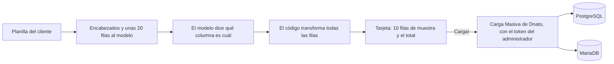

# Análisis de impacto — herramientas de configuración para Kuntur

## Objetivo

Qué es: el análisis de impacto que exige el `CLAUDE.md` antes de tocar el núcleo (APIs de WSO2 y servicios de datos), para darle a Kuntur las herramientas con las que carga la configuración inicial de una empresa (ADR-A12, etapa 2 de [`kuntur-entrevista-configuracion.md`](kuntur-entrevista-configuracion.md)). Para quién: el PM, que lo aprueba o lo corrige; sin su aprobación no se programa nada de esto. Cuándo leerlo: antes de aprobar la etapa 2. Qué NO cubre: el mecanismo de "Kuntur propone, el administrador toca Cargar" (ya está hecho y no toca el núcleo, ver `agente/cargas.py`) ni los menús y roles de Dnato v3, que van contra servicios simulados (§6).

| Campo | Valor |
|---|---|
| Fecha | 2026-11-11 |
| Tarea | AGENTE-CO-09 (carga inicial) |
| Estado | A-1 **aprobado y hecho** (2026-11-11); A-2 **aprobado y hecho** (ver §3.2); A-3 y A-4 resueltos como simulados |
| Comparado contra | `origin/master` (producción) y `origin/develop-v3.5`, el 2026-11-11 |

---

## 1. Resumen en una línea por lote

| Lote | Qué | Toca el núcleo | Riesgo | Propuesta |
|---|---|---|---|---|
| 1 | Alta de establecimiento, depósito y valores de listas (unidades de medida, tipos de artículo, tipos de herramienta) | **Sí, solo se suman** recursos nuevos a la fachada MCP (`toolsMCPAPI.xml`). Los servicios de datos que llaman **no se modifican** | Bajo | **Hecho** (falta probarlo en un MI de prueba, §2.5) |
| 2 | Carga de artículos y herramientas de a muchos (con la planilla del cliente) | **Sí: una función nueva** en la base (`sta.carga_masiva_filas`), que reutiliza los procedimientos de la carga masiva de Dnato sin cambiarlos | Medio | Hacerlo después del lote 1 |
| 3 | ABM de Mantenimiento: sectores, áreas, procesos, criticidades, grupos, marcas y equipos | No: **servicios simulados** con la interfaz de `MANDataService` de `develop-v3` (decisión del PM, 2026-11-11). **Hecho** | Bajo | Reemplazar por los reales cuando lleguen a `develop-v3.5` (deuda técnica) |
| 4 | Menús, roles y administradores (Dnato v3) | No: servicios **simulados** dentro del motor de los agentes (decisión del PM, deuda técnica). **Hecho** | Bajo | Reemplazar por los reales cuando Dnato v3 exista |

---

## 2. Lote 1 — establecimiento, depósito y listas de valores

### 2.1 Qué cambia

Tres recursos nuevos en la fachada MCP (`_backend/api/.../apis/toolsMCPAPI.xml`), igual que los de lectura que ya hay. Cada uno toma la empresa **del token** (ADR-013), nunca de un parámetro, y llama a un recurso del servicio de datos que **ya existe y no se toca**:

| Herramienta nueva | Recurso MCP | Llama a (sin cambios) | Graba en |
|---|---|---|---|
| `core_alta_establecimiento` | `POST /mcp/core/establecimiento` | `COREDataService` `POST /establecimiento` (`setEstablecimiento`) | `prd.establecimientos` |
| `alm_alta_deposito` | `POST /mcp/alm/deposito` | `COREDataService` `POST /deposito/establecimiento` (`setDepositoPorEstablecimiento`) | `alm.alm_depositos` |
| `core_alta_valor` | `POST /mcp/core/valor` | `COREDataService` `POST /tablas` (`setTabla`) | `core.tablas` |

Detalles:

- `core_alta_valor` solo acepta tres listas: `unidades_medida`, `tipo_articulo` y `tipos_herramienta`. Manda **el mismo cuerpo que la pantalla Lista de Valores para un usuario de la empresa** (`application/models/core/Valores.php:97-107`): el nombre de la lista sin prefijo y el `empr_id` del token aparte. Las consultas buscan la lista como `<empr_id>-<lista>` y el alta la manda sin prefijo: el nombre por empresa lo arma el disparador `core.set_tabla_id_trg` (`set_tabla_id_bui`, antes de insertar o actualizar en `core.tablas`), que **existe en DEV** (verificado el 2026-11-11) aunque no esté en el repositorio. Arma `tabla = <empr_id>-<lista>` y `tabl_id = tabla + valor`, así que un valor repetido en la misma lista choca con la clave: por eso la herramienta busca antes de grabar. Nunca graba en una lista global (`999999`).
- `alm_alta_deposito` exige un establecimiento **de la misma empresa**: antes de grabar, lee el establecimiento y verifica que sea suyo. El servicio de datos no lo controla.
- Los encargados del depósito **no entran en esta primera versión**: en la pantalla son una segunda llamada sin transacción y requieren usuarios ya creados.
- Las tres responden `200` con el id creado, no `202` (decisión del 2026-08-21: con `202` el cliente MCP descarta el cuerpo).

### 2.2 Comparación contra producción

- `COREDataService.dbs` es **idéntico en `master` y en `develop-v3.5`**. Las tres consultas (`setEstablecimiento`, `setDepositoPorEstablecimiento`, `setTabla`) son las que usan hoy las pantallas de producción.
- No se modifica ninguna: el cambio es **solo sumar** recursos a la fachada MCP.

### 2.3 Quién más usa lo que se toca

- **Los servicios de datos:** las pantallas `core/Establecimiento.php` (`guardarEstablecimiento`, `guardarDeposito`) y `core/Valor.php` (`guardarValor`). No cambian.
- **La fachada MCP:** hoy la usan Claude (conector) y los agentes. Los recursos nuevos no cambian los existentes. Ojo: sumar herramientas a un servidor MCP del gateway **obliga a recrear la API** en el Publisher (decisión del 2026-08-20). Es un paso del despliegue.

### 2.4 Qué se puede romper y cómo se evita

| Riesgo | Cómo se evita |
|---|---|
| Que un cliente MCP cualquiera (Claude, por ejemplo) graba con estas herramientas | Son de clase `configuracion`. El motor de los agentes **nunca las ejecuta sin confirmación** (ADR-A12). Para clientes externos, el gateway las expone solo a la aplicación de los agentes (suscripción aparte). *A verificar en el despliegue* |
| Que el token de máquina grabe | El MI ya rechaza las escrituras con token de máquina (commit `972d9a8d`). Se suma una prueba para estas tres |
| Grabar en otra empresa | La empresa sale del token; el depósito verifica el establecimiento |
| Valores repetidos en una lista | La pantalla tampoco lo impide. La herramienta lee la lista antes de grabar y, si el valor ya está, devuelve el existente sin grabar |

### 2.5 Cómo se prueba

- **Hecho (2026-11-11), en una copia del MI desconectada de DEV** (puerto 8300; el MI del PM no se toca). La copia solo tiene `toolsMCPAPI` y sus secuencias, y apunta a un simulador de COREDataService (`scripts/dev/simulador-core-ds.py`) que responde con las mismas formas que WSO2 e imita el disparador de las listas.
- `tests/security/mcp-alta-configuracion.hurl`: **12 de 12**. Sin identidad, 503; token de máquina, 403 en las tres; parámetros inválidos, 400; establecimiento de otra empresa, 400; alta real de las tres; valor repetido devuelve el existente; error del servicio de datos, 502 en el acto.
- **Lo que la prueba encontró y se corrigió:**
  - *Si el servicio de datos fallaba o no respondía, el cliente quedaba colgado.* Causa: la secuencia común `toolsFault` termina en `<send/>`, y en un recurso que usa `<call>` eso va al servicio de datos en vez de volver al que llamó. Las tres herramientas ahora responden el error ellas mismas (502, `servicio_de_datos` o `servicio_de_datos_no_disponible`).
  - *Las consultas previas (GET) arrastraban el cuerpo recibido como parámetros de la dirección.* Se vacía el cuerpo antes de consultar.
- **Pendiente:** el circuito en el panel, desde la propuesta de Kuntur hasta el dato en la pantalla de Tools, con DEV.
- ⚠️ **Fuera de alcance, para revisar aparte:** los demás recursos de `toolsMCPAPI` que usan `toolsFault` después de un `<call>` probablemente tengan el mismo cuelgue cuando el servicio de datos falla. Supuesto: no lo probé en esos recursos.

### 2.6 Cómo se vuelve atrás

Sacar los tres recursos de `toolsMCPAPI.xml` y volver a desplegar el CAR. No hay cambios en la base.

---

## 3. Lote 2 — carga de muchas filas (artículos, herramientas, equipos)

### 3.1 Cómo funciona hoy la Carga Masiva (verificado el 2026-11-11)

Corrige lo que se había escrito antes en esta sección: se había leído la versión del repositorio de los procedimientos, que está **desactualizada**. Lo que vale es lo instalado en DEV.

- **La pantalla** (`traz-comp-dnato`, `controllers/Bulkload.php::procesarCarga` y `models/Bulkloads.php`):
  1. recibe el Excel, lo deja en el servidor (`bulkload_stage_files/`) y lo convierte a CSV;
  2. toma la empresa de la sesión;
  3. según el motor de la entidad en `sta.entidades_negocio.motor_bd`, carga con la interfaz de PostgreSQL o la de MariaDB.
- **PostgreSQL** (Artículos, Herramientas, Stock Artículos, Solicitantes de Transporte): `SELECT sta.ejecutar_carga_masiva(procedimiento, ruta_csv, empr_id)`. El procedimiento hace `COPY` del CSV a su tabla intermedia y procesa.
- **MariaDB** (Mantenimiento Equipos, Mantenimiento Artículos): el PHP lee el CSV por nombre de encabezado, lo inserta en la tabla intermedia (`sta_equipos`, …) y hace `CALL bulkload_equipos(empr_id_de_AssetPlanner)`. Si quedaron filas pendientes de otra carga, aborta.
- **Es todo o nada.** En DEV, `sta.bulkload_articulos` y `sta.bulkload_herramientas` validan y cortan con error ante la primera fila mala (unidad o tipo inexistente, código repetido, campos obligatorios vacíos), y en ese caso borran lo pendiente: no queda nada grabado. Como todo corre en una sola transacción, dos cargas simultáneas no se mezclan.
- **Herramientas** necesita que ya existan la marca y el pañol (`sta.calcula_marca_herramienta`, `sta.calcula_panol`, por código).

### 3.2 La propuesta: Kuntur usa la misma Carga Masiva

Kuntur no tiene carga propia: arma **el mismo archivo que la plantilla de la entidad** y lo pasa por **el mismo camino que la pantalla**.

- **La planilla:** el orquestador le pasa al modelo **solo los encabezados y unas 20 filas** (P-8). La transformación de todas las filas la hace el código, no el modelo. Antes de proponer, Kuntur verifica con herramientas de lectura que existan las unidades, tipos, marcas y pañoles que usa la planilla, y si falta alguno propone primero darlo de alta (lote 1).
- **La carga:** hace falta una **entrada a la Carga Masiva que no dependa de la sesión de la pantalla**: recibe el CSV y la entidad, toma la empresa del token del administrador, y llama a `Bulkloads::enviarADataservice` tal como está (los dos motores, todo o nada). Lo que existe hoy no se modifica.
- **Por qué no una herramienta MCP directa:** la carga necesita dejar el archivo en el servidor de la base, y el camino de MariaDB vive en el PHP de Dnato, no en un servicio de datos.
- **Toca Dnato** (núcleo): necesita este análisis aprobado y avisarle a ese frente.
- *Alternativa descartada:* que el PHP de Tools deje el CSV y llame al recurso existente `COREDataService /carga_masiva/archivo`. No toca Dnato, pero sirve solo para PostgreSQL y depende de que Tools escriba en una carpeta que lea la base.

### 3.3 Cómo quedó (2026-11-11, aprobado por el PM)

- **Dnato** (traz-comp-dnato#50, contra `develop-v3`): `POST /bulkload_api/cargar` y la biblioteca `JwtVerifier`. `Bulkload.php` y `Bulkloads.php` no se tocan. Solo administradores (`role` = 1), nunca token de máquina; la empresa sale del token y el procedimiento del catálogo; solo Articulos, Herramientas, Mantenimiento Equipos y Mantenimiento Articulos; hasta 5.000 filas.
- ⚠️ `develop-v3` de Dnato todavía no tiene el despacho a MariaDB (está en `develop` y `master`): hasta la sincronización, en v3 solo cargan artículos y herramientas.
- **Agente:** `agente/planillas.py` lee CSV y `.xlsx` sin dependencias nuevas (`.xls` viejo no: se pide guardarla como `.xlsx`); `028` guarda la planilla por empresa; `kuntur_carga_masiva` es una herramienta del motor, que se ofrece solo si hay planilla; el modelo da el mapeo y el código transforma todas las filas, avisando con el número de fila lo que falta.
- **Panel:** «Subí tu planilla» en la pestaña de Kuntur; la tarjeta muestra la entidad, cómo se leyó cada columna, 10 filas y el total.
- **Hallazgo, no corregido:** la plantilla de «Mantenimiento Articulos» tiene encabezados en mayúsculas y con tilde (`CÓDIGO`, `UNIDAD DE MEDIDA`), que no coinciden con las columnas de la tabla intermedia (`codigo`, `u_medida`), así que la pantalla probablemente no la pueda cargar. Supuesto: no lo probé. Kuntur no la usa: arma el archivo con los nombres de la tabla.

---

## 4. Lote 3 — ABM de Mantenimiento (simulado, hecho)

**Decisión del PM (2026-11-11):** se simulan con las interfaces de `develop-v3` ("ya está probado, no va a cambiar mucho"). Los equipos van en la tabla de **MariaDB** (AssetPlanner); la de PostgreSQL (`core.equipos`) está deprecada y no se usa.

| Herramienta (simulada) | Interfaz que copia (`MANDataService`, `develop-v3`) |
|---|---|
| `man_alta_sector` | `POST /equipos/sector` (`setSectorEqMan`): `descripcion` (50) |
| `man_alta_area` | `POST /area` (`setAreaMan`): `descripcion` |
| `man_alta_proceso` | `POST /proceso` (`setProcesoMan`): `descripcion` |
| `man_alta_criticidad` | `POST /equipos/criticidad` (`setCriticidadEqMan`): `descripcion` (50) |
| `man_alta_grupo` | `POST /equipos/grupo` (`setGrupoEqMan`): `descripcion` (50) |
| `man_alta_marca` | `POST /equipos/marca` (`setMarcaEqMan`): `marcadescrip` (255) |
| `man_alta_equipo` | `POST /equipo` (`setEquipoMan`): descripción, código, marca, número de serie, fechas e id de sector, grupo, criticidad, área y proceso |
| `man_get_configuracion` | Las lecturas de cada ABM |

- `id_empresa` **no es un parámetro**: en las reales sale del token (traducido a `empr_id_mysql`), igual que en el resto de la fachada MCP.
- **Al reemplazarlas por las reales** hay que tener en cuenta que, si la empresa no tiene `empr_id_mysql`, Mantenimiento no puede dar de alta nada. La puesta en marcha tiene que verificarlo primero.
- **Preventivos:** no se cargan el primer día (pedido del PM). Kuntur va a **proponer una tarea** del tipo "Generar los preventivos de estos equipos", como pedido de trabajo en estado propuesta (ADR-A9). Depende del módulo de Tareas.

---

## 5. Lo que queda afuera a propósito

- **Artículos y proveedores de a uno.** El alta de artículos de la pantalla **graba directo en la base sin servicio de datos** (`ALM/models/Articulos.php:72`), y la edición no filtra por empresa. No se expone como herramienta. Los artículos entran por el lote 2.
- **Encargados de depósito y pañoles.** Requieren usuarios creados y varias llamadas sin transacción.

---

## 6. Lote 4 — Dnato v3 simulado (no toca el núcleo)

Por decisión del PM, hasta que la nueva versión de Dnato exista, Kuntur trabaja contra **servicios simulados** dentro del motor de los agentes:

| Herramienta | Qué simula |
|---|---|
| `dnato_get_funcionalidades` | Lo que el plan de la empresa permite y lo que está activo (RF-50 a 53) |
| `dnato_activar_funcionalidad` | Activar una funcionalidad del plan (CU-31) |
| `dnato_asignar_menu_rol` | Dar o quitar una opción del menú a uno de los 5 roles fijos (`seg.memberships_menues`, CU-40). El rol Administrador no se edita |
| `dnato_asignar_rol_usuario` | Dar un rol a un usuario de la empresa (CU-38) |
| `dnato_get_administradores` | Los administradores de la empresa, para avisarles a todos (no existe en el diseño de v3: se le pide a ese frente) |

- Lo que "graban" queda en tablas propias del esquema `agente`, marcadas como simulación, y la tarjeta lo dice.
- **Deuda técnica:** reemplazarlas por los servicios de datos reales de Dnato v3 cuando existan. Queda anotada en `STATE.md`.

---

## 7. Lo que necesito que apruebe el PM

| # | Qué | Propuesta |
|---|---|---|
| A-1 | Lote 1 | **Aprobado (2026-11-11) y hecho**: `toolsMCPAPI.xml`, `doc/api/trazalog-operaciones.yaml`, `027`. Probado en una copia del MI: 12 de 12 (§2.5) |
| A-2 | Lote 2: Kuntur arma el CSV de la plantilla y usa la Carga Masiva existente por una entrada nueva con token (§3.2) | **Aprobado (2026-11-11) y hecho**: entrada en Dnato (traz-comp-dnato#50, 18 de 18 en una copia aislada); en el agente `agente/planillas.py`, `028`, `POST /kuntur/planillas` y el botón en el panel |
| A-3 | Lote 3 | **Resuelto por el PM:** simulado con las interfaces de `develop-v3`; los equipos van en MariaDB |
| A-4 | Lote 4 | **Resuelto por el PM:** simulado, como deuda técnica |
