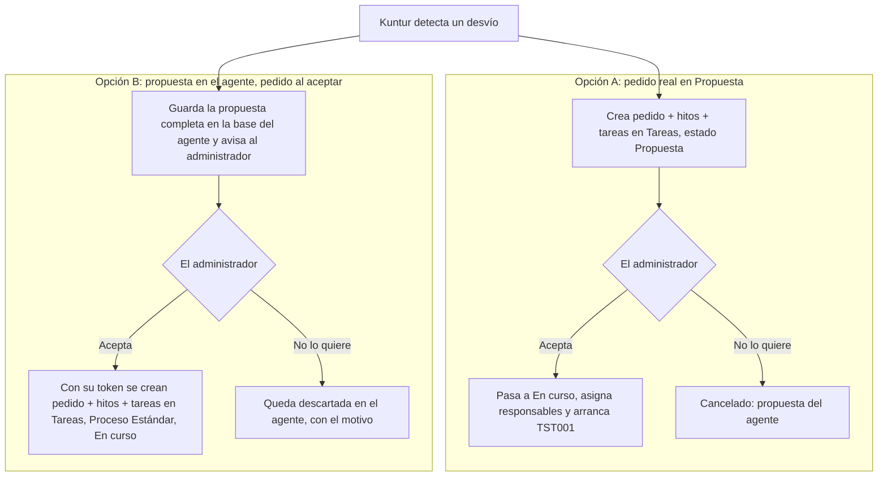

# Análisis de impacto — el plan de acción de Kuntur como pedido de trabajo

## Objetivo

Qué es: el análisis de impacto que exige el `CLAUDE.md` antes de tocar el núcleo (servicios de datos de Tareas y Pedidos, listas de `core.tablas`, Bonita), para que Kuntur arme su **plan de acción** como un pedido de trabajo con hitos y tareas (B-05 de la especificación de Tareas, ADR-A9). Para quién: el PM, que elige una de las dos opciones de la §4 y aprueba; sin su aprobación no se programa nada. Cuándo leerlo: antes de arrancar AGENTE-CO-04. Qué NO cubre: cómo Kuntur detecta el desvío ni cómo mide si el plan funcionó (AGENTE-CO-04/05, en [`analisis-impacto-kpi-objetivos.md`](analisis-impacto-kpi-objetivos.md)), ni los arreglos de aislamiento por empresa de Tareas (sesión de Tareas, traz-tools #636/#639/#640).

| Campo | Valor |
|---|---|
| Fecha | 2026-11-12 |
| Tarea | AGENTE-CO-04 (plan de acción) — B-05 de `TAR-spec-modulo-tareas.md` |
| Estado | **Propuesta, para que el PM elija opción** |
| Leído en | `traz-tools` rama `fix/TAR-aislamiento-empresa-hora-24` (código de los módulos y `_backend/`), el 2026-11-12. **Todo lo de este documento sale de leer el código; nada se probó en vivo** |
| Pedido del PM (2026-11-11/12) | Kuntur crea directamente el pedido **con hitos y tareas**; si el usuario no lo quiere, pasa a un estado tipo "cancelado (propuesta del agente)". **Kuntur solo usa el Proceso Estándar**: un proceso propio de un cliente (por ejemplo, el de Yudica) jamás lo genera Kuntur |

---

## 1. Cómo funciona hoy (verificado en el código)

### 1.1 Qué arranca Bonita y cuándo

| Momento | ¿Arranca algo en Bonita? | Dónde |
|---|---|---|
| Se crea el pedido con el **Proceso Estándar** | **No.** `PROCESO-STANDAR` tiene `lanzar_bpm = false` | `_backend/database/scripts/versiones/v2.8.1.7/configuracion_inicial_empresa_trg_func.sql:171-178`; `traz-comp-bpm/controllers/Pedidotrabajo.php:246-252` |
| Se crea el pedido con un proceso propio de un cliente | Sí, si ese proceso tiene `lanzar_bpm = true` | mismo controlador |
| Se crea una tarea sin responsable ni fecha | No | `traz-comp-tareasestandar/models/Tareas.php:254-283` |
| Se guarda una tarea **con responsable y fecha real** por primera vez | **Sí: arranca TST001**, una vez por tarea | mismo lugar |

Conclusión: **un pedido del Proceso Estándar, con hitos y tareas sin responsable, no genera nada en Bonita y no aparece en ninguna bandeja.** La bandeja solo lee tareas abiertas de Bonita (`BandejaDataService.dbs:7`).

### 1.2 Dónde se ve un pedido según su estado

El estado del pedido es un texto libre (`pro.pedidos_trabajo.estado`, sin clave foránea; `versiones/v1.4/tablas pedidos trabajo.sql:46`). El estado inicial sale de `pro.procesos.esin_id` y el final de `esfi_id`. **Hoy no existe un estado "cancelado" para los pedidos estándar** (solo `estados_seinCANCELADO_NC`, que es de un cliente).

| Pantalla o lectura | Filtro que usa | ¿Vería un pedido "propuesta"? |
|---|---|---|
| Planificación de tareas (lista de pedidos) | Solo excluye el estado final (`PRODataService.dbs:88`; `Pedidotrabajos.php:149-167`) | **Sí, como activo** |
| Listado de pedidos (pestaña no finalizados) | Igual (`PRODataService.dbs:95, 112, 130, 140`); un estado desconocido se pinta como botón gris (`listar_pedidos_trabajo.php:310`) | **Sí** |
| Bolsa de tareas del hito | Ningún filtro de estado (`TARDataService.dbs:154`) | **Sí, y las tareas se pueden editar** |
| Calendario | Solo fechas no nulas (`TARDataService.dbs:192`) | No mientras tengan la fecha "sin fecha" |
| Indicadores de tareas (`getKpiBasico`) | Excluye fecha 3000-12-31, ignora el estado del pedido (`TARDataService.dbs:230`) | No mientras no tengan fecha |
| Ingreso por barrera (DDPE) | Todos los pedidos de la empresa (`ddpe-tools-pro/models/Ingresosbarrera.php:95`) | **Sí** |
| Bandeja | Solo tareas de Bonita | No |
| Herramientas de los agentes (MCP), Siddhi | No leen pedidos | No |

Además, todas las listas exigen **cliente y tipo de pedido** (los unen de forma obligatoria): un pedido sin los dos no se ve en ninguna.

### 1.3 Qué operaciones existen

- Crear pedido (`POST /pedidoTrabajo`), hito (`POST /hitos`), tarea (`POST /tarea/planificar`, responsable opcional) y el vínculo tarea → hito (`POST /tarea/origen`).
- Cambiar el estado del pedido (`PUT /pedidoTrabajo/estado`).
- Borrar un pedido (`DELETE /pedidoTrabajo`) solo lo marca como eliminado: **no toca hitos ni tareas.** El controlador que lo llama además intenta borrar un caso de Bonita **de otro proceso fijo** (`BPM_PROCESS_ID_REPARACION_NEUMATICOS`) aunque el pedido no tenga caso (`Pedidotrabajo.php:352-405`) — no hay que usarlo.
- **No hay operación para borrar ni cancelar un hito.**
- Ninguna de estas operaciones está en la fachada de los agentes (MCP): habría que sumarlas.

### 1.4 Con qué permiso graba un agente

- Kuntur detecta desvíos **por la noche, sin nadie conectado**, con el **token de máquina** (ADR-A10). El gateway **rechaza escrituras con ese token** a propósito.
- Las grabaciones de Kuntur que existen hoy (ADR-A12) usan **el token del administrador** y solo después de que toca "Cargar".

---

## 2. Qué choca con lo ya decidido

| Decisión vigente | Qué dice | Qué cambia con el pedido del PM |
|---|---|---|
| D6 / R2 (2026-10-27) | Kuntur no crea ni asigna tareas | Kuntur **crea** tareas (sin asignar) |
| ADR-A8 | Los agentes son de solo lectura | Escritura nueva en el núcleo |
| ADR-A12 | Kuntur graba **solo configuración**, **con el token del administrador** y **después** de "Cargar"; pedidos quedan fuera | Graba un pedido **antes** de que nadie confirme |

Cualquiera de las dos opciones de abajo necesita una decisión nueva (**ADR-A13**, borrador en §6).

---

## 3. Riesgos de crear el pedido real en estado "propuesta"

1. **Se ve como activo en tres pantallas** (planificación, listado, ingreso por barrera). Hay que cambiar las consultas de `PRODataService.dbs` y las vistas para excluirlo o marcarlo. Son consultas que usa producción.
2. **La aprobación se puede saltear sin querer:** las tareas de un pedido "propuesta" aparecen en la bolsa de tareas y se pueden editar. Si alguien les pone responsable y fecha, **arranca TST001 y llegan a la bandeja** sin que nadie haya aceptado el plan. Hay que bloquear la edición mientras el pedido esté en "propuesta" (cambio en `traz-comp-tareasestandar`).
3. **Estados nuevos en `core.tablas`:** `estados_procesosPROPUESTA` y `estados_procesosCANCELADO_AGENTE` como filas **globales**. Las consultas de detalle unen el estado con `core.tablas` de forma obligatoria (`PRODataService.dbs:54, 59`): sin la fila, el detalle sale vacío. **Pendiente verificar en la base de desarrollo** cómo están cargados hoy los `estados_procesos*`; ningún script del repositorio los crea.
4. **Cancelar deja restos:** no hay forma de borrar hitos; quedan colgados del pedido cancelado. Las tareas se pueden marcar como eliminadas.
5. **Permiso:** como el desvío se detecta de noche con token de máquina, para grabar el pedido habría que **abrir la escritura al token de máquina** (cambio de seguridad del gateway, ADR-A10) o esperar a que el administrador entre al chat, que ya no es "directo".
6. **Cliente y tipo obligatorios:** Kuntur tiene que poner un cliente (¿la propia empresa?) y el tipo "General" (lo crea el alta de empresa desde v2.8.1.7).

Suposición mía, no verificada: los puntos 1 y 2 son los que más cuestan, porque tocan pantallas que hoy usan clientes reales con procesos propios.

---

## 4. Las dos opciones

| | **A — pedido real en "Propuesta"** (lo que pidió el PM) | **B — propuesta en el agente, pedido al aceptar** |
|---|---|---|
| Dónde se ve la propuesta | En Tareas, como un pedido más | En el panel de Kuntur y en el aviso al administrador (con todos los hitos y tareas) |
| Cambios en el núcleo | Estados nuevos, filtros en consultas y vistas de pedidos, bloqueo de edición en la bolsa de tareas, operaciones nuevas en la fachada MCP | Solo operaciones nuevas en la fachada MCP (crear pedido, hito, tarea y vínculo). **No cambia ninguna pantalla ni consulta existente** |
| Permiso para grabar | Token de máquina con escritura (cambio de seguridad) o esperar al administrador | Token del administrador al tocar "Aceptar", igual que ADR-A12 |
| Riesgo de que llegue a una bandeja sin aprobación | Existe hasta bloquear la edición | No existe: no hay pedido hasta que aceptan |
| Rechazo | Estado "Cancelado: propuesta del agente"; hitos quedan colgados | "Descartada" en la base del agente, con el motivo; sirve igual para que Kuntur aprenda |
| Medir si el plan funcionó (R10) | Vínculo `kpi.objetivos.petr_id` | El mismo: el pedido se crea al aceptar y se vincula ahí |
| Ya construido que se reutiliza | — | `agente.carga_propuesta` y la tarjeta "Cargar" (`agente/cargas.py`) |
| Esfuerzo (estimación mía) | Alto, y toca código de producción de Tareas | Medio |

**Recomendación: opción B.** Logra lo mismo que pide el PM (Kuntur arma el plan completo con hitos y tareas, el administrador lo acepta con un clic y si no lo quiere queda registrado) sin cambiar pantallas que usan clientes en producción, sin abrir escrituras con token de máquina y sin riesgo de que una tarea propuesta llegue a una bandeja. Si más adelante se quiere ver las propuestas dentro de Tareas, se puede sumar la opción A encima.

---

## 5. Reglas que valen para las dos opciones

1. **Solo Proceso Estándar** (regla del PM, 2026-11-12). La herramienta **no recibe** el proceso: lo pone fijo en `PROCESO-STANDAR`. Si la empresa no lo tiene, no se crea nada y Kuntur lo dice.
2. **Tareas sin responsable** en la propuesta. Kuntur puede **sugerir** un responsable como texto, pero la asignación la hace una persona después de aceptar.
3. **La empresa sale del token**, nunca de un parámetro (ADR-013).
4. **Todo o nada:** si falla la creación de un hito o una tarea, no queda un pedido a medias. (Opción B: se borra lo creado y se informa; los hitos no tienen borrado, así que el pedido se marca eliminado — a resolver en el diseño.)
5. **Registro** en la corrida de qué se creó, quién aceptó y cuándo (R8).
6. **Medición obligatoria** del plan (R10), vinculada por `kpi.objetivos.petr_id`.

---

## 6. Borrador de ADR-A13 (se escribe en el documento técnico al aprobar)

> **ADR-A13 — Kuntur arma el plan de acción completo; el pedido de trabajo se crea con el token del administrador al aceptar** (borrador, 2026-11-12). Excepción acotada a ADR-A8 y ajuste de D6/R2. Kuntur puede proponer un plan de acción con pedido, hitos y tareas sin responsable. Con la opción B, la propuesta se guarda en la base del agente y, cuando el administrador toca "Aceptar", se crean pedido, hitos y tareas en el módulo de Tareas con **su** token, siempre con el **Proceso Estándar**; si no lo quiere, queda descartada con el motivo. Kuntur nunca asigna responsables ni usa procesos propios de un cliente. **Por qué:** el plan de acción solo sirve si llega al módulo de Tareas listo para asignar, y el administrador ya revisa cada propuesta; crear el pedido recién al aceptar evita cambiar pantallas y consultas de producción y evita escrituras con el token de máquina.

(Si el PM elige la opción A, el ADR cambia: pedido real en estado "Propuesta", estados nuevos y escritura con token de máquina, con sus propios análisis de seguridad.)

---

## 7. Qué falta antes de programar

- [ ] El PM elige opción (A o B).
- [ ] Verificar en la base de desarrollo (solo lectura) que ninguna empresa tenga `PROCESO-STANDAR` con `lanzar_bpm = true` y cómo están cargados los `estados_procesos*`.
- [ ] Que se unan los arreglos de aislamiento de Tareas (#639, #640 y los de los módulos): las operaciones nuevas se apoyan en ellas.
- [ ] Opción B: diseñar el "todo o nada" (qué hacer con hitos creados si falla una tarea).
