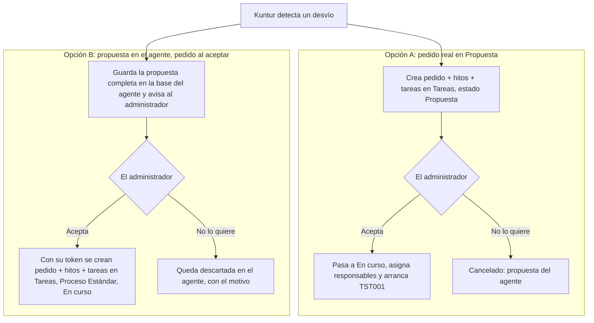
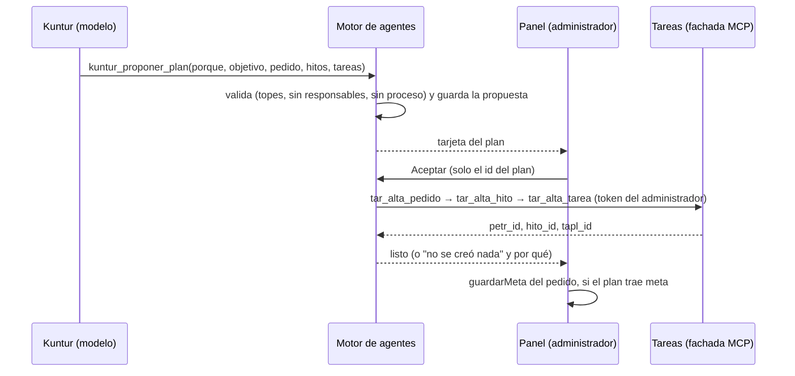

# Análisis de impacto — el plan de acción de Kuntur como pedido de trabajo

## Objetivo

Qué es: el análisis de impacto que exige el `CLAUDE.md` antes de tocar el núcleo (servicios de datos de Tareas y Pedidos, listas de `core.tablas`, Bonita), para que Kuntur arme su **plan de acción** como un pedido de trabajo con hitos y tareas (B-05 de la especificación de Tareas, ADR-A9). Para quién: el PM, que elige una de las dos opciones de la §4 y aprueba; sin su aprobación no se programa nada. Cuándo leerlo: antes de arrancar AGENTE-CO-04. Qué NO cubre: cómo Kuntur detecta el desvío ni cómo mide si el plan funcionó (AGENTE-CO-04/05, en [`analisis-impacto-kpi-objetivos.md`](analisis-impacto-kpi-objetivos.md)), ni los arreglos de aislamiento por empresa de Tareas (sesión de Tareas, traz-tools #636/#639/#640).

| Campo | Valor |
|---|---|
| Fecha | 2026-11-12 |
| Tarea | AGENTE-CO-04 (plan de acción) — B-05 de `TAR-spec-modulo-tareas.md` |
| Estado | **Aprobado por el PM el 2026-11-22** (opción B, ADR-A13 y las 5 escrituras del anexo A). El motor crea en Tareas de verdad (`agente/planes.py`, `SIMULADO = False`); quedan las verificaciones de DEV (`scripts/dev/verificaciones-dev-agentes.sql`) |
| Leído en | `traz-tools` rama `fix/TAR-aislamiento-empresa-hora-24` (código de los módulos y `_backend/`), el 2026-11-12. **Todo lo de este documento sale de leer el código; nada se probó en vivo** |
| Pedido del PM (2026-11-11/12) | Kuntur crea directamente el pedido **con hitos y tareas**; si el usuario no lo quiere, pasa a un estado tipo "cancelado (propuesta del agente)". **Kuntur solo usa el Proceso Estándar**: un proceso propio de un cliente (por ejemplo, el de Yudica) jamás lo genera Kuntur |

---

## 1. Cómo funciona hoy (verificado en el código)

### 1.1 Qué arranca Bonita y cuándo

| Momento | ¿Arranca algo en Bonita? | Dónde |
|---|---|---|
| Se crea el pedido con el **Proceso Estándar** | **No.** `PROCESO-STANDAR` tiene `lanzar_bpm = false` | `_backend/database/scripts/versiones/v2.8.1.7/configuracion_inicial_empresa_trg_func.sql:171-178`; `traz-comp-bpm/controllers/Pedidotrabajo.php:246-252` |
| Se crea el pedido con un proceso propio de un cliente | Sí, si ese proceso tiene `lanzar_bpm = true` | mismo controlador |
| Se crea una tarea sin responsable ni fecha | No | `traz-comp-tareasestandar/models/Tareas.php:254-283` |
| Se guarda una tarea **con responsable y fecha real** por primera vez | **Sí: arranca TST001**, una vez por tarea | mismo lugar |

Conclusión: **un pedido del Proceso Estándar, con hitos y tareas sin responsable, no genera nada en Bonita y no aparece en ninguna bandeja.** La bandeja solo lee tareas abiertas de Bonita (`BandejaDataService.dbs:7`).

### 1.2 Dónde se ve un pedido según su estado

El estado del pedido es un texto libre (`pro.pedidos_trabajo.estado`, sin clave foránea; `versiones/v1.4/tablas pedidos trabajo.sql:46`). El estado inicial sale de `pro.procesos.esin_id` y el final de `esfi_id`. **Hoy no existe un estado "cancelado" para los pedidos estándar** (solo `estados_seinCANCELADO_NC`, que es de un cliente).

| Pantalla o lectura | Filtro que usa | ¿Vería un pedido "propuesta"? |
|---|---|---|
| Planificación de tareas (lista de pedidos) | Solo excluye el estado final (`PRODataService.dbs:88`; `Pedidotrabajos.php:149-167`) | **Sí, como activo** |
| Listado de pedidos (pestaña no finalizados) | Igual (`PRODataService.dbs:95, 112, 130, 140`); un estado desconocido se pinta como botón gris (`listar_pedidos_trabajo.php:310`) | **Sí** |
| Bolsa de tareas del hito | Ningún filtro de estado (`TARDataService.dbs:154`) | **Sí, y las tareas se pueden editar** |
| Calendario | Solo fechas no nulas (`TARDataService.dbs:192`) | No mientras tengan la fecha "sin fecha" |
| Indicadores de tareas (`getKpiBasico`) | Excluye fecha 3000-12-31, ignora el estado del pedido (`TARDataService.dbs:230`) | No mientras no tengan fecha |
| Ingreso por barrera (DDPE) | Todos los pedidos de la empresa (`ddpe-tools-pro/models/Ingresosbarrera.php:95`) | **Sí** |
| Bandeja | Solo tareas de Bonita | No |
| Herramientas de los agentes (MCP), Siddhi | No leen pedidos | No |

Además, todas las listas exigen **cliente y tipo de pedido** (los unen de forma obligatoria): un pedido sin los dos no se ve en ninguna.

### 1.3 Qué operaciones existen

- Crear pedido (`POST /pedidoTrabajo`), hito (`POST /hitos`), tarea (`POST /tarea/planificar`, responsable opcional) y el vínculo tarea → hito (`POST /tarea/origen`).
- Cambiar el estado del pedido (`PUT /pedidoTrabajo/estado`).
- Borrar un pedido (`DELETE /pedidoTrabajo`) solo lo marca como eliminado: **no toca hitos ni tareas.** El controlador que lo llama además intenta borrar un caso de Bonita **de otro proceso fijo** (`BPM_PROCESS_ID_REPARACION_NEUMATICOS`) aunque el pedido no tenga caso (`Pedidotrabajo.php:352-405`) — no hay que usarlo.
- **No hay operación para borrar ni cancelar un hito.**
- Ninguna de estas operaciones está en la fachada de los agentes (MCP): habría que sumarlas.

### 1.4 Con qué permiso graba un agente

- Kuntur detecta desvíos **por la noche, sin nadie conectado**, con el **token de máquina** (ADR-A10). El gateway **rechaza escrituras con ese token** a propósito.
- Las grabaciones de Kuntur que existen hoy (ADR-A12) usan **el token del administrador** y solo después de que toca "Cargar".

---

## 2. Qué choca con lo ya decidido

| Decisión vigente | Qué dice | Qué cambia con el pedido del PM |
|---|---|---|
| D6 / R2 (2026-10-27) | Kuntur no crea ni asigna tareas | Kuntur **crea** tareas (sin asignar) |
| ADR-A8 | Los agentes son de solo lectura | Escritura nueva en el núcleo |
| ADR-A12 | Kuntur graba **solo configuración**, **con el token del administrador** y **después** de "Cargar"; pedidos quedan fuera | Graba un pedido **antes** de que nadie confirme |

Cualquiera de las dos opciones de abajo necesita una decisión nueva (**ADR-A13**, borrador en §6).

---

## 3. Riesgos de crear el pedido real en estado "propuesta"

1. **Se ve como activo en tres pantallas** (planificación, listado, ingreso por barrera). Hay que cambiar las consultas de `PRODataService.dbs` y las vistas para excluirlo o marcarlo. Son consultas que usa producción.
2. **La aprobación se puede saltear sin querer:** las tareas de un pedido "propuesta" aparecen en la bolsa de tareas y se pueden editar. Si alguien les pone responsable y fecha, **arranca TST001 y llegan a la bandeja** sin que nadie haya aceptado el plan. Hay que bloquear la edición mientras el pedido esté en "propuesta" (cambio en `traz-comp-tareasestandar`).
3. **Estados nuevos en `core.tablas`:** `estados_procesosPROPUESTA` y `estados_procesosCANCELADO_AGENTE` como filas **globales**. Las consultas de detalle unen el estado con `core.tablas` de forma obligatoria (`PRODataService.dbs:54, 59`): sin la fila, el detalle sale vacío. **Pendiente verificar en la base de desarrollo** cómo están cargados hoy los `estados_procesos*`; ningún script del repositorio los crea.
4. **Cancelar deja restos:** no hay forma de borrar hitos; quedan colgados del pedido cancelado. Las tareas se pueden marcar como eliminadas.
5. **Permiso:** como el desvío se detecta de noche con token de máquina, para grabar el pedido habría que **abrir la escritura al token de máquina** (cambio de seguridad del gateway, ADR-A10) o esperar a que el administrador entre al chat, que ya no es "directo".
6. **Cliente y tipo obligatorios:** Kuntur tiene que poner un cliente (¿la propia empresa?) y el tipo "General" (lo crea el alta de empresa desde v2.8.1.7).

Suposición mía, no verificada: los puntos 1 y 2 son los que más cuestan, porque tocan pantallas que hoy usan clientes reales con procesos propios.

---

## 4. Las dos opciones



| | **A — pedido real en "Propuesta"** (lo que pidió el PM) | **B — propuesta en el agente, pedido al aceptar** |
|---|---|---|
| Dónde se ve la propuesta | En Tareas, como un pedido más | En el panel de Kuntur y en el aviso al administrador (con todos los hitos y tareas) |
| Cambios en el núcleo | Estados nuevos, filtros en consultas y vistas de pedidos, bloqueo de edición en la bolsa de tareas, operaciones nuevas en la fachada MCP | Solo operaciones nuevas en la fachada MCP (crear pedido, hito, tarea y vínculo). **No cambia ninguna pantalla ni consulta existente** |
| Permiso para grabar | Token de máquina con escritura (cambio de seguridad) o esperar al administrador | Token del administrador al tocar "Aceptar", igual que ADR-A12 |
| Riesgo de que llegue a una bandeja sin aprobación | Existe hasta bloquear la edición | No existe: no hay pedido hasta que aceptan |
| Rechazo | Estado "Cancelado: propuesta del agente"; hitos quedan colgados | "Descartada" en la base del agente, con el motivo; sirve igual para que Kuntur aprenda |
| Medir si el plan funcionó (R10) | Vínculo `kpi.objetivos.petr_id` | El mismo: el pedido se crea al aceptar y se vincula ahí |
| Ya construido que se reutiliza | — | `agente.carga_propuesta` y la tarjeta "Cargar" (`agente/cargas.py`) |
| Esfuerzo (estimación mía) | Alto, y toca código de producción de Tareas | Medio |

**Recomendación: opción B.** Logra lo mismo que pide el PM (Kuntur arma el plan completo con hitos y tareas, el administrador lo acepta con un clic y si no lo quiere queda registrado) sin cambiar pantallas que usan clientes en producción, sin abrir escrituras con token de máquina y sin riesgo de que una tarea propuesta llegue a una bandeja. Si más adelante se quiere ver las propuestas dentro de Tareas, se puede sumar la opción A encima.

### 4.1 Cómo ve el administrador el plan (opción B)

Pregunta del PM: cómo muestra Kuntur qué tareas tendrá el plan, de forma fácil de evaluar. Kuntur muestra en su panel una **tarjeta del plan**, armada como un pedido de trabajo en papel (los números de abajo son de ejemplo, inventados):

```
🦅 Kuntur te propone un plan
📉 Por qué: la disponibilidad de la flota bajó a 78 % (tu meta es 85 %).
   Causa principal: 6 preventivos atrasados en las palas.
🎯 Qué espero lograr: volver a 85 % en 30 días.

📁 Pedido: "Recuperar disponibilidad de palas"
   Proceso Estándar · 3 hitos · 7 tareas · 4 semanas
  1️⃣ Ponerse al día con los preventivos  (semana 1-2)
     ▫️ Hacer los 6 preventivos atrasados   → sugerido: jefe de taller
     ▫️ Pedir los repuestos que faltan      → sugerido: pañolero
  2️⃣ Evitar que se vuelvan a atrasar     (semana 2-3)  ...
  3️⃣ Medir                               (semana 4)
     ▫️ Kuntur compara la disponibilidad antes y después

[✅ Aceptar]   [✏️ Pedir cambios]   [❌ No lo quiero]
```

- Arriba, el porqué en una línea: qué número se movió y por qué, con la cifra de una herramienta de lectura (regla de cifras con fuente, ADR-A8).
- Hitos como etapas con semanas; adentro, las tareas con el responsable **sugerido** en gris (no se asigna).
- **Pedir cambios** abre el chat ("sacá la tarea 3", "dame 6 semanas") y Kuntur rearma la tarjeta.
- **No lo quiero** pide el motivo en un clic (no es prioridad / ya lo estamos haciendo / no aplica); queda registrado para que Kuntur aprenda.
- El aviso al celular solo dice "Kuntur te propone un plan para …" y abre la tarjeta.
- Es una versión ampliada de la tarjeta "Cargar" que ya existe (`agente/cargas.py`).

---

## 5. Reglas que valen para las dos opciones

1. **Solo Proceso Estándar** (regla del PM, 2026-11-12). La herramienta **no recibe** el proceso: lo pone fijo en `PROCESO-STANDAR`. Si la empresa no lo tiene, no se crea nada y Kuntur lo dice.
2. **Tareas sin responsable** en la propuesta. Kuntur puede **sugerir** un responsable como texto, pero la asignación la hace una persona después de aceptar.
3. **La empresa sale del token**, nunca de un parámetro (ADR-013).
4. **Todo o nada:** si falla la creación de un hito o una tarea, no queda un pedido a medias. (Opción B: se borra lo creado y se informa; los hitos no tienen borrado, así que el pedido se marca eliminado — a resolver en el diseño.)
5. **Registro** en la corrida de qué se creó, quién aceptó y cuándo (R8).
6. **Medición obligatoria** del plan (R10), vinculada por `kpi.objetivos.petr_id`.

---

## 6. Borrador de ADR-A13 (se escribe en el documento técnico al aprobar)

> **ADR-A13 — Kuntur arma el plan de acción completo; el pedido de trabajo se crea con el token del administrador al aceptar** (borrador, 2026-11-12). Excepción acotada a ADR-A8 y ajuste de D6/R2. Kuntur puede proponer un plan de acción con pedido, hitos y tareas sin responsable. Con la opción B, la propuesta se guarda en la base del agente y, cuando el administrador toca "Aceptar", se crean pedido, hitos y tareas en el módulo de Tareas con **su** token, siempre con el **Proceso Estándar**; si no lo quiere, queda descartada con el motivo. Kuntur nunca asigna responsables ni usa procesos propios de un cliente. **Por qué:** el plan de acción solo sirve si llega al módulo de Tareas listo para asignar, y el administrador ya revisa cada propuesta; crear el pedido recién al aceptar evita cambiar pantallas y consultas de producción y evita escrituras con el token de máquina.

(Si el PM elige la opción A, el ADR cambia: pedido real en estado "Propuesta", estados nuevos y escritura con token de máquina, con sus propios análisis de seguridad.)

---

## 7. Qué falta antes de programar

- [x] El PM elige opción: **B** (2026-11-12).
- [ ] Verificar en la base de desarrollo (solo lectura) que ninguna empresa tenga `PROCESO-STANDAR` con `lanzar_bpm = true` y cómo están cargados los `estados_procesos*`.
- [x] Que se unan los arreglos de aislamiento de Tareas (#639, #640, #644, #645 y los de los módulos): unidos el 2026-11-13.
- [x] Opción B: diseñar el "todo o nada" (§8.3).
- [ ] **Aprobar los recursos MCP de escritura del anexo A** (núcleo). Sin eso, el plan corre simulado.

---

## 8. Cómo quedó construido (AGENTE-CO-04, 2026-11-23)

### 8.1 Qué hay

| Pieza | Dónde | Estado |
|---|---|---|
| Propuestas de plan con RLS por empresa | `db/agente/031-plan-accion.sql` (`agente.plan_propuesta`) | Hecho y probado (base de prueba) |
| Herramienta del motor `kuntur_proponer_plan` (clase generación, solo Kuntur) | `agente/planes.py`, `agente/orquestador.py` | Hecho y probado |
| Tarjeta del plan en el panel (Aceptar / Pedir cambios / No lo quiero) | `views/panel.php`, `controllers/Agente.php` | Hecho; **no probado en el navegador** |
| Ejecutor "Aceptar", todo o nada | `agente/planes.py` (`crear`, `aceptar`) | **Simulado** (`SIMULADO = True`): registra lo que crearía en `agente.simulacion` |
| Recursos MCP de escritura de Tareas | `toolsMCPAPI.xml`, anexo A | Escritos y **probados en MI aislado (21/21)**; sin aprobar |
| Meta del pedido para medir el plan (R10) | El panel la carga con la sesión del administrador en `traz-comp-bpm/Pedidotrabajo/guardarMeta` (TAR-METAS, #646) | Solo cuando el pedido es real; sin cambios en el núcleo |

### 8.2 El recorrido



### 8.3 Todo o nada

Si falla cualquier alta, el motor da de baja las tareas ya creadas (al revés) y después el pedido. Los hitos **no tienen baja** en el servicio de datos: quedan colgados de un pedido eliminado, que ninguna lista muestra. Si una baja también falla, la propuesta queda `fallida` y el error dice exactamente qué quedó, para que soporte lo limpie. Además, el alta de una tarea que no pudo vincularse a su hito se da de baja dentro de la misma fachada.

---

## Anexo A — Recursos MCP de escritura de Tareas (para aprobar)

Todos en `toolsMCPAPI.xml`, con el mismo patrón que las altas de configuración de ADR-A12: empresa **siempre del token**, token de máquina rechazado (`rechazarTokenMaquina`, 403), errores respondidos en el recurso (no `toolsFault`), y **ningún servicio de datos modificado**. Clase `accion` en el catálogo del agente: ningún agente los ve; solo los llama el motor al aceptar, con el token del administrador.

| Herramienta | Recurso | Llama a (sin cambios) | Controles propios |
|---|---|---|---|
| `tar_alta_pedido` | `POST /mcp/tar/pedido` | COREDataService: clientes activos, tipos de pedido de la empresa, `unidad_medida_tiempo`; PRODataService `POST /pedidoTrabajo` | Proceso fijo `PROCESO-STANDAR`, estado `estados_procesosPROC_EN_CURSO`, tipo "General" de la empresa, `objetivo` = semanas con la unidad "Semanas"; código único `K-AAMMDD-xxxxxx` |
| `tar_alta_hito` | `POST /mcp/tar/hito` | PRODataService `GET /pedidoTrabajo/{empr}/{petr}`; COREDataService establecimientos y unidades; TARDataService `POST /hitos` y `GET /pedidostrabajo/hitos/{petr}?empr_id` | El pedido tiene que ser de la empresa **y** del Proceso Estándar (el servicio de datos no lo controla). `setHito` no devuelve el id: se toma el hito de mayor número del pedido |
| `tar_alta_tarea` | `POST /mcp/tar/tarea` | TARDataService `GET /hitos/{id}?empr_id`, `POST /tarea/planificar`, `POST /tarea/origen` (y `DELETE /tarea/planificar` si el vínculo falla) | Hito de la empresa; tarea **sin responsable**, "sin fecha" (3000-12-31) y proceso TST001, igual que las de la bolsa: no arranca nada en Bonita |
| `tar_baja_pedido` | `DELETE /mcp/tar/pedido` | PRODataService `DELETE /pedidoTrabajo` (filtra por empresa, #640) | Solo para deshacer |
| `tar_baja_tarea` | `DELETE /mcp/tar/tarea` | TARDataService `DELETE /tarea/planificar` (filtra por empresa, #640) | Solo para deshacer |

**Probado en MI aislado: 21/21** (2026-11-22). Copia del MI 4.5 en el puerto 8301, sin otros `.car`, desconectada de DEV y apuntando a `scripts/dev/simulador-plan-ds.py`; corrida de `tests/security/mcp-plan-accion.hurl`. El registro del simulador confirma:
- los pedidos llevan la empresa del token, `PROCESO-STANDAR`, el primer cliente activo, el tipo "General" de la empresa y la unidad "Semanas";
- el usuario del pedido sale del email del token, también con acentos;
- hitos y tareas sin responsable; tareas "sin fecha", con TST001 y sin caso;
- las bajas llevan la empresa del token;
- si falla el vínculo de la tarea con el hito, la tarea se da de baja;
- sin identidad (503), con token de máquina (403) y con parámetros inválidos (400) no se llama a ningún servicio de datos;
- un pedido o un hito de otra empresa, o un pedido de un proceso propio de un cliente, dan 400 sin escribir nada;
- un error del servicio de datos responde 502 en menos de 5 segundos.

**Defecto encontrado y corregido en esa prueba:** cuando la última llamada al servicio de datos responde 202 sin cuerpo (las bajas y el vínculo tarea-hito), el MI contestaba **202 con el cuerpo vacío** en lugar de 200 con el resultado. Por eso el motor no recibía el `tapl_id` de la tarea. La causa: el MI deja marcadas `NO_ENTITY_BODY` y `SC_ACCEPTED`. Ahora se quitan antes de cada respuesta de estos cinco recursos.

**Lo que queda para verificar en DEV antes de activar** (`SIMULADO = False` en `agente/planes.py` y publicar las cinco en el APIM con esos nombres). Las formas de respuesta y los parámetros de los servicios de datos se compararon contra los `.dbs` y coinciden. Lo que el simulador no puede probar:
1. Que la lista `unidad_medida_tiempo` de DEV tenga un valor con "Semana".
2. Que las pantallas de Tareas muestren bien un hito con el primer establecimiento y sin responsable.
3. Que una empresa real tenga al menos un cliente activo y el tipo "General". Las anteriores a v2.8.1.7 pueden no tenerlo; en ese caso el recurso responde 400 con el motivo.
4. Que el servicio de datos real responda 202 en `POST /hitos`, `POST /tarea/origen` y los `DELETE`, como el simulador. Si responde 200, también funciona.
5. Que el pedido creado aparezca en Planificación de tareas y que, al asignar responsable y fecha a una tarea, arranque TST001 como cualquier otra.

---

## Decisiones de AGENTE-CO-04

🔴 = revisar antes de unir; 🟡 = conviene mirarla; 🟢 = técnica menor.

| # | Decisión | Por qué | Revisión |
|---|---|---|---|
| 1 | Los cinco recursos MCP de escritura de Tareas (anexo A), clase `accion`, solo para el motor | Es la única forma de crear el pedido "al aceptar" sin tocar servicios de datos | 🔴 núcleo |
| 2 | Ejecutor simulado (`SIMULADO = True`) hasta tu aprobación | La regla del núcleo: sin análisis aprobado no se graba en Tareas | 🟢 |
| 3 | Cliente del pedido: el primero activo de la empresa; si no tiene ninguno, no se crea y se le dice que cargue uno | El pedido exige cliente y el plan es interno; preguntarlo en la tarjeta suma un paso que casi nunca cambia nada | 🟡 ¿preferís que la empresa sea su propio cliente o elegirlo en la tarjeta? |
| 4 | Establecimiento del hito: el primero de la empresa | El formulario lo pide y el servicio de datos no acepta vacío | 🟡 |
| 5 | Código del pedido `K-AAMMDD-xxxxxx` | `cod_proyecto` es único por empresa; así no choca y se reconoce que vino de Kuntur | 🟢 |
| 6 | Duración en semanas: `objetivo` de pedido e hito = semanas, con la unidad "Semanas" | En Tareas `objetivo` es una duración, no una meta (TAR-METAS) | 🟢 |
| 7 | Topes: 6 hitos, 30 tareas, 26 semanas; la propuesta vence a los 7 días | Un plan de acción, no un proyecto | 🟡 |
| 8 | El responsable sugerido va como texto en la descripción de la tarea ("sugerido: jefe de taller"), nunca en el campo de responsable | Regla del PM: Kuntur no asigna | 🟢 |
| 9 | La meta del plan (si la trae) la carga el panel con la sesión del administrador en `Pedidotrabajo/guardarMeta`, solo con pedido real | Reusa TAR-METAS sin tocar el núcleo | 🟢 |
| 10 | "Pedir cambios" escribe en el chat de Kuntur «Quiero cambios en el plan…» para que el administrador complete; la propuesta anterior queda hasta que vence | Rearmar es una charla, no un formulario | 🟢 |
| 11 | Kuntur recibe los planes descartados de los últimos 90 días con su motivo, para no repetirlos | Es el "aprende" de la opción B | 🟢 |
| 12 | El "porque" y el "objetivo" pasan por el guardián de cifras; si hay una cifra sin fuente, no se muestra la tarjeta | Mismo criterio que las metas (R4) | 🟢 |


---

## Verificaciones en DEV (2026-11-22, `scripts/dev/verificaciones-dev-agentes.sql`)

| Verificación | Resultado | Qué se hizo |
|---|---|---|
| Ninguna empresa tiene el Proceso Estándar arrancando procesos en Bonita | ✅ 0 empresas | — |
| Pedidos sin empresa | ✅ 0 de 313 | — |
| La lista `unidad_medida_tiempo` tiene Semanas | ❌ Solo Días, Meses y Años | Los recursos de alta de pedido e hito usan **Días con la duración × 7** cuando no hay Semanas (PR del 2026-11-22) |
| Empresas con Proceso Estándar, tipo General y cliente activo | ⚠️ Solo 2 (de prueba) | `scripts/dev/habilitar-plan-accion-empresa.sql` lo habilita empresa por empresa; **núcleo: con aprobación del PM** |
| Mecanismo de avisos (`ntf`) en la base de DEV | ❌ No está instalado | Desplegar `v2.8.1.5/ntf_avisos.sql` y seguir `doc/notificaciones/instalacion-avisos.md`; sin eso no llega ningún aviso de los agentes |
