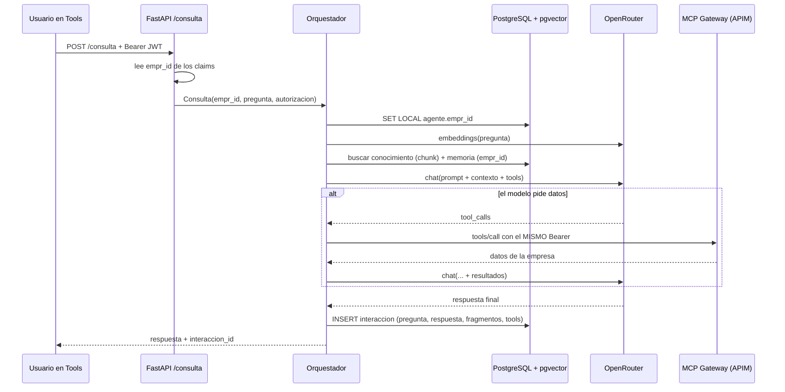
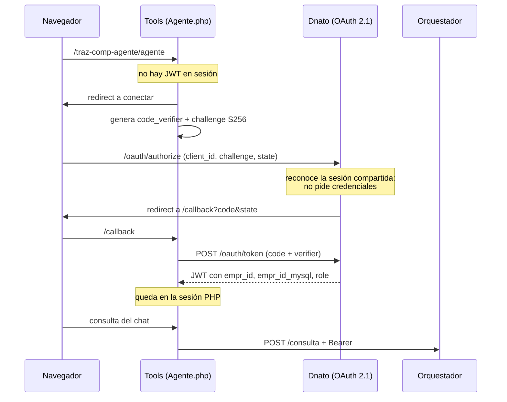

# Agentes de IA de Trazalog — cómo quedó implementado

## Objetivo

Este documento describe **cómo está construido el motor de los agentes de IA en el código**, pieza por pieza: qué hace cada módulo, cómo se conectan y por qué se resolvió así. Es para quien va a tocar el código o necesita entender qué pasa cuando alguien hace una pregunta.

**Qué NO cubre:** no es el diseño conceptual —eso está en `doc/v3/AGENTES_TRAZALOG_ARQUITECTURA_TECNICA.md` con los ADR-A1 a A11—, ni cómo instalarlo (`doc/agente/instalacion.md`), ni cómo operarlo día a día (`doc/agente/operacion.md`).

> **Estado de transición.** El diseño vigente son **tres agentes sobre este mismo motor** —Kuntur (Coach), Quirqui (Asistente) y Faustino (Entrevistador)— y un conocimiento multi-vertical (ADR-A7 a A11). Este documento se actualiza a medida que se implementan las tareas de [`PROMPT_CC_AGENTES_TRAZALOG.md`](../v3/PROMPT_CC_AGENTES_TRAZALOG.md). **Hecho:** AGENTE-M-01 (configuración por agente, sección "Un motor, tres agentes") AGENTE-M-02 (lista blanca de tools, sección "Los agentes dicen cómo, no hacen") AGENTE-M-03 (corrida auditable, sección "Todo queda registrado") AGENTE-M-04 (guardián de cifras, sección "Ninguna cifra sin origen") AGENTE-M-05 (búsqueda en internet, sección "Internet, como último recurso") y AGENTE-M-06 (conocimiento del producto, sección "Lo que el agente sabe del propio Trazalog"). Los nombres de infraestructura que todavía dicen "minero" —la base `agente_minero`, `~/.agente-minero.env`, la empresa de prueba y el ítem de menú en `seg.menues`— se mantienen: cambiarlos rompe entornos ya armados sin aportar nada al usuario.

---

## El recorrido de una consulta



El `interaccion_id` que vuelve es el que después usa el control de feedback: sin él, un pulgar abajo no se puede asociar a nada.

---

## Alcance: dos áreas, no una

El agente cubre **Mantenimiento y Almacenes**, porque son las dos que la capa MCP expone hoy:

| Área | Tools MCP | Qué responde |
|---|---|---|
| 🔧 Mantenimiento (`man_*`) | 11 | Equipos, órdenes de trabajo, preventivos, lecturas, KPIs de confiabilidad |
| 📦 Almacenes (`alm_*`) | 9 | Stock, depósitos, movimientos, entregas, vencimientos, pedidos de materiales |

**Pañol y Tareas quedan para una versión posterior.** Cuando sus tools existan, hay que sumarlas en tres lugares: el prompt (sección "Tu alcance"), `_TOOLS_DEV` de `mcp_client.py` para el modo de desarrollo, y los `CHECK` de `modulo` y `tipo` en la base (script `009`).

Lo más valioso está en el **cruce**: una orden de trabajo que no se puede ejecutar porque falta el repuesto es un problema de las dos áreas a la vez. El prompt le pide explícitamente al agente que no se encierre en el área por la que arrancó la pregunta.

Cada pieza de conocimiento lleva su `modulo` (`man`, `alm` o `general`). El `general` —seguridad, normativa transversal— se recupera siempre, sin importar el área de la consulta. La recuperación **no filtra por módulo por defecto**: la similitud vectorial ya separa bien y muchas consultas cruzan las dos. El filtro está disponible para cuando se sabe el área de antemano, como en un job de monitoreo.

`tests/test_alcance.py` verifica que el sesgo a mantenimiento no vuelva.

---

## Módulos

| Archivo | Qué hace |
|---|---|
| `agente/config.py` | Toda la configuración, por variables de entorno. Ningún modelo ni URL hardcodeado. `validar()` devuelve la lista de problemas, que `/salud` expone |
| `agente/agentes.py` | La configuración de cada agente (`agente.agente`): quién lo puede usar, su identidad, su prompt y sus tools permitidas. `para_consulta()` es la única puerta desde `/consulta` |
| `agente/prompt.py` | Carga los prompts de `prompts/<agente>.md`, saca los comentarios HTML y detecta los bloques que el PM todavía no definió. Relee si el archivo cambió: se puede ajustar el prompt sin reiniciar |
| `agente/llm.py` | Cliente de OpenRouter (ADR-A1). Chat con tool-calling y embeddings. Valida que la dimensión del embedding coincida con la del esquema |
| `agente/rag.py` | Acceso a pgvector: conocimiento compartido, memoria por empresa, y el armado del bloque de contexto que ve el modelo |
| `agente/mcp_client.py` | Cliente MCP (ADR-A3). Passthrough del Bearer, dos modos (`apim` / `mi`), y traza de cada llamada |
| `agente/orquestador.py` | El loop: recupera, conversa, ejecuta tools, registra |
| `agente/api.py` | FastAPI: `/salud`, `/consulta`, `/feedback`, `/admin/feedback` |
| `agente/ingesta.py` | CLI de ingesta documental: PDF/MD/TXT → chunks → embeddings → `agente.chunk` |

---

## Un motor, tres agentes (AGENTE-M-01)

Kuntur, Quirqui y Faustino no son tres servicios: son tres filas de `agente.agente` (ADR-A7). El orquestador arma el mensaje de sistema con **la identidad de la configuración** ("Te llamás Quirqui. …") seguida de **las instrucciones del archivo** `prompts/<agente>.md`. Así el nombre se cambia sin tocar las instrucciones.

| Agente | Acceso | Prompt | Estado |
|---|---|---|---|
| Quirqui (asistente) | Todo usuario | `prompts/quirqui.md` | Activo; es el que responde si `/consulta` no dice otro |
| Kuntur (coach) | Solo `role = 1` de Dnato (administrador) | `prompts/kuntur.md` (esqueleto) | **Inactivo** hasta la Fase 5 |
| Faustino (entrevistador) | Expertos y curadores, por menú | `prompts/faustino.md` | Activo, solo por `/entrevista/*` |

Tres decisiones:

- **El acceso se verifica antes que si el agente está activo.** Si fuera al revés, un empleado que pidiera a Kuntur recibiría "todavía no está disponible" y sabría que existe. Hoy recibe el mismo `404` que con un agente inexistente (R1). Hay un test que lo verifica, y se comprobó que falla si se invierte el orden.
- **`/agentes` expone solo lo que la interfaz muestra** (clave, nombre, rol, avatar). Nunca el prompt ni las tools.
- **El runtime no puede editar la configuración**: `agente_app` solo tiene `SELECT`. El Coach exige acceso `admin` y la autonomía solo puede ser `proponer`, las dos como `CHECK` de la base.

## Los agentes dicen cómo, no hacen (AGENTE-M-02)

El gateway publica 25 tools, y dos escriben: `man_create_ot` y `alm_crear_pedido_materiales`. Ningún agente las puede usar (ADR-A8). Una tool es usable solo si **está en el catálogo `agente.tool`, no es de clase `accion` y entra en un patrón de la configuración del agente**. Lo resuelve la base con `agente.tools_permitidas(clave)`, que es la única fuente.

Dos barreras en el orquestador:

1. **El modelo solo ve las tools permitidas.** Las demás ni aparecen en la lista que se le manda.
2. **Si igual pide otra**, porque inventa el nombre o la conoce de otra conversación, **no sale al MCP**: queda en `tools_llamadas` con `status: "bloqueada"` y le vuelve al modelo como error ("solo podés consultar datos, no modificarlos"), así puede explicarle al usuario cómo hacerlo.

**Falla cerrado.** Una tool nueva del gateway no la ve nadie hasta que se catalogue. Si no se puede resolver la lista blanca (por ejemplo, porque falta `012`), el agente no responde, en vez de seguir con todas las tools del gateway.

## Decisiones que vale la pena conocer

### Quién decide si usar RAG, MCP o ambos: el modelo

No hay una heurística nuestra que clasifique la pregunta. El modelo recibe el contexto ya recuperado **y** las tools declaradas, y elige. El prompt de sistema le explica cuándo corresponde cada fuente: conocimiento para el "cómo debería ser", datos para el "cómo está", memoria para el "qué venía pasando".

Se hizo así porque cualquier clasificador que escribiéramos sería peor que el modelo y habría que mantenerlo. El costo es una llamada extra cuando el modelo decide pedir datos.

### El `empr_id` no viaja nunca como parámetro

Sale del JWT, y el JWT lo valida el gateway. Tres barreras, en tres capas distintas:

1. `api.py` lo lee de los claims. **No lo acepta por body**: si lo aceptara, cualquiera podría pedir los datos de cualquier empresa.
2. `rag.py` hace `SET LOCAL agente.empr_id` antes de tocar nada, y las policies de RLS filtran. Sin contexto seteado no se ve nada — falla cerrado.
3. `mcp_client.py` **descarta un `empr_id`** si el modelo lo alucina en los argumentos de una tool, antes de que salga.

`tests/test_aislamiento.py` verifica las tres.

### `SET LOCAL`, no `SET`

El contexto de empresa muere con la transacción. Es lo que evita la fuga más difícil de encontrar el día que haya un pool: si el contexto sobreviviera al commit, la siguiente consulta que tomara esa conexión heredaría la empresa de la anterior. Hay un test dedicado a eso.

### El JWT se lee sin validar la firma, y está bien

`api.py` decodifica los claims sin verificar la firma. No es un descuido: la validación la hace el APIM antes de que el request llegue (ADR-008/ADR-009), y el acceso a los datos del cliente vuelve a pasar por el gateway con el mismo token. El orquestador solo necesita saber de qué empresa es la consulta para elegir la partición de memoria.

**La consecuencia operativa es que este servicio no puede quedar expuesto sin el gateway adelante.** Está anotado en el código y en `operacion.md`.

### Un fallo de tool no corta la conversación

Cuando una tool MCP falla, el error vuelve al modelo **como contenido del mensaje**, no como excepción. Así el agente puede decir "no pude consultar tus equipos en este momento" en lugar de que el usuario reciba un error técnico. Queda registrado en `tools_llamadas` con `status: "error"`.

### Todo queda registrado, incluidos los errores (R8, AGENTE-M-03)

Cada corrida escribe una fila en `agente.interaccion` con la pregunta, la respuesta, **qué fragmentos se recuperaron y qué tools se llamaron**, y además:

| Columna | Qué guarda |
|---|---|
| `agente` | Quién respondió: `quirqui`, `kuntur`… |
| `disparador` | Qué la puso en marcha: una consulta, un evento operativo, un desvío de KPI… |
| `costo_usd` | Lo que informó OpenRouter (`usage.cost`), sumado entre las llamadas de la corrida. Vacío si no lo informó: cero diría "fue gratis", y no se sabe |
| `controles` | Qué controles se aplicaron y con qué resultado (hoy, la lista blanca: cuántas tools publicó el gateway y cuántas se ofrecieron) |
| `incidentes` | Lo que hay que revisar: tools bloqueadas y, desde M-04, cifras sin fuente. Vacío = corrida limpia |

Y una fila en `agente.tool_llamada` por cada tool, con **exactamente lo que vio el modelo** (el contenido ya truncado que se le pasó, no la respuesta cruda completa). Es contra eso que el guardián de cifras de R4 compara los números de la respuesta: un número tiene que estar en algo que el modelo efectivamente leyó.

Eso es lo que hace accionable un pulgar abajo: sin esa traza, un "no me sirvió" no dice si el problema fue el conocimiento, los datos o el modelo.

**Las corridas con error también se guardan**, incluso cuando lo que falló fue la base: si la transacción quedó abortada, el orquestador vuelve a una limpia, re-fija la empresa y registra. Son las más informativas.

Si el registro falla igual, la respuesta se entrega: se pierde la traza, no la respuesta (queda en el log).

### Ninguna cifra sin origen (R4, AGENTE-M-04)

Decisión del PM: si una respuesta trae un número que no tiene origen, **se bloquea**. El usuario recibe "No tengo datos para responder eso con certeza…" y la corrida queda con un incidente `cifra_sin_fuente` que guarda la respuesta original para revisarla. Lo hace `agente/guardian.py`, sobre la respuesta final del modelo (no sobre los mensajes fijos de error).

**Qué cuenta como origen**, comparado siempre contra lo que el modelo **leyó** en esa corrida:

| Origen | Ejemplo |
|---|---|
| Lo que devolvió una tool (el contenido exacto que se le pasó al modelo) | `alm_get_stock` devolvió `12` → "quedan 12" |
| La cantidad de elementos de una lista que devolvió una tool | tres equipos en la lista → "tenés 3 equipos" |
| El contexto de conocimiento y memoria recuperado | el manual dice 250 horas → "cada 250 horas" |
| La pregunta del usuario | "tengo 4 técnicos" → "con 4 técnicos…" |
| La web (`web_buscar`), **solo si la respuesta cita la URL** | "7100 millones (https://…)" |

Admite redondeos a los decimales escritos (72 contra 71,83), porcentajes contra fracciones (72 % contra 0,72) y el separador de miles argentino (1.500 = 1500). **No controla** fechas, horas, códigos de letras y números (COMP-001, OT1234), marcadores de lista ni números chicos de discurso ("3 pasos", "2 opciones"; la lista de palabras es configurable en `PALABRAS_DE_DISCURSO`). Una norma como "ISO 55000" **sí** se controla: inventar una referencia normativa es tan grave como inventar un torque.

En `controles` queda `{"control": "R4_cifras", "cifras": N, "sin_fuente": K}` en cada corrida. Los falsos positivos se ajustan mirando los incidentes.

### Lo que el agente sabe del propio Trazalog (AGENTE-M-06)

Además del conocimiento de la industria, la base tiene el **material del producto** (`agente/fuentes.py`):

| Fuente | Cómo se parte | Qué guarda en `chunk.metadata` |
|---|---|---|
| Ayudas de Tools (`ayuda/*.html`, el sitio que ve el usuario) | Una pieza por sección; las de más de 1500 caracteres se parten conservando el título del manual y de la sección | `ayuda` (link con ancla), `titulo`, `documento` |
| Casos de uso validados de DocTest (`doctest/catalogo/**/XXX-UC-NNN.yaml`) | Uno por caso, entero: pantalla, perfil, pasos, alternativas y reglas juntos | `caso_uso`, `pantallas`, `controladores` (repo/path), `perfil`, `ayuda` |

El modelo ve el link de la ayuda y la pantalla de cada fragmento, así puede citarlos ("está en ayuda/manual_almacenes.html#s03"). Los `controladores` son lo que va a usar la AGENTE-AS-01 para ubicar el caso de uso de la pantalla donde está el usuario **por ruta exacta**, no solo por parecido (hay un índice GIN sobre `chunk.metadata` para eso).

Los documentos **de una empresa** van a su memoria privada (`origen = 'ingesta'`), con RLS. Nunca al conocimiento compartido.

**Limitación conocida del guardián de cifras (D-24):** compara valores, no significados. Con mucho conocimiento cargado, un número chico ("7") puede quedar respaldado por coincidencia con un fragmento que no tiene nada que ver. Ver la propuesta en `decisiones-para-revisar.md`.

### Internet, como último recurso (AGENTE-M-05)

`web_buscar` busca en internet con **SearXNG autoalojado** (`agente/web.py`): un metabuscador libre, sin API key ni costo (ADR-005). Devuelve título, URL y extracto de los primeros resultados.

- **No pasa por el MCP Gateway** —no son datos del cliente—, pero **sí por la lista blanca**: está catalogada en `agente.tool` (script `014`, clase `lectura`, costo `externo`, riesgo `medio`). La tiene Quirqui; Faustino no.
- **Solo se ofrece si hay un SearXNG configurado** (`AGENTE_WEB_URL`). Sin él la búsqueda queda apagada, sin error.
- **Toda cifra que salga de la web va con su URL**, o el guardián de cifras la bloquea (R4).
- **La consulta sale a buscadores externos**, así que no puede llevar datos de la empresa. Lo dicen el prompt y la descripción de la tool, que es lo que el modelo lee al decidir usarla. No hay un filtro automático de la consulta (ver D-21 en `decisiones-para-revisar.md`).
- Si el buscador falla, el agente sigue: el error le vuelve al modelo como contenido y la llamada queda con `status: "error"`.

### `interaccion`, `feedback` y `tool_llamada` tienen RLS

Guardan preguntas y respuestas de cada empresa, con datos que vinieron de sus tools. Desde `013` tienen la misma policy que `memoria`: un `empr_id` solo ve y escribe lo suyo, y sin contexto no se ve nada. Hasta `013` las protegía solo el `WHERE empr_id` del código (hallazgo del 2026-10-27). La vista `v_feedback_negativo` corre con los permisos de quien consulta (`security_invoker`), para que su dueño no se saltee las policies.

### El orquestador no puede borrar interacciones

`agente_app` tiene `SELECT`/`INSERT`/`UPDATE` sobre `interaccion`, pero no `DELETE`. El historial es la evidencia de qué dijo el agente y el insumo del ciclo de mejora; un bug del runtime no tiene que poder borrarlo. Hay un test que lo verifica.

---

## El chat dentro de Trazalog Tools (E3)

Módulo `application/modules/traz-comp-agente/`, con el patrón habitual de Tools:

| Archivo | Qué hace |
|---|---|
| `controllers/Agente.php` | Vista del chat, flujo OAuth, y **proxy** de las llamadas al orquestador |
| `models/Agentes.php` | Las llamadas HTTP, con el Bearer del usuario |
| `views/chat.php` | La conversación, el resumen de fuentes y el control de feedback |
| `views/feedback_admin.php` | Feedback negativo agrupado por motivo |

### El módulo devuelve solo fragmentos, nunca el layout

`layout/Admin.php` es la **página completa** — trae `<html>`, `<head>`, `<body>` y un `<section id="content">` vacío donde el menú inyecta el contenido de cada módulo con `linkTo(url)` (`lib/props/navegacion.js`, que hace `$("#content").load(url)`).

Dos razones para no servirlo desde el módulo, y la segunda es la que obliga:

1. **La convención.** Todas las vistas de módulo son fragmentos: empiezan en `<div class="box box-primary">`, sin layout propio.
2. **El layout no funciona fuera del Dash.** Referencia sus CSS con rutas relativas (`lib/bower_components/...`), así que servido desde `/traz-tools/traz-comp-agente/agente` el navegador los busca en `/traz-tools/traz-comp-agente/lib/...` y recibe 404. La página queda sin una sola hoja de estilo.

La primera versión de esta vista cargaba el layout y la vista una detrás de otra, lo que dejaba el fragmento **después de `</html>`**. La segunda cargaba el layout desde la URL del módulo, y se rompían los assets. La correcta es la de todos los demás: **solo el fragmento**, y se entra por el menú.

### El OAuth se hace desde el servidor, no con redirects

Consecuencia directa de lo anterior: si el módulo vive dentro de la SPA, no puede sacar al usuario a Dnato y traerlo de vuelta cada vez que vence el token — eso recargaría la página entera y lo dejaría fuera del contexto donde estaba.

Como **Tools y Dnato comparten la sesión PHP**, el controller resuelve el flujo entero desde el backend: le pide el `code` a `/oauth/authorize` **reenviando la cookie de sesión del usuario**, y lo canjea en `/oauth/token`. Dnato reconoce la sesión y responde sin pedir credenciales. El usuario no se entera.

Un detalle que importa: **la sesión de CI usa archivos y queda bloqueada durante el request.** Si el controller llama a Dnato sin cerrarla, Dnato se queda esperando el mismo archivo y el `curl` expira. Por eso hay un `session_write_close()` antes de la llamada y un `session_start()` después.

Medido en el entorno local: la primera consulta tarda ~4,5 s (incluye obtener el token) y las siguientes ~1,7 s, con el token ya en sesión.

### El navegador nunca habla directo con el orquestador

Todo pasa por el controller PHP, que agrega el `Authorization: Bearer`. Dos motivos: el JWT no queda expuesto al JavaScript, y el orquestador puede seguir sin estar publicado — que es requisito, porque lee los claims sin validar la firma.

### De dónde sale el JWT del usuario

Este fue el problema de fondo de E3. El orquestador necesita el JWT con el claim `empr_id` (ADR-009) porque es el token que reenvía al MCP Gateway. **Tools no tenía ese token**: se autentica contra WSO2 con `TOKEN_API_MANAGER`, que es de aplicación (`"sub":"admin"`, `"aut":"APPLICATION"`), y pasa el `empr_id` a mano en cada URL desde la sesión PHP.

La identidad JWT estaba resuelta para el camino MCP (Claude.ai → APIM), pero el frontend web seguía en el modelo viejo. El chat es lo primero que necesita las dos cosas a la vez.

**Solución (decisión del PM, 2026-09-02): flujo OAuth 2.1 contra Dnato**, que ya lo tiene implementado. No hizo falta tocar Dnato.



Detalles que importan:

- **PKCE con S256** es obligatorio del lado de Dnato. El `code_verifier` vive en la sesión del servidor y **nunca viaja al navegador**. `tests/agente/test-pkce.php` verifica que el challenge que genera Tools sea exactamente el que Dnato valida — si difirieran en un detalle del base64url, el canje fallaría con un mensaje poco claro.
- El `state` se valida a la vuelta, para que nadie haga canjear un code ajeno.
- Cuando el token está por vencer, `/consulta` devuelve `401` y el JS **reconecta solo**, sin perder lo que el usuario había escrito.

> **Deuda conocida:** Dnato acepta hoy un único `client_id` (`trazalog-mcp-connector`, "fase 1: cliente único fijo"), así que Tools usa el mismo que el conector MCP. Cuando Dnato soporte varios clientes, Tools debería tener el suyo.

### El control de feedback

Cada respuesta muestra 👍/👎 y, **solo cuando la calificación es negativa**, pide un comentario — que es donde aporta. Debajo va un resumen de en qué se apoyó la respuesta ("3 fragmentos de conocimiento · consultó: alm_get_stock"), para que el usuario sepa si el agente miró sus datos o solo el conocimiento general.

El `interaccion_id` que devuelve `/consulta` es lo que ata la calificación a la respuesta. Sin él, un pulgar abajo no se puede asociar a nada.

---

## Los dos modos de MCP

| Modo | Cómo habla | Auth | Dónde se usa |
|---|---|---|---|
| `apim` | JSON-RPC MCP contra el Virtual MCP Server | `Authorization: Bearer` del usuario, tal cual | Demo y producción |
| `mi` | REST directo al MI | `X-JWT-Assertion` | **Solo desarrollo** |

El modo `mi` existe para poder trabajar sin un APIM levantado, reusando el patrón de `scripts/dev/mcp_tools_client.py`. **No se usa fuera de desarrollo**: el MI decodifica la assertion sin validar la firma, porque en el flujo real eso lo hace el gateway. Además solo expone tools de lectura, para no crear OTs sin querer mientras se prueba.

---

## Tests

```
./agente/dev.sh test
```

| Archivo | Qué cubre |
|---|---|
| `tests/test_agentes.py` | La configuración de los agentes: quién puede usar a quién (R1), que el Coach no se pueda confirmar desde un usuario común, que no haya tools de escritura permitidas, que el runtime no pueda editar la configuración, y `/agentes` y `/consulta` con la elección de agente |
| `tests/test_corrida.py` | La corrida (R8): agente, disparador, costo sumado, controles, una tool bloqueada como incidente, lo que vio el modelo de cada tool, que una corrida que rompe la base igual quede registrada, y que otra empresa no la vea |
| `tests/test_fuentes.py` | El conocimiento del producto, contra el material real del repo: ayudas por sección con link, casos validados con pantalla y controlador, borradores y obsoletos afuera, ningún documento interno del catálogo, y los documentos de empresa a su memoria (sin duplicar y sin que los vea otra) |
| `tests/test_guardian.py` | R4: qué se bloquea (cifra inventada, pegada a la unidad, norma inventada, cifra de la web sin URL) y qué pasa (tool, conteo, redondeo, miles, conocimiento, pregunta, web citada, fechas, códigos, discurso); y en el orquestador, que el usuario reciba "no tengo datos" y quede el incidente con la respuesta original |
| `tests/test_web.py` | `web_buscar`: el cliente contra un SearXNG simulado, que solo se ofrezca con buscador configurado, la cifra citada que pasa y la no citada que se bloquea, que un buscador caído no corte la conversación, y una búsqueda real opcional (con `AGENTE_WEB_URL`) |
| `tests/test_tools.py` | La lista blanca: que el catálogo cubra todo el contrato del gateway y que lo que no es `GET` sea `accion`; que un patrón amplio no alcance las de escritura; que el modelo solo vea las permitidas; que una de escritura pedida igual no salga al MCP; y que sin catálogo no responda |
| `tests/test_prompt.py` | Que los comentarios no le lleguen al modelo, que el contenido sobreviva, y que los bloques sin definir se detecten |
| `tests/test_mcp_client.py` | Passthrough del token, que el `empr_id` no viaje, trazabilidad, y el parseo de SSE |
| `tests/test_orquestador.py` | El loop completo con OpenRouter mockeado: sin tools, con tools, tool que falla, LLM que falla, tope de iteraciones, registro |
| `tests/test_aislamiento.py` | **El que no puede fallar nunca.** Que una empresa no vea ni escriba la memoria de otra, que sin contexto no se vea nada, que el conocimiento compartido sea de solo lectura, y que el contexto no quede pegado entre transacciones |
| `tests/agente/test-pkce.php` | Que el PKCE que genera Tools sea el que Dnato valida, que un verifier distinto se rechace, y que el alfabeto sea seguro en URLs |
| `tests/agente/oauth-dnato.hurl` | El flujo OAuth contra Dnato real: metadata, JWKS, que los parámetros del chat sean aceptados, y que un `client_id` ajeno o un PKCE sin S256 se rechacen |
| `tests/agente/orquestador.hurl` | El contrato HTTP que consume el chat: identidad (401/403), forma de la respuesta, feedback, y que no se pueda calificar la interacción de otra empresa |
| `tests/test_alcance.py` | Que el prompt nombre las dos áreas y pida cruzarlas, que haya tools de ambas, que toda tool declarada tenga ruta y descripción útil, y que la ingesta acepte los tres módulos |
| `tests/test_smoke_real.py` | Apagado por defecto. Con `AGENTE_SMOKE_REAL=1` verifica contra OpenRouter real que la key anda, que el modelo hace tool-calling y que los embeddings tienen la dimensión del esquema |

**Ningún test gasta tokens** salvo el smoke, que hay que pedir explícitamente.
