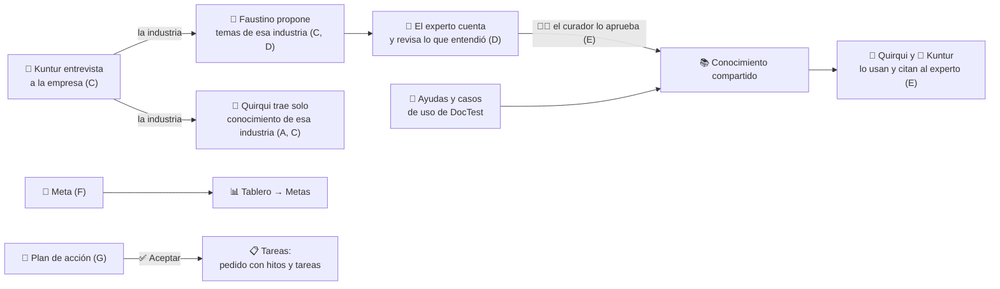

# Guion de prueba de los agentes (ronda 1)

## Objetivo

- 🧭 Es el **recorrido completo de los tres agentes de Tools**, Quirqui, Kuntur y Faustino, para que el PM los pruebe solo en su máquina, función por función, y vea cómo se pasan la información entre ellos.
- 📝 En cada función (**F01**, **F02**, …) dice con qué usuario entrar, qué menú tocar, qué escribir y **qué tiene que aparecer**. Después de probarla, la aprobás o pedís cambios en la **planilla de opiniones**, que tiene los mismos números.
- 🕐 Lleva unas **3 horas** y se puede hacer en varias veces: cada bloque (A a J) es una parada natural. Los agentes tardan entre 10 segundos y 2 minutos en contestar (H-5).
- 🚫 **No cubre** cómo se instalan el motor de los agentes ni el integrador de WSO2: eso está en [instalar-y-operar.md](instalar-y-operar.md). Tampoco cubre DEMO ni producción: todo pasa en tu máquina, contra la base de desarrollo.

- Versión: 1 · 2026-11-26.
- Lo que tiene que aparecer sale de una **corrida real** con la IA, hecha con `scripts/dev/agentes-prueba/recorrer.py` el 2026-11-26 por las mismas rutas que usa la pantalla. **La IA no contesta siempre igual**: el guion marca lo esencial, no el texto exacto.
- ⚠️ **Lo que la corrida no pudo ver es la pantalla en sí**: los nombres de botones y avisos salen del código de las pantallas, y F03, F13, F33, F34, F36, F38, F42 y F47 no se recorrieron de punta a punta. Si algo de eso no coincide, es un hallazgo.
- Las fechas de los datos se arman **relativas al día en que se preparan** («venció hace 3 días»). Si preparás un día y probás otro, corré la cuenta.

## Audiencia

- 🤝 **El PM**, que prueba y opina. No hace falta saber nada técnico, salvo en el bloque E, donde se corre un comando en la terminal.
- 🛠️ **Quien programa los agentes**: prepara los datos (§9), lee la planilla y arregla.

## Referencias

| Qué | Dónde |
|---|---|
| 🌐 Ingreso | `http://traz-comp.local/traz-comp-dnato/main/login` |
| 🌐 Tools de prueba | `http://traz-comp.local/traz-v35/traz-tools-agentes-prueba/` |
| 📝 Planilla de opiniones | **https://claude.ai/artifact/Ngo64wtGK3TB7jjUQoBKwA** (hay que entrar con la cuenta de claude.ai que la publicó, o que te la compartan como Editor). El fuente está en [pruebas/planilla-opiniones.html](pruebas/planilla-opiniones.html) |
| 📦 Archivos para subir | `scripts/dev/agentes-prueba/archivos/` en la copia de prueba |
| 🐞 Lo que ya se encontró | [hallazgos.md](hallazgos.md): los H-n que cita este guion |

---

## 1. Antes de empezar

1. 💻 **En la terminal local**: dejá todo listo con los pasos de §9. Si ya lo preparó otra persona, pedile que te confirme que corrió `preparar_prueba.py --borrar` hoy.
2. 🌐 **En el navegador**: abrí la **planilla de opiniones** en una pestaña y dejala abierta. Lo que marques se guarda solo.
3. 🌐 Usá **Google Chrome o Microsoft Edge** en la computadora.
4. 🌐 **Para entrar con un usuario**:
   1. Abrí `http://traz-comp.local/traz-comp-dnato/main/login`.
   2. Escribí el correo y la clave del usuario (§2).
   3. Te va a llevar a una página con error (`traz-v3/traz-tools`): es esperable. **Escribí en la barra de direcciones** `http://traz-comp.local/traz-v35/traz-tools-agentes-prueba/` y Enter.
   4. Para cambiar de usuario: arriba a la derecha → **Salir**, o usá una **ventana privada** (Ctrl + Shift + N) para tener dos usuarios a la vez.
5. ✅ **Revisá que esté listo**: entrá con el operario (`operario.minero@trazalog.local`). Abajo a la derecha tiene que estar el **botón redondo de Quirqui**. Si no está, el motor no corre: volvé a §9, paso 4.

### Cómo opinar

- ✅ **Aprobada**: está bien como está.
- ✏️ **Con cambios**: sirve, pero hay que cambiar algo. Escribí qué.
- ❌ **No sirve**: así no la usaría nadie. Escribí por qué.
- 💬 Cada función tiene una pregunta **🔍 Para opinar**: es lo que más nos interesa saber. Contestala aunque la apruebes.
- 🐞 Si algo **no hace lo que dice el guion**, marcá **Con cambios** y contá qué pasó. Si ya figura en §7, no hace falta: decí solo si te importa.

## 2. Usuarios

La clave de los usuarios nuevos es la misma para todos. **No va en este documento**: para verla, en la terminal local corré `grep PRUEBA_CLAVE ~/.agentes-prueba.env`. El administrador de la 191 mantiene su clave de siempre: `grep AGENTE_TEST_PASSWORD ~/.agente-minero.env`.

| | Usuario | Persona | Empresa | Qué puede hacer |
|---|---|---|---|---|
| 👑 | `agente.minero.test@trazalog.local` | Agente Prueba | **AGENTE MINERO TEST** (191, minería) | Administrador: Quirqui, **Kuntur**, Feedback del agente, Capturar conocimiento |
| 🎩 | `experto.minero@trazalog.local` | Juan Pérez, jefe de planta | AGENTE MINERO TEST | Experto: Quirqui y **Capturar conocimiento** (Faustino) |
| 🎩 | `experta.minera@trazalog.local` | Marta Gómez, supervisora de mantenimiento | AGENTE MINERO TEST | Experta: igual que Juan (la segunda experta, para más adelante) |
| 🧰 | `operario.minero@trazalog.local` | Pedro Ríos | AGENTE MINERO TEST | Responsable de almacén: **solo Quirqui** |
| 🆕 | `admin.electrica@trazalog.local` | Laura Méndez | **ELECTRICA DEL SUR TEST** (230, recién creada) | Administradora de una empresa vacía, que Kuntur todavía no conoce |

## 3. Las empresas (todo inventado)

| Empresa | Industria | Qué tiene |
|---|---|---|
| ⛏️ **AGENTE MINERO TEST** (191) | Minería (ya se la contó a Kuntur) | **Almacén**: 3 artículos, los 3 bajo el punto de pedido (aceite hidráulico, filtro de aire, neumático). 4 lotes: el del **aceite hidráulico venció hace 3 días** y el del **filtro de aire vence en 10 días**. **Mantenimiento**: 4 equipos (2 chancadoras, un camión y una cinta) y 5 órdenes de trabajo en los últimos 50 días; **3 son fallas de la chancadora primaria AMT-CH01** y **2 siguen abiertas** |
| ⚡ **ELECTRICA DEL SUR TEST** (230) | Todavía ninguna: la dice en el bloque C | Nada |

- 📚 **Conocimiento cargado**: las ayudas de Tools, los casos de uso validados de DocTest y tres datos de ejemplo:
  - ⛏️ minería: los mantos de la chancadora primaria se revisan **cada 250 horas** y se cambian a los **45 mm** de desgaste;
  - ⛏️ minería: los neumáticos del camión de 240 t se rotan a las 1.500 horas;
  - ⚡ electricidad: el aceite de los transformadores de 13,2 kV se analiza **cada 6 meses**.

## 4. Quiénes son los agentes

| | Agente | Para quién | Dónde está |
|---|---|---|---|
| 🐾 | **Quirqui** | Todos | El **botón redondo abajo a la derecha**, en cualquier pantalla. También el menú **Agente Minero** (pantalla completa) |
| 🦅 | **Kuntur** | Solo el administrador | En el mismo panel, la pestaña **Kuntur** |
| 🎩 | **Faustino** | Los expertos | Menú **Agente Minero → Capturar conocimiento** |

## 5. Cómo se pasan la información



---

## 6. Las funciones, bloque por bloque

### 🅰️ Bloque A · Quirqui con los datos del día a día (35 minutos)

👤 `operario.minero@trazalog.local`

| F | Qué hacer | ✅ Qué tiene que aparecer | 🔍 Para opinar |
|---|---|---|---|
| F01 | Entrar (§1, paso 4) y mirar el menú lateral | **Agente Minero** en el menú y el **botón redondo de Quirqui** abajo a la derecha. ⚠️ Hoy también aparecen **Feedback del agente** y **Capturar conocimiento**, que el operario no debería ver (H-1) | ¿El nombre "Agente Minero" dice qué es? |
| F02 | Menú **Almacenes → Artículos**. Tocá el botón de Quirqui | Se abre el panel con el aviso amarillo «Lo que hables con Quirqui se usa para medir…» (con **¿Qué se mide?**). Arriba, **«¿Te ayudo con esta pantalla?»** con hasta 3 propuestas, por ejemplo **«Lote vencido: Aceite hidráulico 20L (demo)»**, cada una con **Ver cómo** y **Descartar** | ¿Las propuestas son las que le importan a alguien de almacén? |
| F03 | En una propuesta, tocá **Descartar**. Cerrá el panel y volvé a abrirlo | La propuesta descartada no vuelve (no vuelve por 7 días) | ¿7 días está bien? |
| F04 | Escribí `¿Qué hago en esta pantalla?` y **Enviar** | Explica **Almacenes → Artículos**: ver el listado, dar de alta y editar artículos. Puede traer el enlace a la ayuda | ¿Se entiende sin haber usado nunca la pantalla? |
| F05 | `¿Qué lotes están por vencer o ya vencieron?` | Una tabla con **dos lotes**: el del **aceite hidráulico, vencido hace 3 días**, y el del **filtro de aire, que vence en 10 días**, con depósito y cantidad | ¿Cómo te gustaría ver esto: tabla, lista, otra cosa? |
| F06 | `¿Qué artículos están por debajo del punto de pedido?` | Los **3**: aceite hidráulico (faltan **40**), filtro de aire (faltan **90**) y neumático 24.00R35 (faltan **17**) | |
| F07 | `¿Qué órdenes de trabajo están abiertas y de qué equipos?` | **2 abiertas**: **AMT-CH01** (chancadora primaria, atascamiento por material sobredimensionado, urgente) y **AMT-CT01** (cinta, desalineación de la banda) | ¿Falta algún dato de la orden que mirarías primero? |
| F08 | Andá al **Tablero** de inicio (logo de arriba a la izquierda, o `…/traz-tools-agentes-prueba/Dash/dashboard`) y preguntá `¿Qué hago en esta pantalla?` | Dice que **no tiene registrado** qué se hace en esa pantalla y **no inventa botones**. Cuando valides el caso del Tablero (H-9), en la ronda siguiente lo va a explicar | ¿Prefiere que diga "no sé" o que intente igual? |
| F09 | Volvé a **Almacenes → Artículos**. `Dame de alta un artículo nuevo: guantes de nitrilo talle L` | **Lo esperado**: explica cómo (**Almacenes → Artículos → Agregar**, qué datos son obligatorios) y **no lo crea**. ⚠️ **Hoy contesta «No tengo ese dato confirmado»**: el control de cifras bloquea la explicación por el "4" de «cuatro obligatorios» (H-2) | ¿Quirqui debería poder cargarlo él, con tu confirmación? |
| F10 | En esa respuesta, tocá el **pulgar abajo**, elegí **Incompleta** y escribí `Quería que me diga cómo` | «Gracias, lo vamos a revisar.» (lo vas a ver del otro lado en F34) | ¿Los motivos para elegir alcanzan? |
| F11 | `¿Cada cuánto hay que revisar los mantos de la chancadora primaria?` | **Cada 250 horas**, y cambio a los **45 mm**, citando que es conocimiento registrado de minería | |
| F12 | `¿Cada cuánto se analiza el aceite dieléctrico de un transformador de 13,2 kV?` | **No usa el dato de electricidad**: la empresa es minera. Contesta «No tengo ese dato confirmado…» | ¿Está bien que no le conteste algo que sí sabe, porque es de otra industria? |
| F13 | Menú **Agente Minero** (pantalla completa). Tocá uno de los ejemplos, por ejemplo **¿Hay material próximo a vencer?** | El mismo Quirqui en pantalla completa; contesta como en F05 | ¿Hace falta la pantalla completa si está el panel? |

### 🅲 Bloque C · Kuntur conoce a una empresa nueva (20 minutos)

👤 `admin.electrica@trazalog.local`

| F | Qué hacer | ✅ Qué tiene que aparecer | 🔍 Para opinar |
|---|---|---|---|
| F14 | Entrar y abrir el panel (botón de abajo a la derecha) | Dos pestañas, **Quirqui** y **Kuntur**. En Kuntur: **«Antes de arrancar, ¿me contás un poco de tu empresa?»** con **Dale** y **Seguimos otro día** | ¿Kuntur debería aparecer solo, sin abrir el panel? |
| F15 | **Dale** y contestá: industria **Electricidad**; partes del sistema **Mantenimiento** y **Almacenes**; ¿trabajan para una operadora? **No**; lo que más te preocupa: la primera opción | Arriba dice **«Pregunta 1 de 4»**, 2 de 4… Las preguntas de la operadora no aparecen porque contestaste que no | ¿Sobra o falta alguna pregunta? |
| F16 | Al terminar | Tarjeta **«Así voy a trabajar con tu empresa»** con la industria y los módulos. **Confirmar** | ¿Confiarías en que Kuntur "entendió" a la empresa? |
| F17 | Pestaña **Quirqui**: `¿Cada cuánto se analiza el aceite dieléctrico de un transformador de 13,2 kV?` | **Ahora sí**: **cada 6 meses**, y se saca de servicio si la rigidez baja de 30 kV. Es la misma pregunta de F12: cambió porque la empresa ahora es de electricidad | |
| F18 | Pestaña **Kuntur**: mirá las recomendaciones de funciones que la empresa no usa | Aparece **«Cargar tus depósitos»** («Tu empresa no tiene ningún depósito cargado»), con **No me interesa**. Tocalo | ¿Te sirven estas recomendaciones? ¿Cuántas como máximo? |
| F19 | Menú **Agente Minero → Capturar conocimiento** | **Industria** ya elegida en **Electricidad**, con la nota «Es la industria que declaró tu empresa». Los temas son de electricidad y generales (por ejemplo, «Trabajo con tensión y arco eléctrico») | |

### 🅳 Bloque D · Faustino entrevista al experto (25 minutos)

👤 `experto.minero@trazalog.local` (Juan Pérez)

| F | Qué hacer | ✅ Qué tiene que aparecer | 🔍 Para opinar |
|---|---|---|---|
| F20 | Menú **Agente Minero → Capturar conocimiento** | Arriba, **Faustino** con su imagen y los 3 pasos (**Tema · Charla · Revisión**). **Industria: Minería**, ya elegida. Los temas como tarjetas, con su barra de prioridad | ¿Se entiende para qué es esta pantalla? |
| F21 | En **¿Quién va a responder?** elegí **Juan Pérez (jefe de planta)**. Tocá la tarjeta **Chancadoras** | Faustino abre con una primera pregunta concreta sobre el cambio de mantos o revestimientos | ¿La primera pregunta invita a contar? |
| F22 | Contestá, **de a una** y con **Responder** (o Ctrl + Enter):<br/>1. `En nuestra planta los mantos de la chancadora primaria los medimos cada 200 horas con galga, en 4 puntos.`<br/>2. `Cuando el desgaste pasa los 40 milímetros programamos el cambio en la parada siguiente; nunca esperamos a 50.`<br/>3. `Lo que más falla antes que el manto es el anillo de ajuste: si hay ruido metálico, se para y se revisa ese día.` | Cada pregunta nueva **sigue lo que contaste** («¿y con esas mediciones qué criterio usan…?»). La barra de avance crece. Mientras piensa, cambia su imagen | ¿Se siente una charla o un formulario? |
| F23 | **Terminar y ordenar lo que conté** | **«Revisalo y corregí lo que haga falta»** con **3 hechos**: los 200 horas con galga en 4 puntos; el cambio después de los 40 mm; el anillo de ajuste | ¿Entendió bien? ¿Lo redactarías distinto? |
| F24 | En los dos primeros tocá **Está bien**. En el del anillo, **Descartar** | El contador de la revisión avanza; el descartado queda tachado | ¿Le pondrías más opciones que aprobar o descartar? |
| F25 | **Listo, cerrar** | Pantalla **¡Gracias!**, con Faustino despidiéndose, y **Elegir otro tema** | |
| F26 | 📱 Achicá la ventana al ancho de un celular (o abrila en el teléfono, si está en la misma red) | Todo entra a lo ancho, sin correrse para el costado | ¿Un experto contestaría desde el celular? |

### 🅴 Bloque E · Lo que contó el experto llega a los demás (15 minutos)

💻 **Terminal local**, en la carpeta de la copia de prueba · después 👤 `operario.minero` y `agente.minero.test`

| F | Qué hacer | ✅ Qué tiene que aparecer | 🔍 Para opinar |
|---|---|---|---|
| F27 | **En la terminal local**, como curador:<br/>`cd /mnt/win/dev/git/traz-v35/traz-tools-agentes-prueba && set -a && . ~/.agente-minero.env && . ~/.agentes-prueba.env && set +a && AGENTE_DB_USER=$PRUEBA_CURADOR_USER AGENTE_DB_PASSWORD=$PRUEBA_CURADOR_PASSWORD .venv-agente/bin/python -m agente.curar listar` | Los **2 hechos** que aprobó Juan, con su número (`#1`, `#2`), el tema **Chancadoras** y **minería**. El del anillo no aparece: Juan lo descartó | ¿Quién debería hacer esto en una empresa real, y desde dónde? |
| F28 | En la misma terminal, cambiá `listar` por `aprobar 1 2 --curador "Tu nombre"` (con los números que te dio F27) | `✅ #1 aprobado: ya lo usan Quirqui y Kuntur` y lo mismo para el #2 | |
| F29 | 👤 `operario.minero`, en el panel: `¿Cada cuántas horas se miden los mantos de la chancadora primaria?` | Dice que hay **dos datos distintos**: **200 horas** con galga en 4 puntos (**del experto Juan Pérez**) y **250 horas** (del conocimiento cargado), y cuál tiene más confianza | ¿Está bien que muestre los dos, o tiene que elegir uno? |
| F30 | `¿Qué falla antes que el manto en la chancadora?` | **No** presenta lo del anillo de ajuste como dicho por el experto (lo descartó). ⚠️ Hoy contesta con conocimiento general del modelo, sin fuente y con palabras en inglés (H-6, H-7) | ¿Debería decir "no lo tengo registrado"? |
| F31 | 👤 `agente.minero.test`, pestaña **Kuntur**: `¿Cuándo conviene programar el cambio de mantos?` | Cuando el desgaste **pasa los 40 mm**, en la parada siguiente, **citando a Juan Pérez** | |

### 🅵 Bloque F · Metas con Kuntur (15 minutos)

👤 `agente.minero.test@trazalog.local` (administrador de la 191)

| F | Qué hacer | ✅ Qué tiene que aparecer | 🔍 Para opinar |
|---|---|---|---|
| F32 | Pestaña **Kuntur**: `Tengo muchos artículos bajo el punto de pedido. Proponeme una meta para fin de mes.` | Repasa los **3 artículos** y muestra una **tarjeta de meta**: **Artículos bajo punto de pedido**, que quede **igual o por debajo de** un valor chico (por ejemplo **1**) para **fin de este mes**, con **Por qué** y **Cargar meta** | ¿La meta es razonable? ¿La fecha? |
| F33 | **Cargar meta**. Después andá al **Tablero** de inicio y bajá hasta **Metas** | «Meta cargada. La ves en el Tablero, en Metas.» En el Tablero, la meta aparece en la lista | ¿Hace falta poder editarla desde la tarjeta? |
| F34 | Menú **Agente Minero → Feedback del agente** | El pulgar abajo de F10: motivo **incompleta** y el comentario «Quería que me diga cómo», con la pregunta de origen | ¿Qué harías con esto? ¿Falta algún dato? |

### 🅶 Bloque G · Plan de acción (20 minutos)

👤 `agente.minero.test@trazalog.local`

| F | Qué hacer | ✅ Qué tiene que aparecer | 🔍 Para opinar |
|---|---|---|---|
| F35 | Pestaña **Kuntur**: `Las chancadoras paran mucho por fallas. Armame un plan de acción para bajarlas.` | Tarda (hasta 2 minutos y medio, H-5). Tarjeta **«🦅 Kuntur te propone un plan»**: la **causa** (la **AMT-CH01** tuvo **3 órdenes correctivas** en unos 2 meses y no tiene preventivos), el **objetivo** (por ejemplo, disponibilidad de 90 % en 6 semanas) y **3 hitos** con sus tareas. Botones **✅ Aceptar**, **✏️ Pedir cambios** y **❌ No lo quiero** | ¿El plan es el que armaría un jefe de mantenimiento? |
| F36 | **✏️ Pedir cambios** y escribí `Que sea en 4 semanas, no en 6` | Kuntur arma un plan nuevo con el cambio | |
| F37 | **✅ Aceptar** | «Creando el pedido…» y después la confirmación. En **Tareas → Pedidos de trabajo** aparece el pedido con sus hitos y tareas, **sin responsables**. ⚠️ Esto **sí escribe en la base de desarrollo** (empresa 191) | ¿Tendría que proponer responsables? |
| F38 | Pedile otro plan (`Armame un plan para que no falte stock`) y tocá **❌ No lo quiero** → **No es prioridad** | Pide el motivo con opciones (**No es prioridad**, **Ya lo estamos haciendo**, **No aplica**, **Otro**). Si le volvés a pedir lo mismo, no te propone el mismo plan | ¿Los motivos alcanzan? |

### 🅷 Bloque H · Configurar la empresa con Kuntur (20 minutos)

👤 `agente.minero.test@trazalog.local` · 📁 `scripts/dev/agentes-prueba/archivos/`

| F | Qué hacer | ✅ Qué tiene que aparecer | 🔍 Para opinar |
|---|---|---|---|
| F39 | Pestaña **Kuntur**: `Cargame el sector Planta de Chancado en mantenimiento` | Tarjeta **«Para cargar: …»** con **Cargar** y **Ahora no**, y el aviso **«Simulación: todavía no se graba en el sistema real.»** Tocá **Cargar** → **«Cargado.»** | ¿Se entiende que es una simulación? |
| F40 | `Quiero dar de alta un depósito nuevo llamado Depósito Rampa Norte` | **Lo esperado**: una tarjeta para cargarlo de verdad. ⚠️ **Hoy dice que no tiene cómo** y te manda a la pantalla de Almacenes: en la prueba local el motor no ofrece esas altas (H-4) | |
| F41 | **📎 Subí tu planilla de artículos, herramientas o equipos** → elegí `planilla-articulos-cliente.csv` | «Te subí la planilla…» y Kuntur explica qué columna va en cada lugar (**Cod. interno** → código, **Stock mín.** → punto de pedido, **Ubicación** no se usa) y **pide el tipo de artículo, que falta**. Contestá `EPP para los tres primeros, insumo para los otros dos` | ¿Te sirve que lea la planilla así? ⚠️ Hoy se le escapan nombres técnicos (H-6) |
| F42 | En las recomendaciones de Kuntur: **«Armar planes de mantenimiento preventivo»** («Tenés 4 equipos cargados y ningún preventivo») → **No me interesa** | Desaparece y no vuelve en 30 días | |

### 🅸 Bloque I · Quién ve qué (10 minutos)

| F | Qué hacer | ✅ Qué tiene que aparecer | 🔍 Para opinar |
|---|---|---|---|
| F43 | 👤 `operario.minero`: abrí el panel | **Solo Quirqui**: no hay pestaña Kuntur | |
| F44 | 👤 `operario.minero`: menú **Agente Minero → Feedback del agente** | **Lo esperado**: no ve el menú o no puede entrar. ⚠️ **Hoy entra y ve el feedback negativo de toda la empresa** (H-1, H-3) | ¿Quién debería ver el feedback? |
| F45 | 👤 `operario.minero`: menú **Agente Minero → Capturar conocimiento** | **Lo esperado**: no ve el menú. ⚠️ **Hoy entra y puede entrevistarse con Faustino** (H-1) | ¿Cualquiera puede ser experto, o lo designa el administrador? |
| F46 | 👤 `admin.electrica`: en Quirqui, `¿Qué órdenes de trabajo están abiertas?` | **Ninguna**: no ve las de la minera | |

### 🅹 Bloque J · En el celular (5 minutos)

| F | Qué hacer | ✅ Qué tiene que aparecer | 🔍 Para opinar |
|---|---|---|---|
| F47 | Con cualquier usuario, achicá la ventana al ancho de un celular y usá el panel de Quirqui y de Kuntur | El panel entra en la pantalla; las tarjetas de meta y de plan se pueden leer y tocar | ¿Lo usarías desde el celular? |

### 🧭 Al final

- 🔎 Recorré lo que quieras y anotá en la planilla, en **Opinión general**, lo que te llame la atención.

## 7. 🔎 Lo que ya sabemos que falta

No hace falta anotarlo de nuevo, pero sí decir si es importante. El detalle está en [hallazgos.md](hallazgos.md).

- 🔐 El operario ve **Feedback del agente** y **Capturar conocimiento**, y puede entrar a los dos (H-1, H-3).
- 🧮 Quirqui no explica cómo dar de alta un artículo: el control de cifras lo bloquea (H-2).
- 🏗️ En la prueba local, Kuntur no puede dar de alta depósitos, establecimientos ni valores (H-4). Las cargas de Mantenimiento y la planilla masiva están **simuladas** a propósito.
- 🐢 Los agentes tardan entre 10 segundos y 2 minutos y medio (H-5).
- 🔤 Se escapan palabras técnicas y en inglés (H-6).
- 🌐 La búsqueda en internet está apagada en la prueba local.
- ⏰ Los **avisos de metas** (revisión diaria), las **mediciones** y los avisos al celular **no corren** en la prueba local.
- 🧪 La validación cruzada entre dos expertos (Marta revisando lo de Juan) no tiene pantalla todavía.
- 📊 La meta de **disponibilidad de equipos** no se puede probar: los equipos de prueba no tienen lecturas.

## 8. 🆘 Si algo sale mal

| Pasa esto | Qué hacer |
|---|---|
| No aparece el botón de Quirqui | El motor no corre: §9, paso 4. Si corre, el usuario no tiene el menú del agente: volvé a preparar (§9, paso 3) |
| «No pude responder ahora mismo por un problema técnico» | Esperá un minuto y repetí. Si sigue, mirá la terminal del motor (§9, paso 4) |
| Tarda mucho y no contesta | Hasta 2 minutos y medio es normal (H-5). Pasados 4 minutos, recargá la página y repetí |
| Después de ingresar, página con error | Es esperable: escribí la dirección de Tools de prueba (§1, paso 4) |
| «Tu sesión venció. Recargá la página para seguir.» | Recargá. Si sigue, volvé a ingresar |
| Kuntur o Quirqui dicen que no pueden leer los datos de la empresa | El integrador de prueba no está prendido: mirá la terminal de §9, paso 4 |
| Un número no coincide con el guion | ¿Preparaste otro día? Las fechas se corren. Si no, anotalo en la función |
| Quiero empezar de nuevo | §9, pasos 3 y 4: se vuelve al punto de partida. Lo que anotaste en la planilla no se pierde |

## 9. 🛠️ Para quien prepara la prueba

Todo en la **terminal local**, con la **conexión segura (VPN) a desarrollo** levantada.

1. **Apache prendido** (pide tu contraseña):
   ```
   sudo /opt/lampp/lampp startapache
   ```
2. **La copia de prueba al día**, en la rama de la prueba:
   ```
   cd /mnt/win/dev/git/traz-v35/traz-tools-agentes-prueba && \
     git fetch origin && \
     git checkout -B prueba/agentes-2026-11-26 origin/feat/AGENTE-PRUEBAS-01
   ```
3. **Dejar los datos como al empezar** (tarda unos minutos; la primera vez gasta unos centavos de OpenRouter). Si el motor está prendido, cortalo antes con Ctrl + C:
   ```
   cd /mnt/win/dev/git/traz-v35/traz-tools-agentes-prueba && \
     set -a && . ~/.agente-minero.env && . ~/.agentes-prueba.env && set +a && \
     .venv-agente/bin/python scripts/dev/agentes-prueba/preparar_prueba.py --borrar
   ```
   Al final imprime el punto de partida: tiene que decir **conocimiento: … mineria=1, electricidad=1**, **2 expertos** y los **5 usuarios** de §2.
4. **Prender el integrador de prueba y el motor** (queda corriendo; se corta con Ctrl + C). La primera vez copia el integrador a `~/.local/share/agentes-prueba/` (1 GB). **Tu integrador instalado, el del puerto 8290, no se toca**:
   ```
   cd /mnt/win/dev/git/traz-v35/traz-tools-agentes-prueba && \
     scripts/dev/agentes-prueba/levantar.sh
   ```
   Tiene que decir **✅ Integrador de prueba en el puerto 8301** y **✅ Motor de los agentes en el puerto 8099**. Para apagar el integrador al terminar: `scripts/dev/agentes-prueba/levantar.sh parar`.
5. **Opcional, antes de pasársela al PM**: el recorrido automático con la IA real, para ver que todo contesta. Gasta tokens y **cambia el punto de partida**: después hay que repetir el paso 3.
   ```
   cd /mnt/win/dev/git/traz-v35/traz-tools-agentes-prueba && \
     .venv-agente/bin/python scripts/dev/agentes-prueba/recorrer.py /tmp/recorrido-agentes acdefi
   ```
   Deja lo que contestó cada agente en `/tmp/recorrido-agentes/recorrido.md`.
6. **Compartir la planilla de opiniones** con el PM **como Editor** desde claude.ai. Si se comparte solo para ver, no puede guardar lo que marca.

### Qué toca la preparación, y qué no

- ✅ **Base de agentes de prueba** `agentes_manual`, en el contenedor `agentes-pg-prueba` (puerto 55432): se borra y se vuelve a crear entera. No es la base `agente_minero` de tu Postgres ni la de las pruebas automáticas.
- ✅ **Base de Tools de DEV**: crea la empresa **ELECTRICA DEL SUR TEST**, los 4 usuarios nuevos con su menú, y corre las fechas de los lotes de la 191. Cambia la empresa de AssetPlanner de la 191 a la suya (H-8).
- ✅ **Bonita de DEV**: crea los usuarios nuevos, si no están.
- ✅ **AssetPlanner de DEV**: borra y vuelve a crear los equipos y las órdenes de la empresa **191** (solo esa).
- ⚠️ **No borra** los pedidos de trabajo que se crean al aceptar un plan (F37): quedan en Tareas de la 191.
- 🚫 No toca el integrador instalado, ni otras empresas, ni nada de producción.
- 🔑 Las claves están en `~/.agentes-prueba.env` (permisos 600, fuera del repositorio). Nunca van en archivos guardados en git.

---

## Glosario

| Término | Qué es |
|---|---|
| **Quirqui** | El asistente de todos: responde sobre la pantalla donde estás y sobre los datos de la empresa |
| **Kuntur** | El asistente del administrador: conoce a la empresa, propone metas, planes de acción y cargas de configuración |
| **Faustino** | El que entrevista a los expertos para guardar lo que saben |
| **Hecho** | Una frase concreta que Faustino saca de la charla con el experto («los mantos se miden cada 200 horas») |
| **Curador** | Quien aprueba los hechos revisados para que los usen Quirqui y Kuntur |
| **Conocimiento compartido** | Lo que saben los agentes para todas las empresas de una industria: las ayudas, los casos de uso y los hechos aprobados |
| **Punto de pedido** | El stock mínimo de un artículo: debajo de eso hay que reponer |
| **Plan de acción** | Lo que propone Kuntur para mejorar un indicador: causa, objetivo, hitos y tareas. Al aceptarlo se crea en Tareas |
| **Carga simulada** | Kuntur muestra lo que cargaría y dice «Cargado.», pero no se graba en el sistema real |
| **Integrador de prueba** | Una copia del integrador de WSO2 (puerto 8301) por donde los agentes leen los datos de la base de desarrollo |
| **Motor de los agentes** | El programa que corre a los tres agentes (puerto 8099) |
| **VPN** | La conexión segura con los servidores de desarrollo |
