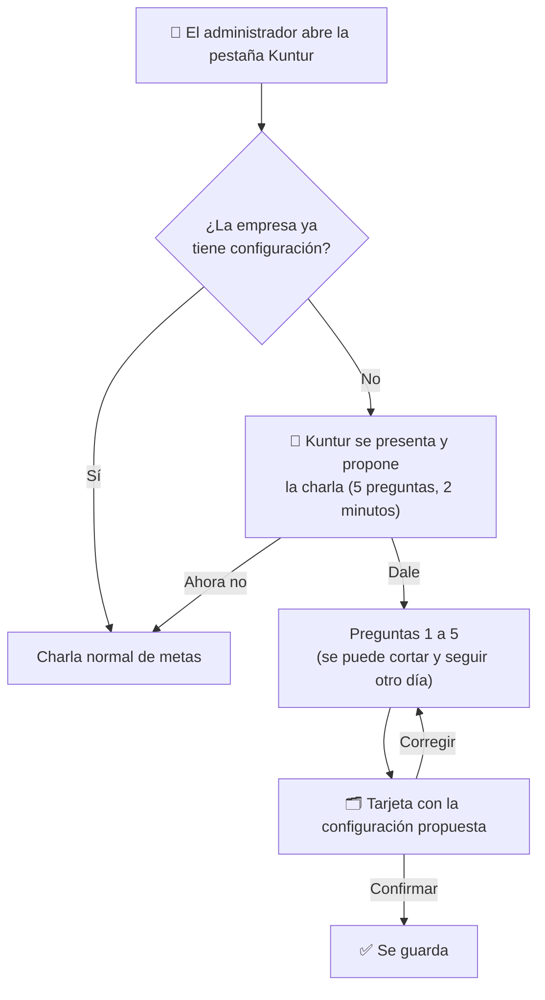

# Kuntur — entrevista de configuración (borrador para aprobar)

## Objetivo

Qué es: el guion de la charla que Kuntur tiene con el administrador de una empresa la primera vez que entra, y qué cambia en el sistema con cada respuesta (AGENTE-CO-02). Para quién: el PM, que aprueba las preguntas y los efectos antes de que se programe. Cuándo leerlo: antes de revisar el PR de CO-02. Qué NO cubre: el tono de Kuntur (sale del taller de personajes, [`taller-claude-web-personajes.md`](taller-claude-web-personajes.md)) ni las metas en sí (ya funcionan: [`operacion.md`](operacion.md), sección Kuntur).

| Campo | Valor |
|---|---|
| Estado | Borrador, 2026-11-11. **No programado.** |
| Tarea | AGENTE-CO-02 |
| Reglas que respeta | R1 (solo el administrador), R4 (sin cifras inventadas), ADR-A8 (Kuntur no graba solo: el administrador confirma) |

---

## 1. La idea en una frase

Cinco preguntas cortas, con opciones para tocar, que terminan en **una tarjeta "Así voy a trabajar con tu empresa"**. Nada se guarda hasta que el administrador toca **"Confirmar"**.

## 2. Las preguntas

Las opciones son botones; en todas se puede escribir otra cosa. Si el administrador escribe algo que no entra en las opciones, Kuntur repregunta una vez y, si sigue sin entrar, la pregunta queda sin responder (no se adivina).

| # | Pregunta (texto aproximado) | Opciones | Qué cambia |
|---|---|---|---|
| 1 | **¿En qué industria trabaja tu empresa?** | Minería · Petróleo y gas · Electricidad · Otra / varias | Qué conocimiento usan **los tres asistentes**: los de esa industria más los generales. Hoy esto lo carga Trazalog a mano (D-31) |
| 2 | **¿Qué partes de Trazalog usan hoy?** (varias) | Almacenes · Mantenimiento · Herramientas · Tareas | Sobre qué indicadores te propone metas Kuntur, y la base para recomendar después las que no usan (CO-08) |
| 3 | **¿Qué es lo que más te preocupa hoy?** (hasta 2) | Que falten repuestos · Que los equipos paren · Que las herramientas no vuelvan · Que los pedidos internos tarden | Con qué indicador arranca Kuntur al proponer metas. Cada opción apunta a un indicador del Tablero (ver §3) |
| 4 | **¿Cada cuánto querés que te avise si una meta no se cumple?** | Una vez por semana (como hoy) · Todos los días · No me avises | El aviso de desvío (CO-07). Hoy es fijo: una vez por semana |
| 5 | **¿Hay alguien más que tenga que recibir esos avisos?** | Solo yo · Elegir de la lista de usuarios de la empresa | A quién le llega el aviso de desvío, además de quien cargó la meta |

Al final, Kuntur muestra la tarjeta y, si la pregunta 3 tuvo respuesta, ofrece: *"¿Querés que miremos cómo viene [indicador] y pongamos una meta?"* (entra en la charla de metas que ya existe).

## 3. La regla que arma la configuración (sin el modelo)

La configuración la arma **una regla fija**, no el modelo de lenguaje. El modelo solo conversa; las respuestas se guardan como datos con opciones cerradas.

| Respuesta en la pregunta 3 | Indicador con el que arranca |
|---|---|
| Que falten repuestos | Artículos bajo punto de pedido |
| Que los equipos paren | Disponibilidad de equipos |
| Que las herramientas no vuelvan | Herramientas en tránsito |
| Que los pedidos internos tarden | Movimientos internos sin entregar |

Si eligió una preocupación de una parte que en la pregunta 2 dijo que **no usa**, Kuntur lo marca en la tarjeta ("no usás Mantenimiento: no hay datos para medir esto") en lugar de proponer la meta.

## 4. Lo que no hace

- ❌ No pregunta cifras (cantidad de equipos, facturación, empleados): no se usan para nada todavía y serían cifras sin fuente.
- ❌ No configura nada de otras empresas ni compara con otras.
- ❌ No crea usuarios, roles ni menús: solo lee la lista de usuarios para la pregunta 5.
- ❌ No vuelve a preguntar sola. Para cambiar la configuración, el administrador toca "Revisar configuración" en la pestaña Kuntur.

## 5. Decisiones que tiene que tomar el PM

| # | Pregunta | Propuesta |
|---|---|---|
| P-1 | ¿Las preguntas y opciones de §2 están bien? ¿Falta o sobra alguna? | Estas cinco |
| P-2 | Si la empresa ya tiene la industria cargada por Trazalog, ¿Kuntur la pregunta igual? | La muestra ya elegida y pide confirmarla |
| P-3 | ¿La industria la puede cambiar el administrador, o solo Trazalog? | El administrador, con la tarjeta. Queda registrado quién y cuándo |
| P-4 | Pregunta 5 (otros destinatarios del aviso): ¿entra ahora o después? | Ahora, solo usuarios de la misma empresa |

## 6. Cómo se va a armar (para la revisión técnica)

- **Guion fijo en el código**, no la entrevista libre de Faustino: las respuestas tienen que quedar como opciones cerradas para que la regla de §3 funcione. De Faustino se reusa la idea de sesión que se puede cortar y retomar, no su código (D-98).
- **Datos:** `agente.perfil_empresa` suma lo que usa, las preocupaciones, la frecuencia del aviso, quién confirmó y cuándo; una tabla nueva `agente.entrevista_config` guarda la charla en curso (para retomarla). Las dos con aislamiento por empresa.
- **Escritura:** el orquestador solo propone; lo guarda el panel con la sesión del administrador, igual que "Cargar meta".
- **Efectos:** la búsqueda de conocimiento ya filtra por industria (`rag.py`); el seguimiento de metas (`coach.py`) lee la frecuencia y los destinatarios extra.
