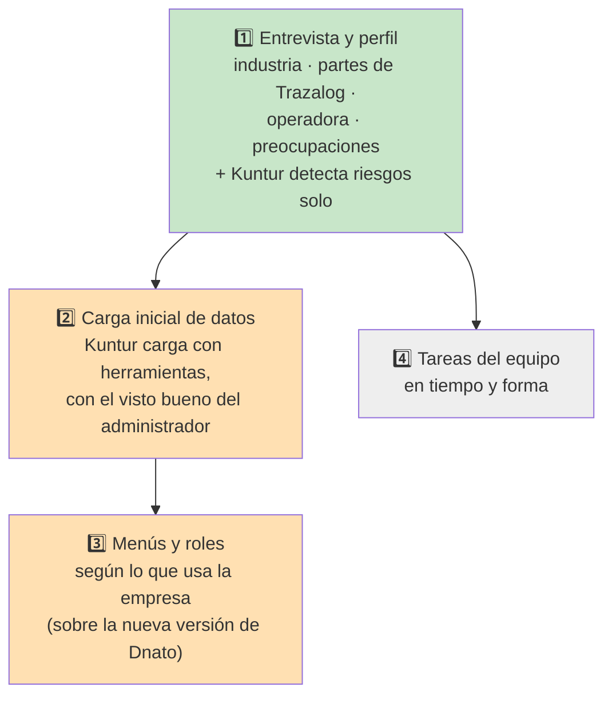
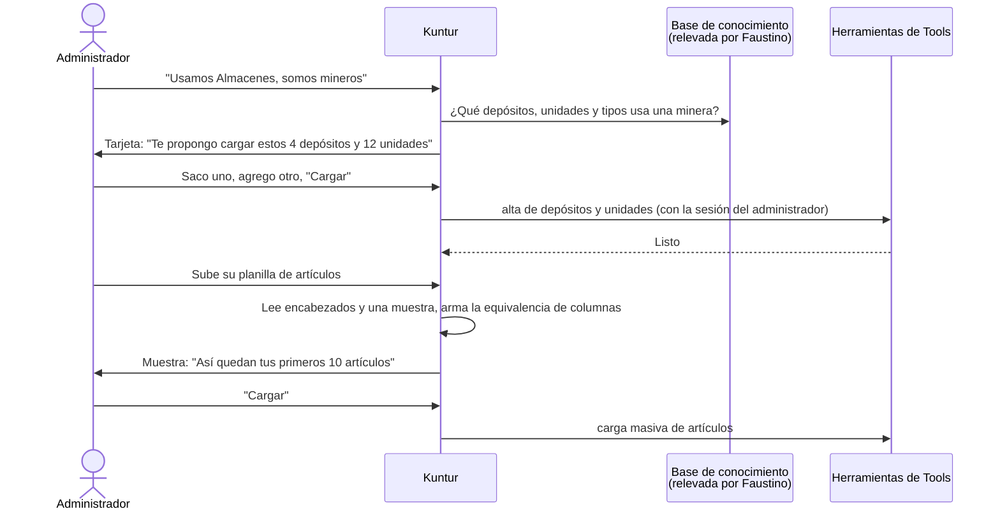

# Kuntur — puesta en marcha de la empresa

## Objetivo

Qué es: cómo Kuntur acompaña al administrador de una empresa cliente en la puesta en marcha. Cubre la entrevista de configuración, la detección de metas en riesgo, la carga inicial de datos y los menús y roles. Para quién: el PM, que aprueba cada etapa, y quien programe las etapas 2 a 4. Cuándo leerlo: antes de revisar el PR de AGENTE-CO-02 o de empezar la etapa 2. Qué NO cubre: el tono de Kuntur (sale del taller de personajes, [`taller-claude-web-personajes.md`](taller-claude-web-personajes.md)) ni la charla de metas, que ya funciona (ver la sección Kuntur de [`operacion.md`](operacion.md)).

| Campo | Valor |
|---|---|
| Versión | 2, 2026-11-11 (la 1 era un borrador de 5 preguntas; esta incorpora lo que pidió el PM el mismo día) |
| Tareas | AGENTE-CO-02 (entrevista), CO-07 (avisos), y las etapas nuevas CO-09 (carga inicial) y CO-10 (menús y roles) |
| Etapa 1 | **Hecha** (rama `feat/AGENTE-CO-02-entrevista-kuntur`) |
| Etapas 2 y 3 | **Diseño. Necesitan aprobación**: cambian la regla de que los agentes no graban (ADR-A8) y tocan el núcleo del sistema |
| Etapa 4 | Espera al módulo de Tareas |

---

## 1. Las cuatro etapas

---

## 2. Etapa 1 — entrevista y perfil (hecha)

### 2.1 Las preguntas

La primera vez que el administrador abre la pestaña Kuntur, Kuntur le propone la entrevista ("Dale" / "Ahora no"). Las opciones se tocan como botones. La entrevista se puede cortar y seguir otro día, y nada se guarda en el perfil hasta que el administrador toca **"Confirmar"**.

| # | Pregunta | Opciones | Para qué sirve |
|---|---|---|---|
| 1 | ¿En qué industria trabaja tu empresa? | Minería · Petróleo y gas · Electricidad · Otra o varias | El conocimiento que usan **los tres asistentes**. Si ya estaba cargada: *"Ya me habías dicho que son de minería. ¿Querés cambiarla?"*, con la industria anterior marcada |
| 2 | ¿Qué partes de Trazalog usan hoy, o usarían? | Almacenes · Mantenimiento · Herramientas · Tareas | Kuntur no propone metas sobre lo que no usan. En las etapas 2 y 3 define qué datos se cargan y qué menús se arman |
| 3 | ¿Trabajan para una operadora? | Sí · No | Si es "no", se saltean la 4 y la 5 |
| 4 | ¿Para cuál? | Texto, opcional | Kuntur la nombra en la charla |
| 5 | ¿Qué información o qué metas te exige hoy la operadora? | Los indicadores del Tablero, más un texto para lo demás | **Mandan sobre la pregunta 6.** Lo que la operadora pide y Trazalog no mide queda anotado |
| 6 | ¿Qué es lo que más te preocupa hoy? (hasta dos) | Que falten repuestos · Que los equipos paren · Que las herramientas no vuelvan · Que los pedidos internos tarden | El orden en que Kuntur mira los indicadores, después de lo de la operadora |

### 2.2 La tarjeta "Así voy a trabajar con tu empresa"

La arma **una regla fija, no el modelo de lenguaje**, así no puede inventar nada:

- **Prioridades:** primero los indicadores que exige la operadora y después los que le preocupan al administrador, sin repetir.
- Un indicador de una parte que la empresa no usa no entra. Se avisa: *"La operadora pide «Disponibilidad de equipos», pero no usan Mantenimiento: para medirlo hay que empezar a usar Mantenimiento en Trazalog"*.
- Lo que la operadora pide y Trazalog no mide queda anotado: *"hoy Trazalog no lo mide. Lo dejamos anotado"*. Es insumo para sumar indicadores nuevos.
- Al confirmar, Kuntur ofrece arrancar la charla de metas por la primera prioridad. Desde ese momento, en cada charla recibe lo que contó el administrador.
- La tarjeta tiene "Corregir": la entrevista vuelve a empezar con lo elegido marcado. Lo mismo hace "Revisar configuración".

### 2.3 Kuntur detecta riesgos solo

Ya no hay una pregunta de "cada cuánto te aviso" (pedido del PM). Cada meta tiene uno de tres estados:

| Estado | Cuándo |
|---|---|
| ✅ ok | Se cumple, y con la tendencia del último mes llega a la fecha |
| 🟠 en riesgo | Hoy se cumple, pero con la tendencia del último mes **no llega** a la fecha |
| 🔴 no se cumple | Hoy no se cumple |

- La tendencia sale de la historia diaria del indicador (`kpi_get_historico`, últimos 30 días, mínimo 7 valores), proyectada en línea recta hasta la fecha de la meta. Con menos historia no se adivina: queda ok.
- La disponibilidad de equipos no tiene historia (vive en AssetPlanner): solo puede quedar ok o no se cumple.
- **Kuntur avisa cuando el estado cambia** a en riesgo o a no se cumple, no por calendario. Si la meta se recupera y vuelve a caer, avisa de nuevo.
- **"No insistas":** en la pestaña Kuntur se listan las metas de las que ya avisó, con ese botón. Con "No insistas", no avisa más de esa meta hasta que vuelva a cumplirse; ahí se limpia solo.
- En el futuro, también va a dejar de insistir si hay acciones correctivas cargadas en Tareas (etapa 4).

### 2.4 A quién le llegan los avisos

- **Solo a administradores, nunca a empleados** (decisión del PM).
- **Hoy:** a quien cargó la meta, que es un administrador.
- **Lo que pidió el PM: a todos los administradores de la empresa.** Falta saber quiénes son:
  - hoy el rol de administrador de Dnato es uno solo para todas las empresas (D7);
  - la nueva versión de Dnato lo hace por empresa, pero no trae una forma de listar los administradores (ver §4.1);
  - los avisos de Tools (`ntf`) todavía no admiten "a todos los de un rol" (D-85).
  
  Queda pendiente para cuando se resuelvan esas dos cosas.

---

## 3. Etapa 2 — carga inicial de datos (diseño, para aprobar)

### 3.1 Lo que pidió el PM

- Kuntur **carga** los datos de la puesta en marcha **con herramientas**, sin planillas: establecimientos, depósitos, unidades de medida, tipos de artículo, puntos de pedido, tipos de herramienta, preventivos y correctivos.
- El administrador también puede **pasarle sus datos como los tiene** (su planilla, con sus columnas). Kuntur:
  1. lee los encabezados y una muestra de filas;
  2. entiende qué es cada columna;
  3. lo pasa al formato que espera la carga masiva;
  4. le muestra al administrador **una muestra de cómo va a quedar**;
  5. si el administrador acepta, carga todo.
- El contenido típico de cada industria (qué depósitos, unidades y tipos usa una minera, una petrolera o una eléctrica) **lo releva Faustino con los expertos** y queda en la base de conocimiento.

### 3.2 Lo que cambia en las reglas

Hoy los agentes **no graban nada** (ADR-A8, decisión D3 del plan). Esta etapa necesita una excepción, que propongo como **ADR-A12**:

> Kuntur puede ejecutar herramientas que graban **datos de configuración** de la empresa cuando se cumplen estas cinco condiciones:
>
> 1. **Confirmación:** antes de cada carga, el administrador vio una tarjeta con lo que se va a cargar y tocó "Cargar".
> 2. **Con el permiso del administrador:** se usa su sesión, nunca el token de máquina. El gateway ya rechaza las escrituras con ese token.
> 3. **Lista cerrada:** solo herramientas de la clase nueva `configuracion`. Crear órdenes de trabajo o pedidos de materiales sigue fuera de su alcance.
> 4. **Registro:** cada carga queda en la corrida, con qué se cargó y quién lo confirmó.
> 5. **Todo o nada:** si una fila falla, no se carga ninguna. Es como funciona hoy la carga masiva.
>
> Quirqui sigue sin grabar nada.

### 3.3 Cómo funcionaría

### 3.4 Qué hace falta construir

| Pieza | Dónde | Comentario |
|---|---|---|
| Herramientas de alta: establecimiento, depósito, unidad de medida, tipo de artículo, tipo de herramienta, punto de pedido | Tools, sobre las operaciones que ya usan las pantallas | **Toca el núcleo del sistema** (servicios de datos y APIs): antes, análisis de impacto aprobado por el PM |
| Preventivos y correctivos | Mantenimiento | **Coordinar con la migración de AssetPlanner a Mantenimiento**, que lleva otra sesión. No se toca hasta que esa migración lo permita |
| Herramienta de carga masiva para agentes | Sobre la carga masiva de Dnato (procedimientos `sta.*`) | La nueva versión de Dnato la mantiene (entrega E11). Se reutiliza su validación de todo o nada |
| Lectura de la planilla del administrador | Orquestador | Al modelo de lenguaje solo le llegan **los encabezados y una muestra de filas**, no la planilla entera. Supuesto propio: alcanza con unas 20 filas para entender las columnas |
| Clase `configuracion`, lista de Kuntur y tarjeta "Cargar" | Base de los agentes y panel | Igual que "Cargar meta", pero ejecutada por Kuntur después de la confirmación |
| Contenido por industria | Base de conocimiento | Faustino lo releva con expertos; antes de eso, Kuntur no propone listas típicas, solo carga lo que le da el administrador |

---

## 4. Etapa 3 — menús y roles (diseño, para aprobar)

El PM pidió que esto lo configure Kuntur, asumiendo que la nueva versión de Dnato (en diseño) ya está construida. Lo que dicen sus documentos (`traz-tools/doc/v3/dnato/`, versión 0.5.1 del 2026-11-02):

### 4.1 Lo que trae la nueva versión de Dnato

- **El administrador es por empresa:** es quien tiene el rol Administrador en esa empresa (`02_MODELO_Y_REGLAS.md` §3 R7). Es parte del ADR-016, todavía en propuesta.
  - Pero el token sigue trayendo el nivel global (`role`), que ya no sirve para saber si alguien es administrador.
  - Y no hay una forma de **listar los administradores de una empresa**: solo se puede preguntar por un usuario.
- **Roles:** cada empresa tiene cinco fijos (Administrador, Solicitante, Supervisor, Planificador, Mantenedor). **No se crean roles nuevos** (D-09 de Dnato) y el rol Administrador no se edita.
- **Menús:** lo que ve cada rol es una tabla de "rol × opción del menú, sí o no". Existe también un menú a medida que se asigna a un rol o a una persona. Las funcionalidades se activan por empresa según el plan contratado.
- **No hay plantillas** de menú por módulo ni por industria.
- **No hay operaciones para agentes:** todo se configura desde pantallas del Portal. Los únicos servicios para otros sistemas son de consulta.
- Los tokens de máquina (`client_credentials`) no figuran en el diseño. Están construidos aparte (Dnato #48).

### 4.2 Qué haría Kuntur

Con lo que el administrador contó en la pregunta 2, Kuntur propone:

- qué funcionalidades activar;
- qué opciones del menú ve cada uno de los roles (por ejemplo, el Planificador ve Tareas y Mantenimiento, y el Solicitante solo pedidos);
- a quién de su equipo darle cada rol.

Lo muestra en una tarjeta y, con "Aplicar", lo graba bajo las mismas cinco condiciones de §3.2.

### 4.3 Qué le falta a la nueva versión de Dnato para esto

Esto hay que pedírselo al frente de Dnato. No lo programo yo: es identidad y está en diseño.

1. Operaciones de API para:
   - activar funcionalidades;
   - asignar opciones del menú a un rol;
   - asignar un rol a un usuario.
   
   Que las use el panel del Portal y también Kuntur. Es la regla del proyecto: la lógica en las APIs.
2. Una forma de **listar los administradores de una empresa**, para avisarles a todos (§2.4).
3. Que esas operaciones acepten el token del administrador de la empresa, no solo la sesión del Portal.

---

## 5. Etapa 4 — tareas del equipo (espera al módulo de Tareas)

- Los empleados reciben tareas. Kuntur mira si se hacen en tiempo y forma y, si no, le avisa al administrador.
- Si para una meta en riesgo hay acciones correctivas cargadas en Tareas, Kuntur deja de insistir con esa meta.
- Depende de que se corrijan los errores de Tareas que permiten ver datos entre empresas y los de fechas y horas (los está corrigiendo otra sesión: PR en borrador #636), y de las herramientas de lectura de Tareas.

---

## 6. Decisiones pendientes del PM

| # | Pregunta | Propuesta |
|---|---|---|
| P-5 | ¿Se aprueba el ADR-A12 (Kuntur graba configuración con confirmación, §3.2)? | Sí, con las cinco condiciones |
| P-6 | ¿Por qué empieza la etapa 2? | Depósitos, unidades y tipos de artículo, más la importación de artículos con la carga masiva. Es lo que más usan los clientes de Almacenes. Supuesto propio, sin datos de uso |
| P-7 | Etapa 3: ¿se le piden al frente de Dnato las tres cosas de §4.3? | Sí, como requisito para la nueva versión |
| P-8 | La planilla del administrador: ¿se puede mandar una muestra al modelo de lenguaje (servicio externo)? | Sí, solo encabezados y unas 20 filas, avisándolo en la tarjeta. Entra en la revisión legal |

---

## 7. Cómo está armada la etapa 1 (para la revisión técnica)

| Pieza | Archivo |
|---|---|
| Guion, validación de respuestas, la regla y el texto que recibe Kuntur | `agente/configuracion.py` |
| Estados de una meta y tendencia | `agente/metas.py` (`seguir`, `estado_meta`, `pendiente`) |
| Seguimiento programado: avisa cuando cambia el estado y respeta "No insistas" | `agente/coach.py` |
| Puntos de entrada `/kuntur/configuracion*` y `/kuntur/avisos*`, solo para administradores (R1) | `agente/api.py` |
| Tablas: perfil ampliado, entrevista en curso, estado de los avisos (con aislamiento por empresa) | `db/agente/024-kuntur-configuracion.sql` |
| Panel: entrevista, tarjeta y seguimiento | `application/modules/traz-comp-agente/views/panel.php`, `controllers/Agente.php`, `models/Agentes.php` |
| Pruebas | `tests/test_configuracion.py`, `tests/test_metas.py`, `db/agente/tests/*.sql` |

Decisiones tomadas sin consultar: D-98 a D-103 en [`decisiones-para-revisar.md`](decisiones-para-revisar.md).
