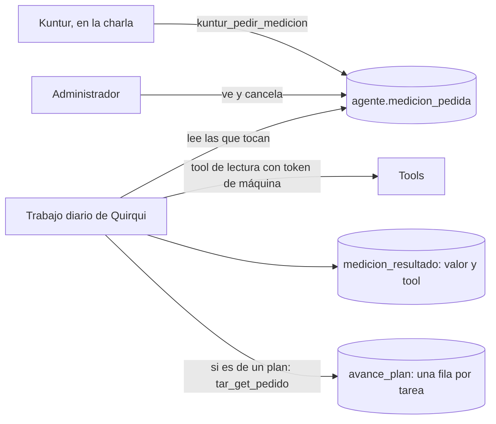

# Mediciones: lo que Kuntur le pide medir a Quirqui

## Objetivo

Qué es: cómo funciona el contrato entre Kuntur y Quirqui para medir (AGENTE-AS-04 y AGENTE-CO-06): qué puede pedir Kuntur, cómo y cuándo lo mide Quirqui, qué ve el administrador y las decisiones que tomé al construirlo. Para quién: el PM, que revisa las decisiones, y quien opere el orquestador. Cuándo leerlo: antes de unir el PR de AGENTE-AS-04 o al programar el trabajo diario. Qué NO cubre: el plan de acción que dispara la medición (AGENTE-CO-04, [`analisis-impacto-plan-accion-kuntur.md`](analisis-impacto-plan-accion-kuntur.md)) ni cómo se instala el cron (está en [`operacion.md`](operacion.md)).

---

## Cómo funciona

- **Kuntur pide** con la tool del motor `kuntur_pedir_medicion`: indicador, parámetros, frecuencia (diaria, semanal o mensual), fecha final (hasta 180 días), alcance y, si es de un plan, el número de pedido. El prompt le pide hacerlo **siempre después de un plan aceptado** (R10) y para un desvío que quiera vigilar.
- **Quirqui mide** en el trabajo programado `python -m agente.mediciones`: solo las activas, dentro de su vigencia, cuyo último resultado es más viejo que la frecuencia. Llama a la tool con el token de máquina de la empresa, saca el número y lo guarda junto con la tool (R4). Si es de un plan, actualiza el avance de cada tarea.
- **El administrador ve y cancela** en la pestaña Kuntur, «Lo que estoy midiendo» (R11).
- **Nunca viaja contenido de conversaciones** (R3): solo números y estados cortos; la base lo vigila desde `019`.

## Qué se puede medir

| Indicador | Qué número guarda |
|---|---|
| `kpi_get_valor` (parámetro `kpi`) | El valor de hoy de ese indicador |
| `tar_get_atrasadas` | Cuántas tareas están atrasadas |
| `tar_get_tareas` (parámetros `hito_id`, `estado`) | Cuántas tareas hay con ese filtro |
| `tar_get_pedidos` (parámetros `buscar`, `todos`) | Cuántos pedidos de trabajo |
| `man_get_kpi_disponibilidad`, `_mttr`, `_mttf`, `_fallas` (parámetro `equipo_id`) | El indicador de los últimos 30 días |

## Avance de una tarea del plan

| Situación | Resultado |
|---|---|
| Eliminada | `cancelada` |
| Sin fecha planificada | sin resultado |
| Finalizada después de lo planificado | `atrasada` |
| Finalizada a tiempo | `en_plazo` |
| Abierta y con la fecha pasada | `atrasada` |
| Abierta y en fecha | `en_plazo` |

La fecha planificada es el fin planificado y, si no tiene, la fecha asignada: el mismo criterio que `tar_get_atrasadas`.

---

## Decisiones

🔴 = necesita tu revisión antes de unir; 🟡 = conviene que la mires; 🟢 = técnica menor.

| # | Decisión | Por qué | Revisión |
|---|---|---|---|
| 1 | Kuntur deja la medición **activa enseguida**, sin tarjeta de confirmación. El administrador la ve y la cancela en «Lo que estoy midiendo» | Solo escribe la base del agente (no toca Tools) y R11 pide ver y cancelar, no aprobar antes. Una tarjeta más en cada plan suma un clic sin proteger nada | 🟡 |
| 2 | Tope de **20 mediciones activas** por empresa y sin duplicados (mismo indicador, parámetros, alcance y pedido) | Que Kuntur no llene la lista ni gaste llamadas | 🟢 |
| 3 | Solo se miden las tools de la tabla de arriba, y además tienen que estar en la lista blanca de Quirqui | Quirqui es el que mide (contrato R3); cada una necesita una regla para sacar el número | 🟢 |
| 4 | Los KPI de Mantenimiento se miden con los **últimos 30 días** | Esas tools piden un período; 30 días es lo mismo que usa el seguimiento de metas | 🟢 |
| 5 | Trabajo diario aparte (`python -m agente.mediciones`, a las 6), no dentro del monitoreo | El monitoreo corre cada hora; medir una vez por día alcanza y no repite llamadas | 🟢 |
| 6 | Clave única por tarea en `agente.avance_plan` (`032`) | La tabla de `019` no tenía clave natural y el trabajo tiene que poder refrescar sin duplicar | 🟢 |
| 7 | Tool `kuntur_pedir_medicion` de clase `generacion`, como `kpi_proponer_meta` | No lee datos de la empresa ni cambia nada en Tools | 🟢 |

---

## Medición del plan y prácticas (AGENTE-CO-05)

Cuando la medición de un plan (una medición con `petr_id`) pasa su fecha final y queda `vencida`, el mismo trabajo diario (`python -m agente.mediciones`) hace tres cosas, en `agente/evaluacion.py`:

1. **Decide si funcionó, con una regla:** compara el **primer** valor medido con el **último** (los días sin valor no cuentan). Si mejoró en el sentido del indicador, **funcionó**; igual o peor, **no funcionó**; con menos de dos valores, **sin datos suficientes**. Queda una fila en `agente.evaluacion_plan` (script `033`), **una sola vez** por medición.
2. **Le avisa al administrador** por los avisos de Tools, firmado por Kuntur, con los dos números, sus fechas y la tool de la que salieron (R4). Si el aviso no sale (API caída o sin `AGENTE_AVISOS_URL`), se reintenta en la próxima corrida sin volver a evaluar; la clave de duplicado es una por medición.
3. **Si funcionó, propone una práctica** en la cola de curaduría (`agente.candidato`, origen `plan_accion`): el indicador, las etapas (hitos) y las tareas del pedido leídas con `tar_get_pedido`, **sin cifras y sin la empresa ni el pedido**. La aprueba o la descarta un curador (ADR-A4).

El panel muestra los planes que terminaron en la pestaña Kuntur, debajo de «Lo que estoy midiendo»: ✅ funcionó, ⚠️ no movió el indicador o ❔ sin datos suficientes, con los dos valores.

### Decisiones de AGENTE-CO-05

| # | Decisión | Por qué | Revisión |
|---|---|---|---|
| 8 | **Hacia dónde mejora** un indicador: lo dice Kuntur en `parametros.mejor` (`subir` o `bajar`); si no lo dice, el sentido habitual (tareas atrasadas, fallas y tiempo de reparación mejoran si **bajan**; disponibilidad y tiempo entre fallas si **suben**); si tampoco se conoce (un KPI del Tablero), **subir** | Sin el sentido no se puede decir si funcionó, y casi todos los KPI del Tablero son "más es mejor". Para uno que no lo sea, Kuntur tiene que decirlo al pedir la medición (regla en `prompts/kuntur.md`) | 🟡 |
| 9 | **Funcionó = mejoró estrictamente** entre el primer y el último valor; igual o peor es "no funcionó". No hay umbral mínimo de mejora ni tendencia | Es la regla más simple de explicar al administrador y no inventa un porcentaje que nadie definió. Si después hace falta un umbral (por ejemplo, la meta del pedido de TAR-METAS), se agrega a la regla | 🟡 |
| 10 | Se evalúan solo las mediciones **vencidas** de un plan; una cancelada por el administrador no se evalúa | Cancelar es decir "esto no me interesa": no corresponde avisar ni proponer práctica | 🟢 |
| 11 | El aviso va a los **suscriptos del tipo** `plan_accion_resultado` (sin destinatario puntual) | La medición no guarda qué administrador aceptó el plan, y avisar a todos los administradores espera Dnato v3 (D-85). Hay que suscribir al administrador a ese tipo de aviso en Tools | 🟡 |
| 12 | La práctica candidata lleva **etapas y tareas del pedido sin números**, la industria de la empresa y nada más; los nombres pueden conservar letras de un código (por ejemplo "pala P-") | Es conocimiento compartido (ADR-A4) y lo revisa un curador antes de que llegue a nadie; sacar números es la limpieza que se puede hacer con una regla | 🟡 el curador tiene que mirar que no queden nombres propios |
| 13 | Origen nuevo `plan_accion` en la cola de curaduría (`033`) en lugar de usar `patron_operativo` | Que el curador sepa que viene de un plan medido, no de un patrón observado en charlas | 🟢 |
