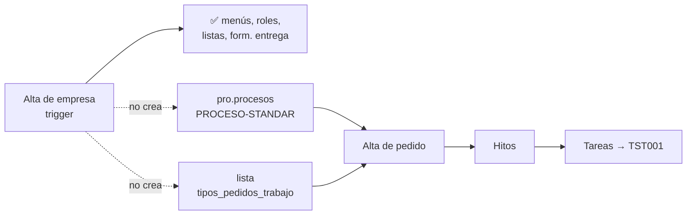

# Análisis de impacto — Una empresa nueva puede crear pedidos de trabajo y planificar tareas con TST001

## Objetivo

Qué es: el análisis de impacto para que una empresa recién dada de alta pueda, sin carga manual,
crear pedidos de trabajo, planificar hitos y generar tareas que lancen el proceso por defecto
**TST001 - Tarea Planificada**. Trae el diagnóstico, el diseño propuesto y lo que hay que verificar en
la base antes de programar. Para quién: Rodolfo (PM). Cuándo leerlo: antes de aprobar el cambio.
Qué NO cubre: los procesos a medida (Yudica, DDPE, SMA), que siguen configurándose a mano como hoy, y
las correcciones de seguridad y de horas de Tareas ([`../specs/TAR-analisis-impacto-correcciones.md`](../specs/TAR-analisis-impacto-correcciones.md)).

## Metadata

- **Fecha:** 2026-11-11
- **Clase de riesgo:** 🔴 (trigger de alta de empresa, schema core) + 🟡 (alta de tarea estándar en
  `traz-comp-tareasestandar`)
- **Diseño pedido por el PM** (2026-11-11, abajo). Sigue el mismo patrón ya aprobado para el formulario
  "Entrega Materiales" ([`impacto-config-formulario-entrega-alta.md`](impacto-config-formulario-entrega-alta.md)).
- **Errores que resuelve:** #578 (empresa nueva sin `PROCESO-STANDAR`), H-110 (proceso sin formulario),
  y la parte de #579/#580 que hace que una tarea estándar no lance TST001.
- **Estado:** esperando aprobación y las verificaciones de §4. **No se modificó ningún archivo de
  código ni de base.**

## Requisitos (PM, 2026-11-11)

1. El uso por defecto de Pedidos de Trabajo es generar tareas con **TST001 - Tarea Planificada**.
2. Si una empresa tiene configurado explícitamente otro proceso (como Yudica en producción), se lanza
   ese proceso. Eso es consultoría aparte y no cambia.
3. Una empresa nueva tiene que poder, de entrada: crear pedidos de trabajo, planificar hitos y generar
   tareas.

## 1. Diagnóstico (verificado en el código y en el DEMO)

- **El alta de pedido necesita una fila de `pro.procesos`.** `Pedidotrabajo::guardarPedidoTrabajo()`
  (`traz-comp-bpm`) busca el proceso de la sesión y, si no hay, `PROCESO-STANDAR` de la empresa
  (`/proceso/nombre/PROCESO-STANDAR/empresa/<empr_id>`). De esa fila saca el estado inicial
  (`esin_id` → `pedidos_trabajo.estado`, NOT NULL), si lanza un caso de Bonita para el pedido
  (`lanzar_bpm`) y el formulario. Sin la fila, el alta falla sin explicar por qué (#578, visto en el
  DEMO con las 2 empresas de prueba).
- **El trigger no la crea.** `core.configuracion_inicial_empresa_trg()` (última versión:
  `_backend/database/scripts/versiones/v2.8.1.3/configuracion_inicial_empresa_trg_func.sql`) crea
  menús, roles, listas de valores y el formulario de entrega. No crea nada de `pro.procesos` ni la
  lista `tipos_pedidos_trabajo`, que el alta de pedido lee por empresa
  (`obtenerTablaEmpr_id('tipos_pedidos_trabajo')`) y que el listado necesita para mostrar el pedido.
- **Sin formulario no se puede guardar el pedido (H-110).** El alta manda `info_id` (la instancia del
  formulario del proceso) y `pro.pedidos_trabajo.info_id` es NOT NULL.
- **TST001 ya está preparado para cada empresa.** El alta de empresa mapea el actor de
  "TST001 - Tarea Planificada" al grupo de la empresa (`toolsCOREAPI.xml`), y `TAREAS_DEFAULT_PROC`
  vale `TST001` en el `constants.php` del repo. Las tareas libres usan esa constante.
- **Las tareas estándar no.** El alta de tarea estándar guarda `proc_id` vacío si no se elige un
  proceso, y una tarea sin proceso no lanza caso (`Tareas::lanzarProceso()`). Además el selector no
  ofrece TST001 (#580).
- **Cómo lo resolvió la prueba completa (local, 2026-11-05):** con el script manual
  `doctest/tests/e2e/seeds/tar/pro-procesos-empresas-test.sql`, que copia la fila `PROCESO-STANDAR`
  de una empresa modelo con su formulario. Con eso pasaron las pruebas de pedidos, hitos y tareas. En
  DEV el pedido va con `lanzar_bpm=false`, porque ese Bonita no tiene el proceso del pedido.

## 2. Diseño propuesto

### Cambio 1 — trigger de alta de empresa (próxima versión libre de scripts; hoy sería `v2.8.1.7`)

Un bloque nuevo en `core.configuracion_inicial_empresa_trg()`, con su propio `begin … exception` como
los demás (si falla, avisa con `raise warning` y la empresa se crea igual):

1. **Copiar el proceso `PROCESO-STANDAR` de la empresa plantilla 9000** a la empresa nueva, cambiando
   `empr_id` y `usuario_app`. Si 9000 no lo tiene, no se hace nada.
2. **Copiar su formulario** (cabecera e ítems), igual que el bloque de "Entrega Materiales", y apuntar
   el `form_id` de la copia del proceso al formulario copiado.
3. **Copiar las listas que el proceso necesita**: `tipos_pedidos_trabajo` de 9000 y, si el estado
   inicial (`esin_id`) es una fila de `core.tablas` de 9000, esa fila, ajustando `esin_id` a la copia.
4. Los valores por defecto los define **la fila de 9000**: ahí se deja `lanzar_bpm=false` (el pedido no
   abre caso propio) y `planificar_tareas=true`. Así el pedido sirve para planificar hitos y las
   tareas lanzan TST001. Una empresa que quiera otro proceso se configura a mano, como hoy.

Copiar desde 9000, en vez de escribir los valores en el trigger, hace que el PM pueda cambiar el
estándar editando la empresa plantilla, sin otra versión del trigger.

### Cambio 2 — tarea estándar sin proceso usa TST001 (`traz-comp-tareasestandar`)

- `Tarea::guardar` y la edición: si `proc_id` llega vacío, se guarda `TAREAS_DEFAULT_PROC`
  (`TST001`). Una tarea estándar nueva lanza TST001 sin que nadie lo elija.
- El selector "Proceso Asociado" muestra TST001 como opción por defecto, más la lista general y la de
  la empresa (C7 de `TAR-analisis-impacto-correcciones.md`).
- **Impacto:** las tareas estándar ya guardadas con `proc_id` vacío no cambian (no se tocan datos).
  Si una empresa usaba a propósito tareas que no abren caso, ahora las nuevas sí lo abren: según el PM,
  el uso esperado es que abran TST001.

### Qué no cambia

- Yudica, DDPE y SMA: tienen su propio proceso (`proccessname` de la sesión) y no pasan por
  `PROCESO-STANDAR`. El trigger solo actúa sobre empresas **nuevas**.
- Empresas existentes sin `PROCESO-STANDAR`: no se tocan. Si hace falta, se carga con el script
  manual de DocTest (decisión aparte).

## 3. Qué se rompe si sale mal

| Riesgo | Efecto | Cómo se cubre |
|---|---|---|
| La clave primaria de `pro.procesos` es solo `proc_id` (así figura en el DDL v1.4 del repo) | La segunda empresa no puede tener `PROCESO-STANDAR`: el bloque falla y avisa, la empresa se crea igual pero sin pedidos (como hoy) | Verificación 4.2 antes de programar. En DEV la prueba completa cargó la fila en varias empresas, así que ahí la clave ya es otra |
| 9000 no tiene `PROCESO-STANDAR` o tiene uno de otra cosa | No se copia nada (como hoy) | Verificación 4.1 y cargar la fila en 9000 en cada ambiente |
| El estado inicial de 9000 apunta a una fila de otra empresa | El pedido nace con un estado que la empresa no ve | Verificación 4.3 |
| El trigger corre en producción en cada alta | Una falla del bloque no debe frenar el alta | Bloque propio con `exception`, igual que los existentes |

## 4. Verificaciones en la base antes de programar (solo lectura)

Se corren en la base de Tools de **DEV o TEST** (VPN), en `psql` o DBeaver, y después en producción
antes de desplegar:

1. ¿La empresa plantilla tiene el proceso?
   `select * from pro.procesos where empr_id = 9000 and proc_id = 'PROCESO-STANDAR' and not eliminado;`
2. ¿Cuál es la clave primaria real de `pro.procesos`?
   `select conname, pg_get_constraintdef(oid) from pg_constraint where conrelid = 'pro.procesos'::regclass;`
3. ¿De dónde sale el estado inicial de 9000?
   `select * from core.tablas where tabl_id = (select esin_id from pro.procesos where empr_id = 9000 and proc_id = 'PROCESO-STANDAR' and not eliminado);`
4. ¿Qué tipos de trabajo tiene 9000?
   `select * from core.tablas where tabla = 'tipos_pedidos_trabajo' and empr_id = 9000;`

## 5. Cómo se prueba

1. En local (servidor web, WSO2 MI y Bonita de la máquina del PM, base DEV): se aplica la versión
   nueva del trigger.
2. Se corre DocTest en modo full (`npm run doctest`), que crea empresas nuevas por la registración,
   **sin** el script manual `pro-procesos-empresas-test.sql`. Tienen que pasar `TAR-CP-002-01` (alta de
   pedido), los de hitos (`TAR-CP-006-*`) y los del ciclo de la tarea hasta la bandeja.
3. Un solo despliegue por ambiente: primero la fila de 9000, después el trigger.
