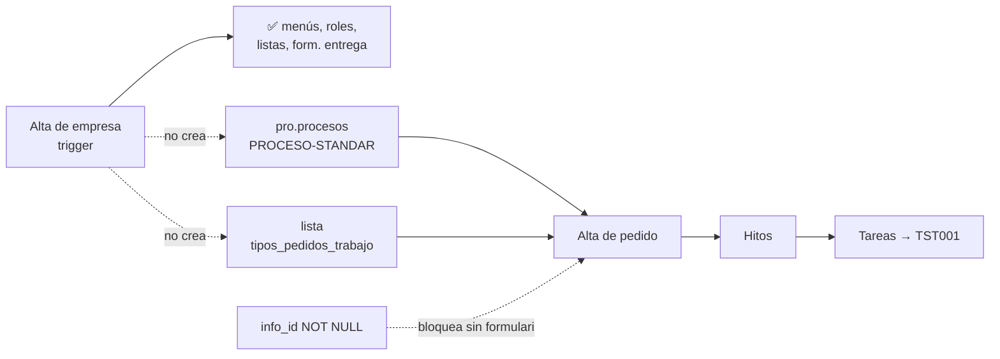

# Análisis de impacto — Una empresa nueva puede crear pedidos de trabajo y planificar tareas con TST001

## Objetivo

Qué es: el análisis de impacto para que una empresa recién dada de alta pueda, sin carga manual,
crear pedidos de trabajo **sin formulario**, planificar hitos y generar tareas que lancen el proceso
por defecto **TST001 - Tarea Planificada**. Trae el diagnóstico, el diseño y lo que hay que verificar
en la base antes de programar. Para quién: Rodolfo (PM). Cuándo leerlo: antes de aprobar el cambio.
Qué NO cubre: los procesos a medida (Yudica, DDPE, SMA), que siguen configurándose a mano como hoy, y
las correcciones de seguridad y de horas de Tareas ([`../specs/TAR-analisis-impacto-correcciones.md`](../specs/TAR-analisis-impacto-correcciones.md)).

## Metadata

- **Fecha:** 2026-11-11 (versión 2: sin formulario obligatorio y sin empresa plantilla)
- **Clase de riesgo:** 🔴 (trigger de alta de empresa y una columna de `pro.pedidos_trabajo`) + 🟡
  (servicio de datos del alta de pedido, `traz-comp-tareasestandar` y `traz-comp-bpm`)
- **Diseño pedido por el PM** (2026-11-11, abajo).
- **Errores que resuelve:** #578 (empresa nueva sin `PROCESO-STANDAR`), H-110 (pedido sin formulario),
  H-118 ("Trabajo Terminado" sin caso) y la parte de #579/#580 que hace que una tarea estándar no lance
  TST001.
- **Estado:** **aprobado por el PM el 2026-11-11**, con el cambio 5 (numeración de hitos) agregado ese
  día. Programado en ramas, sin probar en vivo: faltan las verificaciones de §5 y la prueba de §6.

## Requisitos (PM, 2026-11-11)

1. El uso por defecto de Pedidos de Trabajo es generar tareas con **TST001 - Tarea Planificada**.
2. Si una empresa tiene configurado explícitamente otro proceso (como Yudica en producción), se lanza
   ese proceso. Eso es consultoría aparte y no cambia.
3. Una empresa nueva tiene que poder, de entrada: crear pedidos de trabajo, planificar hitos y generar
   tareas.
4. **El pedido se crea sin formulario.** Si el cliente quiere uno, se lo asocia después por lista de
   valores (o, más adelante, desde el nuevo DNATO).
5. **Sin empresa plantilla 9000:** los valores por defecto los pone el alta de empresa.

## 1. Diagnóstico (verificado en el código y en el DEMO)

- **El alta de pedido necesita una fila de `pro.procesos`.** `Pedidotrabajo::guardarPedidoTrabajo()`
  (`traz-comp-bpm`) busca el proceso de la sesión y, si no hay, `PROCESO-STANDAR` de la empresa. De
  esa fila saca el estado inicial (`esin_id` → `pedidos_trabajo.estado`, NOT NULL), si lanza un caso de
  Bonita para el pedido (`lanzar_bpm`) y el formulario (`form_id`). Sin la fila, el alta falla sin
  explicar por qué (#578, visto en el DEMO con las 2 empresas de prueba).
- **El trigger no la crea.** `core.configuracion_inicial_empresa_trg()` (última versión:
  `_backend/database/scripts/versiones/v2.8.1.3/configuracion_inicial_empresa_trg_func.sql`) crea
  menús, roles, listas de valores y el formulario de entrega. No crea nada de `pro.procesos` ni la
  lista `tipos_pedidos_trabajo`, que el alta lee por empresa (`obtenerTablaEmpr_id`) y que el listado
  necesita (la consulta `getinfopedidotrabajo` hace `pe.tipt_id = t3.tabl_id`: sin tipo, el pedido no
  se ve).
- **Los estados del pedido son una lista general**, no de cada empresa: `estados_procesosPROC_EN_CURSO`
  y `estados_procesosTRABAJO_TERMINADO` (`listar_pedidos_trabajo.php`, `lista_pedidos.php`). El estado
  inicial se puede apuntar a esa lista sin crear nada por empresa.
- **Hoy no se puede crear un pedido sin formulario (H-110), por dos lados:**
  - la base: `pro.pedidos_trabajo.info_id` es NOT NULL (DDL v1.4);
  - el servicio de datos: `setPedidoTrabajo` hace `cast(:info_id as integer)`, que falla con texto vacío.

  La pantalla ya lo contempla: el alta solo manda `info_id` si hay formulario
  (`pedido_trabajo.php`) y el listado muestra "Aún no se completó formulario asociado" si no hay
  (`listar_pedidos_trabajo.php`).
- **"Trabajo Terminado" necesita un caso del pedido.** `finalizarTrabajo()` busca la tarea del caso en
  Bonita; un pedido que no abre caso propio (`lanzar_bpm=false`) responde "El case especificado..." y la
  pantalla no avisa (H-118).
- **TST001 ya está preparado para cada empresa.** El alta de empresa mapea el actor de
  "TST001 - Tarea Planificada" al grupo de la empresa (`toolsCOREAPI.xml:399`) y `TAREAS_DEFAULT_PROC`
  vale `TST001` en el `constants.php` del repo (falta en el del DEMO, #579).
- **Las tareas estándar no lo usan.** Si no se elige proceso, se guardan con `proc_id` vacío y no
  lanzan caso (`Tareas::lanzarProceso()`). Además el selector no ofrece TST001 (#580).

## 2. Diseño

### Cambio 1 — base de datos (próxima versión libre de scripts; hoy sería `v2.8.1.7`) 🔴

1. `alter table pro.pedidos_trabajo alter column info_id drop not null;` con su rollback
   (`set not null`, que solo funciona si no quedaron pedidos sin formulario).
2. Bloque nuevo en `core.configuracion_inicial_empresa_trg()`, con su propio `begin … exception` como
   los demás (si falla, avisa con `raise warning` y la empresa se crea igual). Inserta:
   - en `pro.procesos`: `proc_id='PROCESO-STANDAR'`, `nombre='Proceso Estándar'`,
     `lanzar_bpm=false`, `planificar_tareas=true`, `nombre_bpm=null`,
     `esin_id='estados_procesosPROC_EN_CURSO'`, `form_id=null`, `empr_id=new.empr_id`,
     `usuario_app='core'`;
   - en `core.tablas`: la lista `tipos_pedidos_trabajo` con un valor por defecto, **"General"**
     (propuesta: el PM puede cambiar el nombre o agregar otros).

   `lanzar_bpm=false` significa que el pedido no abre un caso propio: sirve para planificar hitos, y
   cada tarea lanza su caso de TST001.

### Cambio 2 — servicio de datos del alta de pedido (`PRODataService`) 🟡 núcleo

`setPedidoTrabajo`: `cast(:info_id as integer)` pasa a
`case when :info_id is null or :info_id = '' then null else cast(:info_id as integer) end`, igual
que ya hace `setTareaPlanificada`.

### Cambio 3 — formulario opcional por lista de valores (`traz-comp-bpm`) 🟡

El alta de pedido muestra formulario si el proceso tiene `form_id` (como hoy, Yudica y los demás no
cambian). Si no tiene, busca la configuración de la empresa `configuraciones` /
`formulario_pedido_trabajo` en la Lista de Valores (el mismo mecanismo que
`formulario_entrega_materiales`). Si tampoco hay, el pedido se guarda sin formulario. Desde el nuevo
DNATO, el formulario se asociaría escribiendo esa misma configuración.

### Cambio 4 — tareas y "Trabajo Terminado" 🟡

- **Tarea estándar sin proceso usa TST001** (`traz-comp-tareasestandar`, `Tarea::guardar` y la
  edición): si `proc_id` llega vacío, se guarda `TAREAS_DEFAULT_PROC`. El selector "Proceso Asociado"
  muestra TST001 como opción por defecto, más la lista general y la de la empresa (C7 del análisis de
  Tareas). Las tareas ya guardadas no se tocan.
- **"Trabajo Terminado" sin caso** (`Pedidotrabajo::finalizarTrabajo()`): si el pedido no tiene caso
  de Bonita, cambia el estado directamente. Si tiene caso, sigue como hoy. Si el servidor rechaza, la
  pantalla muestra el motivo (H-118).

### Cambio 5 — hitos numerados por pedido (PM, 2026-11-11) 🔴 + 🟡

- `tst.hitos.nro`: número del hito dentro de su pedido (1, 2, 3). Lo asigna el alta del hito
  (`setHito`); los hitos existentes se numeran por orden de alta. `numero` sigue siendo el código
  que carga el usuario. La lista de hitos muestra "Hito N · código".
- La planificación de un hito de pedido recibe el número de hito entero. Antes `Tarea::planificar`
  lo cortaba en el primer 0 y el hito 60 abría la planificación del 6 (H-115).
- **Decisión tomada al programar:** el corte se saca **solo para pedidos de trabajo**. La
  planificación de lotes de producción (`traz-prod-trazasoft`, origen `BATCH`) usa el mismo corte y
  sus tareas ya guardadas tienen el número cortado: si se corrigiera ahí, las tareas viejas de un lote
  con un 0 en su número dejarían de verse. Los pedidos no tienen ese problema porque, según el PM, hoy
  nadie planifica tareas en ellos. El error de los lotes queda anotado como hallazgo aparte.

### Qué no cambia

- Yudica, DDPE y SMA: usan su propio proceso (`proccessname` de la sesión) y sus formularios. El
  trigger solo actúa sobre empresas **nuevas**, y el cambio 3 solo se activa cuando el proceso no tiene
  formulario.
- Empresas existentes sin `PROCESO-STANDAR`: no se tocan. Si hace falta, se cargan con el mismo
  `insert` del trigger (decisión aparte, empresa por empresa).

## 3. Qué lo consume

| Pieza | Quién la usa |
|---|---|
| `pro.pedidos_trabajo.info_id` | alta de pedido (`traz-comp-bpm`), listado y cabecera de pedido (`getForm($info_id)`), planificación de hitos (`Pedidotrabajo::hitos` arma `"0".info_id`), `ddpe-tools-pro`, `yudi-tools-almproc` y `sein-tools-almpantar` en sus procesos (siempre con formulario: no cambian) |
| `setPedidoTrabajo` | solo `Pedidotrabajos::guardarPedidoTrabajo()` |
| `pro.procesos` | alta de pedido, `Tarea.php` (`procesos($proc_id)`), procesos a medida |
| `finalizarTrabajo()` | botón "Trabajo Terminado" del listado de pedidos |

## 4. Qué se rompe si sale mal

| Riesgo | Efecto | Cómo se cubre |
|---|---|---|
| La clave primaria de `pro.procesos` es solo `proc_id` (así figura en el DDL v1.4) | La segunda empresa no puede tener `PROCESO-STANDAR`: el bloque falla y avisa, la empresa se crea igual pero sin pedidos (como hoy) | Verificación 5.1. En DEV la prueba completa cargó la fila en varias empresas, así que ahí la clave ya es otra |
| `estados_procesosPROC_EN_CURSO` no existe en algún ambiente | El insert falla por la clave foránea y el bloque avisa | Verificación 5.2 |
| Código que asume que todo pedido tiene `info_id` | Un pedido sin formulario podría mostrar un error al abrir su cabecera o al planificar hitos | Verificación 5.3 y prueba de punta a punta (§6). `Pedidotrabajo::hitos` concatena `"0".info_id` y `Tarea::planificar` separa por ceros (misma zona que H-115): hay que probarlo con `info_id` nulo |
| El trigger corre en producción en cada alta | Una falla del bloque no debe frenar el alta | Bloque propio con `exception`, igual que los existentes |

## 5. Verificaciones en la base antes de programar (solo lectura)

Se corren en la base de Tools de **DEV o TEST** (VPN), en `psql` o DBeaver, y después en producción
antes de desplegar:

1. Clave primaria real de `pro.procesos`:
   `select conname, pg_get_constraintdef(oid) from pg_constraint where conrelid = 'pro.procesos'::regclass;`
2. El estado inicial existe y es general:
   `select tabl_id, tabla, valor, empr_id from core.tablas where tabl_id = 'estados_procesosPROC_EN_CURSO';`
3. Cómo están hoy las filas `PROCESO-STANDAR` que existen (para copiar sus valores):
   `select proc_id, nombre, empr_id, lanzar_bpm, planificar_tareas, nombre_bpm, esin_id, form_id from pro.procesos where proc_id = 'PROCESO-STANDAR' and not eliminado;`
4. Que la columna sea la del DDL:
   `select is_nullable from information_schema.columns where table_schema = 'pro' and table_name = 'pedidos_trabajo' and column_name = 'info_id';`

## 6. Cómo se prueba

1. En local (servidor web, WSO2 MI y Bonita de la máquina del PM, base DEV): se aplica el script de
   base, se despliega el `.car` con el cambio 2 y el PHP con los cambios 3 y 4.
2. Se corre DocTest en modo full (`npm run doctest`), que crea empresas nuevas por la registración,
   **sin** el script manual `pro-procesos-empresas-test.sql`. Tienen que pasar `TAR-CP-002-01` (alta de
   pedido sin formulario), los de hitos (`TAR-CP-006-*`), "Trabajo Terminado" (`TAR-CP-005-01/02`) y los
   del ciclo de la tarea hasta la bandeja.
3. Se prueba a mano un pedido de Yudica en local (proceso con formulario) para confirmar que no
   cambió.
4. Un solo despliegue por ambiente, en este orden: servicio de datos, PHP, script de base.
