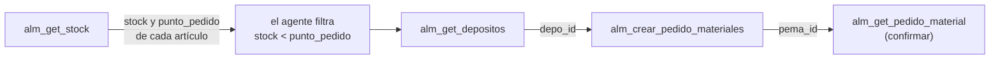

# El conector MCP de Trazalog — pruebas y casos de uso

## Objetivo

Qué es: cómo se comprueba que el conector MCP responde bien: escenarios de uso encadenado y la suite de regresión, la verificación de las consultas contra datos reales y los casos de uso de una operación minera con las tools que faltan. Para quién: quien pruebe el MCP o decida qué tool construir. Cuándo leerlo: antes de cerrar un cambio en una tool o al priorizar tools nuevas. Qué NO cubre: DocTest, que tiene su propia documentación en `doc/v3/TRAZALOG_v3_DOCTEST_*.md` y en `doctest/`.

**Partes:** 1. Escenarios de uso encadenado y suite de regresión · 2. Verificación de las consultas contra datos reales · 3. Casos de uso de operación minera y tools que faltan

---

## Parte 1 — Escenarios de uso encadenado y suite de regresión

Los escenarios de uso real de las tools MCP: qué le pregunta un usuario a Claude, qué tools se
encadenan para responderle, y qué tiene que devolver cada una. Sirve para tres cosas: entender
funcionalmente para qué existe cada tool, ejecutar las pruebas a mano (QA), y correr la suite
automática como regresión antes de un release.

Escrito para quien tenga que validar la capa MCP después de un cambio, o entender por qué falta
una tool.

**No cubre** el despliegue ni la conexión del conector — eso está en
[`deployment-gcp.md`](../v3/deployment-gcp.md) y
[`conectar-claude-a-trazalog.md`](../manuales/conectar-claude-a-trazalog.md).

| | |
|---|---|
| **Última ejecución** | 2026-08-12 — 12/12 escenarios OK, con escrituras reales |
| **Entorno** | MI local `:8290` + bases de desarrollo (`10.142.0.13`) |
| **Suite** | `scripts/dev/mcp_escenarios.py` |

---

### 1. Por qué escenarios encadenados y no tools sueltas

Probar cada tool por separado no encuentra el problema más común: **que una tool pida un dato
que ninguna otra devuelve**. El agente queda trabado a mitad de camino aunque todas las tools
"funcionen".

Ejemplo real que motivó este documento (2026-08-11): el usuario pidió los artículos bajo punto
de pedido y después quiso crear el pedido de reposición. `alm_crear_pedido_materiales` exige un
`depo_id` por artículo — y **ninguna tool devolvía los depósitos**. Las 9 tools pasaban sus
pruebas individuales; el flujo real era imposible de completar.

De ahí salió `alm_get_depositos`. La suite ahora cubre ese encadenado para que no se repita.

---

### 2. Datos de prueba (base de desarrollo)

La empresa **Empresa_Test** tiene datos en las dos bases, y es la que usan los escenarios:

| | PostgreSQL `tools_prod_t` | MySQL `assetv2` |
|---|---|---|
| **ID** | `empr_id = 1` | `id_empresa = 1` |
| **Datos** | 311 artículos · 25 depósitos · 371 pedidos | 4 equipos · 52 solicitudes |

Sus 4 equipos son representativos de una faena:

| ID | Código | Equipo | Estado |
|---|---|---|---|
| 130 | COMP-001 | Compresor de aire Atlas Copco GA37 | AC (activo) |
| 131 | BOMB-001 | Bomba centrífuga Grundfos CM10 | **RE (en reparación)** |
| 132 | GHOR-001 | Grúa horquilla Caterpillar GP25N | AC |
| 133 | GEN-001 | Generador Sullair 750kVA | AC |

Para las pruebas de aislamiento se usa **SEADS** (`empr_id = 87` / `id_empresa = 8`).

> El `id_empresa` de MySQL **no** es el `empr_id` de PostgreSQL. En desarrollo ambos son `1`
> para Empresa_Test por casualidad; en otros ambientes la correspondencia la da
> `core.empresas.empr_id_mysql`.

---

### 3. Los escenarios

#### E1 · Reponer un artículo bajo punto de pedido

**Contexto.** El jefe de almacén revisa qué está por debajo del mínimo antes de que falte en
plena operación, y arma el pedido de reposición.

**Lo que le dice a Claude:**
> «¿Qué artículos tengo por debajo del punto de pedido?»
> «Armá un pedido de reposición para el primero, al depósito principal»

**Encadenado:**



| # | Tool | Qué aporta al paso siguiente |
|---|---|---|
| 1 | `alm_get_stock` | `id`, `stock`, `punto_pedido` de los 311 artículos |
| 2 | *(el agente filtra)* | los 21 que están bajo el mínimo |
| 3 | `alm_get_depositos` | **el `depo_id`** que exige el alta |
| 4 | `alm_crear_pedido_materiales` | `pema_id` del pedido creado |
| 5 | `alm_get_pedido_material` | confirma que quedó registrado |

**Resultado esperado:** el pedido queda en estado `Solicitado` con su `case_id` de Bonita.
Última corrida: `pema_id=1483`.

**Sin `alm_get_depositos` este escenario es imposible** — es la razón de ser de esa tool.

---

#### E2 · Equipo en falla: diagnóstico y orden de trabajo

**Contexto.** El supervisor de mantenimiento revisa qué equipos están detenidos y abre la orden
de trabajo correspondiente.

**Lo que le dice a Claude:**
> «¿Qué equipos tengo en reparación?»
> «Mostrame el detalle de la bomba»
> «Creá una orden de trabajo por vibración excesiva»

**Encadenado:**

| # | Tool | Qué aporta |
|---|---|---|
| 1 | `man_get_equipos` | los 4 equipos con su `estado` |
| 2 | *(el agente filtra)* | el que está en `RE` → BOMB-001 (`id_equipo=131`) |
| 3 | `man_get_equipo(131)` | marca, sector, área, **criticidad** |
| 4 | `man_create_ot` | crea la solicitud + instancia el proceso en Bonita |
| 5 | `man_get_ot` | confirma estado `S` (solicitada) |

**Resultado esperado:** OT creada con `ot_id` y `case_id`. Última corrida: `ot_id=293`,
`case_id=30006`.

---

#### E3 · Auditar las órdenes de trabajo abiertas

**Contexto.** Reunión de planificación: qué hay pendiente y dónde.

**Lo que le dice a Claude:**
> «¿Qué órdenes de trabajo tengo abiertas?»
> «¿Dónde está el equipo de la más reciente?»

| # | Tool | Qué aporta |
|---|---|---|
| 1 | `man_get_ots` | las 53 solicitudes con estado |
| 2 | `man_get_ots(estado="S")` | filtro server-side; **todas deben venir en ese estado** |
| 3 | `man_get_ot(id)` | equipo, sector y **ubicación física** |

**Resultado esperado:** el detalle ubica el equipo (ej. *"Sala de bombas Circuito 2"*), que es
lo que el técnico necesita para ir.

---

#### E4 · Seguir el estado de los pedidos de materiales

**Contexto.** Compras quiere saber qué se pidió y en qué anda.

**Lo que le dice a Claude:**
> «¿Cómo vienen mis pedidos de materiales?»
> «Mostrame qué tiene el último»

| # | Tool | Qué aporta |
|---|---|---|
| 1 | `alm_get_pedidos_materiales` | los 372 pedidos con su estado |
| 2 | *(el agente agrupa)* | Solicitado 130 · Entregado 90 · Planificado 39 |
| 3 | `alm_get_pedido_material(id)` | encabezado **+ las líneas de artículos** |

**Resultado esperado:** el detalle incluye `detalles.detalle[]` con `arti_id`, `cantidad`,
`descripcion` y `barcode` de cada línea.

---

#### E5 · Aislamiento multi-tenant (ADR-012)

**Contexto.** No es un caso de uso: es la garantía de que una empresa nunca ve datos de otra.
Es el escenario más importante de la suite.

Se ejecutan las mismas tools con dos identidades distintas (Empresa_Test y SEADS) y se verifica:

| Verificación | Esperado |
|---|---|
| Artículos de una vs otra | **0 en común** (311 vs 7) |
| Depósitos de una vs otra | **0 en común** (25 vs 3) |
| Pedir por ID un pedido ajeno | respuesta **vacía**, sin error |
| Pedir por ID un equipo ajeno | respuesta **vacía**, sin error |

> La respuesta a un recurso ajeno es **vacía, no un error**: así el agente no puede inferir si
> el ID existe en otra empresa.

---

#### E6 · Coherencia entre listado y detalle

**Contexto.** Que la misma entidad no se describa distinto según por dónde se la consulte — si
`man_get_equipos` dice que un equipo está activo y `man_get_equipo` dice otra cosa, el agente
razona sobre datos contradictorios.

| Verificación | Esperado |
|---|---|
| `código`, `descripción`, `estado` del equipo | idénticos en listado y detalle |
| `estado` del pedido | idéntico en listado y detalle |
| Acentos en las descripciones | sin mojibake (ver §5) |

---

#### E8 · Preventivos vencidos y cobertura del plan

**Contexto.** La consulta que el jefe de mantenimiento hace todos los días, y la que las mineras
auditan: ¿el plan existe, se cumple, y cubre los equipos que importan?

**Lo que le dice a Claude:**
> «¿Qué mantenimientos tengo vencidos?»
> «¿Qué equipos no tienen plan preventivo? ¿Alguno es crítico?»

| # | Tool | Qué aporta |
|---|---|---|
| 1 | `man_get_preventivos` | plan, periodicidad, intervalo, `estadoprev` y criticidad del equipo |
| 2 | *(el agente filtra)* | los que están en `VE` (vencido) |
| 3 | *(el agente cruza con `man_get_equipos`)* | los equipos que **no aparecen** no tienen plan |

**Resultado esperado:** además de los vencidos, detecta los equipos sin cobertura y los prioriza
por criticidad. En los datos de prueba: 2 de 4 equipos sin plan, **ambos críticos**
(GEN-001 Muy Alta, GHOR-001 Alta).

---

#### E9 · Aislamiento del plan preventivo

Verifica que dos empresas no compartan planes, y —específicamente— que no se filtren los
registros donde `preventivo.id_empresa` no coincide con el del equipo. En la base de desarrollo
hay 130 así (datos basura confirmados con el PM): el filtro estricto los excluye.

---

#### E10 · Stock filtrado por depósito, tipo y búsqueda

**Contexto.** El stock total no sirve si el material está en otra faena, y con catálogos grandes
tampoco sirve traerlo entero.

**Lo que le dice a Claude:**
> «¿Cuántos insumos tengo en el depósito de Zaranda?»
> «¿Tengo filtros de aire y aceite hidráulico?»

Los tres filtros de `alm_get_stock` son opcionales y combinables:

| Filtro | Efecto |
|---|---|
| `depo_id` | solo artículos con stock ahí, y el `stock` pasa a ser el de ese depósito |
| `tipo` | por nombre legible: Insumo, Materia Prima, Producto… |
| `buscar` | texto libre sobre la descripción |

**`buscar` es la pieza del caso donde Claude aporta el conocimiento de dominio**: releva por su
cuenta qué insumos son clave en minería y después consulta por esos.

El escenario verifica que cada filtro devuelva **solo** lo que corresponde, que combinarlos
acumule, y que **sin filtros la respuesta sea idéntica a la de antes** (retrocompatible).

---

#### E11 · Lotes vencidos y por vencer

**Contexto.** Lubricantes, adhesivos y reactivos tienen vida útil; un lote vencido usado en un
mantenimiento es un problema de calidad.

`alm_get_vencimientos` devuelve los lotes **con stock** y fecha, ya clasificados: `Vencido` ·
`Critico` (menos de 10 días) · `Activo`, con los días restantes.

El escenario verifica que la clasificación coincida con los días en **todos** los lotes (344 en
los datos de prueba, de los cuales 55 vencidos).

---

#### E12 · Equipos sin control de lecturas

**Contexto.** Un preventivo por Horas/Km/Ciclos **no se puede evaluar** si nadie toma la lectura.
Este escenario audita el plan de medición, no el de mantenimiento.

`man_get_lecturas` devuelve un registro por equipo — incluidos los que **nunca** tuvieron una
lectura, que son los relevantes.

**Resultado en datos reales** (empresa 8): de 68 equipos, **42 sin ninguna lectura** y 26 con más
de 90 días; **14 de esos son críticos**, el peor con 2296 días.

El escenario además cruza con `man_get_preventivos` para detectar **planes por uso sobre equipos
sin lecturas**: planes que nadie puede saber si vencieron.

---

#### E7 · El contrato publicado no se desincroniza de lo implementado

**Contexto.** La OpenAPI (`doc/api/trazalog-operaciones.yaml`) es lo que consume el Virtual MCP
Server del APIM para generar las tools. Es un artefacto **separado** del `toolsMCPAPI.xml` del
MI, así que pueden divergir sin que nadie lo note:

| Divergencia | Qué pasa |
|---|---|
| Declarada en la OpenAPI, no implementada en el MI | la tool aparece en Claude y **falla con 404** al usarla |
| Implementada en el MI, no declarada | la tool es **invisible** para el agente |

Se verifica que ambos conjuntos de rutas coincidan y que no haya `operationId` duplicados. Es el
único escenario que no necesita el MI corriendo — solo lee los dos archivos.

**Resultado esperado:** 9 rutas declaradas, todas implementadas, 10 `operationId` únicos.

---

### 4. Cómo ejecutar

#### Automático (regresión)

```bash
# Requiere: MI local en :8290 con el CAR desplegado, y VPN a las bases de desarrollo
python3 scripts/dev/mcp_escenarios.py              # solo lectura — seguro, no crea nada
python3 scripts/dev/mcp_escenarios.py --escrituras # incluye crear OT y pedido reales
python3 scripts/dev/mcp_escenarios.py --lista      # ver los escenarios sin ejecutar
```

Variables: `MI_URL` (default `http://localhost:8290`), `EMPR_ID`, `EMPR_ID_MYSQL`,
`OTRA_EMPR`, `OTRA_EMPR_MYSQL`.

Devuelve **exit code ≠ 0** si algún escenario falla → apto para CI.

> **`--escrituras` crea datos reales**: un pedido de materiales y una orden de trabajo, ambas
> con la justificación `[TEST Ex descartable]` y una instancia real en Bonita. Correr solo
> contra desarrollo. Sin ese flag, los escenarios de escritura validan todo el encadenado hasta
> el paso previo al alta.

#### Manual (QA desde Claude)

Con el conector configurado, escribir en el chat las preguntas de cada escenario (están en
*"Lo que le dice a Claude"*) y verificar:

1. Que Claude use **las tools esperadas** — se ven en el panel de herramientas de la conversación.
2. Que **no pida datos que debería poder buscar solo**. Si pregunta "¿a qué depósito?" en vez de
   consultar `alm_get_depositos`, hay un problema de descripción de la tool, no de datos.
3. Que **pida confirmación antes de escribir** (crear OT o pedido).
4. Que los números coincidan con los de la app v2 para la misma empresa.

---

### 5. Hallazgos abiertos

#### 5.0 El DDL versionado de `movimientos_historicos_vw` no refleja la vista real 🟡

`application/modules/traz-comp-almacenes/_backend/database/scripts/versiones/v1.5 tools/movimientos historicos view.sql`
quedó atrás respecto de la vista que está en las bases. Verificado el 2026-08-24 contra
desarrollo, difiere en tres puntos:

| | El script dice | La base tiene |
|---|---|---|
| `empr_id` | no existe | existe, y **todo el aislamiento depende de él** |
| Nombres de `tipo_mov` | `MOV. SALIDA`, `INGRESO PRODUCTO`, … | `MOV.SALIDA`, `INGRESOPRODUCTO`, `ETAPAPRODINGRESO`, `ETAPAPRODEGRESO` |
| Rama `MOV. SALIDA` | une por `lote_id_destino` | usa el lote de **origen** |

**Por qué importa:** `getHistoricoMovimientos` filtra por `mh.empr_id` y `alm_get_movimientos` le
pasa el de la empresa del token. Si alguien ejecuta ese archivo para "restaurar" la vista, la
columna desaparece, la query falla — o peor, si se la adapta sin el filtro, cada empresa pasa a
ver los movimientos de todas (ADR-012).

El tercer punto era una sospecha de bug que **no se confirmó**: la vista desplegada está bien. El
traslado 50 (DEPO_RNS_TEST_1 → Playa) reporta `DEPO_RNS_TEST_1` en la pata `MOV.SALIDA` y `Playa`
en la `MOV.ENTRADA`, que es lo correcto. El error está solo en el archivo.

**Estado:** se agregó una advertencia en la cabecera del `.sql`, donde la va a leer quien lo abra
para ejecutarlo. **El cambio está sin commitear**: `traz-comp-almacenes` es un submódulo (otro
repo) y además está en HEAD detached. Requiere decidir rama y PR en ese repo.

**Lo que hay que hacer:** exportar el DDL vigente (`\d+ alm.movimientos_historicos_vw` en psql) y
versionarlo, en vez de mantener a mano una copia que ya divergió.

#### 5.1 Mojibake en las descripciones de equipos 🟡

`man_get_equipos` devuelve `"Bomba centrífuga"` en vez de `"Bomba centrífuga"` para 3 de los 88
equipos de la base de desarrollo.

**Causa (verificada):** la columna `equipos.descripcion` de `assetv2` es **latin1**, pero esas 3
filas tienen bytes **UTF-8** guardados adentro. Cuando el driver JDBC pide los datos como UTF-8,
MySQL convierte latin1→UTF-8 y produce el doble encoding: `c3 ad` (í correcto) se transforma en
`c3 83 c2 ad`.

**No se puede arreglar cambiando el datasource**, y este es el punto importante: de las 8 filas
con acentos, **5 están en latin1 correcto y 3 en UTF-8**. La configuración actual
(`characterEncoding=UTF-8`) es la correcta para las 5 buenas; cambiarla arreglaría las 3 malas y
rompería las otras 5.

| Guardado como | Filas | Ejemplo | Hoy se ve |
|---|---|---|---|
| latin1 (correcto) | 5 | `Noqueador Neumático STUN-BP1` | bien |
| UTF-8 en columna latin1 | 3 | `Bomba centrífuga Grundfos CM10` | **mal** |

Las 3 afectadas (BOMB-001, GHOR-001, BOMB-SJ-001) son las que se cargaron en el smoke test de
Sprint 2 — o sea que el problema lo introduce la vía por la que se cargaron esos datos, no la
capa MCP.

**Es corrección de datos, no de configuración** (🔴, requiere decisión): hay que normalizar esas
filas puntuales. Diagnóstico reproducible:

```sql
SELECT id_equipo, codigo, HEX(descripcion) FROM equipos WHERE descripcion REGEXP '[^ -~]';
```

Los valores cuyos bytes sean UTF-8 válido son los que están mal guardados.

#### 5.2 Escenarios no cubiertos todavía

- **Vencimientos de lotes.** `getLotesVencimientos` ya existe en `ALMDataService` y clasifica en
  Crítico/Advertencia. Relevante para insumos con vida útil (lubricantes, filtros). No hay tool
  que lo exponga.
- **Movimientos históricos de stock.** `getHistoricoMovimientos` existe; permitiría responder
  «¿cuánto consumimos de este artículo el mes pasado?».
- **Ajustes de stock y recepción de materiales.** Existen en el DataService; son escrituras, así
  que requieren la misma cautela que `alm_crear_pedido_materiales`.

---

### 6. Contrato de las respuestas (para escribir tests)

Cada tool envuelve el resultado con un nombre propio. Equivocarse de wrapper hace que un test
lea 0 elementos y parezca un bug de datos — pasó al escribir esta suite.

| Tool | Camino en el JSON |
|---|---|
| `man_get_equipos` | `equipos.equipo[]` |
| `man_get_preventivos` | `preventivos.preventivo[]` |
| `man_get_lecturas` | `lecturas.equipo[]` |
| `man_get_equipo` | `equipo` (objeto) |
| `man_get_ots` | `solicitudes.solicitud[]` |
| `man_get_ot` | `solicitudes.solicitud[]` |
| `man_create_ot` | `resultado`, `ot_id`, `case_id`, `estado` |
| `alm_get_stock` | `materias.materia[]` |
| `alm_get_depositos` | `depositos.deposito[]` |
| `alm_get_vencimientos` | `vencimientos.lote[]` |
| `alm_get_pedidos_materiales` | `pedidos.pedido[]` |
| `alm_get_pedido_material` | `pedidos.pedido[]` (con `detalles.detalle[]`) |
| `alm_crear_pedido_materiales` | `resultado`, `pema_id`, `case_id`, `estado` |

> Cuando no hay resultados el wrapper viene **vacío** (`{"materias":{}}`), y cuando hay **uno
> solo** viene como objeto en vez de lista. El helper `lista()` de `mcp_tools_client.py`
> normaliza los tres casos.

---

## Parte 2 — Verificación de las consultas contra datos reales

Registro de la verificación de que las **9 tools MCP devuelven datos completos, sin duplicados
y sin fugas entre empresas**, ejecutando las queries reales de los DataServices contra las bases
de desarrollo. Escrito para quien tenga que re-verificar esto tras un cambio en un `.dbs`, o
diagnosticar por qué una tool devuelve vacío o datos raros.

**No cubre** el despliegue de la fachada MCP ni la configuración de identidad — eso está en
[`doc/v3/deployment-gcp.md`](../v3/deployment-gcp.md) §6 y §7.

| | |
|---|---|
| **Fecha** | 2026-08-11 |
| **Ejecutado contra** | `tools_prod_t` @ `10.142.0.13:5432` (PostgreSQL 11.18) y `assetv2` @ `10.142.0.13:3306` (MariaDB 10.1.48) |
| **Scripts** | `scripts/dev/verify-mcp-queries.py`, `scripts/dev/verify-mcp-isolation.py` |
| **Resultado** | 23/23 completitud OK · 19/19 aislamiento OK · 18/18 en la pasada exhaustiva |
| **Confirmado en GCP** | 2026-08-11 — `alm_get_stock` devuelve datos reales desde Claude vía `mcp.cloudtrazalog.com` (Barra de acero 50.0, Barra de acero cortada 307.0, Eje 51.0) |

---

### 1. Antes de mirar las queries: contra qué base está apuntando el MI

**Es lo primero a descartar cuando una tool devuelve `{}` vacío**, y lo que más tiempo costó
diagnosticar: la query puede estar perfecta y aun así no devolver nada si corre contra la base
equivocada.

Los datasources viven **embebidos en el `.car`** (`src/main/wso2mi/artifacts/data-sources/`), así
que cada instancia necesita su propia copia del repo con las URLs de su ambiente. Verificar cuál
quedó realmente desplegada — no alcanza con mirar el XML del repo:

```bash
cd /tmp && cp /opt/wso2/wso2mi-4.5.0/repository/deployment/server/carbonapps/ToolsAPIProject_1.0.0.car tap.zip
unzip -o tap.zip >/dev/null
cat ToolsDataSource_1.0.0/ToolsDataSource-1.0.0.xml
cat AssetPlannerDataSource_1.0.0/AssetPlannerDataSource-1.0.0.xml
```

> **Ojo con el nombre de la base, no solo con el host.** En TEST conviven en el **mismo servidor y
> puerto** (`10.142.0.11:5434`) más de una base con esquema equivalente. Un datasource apuntando a
> la base equivocada del servidor correcto da exactamente el mismo síntoma que un host equivocado:
> HTTP 200 con la estructura vacía. Comparar el `<url>` completo contra la base donde realmente se
> ven los datos.

**Y las dos URLs para probar, que es fácil confundir:**

| URL | API | ¿JWT? | `empr_id` |
|---|---|---|---|
| `/tools/mcp/mcp/alm/stock` | `toolsMCPAPI` (fachada MCP) | **Sí** — sin él, `503 identity_missing` | Derivado del `X-JWT-Assertion` |
| `/tools/alm/stock/{empr_id}` | `toolsALMAPI` (orquestación) | No | **Explícito en la URL** |

El doble `/mcp/mcp` de la primera no es un error de tipeo: el contexto de la API es `/tools/mcp` y
sus resources están prefijados por módulo (`/mcp/man/…`, `/mcp/alm/…`) por decisión de ADR-013.

```bash
# 1) ¿está viva la fachada MCP?  -> 503 identity_missing es la respuesta CORRECTA sin JWT
curl -i http://localhost:8290/tools/mcp/mcp/alm/stock

# 2) ¿la cadena orquestación -> DataService -> base devuelve datos? (saltea identidad)
curl -s http://localhost:8290/tools/alm/stock/<empr_id-con-datos>
```

- (1) da `503` y (2) devuelve datos → la plomería está bien; si la tool igual falla, el problema
  está en la identidad (JWT, `empr_id` mal resuelto, `empr_id_mysql` en NULL).
- (2) devuelve vacío con un `empr_id` que **sabés** que tiene datos → base equivocada o query.
- **(2) responde `main sequence executed for call to non-existent`** en el log del MI → la API no
  está desplegada: el CAR se construyó incompleto o su deploy falló. Revisar
  `Successfully Deployed Carbon Application` / `Error occurred while deploying` en el log.

> **Nota sobre credenciales:** los datasources llevan usuario y contraseña en texto plano dentro
> del artefacto versionado (ya señalado en `deployment-gcp.md` §5). Sacarlos del `.car` — WSO2 MI
> soporta `[[datasource]]` en su `deployment.toml`, que además permitiría config por ambiente sin
> tocar el artefacto — es una mejora pendiente de decisión (🔴).

---

### 2. Set de datos de referencia (base de desarrollo)

Empresas con datos suficientes para probar cada tool:

#### PostgreSQL — `tools_prod_t` (tools `alm_*`)

| `empr_id` | Empresa | Artículos activos | Lotes c/stock | Pedidos |
|---|---|---|---|---|
| **1** | Empresa_Test | 311 | 350 | 371 |
| 9 | descri232323 | 836 | 0 | 0 |
| 4 | Isola Asti | 640 | 0 | 0 |
| 777 | Yudica | 13 | 5 | 140 |
| 87 | SEADS | 7 | 30 | 1 |

**`empr_id = 1` es la mejor para pruebas end-to-end**: es la única con artículos, lotes con stock
y pedidos a la vez.

#### MySQL/MariaDB — `assetv2` (tools `man_*`)

| `id_empresa` | Equipos activos | Solicitudes |
|---|---|---|
| **8** | 68 | 27 |
| 6 | 12 | 197 |
| 1 | 4 | 52 |
| 17 | 3 | 0 |
| 9 | 1 | 1 |

> Ojo: el `id_empresa` de `assetv2` **no** es el `empr_id` de PostgreSQL. La correspondencia la
> da `core.empresas.empr_id_mysql` (ver `deployment-gcp.md` §7.0-quinquies).

---

### 3. Bugs encontrados y corregidos

Los cuatro se detectaron comparando lo que devuelve cada query contra un conteo de control
independiente sobre la tabla base.

#### 3.1 `alm_get_stock` sumaba stock de otras empresas 🔴

`getArticulos2` filtraba el artículo por empresa, pero unía los lotes **sin** filtrarlos:

```sql
LEFT JOIN alm.alm_lotes C ON C.arti_id = A.arti_id     -- ← sin condición de empresa
WHERE A.empr_id = cast(:empr_id as integer)
```

En desarrollo había 6 lotes cuyo `empr_id` no coincide con el del artículo, y eso inflaba el
stock reportado:

| Empresa | Artículo | Reportaba | Real | Ajeno |
|---|---|---|---|---|
| 87 | Residuos Organicos | 5982 | 2981 | **3001** |
| 1 | Prueba 5 MODIF | 181.5 | 38 | **143.5** |
| 87 | Residuos Urbanos | 1552 | 1551 | 1 |

**Fix:** `... ON C.arti_id = A.arti_id AND C.empr_id = A.empr_id`. No cambia el número de filas
devueltas, solo el valor de `stock`.

#### 3.2 `man_get_equipos` ocultaba equipos con catálogos incompletos

`getEquipos` hacía `INNER JOIN` contra 6 catálogos descriptivos (marca, sector, grupo,
criticidad, área, proceso). Un equipo con cualquiera de esos IDs inválido **desaparecía del
inventario**.

En desarrollo, 2 equipos de la empresa 8 tienen `id_grupo` en `-1` y `0` (valores centinela que
no existen en `grupo`), y ambos están en estado **`RE` (en reparación)** — justo el caso de uso
que la descripción de la tool declara cubrir. 68 equipos reales, 66 devueltos.

**Fix:** los 6 catálogos pasan a `LEFT JOIN`. `empresas` queda como `INNER JOIN` (de ahí sale el
`empr_id`, y ningún equipo tiene empresa inválida). Mismo criterio aplicado a `getEquipoIsolated`
(`man_get_equipo`), que tenía el mismo patrón.

#### 3.3 `man_get_ots` perdía y duplicaba solicitudes a la vez

Dos defectos que se compensaban parcialmente, por eso el total parecía casi correcto:

- **Perdía**: `INNER JOIN equipos` descartaba las solicitudes con `id_equipo = -1` (equipo
  borrado). En la empresa 6 eran 2, ambas en estado `S` (solicitado) — OTs abiertas invisibles.
- **Duplicaba**: `LEFT JOIN orden_trabajo ON sr.case_id = ot.case_id` asume 1:1, pero el modelo
  admite **varias OT por `case_id`** (`orden_trabajo.id_orden` es la PK). 3 solicitudes de la
  empresa 6 aparecían dos veces.

Neto: 197 reales → 198 devueltas.

**Fix:** `equipos`/`sector` pasan a `LEFT JOIN`, y la unión a `orden_trabajo` se desambigua
tomando la orden más reciente del caso:

```sql
LEFT JOIN orden_trabajo ot
       ON ot.case_id = sr.case_id
      AND ot.id_orden = (SELECT MAX(ot2.id_orden) FROM orden_trabajo ot2
                          WHERE ot2.case_id = sr.case_id)
```

(subconsulta correlacionada porque MariaDB 10.1 no tiene window functions)

#### 3.4 `man_get_ot` devolvía la misma solicitud dos veces

`getSolicitudServicioById` tenía el mismo problema 1:N con `orden_trabajo`. Para la solicitud 75
devolvía 2 filas. Mismo fix.

---

### 4. Cómo re-verificar

```bash
export MCP_DB_HOST=10.142.0.13
export MCP_MYSQL_PASS='...'   # usuario rootremote de assetv2
export MCP_PG_PASS='...'      # usuario postgres de tools_prod_t

python3 scripts/dev/verify-mcp-queries.py     # completitud: filas devueltas vs control
python3 scripts/dev/verify-mcp-isolation.py   # aislamiento: ninguna fila de otra empresa
```

Los scripts **extraen el SQL directamente de los `.dbs`** y lo ejecutan, así que verifican el
código real del repo, no una copia. Devuelven exit code distinto de 0 si algo falla, o sea que
sirven para CI.

> **Al contar filas, no cuentes líneas de salida.** Los campos de texto pueden tener saltos de
> línea embebidos (la solicitud 121 de la empresa 6, por ejemplo) y eso infla el conteo. Los
> scripts envuelven cada query en `SELECT count(*) FROM (...) _c`. Un falso positivo por esto
> costó una vuelta entera de diagnóstico.

---

### 5. Resultado

**Completitud** — cada query devuelve exactamente las filas que existen en la tabla base:

```
man_get_equipos   empresas 8, 6, 1, 17, 9        OK (68, 12, 4, 3, 1)
man_get_ots       empresas 8, 6, 1, 17, 9        OK (27, 197, 52, 0, 1)
man_get_ot        solicitudes 75, 117, 127       OK (1 fila cada una)
man_get_equipo    equipos 2 y 3 (grupo roto)     OK (1 fila cada uno)
alm_get_stock     empresas 1, 87, 777, 9, 4      OK (311, 7, 13, 836, 640)
alm_get_pedidos   empresas 1, 777, 87            OK (371, 140, 1)
```

**Aislamiento (ADR-012)** — ninguna query devuelve filas de otra empresa, y el `stock` reportado
coincide exactamente con la suma de los lotes propios. Verificado además que pedir un recurso
ajeno por ID (equipo de la empresa 8 solicitado por la 6, solicitud de la 6 pedida por la 8)
devuelve 0 filas.

**Pasada exhaustiva** — no solo el set de muestra: se corrió cada query contra **todas** las
empresas que tienen datos, verificando completitud y ausencia de filas ajenas en cada una.

| Query | Empresas verificadas | Resultado |
|---|---|---|
| `getEquipos` | 1, 6, 8, 9, 17 | 5/5 OK |
| `getOTsByEmpresa` | 1, 6, 8, 9 | 4/4 OK |
| `getArticulos2` | 1, 2, 3, 4, 9, 87, 99, 181, 777 | 9/9 OK |

---

### 6. 🔴 Requiere decisión: solicitudes que apuntan a equipos de otra empresa

**Encontrado el 2026-08-11. No se corrigió — necesita una definición de negocio antes de tocar
nada.**

En `assetv2` hay **203 solicitudes de reparación cuyo equipo pertenece a otra empresa**:

| Empresa de la solicitud | Equipos de la empresa | Cantidad |
|---|---|---|
| 1 | 8 | 48 |
| 6 | 8 | 155 |

Como `man_get_ots` y `man_get_ot` unen `solicitud_reparacion` con `equipos` para traer el código,
sector y ubicación, **la empresa 6 termina viendo el código y la ubicación de 155 equipos de la
empresa 8**. Las queries filtran correctamente por `sr.id_empresa` (las solicitudes SÍ son
propias), pero los campos del equipo salen del registro ajeno.

**Por qué no se corrigió por cuenta propia:** hay dos lecturas posibles y llevan a soluciones
opuestas.

- **Si son datos sucios** (lo más probable dado que las 203 apuntan a la misma empresa 8, con
  aspecto de carga de prueba mal hecha): hay que limpiar los datos, y además blindar la query con
  `AND e.id_empresa = sr.id_empresa` en el join para que el aislamiento no dependa de la calidad
  del dato.
- **Si es un caso de negocio legítimo** — una empresa de servicios haciendo mantenimiento sobre
  equipos de un cliente, que es exactamente el modelo de los proveedores mineros al que apunta
  v3 — entonces la query está bien y lo que falta es modelar esa relación explícitamente.

Blindar el join sin resolver esa pregunta haría desaparecer el equipo de 203 OTs que hoy se ven,
en ambas lecturas por el motivo equivocado.

**Riesgo asociado, independiente de la respuesta:** `man_create_ot` **no valida que el
`equipo_id` recibido pertenezca a la empresa del JWT**. Toma el valor del payload del agente y lo
inserta con el `id_empresa` del token, sin chequeo previo (`toolsMCPAPI.xml`, resource
`POST /mcp/man/ot`). Un agente puede crear una OT sobre un equipo ajeno y disparar el proceso BPM
correspondiente. `toolsMANAPI` sí tiene el patrón de validación (`getEquipoIsolated`), pero la
fachada MCP no lo aplica antes del INSERT.

Además, el paso 2 de ese flujo usa:

```sql
select max(sr.id_solicitud) sose_id, sr.id_equipo equiid
  from solicitud_reparacion sr where sr.id_equipo = :equi_id
```

que **no filtra por empresa** y recupera el ID con un `max()` — susceptible a race condition si
dos altas concurrentes tocan el mismo equipo. El patrón correcto sería que el INSERT devuelva la
clave generada (`returnGeneratedKeys="true"`, ya usado en `setEmpresa` del mismo DataService) en
vez de releerla después.

No se tocó ninguna de las dos cosas porque `man_create_ot` es la única tool de escritura: probarla
crea registros reales e instancia procesos en Bonita.

---

### 7. Lo que queda pendiente

- **`alm_crear_pedido_materiales` no se verificó**: es la única tool de escritura y probarla
  crea registros reales + instancia un proceso en Bonita. Requiere decidir contra qué ambiente
  se prueba y cómo se limpia después.
- **16 queries de `ALMDataService` que usa el PHP de v2** tienen el mismo patrón de join a
  `alm_lotes` sin filtro de empresa que el bug 3.1 (`getArticulos`, `getArticulo`,
  `getArticulosXTipo`, `getStock`, `getStockValorizado`, …). **No se tocaron** porque están fuera
  del alcance MCP y no se pueden probar sin la app v2. Vale la pena revisarlas: si el dato de
  stock que muestra v2 sale de esas queries, tiene el mismo sesgo.
- **`ALMDataService.dbs` tiene dos resources con el mismo path** `/articulos/{empr_id}` (líneas
  569 → `getArticulos` y 633 → `getArticulos2`), con wrappers JSON distintos (`articulos` vs
  `materias`). Hoy gana el segundo, que es el que `toolsALMAPI` espera — pero depende de cuál
  resuelve primero el DSS. Conviene eliminar el duplicado; no se hizo porque `getArticulos`
  podría estar en uso por v2.

---

## Parte 3 — Casos de uso de operación minera y tools que faltan

Qué le va a preguntar a Claude un proveedor de servicios mineros, qué se puede responder **hoy**,
y qué falta construir. Cruza los casos de alto impacto identificados en
[`investigacion-sector-minero-trazalog-v3-2.md`](../v3/investigacion-sector-minero-trazalog-v3-2.md)
con el relevamiento de modelos de
[`codeigniter-models-survey.md`](../historial/api/codeigniter-models-survey.md) y con lo que realmente hay
en las bases.

Escrito para decidir qué tools construir y en qué orden. No documenta lo ya construido — eso está
en [`escenarios-de-uso-y-regresion.md`](pruebas-y-casos.md).

| | |
|---|---|
| **Fecha** | 2026-08-11 |
| **Relevado contra** | `assetv2` (Asset Planner) y `tools_prod_t` (Almacenes), base de desarrollo |
| **Resultado** | 21 casos · **12 cubiertos** · 9 con gap |

> **Sobre los datos de prueba:** la base de desarrollo tiene datos agrícolas y de laboratorio, no
> mineros. Los equipos sí incluyen maquinaria real (generador, autoelevador, equipo de corte,
> turbina) y las tareas preventivas son textualmente de maquinaria pesada. Los casos son válidos
> funcionalmente; los ejemplos con insumos mineros son ilustrativos.

---

### 1. Hallazgos que cambian el plan

Tres cosas encontradas en este relevamiento que no estaban en el análisis anterior:

#### 1.1. Los KPIs ya están implementados como DataService

`MANDataService.dbs` **ya tiene** las queries de los KPIs que el documento de minería lista como
críticos, con sus resources publicados:

| Query existente | KPI | Benchmark del sector |
|---|---|---|
| `getKPIDisponibiidadPorFecha` (+ `PorEquipo`) | Disponibilidad % | >92% |
| `getKPIMttrporFecha` (+ `xEquipo`) | MTTR | <6 hs |
| `getKPIMttfporFecha` (+ `porEquipo`) | MTTF | varía |
| `getCantidadFallos` (+ `xEquipo`) | Frecuencia de fallas | — |

**No hay que calcular nada: hay que exponerlas como tools.** Esto contradice la suposición previa
de que los KPIs vivían solo en el frontend PHP.

#### 1.2. …pero la tabla que leen está vacía, y hace 2 años

Los KPIs leen de **`historial_lecturas_mem`**, una tabla `ENGINE=MEMORY` (se vacía al reiniciar
MySQL) que puebla un evento programado:

```
event_scheduler = OFF
ejecutar_historial_lecturas_mem  ·  cada 1 MINUTE  ·  LAST_EXECUTED: 2024-09-12
```

**El event scheduler de MySQL está apagado**, así que la tabla tiene 0 filas y cualquier KPI
devuelve vacío hoy. Es un problema de infraestructura de la base, no de las queries.

> ✅ **Confirmado por el PM (2026-08-12): en producción los KPIs se usan activamente** — el
> dashboard de Asset Planner muestra Disponibilidad, MTBF y el donut Correctivo/Preventivo/Backlog
> con datos reales. O sea que allá el evento sí corre y la tabla se puebla. **El problema es solo
> del ambiente de desarrollo**, y no bloquea exponer los KPIs como tools: hay que prender el
> scheduler en desarrollo para poder probarlas.

#### 1.3. `orden_trabajo.tipo` — resuelto por código y datos

El catálogo no existe como tabla; está en el `switch` de `Calendarios.php::getInfoTareaProgram()`
y se confirma cruzando con los datos:

| `tipo` | OTs | Verificación en datos | Significado |
|---|---|---|---|
| **3** | 684 | 684 con plan preventivo asociado | **Preventivo** |
| **2** | 130 | 130 con solicitud correctiva | **Correctivo** |
| **4** | 20 | 20 con plan preventivo | **Backlog** |
| 1 y 10 | 132 | sin origen | OT directa desde menú |

Con esto el ratio preventivo/correctivo es calculable **hoy**: la empresa 6 tiene
**84,4% de mantenimiento planificado** (704 planificadas / 130 correctivas), contra el benchmark
world-class de >85%.

---

### 2. Lo que el modelo soporta

#### Mantenimiento (`assetv2`)

| Concepto | Tabla | Volumen | Relevante para |
|---|---|---|---|
| Plan preventivo | `preventivo` | 130 planes | M1, M2, M3 |
| Periodicidad | `periodo` | Diario · Semanal · Mensual · Semestral · Anual · **Horas · Km · Ciclos** | M2 |
| **Predictivo** | `predictivo` | 7 planes, 5 equipos | M8 |
| **Backlog** | `tbl_back` | 37 ítems | M9 |
| **Bill of materials del PM** | `tbl_preventivoinsumos` | 6 (prevId + artId + cantidad) | **C1** |
| Herramientas del PM | `tbl_preventivoherramientas` | 14 | C1 |
| Lecturas | `historial_lecturas` | 534, con trigger que actualiza `equipos.ultima_lectura` | M2, M4 |
| Criticidad | `criticidad` | Muy Alta 8 · Alta 39 · Media 15 · Baja 20 | M3 |
| KPIs | `historial_lecturas_mem` | **0 filas** (ver §1.2) | K1-K4 |

Tareas preventivas cargadas, textuales:

> *"Cambiar Aceite de Diferencial Delantero y Trasero (cada 1000 hs según horómetro, utilizar
> aceite SAE50)"* · *"Cambie el Aceite de Motor (15W40)"* · *"Apriete los Tornillos de los
> Pasadores de Expansión de los Cilindros"*

#### Almacenes (`tools_prod_t`)

| Concepto | Dónde | Query existente |
|---|---|---|
| Stock por depósito | `alm_lotes.depo_id` | `getStockXArticuloYDeposito` ✅ |
| Tipo de artículo | `core.tablas` | `getArticulosXTipo` ✅ |
| Vencimientos | `alm_lotes.fec_vencimiento` | `getLotesVencimientos` ✅ (ya clasifica Crítico/Advertencia) |
| Consumo | `alm.movimientos` | `getHistoricoMovimientos` ✅ |
| Punto de pedido | `alm_articulos.punto_pedido` | — |

#### Decisiones tomadas con el PM (2026-08-11)

1. **Estado del preventivo**: usar `estadoprev` tal cual, sin recalcular.
2. **Lectura actual**: leer de `historial_lecturas`. El trigger `actualizaLectura` sí mantiene
   `equipos.ultima_lectura`, pero refleja la **última lectura insertada**, y las últimas cargas
   fueron con valor `0` ("Verificación Masiva Informe Servicio") — por eso está en 0. Para
   horómetros conviene tomar el **máximo**, que es monotónico creciente.
3. **Artículos críticos**: no se agrega nada al modelo. **Claude aporta el conocimiento de
   dominio** — releva qué insumos son clave en minería y consulta por esos. Las tools solo tienen
   que permitir buscarlos.

---

### 3. Casos por área

Los marcados con ⭐ son los de **impacto ALTO** según la investigación del sector minero.

#### Mantenimiento

| # | Caso | Pregunta del usuario | Estado |
|---|---|---|---|
| M1 | Equipos sin plan preventivo | «¿Qué equipos no tienen preventivo cargado?» | ✅ cubierto (2026-08-12) |
| M2 ⭐ | Preventivos vencidos | «¿Qué mantenimientos tengo vencidos?» | ✅ cubierto (2026-08-12) |
| M3 ⭐ | Priorizar por criticidad | «De esos, ¿cuáles son críticos?» | ✅ cubierto |
| M4 | Equipos sin lecturas | «¿A qué equipos no les toman el horómetro?» | ✅ cubierto (2026-08-12) |
| M5 | Backlog por antigüedad | «¿Qué OTs llevan más de una semana abiertas?» | ✅ cubierto |
| M6 ⭐ | Equipos que más fallan | «¿Qué equipo me dio más problemas?» | ✅ cubierto |
| **M7** ⭐ | Ratio preventivo/correctivo | «¿Estoy previniendo o apagando incendios?» | ❌ gap (datos ✅, ver §1.3) |
| **M8** | Planes predictivos | «¿Qué predictivos tengo programados?» | ❌ gap |
| **M9** | Cola de backlog | «¿Qué trabajo pendiente tengo priorizado?» | ❌ gap |

**Verificado con datos** (empresa 8): **60 de 68 equipos sin plan preventivo**, de los cuales
**31 son criticidad Alta y 6 Muy Alta**. Y 47 equipos sin lectura en 90 días.

M3 **sí está cubierto**: `man_get_equipos` devuelve `criticidad` y `sector` en el listado (una
revisión anterior lo dio por faltante por haber truncado la salida al inspeccionarla).

#### KPIs (el diferencial competitivo del sector)

| # | KPI | Benchmark | Query | Estado |
|---|---|---|---|---|
| **K1** ⭐ | Disponibilidad | >92% | `getKPIDisponibiidadPorFecha` ✅ | ❌ sin tool + tabla vacía |
| **K2** | MTTR | <6 hs | `getKPIMttrporFecha` ✅ | ❌ sin tool + tabla vacía |
| **K3** | MTTF / MTBF | >800 hs | `getKPIMttfporFecha` ✅ | ❌ sin tool + tabla vacía |
| **K4** | Frecuencia de fallas | — | `getCantidadFallos` ✅ | ❌ sin tool + tabla vacía |
| **K5** | **PM Compliance** | >95% | — | ❌ calculable con lo que hay |
| K6 | OEE | >85% | — | ❌ requiere datos de performance y calidad |
| K7 | MC/RAV | 2-6% | — | ❌ requiere valor de reposición del activo |

K5 (PM Compliance = % de preventivos completados a tiempo) es **calculable hoy** cruzando
`preventivo.ultimo` con las OTs de tipo 3 — no necesita datos nuevos.

#### Almacenes

| # | Caso | Pregunta | Estado |
|---|---|---|---|
| I1 ⭐ | Bajo punto de pedido | «¿Qué tengo que reponer?» | ✅ cubierto (E1) |
| I2 | Stock por tipo y depósito | «¿Cuántos insumos hay en Zaranda?» | ✅ cubierto (2026-08-12) |
| I3 ⭐ | Insumos clave por nombre | «¿Tengo filtros y aceite hidráulico?» | ✅ cubierto (2026-08-12) |
| I4 | Lotes por vencer | «¿Qué se vence este mes?» | ✅ cubierto (2026-08-12) |
| **I5** | Consumo histórico | «¿Cuántos filtros usamos el mes pasado?» | ❌ gap (query ✅) |
| I6 | Stock inmovilizado | «¿Qué no se mueve hace un año?» | ❌ gap (depende de I5) |

I3 se resolvió agregando el parámetro `buscar` a `alm_get_stock`, en vez de que el agente traiga
el catálogo entero y filtre —que funciona con 311 artículos pero no escala a miles.

Verificado: 58 lotes vencidos con stock en la empresa 1.

#### Cruzados — donde está el valor real de la capa MCP

| # | Caso | Por qué importa | Estado |
|---|---|---|---|
| C2 | Falla → OT → pedido | flujo diario | ✅ cubierto (E2+E1) |
| **C1** ⭐ | **Repuestos para los PMs que vienen** | evita el stockout que para una máquina | ❌ bloqueado por M2 |
| **C3** ⭐ | **Informe para la minera** | hoy se arma a mano en 2-3 hs | ❌ bloqueado por K1-K4 |

**C1** es el caso que mejor justifica toda la arquitectura: requiere leer la tarea preventiva en
lenguaje natural (*"cambiar aceite de motor 15W40"*), inferir qué insumo necesita, y buscarlo en
el catálogo. Ninguna consulta SQL hace eso. Y **el bill of materials ya existe**
(`tbl_preventivoinsumos`), así que para los PMs que lo tengan cargado el cruce es directo.

> ⚠️ **Obstáculo conocido para C1:** `tbl_preventivoinsumos.artId` apunta al **almacén legacy de
> Asset Planner** (`articles`), no a `alm_articulos` de Tools. Es la deuda técnica de almacenes
> duplicados que ya documenta la investigación del sector (§ "Deuda técnica crítica"). Para el
> piloto, la estrategia validada es **fuentes separadas**: mantenimiento desde Asset Planner,
> inventario desde Tools, y el cruce lo hace el agente por descripción, no por ID.

**C3** («armame el informe semanal para Barrick») es el de mayor wow-factor comercial según la
investigación. Necesita K1-K4 expuestos, que a su vez necesitan la tabla `_mem` poblada.

---

### 4. Plan propuesto, por valor

#### Ola 1 — desbloquea 6 casos

**`man_get_preventivos`** — M1, M2, M3 y desbloquea C1.

Es el único gap donde **no existe ninguna query previa**: ningún DataService toca la tabla
`preventivo` (confirmado). El survey de modelos ya lo anticipaba como `MANPreventivoDataService`
(nuevo).

Devuelve por equipo: tarea, componente, periodicidad, intervalo, última ejecución, `estadoprev`,
**criticidad del equipo** y la **lectura actual** desde `historial_lecturas`. Con parámetros para
filtrar por estado y para traer los equipos **sin** plan (M1).

#### Ola 2 — reutiliza queries existentes, costo bajo

| Tool | Habilita | Reutiliza |
|---|---|---|
| Parámetros `depo_id` / `tipo` / `buscar` en `alm_get_stock` | I2, I3 | `getStockXArticuloYDeposito`, `getArticulosXTipo` |
| `alm_get_vencimientos` | I4 | `getLotesVencimientos` (ya clasifica) |
| `man_get_lecturas` | M4 | `historial_lecturas` |
| Criticidad en `man_get_equipos` | M3 completo | ajuste de una query |

> Para I2/I3 conviene **enriquecer la tool existente** en vez de crear nuevas: menos tools que
> elegir para el agente, misma semántica. Los parámetros tienen que ser **opcionales** para no
> romper la suite de regresión.

#### Ola 3 — KPIs (requiere destrabar la infraestructura)

`man_get_kpis` envolviendo las 4 queries existentes. **Bloqueado hasta resolver §1.2**
(event scheduler apagado). Habilita K1-K4 y desbloquea C3, el informe para la minera.

K5 (PM Compliance) se puede calcular sin esa dependencia, cruzando `preventivo` con OTs tipo 3.

#### Ola 4

`man_get_predictivos` (M8), `man_get_backlog` (M9), `alm_get_movimientos` (I5, I6).

---

### 5. Pendientes de confirmar

1. **Event scheduler de MySQL en producción** — si está apagado como en desarrollo, los KPIs del
   dashboard de Asset Planner tampoco estarían funcionando hoy. Es una verificación de 1 minuto
   (`SHOW VARIABLES LIKE 'event_scheduler'`) con impacto directo en qué se puede prometer.
2. **`getHistoricoMovimientos`** — confirmar si registra todos los tipos de movimiento (entradas,
   salidas, ajustes, transferencias) antes de exponerlo para I5/I6.
3. **Estados `CE`, `PL`, `AS`, `M` de `estadoprev`** — se devuelven tal cual (decisión tomada),
   pero conviene documentar qué significan para que el agente los explique en palabras en vez de
   mostrar la sigla.

## De dónde salió este documento

Fusionado el 2026-11-26 (unificación de documentación, `DOC-UNIF-3`) a partir de:

- `doc/mcp/pruebas-y-casos.md`
- `doc/mcp/pruebas-y-casos.md`
- `doc/mcp/pruebas-y-casos.md`

El texto se juntó sin reescribirlo; solo se bajaron niveles de título y se ajustaron enlaces. La historia de cada parte está en `git log --follow` de los archivos originales.
