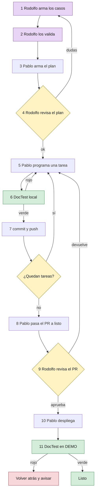
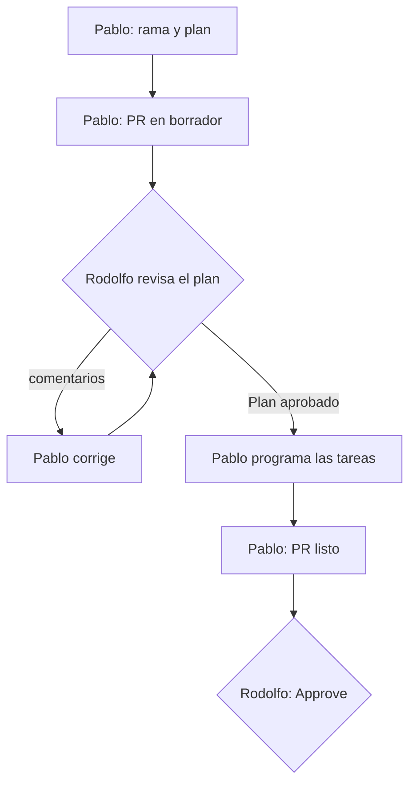
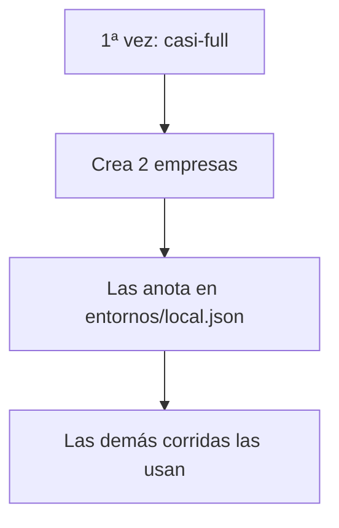
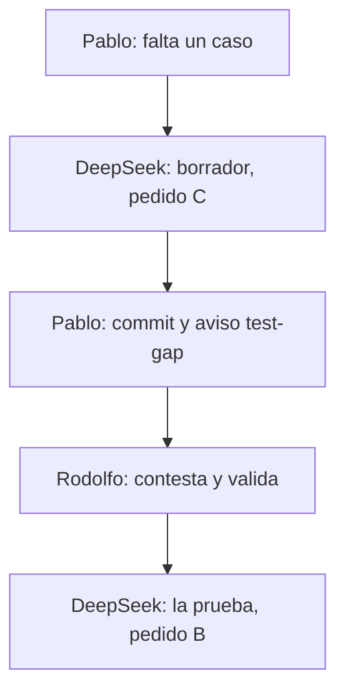

# Guía rápida: cómo trabajamos los requerimientos con Claude + DeepSeek

## Objetivo

Cómo viaja un requerimiento desde que Rodolfo lo define con Claude hasta que Pablo lo construye con
DeepSeek, lo despliega en DEMO y queda verificado, incluido **qué pruebas automáticas (DocTest) se
corren en cada paso**. Para Rodolfo, Pablo y Claude. La **Parte 1** es la ayuda memoria del día a día;
la **Parte 2** tiene el detalle de cada paso y se consulta cuando hay dudas. **No** cubre el detalle
técnico de DocTest (está en [`doctest/README.md`](../../doctest/README.md) y
[`doctest/GUIA-PRUEBAS-Y-AYUDAS.md`](../../doctest/GUIA-PRUEBAS-Y-AYUDAS.md)) ni la metodología de ramas
y PR (está en el `CLAUDE.md` del repo).

> Versión 1.4 · noviembre 2026 · Trazalog v2.5 / v3
> **Cambios en 1.4:** DeepSeek sigue las mismas reglas de ramas y pull requests que Claude Code, a
> través del archivo `doc/metodologia/REGLAS-PARA-AGENTES.md` (sección 2.16). dónde deja Pablo el plan y cómo lo aprueba Rodolfo: pull request en borrador y
> comentario "✅ Plan aprobado" (sección 2.4). El documento se parte en dos: **Parte 1, ayuda memoria** del día a día, y
> **Parte 2, el detalle**. El despliegue a DEMO y la verificación posterior los hace **Pablo**; Rodolfo
> aprueba el pull request. Se agrega la primera vez de Pablo (`casi-full`) a la tabla de DocTest.
>
> **Cambios en 1.3:** se agregan los pedidos listos para copiar y pegar al agente (sección 2.8). DeepSeek
> puede redactar el borrador de un caso que falta; la validación sigue siendo de Rodolfo. Se aclara
> contra qué ambiente y con qué empresa corre DocTest (sección 2.5). La corrida en el ambiente pasa a
> ser después de desplegar.
>
> **Cambios en 1.2:** se ajustó todo lo de DocTest a lo que existe hoy en el repo. DocTest se reduce a
> un comando, `npm run doctest`. Se corrigieron el ejemplo de caso de uso, los roles, el ambiente de
> pruebas (DEMO, no staging-v3) y qué controla hoy GitHub (sección 2.11).

---

# PARTE 1 — Ayuda memoria (lo de todos los días)

## 1.1 La idea

**Rodolfo define QUÉ se construye, con Claude. Pablo construye CÓMO, con DeepSeek, y lo despliega.
Nada entra al sistema sin DocTest en verde y sin la aprobación de Rodolfo.** Nadie escribe casos ni
pruebas a mano: se le piden a un agente con los pedidos A, B y C (sección 2.8).

| Quién | Con qué | Qué hace |
|---|---|---|
| **Rodolfo** | Claude Code | Requerimiento y **casos de uso** (pedido A); valida los casos; revisa el plan; **aprueba el pull request** |
| **Pablo** | DeepSeek Pro | Plan de tareas chicas; propone casos que faltan (pedido C) |
| **Pablo** | DeepSeek Flash | Programa cada tarea **y su prueba** (pedido B) |
| **Pablo** | Terminal | Corre DocTest, abre el pull request, **despliega a DEMO y verifica** |

## 1.2 El recorrido



## 1.3 DocTest: qué correr y cuándo

**Dónde:** en una terminal, parado en `traz-tools/doctest/`. (También se le puede pedir a Claude Code:
"corré doctest regresión en demo".) Detalle en la sección 2.5.

| Quién | Cuándo | Comando |
|---|---|---|
| **Pablo** | **La PRIMERA VEZ que termina una tarea** (o si las empresas de prueba de su máquina quedaron inservibles) | `npm run doctest -- casi-full --entorno local` |
| **Pablo** | **Cada vez que termina una tarea**, antes de commit y push | `npm run doctest -- --entorno local` |
| **Pablo** | **La PRIMERA VEZ que verifica un despliegue en DEMO** | `npm run doctest -- casi-full --entorno demo` |
| **Pablo** | **Cada vez que despliega en DEMO**, apenas termina | `npm run doctest -- regresion --entorno demo --base <versión anterior>` |
| Cualquiera | Prueba completa, cuando se pide | `npm run doctest -- full --entorno <ambiente>` |

- 🖥️ **`local` es la máquina de Pablo con su rama levantada.** Su código todavía no está en DEMO: probar
  contra DEMO antes del despliegue prueba la versión vieja.
- 🏢 **`casi-full` crea dos empresas de prueba** en ese ambiente y las deja anotadas en
  `doctest/entornos/<ambiente>.json`. Las corridas siguientes las usan solas. Se corre una vez por
  ambiente y por máquina.
- 🟢 **Verde** = commit y push (o, después de desplegar, la versión queda). 🔴 **Rojo** = se corrige
  (o, después de desplegar, se vuelve a la versión anterior y se avisa a Rodolfo).

## 1.4 Checklist de Rodolfo

- [ ] **Requerimiento nuevo:** pedido A a Claude → contestar las dudas → validar los casos → subirlos
      a `develop`. Antes de pasárselo a Pablo, la lista de control de la sección 2.14.
- [ ] **Llega el plan de Pablo** (pull request en borrador en GitHub): comentarios sobre los renglones
      si hay algo para cambiar, o un comentario **`✅ Plan aprobado`** si está bien. No el botón
      "Approve" (sección 2.4).
- [ ] **Llega un aviso "falta probar algo" (test-gap):** revisar el borrador con Claude, contestar las
      dudas y validarlo en la rama de Pablo (sección 2.7).
- [ ] **Llega el pull request:** verificar lo de la sección 2.11 y aprobar o devolver.

## 1.5 Checklist de Pablo

- [ ] **Una sola vez:** configurar DeepSeek para que siga las reglas del repo
      (`doc/metodologia/REGLAS-PARA-AGENTES.md`, sección 2.16).
- [ ] **Arranca un requerimiento:** plan con DeepSeek Pro → rama `feature/req-###` → pull request en
      borrador con solo el plan → esperar el comentario **`✅ Plan aprobado`** de Rodolfo (sección 2.4).
- [ ] **Por cada tarea:** DeepSeek Flash programa la tarea y su prueba (pedido B) → DocTest en su
      máquina → verde: commit y push (sección 2.9).
- [ ] **Falta un caso o uno está mal:** pedido C → commitea el borrador → aviso test-gap a Rodolfo. No
      escribe la prueba hasta que Rodolfo lo valide (sección 2.7).
- [ ] **Terminó todas las tareas:** completa la descripción del mismo pull request con los resultados
      reales de DocTest y lo pasa a "Ready for review" (sección 2.10).
- [ ] **Rodolfo aprobó:** despliega a DEMO → DocTest contra DEMO → rojo: vuelve a la versión anterior
      y avisa (sección 2.12).
- [ ] **Algo falla dos veces:** escalar (sección 2.13).

## 1.6 Reglas que no se negocian

- 📁 **El repositorio es la única verdad.** Lo que no está en el repositorio no existe.
- 📋 **El catálogo manda.** Los casos de uso viven en `doctest/catalogo/`, no en el requerimiento ni en
  un chat.
- 🔢 **Una tarea por vez.** Siempre.
- 🧪 **Sin caso validado no hay prueba, y sin DocTest en verde no hay commit.**
- 🚫 **Nada se deriva desde un caso en `borrador`.** El validador lo rechaza.
- 🗣️ **Si hay duda, se pregunta.** Pablo abre un aviso test-gap; Rodolfo lo aclara en el caso.
- 👀 **Rodolfo aprueba todo** antes de que se despliegue.
- 🧾 **Vocabulario fijo.** Perfiles de la sección 2.1; pantallas y ayudas en español argentino con
  tuteo ("podés", "ingresá").
- 🏭 **Las pruebas nunca apuntan a producción.** Solo a `local`, `demo` o, cuando exista, `staging-v3`.
  DocTest lo impide solo.

---

# PARTE 2 — El detalle

## 2.1 Lo que Rodolfo entrega: el requerimiento

Cada requerimiento son **dos cosas** en el repositorio `traz-tools`:

1. **Un archivo de requerimiento** en `requerimientos/REQ-###-nombre-corto.md` (la carpeta se crea con
   el primer requerimiento) con el contexto, las pantallas, las reglas y las decisiones.
2. **Uno o más casos de uso del catálogo DocTest** en `doctest/catalogo/<modulo>/<MOD>-UC-###.yaml`,
   uno por cada función del requerimiento (sección 2.2).

Pablo y DeepSeek solo ven esos archivos, no la conversación que tuvo Rodolfo con Claude. Por eso tienen
que estar completos y sin suposiciones.

| Sección del requerimiento | Qué va | Ejemplo |
|---|---|---|
| **Título y número** | Identificador único | REQ-012 Alta de equipos y componentes |
| **Para qué sirve** | El problema que resuelve, en dos o tres renglones, sin tecnicismos | "El Supervisor hoy carga equipos en una planilla aparte y se pierde el historial" |
| **Quién lo usa** | Perfil o perfiles involucrados, **con el vocabulario del catálogo** (ver abajo) | Supervisor |
| **Qué tiene que hacer** | Lista numerada de funciones, una por renglón. Cada función apunta a su caso de uso | 1. Dar de alta un equipo → MAN-UC-001 |
| **Qué NO hace** | Lo que queda explícitamente afuera | "No importa equipos desde planilla" |
| **Pantallas** | Maqueta o descripción de cada pantalla, con sus campos y botones, y el `data-testid` de cada elemento que las pruebas van a tocar | Imagen + lista de campos |
| **Reglas** | Validaciones, cálculos, permisos, mensajes de error | "El código de equipo no se puede repetir dentro de la misma empresa" |
| **Datos** | Qué se guarda, dónde y con qué forma | Tabla, campos, tipos |
| **Decisiones tomadas** | Por qué se eligió hacerlo así | "Se usa el mismo formulario que almacenes" |
| **Dudas abiertas** | Lo que todavía no está definido (idealmente, nada) | — |

**Perfiles válidos** (vocabulario fijo de `doctest/catalogo/SCHEMA.md`): de la operación, `Solicitante`,
`Supervisor`, `Planificador`, `Mantenedor` y `Responsable de Almacén`; de la administración de la cuenta,
`Administrador`, `Usuario` y `Superusuario`. Si un requerimiento necesita otro, se agrega primero al
esquema.

## 2.2 Los casos de uso del catálogo DocTest

Los casos de uso **no van en el archivo de requerimiento**: van directo al catálogo DocTest, porque de
ahí salen la documentación Gherkin y la ayuda al usuario, y la prueba automática se escribe contra el
caso. Escribirlos dos veces es la forma más rápida de que queden desincronizados.

**Quién arma qué:** el caso de uso (el *qué* tiene que pasar) lo arma Rodolfo antes de pasarle el
requerimiento a Pablo. La prueba que se ejecuta (el *cómo* se comprueba) la escribe Pablo mientras
programa, porque toca botones y campos que todavía no existen cuando se escribe el caso.

Cada YAML tiene esta forma (el esquema completo está en `doctest/catalogo/SCHEMA.md`). Este ejemplo
**pasa el validador**:

```yaml
id: MAN-UC-001
modulo: MAN
titulo: Alta de equipo con componentes
perfil: Supervisor
estado: borrador              # Rodolfo lo pasa a "validado" cuando lo aprueba
version: "1.0"
origen: baseline              # o delta-PR#N, o feedback-issue#N
referencias_codigo:           # OBLIGATORIO, al menos una. Antes de programar, se apunta al
  - repo: traz-tools          # requerimiento; Pablo agrega los archivos reales al programar
    path: requerimientos/REQ-012-alta-equipos.md
    detalle: "se completa con la vista y el controller al programar"
pantallas:
  - "Mantenimiento → Equipos → Agregar"
precondiciones:
  - Usuario autenticado con perfil Supervisor
  - Empresa de test con establecimiento activo
flujo_principal:
  - paso: "Toca 'Nuevo equipo' en el listado"
    resultado: "Se abre el formulario de alta vacío"
  - paso: "Completa código, nombre, ubicación y toca 'Guardar'"
    resultado: "El equipo aparece en la lista y queda registrado quién lo creó y cuándo"
flujos_alternativos:
  - nombre: "Código repetido"
    pasos:
      - paso: "Intenta guardar con un código que ya existe en la empresa"
        resultado: "Mensaje 'Ese código ya está en uso' y no guarda"
validaciones:
  - "Código de equipo único por empresa"
datos_prueba:
  equipo_codigo_prefijo: "EQ-TEST-"
dudas:                        # en borrador es OBLIGATORIO tener al menos una
  - "¿El código se valida único por empresa o en todo el sistema? Hoy el sistema lo valida global."
derivados: {}                 # en borrador tiene que estar vacío
```

Al **validarlo**, Rodolfo cambia `estado: validado`, agrega `fecha_validacion: 2026-11-02` y deja
`dudas: []`. Esas tres cosas las exige el validador.

**Regla de oro:** cada regla de "validaciones" tiene su flujo alternativo que la prueba. Si una regla no
tiene cómo probarse, DeepSeek no tiene forma de saber si la programó bien.

## 2.3 Cómo lo arma Rodolfo con Claude

Todo en una sesión de Claude Code abierta en `traz-tools/`.

1. Rodolfo conversa con Claude hasta tener claro el requerimiento.
2. Claude redacta el `REQ-###.md` y los YAML del catálogo con el **pedido A** (sección 2.8), y corre
   `npm run validate:catalog`. Rodolfo no los escribe a mano.
3. Rodolfo los lee una vez haciendo de cuenta que es Pablo y no conoce el contexto. Para leer los casos
   cómodo: `npm run hoja:validacion -- man` (en `traz-tools/doctest/`) arma una hoja en prosa con un
   control para marcar cada caso.
4. Rodolfo sube todo en una rama `feature/req-###` y abre un pull request a `develop`.
5. En ese pull request corre `doctest-validate.yml`, que verifica que los YAML respeten el esquema. Si
   está en rojo, se corrige antes de seguir.
6. Rodolfo pasa cada caso a `validado` y mergea. **Recién ahí Pablo puede empezar.**

## 2.4 El plan de Pablo (DeepSeek Pro)

Pablo le da a DeepSeek Pro el `REQ-###.md` y los YAML del catálogo, y le pide un plan que cumpla:

- ✅ Cada tarea se hace en **una o dos horas**, no más.
- ✅ Cada tarea tiene **un resultado comprobable** (una pantalla que se ve, una prueba que pasa, un dato
  que se guarda).
- ✅ Cada tarea dice **qué caso de uso (`MAN-UC-###`) y qué flujo cubre**.
- ✅ Las tareas están **ordenadas** (primero los datos, después las reglas, después las pantallas).
- ✅ Hay una tarea explícita para **agregar los `data-testid`** en las vistas.
- ❌ Ninguna tarea dice "implementar el módulo completo". Si aparece, se parte.

### Dónde lo deja Pablo

En GitHub, como **el primer paso del mismo pull request** que después va a llevar el código:

1. En su máquina, en `traz-tools/`: crea la rama `feature/req-###` desde `develop` y guarda el plan
   en `requerimientos/REQ-###-nombre-corto.plan.md`, al lado del requerimiento.
2. Commit y push de **solo el plan**.
3. Abre el pull request a `develop` **como borrador** ("Create draft pull request" en GitHub), con el
   título `REQ-###: <nombre>` y en la descripción: *"Plan para revisar: requerimientos/REQ-###-….plan.md"*.
   Un pull request en borrador no se puede unir a `develop` por error.

### Cómo lo revisa y aprueba Rodolfo

En GitHub, en ese pull request, pestaña **"Files changed"**:

- **Si hay algo para cambiar:** deja comentarios sobre los renglones del plan (botón **+** al lado de
  cada línea). Pablo lo corrige con DeepSeek Pro, hace push en la misma rama y le avisa.
- **Si está bien:** deja un comentario en la pestaña "Conversation" que diga **`✅ Plan aprobado`**.
  Ese comentario es la aprobación: queda con fecha y nombre, y Pablo no programa sin él.

> **Por qué un comentario y no el botón "Approve" de GitHub:** el botón aprueba el pull request entero.
> Si Rodolfo lo usara para el plan, el pull request quedaría aprobado aunque todavía no tenga código.
> "Approve" se reserva para el final (sección 2.11).

Qué mira Rodolfo: ¿las tareas son chicas? ¿cubren todos los casos? ¿DeepSeek entendió algo distinto?

Con el plan aprobado, Pablo programa **en la misma rama**: cada tarea es un commit más en ese pull
request (sección 2.9). Al terminar todas, lo pasa de borrador a listo (sección 2.10).



## 2.5 DocTest: ambientes, empresas y configuración

**DocTest se maneja con un solo comando**, `npm run doctest`, en una terminal parada en
`traz-tools/doctest/`. La tabla de cuándo correr cada modo está en la sección 1.3.

**Instalación, una sola vez por máquina** (en `traz-tools/doctest/`): `npm install`,
`npx playwright install chromium` y `cp .env.example .env`. Ver el [README](../../doctest/README.md).

### Los modos

| Modo | Qué hace |
|---|---|
| `regresion` (el de siempre; es el que corre si no se pone modo) | Corre **lo nuevo** (las pruebas que se agregaron o tocaron, y las de los casos que cambiaron, respecto de `--base`) y después el **set de regresión** (todas las pruebas estables) |
| `casi-full` | Crea dos empresas desde cero en el ambiente, las deja anotadas y corre la regresión |
| `full` | Como `casi-full`, y además le carga datos a la primera empresa y corre también los circuitos largos |
| `nuevos` | Solo lo nuevo |

Opciones: `--entorno <local|demo|staging-v3>`, `--base <rama o tag>` (contra qué se calcula "lo nuevo";
si no se pone, `origin/develop`), `--plan` (muestra qué correría sin ejecutar nada).

### Contra qué ambiente

**El ambiente es donde está corriendo el código que se quiere probar.**

| Quién y cuándo | Ambiente | Por qué ahí |
|---|---|---|
| Pablo, antes de commit y push | `local`: el sistema levantado en **su** máquina, con su rama | Su código todavía no está desplegado. Si lo corre contra DEMO, prueba la versión vieja: lo nuevo falla siempre y la regresión no dice nada de su cambio |
| Pablo, después de desplegar | `demo` (más adelante, `staging-v3`) | Ahí quedó la versión nueva |

### Dónde se configura

En el archivo `traz-tools/doctest/.env` de cada uno (no se sube al repo; se crea copiando
`.env.example`):

- `DOCTEST_ENV`: el ambiente que se usa cuando el comando no lleva `--entorno`. Poner `--entorno`
  explícito lo pisa. Como Pablo usa los dos ambientes, conviene que siempre ponga `--entorno`.
- Las direcciones de cada sistema. Para `local`, Pablo completa `DOCTEST_LOCAL_URL_TOOLS`,
  `DOCTEST_LOCAL_URL_MAN` y `DOCTEST_LOCAL_URL_DNATO` con las de su máquina. Las de DEMO ya vienen
  completas.
- `DOCTEST_SEED_PASSWORD`: la contraseña con la que `casi-full` registra las empresas nuevas.

### Con qué empresa

**No se configura a mano.** La primera vez en cada ambiente se corre `casi-full`:



- El archivo `doctest/entornos/<ambiente>.json` guarda las empresas y sus usuarios. Es **uno por
  ambiente y por máquina**: Pablo tiene su `local.json` y su `demo.json`. Tiene contraseñas, así que
  no se sube al repo.
- Se vuelve a correr `casi-full` solo si las empresas quedaron inservibles (alguien las borró, se
  restauró la base, etc.). Cada corrida crea dos empresas nuevas y reemplaza las anotadas.
- Si un ambiente no tiene ese archivo, DocTest toma las empresas que estén en el `.env`
  (`DOCTEST_EMPRESA1_*`, `DOCTEST_EMPRESA2_*`).

> ⚠️ **Pendiente de verificar — la máquina local:** DocTest todavía **no se corrió nunca** contra una
> máquina local (hasta noviembre 2026 solo contra DEMO). La primera vez que Pablo lo haga hay que
> comprobar: que su máquina tenga levantados los tres sistemas (Tools, AssetPlanner y Dnato), que el
> alta de empresa funcione completa (incluido el mail de activación) y contra qué base de datos apunta
> su sistema local. Si apunta a una base compartida, las empresas que crea `casi-full` aparecen también
> ahí. Hasta que esa primera corrida salga bien, este flujo es **el diseño, no algo probado**.

## 2.6 Cómo se escribe la prueba de una tarea

La prueba la escribe **DeepSeek Flash, no Pablo a mano**, con el **pedido B** (sección 2.8). No hay un
generador de esqueletos: el agente la escribe **copiando una existente del mismo módulo**
(`doctest/tests/e2e/specs/<modulo>/`) y adaptándola. Para que la escriba bien, necesita **cuatro cosas**
y nada más (el pedido B ya se las indica):

1. El YAML del caso de uso.
2. Una prueba existente del mismo módulo, como modelo.
3. Los page objects de las pantallas involucradas (`doctest/tests/e2e/pages/`), o la indicación de
   crearlos si no existen.
4. La lista de `data-testid` de esas pantallas.

Reglas que Flash tiene que respetar (van en el pedido):
- Sin esperas fijas (`waitForTimeout`); se usa la espera automática de Playwright.
- Un escenario por cada flujo del YAML (principal y alternativos).
- Los selectores van en los page objects, nunca sueltos en la prueba.
- La prueba lleva en el título el id del caso (`@MAN-UC-001`) y la etiqueta del módulo (`@man`); si es
  un flujo crítico, también `@smoke`.
- Los datos que crea llevan el prefijo del YAML (`EQ-TEST-`) más un sello de tiempo.
- El YAML apunta a la prueba en `derivados.test_e2e`, y `referencias_codigo` lista los archivos que se
  tocaron. Así `npm run doctest` la reconoce como "nueva".

Después, si el caso tiene ayuda de usuario, `npm run features` y `npm run ayudas` regeneran el `.feature`
y el manual. Los `.feature` no se editan a mano.

## 2.7 Casos que faltan o cambios que aparecen mientras se programa

Si al programar Pablo descubre que falta un caso o que uno estaba mal:
- **Le pide a DeepSeek que redacte el caso**, con el **pedido C** (sección 2.8). DeepSeek lo deja en
  `estado: borrador`, con sus dudas, en la rama de Pablo. **No** lo valida ni escribe la prueba
  todavía: el validador rechaza cualquier prueba colgada de un borrador.
- Pablo commitea el borrador y abre un issue con la plantilla **"Falta probar algo (test-gap)"**, con el
  link al archivo.
- Rodolfo lo revisa con Claude (`/doctest <qué cambió>` en Claude Code), contesta las dudas y lo pasa a
  `validado` en la misma rama.
- Recién ahí Pablo pide la prueba (pedido B) y sigue.



## 2.8 Los pedidos al agente, listos para copiar

Ni Rodolfo ni Pablo escriben casos de uso ni pruebas a mano: se los piden a un agente. Se copian tal
cual, se reemplaza lo que está entre `<...>` y se pegan.

**Qué tiene que poder hacer el agente:** leer el repo y correr comandos en una terminal parada en
`traz-tools/doctest/`. Claude Code ya lo hace. Para DeepSeek, Pablo tiene que usarlo desde una
herramienta que le dé ese acceso (un agente de programación abierto en la carpeta del repo). Si lo usa
desde un chat sin acceso al repo, tiene que pegarle él los archivos que el pedido nombra y correr él los
comandos que el pedido manda correr, devolviéndole la salida.

| Pedido | Quién | Con qué | Cuándo |
|---|---|---|---|
| **A** — armar los casos de uso | Rodolfo | Claude Code, en `traz-tools/` | Antes de pasarle el requerimiento a Pablo (sección 2.3) |
| **B** — escribir la prueba ejecutable | Pablo | DeepSeek Flash, en `traz-tools/` | En cada tarea del plan, junto con el código (sección 2.9) |
| **C** — proponer un caso que falta | Pablo | DeepSeek Pro, en `traz-tools/` | Cuando al programar aparece algo que ningún caso cubre (sección 2.7) |

### Pedido A — Rodolfo arma los casos de uso (Claude Code)

Se pega en una sesión de Claude Code abierta en `traz-tools/`, en la rama `feature/req-###`.

```text
Armá los casos de uso del catálogo DocTest para el requerimiento <requerimientos/REQ-###-nombre.md>.

Antes de escribir, leé:
- doctest/catalogo/SCHEMA.md (esquema y vocabulario de perfiles),
- los YAML que ya existen en doctest/catalogo/<modulo>/, para no duplicar casos ni numeración,
- la sección 2.2 de doc/metodologia/GUIA_REQUERIMIENTOS_CLAUDE_DEEPSEEK.md (ejemplo que pasa el validador).

Reglas:
- Un YAML por caso de uso, en doctest/catalogo/<modulo>/, con el próximo id libre (<MOD>-UC-###).
- estado: borrador, derivados: {}, y al menos una duda real en "dudas".
- referencias_codigo apunta al archivo del requerimiento (todavía no hay código).
- Cada regla de "validaciones" tiene su flujo alternativo que la prueba.
- Pasos y resultados en lenguaje de usuario, con los nombres de botones y menús que ve en pantalla.
- No inventes reglas de negocio: si algo no está en el requerimiento, va a "dudas".

Al terminar, corré npm run validate:catalog en doctest/ hasta que dé 0 problemas, armá la hoja de
lectura con npm run hoja:validacion -- <modulo>, y pasame la lista de casos con sus dudas para que
yo las conteste. No los pases a validado: eso lo hago yo.
```

Cuando Rodolfo contesta las dudas, le pide a Claude: *"pasá a validado los casos <ids> con fecha de
hoy y dudas vacías, y corré el validador"*.

### Pedido B — Pablo pide la prueba ejecutable de una tarea (DeepSeek Flash)

Se pega una vez por tarea del plan, después de que el código de la tarea existe (o junto con él).

```text
Escribí la prueba automática DocTest de esta tarea: <tarea N del requerimientos/REQ-###-nombre.plan.md>.
Cubre el caso de uso <doctest/catalogo/<modulo>/<MOD-UC-###>.yaml>, que ya está validado. No lo
modifiques salvo los dos campos que se indican abajo.

Leé antes:
- el YAML del caso,
- una prueba existente del mismo módulo como modelo: <doctest/tests/e2e/specs/<modulo>/<archivo>.spec.ts>,
- los page objects de doctest/tests/e2e/pages/<modulo>/ que usan esas pantallas,
- las vistas que tocó esta tarea, para sacar los data-testid.

Reglas:
- Un escenario por cada flujo del YAML: el principal y cada alternativo.
- El título de la prueba lleva @<MOD-UC-###> y @<modulo>; si es un flujo crítico, también @smoke.
- Los selectores van en los page objects (creá el que falte en pages/<modulo>/), nunca sueltos en la
  prueba. Usá data-testid; si la vista no lo tiene, agregalo en la vista.
- Nada de waitForTimeout: usá las esperas automáticas de Playwright.
- Los datos que crees llevan el prefijo de datos_prueba del YAML más un sello de tiempo.
- No uses credenciales escritas en el código: salen de las fixtures que ya existen.
- En el YAML, solo agregá la ruta de la prueba en derivados.test_e2e y los archivos que tocó la tarea en
  referencias_codigo.

Al terminar, en doctest/ corré, en este orden: npm run typecheck, npm run validate:catalog y
npm run doctest -- --entorno local. Si algo falla, corregí y volvé a correr; si después de dos
intentos sigue fallando, pará y mostrame el error completo sin tocar nada más. No hagas commit.
```

### Pedido C — Pablo propone un caso que falta (DeepSeek Pro)

```text
Programando la tarea <N> del <requerimientos/REQ-###-nombre.plan.md> apareció algo que ningún caso de
uso del catálogo DocTest cubre: <qué pasa, en una o dos frases, desde el lado del usuario>.

Redactá la propuesta de caso de uso. Leé antes doctest/catalogo/SCHEMA.md, los YAML de
doctest/catalogo/<modulo>/ (para no duplicar y tomar el próximo id libre) y la sección 2.2 de
doc/metodologia/GUIA_REQUERIMIENTOS_CLAUDE_DEEPSEEK.md.

Reglas:
- Si es un caso nuevo, un YAML nuevo. Si en realidad es un flujo que le falta a un caso existente, NO
  toques ese YAML (ya tiene pruebas colgadas y pasarlo a borrador rompe el validador): escribime el
  flujo propuesto (pasos, resultados y dudas) en texto, para pegarlo en el issue test-gap.
- estado: borrador, derivados: {}, y en "dudas" todo lo que estés suponiendo. Mejor una duda de más
  que una regla inventada.
- origen: feedback-issue#<número del issue test-gap, si ya existe>.
- No escribas la prueba ni toques código: eso va después de que Rodolfo lo valide.

Al terminar, corré npm run validate:catalog en doctest/ hasta que dé 0 problemas y mostrame el YAML y
la lista de dudas.
```

## 2.9 Cómo programa Pablo cada tarea (DeepSeek Flash)

Pablo trabaja **de a una tarea del plan**. Para cada una:

1. Le da a Flash la tarea, la sección del requerimiento y el YAML del caso de uso, y le pide el código
   y la prueba (pedido B).
2. **Si es la primera tarea que termina en su máquina**, corre una vez
   `npm run doctest -- casi-full --entorno local` (sección 1.3).
3. Corre `npm run doctest -- --entorno local`.
4. Si falla, se lo devuelve a Flash con el error. Máximo **dos intentos**.
5. Si al tercer intento sigue fallando, **escala** (sección 2.13).
6. Si pasa, commit + push y sigue con la próxima.

Lo que Flash **no** debe recibir nunca: varias tareas juntas, un pedido vago ("mejorá esto"), o un
pedido sin caso de uso asociado.

## 2.10 El pull request de Pablo

Es **el mismo pull request** que Pablo abrió en borrador con el plan (sección 2.4): una rama
`feature/req-###` por requerimiento, a `develop`. Al terminar todas las tareas, Pablo completa la
descripción y lo pasa a listo para revisar (botón **"Ready for review"** en GitHub). La descripción
tiene siempre:

```
## Qué cambia
(dos o tres renglones)

## Por qué
Cierra REQ-###. Casos de uso: MAN-UC-001, MAN-UC-002.

## Cómo lo verifiqué
npm run doctest -- --entorno local
  Pruebas nuevas: 6 verdes
  Set de regresión: 71 verdes
(resultados reales, pegados, no supuestos)
```

## 2.11 Qué tiene que estar en verde para que Rodolfo apruebe el pull request

### Lo que GitHub controla solo, hoy

| Chequeo | Workflow | Qué mira |
|---|---|---|
| ✅ Catálogo bien formado | `doctest-validate.yml` | Los YAML respetan el esquema y las reglas (un borrador tiene dudas y no tiene derivados; un validado tiene fecha y sus derivados existen), el TypeScript compila y las pruebas cargan |

**Eso es todo lo que corre hoy en GitHub.** GitHub **no ejecuta las pruebas**: por eso el resultado
real de DocTest va pegado en la descripción del pull request (sección 2.10).

**Pendiente** (diseñado, no construido): que GitHub corra las pruebas en cada pull request y guarde la
evidencia, que analice solo si un cambio afecta casos de otros módulos, y los chequeos de lint de PHP,
seguridad y submódulos. Cuando existan, se suman a esta tabla.

### Lo que verifica Rodolfo

- [ ] **La descripción trae resultados reales** de DocTest, no "debería pasar".
- [ ] **Cada caso del requerimiento tiene su prueba** (`derivados.test_e2e` completo) y la prueba pasa.
- [ ] **Cada YAML está cerrado:** `estado: validado`, `fecha_validacion`, `dudas: []`,
      `referencias_codigo` con los archivos reales.
- [ ] **Ninguna prueba nueva en `@quarantine`.** Si quedó inestable, se abre issue y no se aprueba.
- [ ] **Los `.feature` no fueron editados a mano** y la ayuda se regeneró y se lee bien (tuteo
      argentino, sin jerga, pantallas como las ve el usuario).
- [ ] **El código es entendible** en una lectura.

Que haga lo que dice el requerimiento en la práctica, Rodolfo lo recorre en DEMO **después** del
despliegue (sección 2.12): antes, el código no está en DEMO.

## 2.12 El despliegue a DEMO y la verificación

Lo hace **Pablo**, con el pull request aprobado por Rodolfo y mergeado a `develop` (DEMO se despliega
desde `develop`):

1. Despliega la versión nueva en DEMO.
2. **La primera vez**, corre `npm run doctest -- casi-full --entorno demo` (sección 1.3).
3. En `traz-tools/doctest/`, parado en la versión que acaba de desplegar
   (`git fetch --tags && git checkout <tag nuevo>`), corre:
   `npm run doctest -- regresion --entorno demo --base <tag de la versión anterior>`.
   "Lo nuevo" son las pruebas de lo que trajo esta versión; la regresión comprueba que lo de antes siga
   andando.
4. **Si da verde:** la versión queda y le avisa a Rodolfo, que puede recorrer el flujo principal de cada
   caso en DEMO. **Si da rojo:** vuelve a desplegar la versión anterior, avisa a Rodolfo y el error se
   trata como un bug de la versión nueva.

> **Pendiente:** que esto corra solo al terminar cada despliegue, y que vuelva atrás sin intervención.
> Hoy es manual.

## 2.13 Cuándo escalar (cambiar de modelo)

```
Flash falla dos veces  →  Pablo prueba con DeepSeek Pro
Pro falla dos veces    →  Pablo le avisa a Rodolfo
Rodolfo decide:
   - la tarea estaba mal partida → se vuelve a partir más chica
   - el requerimiento tenía un hueco → Rodolfo lo corrige con Claude (YAML nuevo o corregido)
   - la tarea es realmente difícil → se hace con Claude
```

Casos donde conviene ir directo a Claude sin esperar a que Flash falle: integraciones con Bonita, cambios
en la capa de API (WSO2, MCP), la preparación de datos de DocTest y cualquier cosa que toque varios
módulos a la vez.

## 2.14 Lista de control antes de pasar un requerimiento a Pablo

- [ ] `REQ-###.md` tiene número, título y "para qué sirve" en lenguaje simple.
- [ ] Dice qué perfiles lo usan (vocabulario de la sección 2.1) y qué queda afuera.
- [ ] Cada función apunta a un caso del catálogo.
- [ ] Cada YAML tiene flujo principal, alternativos y validaciones; cada validación, su flujo.
- [ ] Cada pantalla tiene maqueta o lista de campos, con sus `data-testid`.
- [ ] Está definido qué datos se guardan y dónde.
- [ ] Las decisiones de diseño tienen su "por qué".
- [ ] `npm run validate:catalog` en verde y `doctest-validate.yml` en verde en el pull request.
- [ ] Todos los YAML en `estado: validado`, con `fecha_validacion`, y mergeados a `develop`.
- [ ] Lo leí una vez haciendo de cuenta que soy Pablo y no entiendo nada del contexto.

## 2.15 Qué medimos para saber si el esquema funciona

Al cierre de cada requerimiento, Pablo anota en el `.plan.md`:

| Qué | Para qué |
|---|---|
| Tareas que necesitaron más de dos intentos | Si son muchas, las tareas están mal partidas o el requerimiento tiene huecos |
| Veces que se escaló a Pro o a Claude | Si es frecuente, Flash no sirve para ese tipo de trabajo |
| Avisos test-gap abiertos durante la construcción | Si son muchos, el catálogo salió incompleto |
| Devoluciones en la revisión de Rodolfo | Si son muchas, el problema está en el requerimiento, no en el código |
| Corridas de DocTest en rojo por tarea | Si son muchas, las pruebas o las tareas están mal planteadas |
| Despliegues que hubo que volver atrás | Si pasa, la prueba en la máquina de Pablo no está cubriendo lo que importa |

Después de tres o cuatro requerimientos se revisa esta guía con esos números a la vista.

## 2.16 Configurar DeepSeek con las reglas del repo (una sola vez)

Claude Code lee solo el `CLAUDE.md` del repo, y por eso respeta las reglas de ramas, commits y pull
requests. DeepSeek no lo lee. Para que siga **las mismas reglas**, el repo tiene un archivo hecho para
cualquier agente: **`doc/metodologia/REGLAS-PARA-AGENTES.md`**. Tiene, en corto: nunca commitear directo
a `develop` ni a las otras ramas de integración, formato de commit, pull request en borrador con el
plan, formato de la descripción, nunca unir sin aprobación de Rodolfo, DocTest antes de cada commit, qué
partes del sistema no se tocan sin aprobación, PHP 5.6 y cuándo parar a preguntar.

> **Por qué no se llama `AGENTS.md`:** ese es el nombre que muchos agentes leen solos, pero en este repo
> `AGENTS.md` y la carpeta `.agents/` están en el `.gitignore` a propósito: son el conocimiento local de
> cada uno. Si el repo trajera su propio `AGENTS.md`, pisaría el de Pablo. Por eso las reglas compartidas
> van en un archivo aparte, y el `AGENTS.md` local de cada uno lo nombra.

**Cómo se lo da Pablo a DeepSeek**, según desde dónde lo use:

| Pablo usa DeepSeek desde… | Qué hace, una vez |
|---|---|
| Un agente de programación abierto en la carpeta del repo, que lee un `AGENTS.md` local | Agrega al principio de **su** `AGENTS.md` (en la raíz de `traz-tools/`, no se sube al repo) este renglón: `Antes de cualquier tarea, leé y seguí doc/metodologia/REGLAS-PARA-AGENTES.md. Si algo de este archivo lo contradice, manda REGLAS-PARA-AGENTES.md.` |
| Un agente que usa otro archivo de reglas o instrucciones permanentes ("rules", "instructions", "conventions") | El mismo renglón, en ese lugar |
| Un chat sin acceso al repo | Pega el contenido de `REGLAS-PARA-AGENTES.md` al principio de **cada** conversación nueva, antes del pedido |

**Cómo comprueba que lo tomó** — le pregunta, en una conversación nueva:

```text
Antes de empezar: ¿a qué rama hacés commit, con qué formato, cuándo podés unir un pull request y qué
tenés que correr antes de cada commit?
```

La respuesta correcta: rama `feature/req-###` (nunca `develop`), formato `tipo(scope): descripción [ID]`,
nunca unir sin aprobación de Rodolfo, y `npm run doctest -- --entorno local` antes de cada commit. Si
contesta otra cosa, no leyó las reglas.

> **Si cambia una regla:** se cambia en `CLAUDE.md` y en `REGLAS-PARA-AGENTES.md` en el mismo pull
> request. Si se contradicen, manda `CLAUDE.md`.
