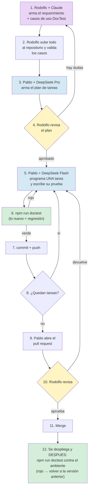
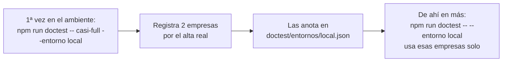
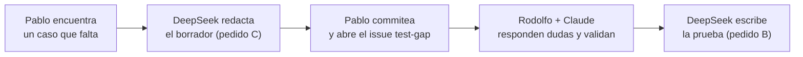

# Guía rápida: cómo trabajamos los requerimientos con Claude + DeepSeek

## Objetivo

Ayuda memoria de cómo viaja un requerimiento desde que Rodolfo lo define con Claude hasta que Pablo lo
construye con DeepSeek y entra al sistema, incluido **qué pruebas automáticas (DocTest) se corren en
cada paso**. Para Rodolfo, Pablo y Claude. Se lee al arrancar un requerimiento nuevo y cuando hay duda
de qué toca hacer. **No** cubre el detalle técnico de DocTest (está en
[`doctest/README.md`](../../doctest/README.md) y [`doctest/GUIA-PRUEBAS-Y-AYUDAS.md`](../../doctest/GUIA-PRUEBAS-Y-AYUDAS.md))
ni la metodología de ramas y PR (está en el `CLAUDE.md` del repo).

> Versión 1.3 · noviembre 2026 · Trazalog v2.5 / v3
> **Cambios en 1.3:** nadie escribe casos ni pruebas a mano: se agregan los **pedidos listos para
> copiar y pegar** al agente (sección 6.3) — el de Rodolfo para armar los casos de uso, el de Pablo para
> escribir la prueba ejecutable y el de Pablo para proponer un caso que falta. La sección 6.2 ahora deja
> que DeepSeek redacte el borrador del caso faltante; la validación sigue siendo de Rodolfo.
> Se aclara **contra qué ambiente y con qué empresa** corre DocTest (sección 6.0): Pablo contra su
> máquina, la empresa la deja anotada `casi-full` la primera vez. La corrida en el ambiente pasa a ser
> **después** de desplegar, y si da rojo se vuelve a la versión anterior (sección 9.3).
>
> **Cambios en 1.2:** se ajustó todo lo de DocTest a lo que existe hoy en el repo (la 1.1 describía el
> diseño, no lo construido). DocTest se reduce a **un comando**, `npm run doctest`. Se corrigieron el
> ejemplo de caso de uso (no pasaba el validador), los roles, el ambiente de pruebas (DEMO, no
> staging-v3) y qué controla hoy GitHub (sección 9). Se marcan como **pendiente** las piezas que
> todavía no existen.

---

## 1. La idea en una frase

**Rodolfo define QUÉ se construye usando Claude. Pablo construye CÓMO usando DeepSeek. Nada entra al
sistema hasta que DocTest está en verde y Rodolfo aprueba.**

El modelo caro se usa donde un error cuesta meses (definir mal algo). El modelo barato se usa donde un
error se detecta en minutos (código con pruebas).

---

## 2. Quién hace qué

| Quién | Con qué herramienta | Qué hace |
|---|---|---|
| **Rodolfo** | Claude (Fable u Opus) | Requerimiento, arquitectura, diseño de pantallas, **casos de uso del catálogo DocTest** |
| **Pablo** | DeepSeek Pro | Lee lo que armó Rodolfo y lo convierte en un plan de tareas chicas |
| **Pablo** | DeepSeek Flash | Programa cada tarea chica, de a una, **y escribe su prueba automática** |
| **DocTest** | `npm run doctest` | Corre las pruebas automáticas y dice verde o rojo |
| **Rodolfo** | Revisión | Aprueba o devuelve el pull request |

---

## 3. El recorrido completo



---

## 4. Lo que Rodolfo entrega (el requerimiento)

Cada requerimiento son **dos cosas** en el repositorio `traz-tools`:

1. **Un archivo de requerimiento** en `requerimientos/REQ-###-nombre-corto.md` (la carpeta se crea con
   el primer requerimiento) con el contexto, las pantallas, las reglas y las decisiones.
2. **Uno o más casos de uso del catálogo DocTest** en `doctest/catalogo/<modulo>/<MOD>-UC-###.yaml`,
   uno por cada función del requerimiento.

Pablo y DeepSeek solo ven esos archivos, no la conversación que tuvo Rodolfo con Claude. Por eso tienen
que estar completos y sin suposiciones.

### 4.1 El archivo de requerimiento

| Sección | Qué va | Ejemplo |
|---|---|---|
| **Título y número** | Identificador único | REQ-012 Alta de equipos y componentes |
| **Para qué sirve** | El problema que resuelve, en dos o tres renglones, sin tecnicismos | "El Supervisor hoy carga equipos en una planilla aparte y se pierde el historial" |
| **Quién lo usa** | Perfil o perfiles involucrados, **con el vocabulario del catálogo** (ver abajo) | Supervisor |
| **Qué tiene que hacer** | Lista numerada de funciones, una por renglón. Cada función apunta a su caso de uso | 1. Dar de alta un equipo → MAN-UC-001 |
| **Qué NO hace** | Lo que queda explícitamente afuera | "No importa equipos desde planilla" |
| **Pantallas** | Maqueta o descripción de cada pantalla, con sus campos y botones, y el `data-testid` de cada elemento que las pruebas van a tocar | Imagen + lista de campos |
| **Reglas** | Validaciones, cálculos, permisos, mensajes de error | "El código de equipo no se puede repetir dentro de la misma empresa" |
| **Datos** | Qué se guarda, dónde y con qué forma | Tabla, campos, tipos |
| **Decisiones tomadas** | Por qué se eligió hacerlo así | "Se usa el mismo formulario que almacenes" |
| **Dudas abiertas** | Lo que todavía no está definido (idealmente, nada) | — |

**Perfiles válidos** (vocabulario fijo de `doctest/catalogo/SCHEMA.md`): de la operación, `Solicitante`,
`Supervisor`, `Planificador`, `Mantenedor` y `Responsable de Almacén`; de la administración de la cuenta,
`Administrador`, `Usuario` y `Superusuario`. Si un requerimiento necesita otro, se agrega primero al
esquema.

### 4.2 Los casos de uso del catálogo DocTest

Los casos de uso **no van en el archivo de requerimiento**: van directo al catálogo DocTest, porque de
ahí salen la documentación Gherkin y la ayuda al usuario, y la prueba automática se escribe contra el
caso. Escribirlos dos veces es la forma más rápida de que queden desincronizados.

Cada YAML tiene esta forma (el esquema completo está en `doctest/catalogo/SCHEMA.md`). Este ejemplo
**pasa el validador**:

```yaml
id: MAN-UC-001
modulo: MAN
titulo: Alta de equipo con componentes
perfil: Supervisor
estado: borrador              # Rodolfo lo pasa a "validado" cuando lo aprueba
version: "1.0"
origen: baseline              # o delta-PR#N, o feedback-issue#N
referencias_codigo:           # OBLIGATORIO, al menos una. Antes de programar, se apunta al
  - repo: traz-tools          # requerimiento; Pablo agrega los archivos reales al programar
    path: requerimientos/REQ-012-alta-equipos.md
    detalle: "se completa con la vista y el controller al programar"
pantallas:
  - "Mantenimiento → Equipos → Agregar"
precondiciones:
  - Usuario autenticado con perfil Supervisor
  - Empresa de test con establecimiento activo
flujo_principal:
  - paso: "Toca 'Nuevo equipo' en el listado"
    resultado: "Se abre el formulario de alta vacío"
  - paso: "Completa código, nombre, ubicación y toca 'Guardar'"
    resultado: "El equipo aparece en la lista y queda registrado quién lo creó y cuándo"
flujos_alternativos:
  - nombre: "Código repetido"
    pasos:
      - paso: "Intenta guardar con un código que ya existe en la empresa"
        resultado: "Mensaje 'Ese código ya está en uso' y no guarda"
validaciones:
  - "Código de equipo único por empresa"
datos_prueba:
  equipo_codigo_prefijo: "EQ-TEST-"
dudas:                        # en borrador es OBLIGATORIO tener al menos una
  - "¿El código se valida único por empresa o en todo el sistema? Hoy el sistema lo valida global."
derivados: {}                 # en borrador tiene que estar vacío
```

Al **validarlo**, Rodolfo cambia `estado: validado`, agrega `fecha_validacion: 2026-11-02` y deja
`dudas: []`. Esas tres cosas las exige el validador.

**Regla de oro:** cada regla de "validaciones" tiene su flujo alternativo que la prueba. Si una regla no
tiene cómo probarse, DeepSeek no tiene forma de saber si la programó bien.

### 4.3 Cómo lo arma Rodolfo con Claude

1. Rodolfo conversa con Claude hasta tener claro el requerimiento.
2. Claude redacta el `REQ-###.md` y los YAML del catálogo, y corre `npm run validate:catalog`. Rodolfo no
   los escribe a mano: usa el **pedido A** de la sección 6.3.
3. Rodolfo los lee una vez haciendo de cuenta que es Pablo y no conoce el contexto. Para leer los casos
   cómodo: `npm run hoja:validacion -- man` arma una hoja en prosa con un control para marcar cada caso.
4. Rodolfo sube todo en una rama `feature/req-###` y abre un pull request a `develop`.
5. En ese pull request corre `doctest-validate.yml`, que verifica que los YAML respeten el esquema. Si
   está en rojo, se corrige antes de seguir.
6. Rodolfo pasa cada caso a `validado` y mergea. **Recién ahí Pablo puede empezar.**

---

## 5. Lo que hace Pablo con DeepSeek Pro (el plan)

Pablo le da a DeepSeek Pro el `REQ-###.md` y los YAML del catálogo, y le pide un plan que cumpla:

- ✅ Cada tarea se hace en **una o dos horas**, no más.
- ✅ Cada tarea tiene **un resultado comprobable** (una pantalla que se ve, una prueba que pasa, un dato
  que se guarda).
- ✅ Cada tarea dice **qué caso de uso (`MAN-UC-###`) y qué flujo cubre**.
- ✅ Las tareas están **ordenadas** (primero los datos, después las reglas, después las pantallas).
- ✅ Hay una tarea explícita para **agregar los `data-testid`** en las vistas.
- ❌ Ninguna tarea dice "implementar el módulo completo". Si aparece, se parte.

El plan se guarda al lado del requerimiento, en `requerimientos/REQ-###-nombre-corto.plan.md`. Rodolfo
lo revisa antes de que Pablo programe: ¿las tareas son chicas? ¿cubren todos los casos? ¿DeepSeek
entendió algo distinto?

---

## 6. DocTest: lo único que hay que correr

**DocTest se maneja con un solo comando.** Se corre en una terminal, parado en `traz-tools/doctest/`
(la primera vez: `npm install`, `npx playwright install chromium` y `cp .env.example .env`, ver el
[README](../../doctest/README.md)).

| Cuándo | Comando | Qué hace |
|---|---|---|
| **Pablo**, terminó una tarea, **antes de commit y push** | `npm run doctest -- --entorno local` | Corre **lo nuevo** de su rama (las pruebas que agregó o tocó, y las de los casos que cambiaron) y después el **set de regresión** (todas las pruebas estables), **contra el sistema levantado en su máquina**. Si da verde, commitea y sigue con la próxima tarea |
| **Rodolfo**, **después de desplegar** una versión | `npm run doctest -- regresion --entorno demo --base <tag de la versión anterior>` | Lo mismo, contra el ambiente donde se desplegó. "Lo nuevo" es lo que trajo esta versión respecto de la anterior. **Si da rojo, se vuelve a la versión anterior** (sección 9.3) |
| La primera vez en un ambiente, o empresas de test viejas | `npm run doctest -- casi-full --entorno <ambiente>` | Crea dos empresas desde cero en ese ambiente y las deja anotadas para las próximas corridas; después corre la regresión |
| Prueba completa | `npm run doctest -- full --entorno <ambiente>` | Además carga datos y corre también los circuitos largos |

### 6.0 Contra qué ambiente y con qué empresa

**El ambiente es donde está corriendo el código que se quiere probar.** Por eso cambia según quién
corre DocTest y cuándo:

| Quién y cuándo | Ambiente | Por qué ahí |
|---|---|---|
| Pablo, antes de commit y push | `local`: el sistema levantado en **su** máquina, con su rama | Su código todavía no está desplegado en ningún lado. Si lo corre contra DEMO, prueba la versión vieja: lo nuevo falla siempre y la regresión no dice nada de su cambio |
| Rodolfo, después de desplegar | `demo` (más adelante, `staging-v3` y producción) | Ahí quedó la versión nueva |

**Dónde se configura el ambiente** — en el archivo `traz-tools/doctest/.env` de cada uno (no se sube al
repo; se crea copiando `.env.example`):

- `DOCTEST_ENV=local` en el de Pablo, `DOCTEST_ENV=demo` en el de Rodolfo. Es el ambiente que se usa
  cuando el comando no lleva `--entorno`; poner `--entorno` explícito lo pisa.
- Las direcciones de cada sistema en ese ambiente. Para `local`, Pablo completa
  `DOCTEST_LOCAL_URL_TOOLS`, `DOCTEST_LOCAL_URL_MAN` y `DOCTEST_LOCAL_URL_DNATO` con las de su máquina.
  Las de DEMO ya vienen completas.

**Dónde se configura la empresa** — no se configura a mano. La primera vez en cada ambiente se corre
`casi-full`:



- El archivo `doctest/entornos/<ambiente>.json` guarda las empresas y sus usuarios. Es **uno por
  ambiente y por máquina**: el `local.json` de Pablo es suyo, y el `demo.json` de Rodolfo es de él. Tiene
  contraseñas, así que no se sube al repo.
- Se vuelve a correr `casi-full` solo si las empresas quedaron inservibles (alguien las borró, se
  restauró la base, etc.). Cada corrida crea dos empresas nuevas y reemplaza las anotadas.
- Si un ambiente no tiene ese archivo, DocTest toma las empresas que estén en el `.env`
  (`DOCTEST_EMPRESA1_*`, `DOCTEST_EMPRESA2_*`).

> ⚠️ **Pendiente de verificar — la máquina local:** DocTest todavía **no se corrió nunca** contra una
> máquina local (hasta noviembre 2026 solo contra DEMO). Lo que hay que comprobar la primera vez que
> Pablo lo haga: que su máquina tenga levantados los tres sistemas (Tools, AssetPlanner y Dnato), que el
> alta de empresa funcione completa (incluido el mail de activación) y contra qué base de datos apunta
> su sistema local. Si apunta a una base compartida, las empresas que crea `casi-full` aparecen también
> ahí. Hasta que esa primera corrida salga bien, este flujo es **el diseño, no algo probado**.

> **Alternativa sin terminal:** pedírselo a Claude Code en una sesión parada en `traz-tools/` ("corré
> doctest regresión en demo"). Es como lo usa Rodolfo hoy.

### 6.1 Cómo escribe Pablo la prueba de una tarea

La prueba la escribe **DeepSeek Flash, no Pablo a mano**, con el **pedido B** de la sección 6.3. No hay
un generador de esqueletos: el agente la escribe **copiando una existente del mismo módulo**
(`doctest/tests/e2e/specs/<modulo>/`) y adaptándola. Para que la escriba bien, necesita **cuatro cosas**
y nada más (el pedido B ya se las indica):

1. El YAML del caso de uso.
2. Una prueba existente del mismo módulo, como modelo.
3. Los page objects de las pantallas involucradas (`doctest/tests/e2e/pages/`), o la indicación de
   crearlos si no existen.
4. La lista de `data-testid` de esas pantallas.

Reglas que Flash tiene que respetar (van en el pedido):
- Sin esperas fijas (`waitForTimeout`); se usa la espera automática de Playwright.
- Un escenario por cada flujo del YAML (principal y alternativos).
- Los selectores van en los page objects, nunca sueltos en la prueba.
- La prueba lleva en el título el id del caso (`@MAN-UC-001`) y la etiqueta del módulo (`@man`); si es
  un flujo crítico, también `@smoke`.
- Los datos que crea llevan el prefijo del YAML (`EQ-TEST-`) más un sello de tiempo.
- El YAML apunta a la prueba en `derivados.test_e2e`, y `referencias_codigo` lista los archivos que se
  tocaron. Así `npm run doctest` la reconoce como "nueva".

Después, si el caso tiene ayuda de usuario, `npm run features` y `npm run ayudas` regeneran el `.feature`
y el manual. Los `.feature` no se editan a mano.

### 6.2 Pedidos nuevos o cambios que aparecen mientras se programa

Si al programar Pablo descubre que falta un caso o que uno estaba mal:
- **Puede pedirle a DeepSeek que redacte el caso**, con el **pedido C** de la sección 6.3. DeepSeek lo
  deja en `estado: borrador`, con sus dudas, en la rama de Pablo. **No** lo valida ni escribe la prueba
  todavía: el validador rechaza cualquier prueba colgada de un borrador.
- Pablo commitea el borrador y abre un issue con la plantilla **"Falta probar algo (test-gap)"**, con el
  link al archivo.
- Rodolfo lo revisa con Claude (`/doctest <qué cambió>` en Claude Code), contesta las dudas y lo pasa a
  `validado` en la misma rama.
- Recién ahí Pablo pide la prueba (pedido B) y sigue.



### 6.3 Los pedidos al agente, listos para copiar

Ni Rodolfo ni Pablo escriben casos de uso ni pruebas a mano: se los piden a un agente. Estos son los
tres pedidos. Se copian tal cual, se reemplaza lo que está entre `<...>` y se pegan.

**Qué tiene que poder hacer el agente:** leer el repo y correr comandos en una terminal parada en
`traz-tools/doctest/`. Claude Code ya lo hace. Para DeepSeek, Pablo tiene que usarlo desde una
herramienta que le dé ese acceso (un agente de programación abierto en la carpeta del repo). Si lo usa
desde un chat sin acceso al repo, tiene que pegarle él los archivos que el pedido nombra y correr él los
comandos que el pedido manda correr, devolviéndole la salida.

| Pedido | Quién | Con qué | Cuándo |
|---|---|---|---|
| **A** — armar los casos de uso | Rodolfo | Claude Code, en `traz-tools/` | Antes de pasarle el requerimiento a Pablo (sección 4.3) |
| **B** — escribir la prueba ejecutable | Pablo | DeepSeek Flash, en `traz-tools/` | En cada tarea del plan, junto con el código (sección 7) |
| **C** — proponer un caso que falta | Pablo | DeepSeek Pro, en `traz-tools/` | Cuando al programar aparece algo que ningún caso cubre (sección 6.2) |

#### Pedido A — Rodolfo arma los casos de uso (Claude Code)

Se pega en una sesión de Claude Code abierta en `traz-tools/`, en la rama `feature/req-###`.

```text
Armá los casos de uso del catálogo DocTest para el requerimiento <requerimientos/REQ-###-nombre.md>.

Antes de escribir, leé:
- doctest/catalogo/SCHEMA.md (esquema y vocabulario de perfiles),
- los YAML que ya existen en doctest/catalogo/<modulo>/, para no duplicar casos ni numeración,
- la sección 4.2 de doc/metodologia/GUIA_REQUERIMIENTOS_CLAUDE_DEEPSEEK.md (ejemplo que pasa el validador).

Reglas:
- Un YAML por caso de uso, en doctest/catalogo/<modulo>/, con el próximo id libre (<MOD>-UC-###).
- estado: borrador, derivados: {}, y al menos una duda real en "dudas".
- referencias_codigo apunta al archivo del requerimiento (todavía no hay código).
- Cada regla de "validaciones" tiene su flujo alternativo que la prueba.
- Pasos y resultados en lenguaje de usuario, con los nombres de botones y menús que ve en pantalla.
- No inventes reglas de negocio: si algo no está en el requerimiento, va a "dudas".

Al terminar, corré npm run validate:catalog en doctest/ hasta que dé 0 problemas, armá la hoja de
lectura con npm run hoja:validacion -- <modulo>, y pasame la lista de casos con sus dudas para que
yo las conteste. No los pases a validado: eso lo hago yo.
```

Cuando Rodolfo contesta las dudas, le pide a Claude: *"pasá a validado los casos <ids> con fecha de
hoy y dudas vacías, y corré el validador"*.

#### Pedido B — Pablo pide la prueba ejecutable de una tarea (DeepSeek Flash)

Se pega una vez por tarea del plan, después de que el código de la tarea existe (o junto con él).

```text
Escribí la prueba automática DocTest de esta tarea: <tarea N del requerimientos/REQ-###-nombre.plan.md>.
Cubre el caso de uso <doctest/catalogo/<modulo>/<MOD-UC-###>.yaml>, que ya está validado. No lo
modifiques salvo los dos campos que se indican abajo.

Leé antes:
- el YAML del caso,
- una prueba existente del mismo módulo como modelo: <doctest/tests/e2e/specs/<modulo>/<archivo>.spec.ts>,
- los page objects de doctest/tests/e2e/pages/<modulo>/ que usan esas pantallas,
- las vistas que tocó esta tarea, para sacar los data-testid.

Reglas:
- Un escenario por cada flujo del YAML: el principal y cada alternativo.
- El título de la prueba lleva @<MOD-UC-###> y @<modulo>; si es un flujo crítico, también @smoke.
- Los selectores van en los page objects (creá el que falte en pages/<modulo>/), nunca sueltos en la
  prueba. Usá data-testid; si la vista no lo tiene, agregalo en la vista.
- Nada de waitForTimeout: usá las esperas automáticas de Playwright.
- Los datos que crees llevan el prefijo de datos_prueba del YAML más un sello de tiempo.
- No uses credenciales escritas en el código: salen de las fixtures que ya existen.
- En el YAML, solo agregá la ruta de la prueba en derivados.test_e2e y los archivos que tocó la tarea en
  referencias_codigo.

Al terminar, en doctest/ corré, en este orden: npm run typecheck, npm run validate:catalog y
npm run doctest. Si algo falla, corregí y volvé a correr; si después de dos intentos sigue fallando,
pará y mostrame el error completo sin tocar nada más. No hagas commit.
```

#### Pedido C — Pablo propone un caso que falta (DeepSeek Pro)

```text
Programando la tarea <N> del <requerimientos/REQ-###-nombre.plan.md> apareció algo que ningún caso de
uso del catálogo DocTest cubre: <qué pasa, en una o dos frases, desde el lado del usuario>.

Redactá la propuesta de caso de uso. Leé antes doctest/catalogo/SCHEMA.md, los YAML de
doctest/catalogo/<modulo>/ (para no duplicar y tomar el próximo id libre) y la sección 4.2 de
doc/metodologia/GUIA_REQUERIMIENTOS_CLAUDE_DEEPSEEK.md.

Reglas:
- Si es un caso nuevo, un YAML nuevo. Si en realidad es un flujo que le falta a un caso existente, NO
  toques ese YAML (ya tiene pruebas colgadas y pasarlo a borrador rompe el validador): escribime el
  flujo propuesto (pasos, resultados y dudas) en texto, para pegarlo en el issue test-gap.
- estado: borrador, derivados: {}, y en "dudas" todo lo que estés suponiendo. Mejor una duda de más
  que una regla inventada.
- origen: feedback-issue#<número del issue test-gap, si ya existe>.
- No escribas la prueba ni toques código: eso va después de que Rodolfo lo valide.

Al terminar, corré npm run validate:catalog en doctest/ hasta que dé 0 problemas y mostrame el YAML y
la lista de dudas.
```

---

## 7. Lo que hace Pablo con DeepSeek Flash (programar)

Pablo trabaja **de a una tarea del plan**. Para cada una:

1. Le da a Flash: la tarea, la sección del requerimiento, el YAML del caso de uso y una prueba modelo.
2. Flash escribe el código y la prueba.
3. Pablo corre `npm run doctest`.
4. Si falla, se lo devuelve a Flash con el error. Máximo **dos intentos**.
5. Si al tercer intento sigue fallando, Pablo **escala** (sección 10).
6. Si pasa, commit + push y sigue con la próxima.

Lo que Flash **no** debe recibir nunca: varias tareas juntas, un pedido vago ("mejorá esto"), o un
pedido sin caso de uso asociado.

---

## 8. El pull request de Pablo

Una rama `feature/req-###` por requerimiento, pull request a `develop`. La descripción tiene siempre:

```
## Qué cambia
(dos o tres renglones)

## Por qué
Cierra REQ-###. Casos de uso: MAN-UC-001, MAN-UC-002.

## Cómo lo verifiqué
npm run doctest --entorno demo
  Pruebas nuevas: 6 verdes
  Set de regresión: 71 verdes
(resultados reales, pegados, no supuestos)
```

---

## 9. Qué tiene que estar en verde para que Rodolfo acepte el pull request

### 9.1 Lo que GitHub controla solo, hoy

| Chequeo | Workflow | Qué mira |
|---|---|---|
| ✅ Catálogo bien formado | `doctest-validate.yml` | Los YAML respetan el esquema y las reglas (un borrador tiene dudas y no tiene derivados; un validado tiene fecha y sus derivados existen), el TypeScript compila y las pruebas cargan |

**Eso es todo lo que corre hoy en GitHub.** GitHub **no ejecuta las pruebas**: por eso el resultado
real de `npm run doctest` va pegado en la descripción del PR (sección 8).

**Pendiente** (diseñado, no construido): que GitHub corra las pruebas en cada PR y guarde la evidencia,
que analice solo si un cambio afecta casos de otros módulos, y los chequeos de lint de PHP, seguridad y
submódulos. Cuando existan, se suman a esta tabla.

### 9.2 Lo que verifica Rodolfo

- [ ] **La descripción del PR trae resultados reales** de `npm run doctest`, no "debería pasar".
- [ ] **Cada caso del requerimiento tiene su prueba** (`derivados.test_e2e` completo) y la prueba pasa.
- [ ] **Cada YAML está cerrado:** `estado: validado`, `fecha_validacion`, `dudas: []`,
      `referencias_codigo` con los archivos reales.
- [ ] **Ninguna prueba nueva en `@quarantine`.** Si quedó inestable, se abre issue y no se acepta.
- [ ] **Los `.feature` no fueron editados a mano** y la ayuda se regeneró y se lee bien (tuteo
      argentino, sin jerga, pantallas como las ve el usuario).
- [ ] **Hace lo que dice el requerimiento:** Rodolfo recorre en DEMO el flujo principal de cada caso.
- [ ] **El código es entendible** en una lectura.

### 9.3 Después de desplegar

Lo hace Rodolfo (o Claude Code a pedido suyo), en su máquina, **apenas termina el despliegue**:

1. Pararse en la versión que se acaba de desplegar: `git fetch --tags && git checkout <tag nuevo>`.
2. Correr, en `traz-tools/doctest/`:
   `npm run doctest -- regresion --entorno <ambiente> --base <tag de la versión anterior>`.
   "Lo nuevo" son las pruebas de lo que trajo esta versión; la regresión comprueba que lo de antes siga
   andando.
3. **Si da verde:** la versión queda. **Si da rojo:** se vuelve a desplegar la versión anterior y el
   error se trata como un bug de la versión nueva.

> **Pendiente:** que esto corra solo al terminar cada despliegue, y que vuelva atrás sin intervención.
> Hoy es manual.

---

## 10. Cuándo escalar (cambiar de modelo)

```
Flash falla dos veces  →  Pablo prueba con DeepSeek Pro
Pro falla dos veces    →  Pablo le avisa a Rodolfo
Rodolfo decide:
   - la tarea estaba mal partida → se vuelve a partir más chica
   - el requerimiento tenía un hueco → Rodolfo lo corrige con Claude (YAML nuevo o corregido)
   - la tarea es realmente difícil → se hace con Claude
```

Casos donde conviene ir directo a Claude sin esperar a que Flash falle: integraciones con Bonita, cambios
en la capa de API (WSO2, MCP), la preparación de datos de DocTest y cualquier cosa que toque varios
módulos a la vez.

---

## 11. Reglas que no se negocian

- 📁 **El repositorio es la única verdad.** Lo que no está en el repositorio no existe.
- 📋 **El catálogo manda.** Los casos de uso viven en `doctest/catalogo/`, no en el requerimiento ni en
  un chat.
- 🔢 **Una tarea por vez.** Siempre.
- 🧪 **Sin caso validado no hay prueba, y sin `npm run doctest` en verde no hay commit.**
- 🚫 **Nada se deriva desde un caso en `borrador`.** El validador lo rechaza.
- 🗣️ **Si hay duda, se pregunta.** Pablo abre un issue `test-gap`; Rodolfo lo aclara en el YAML.
- 👀 **Rodolfo revisa todo** antes de que entre al sistema.
- 🧾 **Vocabulario fijo.** Perfiles de la sección 4.1; pantallas y ayudas en español argentino con
  tuteo ("podés", "ingresá").
- 🏭 **Las pruebas nunca apuntan a producción.** Solo a `local`, `demo` o, cuando exista, `staging-v3`.
  DocTest lo impide solo.

---

## 12. Lista de control antes de pasar un requerimiento a Pablo

- [ ] `REQ-###.md` tiene número, título y "para qué sirve" en lenguaje simple.
- [ ] Dice qué perfiles lo usan (vocabulario de 4.1) y qué queda afuera.
- [ ] Cada función apunta a un caso del catálogo.
- [ ] Cada YAML tiene flujo principal, alternativos y validaciones; cada validación, su flujo.
- [ ] Cada pantalla tiene maqueta o lista de campos, con sus `data-testid`.
- [ ] Está definido qué datos se guardan y dónde.
- [ ] Las decisiones de diseño tienen su "por qué".
- [ ] `npm run validate:catalog` en verde y `doctest-validate.yml` en verde en el PR.
- [ ] Todos los YAML en `estado: validado`, con `fecha_validacion`, y mergeados a `develop`.
- [ ] Lo leí una vez haciendo de cuenta que soy Pablo y no entiendo nada del contexto.

---

## 13. Qué medimos para saber si el esquema funciona

Al cierre de cada requerimiento, Pablo anota en el `.plan.md`:

| Qué | Para qué |
|---|---|
| Tareas que necesitaron más de dos intentos | Si son muchas, las tareas están mal partidas o el requerimiento tiene huecos |
| Veces que se escaló a Pro o a Claude | Si es frecuente, Flash no sirve para ese tipo de trabajo |
| Issues `test-gap` abiertos durante la construcción | Si son muchos, el catálogo salió incompleto |
| Devoluciones en la revisión de Rodolfo | Si son muchas, el problema está en el requerimiento, no en el código |
| Corridas de `npm run doctest` en rojo por tarea | Si son muchas, las pruebas o las tareas están mal planteadas |

Después de tres o cuatro requerimientos se revisa esta guía con esos números a la vista.
