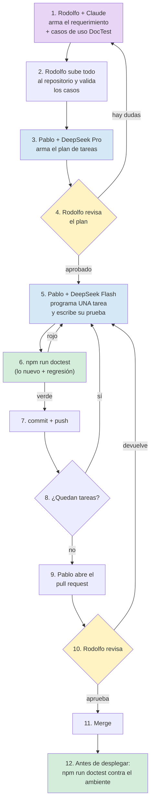

# Guía rápida: cómo trabajamos los requerimientos con Claude + DeepSeek

## Objetivo

Ayuda memoria de cómo viaja un requerimiento desde que Rodolfo lo define con Claude hasta que Pablo lo
construye con DeepSeek y entra al sistema, incluido **qué pruebas automáticas (DocTest) se corren en
cada paso**. Para Rodolfo, Pablo y Claude. Se lee al arrancar un requerimiento nuevo y cuando hay duda
de qué toca hacer. **No** cubre el detalle técnico de DocTest (está en
[`doctest/README.md`](../../doctest/README.md) y [`doctest/GUIA-PRUEBAS-Y-AYUDAS.md`](../../doctest/GUIA-PRUEBAS-Y-AYUDAS.md))
ni la metodología de ramas y PR (está en el `CLAUDE.md` del repo).

> Versión 1.2 · noviembre 2026 · Trazalog v2.5 / v3
> **Cambios en 1.2:** se ajustó todo lo de DocTest a lo que existe hoy en el repo (la 1.1 describía el
> diseño, no lo construido). DocTest se reduce a **un comando**, `npm run doctest`. Se corrigieron el
> ejemplo de caso de uso (no pasaba el validador), los roles, el ambiente de pruebas (DEMO, no
> staging-v3) y qué controla hoy GitHub (sección 9). Se marcan como **pendiente** las piezas que
> todavía no existen.

---

## 1. La idea en una frase

**Rodolfo define QUÉ se construye usando Claude. Pablo construye CÓMO usando DeepSeek. Nada entra al
sistema hasta que DocTest está en verde y Rodolfo aprueba.**

El modelo caro se usa donde un error cuesta meses (definir mal algo). El modelo barato se usa donde un
error se detecta en minutos (código con pruebas).

---

## 2. Quién hace qué

| Quién | Con qué herramienta | Qué hace |
|---|---|---|
| **Rodolfo** | Claude (Fable u Opus) | Requerimiento, arquitectura, diseño de pantallas, **casos de uso del catálogo DocTest** |
| **Pablo** | DeepSeek Pro | Lee lo que armó Rodolfo y lo convierte en un plan de tareas chicas |
| **Pablo** | DeepSeek Flash | Programa cada tarea chica, de a una, **y escribe su prueba automática** |
| **DocTest** | `npm run doctest` | Corre las pruebas automáticas y dice verde o rojo |
| **Rodolfo** | Revisión | Aprueba o devuelve el pull request |

---

## 3. El recorrido completo



---

## 4. Lo que Rodolfo entrega (el requerimiento)

Cada requerimiento son **dos cosas** en el repositorio `traz-tools`:

1. **Un archivo de requerimiento** en `requerimientos/REQ-###-nombre-corto.md` (la carpeta se crea con
   el primer requerimiento) con el contexto, las pantallas, las reglas y las decisiones.
2. **Uno o más casos de uso del catálogo DocTest** en `doctest/catalogo/<modulo>/<MOD>-UC-###.yaml`,
   uno por cada función del requerimiento.

Pablo y DeepSeek solo ven esos archivos, no la conversación que tuvo Rodolfo con Claude. Por eso tienen
que estar completos y sin suposiciones.

### 4.1 El archivo de requerimiento

| Sección | Qué va | Ejemplo |
|---|---|---|
| **Título y número** | Identificador único | REQ-012 Alta de equipos y componentes |
| **Para qué sirve** | El problema que resuelve, en dos o tres renglones, sin tecnicismos | "El Supervisor hoy carga equipos en una planilla aparte y se pierde el historial" |
| **Quién lo usa** | Perfil o perfiles involucrados, **con el vocabulario del catálogo** (ver abajo) | Supervisor |
| **Qué tiene que hacer** | Lista numerada de funciones, una por renglón. Cada función apunta a su caso de uso | 1. Dar de alta un equipo → MAN-UC-001 |
| **Qué NO hace** | Lo que queda explícitamente afuera | "No importa equipos desde planilla" |
| **Pantallas** | Maqueta o descripción de cada pantalla, con sus campos y botones, y el `data-testid` de cada elemento que las pruebas van a tocar | Imagen + lista de campos |
| **Reglas** | Validaciones, cálculos, permisos, mensajes de error | "El código de equipo no se puede repetir dentro de la misma empresa" |
| **Datos** | Qué se guarda, dónde y con qué forma | Tabla, campos, tipos |
| **Decisiones tomadas** | Por qué se eligió hacerlo así | "Se usa el mismo formulario que almacenes" |
| **Dudas abiertas** | Lo que todavía no está definido (idealmente, nada) | — |

**Perfiles válidos** (vocabulario fijo de `doctest/catalogo/SCHEMA.md`): de la operación, `Solicitante`,
`Supervisor`, `Planificador`, `Mantenedor` y `Responsable de Almacén`; de la administración de la cuenta,
`Administrador`, `Usuario` y `Superusuario`. Si un requerimiento necesita otro, se agrega primero al
esquema.

### 4.2 Los casos de uso del catálogo DocTest

Los casos de uso **no van en el archivo de requerimiento**: van directo al catálogo DocTest, porque de
ahí salen la documentación Gherkin y la ayuda al usuario, y la prueba automática se escribe contra el
caso. Escribirlos dos veces es la forma más rápida de que queden desincronizados.

Cada YAML tiene esta forma (el esquema completo está en `doctest/catalogo/SCHEMA.md`). Este ejemplo
**pasa el validador**:

```yaml
id: MAN-UC-001
modulo: MAN
titulo: Alta de equipo con componentes
perfil: Supervisor
estado: borrador              # Rodolfo lo pasa a "validado" cuando lo aprueba
version: "1.0"
origen: baseline              # o delta-PR#N, o feedback-issue#N
referencias_codigo:           # OBLIGATORIO, al menos una. Antes de programar, se apunta al
  - repo: traz-tools          # requerimiento; Pablo agrega los archivos reales al programar
    path: requerimientos/REQ-012-alta-equipos.md
    detalle: "se completa con la vista y el controller al programar"
pantallas:
  - "Mantenimiento → Equipos → Agregar"
precondiciones:
  - Usuario autenticado con perfil Supervisor
  - Empresa de test con establecimiento activo
flujo_principal:
  - paso: "Toca 'Nuevo equipo' en el listado"
    resultado: "Se abre el formulario de alta vacío"
  - paso: "Completa código, nombre, ubicación y toca 'Guardar'"
    resultado: "El equipo aparece en la lista y queda registrado quién lo creó y cuándo"
flujos_alternativos:
  - nombre: "Código repetido"
    pasos:
      - paso: "Intenta guardar con un código que ya existe en la empresa"
        resultado: "Mensaje 'Ese código ya está en uso' y no guarda"
validaciones:
  - "Código de equipo único por empresa"
datos_prueba:
  equipo_codigo_prefijo: "EQ-TEST-"
dudas:                        # en borrador es OBLIGATORIO tener al menos una
  - "¿El código se valida único por empresa o en todo el sistema? Hoy el sistema lo valida global."
derivados: {}                 # en borrador tiene que estar vacío
```

Al **validarlo**, Rodolfo cambia `estado: validado`, agrega `fecha_validacion: 2026-11-02` y deja
`dudas: []`. Esas tres cosas las exige el validador.

**Regla de oro:** cada regla de "validaciones" tiene su flujo alternativo que la prueba. Si una regla no
tiene cómo probarse, DeepSeek no tiene forma de saber si la programó bien.

### 4.3 Cómo lo arma Rodolfo con Claude

1. Rodolfo conversa con Claude hasta tener claro el requerimiento.
2. Claude redacta el `REQ-###.md` y los YAML del catálogo, y corre `npm run validate:catalog`.
3. Rodolfo los lee una vez haciendo de cuenta que es Pablo y no conoce el contexto. Para leer los casos
   cómodo: `npm run hoja:validacion -- man` arma una hoja en prosa con un control para marcar cada caso.
4. Rodolfo sube todo en una rama `feature/req-###` y abre un pull request a `develop`.
5. En ese pull request corre `doctest-validate.yml`, que verifica que los YAML respeten el esquema. Si
   está en rojo, se corrige antes de seguir.
6. Rodolfo pasa cada caso a `validado` y mergea. **Recién ahí Pablo puede empezar.**

---

## 5. Lo que hace Pablo con DeepSeek Pro (el plan)

Pablo le da a DeepSeek Pro el `REQ-###.md` y los YAML del catálogo, y le pide un plan que cumpla:

- ✅ Cada tarea se hace en **una o dos horas**, no más.
- ✅ Cada tarea tiene **un resultado comprobable** (una pantalla que se ve, una prueba que pasa, un dato
  que se guarda).
- ✅ Cada tarea dice **qué caso de uso (`MAN-UC-###`) y qué flujo cubre**.
- ✅ Las tareas están **ordenadas** (primero los datos, después las reglas, después las pantallas).
- ✅ Hay una tarea explícita para **agregar los `data-testid`** en las vistas.
- ❌ Ninguna tarea dice "implementar el módulo completo". Si aparece, se parte.

El plan se guarda al lado del requerimiento, en `requerimientos/REQ-###-nombre-corto.plan.md`. Rodolfo
lo revisa antes de que Pablo programe: ¿las tareas son chicas? ¿cubren todos los casos? ¿DeepSeek
entendió algo distinto?

---

## 6. DocTest: lo único que hay que correr

**DocTest se maneja con un solo comando.** Se corre en una terminal, parado en `traz-tools/doctest/`
(la primera vez: `npm install`, `npx playwright install chromium` y `cp .env.example .env`, ver el
[README](../../doctest/README.md)).

| Cuándo | Comando | Qué hace |
|---|---|---|
| Terminaste una tarea, **antes de commit y push** | `npm run doctest` | Corre **lo nuevo** de tu rama (las pruebas que agregaste o tocaste, y las de los casos que cambiaron) y después el **set de regresión** (todas las pruebas estables). Si da verde, commiteás y seguís con la próxima tarea |
| **Antes de desplegar** una versión | `npm run doctest -- regresion --entorno demo --base <tag desplegado>` | Lo mismo, contra el ambiente, con "lo nuevo" calculado desde la versión que está desplegada |
| Ambiente nuevo o empresas de test viejas | `npm run doctest -- casi-full` | Crea dos empresas desde cero y las deja configuradas para ese ambiente; después corre la regresión |
| Prueba completa | `npm run doctest -- full` | Además carga datos y corre también los circuitos largos |

No hay que configurar con qué empresa se prueba: `casi-full` y `full` la dejan anotada por ambiente
(`doctest/entornos/<ambiente>.json`), y `npm run doctest` la usa sola. Si un ambiente no tiene ese
archivo, toma las credenciales del `.env`.

> **Alternativa sin terminal:** pedírselo a Claude Code en una sesión parada en `traz-tools/` ("corré
> doctest regresión en demo"). Es como lo usa Rodolfo hoy.

### 6.1 Cómo escribe Pablo la prueba de una tarea

No hay un generador de esqueletos: la prueba se escribe **copiando una existente del mismo módulo**
(`doctest/tests/e2e/specs/<modulo>/`) y adaptándola. Para que DeepSeek Flash la escriba bien, Pablo le
pasa **cuatro cosas** y nada más:

1. El YAML del caso de uso.
2. Una prueba existente del mismo módulo, como modelo.
3. Los page objects de las pantallas involucradas (`doctest/tests/e2e/pages/`), o la indicación de
   crearlos si no existen.
4. La lista de `data-testid` de esas pantallas.

Reglas que Flash tiene que respetar (van en el pedido):
- Sin esperas fijas (`waitForTimeout`); se usa la espera automática de Playwright.
- Un escenario por cada flujo del YAML (principal y alternativos).
- Los selectores van en los page objects, nunca sueltos en la prueba.
- La prueba lleva en el título el id del caso (`@MAN-UC-001`) y la etiqueta del módulo (`@man`); si es
  un flujo crítico, también `@smoke`.
- Los datos que crea llevan el prefijo del YAML (`EQ-TEST-`) más un sello de tiempo.
- El YAML apunta a la prueba en `derivados.test_e2e`, y `referencias_codigo` lista los archivos que se
  tocaron. Así `npm run doctest` la reconoce como "nueva".

Después, si el caso tiene ayuda de usuario, `npm run features` y `npm run ayudas` regeneran el `.feature`
y el manual. Los `.feature` no se editan a mano.

### 6.2 Pedidos nuevos o cambios que aparecen mientras se programa

Si al programar Pablo descubre que falta un caso o que uno estaba mal:
- **No** lo inventa ni lo arregla por su cuenta.
- Abre un issue con la plantilla **"Falta probar algo (test-gap)"** describiendo qué falta.
- Rodolfo lo resuelve con Claude (`/doctest <qué cambió>` en Claude Code) y lo pasa a `validado`.
- Recién ahí Pablo escribe la prueba y sigue.

---

## 7. Lo que hace Pablo con DeepSeek Flash (programar)

Pablo trabaja **de a una tarea del plan**. Para cada una:

1. Le da a Flash: la tarea, la sección del requerimiento, el YAML del caso de uso y una prueba modelo.
2. Flash escribe el código y la prueba.
3. Pablo corre `npm run doctest`.
4. Si falla, se lo devuelve a Flash con el error. Máximo **dos intentos**.
5. Si al tercer intento sigue fallando, Pablo **escala** (sección 10).
6. Si pasa, commit + push y sigue con la próxima.

Lo que Flash **no** debe recibir nunca: varias tareas juntas, un pedido vago ("mejorá esto"), o un
pedido sin caso de uso asociado.

---

## 8. El pull request de Pablo

Una rama `feature/req-###` por requerimiento, pull request a `develop`. La descripción tiene siempre:

```
## Qué cambia
(dos o tres renglones)

## Por qué
Cierra REQ-###. Casos de uso: MAN-UC-001, MAN-UC-002.

## Cómo lo verifiqué
npm run doctest --entorno demo
  Pruebas nuevas: 6 verdes
  Set de regresión: 71 verdes
(resultados reales, pegados, no supuestos)
```

---

## 9. Qué tiene que estar en verde para que Rodolfo acepte el pull request

### 9.1 Lo que GitHub controla solo, hoy

| Chequeo | Workflow | Qué mira |
|---|---|---|
| ✅ Catálogo bien formado | `doctest-validate.yml` | Los YAML respetan el esquema y las reglas (un borrador tiene dudas y no tiene derivados; un validado tiene fecha y sus derivados existen), el TypeScript compila y las pruebas cargan |

**Eso es todo lo que corre hoy en GitHub.** GitHub **no ejecuta las pruebas**: por eso el resultado
real de `npm run doctest` va pegado en la descripción del PR (sección 8).

**Pendiente** (diseñado, no construido): que GitHub corra las pruebas en cada PR y guarde la evidencia,
que analice solo si un cambio afecta casos de otros módulos, y los chequeos de lint de PHP, seguridad y
submódulos. Cuando existan, se suman a esta tabla.

### 9.2 Lo que verifica Rodolfo

- [ ] **La descripción del PR trae resultados reales** de `npm run doctest`, no "debería pasar".
- [ ] **Cada caso del requerimiento tiene su prueba** (`derivados.test_e2e` completo) y la prueba pasa.
- [ ] **Cada YAML está cerrado:** `estado: validado`, `fecha_validacion`, `dudas: []`,
      `referencias_codigo` con los archivos reales.
- [ ] **Ninguna prueba nueva en `@quarantine`.** Si quedó inestable, se abre issue y no se acepta.
- [ ] **Los `.feature` no fueron editados a mano** y la ayuda se regeneró y se lee bien (tuteo
      argentino, sin jerga, pantallas como las ve el usuario).
- [ ] **Hace lo que dice el requerimiento:** Rodolfo recorre en DEMO el flujo principal de cada caso.
- [ ] **El código es entendible** en una lectura.

### 9.3 Antes de desplegar

Antes de desplegar una versión a un ambiente se corre
`npm run doctest -- regresion --entorno <ambiente> --base <tag de la versión desplegada>`. Si da rojo,
no se despliega.

---

## 10. Cuándo escalar (cambiar de modelo)

```
Flash falla dos veces  →  Pablo prueba con DeepSeek Pro
Pro falla dos veces    →  Pablo le avisa a Rodolfo
Rodolfo decide:
   - la tarea estaba mal partida → se vuelve a partir más chica
   - el requerimiento tenía un hueco → Rodolfo lo corrige con Claude (YAML nuevo o corregido)
   - la tarea es realmente difícil → se hace con Claude
```

Casos donde conviene ir directo a Claude sin esperar a que Flash falle: integraciones con Bonita, cambios
en la capa de API (WSO2, MCP), la preparación de datos de DocTest y cualquier cosa que toque varios
módulos a la vez.

---

## 11. Reglas que no se negocian

- 📁 **El repositorio es la única verdad.** Lo que no está en el repositorio no existe.
- 📋 **El catálogo manda.** Los casos de uso viven en `doctest/catalogo/`, no en el requerimiento ni en
  un chat.
- 🔢 **Una tarea por vez.** Siempre.
- 🧪 **Sin caso validado no hay prueba, y sin `npm run doctest` en verde no hay commit.**
- 🚫 **Nada se deriva desde un caso en `borrador`.** El validador lo rechaza.
- 🗣️ **Si hay duda, se pregunta.** Pablo abre un issue `test-gap`; Rodolfo lo aclara en el YAML.
- 👀 **Rodolfo revisa todo** antes de que entre al sistema.
- 🧾 **Vocabulario fijo.** Perfiles de la sección 4.1; pantallas y ayudas en español argentino con
  tuteo ("podés", "ingresá").
- 🏭 **Las pruebas nunca apuntan a producción.** Solo a `local`, `demo` o, cuando exista, `staging-v3`.
  DocTest lo impide solo.

---

## 12. Lista de control antes de pasar un requerimiento a Pablo

- [ ] `REQ-###.md` tiene número, título y "para qué sirve" en lenguaje simple.
- [ ] Dice qué perfiles lo usan (vocabulario de 4.1) y qué queda afuera.
- [ ] Cada función apunta a un caso del catálogo.
- [ ] Cada YAML tiene flujo principal, alternativos y validaciones; cada validación, su flujo.
- [ ] Cada pantalla tiene maqueta o lista de campos, con sus `data-testid`.
- [ ] Está definido qué datos se guardan y dónde.
- [ ] Las decisiones de diseño tienen su "por qué".
- [ ] `npm run validate:catalog` en verde y `doctest-validate.yml` en verde en el PR.
- [ ] Todos los YAML en `estado: validado`, con `fecha_validacion`, y mergeados a `develop`.
- [ ] Lo leí una vez haciendo de cuenta que soy Pablo y no entiendo nada del contexto.

---

## 13. Qué medimos para saber si el esquema funciona

Al cierre de cada requerimiento, Pablo anota en el `.plan.md`:

| Qué | Para qué |
|---|---|
| Tareas que necesitaron más de dos intentos | Si son muchas, las tareas están mal partidas o el requerimiento tiene huecos |
| Veces que se escaló a Pro o a Claude | Si es frecuente, Flash no sirve para ese tipo de trabajo |
| Issues `test-gap` abiertos durante la construcción | Si son muchos, el catálogo salió incompleto |
| Devoluciones en la revisión de Rodolfo | Si son muchas, el problema está en el requerimiento, no en el código |
| Corridas de `npm run doctest` en rojo por tarea | Si son muchas, las pruebas o las tareas están mal planteadas |

Después de tres o cuatro requerimientos se revisa esta guía con esos números a la vista.
