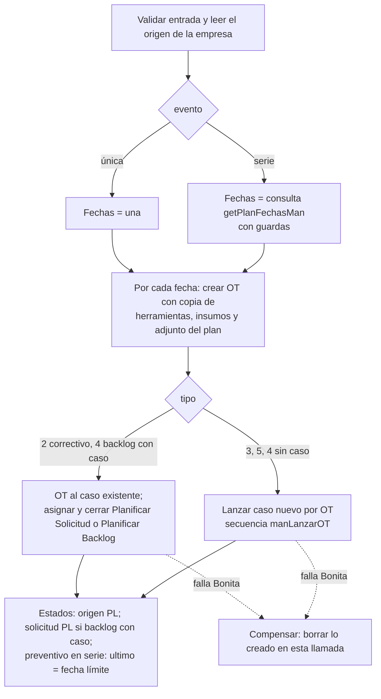

# MIG-4 — Plan de Mantenimiento (Calendario) en MAN: especificación

## Objetivo

Especificación completa para rehacer en MAN la pantalla **Plan de Mantenimiento** de asset
(`Calendario/indexot`) y la **ventana de la OT** que comparte con el listado de OT y la bandeja. Está
escrita para quien la implementa (sin necesidad de leer la conversación que la originó) y para el PM, que
la revisa. Dice qué se ve, qué hace cada acción, cómo se arma por dentro y cómo se prueba. No cubre el
lanzamiento diferido de casos (MIG-8) ni la unificación de bandejas (MIG-7): ver
[MIGRACION-ASSETPLANNER.md](MIGRACION-ASSETPLANNER.md).

- **Rama**: `feat/MIG-ASSET-2-informes` en los dos repositorios (tools en `/mnt/win/dev/git/traz-v3/traz-tools-mig`,
  módulo en `/mnt/win/dev/git/traz-v3/traz-tools/application/modules/traz-tools-man`). Commits locales; un solo
  PR por repositorio al final del tramo.
- **Fuente de asset**: siempre `git show origin/develop:<archivo>` en `/mnt/win/dev/git/traz-prod-assetplanner`
  (la carpeta de trabajo está en otra rama y no se toca).
- **Reglas que aplican**: ADR-014 (datos solo por `MANDataService`; operación que toca varios subsistemas =
  recurso de `toolsMANAPI` con compensación; mediadores nativos de WSO2), A5 (Bonita por `/tools/bpm/...`),
  E1–E34 de [MIGRACION-ASSETPLANNER.md](MIGRACION-ASSETPLANNER.md) §3.8, PHP 5.6, y "lo de almacenes y
  pañol no se migra" (E34).

## Estado de la implementación (2026-10-30)

Implementado según esta especificación, con estas diferencias (todas decididas y documentadas en
[MIGRACION-ASSETPLANNER.md](MIGRACION-ASSETPLANNER.md) §3.8, E35 a E48):

| Especificación | Cómo quedó |
|---|---|
| E42: ampliar `/ot/asignar` | Tres recursos nuevos: `/plan/ot/tarea`, `/plan/asignar` y `/plan/reasignar`. `/ot/asignar` no se toca |
| Secuencia `manLanzarOT` | El bloque de Bonita es una fase separada dentro del recurso `/plan/programar` (no un archivo aparte) |
| `getPlanFechasMan` calcula las fechas y el motor las pide | La misma fórmula está en la consulta que crea las órdenes y en `POST /plan/fechas`, que usa la prueba de fechas. El recurso no pasa fechas por el API |
| `id_tarea_bonita` del correctivo | No se usa: el motor busca "Planificar Solicitud" por nombre en el caso de la solicitud |
| Recurso `/plan/correctivos` en `toolsMANAPI` | Es una consulta de `MANDataService` (`POST /plan/correctivos`) y PHP pide las tareas del usuario con la bandeja (`Tareas::todas`) |
| Mover y estirar comprueban la empresa en la consulta | La base no informa cuántas filas tocó un UPDATE (E47): se comprueba antes con una consulta |
| `foreach` con `call` dentro: a probar | Probado, funciona (E46) |
| Comparación de escrituras contra asset | No se hace (asset no puede lanzar casos con el usuario de prueba, T28): `e2e_calendario.py` comprueba las filas que arma `guardar_agregar` de asset |
| Excel e imprimir | Excel carga SheetJS de su sitio la primera vez (como asset); imprimir usa la impresión del navegador sobre el calendario |


---

## 1. Qué hay hoy en asset

| Pieza | Archivo de asset | Qué hace |
|---|---|---|
| Pantalla | `views/calendar/calendar1.php` (1378 líneas) | Calendario FullCalendar 2.2.5 (jQuery 2) + 5 ventanas de "Generar Orden" + carga de tablas laterales |
| Tablas laterales | `views/calendar/tablas.php` | 5 tablas plegadas con lo que falta programar en el mes |
| Filtro | `views/calendar/filtro.php` + `Calendario::panelFiltro` | Equipo, área, grupo, sector y origen, en el panel derecho del layout de asset |
| Ventana de la OT | `views/calendar/view_OtEjecutar_modal.php` + `Calendario::verEjecutarOT` | Detalle de la OT y, si el caso está en "Asignar Recursos y Tareas", asignar responsable y tarea. **También la abren** el listado de OT ("Asignar Resp y Tareas", y por ahí la bandeja: `tareas/view_asignar` redirige al listado) y `Sservicios/list_bpm` (reasignar) |
| Motor | `Calendario::guardar_agregar`, `setOTenSerie`, `getPeriodTarea`, `getDiasDuracion`, `setHerramInsPorTarea` | Crea la OT (una o una serie), copia herramientas, insumos y adjunto del plan, cambia estados y lanza o cierra tareas de Bonita |
| Datos | `models/Calendarios.php` (1176 líneas) | Consultas directas a la base |
| Asignar desde la ventana | `Otrabajo::EjecutarOT`, `Otrabajo::reasignaOt`, `Otrabajo::updateResponsable` | Bonita + base |
| Períodos | `Calendario::getperiodo` | Lo usan además Preventivo, Predictivo, OT y Solicitudes para el selector de período |

En MAN, `controllers/Calendario.php` y `models/Calendarios.php` son todavía la copia vieja del fork (acceso
directo a la base, `empresa()` de tools en vez de `man_empresa()`): **no funcionan** y se reemplazan
enteros. Mientras tanto, el selector de período de Preventivo, Predictivo, OT y Solicitudes y el botón
"Asignar Resp y Tareas" del listado de OT de MAN están rotos.

El menú de tools ya apunta a la pantalla: `seg.menues` `MAN | plan_mantenimiento | traz-tools-man/Calendario/indexot`.

---

## 2. Qué se ve (tiene que verse igual)

### 2.1 Distribución

Dos columnas como en asset (`col-md-6` cada una):

- **Izquierda**: caja con, arriba, los íconos Imprimir, Exportar a Excel y Filtrar; debajo, "Referencias de
  colores"; debajo, el calendario.
- **Derecha**: las tablas laterales (§2.4), cada una en una caja plegada (`collapsed-box`) con el título
  `<Nombre> (<Mes> <Año>)`, por ejemplo "Preventivo (Octubre 2026)".

### 2.2 El calendario

- Biblioteca: **FullCalendar 5.10, que el layout de tools ya carga** (`application/views/layout/Admin.php:535`,
  `assets/fullcalendar/lib/main.js` y `locales-all.js`). No necesita jQuery, no se agrega ninguna biblioteca
  nueva. Antes de usarla, confirmar que la pantalla de MAN se dibuja dentro de ese layout (si no, cargar esos
  dos archivos en la vista).
- Encabezado: izquierda `prev,next today`; centro el título; derecha `Mes`, `Semana`, `Día`
  (`dayGridMonth,timeGridWeek,timeGridDay`). Textos: "Hoy", "Mes", "Semana", "Día". Idioma `es`.
- Cada OT es un evento:
  - **Título**: `<id_orden> | <código del equipo> | <descripción de la OT>`.
  - **Inicio** `fecha_program`; **fin** = inicio + `duracion` **minutos** (asset trata la duración como
    minutos aunque el plan la guarde en otra unidad; se conserva).
  - **Color de fondo por tipo de OT** (exactamente los de asset): 1 Orden de trabajo `#3c8dbc`, 2 Correctivo
    `#f56954`, 3 Preventivo `#39CCCC`, 4 Backlog `#ff851b`, 5 Predictivo `#00a65a`, 6 Correctivo programado
    `#D81B60`.
  - **Sin responsable** (`id_usuario_a` vacío o 0): borde azul de 2 px (clase `tipo-3-border`).
- Qué OTs entran: las de la empresa, con `estado` distinto de `T` y de `AN`. Asset trae las del mes de la
  fecha que muestra el calendario; MAN trae las del rango visible (ver E37).
- **Clic en un evento**: abre la ventana de la OT (§2.6).
- **Arrastrar un evento** a otro día u hora: pregunta "¿Realmente desea hacer este cambio?"; si se acepta,
  guarda la nueva `fecha_program`; si se cancela o falla, vuelve a su lugar y avisa "No pudo realizarse el
  cambio".
- **Estirar o acortar** un evento: misma pregunta; suma a `duracion` los minutos de diferencia y avisa "Se ha
  guardado Correctamente".

### 2.3 Referencias, imprimir, Excel y filtro

- **Referencias de colores**: la lista de asset con sus textos (Urgente, Backlog, Preventivo, Predictivo,
  Orden Trabajo). Asset usa en la lista colores que no son los de los eventos; MAN usa los de los eventos y
  agrega "Correctivo programado" (E38).
- **Imprimir**: imprime solo el calendario (asset usa `printArea`; si tools no lo tiene, una hoja de estilos
  de impresión que oculte el resto).
- **Exportar a Excel**: archivo `calendario_OT.xlsx`, hoja "Calendario", columnas `Nº OT, Equipo,
  Descripción, Inicio, Fin, Área, Grupo, Sector, Origen` (fechas `DD/MM/YYYY HH:mm`), ancho de columna
  ajustado, con los eventos cargados. Sin eventos: "No hay eventos para exportar". Asset baja SheetJS de
  `cdn.sheetjs.com` al primer uso; si tools ya trae SheetJS se usa la copia local.
- **Filtro**: cinco campos con lista de sugerencias (Equipos, Areas, Grupos, Sectores, Origenes), cada uno
  con "Limpiar". Filtra en el navegador los eventos ya cargados por igualdad exacta (código de equipo, área,
  grupo, sector, descripción del tipo de OT). Las opciones son los equipos, áreas, grupos y sectores de la
  empresa y todos los tipos de OT. En asset vive en un panel derecho propio de su layout; en MAN va en una
  caja plegable arriba del calendario (E39).

### 2.4 Tablas laterales (lo que falta programar)

Se recargan cada vez que el calendario cambia de mes. Las columnas ocultas de asset no se dibujan (los datos
viajan en atributos de la fila). Asset declara DataTables para estas tablas pero los inicializa antes de que
existan, así que se ven como tablas comunes: MAN las deja comunes (paridad visual).

| Tabla | Qué filas (empresa de la sesión) | Columnas visibles | Ícono de la primera columna |
|---|---|---|---|
| **Solicitud de Servicios** | Tareas pendientes del usuario en Bonita cuyo caso es una solicitud **urgente** (`urgente != 0`) en estado `S`, con `f_solicitado` en el mes y año | OT (ícono), ID Solic., Código, Causa, F.Solicitado | `fa-stop-circle` abre "Generar Orden"; si la solicitud ya está en `OT`, `fa-stop-circle-o` "Orden Generada" sin acción |
| **Preventivo** | Preventivos en estado `C`, de período que no sea Horas, Ciclos ni Kilómetros, cuya próxima fecha cae en el mes (ver §4.4 y la pregunta P-MIG4-1) | OT, Equipo, Tarea, Fecha (`ultimo`), Periodo, Frec. | `fa-square` |
| **Preventivo por ciclos/horas** | Preventivos en estado `C` o `M`, de período Horas, Ciclos o Kilómetros, que ya pasaron la alerta (regla única, §4.5). No depende del mes | OT, Equipo, Tarea, Fecha (como asset: `ultimo` + cantidad en días), Periodo (Horas / Ciclos / Km), Frec. | Amarillo `fa-info-circle` "Alerta: se esta por llegar al nivel critico" o rojo `fa-exclamation-triangle` "Alerta: se supero el nivel critico", más `fa-history` |
| **Backlog** | Backlogs en estado `C` o `S` con `fecha` en el mes y año | OT, ID Solic. (`sore_id`), Codigo, Causa (tarea estándar o, si no tiene, `tarea_opcional`), Fecha | `fa-check-square`; si está en `OT`, `fa-check-square-o` "Orden Generada" |
| **Predictivo** | Predictivos en estado `C` con `fecha` en el mes y año | OT, Código, Descrip, Fecha, Período, Frec. | `fa-circle-thin` |

### 2.5 Ventanas "Creación de Orden de Trabajo"

Todas con título "Creación de Orden de Trabajo", subtítulo "Seleccione la fecha de Programación", campo
**Fecha** (texto `dd-mm-aaaa` con selector, hoy por defecto) y **Hora** (`time`), y botones "Cancelar" y
"Generar Orden".

- **Preventivo** y **Predictivo** agregan "Seleccione programación": **Tipo de Evento** (`Unico` = 1,
  `Mensual` = 2; "Mensual" significa en realidad "repetir con la frecuencia del plan") y **Cantidad Meses**
  (deshabilitado hasta que se cambia el tipo). Con `Unico` se ignora la cantidad.
- **Solicitud de Servicios**, **Backlog** y **Preventivo por horas**: solo fecha y hora (siempre una sola OT).
- Si la hora es `00:00`, pregunta "Esta Seguro de la Asignación? Hora: 00:00 Para la Fecha: …" antes de
  seguir.
- Al terminar bien: "Se ha guardado Correctamente" y se recarga la pantalla. Asset no avisa los errores (se
  pierden en la consola); MAN muestra el mensaje del servidor (E40).
- Al abrir la de **Solicitud de Servicios**, asset toma la tarea de Bonita del usuario (`Tarea/tomarTarea`).
  MAN no la toma al abrir: la toma el recurso al generar (E41).

### 2.6 Ventana de la OT (`Calendario/verEjecutarOT/<id_orden>[/<reasigna>]`)

Panel "Orden de Trabajo" con pestañas:

- **Detalle** (siempre): tabla con F. Prog, Nº Orden, Tipo, Nº Tarea (`id_solicitud`), Desc. Tarea,
  Duracion (`<duración del plan> <unidad>`), Frec., Desc. Comp. (solo si el plan tiene componente), Codigo
  de Equipo, Desc. Equipo.
- **Asignación Responsable** y **Agregar Tareas**: solo si el caso de la OT tiene pendiente "Asignar
  Recursos y Tareas" (o "Asignar Recursos y Tareas Urgente" si la OT viene de una solicitud). Responsable con
  autocompletar de operarios de la empresa (obligatorio); Tarea Estandar (lista de tareas de la empresa) y
  Tarea No Estandar (texto); al menos una de las dos.
- **Asignación Responsable** sola cuando se abre para reasignar (desde Solicitudes).
- Pie: "Asignar OT" (asignar o reasignar, según el caso) y "Cerrar".
- **No se portan** (E34): pestañas "Herramientas" (vales de pañol) y "Pedido Materiales" (pedido y
  entregas de almacén), ni el aviso "No se Realizarán Pedido de Materiales".
- **Al cerrar la ventana**, asset guarda el responsable elegido en la OT aunque no se haya asignado en
  Bonita. MAN lo conserva (es lo que saca el borde azul del calendario), pero solo sobre OTs de la empresa
  (T47).
- **Ubicación**: "Asignar OT" pide la ubicación del navegador como asset (en asset la pide en
  computadoras y no en celulares; se conserva tal cual y se anota, T52).

---

## 3. Operaciones: de la pantalla al API

Toda URL del módulo empieza con `base_url(MAN)`. PHP solo arma y pasa datos de la sesión (empresa de asset
con `man_empresa()`, usuario con `man_usuario()`, `bpm_token`); las decisiones las toma el API o la consulta.

### 3.1 Lecturas (`MANDataService`, bloque nuevo `MIG-ASSET-4c`)

| Acción PHP (MAN) | Consulta nueva | Notas |
|---|---|---|
| `Calendario/getcalendarot` (POST `desde`, `hasta`) | `GET /calendario/ot/empresa/{id_empresa}/desde/{desde}/hasta/{hasta}` | Columnas de `Calendarios::getot` de asset |
| `Calendario/panelFiltro` | Cuatro consultas de opciones (equipos, áreas, grupos, sectores) por empresa + tipos de OT | |
| `Calendario/getTablas` (POST `mes`, `year`, `permission`) | Una consulta por tabla (§2.4) | Correctivos: ver §3.2 |
| `Calendario/getperiodo` | `GET /periodos/empresa/{id_empresa}` | **Se porta primero**: arregla el selector de período de Preventivo, Predictivo, OT y Solicitudes. Paridad: con POST vacío asset responde `"nada"` (compara `[] == null`); con datos, todos los períodos `AC` de la empresa por descripción |
| `Calendario/getPrevPorId`, `getBackPorId`, `getPredictPorId`, `getCorrectPorId` | Ya no hacen falta | El navegador solo manda tipo y número de origen; el recurso lee el resto (§4) |
| `Calendario/verEjecutarOT` | Detalle de la OT, componente, duración y frecuencia del plan, tareas de la empresa, operarios | Todo limitado a la empresa: una OT de otra empresa muestra "La orden no existe" (T46). Asset une `predictivo.id_unidad = predictivo.id_unidad` (siempre verdadero) y muestra la primera unidad que encuentra; MAN une con la unidad del predictivo (T53) |

### 3.2 Correctivos de la tabla

Recurso `POST /tools/man/plan/correctivos` (`toolsMANAPI`): con la sesión del usuario pide sus tareas
pendientes a Bonita (el mismo pedido que la bandeja, E30) y con sus casos consulta las solicitudes urgentes
en `S` de la empresa en el mes. Devuelve cada fila con el número de tarea de Bonita. Asset recibía del
navegador la lista de tareas (`tareas`) y la reenviaba; MAN no confía en esa lista.

### 3.3 Escrituras

| Acción PHP (MAN) | Recurso | Qué hace |
|---|---|---|
| `Calendario/guardar_agregar` | `POST /tools/man/plan/programar` | El motor (§4) |
| `Calendario/updateDiaProg` (`id`, `prog`) | `PUT /calendario/ot/fecha` (DataService) | `fecha_program` de una OT de la empresa |
| `Calendario/updateDuracion` (`id`, `duracion`) | `PUT /calendario/ot/duracion` (DataService) | `duracion = duracion + :minutos` en una sola sentencia, OT de la empresa |
| `Otrabajo/EjecutarOT` | `POST /tools/man/ot/asignar` **ampliado** (E42) | Ver abajo |
| `Otrabajo/reasignaOt` | `POST /tools/man/ot/reasignar` (nuevo) | OT de la empresa; en su caso, "Ejecutar OT" se desasigna y se asigna al nuevo responsable (Bonita lo busca por correo, E27); graba `id_usuario_a` |
| `Otrabajo/updateResponsable` | `PUT /ot/responsable` (DataService) | `id_usuario_a` de una OT de la empresa, con un usuario de la empresa |

**`/tools/man/ot/asignar` ampliado.** Hoy (E27) cierra la tarea actual, busca "Ejecutar OT", la asigna al
responsable por correo y graba la OT asignada. Para cubrir `EjecutarOT` se agregan campos **opcionales**
(regla de `CLAUDE.md`: el dato se agrega, la decisión queda en el API): `id_tarea`, `tarea_opcional`,
`latitud`, `longitud`, `actualizar_origen`. Con ellos, además:

1. Toma la tarea "Asignar Recursos y Tareas" o "… Urgente" **del caso de la OT** (no la que manda el
   navegador; si no está, error "La orden no está para asignar") y se la asigna al usuario de la sesión antes
   de cerrarla (Bonita no deja cerrar una tarea sin dueño, E27).
2. Después de asignar "Ejecutar OT": posición, `estado = 'AS'`, `id_tarea`, `descripcion` (si vino
   `tarea_opcional`) e `id_usuario_a` en la OT; estado `AS` en el origen (preventivo, predictivo, backlog o
   solicitud) y, si es backlog que vino de una solicitud, también en la solicitud. Todo en un `request_box`.

No se instancian subtareas con formulario (`instanciarSubtareas` usa el motor de formularios de asset: E34).

---

## 4. El motor: `POST /tools/man/plan/programar`

### 4.1 Entrada

```json
{
  "id_empresa": "1",        // man_empresa()
  "usrId": "213",           // man_usuario()
  "usrNick": "…",           // correo de la sesión (para Bonita)
  "session": "…",           // bpm_token
  "tipo": "3",              // 2 correctivo, 3 preventivo, 4 backlog, 5 predictivo
  "id_origen": "105",       // id de la solicitud, preventivo, backlog o predictivo
  "fecha": "2026-11-03 08:00:00",
  "evento": "1",            // 1 única, 2 serie (solo 3 y 5)
  "cant_meses": "3",        // solo serie
  "horas": "0",             // 1 = viene de la tabla de ciclos/horas
  "id_tarea_bonita": "…"    // solo correctivo: la tarea de la fila
}
```

PHP convierte `dd-mm-aaaa` + `HH:mm` a `aaaa-mm-dd HH:mm:00` (asset hace lo mismo con `explode('-')`).

### 4.2 Qué lee el recurso (no el navegador)

Una consulta por tipo, **limitada a la empresa**; si no devuelve fila, error "El origen no existe":

| Tipo | Lee | Valores de la OT |
|---|---|---|
| 2 Correctivo | `solicitud_reparacion` (estado `S`, urgente) + `case_id` | `id_tarea` 0, `descripcion` = `causa`, `duracion` 60, `id_equipo` |
| 3 Preventivo | `preventivo` + `tareas` + `periodo` + `equipos.ultima_lectura` | `id_tarea`, `descripcion` = `tareas.descripcion`, `duracion` = `prev_duracion`; con `horas` = 1, `lectura_ejecutada` = `equipos.ultima_lectura` |
| 4 Backlog | `tbl_back` + caso de su solicitud (`sore_id` → `solicitud_reparacion.case_id`, 0 si no tiene) | `id_tarea`, `descripcion` = `tarea_opcional` (así lo manda asset, aunque tenga tarea estándar), `duracion` = `back_duracion` |
| 5 Predictivo | `predictivo` + `tareas` + `periodo` | `id_tarea` = `tarea_descrip`, `descripcion` = `tareas.descripcion`, `duracion` = `pred_duracion` |

Campos fijos de la OT como en asset: `nro` 1, `fecha` hoy, `estado` `PL`, `cliId` 1, `id_usuario` = usrId,
`id_usuario_e` 1, `id_sucursal` 1, `id_solicitud` = `id_tareapadre` = id de origen, `tipo`, `id_empresa`,
`lectura_programada` 0, `lectura_ejecutada` 0 salvo horas. Las fechas que asset deja en cero se pasan
explícitas como en `setOtMan` (E13).

### 4.3 Pasos



1. **Validaciones** (error controlado, sin escribir nada): tipo válido; serie solo con 3 y 5; `cant_meses`
   entero entre 1 y 36; período del plan con frecuencia mayor que 0; preventivo por horas con
   `lectura_base` cargada; solicitud en `S`, urgente, y backlog en `C` o `S` (como las tablas); correctivo:
   la tarea `id_tarea_bonita` es del caso de la solicitud (validación como la bandeja, E31) y el caso tiene
   "Planificar Solicitud".
2. **Fechas**: única = `fecha`. Serie = consulta `getPlanFechasMan` (§4.4), que ya trae como máximo 400
   fechas; si la serie daría más, error "La serie supera 400 órdenes; programe menos meses".
3. **Por cada fecha** (en orden): `setOtPlanMan` (INSERT … SELECT con todos los campos de §4.2) y, en el
   mismo `request_box`, copia de herramientas (`tbl_otherramientas`), insumos (`tbl_otinsumos`) y adjunto
   (`tbl_otadjuntos`, con la carpeta `assets/filespreventivos/`, `filespredictivos/` o `filesbacklog/` +
   nombre) con INSERT … SELECT desde las tablas del plan. Es lo que hace hoy `setHerramInsPorTarea` y lo que
   ya hace el alta de OT (E26): son las herramientas e insumos **planificados**, no los vales ni las entregas.
4. **Bonita**:
   - Preventivo, predictivo y backlog sin caso: secuencia nueva **`manLanzarOT`** = `POST /tools/bpm/proceso/instancia`
     con `{"idSolicitudServicio":0,"idOT":<id>}`, después `case_id` en la OT y `case_empresa` en `assetv2`
     (E23). Es el paso "lanzar" separado de "programar" que pide MIG-4 para que MIG-8 lo pueda diferir.
   - Correctivo: la OT lleva el `case_id` de la solicitud; se asigna al usuario y se cierra "Planificar
     Solicitud".
   - Backlog con caso: la OT lleva el `case_id` de la solicitud; si el caso tiene "Planificar Backlog", se
     asigna al usuario y se cierra.
   - **Primero la base, después Bonita** (como E33): si Bonita falla se borra lo creado en esta llamada
     (OT, herramientas, insumos, adjunto y, en una serie, también las OTs anteriores y sus casos), y el plan
     queda como estaba. Asset hacía lo contrario en el correctivo (cerraba la tarea y después creaba la OT) y
     en la serie no miraba la respuesta de Bonita (T3).
   - Asset además escribe `gIdOT = 0` en el caso del correctivo (le pasa una variable sin valor, T48). El caso
     ya nace con `idOT` 0, así que MAN no hace esa llamada. **Verificar en DEV** con un caso de solicitud
     urgente que `gIdOT` vale 0 antes de planificar; si no, replicar la llamada.
5. **Estados al final**, en un `request_box`: origen en `PL`; si es backlog con caso, la solicitud también en
   `PL`; preventivo en serie, `ultimo` = fecha de inicio + `cant_meses` meses (lo que asset llama fecha
   límite). Asset cambiaba los estados antes de crear nada y los dejaba así aunque fallara.
6. **Respuesta**: `{"status":true,"ots":[ids]}` o `{"status":false,"msj":"…"}`.

**Bucle en WSO2.** La serie se recorre con `foreach` v2 (`parallel-execution="false"`), como los lotes ya
existentes, con la llamada a Bonita adentro. **Primera tarea de la implementación**: comprobar en el MI local
que `foreach` v2 admite `call` dentro y corta ante un error. Si no lo admite, el recurso se parte en dos:
`/plan/programar` valida, calcula las fechas y crea la primera OT; PHP llama `/plan/programar` una vez por
fecha con `fecha_unica` y corta al primer error, y el recurso de cierre `/plan/cerrar` hace el paso 5. Se
anota cuál se usó.

### 4.4 Fechas de la serie (la regla del plan, en un solo lugar)

Asset (`Calendario.php:497-556`): convierte el período a días con números fijos y suma esos días desde la
fecha elegida mientras la fecha no pase la fecha límite (inicio + `cant_meses` meses, inclusive):

| Período (`periodo.descripcion`) | Días por unidad en asset |
|---|---|
| Mensual | 30 × cantidad |
| Semanal | 7 × cantidad |
| Semestral | 180 × cantidad |
| Anual | 365 × cantidad |
| Cualquier otro (Diario, Horas, Ciclos, Kilómetros) | cantidad (como días) |

Con frecuencia 0 asset no termina nunca (T3). La comparación es por texto `aaaa-mm-dd hh:mm:ss` (válida).

MAN calcula las fechas en **una consulta** de `MANDataService`, `getPlanFechasMan`
(`POST /plan/fechas`, parámetros `tipo`, `id_origen`, `fecha`, `cant_meses`, `id_empresa`): toma el período
y la cantidad del plan de la empresa, y genera la serie con una tabla de números 0–399 armada con uniones
(MariaDB 10.1 no tiene consultas recursivas), filtrando `fecha + n × paso <= fecha + cant_meses MONTH`. Si
el paso es 0 o el plan no es de la empresa, no devuelve filas. **Cómo se calcula el paso depende de la
pregunta P-MIG4-1** (§7). La tabla "Preventivo" de §2.4 usa la misma regla para calcular la próxima fecha
(asset suma `cantidad` días sin mirar el período, ni el año: T49).

### 4.5 Regla única de alerta por contador (T7, T8)

Hoy está escrita cuatro veces con tres fórmulas. Lo que en asset **efectivamente** decide qué se ve es la
consulta (`ultima_lectura >= lectura_base + critico1`) y el color de `tablas.php` (rojo si
`ultima_lectura >= lectura_base + cantidad`, amarillo si no). El bloque de `getTablas` que calcula otra
alerta usa una variable que no existe y nunca corre (T50). MAN deja **esa** regla, escrita una sola vez en
la consulta, que devuelve `alerta` = `R` o `A`; la vista solo pinta. Fuente única del contador:
`equipos.ultima_lectura` (la mantiene el disparador `actualizaLectura` de `historial_lecturas`). La marca
`estadoprev = 'M'` que asset pone al cargar una lectura (E16) sigue apagada: la tabla no la necesita porque
mira la lectura directamente.

---

## 5. Decisiones de esta etapa (se pasan a §3.8 del plan al implementar)

| # | Decisión | Motivo |
|---|---|---|
| E35 | FullCalendar 5.10 del layout de tools, no el 6 que recomendaba el plan | Ya está cargado y no usa jQuery; agregar el 6 sumaría una segunda copia |
| E36 | El motor es `POST /tools/man/plan/programar` en `toolsMANAPI`, con "lanzar" en la secuencia `manLanzarOT` | ADR-014 regla 3; deja listo MIG-8 |
| E37 | El calendario pide las OTs del rango visible, no solo del mes de la fecha actual | En la vista semanal que cruza meses asset deja vacía una parte de la semana. Mismo resultado en la vista mensual (asset la usa por defecto) |
| E38 | Las referencias usan los colores de los eventos y suman "Correctivo programado" | En asset no coinciden con los eventos |
| E39 | El filtro va en una caja plegable arriba del calendario | El panel derecho de asset es de su layout; tools no tiene uno equivalente |
| E40 | Los errores del servidor se muestran | Asset los mandaba solo a la consola |
| E41 | La tarea de Bonita del correctivo la toma el recurso al generar, no la ventana al abrirse | Asset la tomaba al abrir y la dejaba tomada si se cancelaba |
| E42 | `EjecutarOT` = `/tools/man/ot/asignar` con campos opcionales | Es la misma operación; un solo código para la bandeja, el listado y el calendario |
| E43 | Serie: `cant_meses` de 1 a 36 y como máximo 400 OTs | Guarda de T3. En DEV la serie más larga tiene 135 OTs. Se cambia en un solo lugar |
| E44 | Base primero, Bonita después, y compensación de todo lo creado en la llamada | Igual criterio que E33 |

---

## 6. Errores de asset encontrados (se agregan a `ERRORES-ASSET.md` al implementar)

| # | Error | En MAN |
|---|---|---|
| T46 🔴 | La ventana de la OT (`verEjecutarOT`) muestra cualquier OT por número, de cualquier empresa | Solo OTs de la empresa |
| T47 🔴 | Mover, estirar y cambiar responsable de una OT (`updateDiaProg`, `updateDuracion`, `updateResponsable`) aceptan cualquier OT, de cualquier empresa | Solo OTs de la empresa |
| T48 | Al planificar un correctivo y un backlog con caso, asset usa una variable que no existe (`$idOTnueva`): escribe `gIdOT = 0` en el caso y en el backlog intenta cerrar una tarea sin número | El recurso usa la OT real y la tarea del caso |
| T49 | La tabla Preventivo calcula la próxima fecha sumando la cantidad como días sin mirar el período, y compara el mes sin el año | Regla única de §4.4 |
| T50 | El cálculo de alerta de `getTablas` usa una variable que no existe y nunca corre | Regla única de §4.5 |
| T51 | Si el lanzamiento falla en una OT única, asset borra la OT pero deja el plan en `PL` y las herramientas, insumos y adjunto huérfanos; en la serie ni mira la respuesta | Compensación completa (E44) |
| T52 | "Asignar OT" exige la ubicación en computadoras y no en celulares (condición al revés) | Se conserva igual y se anota |
| T53 | La duración del predictivo en la ventana de la OT se une con cualquier unidad (`predictivo.id_unidad = predictivo.id_unidad`) | Se une con la unidad del predictivo |
| T54 | La lista de tareas de Bonita del correctivo viene del navegador | La pide el servidor |

T3, T4, T6, T7 y T8 ya están en la lista; esta etapa los corrige (T6 según P-MIG4-1).

---

## 7. Pregunta abierta para el PM

**P-MIG4-1 — ¿Cómo se calculan las fechas de una serie mensual, semestral y anual?** Asset usa días fijos
(mes = 30 días, semestre = 180, año = 365), y así un plan mensual se va corriendo: empieza el 31 de enero y
a fin de año cae el 27 de diciembre.

- **Opción A — igual que asset.** Las fechas de MAN son idénticas a las de asset; la prueba automática
  compara uno a uno. T6 queda anotado y sin corregir.
- **Opción B — por calendario (recomendada).** Mensual = mismo día de cada mes (si el mes no tiene ese día,
  el último), semestral = cada 6 meses, anual = mismo día de cada año. Diario y Semanal no cambian (dan igual
  que asset). Corrige T6 y la próxima fecha de la tabla Preventivo. La prueba automática compara con asset en
  Diario y Semanal, y con una lista de fechas escrita a mano en Mensual, Semestral y Anual.

En los dos casos, un plan con período Horas, Ciclos o Kilómetros no se puede repetir (asset tomaba las horas
como días): esa serie se rechaza con "Los planes por contador se programan de a una orden".

---

## 8. Cómo se prueba

| Nivel | Qué | Cómo |
|---|---|---|
| 0 y 0b | PHP 5.6 y checklist | `phpcs` PHPCompatibility 5.6 y `bash .ci/checklist-0b.sh` en el módulo; archivos nuevos a `.ci/portados.txt`; chequeo de los `<script>` con `node --check` |
| Fechas (golden) | Que la serie de MAN coincida con la de asset | Script `tests/paridad/golden_fechas.py` del módulo: para una matriz de período (Diario, Semanal, Mensual, Semestral, Anual) × cantidad (1, 2, 3, 4) × fecha de inicio (31-ene, 28-feb de año bisiesto y no, 15-jun, 31-dic, a las 00:00 y 17:30) × meses (1, 3, 12, 36), corre las funciones de asset copiadas **textuales** (`getDiasDuracion` y el `while` de `setOTenSerie`) con `php` de la línea de comandos, y compara con lo que devuelve `getPlanFechasMan` en el MI local. Opción A: iguales en todo. Opción B: iguales en Diario y Semanal; Mensual, Semestral y Anual contra la lista escrita a mano |
| Paridad de lectura | Mismos datos que asset | `paridad.py calendario`: con el usuario de prueba (empresa 1), compara `getcalendarot` (JSON normalizado, rango del mes) y las filas de las 5 tablas (datos, no HTML) de asset y de MAN para el mes actual y dos más; `getperiodo` con POST vacío y con datos; `verEjecutarOT` de una OT de la empresa (datos de la pestaña Detalle) |
| Paridad de escritura | Mismo estado en `assetv2` | Se crean con el alta de MAN un preventivo, un predictivo y un backlog de prueba en la empresa 1. Se programa cada uno en asset y en MAN (única y serie de 2 meses) y se comparan las OTs (todas las columnas salvo `id_orden`, `fecha`, `case_id`), herramientas, insumos, adjunto, estados del plan y `ultimo`. Al terminar se borran OTs, casos de Bonita creados por la prueba (solo esos), filas de `case_empresa` en `assetv2` y en PostgreSQL, y los planes de prueba |
| Bonita | La coreografía | `tests/paridad/e2e_calendario.py` (la Bonita de desarrollo y el MI local): correctivo urgente (crear solicitud urgente por MAN, decidir urgencia en la bandeja, planificar en el calendario: la tarea siguiente del caso tiene que ser "Asignar Recursos y Tareas Urgente"); backlog con solicitud ("Planificar Backlog" se cierra); preventivo (caso nuevo con `idOT`); después, "Asignar OT" desde la ventana y comprobar que "Ejecutar OT" quedó al responsable |
| Casos negativos (obligatorios, §3.4 del plan) | Guardas | Frecuencia 0 → error inmediato y nada escrito; `cant_meses` 0, 37, `abc` → rechazo; plan por contador sin `lectura_base` → error controlado; serie de plan por contador → rechazo; empresa A programando, moviendo, estirando o abriendo la ventana de una OT o plan de la empresa B → rechazo sin cambios; falla a mitad de una serie (se registra de antemano el número del próximo caso: el segundo caso no puede registrarse) → no queda ninguna OT, ni caso, ni cambio de estado |
| En el navegador | Que se vea igual | Lo hace el PM (no puedo escribir la contraseña en `traz-comp.local`): checklist de §2 al lado de asset, mismo mes y misma empresa |

---

## 9. Orden de trabajo para implementar

Cada paso termina con commit local (`feat(man): … [MIG-ASSET-4]`) y sus pruebas en verde.

1. **Prueba de `foreach` v2 con `call` adentro** en el MI local (§4.3). Anotar el resultado.
2. **`getperiodo`** (consulta + controller + model): arregla cinco pantallas. Paridad `getperiodo`.
3. **Lecturas del calendario**: bloque `MIG-ASSET-4c` (eventos, filtro, cuatro tablas por base) y recurso
   `/plan/correctivos`. Paridad de lectura.
4. **Pantalla** (`views/calendar/calendar1.php`, `tablas.php`, `filtro.php`) con FullCalendar 5: eventos,
   colores, filtro, imprimir, Excel, mover y estirar (`updateDiaProg`, `updateDuracion`). Casos negativos de
   empresa.
5. **Fechas**: `getPlanFechasMan` y `golden_fechas.py` (según P-MIG4-1).
6. **Motor** `/plan/programar` con `manLanzarOT`, en este orden: preventivo único, predictivo único,
   preventivo por horas, series, backlog sin caso, backlog con caso, correctivo. Paridad de escritura y de
   Bonita por tipo; casos negativos.
7. **Ventana de la OT**: `verEjecutarOT`, `/ot/asignar` ampliado, `/ot/reasignar`, `updateResponsable`. Probar
   desde el calendario, desde el listado de OT y desde la bandeja (tarea "Asignar Recursos y Tareas").
8. Desplegar en el MI local, correr todo junto, pasar decisiones y errores al plan y a `ERRORES-ASSET.md`,
   actualizar `doc/v3/STATE.md` y pedir al PM la revisión en el navegador.

---

## 10. Riesgos

| Riesgo | Qué se hace |
|---|---|
| `foreach` v2 no admite `call` | Plan B de §4.3 (PHP recorre las fechas) |
| Una serie larga tarda (un caso de Bonita por OT; asset tarda lo mismo) | Límite de 400 OTs; espera con aviso en la pantalla |
| Datos de período cruzados entre empresas (ej. preventivos de la empresa 1 con período 5, que es de la empresa 6) | La consulta une el período por id sin exigir la empresa del período (como asset) y la regla se decide por la descripción; se anota en el informe de pruebas |
| La descripción del período viene con otra codificación ("Kilómetros") | Comparar en la consulta sin depender de la tilde (`LIKE 'Kil%metros'`) y probarlo con la empresa 6 |
