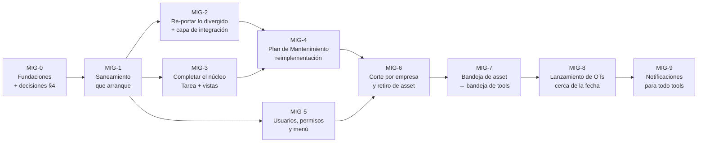

# Migración de AssetPlanner a Trazalog Tools — hoja de ruta

## Objetivo

Documento rector y **único vigente** de la migración de `traz-prod-assetplanner` (app standalone de
mantenimiento) al submódulo `traz-tools-man` de traz-tools. Dice dónde está la migración (con datos
medidos), cuál es el camino hasta retirar asset, y qué decisiones faltan. Está escrito para el PM y
para quien ejecute cualquier etapa, y se lee sin conocer la historia previa. Reemplaza a los
documentos de [`archivo/`](archivo/): si algo de allá contradice esto, **vale esto**. **No cubre** la
operatoria de setup de un cliente (eso es `traz-prod-assetplanner/doc/v3/setup-cliente-alm-pan.md`)
ni la migración de PHP 5.6 a 8.3 (análisis aparte, rama `docs/analisis-migracion-php83`).

---

| | |
|---|---|
| **Fecha** | 2026-10-26 · última actualización 2026-10-27 (MIG-0 en curso, A2/A3/P1 resueltas) |
| **Mediciones contra** | asset `origin/develop` `bf01518` (2026-10-26) · tools `origin/develop-v3` `9556284c` (2026-10-24) · `traz-tools-man` rama `rnsanchez` `343dbb0` (2024-09-09, congelada) |
| **Clase de riesgo de este documento** | 🟢 — análisis y plan, no toca runtime ni datos |
| **Etiqueta para commits y PRs de la migración** | `[MIG-ASSET-<etapa>]`, ej. `[MIG-ASSET-1]` (ver §3.3) |
| **Cómo se mantiene** | Se edita **este** archivo al cerrar cada etapa o decisión. No se abren documentos de plan paralelos: el detalle de una etapa va como sección acá o, si es largo, en un anexo enlazado desde acá |

---

## 1. Resumen

**Destino (decisión del PM, 2026-10-26):** AssetPlanner deja de ser una app aparte. Su núcleo de
mantenimiento pasa a vivir dentro de traz-tools como el submódulo `traz-tools-man`, con la sesión, el
menú, los usuarios y los módulos de almacén y pañol de tools. Cuando la última empresa haya pasado,
asset se retira.

**Dónde estamos:**

1. **Almacén y pañol ya están resueltos, pero del lado equivocado.** Entre agosto y octubre de 2026
   se hicieron dos frentes que se antepusieron como prioridad: *REQ-ASSET-ALM* (asset consume el
   almacén y el pañol de tools por REST) y *Pedido y pañol en la OT* (herramientas usadas desde vales
   reales y detalle de entregas en las pantallas de la OT). Los dos están en prueba. Son la etapa
   "almacenes y herramientas" del plan original, pero se construyeron **dentro de asset**: hay que
   portarlos junto con el resto.
2. **El núcleo no arrancó.** Sigue el fork de Rogelio Sanchez de 2024 (43 archivos, 36.122 líneas)
   en una rama que ningún repo referencia. El submódulo de tools apunta a un README vacío y el módulo
   no levanta (§2.2).
3. **La divergencia creció, pero sigue siendo manejable.** De los 43 archivos portados, ahora
   cambiaron 19 en asset desde el corte (eran 15 en agosto), con unas 2.300 líneas de diferencia real.
   Además asset ganó una capa de integración con tools que hay que traer (§2.3).
4. **MAN no va a tener acceso directo a base de datos: todo pasa por DataServices** (decisión del
   PM, 2026-10-26). Es el cambio de mayor volumen respecto del plan de agosto (§3.2). A2, A3 y el
   freeze (P1) se resolvieron el 2026-10-27, y la regla está escrita como ADR-014 (aceptado).
5. **La migración tiene cuatro escalones.** (1) Llevar asset a tools como módulo **MAN**, con su
   bandeja de tareas tal como está (MIG-0 a MIG-6; el Plan de Mantenimiento rehecho es MIG-4).
   (2) Llevar esa bandeja a la bandeja de tools (MIG-7). (3) Cambiar cuándo se lanzan en Bonita las
   OTs preventivas y predictivas, para que no saturen las bandejas con trabajo a futuro (MIG-8).
   (4) Llevar a todo tools el mecanismo de notificaciones de asset, mejorado (MIG-9).
6. **Ramas:** después de la próxima unificación de `develop` con `develop-v3`, no se vuelven a
   unificar hasta que la migración esté terminada y probada (§3.6).

En este documento, **MAN** es el nombre de asset ya migrado, es decir, el módulo de mantenimiento de
tools (`traz-tools-man`). Las bases de asset son **MariaDB** (`assetv2`); cuando en conversaciones o
documentos viejos aparece "MySQL" para asset, se refiere a esta misma base.

---

## 2. Estado medido

### 2.1 Dónde está cada cosa

| Repo / rama | Qué tiene | Estado |
|---|---|---|
| `traz-prod-assetplanner` `master` | Lo que corre en producción (tags `v2.9.x`) | `7d8ca44`, 2026-04-17 |
| `traz-prod-assetplanner` `develop-v3` / `develop` | Producción + la integración con tools (REQ-ASSET-ALM y Pedido y pañol). El demo se despliega desde `develop` | `develop` contiene todo `develop-v3` |
| `traz-tools-man` `rnsanchez` | **El trabajo portado en 2024.** 43 archivos `.php`, 36.122 líneas. 3 commits "backup", sin PRs | Congelada desde 2024-09-09 |
| `traz-tools-man` `develop-v3` | **Rama de integración de la migración** (MIG-0), creada el 2026-10-27 desde `rnsanchez` (`343dbb0`). Todo entra por PR, con el CI `man-ci.yml` | Desde 2026-10-27 |
| `traz-tools-man` `main` · `develop` / `master` | `main`: `controllers/Sservicio.php` y un README (`6bb0900`, 2024-07-11). `develop` y `master`: solo el README (`02cca43`) | Sin uso |
| `traz-tools` (`develop` y `develop-v3`) | Puntero del submódulo en `02cca43` (el README). Ya tiene `define('MAN', 'traz-tools-man/')` y la conexión `$db['asset_db']` a MariaDB `assetv2`, que agregó Rogelio | Sin cambios desde 2024 en ese punto |

### 2.2 El fork de 2024: qué sirve y por qué no arranca

Lo portado es el núcleo de activos: Equipo, Otrabajo, Preventivo, Predictivo, Backlog, Componente,
Ordenservicio, Sservicio, Parametro, Proceso, Area y Calendario (12 controllers y 13 models), más 18
vistas. Rogelio eligió bien el método: usó los helpers de sesión del host (`empresa()`, `userId()`,
`userNick()` de `application/helpers/sesion_helper.php`), sacó el bloque de login repetido en cada
`index()` y dejó el logging `#TRAZA` que pide `CLAUDE.md`. **Eso se conserva.** Lo que **no** se
conserva es su conexión dedicada a MariaDB (`$this->assetDB = $this->load->database('asset_db',
TRUE)` en los 13 models): MAN accede a los datos solo por DataServices (§3.1).

El error fue de método: convirtió **método por método en vez de archivo por archivo**. Ningún
archivo quedó del todo convertido. Recontado hoy sobre `343dbb0`:

| Defecto | Cantidad | Efecto |
|---|---:|---|
| Accesos a `userdata('user_data')`, una clave de sesión que tools nunca escribe | 89 | Devuelven `NULL` |
| `$this->db->` en controllers (en tools, `default` es PostgreSQL y no MariaDB) | 62 | Consultas contra el motor equivocado. Lo peor está en `Calendario.php:413-495` |
| `$this->db->insert_id()` después de un insert hecho en `assetDB` | ~12 | Devuelve el id de **otra** conexión, sin dar error |
| Vistas referenciadas que nunca se portaron, entre ellas el index del módulo y **todo el calendario** | 23 | Error fatal |
| `equipo/` contra `Equipo/` (`controllers/Equipo.php:646,652`) | 2 | Error fatal en Linux |
| URLs con el estilo viejo `index.php/X` en vez de la constante `MAN` | 92 | Navegación rota |
| Callbacks `.success()`/`.error()` de jQuery 2, que en jQuery 3 tiran `TypeError` | 11 | Pantallas rotas |
| Autocompletes de jQuery UI rotos porque el host carga jQuery UI **dos veces** (`application/views/layout/general_scripts.php:5` y `:115`, la segunda la trae jHTree) | 48 | Acá se detuvo Rogelio |

La doble carga de jQuery UI **sigue igual hoy** en el host. La corrección de raíz es quitar una de
las dos cargas, no parchear los 48 sitios.

### 2.3 Divergencia: lo que cambió en asset desde el corte

Comparación entre el corte (`653fd95`, 2024-09-09) y `origin/develop` de hoy, **sin contar cambios de
espacios ni de fin de línea**. La última columna cuenta los commits desde agosto de 2026, es decir,
los que vienen de los dos frentes de integración.

| Archivo de asset | +/− real | Commits desde ago-2026 |
|---|---|---:|
| `models/Ordenservicios.php` | +422 / −123 | 4 |
| `controllers/Ordenservicio.php` | +215 / −23 | 1 |
| `views/Sservicios/list_bpm.php` | +172 / −25 | 0 |
| `views/tareas/view_presta_presta_conf_modal.php` | +136 / −1 | 3 |
| `views/ordenservicios/list.php` | +132 / −11 | 0 |
| `models/Tareas.php` | +127 / −48 | 0 |
| `models/Calendarios.php` | +42 / −129 | 2 |
| `models/Preventivos.php` | +56 / −109 | 3 |
| `models/Otrabajos.php` | +46 / −80 | 3 |
| `controllers/Otrabajo.php` | +62 / −11 | 1 |
| `models/Backlogs.php`, `models/Predictivos.php` | +14 / −43 c/u | 2 c/u |
| `models/Sservicios.php` | +32 / −2 | 0 |
| `controllers/Calendario.php` | +30 / −26 | 0 |
| `views/otrabajos/view_agregarOT.php` | +29 / −0 | 1 |
| `views/preventivo/list.php` | +26 / −1 | 0 |
| `views/otrabajos/list.php` | +8 / −20 | 0 |
| `controllers/Sservicio.php` | +8 / −5 | 0 |
| `views/equipo/list.php` | +1 / −1 | 0 |
| **19 de 43 archivos** | **≈ 2.270 líneas** | |

Los otros 24 archivos portados (los ABMs de Area, Componente, Equipo, Parametro, Proceso y parte de
las vistas) **no cambiaron**: el fork vale tal cual, una vez saneado.

**Lo que asset ganó y no estaba en el plan de agosto** (todo vive fuera del fork):

| Pieza | Qué es |
|---|---|
| `application/helpers/tools_helper.php` (647 líneas, 24 funciones) | La capa de integración: catálogo de artículos y herramientas, configuración por empresa (`core.tablas`, clave `ASSET`), pedidos, vales, entregas y DNI, todo por REST contra `ALMDataService`, `PANDataService` y `COREDataService` |
| `traz-comp-almacen/new/Pedidos_Materiales.php` | Copia embebida del model de pedidos de tools, reescrita a REST |
| `views/tareas/view_inf_servicio_modal.php`, `view_verifica_informe.php`, `views/calendar/view_OtEjecutar_modal.php` | Pantallas de la OT con pedido, entregas y herramientas usadas |
| `database/scripts/f7-herramientas-usadas.sql` | Tablas nuevas `tbl_otvales` y `tbl_otherramientasusadas` y columna `tbl_otherramientas.descripcion_libre` en `assetv2`, como excepción aprobada al freeze del esquema |
| `database/scripts/f3-…sql`, `f4-…sql` | Ocultan los menús de almacén y pañol de asset (`sismenu.estado`) |
| `tests/e2e/01` a `08` (Playwright) | Regresión del circuito de la OT con almacén y pañol |
| `application/models/Groups.php` | El menú de asset respeta `sismenu.estado` |

### 2.4 Lo que falta portar

| Bloque | Tamaño aprox. | Nota |
|---|---:|---|
| `controllers/Tarea.php` y las 17 vistas de `views/tareas/` | 1.231 + ~7.000 líneas | El hueco más grande y el más vivo: bandeja de Bonita, informe de servicio, conformidad |
| El calendario (`views/calendar/`, motor `Calendario::guardar_agregar()`) | — | Se reimplementa, no se porta (MIG-4) |
| Vistas de `otrabajos/`, `equipo/`, `Sservicios/`, `ordenservicios/` | ~12.600 líneas | |
| `backlog/nuevo_edicion_view_.php`, `Lectura`/`Lecturas`, `Ficha`/`Fichas`, `componente/listabm`, vistas de area y proceso | ~2.500 líneas | `Lecturas` alimenta los planes por contador y hace falta antes de MIG-4 |
| La capa de integración de §2.3 | ~1.200 líneas + 2 scripts | Ver MIG-2 |

**Lo que no se porta, porque tools ya lo tiene:**

| De asset | Lo reemplaza, en tools |
|---|---|
| Almacén, depósitos, compras y la copia `traz-comp-almacen/` | `traz-comp-almacenes` + `ALMDataService` (asset ya consume esos datos) |
| Herramientas y pañol viejos | `traz-comp-pan` + `PANDataService` (asset ya consume esos datos) |
| Login, User, Group, Menu, Administracion | Core de tools + DNATO (ver MIG-5) |
| Notificaciones · Formularios | `traz-comp-notificaciones` · `traz-comp-formularios` |

**Código muerto, que no se porta:** `views/preventivo/partes.php`, `models/Calendar.php`,
`models/Calendars.php`, `views/calendar/Calendario.php` (un controller metido dentro de `views/`),
`programer_.php`, `reprogramer_.php`, `tabla_preventivo_por_horas.php` y los `.orig` versionados.

**Fuera del alcance de esta migración, a definir (P4):** los 17 ABMs de catálogo (Criticidad, Marca,
Familia, Sector, Cliente, Proveedor…), Reportes y KoolReport, y "Trazabilidad de componentes".

---

## 3. Estrategia

### 3.1 Decisiones vigentes

| Decisión | Desde | Consecuencia para la migración |
|---|---|---|
| **Destino: asset entra a tools como submódulo `traz-tools-man`** y la app standalone se retira | PM, 2026-10-26 | Lo que se construyó dentro de asset en ago-oct también se porta |
| **Se parte del fork de 2024**, no de cero | PM, 2026-08-12 | Con el ajuste de §3.2 |
| **El núcleo sigue sobre la misma MariaDB `assetv2`**, sin migrar datos | PM, 2026-08-12 | Asset y tools conviven sobre las mismas filas y el corte se puede revertir en el acto |
| **Almacén y pañol no se migran: se usan los de tools**, y no hay migración masiva de datos (en producción el almacén de asset estaba en cero y el único catálogo real era el de Caleras San Juan) | PM, 2026-08-12 | Esta parte ya está hecha. Desaparecen los riesgos de migrar datos entre motores |
| **El usuario de asset y el de tools son el mismo** | PM, 2026-10-07 (definición 9 del plan Pedido y pañol) | Se elimina el doble login (MIG-5) |
| **La lógica de negocio va en las APIs, no en los controllers** | PM, 2026-09-10 (`CLAUDE.md`) | Ver la fila siguiente |
| **MAN no accede a ninguna base de datos: todo pasa por DataServices** (`MANDataService` para `assetv2`, más los de tools que ya se usan). Las operaciones que tocan varios subsistemas (crear OT + Bonita + pedido) se exponen como recursos del API | PM, 2026-10-26 | Reemplaza el acceso directo por `$db['asset_db']` del plan de agosto. Cuando termina la migración, `$db['asset_db']` se borra del `database.php` de tools. Se formaliza en ADR-014 (MIG-0) |
| **Todo bugfix nuevo que se haga en asset se replica en MAN** | PM, 2026-10-26 | Regla de doble aplicación, con trazabilidad (§3.5). Rige desde hoy y hasta que asset se retire |
| **El Plan de Mantenimiento se rehace** (no se porta), porque su FullCalendar (2.2.5, con jQuery 2) no funciona en tools | PM, 2026-10-26 | MIG-4 es camino crítico: sin esa pantalla no hay corte |
| **La primera versión de MAN trae la bandeja de asset tal cual**, conviviendo con la de tools. La unificación de bandejas viene después del corte | PM, 2026-10-26 | MIG-3 porta la bandeja y MIG-7 la unifica |
| **Las OTs preventivas y predictivas se lanzan en Bonita cerca de su fecha**, no al programarlas. Es el tercer escalón, después de la bandeja | PM, 2026-10-26 | MIG-8. MIG-4 conserva el comportamiento de hoy, pero deja separado "programar" de "lanzar" |
| **PHP de destino: 5.6.** Nada de sintaxis 7.x, y el control es `phpcs` con PHPCompatibility | PM, 2026-10-07 | Gate obligatorio en cada PR. El lint local (7.3/8.3) no lo detecta |
| **Compatibilidad con v2:** lo que se toca en tools es aditivo y no rompe contratos que v2 consume | PM | Las queries nuevas de los DataServices se agregan, no reemplazan |
| **Ramas de tools: una última unificación de `develop` con `develop-v3`** cuando termine el frente `asset-order-warehouse-tracking`, y **después ninguna más hasta que la migración esté terminada y probada** | PM, 2026-10-26 | Toda la migración se hace sobre `develop-v3`. Ver §3.6 |
| **Las notificaciones de asset se llevan a todo tools, mejoradas**, como última etapa | PM, 2026-10-26 | MIG-9 |
| **Bonita al crear una OT: se replica la coreografía de asset** (si el lanzamiento falla, la OT se borra), y los nombres de actividad quedan como están (A2) | PM, 2026-10-27 | MIG-4 no cambia ese comportamiento. El cambio de fondo es MIG-8. En ADR-014 |
| **La fuente única de los artefactos WSO2 de mantenimiento es la de tools** (`toolsMANAPI`, `MANDataService`, `COREDataService`, `ALMDataService`). Las copias de asset se retiran (A3) | PM, 2026-10-27 | Toda query nueva o corregida para MAN entra a `_backend/api/ToolsAPIProject/` de tools. En ADR-014 |
| **Freeze de asset (P1): rige cuando cierren las pruebas** de REQ-ASSET-ALM y de Pedido y pañol | PM, 2026-10-27 | Hasta entonces asset puede recibir cambios funcionales de esos dos frentes. Se vuelve a medir §2.3 al arrancar MIG-2 (R1) |
| **El esquema de `assetv2` no cambia**, salvo excepciones registradas acá (la única hasta hoy: `f7-herramientas-usadas.sql`) | PM, 2026-08-12 | Las mejoras de modelo de datos quedan para después del retiro de asset |

### 3.2 Qué cambia respecto del plan de agosto

- **Almacenes y herramientas salen del plan como etapa**: ya están hechos. Lo que queda es portar la
  capa de integración (MIG-2).
- **El corte ya no tiene dos velocidades.** Sin migración de datos a PostgreSQL, toda empresa pasa
  de una vez y se puede volver atrás en el acto. Desaparecen los riesgos de mojibake, de FK que
  cruzan de motor y de reconciliación de datos migrados.
- **Usuarios, permisos y menú pasan a ser una etapa propia (MIG-5).** El plan de agosto los daba por
  resueltos con "core de tools + DNATO". No lo están: asset tiene su propio padrón (`sisusers`),
  grupos con permisos propios y `grpDash`.
- **El acceso a datos pasa a ser por DataServices.** Rogelio dejó 1.718 accesos a `assetDB` en los
  13 models y 62 accesos a `$this->db` en controllers. Todos se convierten a llamadas REST a
  `MANDataService`, conservando la firma y el formato de salida de cada método del model. Es el
  mismo patrón que ya se usó en asset para almacén y pañol (`Pedidos_Materiales.php` reescrito a
  REST sin tocar a sus llamadores). Los controllers no cambian. **La conversión de datos es parte de
  portar un archivo**: no hay un estado intermedio "anda con `assetDB`", porque eso sería hacer el
  trabajo dos veces.
- **Los 19 archivos que divergieron no se re-mergean sobre el fork: se vuelven a portar** desde el
  asset actual con la mecánica de Rogelio, usando el fork como referencia. Es una decisión técnica
  menor que tomé yo. El motivo: el fork está reindentado y con PHPDoc, así que el merge de git choca
  en casi todas las líneas, y en estos archivos la conversión (sesión, datos a DataService, URLs) es
  más barata que reaplicar a mano ~2.300 líneas de cambios funcionales. Los 24 archivos que no
  cambiaron se sanean sobre el fork.
- **La nomenclatura de etapas es `MIG-n`**, para no chocar con las fases `F0…F8` de los dos frentes
  anteriores, que usaron los mismos nombres para cosas distintas.

### 3.3 Etapas



**Escalón 1** (MIG-0 a MIG-6): asset pasa a ser MAN y se retira. **Escalón 2** (MIG-7): una sola
bandeja. **Escalón 3** (MIG-8): OTs a futuro sin caso Bonita. **Escalón 4** (MIG-9): notificaciones
para todo tools. MIG-2, MIG-3 y MIG-5 pueden avanzar en
paralelo una vez cerrada MIG-1. MIG-4 necesita el núcleo completo y es el camino crítico del
escalón 1. Cada etapa entra por PRs contra la rama de integración de `traz-tools-man` (MIG-0, punto 1),
con la plantilla del repo y la etiqueta `[MIG-ASSET-n]`.

#### MIG-0 — Fundaciones

Sin esto no se puede verificar nada de lo que sigue.

1. **Rama de integración** `develop-v3` en `traz-tools-man`, creada desde `rnsanchez`, con branch
   protection y PR obligatorio (el mismo modelo que tools y asset). Prohibidos los commits "backup"
   a ramas personales.
2. **Apuntar el submódulo** de tools a esa rama (hoy está en `02cca43`).
3. **Ambiente para probar**: Apache y PHP 5.6 con tools, el submódulo y una **réplica** de `assetv2`
   con al menos dos empresas, para poder probar el aislamiento. Hoy no existe staging del frontend
   PHP. Mientras no exista, se trabaja en local (Apache de XAMPP con PHP 7.3, contra `assetv2` de
   DEV, con la VPN levantada) y el control de PHP 5.6 queda en manos de `phpcs`.
4. **CI mínimo** en un workflow nuevo `man-ci.yml`, que corre en cada PR a la rama de integración:
   `php -l`, `phpcs --standard=PHPCompatibility --runtime-set testVersion 5.6`, el checklist de
   conversión (§3.4, nivel 0b) y gitleaks.
5. **Sacar las credenciales en claro y rotarlas** (T5).
6. **Escribir ADR-014: "MAN accede a `assetv2` solo por `MANDataService`"**, con la decisión del PM
   del 2026-10-26, y hacer el bump del `doc/v3/CONTEXT-PACK.md` en el mismo PR, como pide el
   Definition of Done de `CLAUDE.md`. El ADR también fija tres reglas técnicas: cómo se devuelven los
   ids generados (los `insert_id()` de hoy), cómo se hace una operación transaccional de varios
   pasos (por ejemplo, generar una serie de OTs) y dónde viven las operaciones que tocan varios
   subsistemas. Resolver también A2 y A3 de §4. Y **verificar que el datasource de
   `MANDataService` escribe en todos los ambientes**: en DEV ya se escribe (F6 de Pedido y pañol),
   pero hay que confirmarlo en TEST y PROD.
7. **Acordar el freeze de asset (P1)**: desde qué fecha asset solo recibe bugfixes, con cherry-pick
   a ambos lados.
8. Corregir `doc/vision-v3-context.md` (sección "Asset Planner", línea ~112), que todavía dice que la
   migración "se pausó por restricciones de presupuesto".

**Criterio de salida:** el submódulo apunta a la rama nueva, el CI corre en verde sobre el fork tal
como está y ADR-014 está aprobado.

**Estado al 2026-10-27:**

| Punto | Estado |
|---|---|
| 1. Rama de integración | ✅ `develop-v3` creada en `traz-tools-man` desde `rnsanchez`, **protegida**: PR obligatorio, check `man-ci` requerido, también para administradores, sin force push ni borrado |
| 2. Puntero del submódulo | Pendiente. PR propio en tools, después de mergear el CI |
| 3. Ambiente local | Pendiente, **lo arma el PM**: XAMPP + VPN contra `assetv2` de DEV. Sin VPN no se pueden probar con `curl` las queries de `MANDataService` |
| 4. CI mínimo | ✅ `man-ci.yml` (`traz-tools-man` PR #1, fusionado; ajuste de consumo en PR #2: un solo job, solo en PR, ~20 s), en verde sobre el fork: `php -l` con PHP 5.6, PHPCompatibility 5.6, checklist 0b y gitleaks. El 0b bloquea solo los archivos de `.ci/portados.txt` y del resto informa la cantidad |
| 5. Credenciales (T5) | Pendiente, 🔴. **La rotación la hace el PM.** Sacarlas del repo toca `database.php` y `constants.php` de tools, que son core: necesita análisis de impacto aprobado |
| 6. ADR-014 | ✅ Aceptado por el PM el 2026-10-27, con la regla 4 agregada. A2 y A3 resueltas. Falta verificar que el datasource escribe en TEST y PROD |
| 7. Freeze (P1) | ✅ Decidido: rige cuando cierren las pruebas de los dos frentes |
| 8. `doc/vision-v3-context.md` | ✅ Corregido |

#### MIG-1 — Saneamiento: que arranque lo que ya está

**La unidad de trabajo es el archivo completo**, nunca el método. Aplica a los 24 archivos que no
divergieron:

| Tarea | Volumen |
|---|---|
| `userdata('user_data')` → `empresa()` / `userId()` / `userNick()` | 89 sitios |
| `$this->db` en controllers → bajar la consulta al model | 62 + ~12 sitios (`insert_id()`) |
| `$this->assetDB` en models → llamadas REST a `MANDataService`, conservando firma y formato de salida. Cada query nueva se agrega al `.dbs` y se prueba con `curl` antes de que el PHP la use | 1.718 accesos en 13 models. Es el grueso del trabajo |
| Portar las 23 vistas faltantes, salvo el calendario (MIG-4) | ~18 archivos |
| Unificar `Equipo/` y `equipo/` | 2 sitios |
| URLs → constante `MAN` | 92 sitios |
| `.success()`/`.error()` → `.done()`/`.fail()` | 11 sitios |
| **Quitar la doble carga de jQuery UI** del host y validar los autocompletes. Toca `general_scripts.php` de tools, que es core: necesita análisis de impacto aprobado | 1 archivo + 48 sitios |
| Quitar `dump`/`var_dump`/`print_r`/`last_query` y el `$empId = 6` fijo (`models/Preventivos.php:109`) | ~11 sitios |
| Pasar los 6 `<section class="content">` restantes a `box` | 6 vistas |

**Orden sugerido**: primero los ABMs chicos (Area, Proceso, Componente, Parametro), para asentar el
patrón de conversión a DataService con poco riesgo; después Equipo, el más grande de los que no
divergieron.

**Criterio de salida:** con una sesión de tools, el módulo se abre desde el menú, se navegan los ABMs
y se listan equipos y OTs reales de una empresa de prueba. Nivel 0b en verde y **cero accesos a
base de datos** en los archivos portados.

#### MIG-2 — Re-portar lo divergido y la capa de integración

1. **Los 19 archivos de §2.3**: se portan de nuevo desde el asset actual con la misma mecánica, en
   orden de volumen (`Ordenservicios`, `Ordenservicio`, `list_bpm`, `view_presta_presta_conf_modal`…).
   Al terminar cada archivo, el checklist 0b tiene que dar cero.
2. **`tools_helper.php`** pasa a un helper del módulo. Las llamadas siguen yendo por REST a los
   DataServices, que es lo que pide la regla de lógica en APIs. Lo que se elimina es la indirección
   de topología: `HOST_TOOLS` (`application/config/constants.php` de asset) deja de definirse como
   el `HOST` de asset y pasa a ser el host de tools. Hoy funciona solo porque los dos comparten el
   EI, y nadie lo decidió.
3. **`Pedidos_Materiales.php` embebido se porta como model del módulo**, en su versión REST, con el
   mismo proceso Bonita (`8803232493891311406`). No se reemplaza por el model de pedidos de
   `traz-comp-almacenes`, porque ese pega SQL directo a PostgreSQL (D-3) y sería un paso atrás
   respecto de la regla de lógica en APIs. Cuando D-3 se resuelva, los dos convergen.
4. **Pantallas de almacén y pañol**: en tools son las nativas. Los scripts `f3`/`f4`, que ocultan
   menús de asset, dejan de hacer falta cuando asset se retire.

**Criterio de salida:** los specs `tests/e2e/04` a `08` de asset, adaptados a la URL del módulo,
pasan contra el módulo migrado.

#### MIG-3 — Completar el núcleo

En orden de dependencia:

1. `controllers/Tarea.php` y las 17 vistas de `views/tareas/`, **en su versión actual** (incluye todo
   lo de Pedido y pañol). **La bandeja de asset se porta tal cual** y convive con la de tools: es una
   segunda entrada de menú dentro de MAN. Su mecánica de hoy se describe en MIG-7. Sus lecturas de
   MariaDB (`case_empresa` y `getOrdenesPorCaseIds` en `models/Tareas.php`) también pasan a
   `MANDataService`.
2. `Lectura`/`Lecturas`, que hace falta para MIG-4.
3. Las vistas de `otrabajos/`, `equipo/`, `Sservicios/` y `ordenservicios/` que faltan.
4. `Ficha`/`Fichas`, `componente/listabm`, area y proceso.

**Criterio de salida:** el ciclo completo de una OT correctiva (solicitud → OT → ejecución con
pedido → informe → verificación → conformidad) anda en el módulo. Los casos MAN del catálogo DocTest
que cubren ese ciclo pasan.

#### MIG-4 — Plan de Mantenimiento: reimplementación (camino crítico)

**Es crucial.** La pantalla actual no se puede llevar a tools: su FullCalendar no funciona sobre el
jQuery del host, y sin esta pantalla no se generan OTs preventivas ni predictivas, así que no hay
corte posible. Es el único bloque que se reescribe en vez de portarse. `Calendario::guardar_agregar()` (268 líneas)
**es el motor**: genera las OTs de los cinco orígenes, materializa la recurrencia creando N filas en
`orden_trabajo` y lanza Bonita en cada una. Además corre sobre FullCalendar 2.2.5, que depende de
jQuery 2: el mismo conflicto que frenó a Rogelio.

- Extraer el motor y dejar el controller como capa delgada. Con la decisión de DataServices, **la
  generación de OTs (crear la serie + lanzar Bonita) pasa a ser una operación del API**, no lógica
  del PHP. El front solo pide "programar este plan".
- **Separar "programar" de "lanzar".** En MIG-4 las dos cosas siguen pasando juntas, como hoy: se
  crea la OT y se lanza el caso Bonita en el mismo momento. Pero quedan como dos pasos distintos de
  la operación, para que MIG-8 pueda diferir el lanzamiento sin reescribir el motor.
- Recurrencia con RRULE en vez de los números mágicos de `getDiasDuracion()` (T6).
- Guardas en la generación de series (T3): límite de iteraciones, transacción, frecuencia > 0,
  validación de `cant_meses` y verificación del status de Bonita dentro del bucle.
- Una sola regla de alerta (T8) y una sola fuente para la lectura del contador (T7).
- Unificar Preventivo y Predictivo (comparten cerca de la mitad del código de sus vistas).
- Front con FullCalendar 6.x, que no necesita jQuery ni Moment. La alternativa es el 4.4 con
  `rrule` que ya tiene `traz-comp-calendar`. Recomiendo 6.x.
- Antes de reimplementar, **golden tests**: para un plan dado, la serie de fechas tiene que coincidir
  con la que genera hoy asset (§3.4, nivel 4).

Lo que requiere cambio de esquema (tabla polimórfica de recursos, `preventivo.perido` varchar usado
como FK, fechas cero) **queda documentado y no se ejecuta** mientras asset siga en producción.

#### MIG-5 — Usuarios, permisos y menú

Sin esta etapa no hay corte posible: hoy un usuario del cliente tiene dos padrones.

- **Usuarios**: asset tiene `sisusers` y tools tiene `seg.users` (DNATO). Con la definición 9 (es el
  mismo usuario) hay que sanear los que existen solo en asset y fijar la clave del vínculo. El DNI ya
  hace falta en los dos lados para las herramientas usadas.
- **Permisos**: asset tiene grupos con permisos por pantalla y acción, y un `grpDash` que dice qué
  controller carga el escritorio (con `"Dash"` se cuelga por recursión; los grupos admin reales usan
  `"Otrabajo"`). Tools tiene roles de trabajo en Bonita por empresa y `seg.memberships_menues`.
  Hay que mapear unos a otros (P3).
- **Menú**: las entradas del módulo se agregan al menú de tools con la constante `MAN`.
- **Vínculo usuario-empresa en asset**: hoy asignar un rol en tools también da acceso a asset
  (H-085). Mientras convivan, ese vínculo se mantiene. Cuando asset se retire, deja de hacer falta.

**Criterio de salida:** un usuario de una empresa de prueba entra a tools con un solo login, ve el
menú de Mantenimiento según su rol y opera sin pasar por asset.

#### MIG-6 — Corte por empresa y retiro de asset

- El corte es **por empresa entera**, nunca por usuario, para que dos frontends no escriban a la vez
  sobre las mismas filas.
- **Se puede volver atrás en el acto**: los datos no se mueven, así que alcanza con volver a la URL
  vieja.
- Las empresas pasan de menor a mayor volumen. La primera es el ensayo real.
- Para pasar a la siguiente empresa hace falta: N días sin incidentes críticos, la paridad (nivel 1)
  en verde y la validación de QC sobre los flujos del módulo.
- **Cierre:** cuando no queda ninguna empresa en asset, se desactiva su login, queda en solo lectura
  y después se retira. Recién ahí se levanta el freeze del esquema de `assetv2`, se termina la regla
  de doble bugfix (§3.5) y se borra `$db['asset_db']` del `database.php` de tools.

#### MIG-7 — Escalón 2: la bandeja de asset pasa a la bandeja de tools

Arranca **apenas termina el corte**. Lo primero es un **estudio**, no código.

**Cómo funciona hoy cada bandeja** (verificado el 2026-10-26):

| | Bandeja de asset (la que trae MAN) | Bandeja 2 de tools |
|---|---|---|
| De dónde salen las tareas | Paginando la **API REST de Bonita** desde PHP, con caché en la sesión (`$_SESSION['listadoTareas_cache']`, `bonita_page`) | **Una sola query** en `BandejaDataService.getBandejaTareas`, que lee la base de Bonita por **dblink** (servidor `bonita_bpm`, solo lectura) |
| Filtro por empresa | Tabla `case_empresa` de **MariaDB** (`assetv2`), más `GET /assetbandeja/linea/validar/...` de `COREDataService` | `core.case_empresa` en **PostgreSQL** |
| Datos de negocio de cada tarea | `orden_trabajo` en MariaDB (`Tareas::getOrdenesPorCaseIds`) | Tablas de tools (`alm.alm_pedidos_materiales`, `core.equipos`, `core.tablas`…) en la misma query |
| Paginado y búsqueda | En PHP, sobre lo que trajo Bonita | En la base |
| Estado | En producción | Hoy solo en `develop` de tools. Llega a `develop-v3` con la unificación de ramas de §3.6. Convive con "Mis Tareas" hasta pasar a todos. Guía: `doc/v3/bandeja-paginado-real.md` |

**El estudio tiene que responder:**

1. Cómo arma tools cada tarea de la bandeja y qué **hooks** tiene: cómo un módulo aporta su
   formulario de tarea, sus datos de cabecera y sus acciones al tomar, soltar y cerrar.
2. Qué hace falta para que una tarea de MAN aparezca en la bandeja de tools **con sus datos de
   negocio**. El problema: `BandejaDataService` resuelve todo en PostgreSQL, y los datos de la OT
   viven en MariaDB. La base de tools solo tiene dblink, que conecta a PostgreSQL y no a MariaDB.
3. Qué estrategia conviene. La hipótesis del PM es **sincronizar a PostgreSQL** los datos mínimos
   de MariaDB que la bandeja necesita: el par case↔empresa (que hoy vive en la `case_empresa` de
   asset y debería estar en `core.case_empresa`) y un resumen de la OT (número, equipo, tipo,
   estado, fecha programada). Así la bandeja usa el mismo mecanismo que ya existe. Opciones de
   sincronización a evaluar: escribir en los dos lados desde la operación del API que crea la OT
   (encaja con la decisión de DataServices), un proceso periódico, o un foreign data wrapper de
   MySQL (hoy no está instalado).
4. Cómo se migran las tareas que ya están abiertas al momento del cambio.

**Entregables:** el estudio (como sección de este documento), la decisión de estrategia, la
implementación y el retiro de la bandeja de asset del menú de MAN.

#### MIG-8 — Escalón 3: lanzar las OTs preventivas y predictivas cerca de su fecha

**El problema de hoy:** al programar un preventivo o un predictivo, `Calendario::guardar_agregar()`
crea **todas** las OTs de la serie y lanza un caso Bonita por cada una en ese mismo momento. Las
bandejas de los mantenedores se llenan de tareas para dentro de meses, que tapan el trabajo del día.

**El cambio:** la OT se crea al programar (sigue apareciendo en el calendario y en los listados), y
el caso Bonita se lanza **recién cuando la fecha está cerca**, con un margen configurable por
empresa.

**Lo que hay que resolver:**

- **Quién dispara el lanzamiento.** Hace falta un proceso periódico. En PostgreSQL de tools no hay
  `pg_cron`, y hoy los KPIs se refrescan con un cron del sistema operativo
  (`doc/infra/kpi-cron-refresh.md`). La decisión de scheduler también está pendiente para la
  Fase 2 del tablero del administrador: conviene tomar una sola decisión para los dos casos.
- **Una OT sin caso Bonita.** Hoy toda OT tiene `case_id`, y si Bonita falla la OT se borra. Hay que
  definir: un estado "programada, sin lanzar"; qué pasa si el lanzamiento falla (reintento, aviso);
  y qué pasa si alguien edita o cancela una OT antes de que se lance.
- **Qué muestran las pantallas** de una OT sin lanzar: el calendario, el listado de OTs, el panel de
  KPIs y las tools MCP de mantenimiento.
- **El margen**: cuántos días antes se lanza, por empresa y quizás por tipo de plan (decisión
  funcional del PM).
- **Las series ya lanzadas** al momento del cambio: si se dejan como están o si se cancelan los
  casos futuros para relanzarlos con la regla nueva.

Como MIG-4 ya deja separados "programar" y "lanzar" (ver MIG-4), este escalón agrega el disparador
y el estado nuevo, sin reescribir el motor.

#### MIG-9 — Escalón 4: notificaciones para todo tools

Es la **última etapa**. Arranca cuando están hechas las cuatro anteriores: MAN migrado, Plan de
Mantenimiento rehecho, bandeja unificada y lanzamiento de OTs cerca de la fecha. Ese orden importa:
el lanzamiento diferido de MIG-8 es uno de los eventos que más conviene notificar ("se lanzó tu OT
de mañana").

**Qué hay hoy en asset** (relevado en septiembre de 2026; el análisis completo está en
`doc/agente/analisis-alertas-assetplanner.md`, rama `feature/agente-e0-analisis-alertas` de tools):

- Un **pipeline de push** cableado:
  1. Triggers de MariaDB sobre `orden_trabajo`, `orden_servicio` y `solicitud_reparacion`.
  2. Cuatro stored procedures que arman el JSON a mano y lo encolan en
     `synch_notificacion_queue`.
  3. Una app Siddhi (Streaming Integrator) que lee la cola.
  4. `FirebaseConnectorAPI` del MI, que envía por FCM.
- Una **campanita in-app** aparte, que consulta las notificaciones por AJAX periódico.
- **Está parado:** en DEV hay 434 notificaciones encoladas y 0 procesadas desde 2024. El push nunca
  se verificó de punta a punta.
- **Lo que no tiene:** reglas configurables, preferencias por usuario, mail, severidad, ni
  destinatario por rol. Cada notificación va a un solo `user_id`.
- **Tools no tiene nada propio:** `traz-comp-notificaciones` es un esqueleto, y la constante `NOTI`
  no se usa.

**Qué se copia:** el modelo de cola, el conector Firebase, el service worker del push y el patrón de
la campanita.

**Qué se mejora** (a definir en el diseño):

- Que los eventos salgan de **cualquier módulo de tools** y no solo de mantenimiento: almacén,
  pañol, bandeja, producción.
- Que **nazcan en las operaciones del API** y no en triggers de una base. Es coherente con la
  decisión de DataServices: el API que crea la OT, el pedido o la tarea es el que publica el
  evento.
- Destinatarios por rol o por grupo, además de por usuario.
- Preferencias por usuario (qué recibe y por qué canal) y más canales que el push: mail y quizás
  WhatsApp, que tools ya tiene como conector.
- Severidad, agrupación y evitar duplicados.
- **Corregir antes de reusar:** `MANDataService.getNotificaciones` no filtra por `empr_id` (fuga
  entre empresas), y la clave privada del service account de Firebase está commiteada en tools (se
  rota).

**Decisiones que dispara:** el origen de los eventos (API o triggers) y el uso de Streaming
Integrator o de un proceso más simple son de arquitectura (A4, workshop). Qué eventos se notifican
y a quién es funcional (P9).

### 3.4 Pruebas

El oráculo es asset funcionando: mientras dure la migración, **asset y el módulo leen la misma
base**, así que el mismo input tiene que dar la misma salida. **Definición del PM (2026-10-27): la
prueba automática central de la migración es la de paridad (nivel 1)**: la misma operación hecha
desde asset y desde MAN tiene que dar lo mismo. Las demás pruebas la complementan, no la reemplazan.

| Nivel | Qué verifica | Cómo | Cuándo |
|---|---|---|---|
| 0 | Sintaxis y **compatibilidad con PHP 5.6** | `php -l` + `phpcs` PHPCompatibility 5.6 | Cada PR, bloqueante |
| 0b | **Checklist de conversión por archivo**: cero `userdata('user_data')`, **cero `$this->db` y cero `assetDB`** (ningún acceso a base), cero URLs sin `MAN`, toda vista referenciada existe | Script propio (grep) | Cada PR, bloqueante |
| 1 | **Paridad (prueba principal, PM 2026-10-27)**: cada operación migrada se ejecuta **igual en asset y en MAN** (misma empresa, mismo usuario, mismos datos de entrada) y se comparan los resultados. Consultas: se compara la respuesta normalizada. Altas, cambios y bajas: se compara el estado que queda en `assetv2` después de cada una, sobre datos de prueba que se limpian al terminar | Script propio, **corre en local con la VPN** (necesita llegar a asset y a `assetv2` de DEV, que GitHub no alcanza) | Antes de abrir cada PR; el resultado va en "Cómo lo verifiqué". **Ninguna operación se da por migrada sin su prueba de paridad en verde** |
| 2 | Endpoints AJAX del módulo | Hurl | Cada PR |
| 3 | **Aislamiento multi-tenant**: la empresa A no ve datos de la empresa B (cubre T1) | Patrón de `scripts/dev/verify-mcp-isolation.py` | Cada PR, bloqueante |
| 4 | **Golden tests del motor** de planificación | PHPUnit | Cada PR de MIG-4 |
| 5 | Flujos E2E | **Lo que ya existe**: los 37 casos MAN del catálogo DocTest (`doctest/catalogo/man/`, 27 validados) y `tests/e2e/01-08` de asset, apuntados al módulo | Antes de cerrar cada etapa |

Cada query nueva de `MANDataService` se prueba con `curl` contra el EI de DEV antes de que el PHP
la use. Recordar que el script de deploy sube los DataServices pero **no las APIs** de WSO2.

**Dónde corre cada nivel.** En GitHub Actions corren solo los niveles 0 y 0b (`man-ci.yml`), que no
necesitan ningún ambiente. Los demás necesitan llegar a DEV por la VPN y corren en local. La
organización está en el plan free de GitHub (PM, 2026-10-27): no se suman corridas programadas
(nightly) ni jobs nuevos sin consultarlo, y el workflow se mantiene en un solo job, solo en PR y
con filtro de rutas.

Casos negativos obligatorios en MIG-4: frecuencia 0 no cuelga, `cant_meses` fuera de rango se rechaza,
un plan por contador sin `lectura_base` da error controlado, y la empresa A pidiendo un plan de la B
recibe 403.

### 3.5 Regla de doble bugfix: asset → MAN

Mientras asset siga en producción, **todo bugfix que se haga en asset se replica en MAN**. Rige desde
el 2026-10-26 y termina con el retiro de asset (MIG-6).

| Situación del archivo en MAN | Qué se hace |
|---|---|
| Todavía no se portó | Nada inmediato. El fix entra solo cuando el archivo se porte desde el asset actual, pero **se anota igual** en el registro (abajo), para verificarlo al portarlo |
| Ya se portó | El fix se reaplica en MAN en un PR propio, citando el PR de asset. Si el fix tocaba SQL, en MAN va a la query del `MANDataService`, no al PHP |
| Es del Plan de Mantenimiento (se reimplementa en MIG-4) | Se agrega como caso de prueba del motor nuevo (golden test o caso negativo) |

**Trazabilidad:** cada PR de bugfix en asset lleva en la descripción una línea `MAN:` con el PR de
MAN que lo replica, o `MAN: pendiente (archivo no portado)`. Al abrir cada etapa se revisan los PRs
de asset mergeados desde la etapa anterior y se busca esa línea. Un PR sin la línea no se mergea.

Esta regla **no** reemplaza el freeze (P1): el freeze limita qué entra a asset, y esta regla asegura
que lo que entra no se pierda en MAN.

### 3.6 Ramas durante la migración

Definido por el PM el 2026-10-26:

1. Cuando termine el frente **`asset-order-warehouse-tracking`**, se hace **una última unificación**
   de `develop` con `develop-v3` en tools, con merge commit y nunca squash. Con eso, la bandeja 2 y
   el resto de lo que hoy está solo en `develop` quedan también en `develop-v3`.
2. **Después de esa unificación no se vuelven a unificar las ramas** hasta que la migración esté
   terminada y probada. Esto suspende, para este período, la sync semanal `develop` → `develop-v3`
   (E7-CICD-06) que describe `CLAUDE.md`.
3. Toda la migración (MIG-0 en adelante) se hace en `develop-v3` de tools y en la rama de
   integración de `traz-tools-man`. Mientras tanto, el demo se sigue desplegando desde `develop`.

**Consecuencia:** los arreglos que entren a `develop` de tools durante la migración no llegan solos a
`develop-v3`. Si un arreglo toca algo que MAN usa (core, DataServices, `traz-comp-almacenes`,
`traz-comp-pan`, `traz-comp-bpm`), se replica en `develop-v3` con el mismo mecanismo de §3.5. Lo
demás espera a la unificación final (R12).

---

## 4. Decisiones pendientes

La única lista vigente. Las dudas D1-D9 que se le plantearon al PO sobre el pañol quedaron casi todas
respondidas por las 14 definiciones del plan Pedido y pañol (en `archivo/`). Acá quedan solo las que
siguen abiertas.

### Arquitectura 🔴 (workshop: no las decide quien ejecuta)

**A1 — Cómo accede a los datos el núcleo. ✅ Resuelta (PM, 2026-10-26):** todo por DataServices y
ningún acceso directo (§3.1). Escrita como [ADR-014](../adr/ADR-014-man-acceso-datos-dataservices.md),
aceptado por el PM el 2026-10-27, que agregó la regla 4 (APIs con componentes nativos de WSO2).

**A2 — Bonita y la creación de OT. ✅ Resuelta (PM, 2026-10-27): igual que hoy** (§3.1, ADR-014).
El contexto era este: hoy no se puede crear una OT sin Bonita: si `lanzarProceso`
falla, la OT se borra (`controllers/Calendario.php:354-359`). Hay 9 nombres de actividad escritos a
mano en el código. La reimplementación de MIG-4 replica esa coreografía exacta, salvo que se decida
otra cosa antes.

**A3 — Fuente única de los artefactos WSO2 de mantenimiento. ✅ Resuelta (PM, 2026-10-27): la de
tools** (§3.1, ADR-014). Falta retirar las copias de asset. El contexto era este: asset mantiene copias propias
(`_backend/api/toolsMANAPI.xml`, `_backend/api/dataservice/MANDataService.xml`,
`_backend/api/dataservice/ASP/COREDataService.xml`, `api/asp_ALMDataService.xml`) distintas de las
de tools. Tools ya unificó sus copias (PR #545). Falta declarar que la fuente es la de tools y
retirar las de asset.

**A4 — Origen de los eventos de notificación (MIG-9).** Las opciones son publicarlos desde las
operaciones del API (recomendado, coherente con A1) o mantener triggers de base, y usar Streaming
Integrator o un proceso más simple. No bloquea nada hasta MIG-9.

### Funcionales y de negocio (las decide el PM)

| # | Decisión | Mi recomendación |
|---|---|---|
| ~~P1~~ | ✅ **Resuelta (PM, 2026-10-27):** el freeze rige cuando cierren las pruebas de los dos frentes (§3.1). Falta registrar acá la fecha en que efectivamente cierren | — |
| P2 | **Cuándo se corrigen en asset los bugs heredados** T1 (fuga entre empresas), T2 (SQL injection) y T3 (bucle sin límite), que hoy están en producción. Dónde se replican ya no es una duda: lo resuelve la regla de §3.5 | Corregirlos ya en asset. Dos son de seguridad y no deberían esperar al corte |
| P7 | **MIG-8**: margen de lanzamiento (cuántos días antes de la fecha se lanza el caso Bonita) y qué se hace con las series ya lanzadas | Margen configurable por empresa. Las series existentes se dejan como están |
| P9 | **MIG-9**: qué eventos de cada módulo se notifican, a quién y por qué canal | Arrancar con los eventos de la OT que ya notifica asset, más el lanzamiento de MIG-8 |
| P8 | **Scheduler** para MIG-8, compartido con la Fase 2 del tablero del administrador | Una sola decisión para los dos casos. El cron del sistema operativo ya existe para los KPIs |
| P3 | **Mapeo de grupos y permisos de asset a roles y menú de tools** | Relevar los grupos reales por empresa antes de diseñar el mapeo |
| P4 | **Alcance inicial**: ¿entran los 17 ABMs de catálogo, Reportes/KoolReport y "Trazabilidad de componentes" (D9)? | Fuera del primer corte. Los KPIs de mantenimiento ya se exponen por MCP y por el tablero del administrador |
| P5 | **Varios pañoles por empresa** (D3) y **qué hacer con el campo "Cantidad"** de las herramientas del plan (D4) | Mantener un pañol hasta que un cliente lo pida |
| P6 | **Pedido rechazado y cerrado con "No, gracias"**: queda sin salida desde la OT | Decidir con el uso real. La salida es habilitar el pedido nuevo y adaptar `Calendario::verEjecutarOT` |

---

## 5. Riesgos y deuda

### 5.1 Riesgos

| # | Riesgo | Prob. | Impacto | Mitigación |
|---|---|---|---|---|
| R1 | **La divergencia sigue creciendo** (pasó de 15 a 19 archivos entre agosto y octubre) | Alta | Alto | Freeze (P1). Volver a medir §2.3 al abrir cada etapa |
| R2 | **Pérdida de conocimiento**: ya pasó con el fork | Ya ocurrió | Alto | PR obligatorio con descripción, checklist por archivo y este documento al día |
| R3 | **No hay dónde probar** el frontend PHP | Alta | Bloqueante | MIG-0, punto 3 |
| R4 | **Doble escritura** con los dos frontends sobre las mismas filas | Media | Alto | Corte por empresa entera |
| R5 | **Un bugfix de asset no llega a MAN** durante la convivencia | Alta | Alto | Regla de §3.5, con la línea `MAN:` obligatoria en cada PR. Ventana de convivencia corta |
| R9 | **Volumen de la conversión a DataServices**: 1.718 accesos en models, cada uno con su query nueva en `MANDataService` | Alta | Alto | Conservar las firmas de los models para que los controllers no cambien. Paridad (nivel 1) por endpoint. Empezar por los ABMs chicos |
| R10 | **Transacciones e ids generados por DataService**: generar una serie de OTs hoy hace muchos inserts encadenados y lee `insert_id()` | Media | Alto | Que lo resuelva ADR-014. La serie se crea como una sola operación del API, no como N llamadas desde PHP |
| R12 | **`develop` y `develop-v3` vuelven a divergir** durante la migración, porque no se unifican (§3.6) | Alta | Medio | Replicar en `develop-v3` los arreglos de `develop` que toquen lo que MAN usa. Hacer la unificación final apenas se cierren las pruebas |
| R11 | **Datos de la bandeja desincronizados** entre MariaDB y PostgreSQL (MIG-7) | Media | Medio | Escribir en los dos lados desde la misma operación del API, con una verificación de consistencia periódica |
| R6 | **Subestimar el calendario** | Media | Alto | MIG-4 como etapa propia, con golden tests antes de reescribir |
| R7 | **PHP 5.6 en el demo**: la sintaxis 7.x pasa el lint local y revienta en el demo | Alta | Medio | `phpcs` 5.6 bloqueante en el CI |
| R8 | **Tocar core de tools** (`general_scripts.php`, menú, sesión) | Media | Alto | Cada cambio de core con análisis de impacto aprobado, según `CLAUDE.md` |

### 5.2 Bugs heredados de asset (están hoy en producción)

| # | Hallazgo | Evidencia (asset) |
|---|---|---|
| T1 🔴 | Fuga entre empresas: un `OR` sin paréntesis anula el filtro por empresa | `models/Equipos.php:830-832` |
| T2 🔴 | ~15 queries armadas concatenando `$_POST` o la URI | `models/Calendarios.php:124-147, 599-631, 651-698`; `models/Preventivos.php:559-593, 797-814`; `models/Parametros.php:30-88` |
| T3 🔴 | `setOTenSerie()`: un `while` sin límite ni transacción. Con frecuencia 0 crea OTs y procesos Bonita hasta el timeout | `controllers/Calendario.php:523-556` |
| T4 | Fechas `'0000-00-00 00:00:00'` fijas, que bloquean el upgrade del motor | `controllers/Calendario.php:161,171,176` |
| T5 🔴 | Credenciales en claro en el repo, y un JWT completo en tools | `application/config/database.php` de asset y de tools (en tools, `:99-105`); el JWT está en `application/config/constants.php:247` de tools. Se rotan, no alcanza con moverlas |
| T6 | Periodicidad rota: Mensual = 30 días, y "500 horas" se toma como 500 días | `controllers/Calendario.php:497-521` |
| T7 | Dos fuentes para la lectura del contador | `models/Calendarios.php:106` contra `models/Preventivos.php:747` |
| T8 | La regla de alerta está implementada 4 veces con 3 fórmulas | `controllers/Calendario.php:88-100` y otras |
| T9 | Clave duplicada en `BPM_PROCESS` (tools) | `application/config/constants.php` de tools |
| T10 | Errores latentes de PHP 8 (`$result = fase;`, `$i = $i++`) | `controllers/Predictivo.php:401,78`; `models/Preventivos.php:453` |

### 5.3 Deuda abierta de los frentes anteriores

| # | Qué | Dónde se ejecuta |
|---|---|---|
| D-1 | Aplicar `scripts/sql/2026-08-core-empresas-empr-id-mysql.sql` en TEST y PROD (solo está aplicado en DEV) | `psql` contra la base PostgreSQL de tools (esquema `core`) de cada ambiente |
| D-2 | Correr el checklist de setup (`traz-prod-assetplanner/doc/v3/setup-cliente-alm-pan.md`) para el primer cliente real. Caleras San Juan tiene 32 artículos y 2 herramientas que se cargan a mano (D8) | Pantallas de tools + REST a DEV/PROD |
| D-3 | El model de pedidos de `traz-comp-almacenes` (`Ordeninsumos.php`, 63 consultas) pega SQL directo a PostgreSQL | Repo `traz-comp-almacenes` |
| D-4 | `getArticulos2` quedó sin resource que la invoque, y hay 3 queries de `ALMDataService` con el join a `alm_lotes` por revisar | `ALMDataService.dbs` |
| ~~D-5~~ | ✅ Corregido el 2026-10-27: `doc/vision-v3-context.md` ya no dice que la migración está pausada | — |

---

## 6. Próximo paso

1. **El PM** mergea el CI de `traz-tools-man` (PR #1), arma el ambiente local con la
   VPN y rota las credenciales (T5). La regla de doble bugfix (§3.5) ya rige: hay que avisarle a
   quien hoy toca asset.
2. **Cierre de MIG-0**: puntero del submódulo de tools a `develop-v3`, y verificación del datasource en TEST y PROD.
3. **MIG-1** arranca por los ABMs chicos (Area, Proceso, Componente, Parametro), para asentar el
   patrón de model → `MANDataService`. Un archivo completo por PR, con el checklist 0b en cero y el
   archivo agregado a `.ci/portados.txt`. La primera query sirve también para comprobar
   `returnGeneratedKeys` sobre MariaDB (pregunta abierta de ADR-014).

---

## 7. Documentos: qué sigue vigente y qué se archivó

| Documento | Estado |
|---|---|
| **Este** (`doc/migracion/MIGRACION-ASSETPLANNER.md`) | **Vigente. Es el rector.** |
| [`archivo/assetplanner-a-traz-tools-man.md`](archivo/assetplanner-a-traz-tools-man.md) | Archivado. Plan de agosto 2026, reemplazado por este. Tiene el inventario función por función del fork (§1.2) y las líneas exactas de cada defecto, por si hacen falta |
| [`archivo/traspaso-migracion-assetplanner.md`](archivo/traspaso-migracion-assetplanner.md) | Archivado. Traspaso del frente REQ-ASSET-ALM al 2026-08-31. Lo que seguía abierto pasó a §4 y §5.3 |
| [`archivo/integracion-assetplanner-panol.md`](archivo/integracion-assetplanner-panol.md) | Archivado. Explicación al PO y dudas D1-D9, respondidas por el plan Pedido y pañol salvo P5 y D8 |
| [`archivo/plan-pedido-y-panol-en-la-ot.md`](archivo/plan-pedido-y-panol-en-la-ot.md) | Archivado. Plan del frente de octubre (F0-F8 y 14 definiciones). Es la referencia de **por qué** las pantallas de la OT son como son. Antes vivía fuera del repo |
| `traz-prod-assetplanner/doc/v3/setup-cliente-alm-pan.md` | **Vigente.** Es un checklist operativo para dar de alta un cliente mientras asset siga en uso |
| `traz-prod-assetplanner/doc/v3/circuitos-man-alm-pan.md`, `casos-prueba-man.md`, `pruebas-f6-resultados.md` | Referencia del circuito actual de asset. No son plan |
| `traz-prod-assetplanner/doc/v3/STATE.md` | **Desactualizado** (congelado el 2026-08-15). El estado de la migración vive acá y en `doc/v3/STATE.md` de tools |
| `doctest/catalogo/man/` | **Vigente.** Catálogo funcional de Mantenimiento y oráculo de los E2E (§3.4) |

---

## Anexo — Cómo repetir las mediciones

Todos los comandos se ejecutan en una **terminal local**, con los repos ya clonados.

Divergencia de un archivo portado (corte `653fd95`), en el repo de asset:

```bash
cd traz-prod-assetplanner && git fetch origin
git diff -w --ignore-cr-at-eol --numstat 653fd95 origin/develop -- application/models/Ordenservicios.php
```

Restos de conversión en el fork, en un clon de `traz-tools-man` con la rama `rnsanchez`:

```bash
git clone https://github.com/Trazalog/traz-tools-man.git && cd traz-tools-man && git checkout rnsanchez
grep -rn "userdata('user_data')" --include=*.php . | wc -l
grep -rho '\$this->db->' controllers/*.php | wc -l
```

Compatibilidad con PHP 5.6 (requiere `composer global require squizlabs/php_codesniffer phpcompatibility/php-compatibility`):

```bash
phpcs -p . --standard=PHPCompatibility --runtime-set testVersion 5.6 --extensions=php
```
