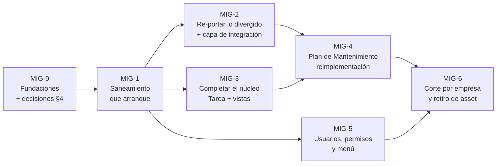

# Migración de AssetPlanner a Trazalog Tools — hoja de ruta

## Objetivo

Documento rector y **único vigente** de la migración de `traz-prod-assetplanner` (app standalone de
mantenimiento) al submódulo `traz-tools-man` de traz-tools. Dice dónde está la migración (con datos
medidos), cuál es el camino hasta retirar asset, y qué decisiones faltan. Está escrito para el PM y
para quien ejecute cualquier etapa, y se lee sin conocer la historia previa. Reemplaza a los
documentos de [`archivo/`](archivo/): si algo de allá contradice esto, **vale esto**. **No cubre** la
operatoria de setup de un cliente (eso es `traz-prod-assetplanner/doc/v3/setup-cliente-alm-pan.md`)
ni la migración de PHP 5.6 a 8.3 (análisis aparte, rama `docs/analisis-migracion-php83`).

---

| | |
|---|---|
| **Fecha** | 2026-10-26 |
| **Mediciones contra** | asset `origin/develop` `bf01518` (2026-10-26) · tools `origin/develop-v3` `9556284c` (2026-10-24) · `traz-tools-man` rama `rnsanchez` `343dbb0` (2024-09-09, congelada) |
| **Clase de riesgo de este documento** | 🟢 — análisis y plan, no toca runtime ni datos |
| **Etiqueta para commits y PRs de la migración** | `[MIG-ASSET-<etapa>]`, ej. `[MIG-ASSET-1]` (ver §3.3) |
| **Cómo se mantiene** | Se edita **este** archivo al cerrar cada etapa o decisión. No se abren documentos de plan paralelos: el detalle de una etapa va como sección acá o, si es largo, en un anexo enlazado desde acá |

---

## 1. Resumen

**Destino (decisión del PM, 2026-10-26):** AssetPlanner deja de ser una app aparte. Su núcleo de
mantenimiento pasa a vivir dentro de traz-tools como el submódulo `traz-tools-man`, con la sesión, el
menú, los usuarios y los módulos de almacén y pañol de tools. Cuando la última empresa haya pasado,
asset se retira.

**Dónde estamos:**

1. **Almacén y pañol ya están resueltos, pero del lado equivocado.** Entre agosto y octubre de 2026
   se hicieron dos frentes que se antepusieron como prioridad: *REQ-ASSET-ALM* (asset consume el
   almacén y el pañol de tools por REST) y *Pedido y pañol en la OT* (herramientas usadas desde vales
   reales y detalle de entregas en las pantallas de la OT). Los dos están en prueba. Son la etapa
   "almacenes y herramientas" del plan original, pero se construyeron **dentro de asset**: hay que
   portarlos junto con el resto.
2. **El núcleo no arrancó.** Sigue el fork de Rogelio Sanchez de 2024 (43 archivos, 36.122 líneas)
   en una rama que ningún repo referencia. El submódulo de tools apunta a un README vacío y el módulo
   no levanta (§2.2).
3. **La divergencia creció, pero sigue siendo manejable.** De los 43 archivos portados, ahora
   cambiaron 19 en asset desde el corte (eran 15 en agosto), con unas 2.300 líneas de diferencia real.
   Además asset ganó una capa de integración con tools que hay que traer (§2.3).
4. **Faltan decisiones de arquitectura antes de escribir código** (§4). La más importante, A1, es
   cómo accede a los datos el núcleo. Una regla de arquitectura de septiembre la puso en tensión con
   el plan de agosto.

---

## 2. Estado medido

### 2.1 Dónde está cada cosa

| Repo / rama | Qué tiene | Estado |
|---|---|---|
| `traz-prod-assetplanner` `master` | Lo que corre en producción (tags `v2.9.x`) | `7d8ca44`, 2026-04-17 |
| `traz-prod-assetplanner` `develop-v3` / `develop` | Producción + la integración con tools (REQ-ASSET-ALM y Pedido y pañol). El demo se despliega desde `develop` | `develop` contiene todo `develop-v3` |
| `traz-tools-man` `rnsanchez` | **El trabajo portado en 2024.** 43 archivos `.php`, 36.122 líneas. 3 commits "backup", sin PRs | Congelada desde 2024-09-09 |
| `traz-tools-man` `main` | Un README y `controllers/Sservicio.php` | `02cca43` |
| `traz-tools` (`develop` y `develop-v3`) | Puntero del submódulo en `02cca43` (el README). Ya tiene `define('MAN', 'traz-tools-man/')` y la conexión `$db['asset_db']` a MariaDB `assetv2`, que agregó Rogelio | Sin cambios desde 2024 en ese punto |

### 2.2 El fork de 2024: qué sirve y por qué no arranca

Lo portado es el núcleo de activos: Equipo, Otrabajo, Preventivo, Predictivo, Backlog, Componente,
Ordenservicio, Sservicio, Parametro, Proceso, Area y Calendario (12 controllers y 13 models), más 18
vistas. Rogelio eligió bien el método: usó los helpers de sesión del host (`empresa()`, `userId()`,
`userNick()` de `application/helpers/sesion_helper.php`), sacó el bloque de login repetido en cada
`index()`, abrió una conexión dedicada (`$this->assetDB = $this->load->database('asset_db', TRUE)`)
en los 13 models y dejó el logging `#TRAZA` que pide `CLAUDE.md`. **Eso se conserva.**

El error fue de método: convirtió **método por método en vez de archivo por archivo**. Ningún
archivo quedó del todo convertido. Recontado hoy sobre `343dbb0`:

| Defecto | Cantidad | Efecto |
|---|---:|---|
| Accesos a `userdata('user_data')`, una clave de sesión que tools nunca escribe | 89 | Devuelven `NULL` |
| `$this->db->` en controllers (en tools, `default` es PostgreSQL y no MariaDB) | 62 | Consultas contra el motor equivocado. Lo peor está en `Calendario.php:413-495` |
| `$this->db->insert_id()` después de un insert hecho en `assetDB` | ~12 | Devuelve el id de **otra** conexión, sin dar error |
| Vistas referenciadas que nunca se portaron, entre ellas el index del módulo y **todo el calendario** | 23 | Error fatal |
| `equipo/` contra `Equipo/` (`controllers/Equipo.php:646,652`) | 2 | Error fatal en Linux |
| URLs con el estilo viejo `index.php/X` en vez de la constante `MAN` | 92 | Navegación rota |
| Callbacks `.success()`/`.error()` de jQuery 2, que en jQuery 3 tiran `TypeError` | 11 | Pantallas rotas |
| Autocompletes de jQuery UI rotos porque el host carga jQuery UI **dos veces** (`application/views/layout/general_scripts.php:5` y `:115`, la segunda la trae jHTree) | 48 | Acá se detuvo Rogelio |

La doble carga de jQuery UI **sigue igual hoy** en el host. La corrección de raíz es quitar una de
las dos cargas, no parchear los 48 sitios.

### 2.3 Divergencia: lo que cambió en asset desde el corte

Comparación entre el corte (`653fd95`, 2024-09-09) y `origin/develop` de hoy, **sin contar cambios de
espacios ni de fin de línea**. La última columna cuenta los commits desde agosto de 2026, es decir,
los que vienen de los dos frentes de integración.

| Archivo de asset | +/− real | Commits desde ago-2026 |
|---|---|---:|
| `models/Ordenservicios.php` | +422 / −123 | 4 |
| `controllers/Ordenservicio.php` | +215 / −23 | 1 |
| `views/Sservicios/list_bpm.php` | +172 / −25 | 0 |
| `views/tareas/view_presta_presta_conf_modal.php` | +136 / −1 | 3 |
| `views/ordenservicios/list.php` | +132 / −11 | 0 |
| `models/Tareas.php` | +127 / −48 | 0 |
| `models/Calendarios.php` | +42 / −129 | 2 |
| `models/Preventivos.php` | +56 / −109 | 3 |
| `models/Otrabajos.php` | +46 / −80 | 3 |
| `controllers/Otrabajo.php` | +62 / −11 | 1 |
| `models/Backlogs.php`, `models/Predictivos.php` | +14 / −43 c/u | 2 c/u |
| `models/Sservicios.php` | +32 / −2 | 0 |
| `controllers/Calendario.php` | +30 / −26 | 0 |
| `views/otrabajos/view_agregarOT.php` | +29 / −0 | 1 |
| `views/preventivo/list.php` | +26 / −1 | 0 |
| `views/otrabajos/list.php` | +8 / −20 | 0 |
| `controllers/Sservicio.php` | +8 / −5 | 0 |
| `views/equipo/list.php` | +1 / −1 | 0 |
| **19 de 43 archivos** | **≈ 2.270 líneas** | |

Los otros 24 archivos portados (los ABMs de Area, Componente, Equipo, Parametro, Proceso y parte de
las vistas) **no cambiaron**: el fork vale tal cual, una vez saneado.

**Lo que asset ganó y no estaba en el plan de agosto** (todo vive fuera del fork):

| Pieza | Qué es |
|---|---|
| `application/helpers/tools_helper.php` (647 líneas, 24 funciones) | La capa de integración: catálogo de artículos y herramientas, configuración por empresa (`core.tablas`, clave `ASSET`), pedidos, vales, entregas y DNI, todo por REST contra `ALMDataService`, `PANDataService` y `COREDataService` |
| `traz-comp-almacen/new/Pedidos_Materiales.php` | Copia embebida del model de pedidos de tools, reescrita a REST |
| `views/tareas/view_inf_servicio_modal.php`, `view_verifica_informe.php`, `views/calendar/view_OtEjecutar_modal.php` | Pantallas de la OT con pedido, entregas y herramientas usadas |
| `database/scripts/f7-herramientas-usadas.sql` | Tablas nuevas `tbl_otvales` y `tbl_otherramientasusadas` y columna `tbl_otherramientas.descripcion_libre` en `assetv2`, como excepción aprobada al freeze del esquema |
| `database/scripts/f3-…sql`, `f4-…sql` | Ocultan los menús de almacén y pañol de asset (`sismenu.estado`) |
| `tests/e2e/01` a `08` (Playwright) | Regresión del circuito de la OT con almacén y pañol |
| `application/models/Groups.php` | El menú de asset respeta `sismenu.estado` |

### 2.4 Lo que falta portar

| Bloque | Tamaño aprox. | Nota |
|---|---:|---|
| `controllers/Tarea.php` y las 17 vistas de `views/tareas/` | 1.231 + ~7.000 líneas | El hueco más grande y el más vivo: bandeja de Bonita, informe de servicio, conformidad |
| El calendario (`views/calendar/`, motor `Calendario::guardar_agregar()`) | — | Se reimplementa, no se porta (MIG-4) |
| Vistas de `otrabajos/`, `equipo/`, `Sservicios/`, `ordenservicios/` | ~12.600 líneas | |
| `backlog/nuevo_edicion_view_.php`, `Lectura`/`Lecturas`, `Ficha`/`Fichas`, `componente/listabm`, vistas de area y proceso | ~2.500 líneas | `Lecturas` alimenta los planes por contador y hace falta antes de MIG-4 |
| La capa de integración de §2.3 | ~1.200 líneas + 2 scripts | Ver MIG-2 |

**Lo que no se porta, porque tools ya lo tiene:**

| De asset | Lo reemplaza, en tools |
|---|---|
| Almacén, depósitos, compras y la copia `traz-comp-almacen/` | `traz-comp-almacenes` + `ALMDataService` (asset ya consume esos datos) |
| Herramientas y pañol viejos | `traz-comp-pan` + `PANDataService` (asset ya consume esos datos) |
| Login, User, Group, Menu, Administracion | Core de tools + DNATO (ver MIG-5) |
| Notificaciones · Formularios | `traz-comp-notificaciones` · `traz-comp-formularios` |

**Código muerto, que no se porta:** `views/preventivo/partes.php`, `models/Calendar.php`,
`models/Calendars.php`, `views/calendar/Calendario.php` (un controller metido dentro de `views/`),
`programer_.php`, `reprogramer_.php`, `tabla_preventivo_por_horas.php` y los `.orig` versionados.

**Fuera del alcance de esta migración, a definir (P4):** los 17 ABMs de catálogo (Criticidad, Marca,
Familia, Sector, Cliente, Proveedor…), Reportes y KoolReport, y "Trazabilidad de componentes".

---

## 3. Estrategia

### 3.1 Decisiones vigentes

| Decisión | Desde | Consecuencia para la migración |
|---|---|---|
| **Destino: asset entra a tools como submódulo `traz-tools-man`** y la app standalone se retira | PM, 2026-10-26 | Lo que se construyó dentro de asset en ago-oct también se porta |
| **Se parte del fork de 2024**, no de cero | PM, 2026-08-12 | Con el ajuste de §3.2 |
| **El núcleo sigue sobre la misma MariaDB `assetv2`**, sin migrar datos | PM, 2026-08-12 | Asset y tools conviven sobre las mismas filas y el corte se puede revertir en el acto |
| **Almacén y pañol no se migran: se usan los de tools**, y no hay migración masiva de datos (en producción el almacén de asset estaba en cero y el único catálogo real era el de Caleras San Juan) | PM, 2026-08-12 | Esta parte ya está hecha. Desaparecen los riesgos de migrar datos entre motores |
| **El usuario de asset y el de tools son el mismo** | PM, 2026-10-07 (definición 9 del plan Pedido y pañol) | Se elimina el doble login (MIG-5) |
| **La lógica de negocio va en las APIs, no en los controllers** | PM, 2026-09-10 (`CLAUDE.md`) | Tensiona el acceso directo a `assetv2` que preveía el plan de agosto (A1) |
| **PHP de destino: 5.6.** Nada de sintaxis 7.x, y el control es `phpcs` con PHPCompatibility | PM, 2026-10-07 | Gate obligatorio en cada PR. El lint local (7.3/8.3) no lo detecta |
| **Compatibilidad con v2:** lo que se toca en tools es aditivo y no rompe contratos que v2 consume | PM | Las queries nuevas de los DataServices se agregan, no reemplazan |
| **El esquema de `assetv2` no cambia**, salvo excepciones registradas acá (la única hasta hoy: `f7-herramientas-usadas.sql`) | PM, 2026-08-12 | Las mejoras de modelo de datos quedan para después del retiro de asset |

### 3.2 Qué cambia respecto del plan de agosto

- **Almacenes y herramientas salen del plan como etapa**: ya están hechos. Lo que queda es portar la
  capa de integración (MIG-2).
- **El corte ya no tiene dos velocidades.** Sin migración de datos a PostgreSQL, toda empresa pasa
  de una vez y se puede volver atrás en el acto. Desaparecen los riesgos de mojibake, de FK que
  cruzan de motor y de reconciliación de datos migrados.
- **Usuarios, permisos y menú pasan a ser una etapa propia (MIG-5).** El plan de agosto los daba por
  resueltos con "core de tools + DNATO". No lo están: asset tiene su propio padrón (`sisusers`),
  grupos con permisos propios y `grpDash`.
- **Los 19 archivos que divergieron no se re-mergean sobre el fork: se vuelven a portar** desde el
  asset actual con la mecánica de Rogelio, usando el fork como referencia. Es una decisión técnica
  menor que tomé yo. El motivo: el fork está reindentado y con PHPDoc, así que el merge de git choca
  en casi todas las líneas, y en estos archivos la conversión mecánica (sesión, `assetDB`, URLs) es
  más barata que reaplicar a mano ~2.300 líneas de cambios funcionales. Los 24 archivos que no
  cambiaron se sanean sobre el fork.
- **La nomenclatura de etapas es `MIG-n`**, para no chocar con las fases `F0…F8` de los dos frentes
  anteriores, que usaron los mismos nombres para cosas distintas.

### 3.3 Etapas



MIG-2, MIG-3 y MIG-5 pueden avanzar en paralelo una vez cerrada MIG-1. MIG-4 necesita el núcleo
completo. Cada etapa entra por PRs contra la rama de integración de `traz-tools-man` (MIG-0, punto 1),
con la plantilla del repo y la etiqueta `[MIG-ASSET-n]`.

#### MIG-0 — Fundaciones

Sin esto no se puede verificar nada de lo que sigue.

1. **Rama de integración** `develop-v3` en `traz-tools-man`, creada desde `rnsanchez`, con branch
   protection y PR obligatorio (el mismo modelo que tools y asset). Prohibidos los commits "backup"
   a ramas personales.
2. **Apuntar el submódulo** de tools a esa rama (hoy está en `02cca43`).
3. **Ambiente para probar**: Apache y PHP 5.6 con tools, el submódulo y una **réplica** de `assetv2`
   con al menos dos empresas, para poder probar el aislamiento. Hoy no existe staging del frontend
   PHP. Mientras no exista, se trabaja en local (Apache de XAMPP con PHP 7.3, contra `assetv2` de
   DEV, con la VPN levantada) y el control de PHP 5.6 queda en manos de `phpcs`.
4. **CI mínimo** en un workflow nuevo `man-ci.yml`, que corre en cada PR a la rama de integración:
   `php -l`, `phpcs --standard=PHPCompatibility --runtime-set testVersion 5.6`, el checklist de
   conversión (§3.4, nivel 0b) y gitleaks.
5. **Sacar las credenciales en claro y rotarlas** (T5).
6. **Resolver las decisiones A1 a A3 de §4.** A1 termina en un ADR nuevo (ADR-014) y en un bump del
   `doc/v3/CONTEXT-PACK.md` en el mismo PR, como pide el Definition of Done de `CLAUDE.md`.
7. **Acordar el freeze de asset (P1)**: desde qué fecha asset solo recibe bugfixes, con cherry-pick
   a ambos lados.
8. Corregir `doc/vision-v3-context.md` (sección "Asset Planner", línea ~112), que todavía dice que la
   migración "se pausó por restricciones de presupuesto".

**Criterio de salida:** el submódulo apunta a la rama nueva, el CI corre en verde sobre el fork tal
como está y A1 tiene ADR aprobado.

#### MIG-1 — Saneamiento: que arranque lo que ya está

**La unidad de trabajo es el archivo completo**, nunca el método. Aplica a los 24 archivos que no
divergieron:

| Tarea | Volumen |
|---|---|
| `userdata('user_data')` → `empresa()` / `userId()` / `userNick()` | 89 sitios |
| `$this->db` → la conexión que defina A1 (o `assetDB`) en controllers, incluido `insert_id()` | 62 + ~12 sitios |
| Portar las 23 vistas faltantes, salvo el calendario (MIG-4) | ~18 archivos |
| Unificar `Equipo/` y `equipo/` | 2 sitios |
| URLs → constante `MAN` | 92 sitios |
| `.success()`/`.error()` → `.done()`/`.fail()` | 11 sitios |
| **Quitar la doble carga de jQuery UI** del host y validar los autocompletes. Toca `general_scripts.php` de tools, que es core: necesita análisis de impacto aprobado | 1 archivo + 48 sitios |
| Quitar `dump`/`var_dump`/`print_r`/`last_query` y el `$empId = 6` fijo (`models/Preventivos.php:109`) | ~11 sitios |
| Pasar los 6 `<section class="content">` restantes a `box` | 6 vistas |

**Criterio de salida:** con una sesión de tools, el módulo se abre desde el menú, se navegan los ABMs
y se listan equipos y OTs reales de una empresa de prueba. Nivel 0b en verde.

#### MIG-2 — Re-portar lo divergido y la capa de integración

1. **Los 19 archivos de §2.3**: se portan de nuevo desde el asset actual con la misma mecánica, en
   orden de volumen (`Ordenservicios`, `Ordenservicio`, `list_bpm`, `view_presta_presta_conf_modal`…).
   Al terminar cada archivo, el checklist 0b tiene que dar cero.
2. **`tools_helper.php`** pasa a un helper del módulo. Las llamadas siguen yendo por REST a los
   DataServices, que es lo que pide la regla de lógica en APIs. Lo que se elimina es la indirección
   de topología: `HOST_TOOLS` (`application/config/constants.php` de asset) deja de definirse como
   el `HOST` de asset y pasa a ser el host de tools. Hoy funciona solo porque los dos comparten el
   EI, y nadie lo decidió.
3. **`Pedidos_Materiales.php` embebido se porta como model del módulo**, en su versión REST, con el
   mismo proceso Bonita (`8803232493891311406`). No se reemplaza por el model de pedidos de
   `traz-comp-almacenes`, porque ese pega SQL directo a PostgreSQL (D-3) y sería un paso atrás
   respecto de la regla de lógica en APIs. Cuando D-3 se resuelva, los dos convergen.
4. **Pantallas de almacén y pañol**: en tools son las nativas. Los scripts `f3`/`f4`, que ocultan
   menús de asset, dejan de hacer falta cuando asset se retire.

**Criterio de salida:** los specs `tests/e2e/04` a `08` de asset, adaptados a la URL del módulo,
pasan contra el módulo migrado.

#### MIG-3 — Completar el núcleo

En orden de dependencia:

1. `controllers/Tarea.php` y las 17 vistas de `views/tareas/`, **en su versión actual** (incluye todo
   lo de Pedido y pañol).
2. `Lectura`/`Lecturas`, que hace falta para MIG-4.
3. Las vistas de `otrabajos/`, `equipo/`, `Sservicios/` y `ordenservicios/` que faltan.
4. `Ficha`/`Fichas`, `componente/listabm`, area y proceso.

**Criterio de salida:** el ciclo completo de una OT correctiva (solicitud → OT → ejecución con
pedido → informe → verificación → conformidad) anda en el módulo. Los casos MAN del catálogo DocTest
que cubren ese ciclo pasan.

#### MIG-4 — Plan de Mantenimiento: reimplementación

Es el único bloque que se reescribe en vez de portarse. `Calendario::guardar_agregar()` (268 líneas)
**es el motor**: genera las OTs de los cinco orígenes, materializa la recurrencia creando N filas en
`orden_trabajo` y lanza Bonita en cada una. Además corre sobre FullCalendar 2.2.5, que depende de
jQuery 2: el mismo conflicto que frenó a Rogelio.

- Extraer el motor a una library testeable (`PlanificadorOT`) y dejar el controller como capa
  delgada.
- Recurrencia con RRULE en vez de los números mágicos de `getDiasDuracion()` (T6).
- Guardas en la generación de series (T3): límite de iteraciones, transacción, frecuencia > 0,
  validación de `cant_meses` y verificación del status de Bonita dentro del bucle.
- Una sola regla de alerta (T8) y una sola fuente para la lectura del contador (T7).
- Unificar Preventivo y Predictivo (comparten cerca de la mitad del código de sus vistas).
- Front con FullCalendar 6.x, que no necesita jQuery ni Moment. La alternativa es el 4.4 con
  `rrule` que ya tiene `traz-comp-calendar`. Recomiendo 6.x.
- Antes de reimplementar, **golden tests**: para un plan dado, la serie de fechas tiene que coincidir
  con la que genera hoy asset (§3.4, nivel 4).

Lo que requiere cambio de esquema (tabla polimórfica de recursos, `preventivo.perido` varchar usado
como FK, fechas cero) **queda documentado y no se ejecuta** mientras asset siga en producción.

#### MIG-5 — Usuarios, permisos y menú

Sin esta etapa no hay corte posible: hoy un usuario del cliente tiene dos padrones.

- **Usuarios**: asset tiene `sisusers` y tools tiene `seg.users` (DNATO). Con la definición 9 (es el
  mismo usuario) hay que sanear los que existen solo en asset y fijar la clave del vínculo. El DNI ya
  hace falta en los dos lados para las herramientas usadas.
- **Permisos**: asset tiene grupos con permisos por pantalla y acción, y un `grpDash` que dice qué
  controller carga el escritorio (con `"Dash"` se cuelga por recursión; los grupos admin reales usan
  `"Otrabajo"`). Tools tiene roles de trabajo en Bonita por empresa y `seg.memberships_menues`.
  Hay que mapear unos a otros (P3).
- **Menú**: las entradas del módulo se agregan al menú de tools con la constante `MAN`.
- **Vínculo usuario-empresa en asset**: hoy asignar un rol en tools también da acceso a asset
  (H-085). Mientras convivan, ese vínculo se mantiene. Cuando asset se retire, deja de hacer falta.

**Criterio de salida:** un usuario de una empresa de prueba entra a tools con un solo login, ve el
menú de Mantenimiento según su rol y opera sin pasar por asset.

#### MIG-6 — Corte por empresa y retiro de asset

- El corte es **por empresa entera**, nunca por usuario, para que dos frontends no escriban a la vez
  sobre las mismas filas.
- **Se puede volver atrás en el acto**: los datos no se mueven, así que alcanza con volver a la URL
  vieja.
- Las empresas pasan de menor a mayor volumen. La primera es el ensayo real.
- Para pasar a la siguiente empresa hace falta: N días sin incidentes críticos, la paridad (nivel 1)
  en verde y la validación de QC sobre los flujos del módulo.
- **Cierre:** cuando no queda ninguna empresa en asset, se desactiva su login, queda en solo lectura
  y después se retira. Recién ahí se levanta el freeze del esquema de `assetv2`.

### 3.4 Pruebas

El oráculo es asset funcionando: mientras dure la migración, **asset y el módulo leen la misma
base**, así que el mismo input tiene que dar la misma salida.

| Nivel | Qué verifica | Cómo | Cuándo |
|---|---|---|---|
| 0 | Sintaxis y **compatibilidad con PHP 5.6** | `php -l` + `phpcs` PHPCompatibility 5.6 | Cada PR, bloqueante |
| 0b | **Checklist de conversión por archivo**: cero `userdata('user_data')`, cero `$this->db` fuera de lo que defina A1, cero URLs sin `MAN`, toda vista referenciada existe | Script propio (grep) | Cada PR, bloqueante |
| 1 | **Paridad**: mismo endpoint, misma empresa y mismo usuario en asset y en el módulo, comparando el JSON normalizado | Script propio | Cada PR + nightly |
| 2 | Endpoints AJAX del módulo | Hurl | Cada PR |
| 3 | **Aislamiento multi-tenant**: la empresa A no ve datos de la empresa B (cubre T1) | Patrón de `scripts/dev/verify-mcp-isolation.py` | Cada PR, bloqueante |
| 4 | **Golden tests del motor** de planificación | PHPUnit | Cada PR de MIG-4 |
| 5 | Flujos E2E | **Lo que ya existe**: los 37 casos MAN del catálogo DocTest (`doctest/catalogo/man/`, 27 validados) y `tests/e2e/01-08` de asset, apuntados al módulo | Antes de cerrar cada etapa |

Casos negativos obligatorios en MIG-4: frecuencia 0 no cuelga, `cant_meses` fuera de rango se rechaza,
un plan por contador sin `lectura_base` da error controlado, y la empresa A pidiendo un plan de la B
recibe 403.

---

## 4. Decisiones pendientes

La única lista vigente. Las dudas D1-D9 que se le plantearon al PO sobre el pañol quedaron casi todas
respondidas por las 14 definiciones del plan Pedido y pañol (en `archivo/`). Acá quedan solo las que
siguen abiertas.

### Arquitectura 🔴 (workshop: no las decide quien ejecuta)

**A1 — Cómo accede a los datos el núcleo.** El plan de agosto proponía acceso directo a `assetv2` por
`$db['asset_db']`, como excepción acotada a la regla "sin queries directas desde PHP" (ADR-014, que
nunca se escribió). En septiembre se fijó la regla de que la lógica de negocio va en las APIs, y eso
lo pone en tensión. Opciones:

- (a) Directo por `assetDB` para portar rápido, con un plan de salida a DataServices.
- (b) Todo por `MANDataService`, que ya consume `assetv2` y ya usan las tools MCP de mantenimiento.
  Son más de 1.700 accesos a convertir.
- (c) Mixto: lecturas directas, y las **operaciones** que tocan varios subsistemas (crear OT +
  Bonita + pedido) como recursos del API.

Mi recomendación es (c), porque es la única que respeta el corolario de la regla sin multiplicar el
trabajo por diez. Pero es una decisión de arquitectura.

**A2 — Bonita y la creación de OT.** Hoy no se puede crear una OT sin Bonita: si `lanzarProceso`
falla, la OT se borra (`controllers/Calendario.php:354-359`). Hay 9 nombres de actividad escritos a
mano en el código. La reimplementación de MIG-4 replica esa coreografía exacta, salvo que se decida
otra cosa antes.

**A3 — Fuente única de los artefactos WSO2 de mantenimiento.** Asset mantiene copias propias
(`_backend/api/toolsMANAPI.xml`, `_backend/api/dataservice/MANDataService.xml`,
`_backend/api/dataservice/ASP/COREDataService.xml`, `api/asp_ALMDataService.xml`) distintas de las
de tools. Tools ya unificó sus copias (PR #545). Falta declarar que la fuente es la de tools y
retirar las de asset.

### Funcionales y de negocio (las decide el PM)

| # | Decisión | Mi recomendación |
|---|---|---|
| P1 | **Freeze de asset**: desde cuándo solo recibe bugfixes | Desde que se cierren las pruebas de los dos frentes en curso. Cualquier excepción se registra en §3.1 |
| P2 | **Dónde se corrigen los bugs heredados** T1 (fuga entre empresas), T2 (SQL injection) y T3 (bucle sin límite), que hoy están en producción | En asset ya, como bugfix con cherry-pick. Dos son de seguridad y no deberían esperar al corte |
| P3 | **Mapeo de grupos y permisos de asset a roles y menú de tools** | Relevar los grupos reales por empresa antes de diseñar el mapeo |
| P4 | **Alcance inicial**: ¿entran los 17 ABMs de catálogo, Reportes/KoolReport y "Trazabilidad de componentes" (D9)? | Fuera del primer corte. Los KPIs de mantenimiento ya se exponen por MCP y por el tablero del administrador |
| P5 | **Varios pañoles por empresa** (D3) y **qué hacer con el campo "Cantidad"** de las herramientas del plan (D4) | Mantener un pañol hasta que un cliente lo pida |
| P6 | **Pedido rechazado y cerrado con "No, gracias"**: queda sin salida desde la OT | Decidir con el uso real. La salida es habilitar el pedido nuevo y adaptar `Calendario::verEjecutarOT` |

---

## 5. Riesgos y deuda

### 5.1 Riesgos

| # | Riesgo | Prob. | Impacto | Mitigación |
|---|---|---|---|---|
| R1 | **La divergencia sigue creciendo** (pasó de 15 a 19 archivos entre agosto y octubre) | Alta | Alto | Freeze (P1). Volver a medir §2.3 al abrir cada etapa |
| R2 | **Pérdida de conocimiento**: ya pasó con el fork | Ya ocurrió | Alto | PR obligatorio con descripción, checklist por archivo y este documento al día |
| R3 | **No hay dónde probar** el frontend PHP | Alta | Bloqueante | MIG-0, punto 3 |
| R4 | **Doble escritura** con los dos frontends sobre las mismas filas | Media | Alto | Corte por empresa entera |
| R5 | **Cada bugfix se aplica dos veces** durante la convivencia | Alta | Medio | Ventana corta y criterios de salida por empresa |
| R6 | **Subestimar el calendario** | Media | Alto | MIG-4 como etapa propia, con golden tests antes de reescribir |
| R7 | **PHP 5.6 en el demo**: la sintaxis 7.x pasa el lint local y revienta en el demo | Alta | Medio | `phpcs` 5.6 bloqueante en el CI |
| R8 | **Tocar core de tools** (`general_scripts.php`, menú, sesión) | Media | Alto | Cada cambio de core con análisis de impacto aprobado, según `CLAUDE.md` |

### 5.2 Bugs heredados de asset (están hoy en producción)

| # | Hallazgo | Evidencia (asset) |
|---|---|---|
| T1 🔴 | Fuga entre empresas: un `OR` sin paréntesis anula el filtro por empresa | `models/Equipos.php:830-832` |
| T2 🔴 | ~15 queries armadas concatenando `$_POST` o la URI | `models/Calendarios.php:124-147, 599-631, 651-698`; `models/Preventivos.php:559-593, 797-814`; `models/Parametros.php:30-88` |
| T3 🔴 | `setOTenSerie()`: un `while` sin límite ni transacción. Con frecuencia 0 crea OTs y procesos Bonita hasta el timeout | `controllers/Calendario.php:523-556` |
| T4 | Fechas `'0000-00-00 00:00:00'` fijas, que bloquean el upgrade del motor | `controllers/Calendario.php:161,171,176` |
| T5 🔴 | Credenciales en claro en el repo, y un JWT completo en tools | `application/config/database.php` de asset y de tools (en tools, `:99-105`); el JWT está en `application/config/constants.php:247` de tools. Se rotan, no alcanza con moverlas |
| T6 | Periodicidad rota: Mensual = 30 días, y "500 horas" se toma como 500 días | `controllers/Calendario.php:497-521` |
| T7 | Dos fuentes para la lectura del contador | `models/Calendarios.php:106` contra `models/Preventivos.php:747` |
| T8 | La regla de alerta está implementada 4 veces con 3 fórmulas | `controllers/Calendario.php:88-100` y otras |
| T9 | Clave duplicada en `BPM_PROCESS` (tools) | `application/config/constants.php` de tools |
| T10 | Errores latentes de PHP 8 (`$result = fase;`, `$i = $i++`) | `controllers/Predictivo.php:401,78`; `models/Preventivos.php:453` |

### 5.3 Deuda abierta de los frentes anteriores

| # | Qué | Dónde se ejecuta |
|---|---|---|
| D-1 | Aplicar `scripts/sql/2026-08-core-empresas-empr-id-mysql.sql` en TEST y PROD (solo está aplicado en DEV) | `psql` contra la base PostgreSQL de tools (esquema `core`) de cada ambiente |
| D-2 | Correr el checklist de setup (`traz-prod-assetplanner/doc/v3/setup-cliente-alm-pan.md`) para el primer cliente real. Caleras San Juan tiene 32 artículos y 2 herramientas que se cargan a mano (D8) | Pantallas de tools + REST a DEV/PROD |
| D-3 | El model de pedidos de `traz-comp-almacenes` (`Ordeninsumos.php`, 63 consultas) pega SQL directo a PostgreSQL | Repo `traz-comp-almacenes` |
| D-4 | `getArticulos2` quedó sin resource que la invoque, y hay 3 queries de `ALMDataService` con el join a `alm_lotes` por revisar | `ALMDataService.dbs` |
| D-5 | Corregir `doc/vision-v3-context.md` (~línea 112), que dice que la migración está pausada | Este repo (MIG-0, punto 8) |

---

## 6. Próximo paso

1. **El PM decide P1** (desde cuándo rige el freeze) y agenda el **workshop de A1 a A3**.
2. Con A1 resuelto, **MIG-0** en este orden: rama `develop-v3` en `traz-tools-man`, CI mínimo y
   ambiente local con VPN. Recién después, ADR-014 y el puntero del submódulo.
3. **MIG-1** arranca por `Equipo` (el archivo más grande de los que no divergieron): un archivo
   completo por PR, con el checklist 0b en cero.

---

## 7. Documentos: qué sigue vigente y qué se archivó

| Documento | Estado |
|---|---|
| **Este** (`doc/migracion/MIGRACION-ASSETPLANNER.md`) | **Vigente. Es el rector.** |
| [`archivo/assetplanner-a-traz-tools-man.md`](archivo/assetplanner-a-traz-tools-man.md) | Archivado. Plan de agosto 2026, reemplazado por este. Tiene el inventario función por función del fork (§1.2) y las líneas exactas de cada defecto, por si hacen falta |
| [`archivo/traspaso-migracion-assetplanner.md`](archivo/traspaso-migracion-assetplanner.md) | Archivado. Traspaso del frente REQ-ASSET-ALM al 2026-08-31. Lo que seguía abierto pasó a §4 y §5.3 |
| [`archivo/integracion-assetplanner-panol.md`](archivo/integracion-assetplanner-panol.md) | Archivado. Explicación al PO y dudas D1-D9, respondidas por el plan Pedido y pañol salvo P5 y D8 |
| [`archivo/plan-pedido-y-panol-en-la-ot.md`](archivo/plan-pedido-y-panol-en-la-ot.md) | Archivado. Plan del frente de octubre (F0-F8 y 14 definiciones). Es la referencia de **por qué** las pantallas de la OT son como son. Antes vivía fuera del repo |
| `traz-prod-assetplanner/doc/v3/setup-cliente-alm-pan.md` | **Vigente.** Es un checklist operativo para dar de alta un cliente mientras asset siga en uso |
| `traz-prod-assetplanner/doc/v3/circuitos-man-alm-pan.md`, `casos-prueba-man.md`, `pruebas-f6-resultados.md` | Referencia del circuito actual de asset. No son plan |
| `traz-prod-assetplanner/doc/v3/STATE.md` | **Desactualizado** (congelado el 2026-08-15). El estado de la migración vive acá y en `doc/v3/STATE.md` de tools |
| `doctest/catalogo/man/` | **Vigente.** Catálogo funcional de Mantenimiento y oráculo de los E2E (§3.4) |

---

## Anexo — Cómo repetir las mediciones

Todos los comandos se ejecutan en una **terminal local**, con los repos ya clonados.

Divergencia de un archivo portado (corte `653fd95`), en el repo de asset:

```bash
cd traz-prod-assetplanner && git fetch origin
git diff -w --ignore-cr-at-eol --numstat 653fd95 origin/develop -- application/models/Ordenservicios.php
```

Restos de conversión en el fork, en un clon de `traz-tools-man` con la rama `rnsanchez`:

```bash
git clone https://github.com/Trazalog/traz-tools-man.git && cd traz-tools-man && git checkout rnsanchez
grep -rn "userdata('user_data')" --include=*.php . | wc -l
grep -rho '\$this->db->' controllers/*.php | wc -l
```

Compatibilidad con PHP 5.6 (requiere `composer global require squizlabs/php_codesniffer phpcompatibility/php-compatibility`):

```bash
phpcs -p . --standard=PHPCompatibility --runtime-set testVersion 5.6 --extensions=php
```
