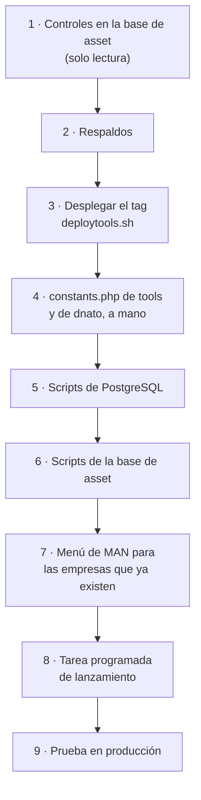

# Pasaje a producción de v3: Mantenimiento en tools

## Objetivo

Checklist para pasar a producción la versión de tools con Mantenimiento (MAN), la que reemplaza a AssetPlanner. Es para el PM:
se sigue de arriba abajo, y cada paso dice dónde se ejecuta. Junta lo aprendido al desplegarla en DEMO entre el 2026-11-16 y el
2026-11-18, del tag `v3.0` al `v3.0.0.4`. No cubre Tareas (TAR), que llega con v3.5, ni el retiro de asset (MIG-6, en
[MIGRACION-ASSETPLANNER.md](MIGRACION-ASSETPLANNER.md)). El porqué de cada cambio del núcleo está en
[ANALISIS-IMPACTO-NUCLEO-MIG.md](ANALISIS-IMPACTO-NUCLEO-MIG.md).

**Fecha:** 2026-11-18 · **Versión a desplegar:** tag `v3.0.0.4` de `develop`, o el último `v3.0.0.N`.

**Cómo quedó DEMO con `v3.0.0.4`:** la prueba completa de DocTest, sin Tareas, dio 143 pasan, 2 fallan y 1 salteada. Las dos que
fallaban eran errores de las pruebas y se corrigieron después:

- **Ajustes de stock:** la prueba esperaba otro texto en el botón;
- **Lista de usuarios:** la prueba tomaba al superusuario como si fuera de otra empresa.

## 1. El recorrido



Los pasos 1 y 2 no cambian nada. Del 3 en adelante, si un paso falla, no se sigue: ver el punto 6, «Volver atrás».

## 2. Lo que aprendimos en DEMO

Producción usa el integrador **EI 6.5**, igual que DEMO. Desarrollo usa el MI 4.5, que es más permisivo. Por eso cada problema de
esta lista apareció recién en DEMO. Todos están resueltos en `v3.0.0.4`; acá quedan para saber qué mirar en producción.

| # | Qué pasó en DEMO | Causa | Arreglo | ¿Pide algo en producción? |
|---|---|---|---|---|
| 1 | Mantenimiento no abría: error de ajax y pantallas sin datos | A `constants.php` del servidor le faltaban líneas, y `deploytools.sh` lo restaura desde el respaldo | Editar a mano | ✅ Paso 4 |
| 2 | El integrador rechazaba `toolsMANAPI` | Usaba expresiones `${...}` del MI 4.4, que el EI 6.5 no entiende | Reescrito para el EI 6.5 (`v3.0`) | No |
| 3 | "Error al guardar equipo" y listados vacíos | El EI 6.5 rechaza una consulta que repite un parámetro (`:id_empresa` dos veces) | 23 consultas reescritas (`v3.0.0.1`); hay un control automático en cada PR | No. Tres consultas de `master` ya fallan así en producción (H54, punto 7) |
| 4 | El alta de equipo fallaba con un número de serie con letras | `equipos.numero_serie` era numérica en la base de asset | Pasar la columna a texto | ✅ Paso 6 |
| 5 | La solicitud de servicio fallaba: «se borraron el caso y la solicitud» | DEMO tenía un disparador que producción no tiene, y el caso se registraba dos veces | Se borró en DEMO | ✅ Control del paso 1 |
| 6 | Programar desde el plan: «No se pudieron crear las ordenes» | Tablas de asset con cotejamientos mezclados (`utf8_spanish_ci` y `utf8_general_ci`) | La consulta unifica el cotejamiento (`v3.0.0.2`) | ✅ Control del paso 1 |
| 7 | Asignar una orden: «no se encontro la tarea siguiente Ejecutar OT» | Bonita contesta antes de crear la tarea siguiente (unos 25 ms después) | Reintento: hasta 4 veces, 1 s cada vez (`v3.0.0.3` y `v3.0.0.4`) | No |
| 8 | Nadie de una empresa nueva podía ejecutar órdenes | La registración no le daba el rol Mantenedor a ningún usuario | traz-comp-dnato #52 | ✅ Paso 4 |
| 9 | Lanzar una orden: «No se encontro el proceso de Bonita» | El proceso se llama "Proceso de Mantenimiento AssetPlanner **SIM**" en DEMO y en producción, y el código buscaba el nombre sin "SIM" | Busca por texto y encuentra los dos nombres (`v3.0.0.4`) | No |
| 10 | La tarea de MAN salía en la bandeja sin nombre de proceso | Faltaba la fila de Mantenimiento en `BPM_PROCESS` de `constants.php` | Editar a mano | ✅ Paso 4 |

**Regla que dejó DEMO:** las bases de asset de cada ambiente no son iguales. Las diferencias en disparadores, tipos de columna y
cotejamientos aparecen recién cuando el código nuevo las toca. Por eso el paso 1 va antes que todo.

## 3. Antes del día del pasaje

### 3.1 Decisiones del PM

- [ ] **¿Cómo se prueba producción? (paso 9)** Mi recomendación es un recorrido a mano con una empresa de prueba. La prueba completa
  de DocTest registra empresas y usuarios nuevos, así que en producción dejaría datos de prueba.
- [ ] **Planes con el equipo de otra empresa (H7).** Mantenimiento rechaza programar un plan cuyo equipo es de otra empresa, y asset
  lo dejaba pasar. Con la cuenta de la consulta d) del paso 1, decidir si se corrigen los datos o se permite.
- [ ] **Claves en el registro del integrador (H48).** `toolsCOREAPI` y `toolsbpmAPI` escriben claves en `wso2carbon.log`. No lo
  trae esta versión, porque ya pasa en producción, pero conviene decidir antes si se baja el nivel de registro.

### 3.2 Qué tiene que estar listo

- [ ] Los PR del tag unidos a `develop`, con el tag creado: `git ls-remote --tags origin v3.0.0.4`.
- [ ] El usuario de mantenimiento de una empresa de producción que se va a usar en el paso 9, con su contraseña. La tiene el PM;
  nunca va al repositorio.
- [ ] **Las empresas de producción que van a usar Mantenimiento están vinculadas con asset**: `core.empresas.empr_id_mysql` con el
  número de la empresa en asset. Las que ya usan la integración de almacén y pañol lo tienen. Sin el vínculo, la pantalla dice «La
  empresa no está vinculada con Mantenimiento». Se controla con la consulta e) del paso 1.

## 4. El día del pasaje

### Paso 1 · Controles en la base de asset de producción (solo lectura)

**Dónde:** cliente de MySQL conectado a la base de asset de **producción** (`assetv2`).

**a) El disparador que hacía fallar la solicitud (H55).** Tiene que salir vacío.

```sql
SELECT trigger_name FROM information_schema.triggers
WHERE trigger_schema = DATABASE()
  AND event_object_table = 'solicitud_reparacion';
```

Si aparece `solicitud_servicio_case_empreas_au_trg`, **parar y avisar**. Con ese disparador, la solicitud de servicio falla como
falló en DEMO.

**b) El tipo del número de serie (H53).**

```sql
SELECT data_type FROM information_schema.columns
WHERE table_schema = DATABASE()
  AND table_name = 'equipos' AND column_name = 'numero_serie';
```

`double` es lo esperado y se arregla en el paso 6. Si ya es `varchar`, el script del paso 6 no hace nada.

**c) Los cotejamientos (H56).**

```sql
SELECT table_name, column_name, character_set_name, collation_name
FROM information_schema.columns
WHERE table_schema = DATABASE()
  AND table_name IN ('solicitud_reparacion','tareas','equipos',
                     'sector','componentes','orden_trabajo')
  AND collation_name IS NOT NULL
ORDER BY collation_name;
```

Mezclas de `utf8_*` y de `latin1_*` están contempladas. Si aparece otro juego de caracteres, como `utf8mb4`, **avisar antes de
seguir**: la consulta de programar órdenes no se probó con esa mezcla.

**d) Planes y órdenes con el equipo de otra empresa (H7).** Es para la decisión 3.1; no frena el pasaje.

```sql
SELECT 'preventivo' origen, COUNT(*) FROM preventivo p
  JOIN equipos e ON e.id_equipo = p.id_equipo WHERE e.id_empresa <> p.id_empresa
UNION ALL SELECT 'predictivo', COUNT(*) FROM predictivo p
  JOIN equipos e ON e.id_equipo = p.id_equipo WHERE e.id_empresa <> p.id_empresa
UNION ALL SELECT 'backlog', COUNT(*) FROM tbl_back p
  JOIN equipos e ON e.id_equipo = p.id_equipo WHERE e.id_empresa <> p.id_empresa
UNION ALL SELECT 'orden', COUNT(*) FROM orden_trabajo p
  JOIN equipos e ON e.id_equipo = p.id_equipo WHERE e.id_empresa <> p.id_empresa;
```

**e) Empresas vinculadas.** **Dónde:** cliente de PostgreSQL conectado a la base de tools de **producción**.

```sql
SELECT empr_id, descripcion, empr_id_mysql FROM core.empresas
ORDER BY empr_id_mysql NULLS FIRST;
```

Las que van a usar Mantenimiento tienen que tener `empr_id_mysql`.

### Paso 2 · Respaldos

**Dónde:** servidor de producción y las dos bases.

- [ ] Una copia de `traz-tools/application/config/constants.php` y de `traz-comp-dnato/application/config/constants.php`.
- [ ] Un respaldo de la función `core.configuracion_inicial_empresa_trg` de PostgreSQL. La reemplaza el paso 5.
- [ ] Un respaldo de la tabla `equipos` y de los disparadores de `empresas` de la base de asset. Los cambian los pasos 6 a) y c).

### Paso 3 · Desplegar el tag

**Dónde:** terminal del servidor de producción, parado en el htdocs de Apache.

```bash
sh traz-tools/scripts/deploy/deploytools.sh v3.0.0.4 traz-tools
```

- [ ] El script termina con 0 errores. Despliega el código de tools y de sus módulos, y en el integrador los servicios de datos y las
  APIs (`MANDataService` y `toolsMANAPI` entre ellos).
- [ ] **No** despliega `data-sources/` ni el registro, a propósito. `MANDataService` usa `AssetPlannerDataSource`, que producción ya
  tiene.
- [ ] Si el script avisa que una API quedó afuera, **parar**. En DEMO pasó con `toolsMANAPI` mientras usaba las expresiones del MI 4.4.
  Para mirar el registro del integrador:

```bash
grep -n "toolsMANAPI\|MANDataService" \
  /usr/lib64/wso2/wso2ei/6.5.0/repository/logs/wso2carbon.log \
  | tail -20
```

La ruta del registro es la de DEMO. Que en producción sea la misma es un supuesto mío.

### Paso 4 · `constants.php`, a mano

`deploytools.sh` restaura `constants.php` desde el respaldo de cada servidor, así que estas líneas **se revisan después de cada
despliegue**, no solo esta vez. No hay que pisar los valores propios de producción: el número del proceso de Bonita, las direcciones
y las claves son de cada ambiente.

**a) Tools.** **Dónde:** servidor de producción, archivo `traz-tools/application/config/constants.php`. Para ver qué tiene, parado
en el htdocs:

```bash
grep -n "define('MAN'\|REST_MAN\|MAN_DIAS\|BPM_PROCESS_ID_MANTENIMIENTO" \
  traz-tools/application/config/constants.php
```

Tienen que aparecer las cuatro cosas:

- [ ] `define('MAN', 'traz-tools-man/');`, junto a `#COMPONENTE MANTENIMIENTO`. Sin ella, las pantallas de MAN dan error de ajax.
- [ ] `define('REST_MAN', HOST.'/services/MANDataService');`, después de la línea que define `HOST`. Sin ella, no traen datos.
- [ ] `define('MAN_DIAS_LANZAMIENTO', 7);`.
- [ ] **La fila de Mantenimiento en la lista de procesos de la bandeja**, la que empieza con `BPM_PROCESS_ID_MANTENIMIENTO =>`.
  - Va dentro de `define('BPM_PROCESS', json_encode(array(...`, y ese bloque tiene que estar **después** de `define('MAN', ...)`.
  - Cada fila termina en coma, salvo la última.
  - Sin esta fila, la tarea sale en la bandeja con «Te falto definir el modelo» y al abrirla no muestra acciones.

Copiar la fila de `develop`, sin el valor de la constante:

```bash
git -C traz-tools show v3.0.0.4:application/config/constants.php \
  | grep -n "BPM_PROCESS_ID_MANTENIMIENTO =>"
```

- [ ] `define('BPM_PROCESS_ID_MANTENIMIENTO', '...')` tiene el número del proceso de Bonita **de producción**. `master` trae
  `8664799170016058315`; DEMO tiene otro. Se ve en el portal de Bonita: Procesos, "Proceso de Mantenimiento AssetPlanner SIM",
  habilitado.

**b) dnato: el usuario de mantenimiento nace con el rol Mantenedor.** **Dónde:** servidor de producción, archivo
`traz-comp-dnato/application/config/constants.php`.

```bash
grep -n '"mantenimiento"' traz-comp-dnato/application/config/constants.php
```

- [ ] Dentro de `REGISTRACION_USUARIOS_DEFAULT_JSON`, la clave `mantenimiento` tiene que quedar así:
  `"mantenimiento":["Supervisor de Mantenimiento","Planificador de Mantenimiento","Mantenedor"]`.
- Vale para las empresas que se registren desde ahora. Las que ya existen no cambian; si a alguna le falta un mantenedor, el rol
  "Mantenedor &lt;empresa&gt;" se le da a mano a un usuario en el portal de Bonita.

### Paso 5 · Scripts de PostgreSQL

**Dónde:** cliente de PostgreSQL conectado a la base de tools de **producción**, en este orden:

1. [ ] `_backend/database/scripts/versiones/v2.8.1.7/pedidos_sin_formulario.sql`
2. [ ] `_backend/database/scripts/versiones/v2.8.1.7/configuracion_inicial_empresa_trg_func.sql`

**No** aplicar `v2.8.1.5`. Se armó copiando la función de desarrollo, no la de producción, y le falta clonar el formulario "Entrega
Materiales". `v2.8.1.7` tiene los cuatro bloques:

- el formulario;
- el menú de MAN para las empresas nuevas;
- los roles de Residuos;
- el proceso estándar de Tareas.

Si hay que deshacer el primero, existe `pedidos_sin_formulario.rollback.sql`.

### Paso 6 · Scripts de la base de asset

**Dónde:** cliente de MySQL conectado a la base de asset de **producción**. Es la misma base que usa AssetPlanner hoy: los tres
scripts solo agregan cosas o amplían una columna, y asset sigue funcionando.

1. [ ] `_backend/database/scripts/assetplanner/equipos-numero-serie-texto.sql`. Pasa `numero_serie` a texto y conserva los valores
   que hay. Se puede correr dos veces sin efecto.
2. [ ] `_backend/database/scripts/assetplanner/kpi-mantenimiento.sql`. Son los cuatro indicadores del tablero; sin él, muestran 0.
3. [ ] `development/sql/asset-empresa-trigger.sql`. Hace que una empresa nueva en asset nazca con una unidad industrial y los cinco
   períodos de los planes. Sin la unidad, el equipo se guarda pero no aparece; sin los períodos, no se puede crear un preventivo.

### Paso 7 · Menú de Mantenimiento para las empresas que ya existen

**Dónde:** cliente de PostgreSQL conectado a la base de tools de **producción**.

- El paso 5 le da el menú a las empresas **nuevas**. Las que ya existen lo reciben aparte: una fila por opción en
  `seg.memberships_menues` con su grupo.
- Procedimiento, opciones y qué ve cada rol: [MENU-MAN.md](MENU-MAN.md).
- [ ] Las opciones de MAN están en `seg.menues`, con las direcciones de la tabla de `MENU-MAN.md`.
- [ ] Cada empresa que va a usar Mantenimiento tiene sus filas.

### Paso 8 · Tarea programada que lanza las órdenes preventivas

**Dónde:** servidor de producción, en el `crontab` del usuario que corre Apache.

- [ ] Instalarla según [man-lanzamiento-cron.md](../infra/man-lanzamiento-cron.md). Corre una vez por día y lanza en Bonita las
  órdenes programadas que entran en los 7 días de anticipación.
- Sin ella, solo se lanzan las órdenes que caen en ese margen al programarlas, más las que se lanzan a mano con el botón Lanzar.

### Paso 9 · Prueba en producción

**Dónde:** navegador, en `https://cloudtrazalog.com`, con la empresa de prueba elegida en 3.1.

Es el mismo circuito que en DEMO falló hasta `v3.0.0.4`. Si algo falla, anotar el número de orden y la hora.


- [ ] **Alta de equipo** con un número de serie con letras (`SN-123`). Así se prueban el paso 6 y las consultas sin parámetros
  repetidos.
- [ ] **Solicitud de servicio:** se genera sin «se borraron el caso y la solicitud». Prueba el control a).
- [ ] **Programar una orden desde el Calendario:** se crea sin «No se pudieron crear las ordenes». Prueba los cotejamientos.
- [ ] **Lanzarla con el botón Lanzar:** sin «No se encontro el proceso de Bonita».
- [ ] **Asignarla:** aparece "Ejecutar OT" en la bandeja del responsable. Necesita https para la ubicación del navegador (H43).
- [ ] **Ejecutar, confeccionar el informe, verificarlo y dar la conformidad**, desde la bandeja.
- [ ] **La tarea de Mantenimiento en "Mis Tareas":** muestra el nombre del proceso y las acciones. Prueba la fila de `BPM_PROCESS`.
- [ ] **El tablero del administrador** muestra los cuatro indicadores de MAN. Pueden dar 0 hasta que corra el cálculo de
  indicadores.

## 5. Después del pasaje

- [ ] Volver a mirar `constants.php` de tools y de dnato **después de cada `deploytools.sh`** (paso 4).
- [ ] Al día siguiente, revisar la salida de la tarea programada de lanzamiento (`/var/log/man_lanzamiento.log`).
- [ ] Repasar con el PM la lista de [HALLAZGOS-POST-MIGRACION.md](HALLAZGOS-POST-MIGRACION.md). Lo que todavía está abierto y se nota
  en producción:
  - H43: asignar pide la ubicación del navegador;
  - H44: el código de equipo es único entre todas las empresas;
  - H-122: un plan recién creado no se puede editar;
  - E14: el mantenimiento autónomo está apagado.

## 6. Volver atrás

AssetPlanner y Mantenimiento comparten la misma base de asset, sin migrar datos. Si Mantenimiento falla, las empresas pueden seguir
en asset mientras se corrige.

- **Código y servicios del integrador:** desplegar el tag anterior con `deploytools.sh`.
  - El script **no borra** artefactos: `toolsMANAPI` y `MANDataService` nuevos quedan. No molestan a asset.
- **`constants.php`:** volver a las copias del paso 2.
- **Paso 5:** volver a la función respaldada; para el primer script, usar `pedidos_sin_formulario.rollback.sql`.
- **Paso 6:**
  - el número de serie como texto no hace falta deshacerlo, porque asset lo lee igual (es un supuesto mío; no lo probé con asset);
  - el disparador de empresas vuelve con el respaldo;
  - las consultas de indicadores se pueden dejar.

## 7. Cosas que ya pasan en producción y esta versión no cambia

- **H54:** `ALMDataService` `/mcp/stock` y `MANDataService` `/mcp/ots`, que usa el MCP, responden 500 en el EI 6.5 porque repiten
  un parámetro. Ya están así en `master`.
- **H48:** las claves en el registro del integrador (decisión 3.1).
- **H-003:** el superusuario aparece en la lista de usuarios de todas las empresas. El PM lo aceptó así.
