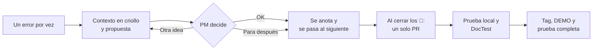

# Plan de corrección de errores de Mantenimiento (MAN)

## Objetivo

Lista, en orden de prioridad, los errores que le quedan a Mantenimiento en tools después de desplegar `v3.0.0.4` en DEMO, con
una propuesta para cada uno. Es para revisarla con el PM de a un error por vez: el PM no tiene que ser especialista en
mantenimiento, así que cada punto arranca explicando qué hace esa parte del sistema. No cubre los errores de AssetPlanner, que no
se corrigen ([ERRORES-ASSET.md](ERRORES-ASSET.md)), ni el pasaje a producción ([PASAJE-PRODUCCION-V3.md](PASAJE-PRODUCCION-V3.md)).

**Fecha:** 2026-11-18 · **Estado:** sin revisar con el PM.

## 1. De dónde sale la lista

- **Las 12 fallas de la consola de DocTest ya están corregidas.**
  - Son de la corrida `2026-11-18_man_demo_v3.0.0.1`, de la madrugada, anterior a `v3.0.0.2`, `v3.0.0.3` y `v3.0.0.4`.
  - En la prueba completa con `v3.0.0.4` pasan las 12.
  - La consola mostraba esa corrida primero porque ordenaba por nombre y no por hora; ya está corregido.
- **Lo que de verdad queda abierto sale de dos lugares:**
  - las 3 pruebas de MAN marcadas como error conocido en la prueba completa con `v3.0.0.4`;
  - los hallazgos abiertos de [HALLAZGOS-POST-MIGRACION.md](HALLAZGOS-POST-MIGRACION.md) y de `doc/hallazgos/REGISTRO.md` que
    son errores de MAN, y no dudas para revisar.

## 2. La lista priorizada

**Cómo se priorizó:**

- 🔴 **Ya:** el usuario no puede hacer algo que necesita, o se pierde un dato. El arreglo es chico.
- 🟡 **Después:** molesta o confunde, o hace falta una decisión del PM antes de tocar.
- ⚪ **Proyecto aparte:** no es un arreglo, es una funcionalidad que falta portar.

| # | Prioridad | Error | De dónde sale | Propuesta en una línea | ¿Necesita decisión del PM? |
|---|---|---|---|---|---|
| 1 | 🔴 | Un plan de mantenimiento, una vez creado, no se puede editar nunca | H-122, DocTest | Mostrar el lápiz en los planes en estado "C", que es el único que usan | No |
| 2 | 🔴 | El código de un equipo choca con los de **otras** empresas | H44, H-056 | Controlar que el código sea único solo dentro de la empresa (regla del PM del 2026-08-26) | Confirmar la regla |
| 3 | 🔴 | Editar una orden borra las herramientas cargadas como texto libre | H35 | Conservar el texto libre al regrabar la lista | No |
| 4 | 🔴 | La lista de órdenes que usa el asistente de IA (MCP) da error en el integrador de producción | H54 | Reescribir la consulta sin parámetros repetidos, como las otras 23 | No; toca un servicio de datos, así que va con análisis de impacto |
| 5 | 🟡 | El alta de equipo responde "ok" aunque falle | H45 | Responder `status: error` cuando falla; la pantalla ya mira el código | No |
| 6 | 🟡 | Rechazar el informe de una orden sin responsable da error, aunque Bonita ya avanzó | H39 | Validar el responsable **antes** de cerrar la tarea | No |
| 7 | 🟡 | El informe de servicio deja un error oculto si el equipo no tiene lecturas | H40 | Mirar si vino una lectura antes de usarla | No |
| 8 | 🟡 | Se puede cambiar el código de un equipo que ya tiene historial | H-055 | No dejar editar el código si el equipo tiene órdenes, lecturas o informes (regla del PM) | Confirmar la regla |
| 9 | 🟡 | Asignar una orden exige la ubicación del navegador | H43 | Pedirla, pero dejar seguir sin ella | **Sí:** ¿la ubicación es obligatoria? |
| 10 | 🟡 | Una empresa nueva no trae marcas de herramientas | H50 | Que el alta siembre una lista básica, o un aviso en la pantalla | **Sí:** qué marcas |
| 11 | 🟡 | El vale de pañol falla en una empresa sin formulario de salida | H52 | Mandar el número de formulario vacío como nulo | No; toca un servicio de datos y es del módulo de pañol |
| 12 | 🟡 | Volver a "Mis Tareas" sin recargar duplica el clic y puede vaciar la ventana | H41, H-107 | Desenganchar el clic antes de volver a engancharlo | No; es de la bandeja central de tools, va con análisis de impacto |
| 13 | ⚪ | El mantenimiento autónomo (el operario carga una lectura con falla) está apagado | E14, DocTest | Portar el formulario de falla al motor de formularios de tools | Es un proyecto: se planifica aparte |

## 3. La dinámica de revisión

**Cada error se presenta igual**, y el PM contesta con OK, con otra idea, o con "para después":

1. **Qué es esa parte del sistema**, sin suponer que se sabe de mantenimiento.
2. **Qué le pasa al usuario hoy**, con un ejemplo.
3. **Por qué pasa:** la causa, en una o dos líneas.
4. **Qué propongo**, con lo que cambia y lo que no.
5. **Qué necesito del PM:** una decisión, o solo el OK.

**Cómo se trabaja después:**

- Las decisiones se anotan en la tabla de este documento.
- Los arreglos se hacen todos juntos, en un solo PR por repositorio, recién cuando están revisados los 🔴. Los 🟡 pueden ir en
  la misma tanda si ya tienen OK.
- Cada arreglo lleva su prueba de DocTest. Si ya había una marcada como error conocido, se le saca la marca.
- Lo que toca un servicio de datos, el integrador o la bandeja central (4, 11 y 12) lleva antes un análisis de impacto, por la
  regla del núcleo de `CLAUDE.md`.

## 4. Decisiones

| # | Fecha | Decisión del PM |
|---|---|---|
| — | — | Todavía no se revisó ninguno |
