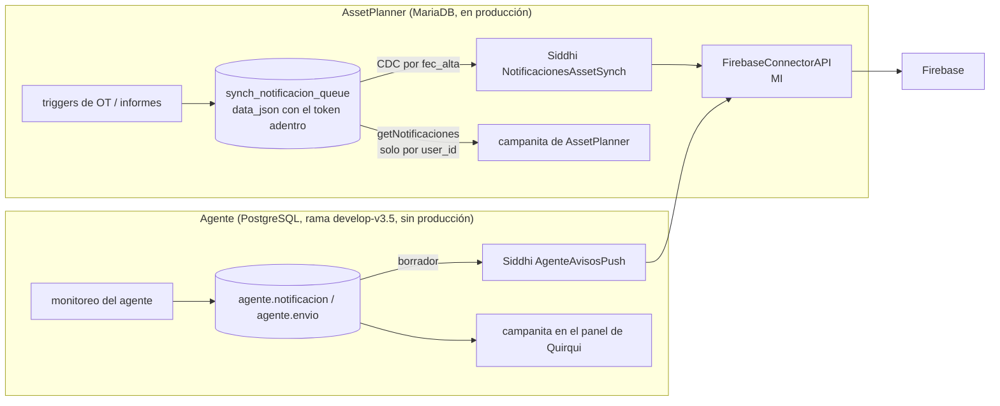

# Avisos de Tools — diseño del mecanismo único de notificaciones (campanita y push)

## Objetivo

Qué es: el diseño y el análisis de impacto del **mecanismo de avisos de todo Trazalog** —la campanita y las notificaciones push—, que reemplaza a los dos que hay hoy (el de AssetPlanner sobre MariaDB y el del agente sobre PostgreSQL). Para quién: el PM, que lo aprueba antes de que se escriba código (toca el core); y quien lo implemente. Cuándo leerlo: antes de tocar cualquier cosa de notificaciones, en cualquier módulo. Qué NO cubre: qué avisos genera cada módulo (eso lo decide cada uno) ni el contenido de los avisos de los agentes ([`doc/agente/arquitectura.md`](../agente/arquitectura.md)).

**Estado:** aprobado por el PM e implementado el 2026-10-28 (ADR-015), en la rama `feat/NTF-avisos-tools`. Cómo se instala: [`instalacion-avisos.md`](instalacion-avisos.md). Lo que cambió respecto de este diseño al construirlo está en las decisiones D-71 a D-85 de [`decisiones-para-revisar.md`](../agente/decisiones-para-revisar.md): sobre todo, el puente solo publica lo de las últimas 24 horas y la depuración de MariaDB borra solo lo leído.
**Pedido del PM:** "traer el mecanismo de AssetPlanner como el mecanismo de Tools, mejorado; colas en MariaDB y en PostgreSQL; que los agentes usen solo PostgreSQL; minimizar objetos nuevos en MariaDB, que a futuro se quiere eliminar".

---

## 1. Las reglas del diseño

1. **PostgreSQL es la cola canónica de todo el sistema.** Todo aviso, venga de donde venga, termina ahí, y de ahí salen la campanita y el push.
2. **En MariaDB, cero objetos nuevos.** La cola de AssetPlanner (`synch_notificacion_queue`) sigue existiendo mientras existan sus triggers, pero **solo como entrada**: un puente la vuelca a PostgreSQL. Cuando Mantenimiento migre a `traz-tools-man`, el puente se borra y MariaDB no queda involucrada en nada.
3. **Los agentes usan solo PostgreSQL** y publican por el mismo camino que cualquier módulo.
4. **Publicar un aviso es una operación del API** ("la lógica va en las APIs", CLAUDE.md): un solo código para el PHP, los agentes, Bonita y el puente.
5. **Un solo emisor de push.** Hoy lo haría AssetPlanner por un lado y el agente por otro; queda uno.
6. **Arreglar lo que hoy no anda** (sección 3), probado antes de reemplazar nada.

## 2. Cómo está hoy



Tools carga `lib/props/firebase_config.js`, que pide el permiso y obtiene el token del navegador, pero **no lo guarda en ningún lado** (arma un JSON de prueba y lo descarta). Tools no tiene campanita propia.

## 3. Lo que hoy no anda (y la causa)

| Problema | Causa verificada | Cómo se resuelve |
|---|---|---|
| **AssetPlanner nunca marca "enviado"** (`procesado = 1`): en desarrollo, 434 filas y 0 procesadas | En `traz-int/siddhi/notificaciones/*/NotificacionesAssetSynch.siddhi`, la respuesta del conector se mapea con `@map(type='json')` esperando `queue_id` **en el cuerpo de la respuesta**, y Firebase no lo devuelve. Siddhi descarta cada respuesta y el `UPDATE` nunca corre. Reproducido el 2026-10-28 en el SI local con el mismo patrón | Tomar el id **del pedido original** (`trp:<id>`) con el mapeador `text` y el código de estado `'2..'`. Probado: marca `enviado` con fecha |
| **Reenvíos duplicados** | Lo que no se marcó se vuelve a tomar en la vuelta siguiente | **Tomar** el lote marcándolo `enviando` en la misma sentencia (sección 5.3); nunca se toma dos veces |
| **La cola no se depura** | Ninguna política de retención; ni en AssetPlanner ni en el borrador del agente | Depuración diaria (sección 5.4) |
| **Falsos "enviado"** | El `FirebaseConnectorAPI` tiene el `faultSequence` vacío: responde 2xx aunque el envío falle | Corregir el conector para que devuelva 5xx al fallar, y 410 si el token ya no existe en Firebase (sección 7) |
| **Polling por timestamp** | La CDC de AssetPlanner usa `fec_alta`: dos avisos en el mismo segundo pueden perderse o repetirse | El puente lee por `queue_id` (autoincremental) |
| **Token del dispositivo dentro del aviso** | `data_json` lleva el `registrationToken`, y la campanita recibe ese JSON | En PostgreSQL el token vive solo en `dispositivo`; el aviso no lo lleva |
| **Campanita sin empresa** | `MANDataService.getNotificaciones` filtra solo por `user_id` | La lectura nueva filtra por empresa (del JWT) y usuario |
| **Credenciales en claro** | El `.siddhi` de producción de `traz-int` tiene usuario y **contraseña de root** de la base de producción | Las apps nuevas usan un **datasource** del `deployment.yaml` del SI (con secure vault), nunca credenciales en el `.siddhi`. **Rotar esa contraseña** |
| **Tools no guarda el token del navegador** | `firebase_config.js` lo obtiene y lo descarta | Registrar el dispositivo por el API (sección 6) |

## 4. Cómo queda

```mermaid
flowchart LR
    subgraph ENTRADAS["Quién publica"]
        PHP[módulos PHP de Tools]
        AG[agentes<br/>token de máquina]
        BPM[conectores de Bonita]
        PUENTE[Siddhi: puente MariaDB<br/>mientras exista AssetPlanner]
    end
    API[["API de avisos (MI)<br/>POST /avisos · GET /avisos/mios<br/>POST /avisos/{id}/leido · POST /dispositivos"]]
    PHP --> API
    AG --> API
    BPM --> API
    PUENTE -->|ntf.publicar()| PG
    API --> PG[(PostgreSQL trazalog_tools<br/>esquema ntf)]
    PG -->|ntf.tomar_envios()| TR[Siddhi: transporte]
    TR --> FC[FirebaseConnectorAPI<br/>corregido]
    FC --> FCM[Firebase]
    PG -->|GET /avisos/mios| CAMP[campanita de Tools<br/>en el layout]
    MDB[(MariaDB<br/>synch_notificacion_queue<br/>sin objetos nuevos)] -->|por queue_id| PUENTE
```

## 5. PostgreSQL: el esquema `ntf` (en la base de Tools)

Va en `trazalog_tools`, la base de Tools, para que cualquier módulo y los DataServices lo alcancen. **Producción es PostgreSQL 11.7**: nada de lo de abajo usa funciones de versiones posteriores. Sigue el patrón de Tools: se accede **solo por DataServices**, con el `empr_id` del JWT (ADR-009), no por RLS.

### 5.1 Tablas

| Tabla | Qué guarda | Columnas principales |
|---|---|---|
| `ntf.aviso` | Un aviso, una vez | `aviso_id`, `empr_id`, `origen` (`man`, `alm`, `pan`, `agente`, `bpm`, `asset`…), `tipo`, `titulo`, `cuerpo`, `severidad` (`info`/`aviso`/`critica`), `enlace`, `entidad_tipo`, `entidad_id`, `dedupe_key`, `emisor` (`quirqui`, `kuntur`, módulo), `fec_alta`, `vence_en` |
| `ntf.destino` | A quién le llega, y si lo leyó (la campanita) | `aviso_id`, `empr_id`, `usuario`, `leido`, `fec_lectura` |
| `ntf.suscripcion` | Quién recibe cada tipo de aviso cuando el emisor no dice a quién | `empr_id`, `tipo` (o `*`), `usuario`, `activo` |
| `ntf.dispositivo` | Los navegadores y celulares de cada usuario | `dispositivo_id`, `empr_id`, `usuario`, `token` (único), `plataforma`, `activo`, `fec_alta`, `fec_ultimo_uso` |
| `ntf.envio` | Un push por dispositivo | `envio_id`, `aviso_id`, `dispositivo_id` (o `token_directo` para lo que viene del puente), `estado`, `intentos`, `proximo_intento`, `ultimo_error`, `fec_alta`, `fec_tomado`, `fec_envio` |

**El usuario se identifica por su nick de Dnato** (`sub` del JWT): es lo que Tools tiene en sesión y lo que traen los tokens. Los avisos que vienen de AssetPlanner, cuyo usuario no tiene correspondencia con Dnato, usan `asset:<user_id>` y llevan el token del dispositivo en `envio.token_directo`.

Estados de `envio`: `pendiente` → `enviando` → `enviado` | `fallido` | `descartado` (token que ya no existe en Firebase).

### 5.2 `ntf.publicar(...)` — la única forma de crear un aviso

Una función SQL que, **en una sola transacción**: inserta el aviso (y si la `dedupe_key` ya existe, no hace nada y devuelve el existente), resuelve los destinatarios (los que manda el emisor, o los de `suscripcion` para ese tipo), crea un `destino` por destinatario y un `envio` por cada dispositivo activo de cada uno. La llaman el DataService del API y el puente. Así el "aviso sin envíos" o los "envíos sin aviso" no pueden pasar.

### 5.3 `ntf.tomar_envios(lote)` — sin duplicados

```sql
UPDATE ntf.envio SET estado = 'enviando', fec_tomado = now(), intentos = intentos + 1
WHERE envio_id IN (
    SELECT envio_id FROM ntf.envio
    WHERE estado = 'pendiente' AND proximo_intento <= now()
    ORDER BY envio_id LIMIT lote
    FOR UPDATE SKIP LOCKED)
RETURNING envio_id, <token>, <payload armado desde el aviso>;
```

Lo tomado ya no está `pendiente`: **no se puede mandar dos veces**, aunque haya dos transportes corriendo (`SKIP LOCKED`). Lo que quedó `enviando` más de 10 minutos (el transporte se cayó a mitad) vuelve a `pendiente`. Un `fallido` reintenta con espera creciente (1, 5 y 30 minutos) hasta 3 veces.

### 5.4 `ntf.depurar()` — la cola no crece sin límite

Una vez por día: borra los envíos terminados de más de 30 días, los avisos vencidos y los leídos de más de 90 días (con sus destinos y envíos). Los plazos son valores por defecto configurables.

## 6. El API de avisos (WSO2 MI)

Recursos nuevos, con el `empr_id` del JWT (nunca como parámetro):

| Recurso | Quién lo usa | Qué hace |
|---|---|---|
| `POST /avisos` | Módulos PHP, agentes (con su token de máquina), Bonita | `ntf.publicar()` |
| `GET /avisos/mios` | La campanita | Los avisos del usuario del token, sin leer primero |
| `POST /avisos/{id}/leido` | La campanita | Solo los propios |
| `POST /dispositivos` · `DELETE /dispositivos/{token}` | `firebase_config.js` | Registra o da de baja el navegador del usuario |

`firebase_config.js` deja de armar el JSON de prueba y registra el token. La **campanita** pasa al layout de Tools para todos los usuarios, y el panel de Quirqui muestra la misma.

## 7. El transporte y el conector

- **`Siddhi AvisosPush` (PostgreSQL):** cada 15 segundos llama a `ntf.tomar_envios(50)` por un **datasource** del `deployment.yaml` del SI (sin credenciales en el `.siddhi`), postea al conector y marca `enviado` / `fallido` / `descartado` según la respuesta, tomando el `envio_id` del pedido original (`trp:`). Una vez por día llama a `ntf.depurar()`. Implementado en `_backend/siddhi/AvisosPush.siddhi` (manda de a un envío por vez: ver D-74).
- **`Siddhi PuenteAsset` (MariaDB → PostgreSQL), mientras exista AssetPlanner:** lee `synch_notificacion_queue` por `queue_id` (no por `fec_alta`), llama a `ntf.publicar()` con `origen = 'asset'` y el token del `data_json` como `token_directo`, y marca `procesado = 1` en MariaDB (la columna que ya existe). Una vez por día borra de MariaDB lo procesado de más de 30 días. **No crea ningún objeto en MariaDB.** Reemplaza a `NotificacionesAssetSynch`: queda **un solo emisor de push**.
- **`FirebaseConnectorAPI` (core):** el `faultSequence` tiene que devolver **5xx** si Firebase falla, y **410** si el token ya no existe (para marcarlo `descartado` y desactivar el dispositivo). Hoy devuelve 2xx siempre.

La campanita de AssetPlanner sigue leyendo MariaDB hasta que Mantenimiento migre: durante ese período, un aviso de AssetPlanner se marca leído por separado en cada aplicación. Es aceptable porque es temporal y no duplica push.

## 8. Qué pasa con lo que se armó para el agente

Lo de `develop-v3.5` (esquema `agente`) **se reemplaza por esto**:

| Hoy (agente) | Pasa a |
|---|---|
| `agente.notificacion`, `agente.envio`, `agente.dispositivo` | `ntf.aviso`, `ntf.destino`, `ntf.envio`, `ntf.dispositivo` |
| `agente.destinatario_alerta` | `ntf.suscripcion` |
| El monitoreo escribe en la base del agente | Publica por `POST /avisos` con su token de máquina |
| `GET /notificaciones` del orquestador | `GET /avisos/mios` del API de Tools |
| Borrador `AgenteAvisosPush.siddhi` | `AvisosPush` sobre `ntf` |

El agente sigue usando **solo PostgreSQL**: su base para lo suyo (conocimiento, corridas) y el API de Tools —que escribe en el PostgreSQL de Tools— para los avisos. Las tablas de avisos del esquema `agente` se retiran cuando esto esté en marcha.

## 9. Qué lo consume hoy y qué le pasa (análisis de impacto)

| Pieza | Hoy | Con el cambio |
|---|---|---|
| Triggers de AssetPlanner | Escriben en `synch_notificacion_queue` | **Nada**: siguen igual |
| `NotificacionesAssetSynch` (Siddhi, prod) | Manda el push de AssetPlanner (y nunca marca) | **Se reemplaza** por el puente. Es el único cambio sobre producción de AssetPlanner |
| Campanita de AssetPlanner (`MANDataService.getNotificaciones`) | Lee MariaDB | **Nada** hasta la migración |
| `FirebaseConnectorAPI` | 2xx siempre | Devuelve el error real. Consumidores verificados el 2026-10-28: la app Siddhi de AssetPlanner (que se reemplaza) y **un push de prueba que los `firebase_config.js` de Tools y de AssetPlanner mandan desde el navegador a `http://localhost:8290/tools/firebase/send` en cada carga de página**. Desde el navegador de un usuario real, `localhost` es su propia máquina: falla en silencio y no hace nada. Se elimina al pasar a registrar el token (sección 6) |
| Layout de Tools (`firebase_config.js`) | Pide permiso y descarta el token | Registra el token; suma la campanita |
| Base `trazalog_tools` | — | Esquema nuevo `ntf`. **No toca ninguna tabla existente** |

## 10. Cómo se prueba (antes de desplegar nada)

1. Esquema `ntf` en un **PostgreSQL 11** descartable: publicar, deduplicar, tomar sin duplicados (dos tomas simultáneas no comparten envíos), reintentos, recuperación de `enviando` colgados, depuración.
2. Transporte y puente en el **SI local** con un conector falso, como el 2026-10-28: cada envío se manda **una sola vez** y queda `enviado` con fecha; un 5xx queda `fallido` y reintenta; un 410 queda `descartado`.
3. Puente con una MariaDB descartable con la estructura real de `synch_notificacion_queue`: lo procesado queda `procesado = 1` y llega una sola vez a PostgreSQL.
4. Recién después, en DEV con VPN, y un único despliegue.

## 11. Lo que necesito que decidas

1. **¿Aprobás el diseño?** En particular: el esquema `ntf` en la base de Tools, y que el puente reemplace a `NotificacionesAssetSynch` en producción.
2. **Plazos de retención:** 30 días para envíos terminados y para lo procesado en MariaDB; 90 días para avisos leídos.
3. **Corregir el `FirebaseConnectorAPI`** (core) como parte de este cambio.
4. **Rotar la contraseña de root** que está en el `.siddhi` de producción de `traz-int`.
5. **La campanita en el layout de Tools para todos los usuarios** (no solo para quien tiene el agente).
6. Formalizarlo como **ADR-015**: es una pieza de arquitectura nueva y de todo el sistema. ADR-014 ya existe en `develop-v3` (acceso a datos de Mantenimiento), así que 015 es el próximo libre.
