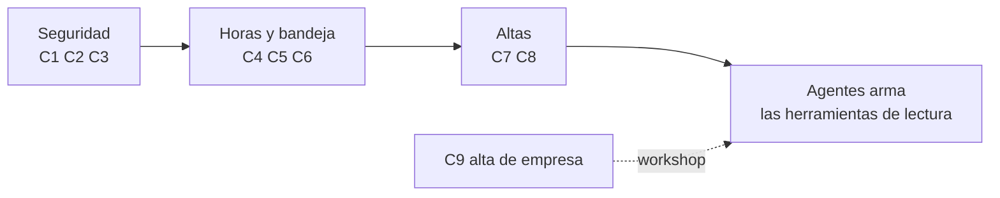

# Tareas (TAR): análisis de impacto de las correcciones que piden los agentes

## Objetivo

Análisis de impacto de cada corrección del módulo de Tareas que la sesión de Agentes necesita para
exponer las herramientas de lectura de Tareas por MCP. Lo aprueba el PM antes de programar nada del
núcleo (regla "Sistema PRODUCTIVO" del `CLAUDE.md`). Se lee junto con el informe de errores
[`TAR-bugs-detectados.md`](TAR-bugs-detectados.md), que tiene la evidencia de cada uno. No cubre los
errores de pantalla que no frenan a los agentes (grupo 4 del informe).

**Fecha:** 2026-11-11 · **Base:** `develop-v3.5` (módulos `traz-comp-tareasestandar` c941a607 y
`traz-comp-bpm` 4095a93f, iguales a la punta de `develop` y contenidos en `master`) · **Pedido de
prioridad:** sesión "v3.5 Agentes", 2026-11-11.

## 1. Resumen para decidir

| # | Corrección | Errores | Dónde | Clase | Pide aprobación |
|---|---|---|---|---|---|
| C1 | Las consultas de tareas planificadas filtran por empresa | #581 | `TARDataService` + `Tareas.php` | 🟡 núcleo | **Sí** |
| C2 | Leer un hito filtra por empresa | H-116 | `TARDataService` + `Pedidotrabajos.php` | 🟡 núcleo | **Sí** |
| C3 | Borrar un pedido filtra por empresa | H-119 | `PRODataService` + 2 controladores | 🟡 núcleo | **Sí** |
| C4 | La hora se lee en formato de 24 horas | #591 | `TARDataService` | 🟡 núcleo | **Sí** |
| C5 | Inicio y fin real de la tarea | H-111 (y el botón "Inicializar") | `notificacion_estandar.php` | 🟢 pantalla | No, pero se verifica en local |
| C6 | La bandeja muestra el pedido correcto | #593 | `Tsttareas.php` | 🟢 pantalla | No, pero se verifica en local |
| C7 | El selector "Proceso Asociado" ofrece TST001 | #580 | `views/tareas/form.php` | 🟢 pantalla | **Sí** (cambia lo que ven todas las empresas) |
| C8 | `TAREAS_DEFAULT_PROC` en el DEMO | #579 | `constants.php` del DEMO | ambiente | Lo hace quien despliega |
| C9 | Una empresa nueva nace con `PROCESO-STANDAR` | #578 | `core.configuracion_inicial_empresa_trg()` | 🔴 base de datos | **Workshop** |

Orden propuesto (el que pidió Agentes): C1, C2, C3 → C4, C5, C6 → C7, C8. C9 queda para el workshop.

## 2. Hechos que valen para todas

- **Quién usa estas consultas:** se buscó en todos los módulos de tools (`application/`, con los
  submódulos inicializados) y en `_backend`. Las consultas de tareas planificadas y de hitos solo las
  llama `traz-comp-tareasestandar/models/Tareas.php` y `traz-comp-bpm/models/Pedidotrabajos.php`.
  El borrado de pedidos lo llaman además `ddpe-tools-pro/controllers/Ingreso_barrera.php` (2 lugares).
  Ninguna API de WSO2 ni herramienta MCP las usa hoy.
- **El orden de despliegue importa.** El servicio de datos (`.car`) y el PHP se despliegan por
  separado. Para que no haya una ventana rota: **primero se despliega el PHP** que ya manda la
  empresa (el servicio viejo ignora el dato de más), **después el servicio de datos** que la exige.
  Esto se prueba en local antes (ver §4).
- **Datos viejos sin empresa.** `tst.tareas_planificadas.empr_id` se agregó en v0.4.2 y admite nulo.
  Si en producción hay tareas planificadas con `empr_id` nulo, el filtro las deja de mostrar. Antes
  de desplegar C1 hay que contar cuántas hay (consulta en §4, paso 1).
- **`tst.hitos` no tiene `empr_id`.** La empresa sale de su pedido (`pro.pedidos_trabajo.empr_id`).

## 3. Cada corrección

### C1 · Tareas planificadas por empresa — #581

- **Qué cambia:** `getTareasPlanificadas`, `getTareaPlanificadaXCaseId` y `deleteTareaPlanificada`
  reciben `empr_id` y agregan `and tp.empr_id = cast(:empr_id as integer)`. `Tareas.php` lo manda
  con `empresa()` en `obtenerPlanificadas()`, `obtenerXCaseId()` y `eliminarPlanificada()`.
- **Qué lo consume:** la planificación de hitos (componente `tareas_planificadas` del pedido), la
  bandeja (`Tsttareas::map`, `desplegarVista`, `desplegarCabecera`) y el borrado de una tarea.
- **Qué se rompe si sale mal:** si falta la empresa en la sesión o la tarea vieja tiene `empr_id`
  nulo, la tarea no aparece en la planificación ni en la bandeja (la bandeja ya filtra por empresa
  con `bandejaEmpresa()`, así que el usuario de esa empresa es el mismo).
- **Por qué está así:** las consultas son de cuando cada empresa tenía su base; el filtro nunca se
  agregó al pasar a multiempresa. Mismo patrón que H-037 de Almacenes.

### C2 · Hito por empresa — H-116

- **Qué cambia:** `getHito` hace `join pro.pedidos_trabajo pt on pt.petr_id = h.petr_id` y filtra
  `pt.empr_id = cast(:empr_id as integer)`. `Pedidotrabajos::obtenerHito()` manda la empresa.
- **Qué lo consume:** solo `Pedidotrabajo/hito/{id}` (el detalle del hito).
- **Qué se rompe si sale mal:** el detalle del hito se ve vacío.
- **Por qué está así:** igual que C1.

### C3 · Borrar pedido por empresa — H-119

- **Qué cambia:** `deletePedidoTrabajo` agrega `and empr_id = cast(:empr_id as integer)`. Los dos
  llamadores mandan `empresa()`: `Pedidotrabajo::eliminarPedidoTrabajo()` (`traz-comp-bpm`) e
  `Ingreso_barrera.php` (`ddpe-tools-pro`).
- **Qué lo consume:** el botón eliminar del listado de pedidos, la limpieza cuando falla el alta
  (#583) y el ingreso por barrera de DDPE.
- **Qué se rompe si sale mal:** si DDPE no se actualiza, sus borrados dejan de hacer efecto (no da
  error: el `update` afecta 0 filas). Por eso los dos módulos van en el mismo despliegue.
- **Por qué está así:** igual que C1.

### C4 · Hora en 24 horas — #591

- **Qué cambia:** en `getTareasPlanificadas` y `getKpiBasico`, `HH12` pasa a `HH24` (`fec_inicio`,
  `fec_fin`, `fec_alta`, `fec_asignacion`).
- **Qué lo consume:** la planificación (`planificacion_tareas.php`, `dateFormatPG`), el calendario y
  `Tareas::map()`, que **vuelve a guardar** la hora que leyó.
- **Qué se rompe hoy:** una tarea planificada a las 15:00 se lee como 03:00 y, al asignarla, se
  guarda a las 03:00. O sea, el error corrompe el dato cada vez que se edita. Las tareas ya
  corrompidas no se arreglan con esto.
- **Qué se rompe si sale mal:** nada que hoy funcione: con `HH12` ninguna hora de la tarde sale bien.

### C5 · Inicio y fin real — H-111 y "Inicializar tarea"

- **Qué cambia:** en `notificacion_estandar.php`, la hora se toma al hacer clic y con el formato
  correcto (hoy `moment().format("YYYY-MM-DD HH:MM:s")` pone el **mes** en lugar de los minutos y se
  calcula al abrir la pantalla). Además, el pantallazo decide si es una tarea planificada mirando
  `nombreTarea === "Tarea Generica"`, pero para TST001 el nombre que llega es el de la tarea
  ("DT Insp ..."): el botón "Inicializar" no aparece y el fin nunca se registra. Hay que decidirlo
  por el proceso (`processId` de TST001) y no por el nombre. Y `CerrarTarea()` llama a
  `terminarTareaPlanificada()`, que no existe (la función se llama `TerminarTarea`).
- **Qué lo consume:** la bandeja de todas las tareas que usan `notificacion_estandar.php`.
- **Qué se rompe si sale mal:** otras tareas de Bonita podrían mostrar el botón "Inicializar". Se
  acota a TST001.
- **Falta confirmar en local:** qué nombre y qué proceso trae Bonita para la tarea de TST001.

### C6 · La bandeja muestra el pedido — #593

- **Qué cambia:** en `Tsttareas::map()`, `orta_id` de una tarea de hito es el **hito**, no el pedido:
  hoy busca el pedido con el número de hito y muestra "Id Ped.Trabajo: 122" donde el pedido es 921.
  Se obtiene el pedido del hito (`Tareas.php` ya tiene `/petrid/hito/{orta_id}`). Además
  `"Nro Pedido: ".($pedido) ? ... : ""` concatena antes de preguntar y se pierde la etiqueta.
- **Qué lo consume:** la tarjeta de la bandeja y la cabecera del detalle.
- **Falta confirmar en local:** en el DEMO la tarjeta llegó vacía y en local no; puede ser el
  ambiente (C8). Si en local con C1 aplicado sigue vacía, se revisa la comparación de `case_id`.

### C7 · Selector "Proceso Asociado" — #580

- **Qué cambia:** `views/tareas/form.php` arma el selector con la lista general **más** la lista de
  la empresa (`selectFromCore` + `selectFromCoreEmpresa`), sin repetir valores. Se cuida que la
  opción vacía siga valiendo `''` (`lanzarProceso()` compara con `""`).
- **Por qué pide aprobación:** cambia lo que ofrece la pantalla. No se quita nada de lo que ve hoy
  cada empresa, solo se agregan los procesos que cargó cada una (en DocTest, `TST001`).
- **Alternativa descartada:** solo la lista de la empresa. Las empresas que usan "Reparacion
  Neumaticos" o "Fabricación" de la lista general los perderían.

### C8 · `TAREAS_DEFAULT_PROC` en el DEMO — #579

- **No es código:** la constante está en el `constants.php` del repo (línea 113, `TST001`) y falta
  en el del DEMO. La agrega quien despliega en el DEMO. Hay que verificarlo también en producción.

### C9 · `PROCESO-STANDAR` al dar de alta una empresa — #578

- **Qué haría:** `core.configuracion_inicial_empresa_trg()` (última versión
  `_backend/database/scripts/versiones/v2.8.1.3/configuracion_inicial_empresa_trg_func.sql`)
  crearía la fila de `pro.procesos` y la lista `tipos_pedidos_trabajo`.
- **Por qué va a workshop:** es una migración de base de datos (🔴). Además, en el DDL v1.4 la clave
  primaria de `pro.procesos` es solo `proc_id`, así que dos empresas no podrían tener cada una su
  `PROCESO-STANDAR`: hay que ver la base real y decidir el modelo.

## 4. Cómo se prueba antes de desplegar

1. **Contar datos sin empresa** (base de producción, en modo lectura, la corre el PM):
   `select count(*) from tst.tareas_planificadas where empr_id is null and not eliminado;`
   Si da más de 0, se decide qué hacer con esas filas antes de C1.
2. **Ambiente local** (servidor web y WSO2 MI de la máquina del PM): se despliega primero el PHP,
   se corre DocTest de Tareas (`npm run doctest`), después el `.car` nuevo y se vuelve a correr.
3. **Qué tiene que pasar:** las pruebas de aislamiento `TAR-CP-X-01`, `014-05`, `006-07` y `004-05`
   pasan, y lo mismo `010-04` (hora), `016-01`, `016-03` y `018-01` (bandeja, inicio y fin). Se les
   saca el `test.fail()` en el mismo pedido de cambios.
4. **Un solo despliegue por ambiente**, con el orden de §2.
