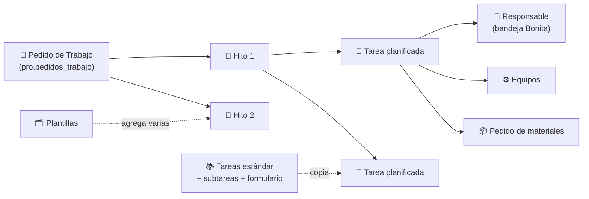
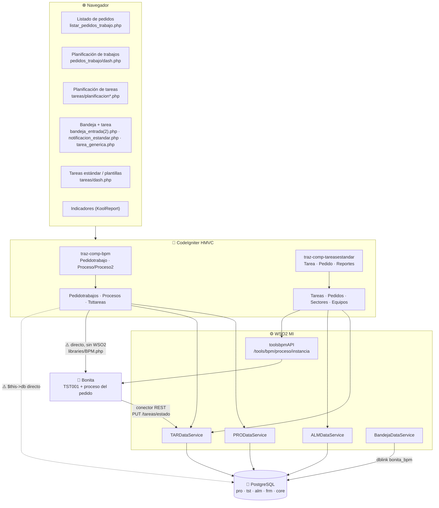
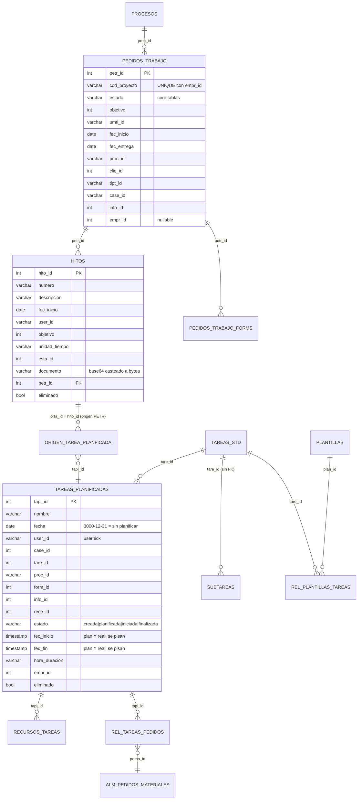
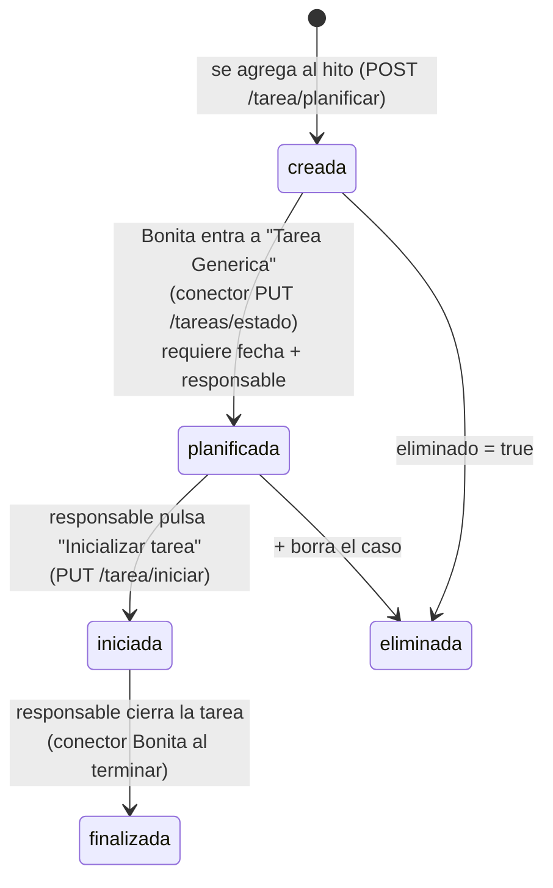
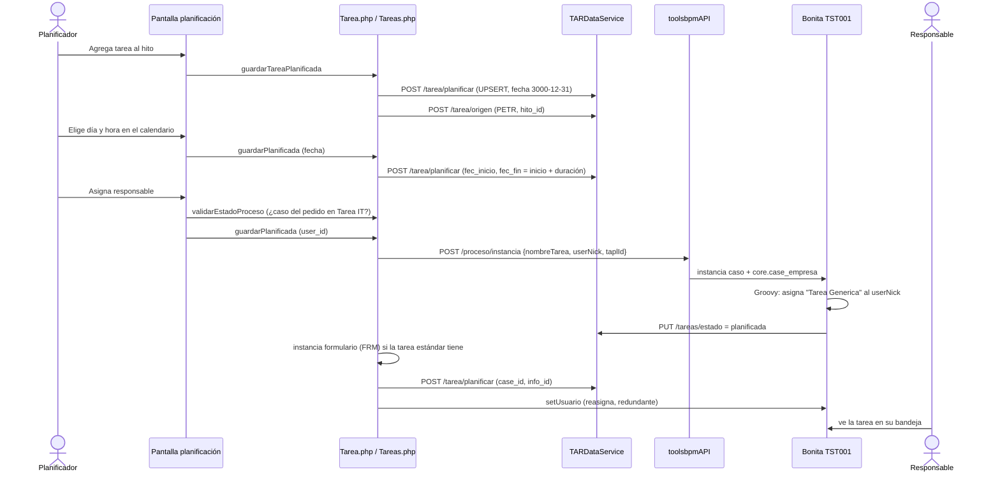
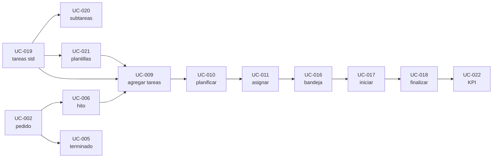

# ✅ Módulo TAR — Tareas: Pedidos de Trabajo, Hitos y Tareas Planificadas

## 🎯 Objetivo

**Qué es.** Especificación deducida desde el código del módulo de Tareas de Trazalog Tools: requerimientos, arquitectura técnica, casos de uso y, para cada caso de uso, sus casos de prueba. Además, una lista de **hipótesis de bug** encontradas al leer el código y las brechas que hay que cerrar para integrar el módulo con un Agente de IA y con KPIs.

**Para quién.** El PM (que valida intención funcional y dudas), DocTest (que convierte los casos de uso en catálogo `doctest/catalogo/tar/TAR-UC-NNN.yaml` y ejecuta las pruebas) y quien después corrija o mejore el módulo.

**Cuándo leerlo.** Antes de cargar el módulo TAR en DocTest, antes de corregir cualquier bug del módulo y antes del workshop de diseño del Agente de IA + KPIs.

**Qué NO cubre.**
- ❌ El proceso de pedido de materiales por dentro (aprobación, entrega): está en el catálogo ALM (`doctest/catalogo/alm/`, ALM-UC-006 y ALM-UC-010).
- ❌ Las tareas planificadas desde Producción (origen `BATCH`/`ETAP`): ver [`PRD-modulo-produccion.md`](PRD-modulo-produccion.md) §9. Acá solo se menciona donde comparten código.
- ❌ Las variantes de cliente del pedido de trabajo (Yudica neumáticos `YUDI-NEUMATICOS`, Sein `SEIN-SERVICIOS-INDUSTRIALES`: impresión de etiquetas QR, estados propios).
- ❌ Decisiones de arquitectura o de producto. La §10 lista **propuestas** para el workshop; ninguna está decidida.

---

## 📇 Metadata

| Campo | Valor |
|---|---|
| **Módulo** | TAR (prefijo de catálogo DocTest `TAR`, ya admitido por `catalogo.schema.json`) |
| **Submódulos PHP** | `traz-comp-bpm` (Pedidos de Trabajo, hitos, bandeja) y `traz-comp-tareasestandar` (prefijo `TST`: tareas estándar, plantillas, subtareas, planificación, pedidos de materiales de la tarea, indicadores) |
| **Esquemas BD** | `pro` (pedidos de trabajo y procesos) y `tst` (hitos y tareas) — PostgreSQL |
| **DataServices** | `TARDataService` (`REST_TST`), `PRODataService` (`REST_PRO`), `ALMDataService` (`REST_ALM`, pedidos de la tarea), `BandejaDataService` (bandeja 2) |
| **API WSO2** | Solo `toolsbpmAPI` `POST /tools/bpm/proceso/instancia` (`REST_API_BPM`) para lanzar el caso de la tarea. **No existe `toolsTARAPI`.** |
| **Bonita** | Proceso `TST001 - Tarea Planificada` v1.0 (`traz-comp-tareasestandar/bpm/`) + el proceso que tenga configurado cada `pro.procesos` para el pedido de trabajo (por defecto `PROCESO-STANDAR`) |
| **MCP** | Nada expuesto. `toolsMCPAPI.xml` no tiene tools de tareas ni de pedidos de trabajo |
| **Fuente del relevamiento** | Código en la rama `feat/bandeja-paginado-real` (submódulos en su HEAD local). Los 6 `.dbs` relevados son iguales a `master` salvo 16 líneas de ALM ajenas al módulo |
| **Fecha** | 2026-10-26 |
| **Verificación en vivo** | ❌ **Ninguna.** No había VPN a la base de TEST. Todo lo que dice este documento sale del código: las hipótesis de bug (§9) **no están confirmadas** y son justamente lo que DocTest tiene que confirmar o descartar |

> ⚠️ **Regla del registro de hallazgos aplicada acá.** Por la lección del 2026-08-25 (`doc/hallazgos/REGISTRO.md`), un hallazgo de interfaz no se registra sin verificarlo contra la pantalla real. Por eso las hipótesis de §9 tienen id propio (`HIP-TAR-NN`) y **no** número `H-NNN`. Pasan al registro cuando un caso de prueba las confirme.

---

## 1. 🧭 Qué resuelve el módulo

Permite manejar **mini-proyectos de trabajo** de forma ágil, sin la estructura de una herramienta de gestión de proyectos:

1. Se crea un **Pedido de Trabajo** (el proyecto): código, cliente, tipo de trabajo, objetivo en tiempo, fechas, descripción y un formulario dinámico opcional según el proceso de la empresa. Al guardarlo se puede lanzar un proceso de Bonita que gobierna su ciclo de vida.
2. El pedido se divide en **Hitos**: entregables o etapas con código, descripción, fecha de inicio, encargado, objetivo, ubicación y un documento adjunto.
3. A cada hito se le agregan **Tareas**: libres (se escribe el nombre), tomadas del catálogo de **tareas estándar** o en bloque desde una **plantilla**.
4. Cada tarea se **planifica** (día y hora en un calendario, duración estándar), se **asigna** a una persona del equipo y se le asignan **recursos**: equipos (recursos de trabajo) y **pedidos de materiales** al almacén (manuales o calculados desde una receta).
5. La tarea asignada **llega a la bandeja** de la persona (caso Bonita TST001). La persona la toma, la **inicia**, completa el checklist de **subtareas** y el **formulario** asociado, y la **finaliza**.
6. El planificador **controla el avance** desde el detalle del pedido (tareas por hito con estado, responsable y fechas) y desde los **indicadores** (tareas planificadas vs finalizadas por usuario, tipo de trabajo y período).

### 1.1 Requerimientos funcionales deducidos

Cada requerimiento dice de qué código se deduce. Los que el código **insinúa pero no termina de implementar** están marcados con ⚠️.

| ID | Requerimiento | Evidencia |
|---|---|---|
| RF-TAR-01 | Crear un pedido de trabajo con código único por empresa (4 a 10 caracteres), cliente activo, tipo de trabajo, objetivo + unidad de tiempo, fecha de inicio (hoy, no editable), fecha de entrega opcional (no anterior al inicio) y descripción | `views/pedido_trabajo.php:26-140`, UNIQUE (`cod_proyecto`, `empr_id`) |
| RF-TAR-02 | El pedido toma el proceso de negocio de la empresa (`pro.procesos`): estado inicial, formulario dinámico, si lanza un caso Bonita y si permite planificar tareas. Si el menú no indica proceso se usa `PROCESO-STANDAR` | `Pedidotrabajo::guardarPedidoTrabajo()`, `PRODataService` GET `/proceso/nombre/...` |
| RF-TAR-03 | Listar pedidos de la empresa, paginado y ordenable, ocultando los finalizados salvo que se pida verlos; buscar por texto; exportar a Excel/PDF/copiar/imprimir | `listar_pedidos_trabajo.php`, `Pedidotrabajo::paginado()` |
| RF-TAR-04 | Ver el detalle de un pedido: trazabilidad del caso, comentarios, estado actual, formulario y tareas planificadas agrupadas por hito | `listar_pedidos_trabajo.php::verPedido()`, `mdl_pedido_detalle.php` |
| RF-TAR-05 | Eliminar un pedido de trabajo (con confirmación) y su caso Bonita | `Pedidotrabajo::eliminarPedidoTrabajo()` |
| RF-TAR-06 | Marcar un pedido como "Trabajo Terminado" cerrando la tarea de Bonita "Ejecuta el Trabajo - Tools Tareas" | `Pedidotrabajo::finalizarTrabajo()`, `lista_pedidos.php:468` |
| RF-TAR-07 | Crear hitos de un pedido con código (4-10), descripción, fecha de inicio, encargado, objetivo + unidad de tiempo, ubicación (establecimiento) y documento adjunto (PDF o imagen) | `form_hito.php`, `Pedidotrabajos::guardarHito()` |
| RF-TAR-08 | ⚠️ Ver un hito (solo lectura). **No hay editar ni eliminar hito** en ninguna capa | `detalle_hito.php`; el DS no tiene UPDATE/DELETE de hitos |
| RF-TAR-09 | Hacer pedidos de materiales a nivel hito | `mdl_hitos.php` (pestaña Pedido Materiales → `ALM notapedido/.../HITOS`) |
| RF-TAR-10 | Agregar tareas a un hito: libre, desde una tarea estándar o todas las de una plantilla | `planificacion_tareas.php` |
| RF-TAR-11 | Planificar una tarea en un calendario: solo fechas de hoy en adelante, hora entre `HORA_INICIO_JORNADA` (10:00) y `HORA_FIN_JORNADA` (18:00) en pasos de 1 h; el fin se calcula con la duración | `planificacion_calendario.php`, `mdl_hora.php`, `Tareas::map()` |
| RF-TAR-12 | Asignar un responsable de la empresa a la tarea. Si el proceso del pedido lo exige, solo se puede asignar cuando el caso del pedido llegó a la tarea "Ejecuta el Trabajo - Tools Tareas" | `modal_asignar_usuario.php`, `Tarea::validarEstadoProceso()` |
| RF-TAR-13 | Cuando una tarea tiene fecha **y** responsable, se lanza el caso Bonita de la tarea y le llega asignada al responsable; si la tarea estándar tiene formulario, se instancia | `Tareas::guardarPlanificada()`, `Tareas::lanzarProceso()` |
| RF-TAR-14 | Reasignar el responsable de una tarea ya lanzada | `Tareas::guardarPlanificada()` (reasigna siempre al guardar) |
| RF-TAR-15 | Asignar equipos (recursos de trabajo) a la tarea, elegidos por sector | `modal_equipos.php`, `Tareas::asignarRecursos()` |
| RF-TAR-16 | Pedir materiales para la tarea: artículo por artículo o calculando cantidades desde la receta de la tarea estándar | `pedidos/detalle.php`, `pedidos/receta.php`, `Pedido::guardar()` |
| RF-TAR-17 | Eliminar una tarea planificada y su caso Bonita | `Tarea::eliminarPlanificada()` |
| RF-TAR-18 | Filtrar el calendario por sector y equipo | `planificacion_calendario.php::agregarFiltro()` |
| RF-TAR-19 | El responsable ve la tarea en su bandeja con su origen, estado, asignado y fecha; la toma o la suelta | `Tsttareas::map()`, `Proceso::tomarTarea()/soltarTarea()` |
| RF-TAR-20 | El responsable inicia la tarea (registra inicio real); hasta iniciarla no puede trabajar en ella | `notificacion_estandar.php::IniciarTarea()`, `tarea_generica.php` |
| RF-TAR-21 | El responsable solo puede finalizar con todas las subtareas tildadas; completa el formulario de la tarea y de cada subtarea; al finalizar se cierra el caso | `tarea_generica.php::cerrarTarea()` |
| RF-TAR-22 | Comentar en el caso y ver su trazabilidad | `notificacion_estandar.php`, `Proceso::guardarComentario()` |
| RF-TAR-23 | ABM de tareas estándar: nombre, descripción, duración estándar `HH:MM`, formulario, receta y proceso asociados | `views/tareas/form.php`, `Tarea::guardar()` |
| RF-TAR-24 | ABM de subtareas de una tarea estándar (nombre, duración, descripción, formulario) | `views/tareas/subtareas.php` |
| RF-TAR-25 | ABM de plantillas y asociación de tareas estándar a una plantilla | `views/tareas/plantillas.php` |
| RF-TAR-26 | Indicadores: por período, tipo de trabajo, estado y usuario, cantidad de tareas planificadas y finalizadas, con detalle por pedido y hito | `Reportes::indicadores()`, `TARDataService` `getKpiBasico` |
| RF-TAR-27 | ⚠️ Medir el avance del pedido contra su objetivo en tiempo. El pedido y el hito guardan `objetivo` + unidad de tiempo, pero **nada lo usa**: no hay cálculo de avance ni de desvío | `pro.pedidos_trabajo.objetivo`, `tst.hitos.objetivo` |

### 1.2 Requerimientos no funcionales deducidos

| ID | Requerimiento | Estado hoy |
|---|---|---|
| RNF-TAR-01 | Aislamiento entre empresas | ⚠️ Solo los listados filtran `empr_id`; las operaciones por id no (ver HIP-TAR-02) |
| RNF-TAR-02 | La lógica de negocio vive en las APIs (CLAUDE.md) | ❌ La orquestación está toda en PHP (controllers y models), con 5-7 llamadas sueltas por operación y sin transacción |
| RNF-TAR-03 | Sin consultas directas a BD desde PHP | ❌ `Pedidotrabajos::obtener()`, los paginados y `Tareas::obtenerform()` usan `$this->db` |
| RNF-TAR-04 | Consistencia ante fallas parciales | ❌ No hay rollback: si falla Bonita después de guardar la tarea, queda guardada sin caso (y viceversa) |

---

## 2. 📖 Glosario

| Término | Qué es | Dónde vive |
|---|---|---|
| **Pedido de Trabajo** (PT, "proyecto", "OT" en algunas pantallas) | El mini-proyecto | `pro.pedidos_trabajo` (`petr_id`) |
| **Proceso** | Configuración de negocio del pedido por empresa: proceso Bonita, formulario, si lanza caso, si permite planificar, estado inicial y final | `pro.procesos` (`proc_id` es un nombre, ej. `PROCESO-STANDAR`) |
| **Hito** | Etapa o entregable del pedido | `tst.hitos` (`hito_id`, FK `petr_id`) |
| **Tarea estándar** | Tarea del catálogo, reutilizable | `tst.tareas_std` (`tare_id`) |
| **Subtarea** | Paso de checklist de una tarea estándar | `tst.subtareas` (`suta_id`) |
| **Plantilla** | Conjunto de tareas estándar que se agregan juntas | `tst.plantillas` + `tst.rel_plantillas_tareas` |
| **Tarea planificada** | Instancia de una tarea dentro de un hito (o de un lote de producción) | `tst.tareas_planificadas` (`tapl_id`) |
| **Origen** | De dónde cuelga la tarea: `PETR` (hito de pedido de trabajo — **`orta_id` es el `hito_id`, no el `petr_id`**), `BATCH`, `ETAP` (producción) | `tst.origen_tarea_planficada` (sic) |
| **Recurso de trabajo** | Equipo asignado a la tarea | `tst.recursos_tareas` → `prd.recursos` → `core.equipos` |
| **Pedido de materiales de la tarea** | Nota de pedido al almacén asociada a la tarea | `alm.alm_pedidos_materiales` + `tst.rel_tareas_pedidos` |
| **Tarea IT** | Tarea Bonita del proceso del pedido llamada `Ejecuta el Trabajo - Tools Tareas` (`TAREA_IT`): mientras el caso no llegue ahí no se asignan responsables | `constants.php:214` |
| **Fecha centinela** | `3000-12-31` = "sin planificar" | `Tareas::map()` |

---

## 3. 👥 Actores

El catálogo de DocTest tiene vocabulario cerrado de perfiles (`doctest/catalogo/SCHEMA.md`). Mapeo propuesto:

| Actor del módulo | Perfil DocTest | Estado |
|---|---|---|
| Quien crea pedidos, hitos y planifica/asigna tareas | `Planificador` (el SCHEMA ya menciona *Planificador de Tareas*) | ✅ existe |
| Quien recibe y ejecuta la tarea desde la bandeja | **Sin perfil adecuado.** `Mantenedor` está definido para órdenes de trabajo de Mantenimiento | ❓ duda D-01 |
| Quien consulta indicadores | `Supervisor` o `Planificador` | ❓ duda D-02 |
| Quien administra el catálogo de tareas estándar y plantillas | `Planificador` | ❓ duda D-03 |

El código **no restringe por rol** ninguna de estas pantallas más allá del menú: cualquier usuario con el menú entra, y cualquier usuario de la empresa aparece como asignable.

---

## 4. 🏗️ Arquitectura técnica

### 4.1 Componentes

### 4.2 Pantallas y puntos de entrada

| Pantalla | URL (relativa a Tools) | Controller |
|---|---|---|
| Listado de Pedidos de Trabajo | `traz-comp-bpm/Pedidotrabajo?proccessname=<proc_id>` — el parámetro queda en sesión y condiciona todo lo demás | `Pedidotrabajo::index()` |
| Alta de pedido (modal) | `traz-comp-bpm/Pedidotrabajo/view_pedido` | `view_pedido()` |
| Planificación de Trabajos (Pedidos → Hitos → Tareas) | `traz-comp-bpm/Pedidotrabajo/dash` | `dash()`, `pedidosTrabajos()`, `hitos()`, `hito()` |
| Planificación de tareas de un hito | `traz-comp-tareasestandar/tarea/planificar/PETR/<hito_id>` (componente embebido) | `Tarea::planificar()` |
| Tareas estándar y plantillas | `traz-comp-tareasestandar/Tarea` | `Tarea::index()` |
| Indicadores | `traz-comp-tareasestandar/Reportes/indicadores` | `Reportes::indicadores()` |
| Bandeja / Bandeja 2 | `traz-comp-bpm/Proceso` · `traz-comp-bpm/Proceso2` | `Proceso::index()`, `detalleTarea()` |

Los nombres de menú no están en el repo (viven en `seg.menues` de la base) → duda D-04.

### 4.3 Modelo de datos

> ⚠️ El repo no tiene el DDL vigente: `usuario_app`, `fec_alta`, `hora`, `hitos.nombre_documento` e `int_pedi_id` aparecen en los `.dbs` y no en ningún script ni en el dump `traz_tools_v1.5.8.5.dmp`. El schema real solo está en la base viva → antes de corregir algo, relevarlo contra TEST.

### 4.4 Estados

**Tarea planificada** (`tst.tareas_planificadas.estado`):

En pantalla de planificación además se muestran `solicitado`, `aprobado` y `rechazado` (`planificacion_tareas.php:133-154`), que **ningún código de este módulo escribe** → duda D-05.

**Pedido de trabajo**: el estado inicial sale de `pro.procesos.esin_id`; "Trabajo Terminado" es `estados_procesosTRABAJO_TERMINADO`; el final sale de `pro.procesos.esfi_id` (default `estados_procesosFINALIZADO`). El resto de los estados (`estados_sein*`, `estados_yudica*`) los mueve el proceso Bonita de cada cliente.

### 4.5 Secuencia: asignar una tarea y que llegue a la bandeja

Puntos frágiles de esta secuencia: ocho llamadas sin transacción; si cualquier paso falla después de instanciar el caso, queda un caso Bonita sin `case_id` guardado en la tarea (no aparece en la planificación pero sí en la bandeja).

### 4.6 Integraciones con otros módulos

| Módulo | Punto de contacto |
|---|---|
| **BPM / Bandeja** | Caso TST001; bandeja mapea el proceso `BPM_PROCESS_ID_TAREA_GENERICA` al model `Tsttareas` (`constants.php:171`); bandeja 2 lee `tst.tareas_planificadas` por `case_id` |
| **ALM** | Pedido de materiales de la tarea (`REST_ALM /pedidos`, `/pedidos/tareas`) y del hito (`notapedido/.../HITOS`, mecanismo distinto: `alm.origen_pedido_materiales`); al crearlo lanza el proceso de pedidos y, si `PLANIF_AVANZA_TAREA`, lo auto-aprueba |
| **FRM** | Formulario dinámico del pedido (`info_id`), de la tarea (se instancia al lanzar el caso) y de cada subtarea |
| **PRD** | Receta de la tarea estándar (`rece_id` → `prd.formulas`); recursos (`prd.recursos`); mismas tablas `tst` usadas por lotes (origen `BATCH`/`ETAP`) |
| **CORE** | Clientes, usuarios de la empresa (`/users/{empr_id}`), sectores/equipos, `core.tablas` (tipos de trabajo, unidades de tiempo, estados) |

---

## 5. 🗂️ Mapa de casos de uso

| ID | Caso de uso | Perfil propuesto | RF |
|---|---|---|---|
| TAR-UC-001 | Listar y buscar pedidos de trabajo | Planificador | 03 |
| TAR-UC-002 | Crear un pedido de trabajo | Planificador | 01, 02 |
| TAR-UC-003 | Ver el detalle de un pedido de trabajo | Planificador | 04 |
| TAR-UC-004 | Eliminar un pedido de trabajo | Planificador | 05 |
| TAR-UC-005 | Marcar un pedido como Trabajo Terminado | Planificador | 06 |
| TAR-UC-006 | Crear un hito | Planificador | 07 |
| TAR-UC-007 | Consultar un hito | Planificador | 08 |
| TAR-UC-008 | Pedir materiales para un hito | Planificador | 09 |
| TAR-UC-009 | Agregar tareas a un hito | Planificador | 10 |
| TAR-UC-010 | Planificar fecha y hora de una tarea | Planificador | 11 |
| TAR-UC-011 | Asignar o reasignar el responsable de una tarea | Planificador | 12, 13, 14 |
| TAR-UC-012 | Asignar equipos a una tarea | Planificador | 15 |
| TAR-UC-013 | Pedir materiales para una tarea | Planificador | 16 |
| TAR-UC-014 | Eliminar una tarea planificada | Planificador | 17 |
| TAR-UC-015 | Filtrar el calendario por sector y equipo | Planificador | 18 |
| TAR-UC-016 | Recibir, tomar y soltar una tarea en la bandeja | ❓ D-01 | 19, 22 |
| TAR-UC-017 | Iniciar una tarea | ❓ D-01 | 20 |
| TAR-UC-018 | Ejecutar y finalizar una tarea | ❓ D-01 | 21 |
| TAR-UC-019 | Administrar tareas estándar | Planificador | 23 |
| TAR-UC-020 | Administrar subtareas | Planificador | 24 |
| TAR-UC-021 | Administrar plantillas | Planificador | 25 |
| TAR-UC-022 | Consultar indicadores de tareas | ❓ D-02 | 26 |

Dependencias para armar los datos de prueba (orden de ejecución):

---

## 6. 📋 Casos de uso

Formato alineado con `doctest/catalogo/SCHEMA.md` para que DocTest los pase a YAML sin reinterpretar: perfil, pantallas, precondiciones, flujo principal (paso → resultado), flujos alternativos, validaciones, referencias de código y dudas. **Todos nacen `borrador`** (relevados desde código, sin validar por el PM).

### TAR-UC-001 — Listar y buscar pedidos de trabajo

- **Perfil:** Planificador · **Pantalla:** Listado de Pedido Trabajo
- **Precondiciones:** sesión iniciada; el menú abre la pantalla con `proccessname` del proceso de la empresa; existen pedidos en distintos estados.
- **Flujo principal:**
  1. Entra al listado → se ven los pedidos **no finalizados** de su empresa, 10 por página, del más nuevo al más viejo, con N° de pedido, código, cliente, domicilio, tipo de trabajo, fecha de inicio y estado.
  2. Escribe en el buscador → la tabla se recarga con los que coinciden.
  3. Ordena por una columna → la tabla se ordena por esa columna.
  4. Activa "Mostrar Pedidos Terminados" → aparecen también los finalizados.
  5. Exporta a Excel / PDF / copia / imprime → sale el listado con las columnas 1 a 6.
- **Flujos alternativos:** la empresa no tiene pedidos → la tabla muestra "sin datos" (ver HIP-TAR-10).
- **Validaciones:** solo pedidos de la empresa de la sesión; el estado se muestra con etiqueta de color.
- **Referencias:** `traz-comp-bpm/controllers/Pedidotrabajo.php::index(), paginado()`, `models/Pedidotrabajos.php::pedidosTrabajoPaginados(), pedidosTrabajoFinalizadosPaginados()`, `views/listar_pedidos_trabajo.php`, `PRODataService` `/pedidoTrabajoPaginadoAscV2|DscV2`, `/pedidoTrabajoNoFinalizado`.
- **Dudas:** D-04 (menú), D-06 (qué es "finalizado": ¿`TRABAJO_TERMINADO` cuenta como terminado para el toggle?).

### TAR-UC-002 — Crear un pedido de trabajo

- **Perfil:** Planificador · **Pantalla:** Listado → Agregar (modal) · también "Nuevo Pedido Trabajo" en Planificación de Trabajos
- **Precondiciones:** existen clientes ACTIVOS, tipos de trabajo (`tipos_pedidos_trabajo`) y unidades de tiempo para la empresa; existe `pro.procesos` para la empresa (el indicado en el menú o `PROCESO-STANDAR`).
- **Flujo principal:**
  1. Pulsa "Agregar" → se abre el formulario; fecha de inicio = hoy y no editable.
  2. Completa código (4-10), objetivo + unidad, cliente (se autocompleta la dirección de entrega), fecha de entrega, tipo de trabajo y descripción; si el proceso tiene formulario dinámico, lo completa.
  3. Pulsa "Guardar" → el pedido queda creado en el estado inicial del proceso, con el formulario guardado.
  4. Si el proceso lanza BPM → se crea el caso Bonita y el pedido guarda su `case_id`.
  5. El pedido aparece en el listado.
- **Flujos alternativos:**
  - Falta un obligatorio → "Debes completar los campos obligatorios (*)", no se guarda.
  - Objetivo sin unidad de tiempo → "Si completo objetivo, seleccione medida de tiempo".
  - Fecha de entrega anterior al inicio → error y se borra la fecha.
  - Código repetido en la empresa → no se guarda (UNIQUE) — mensaje "No se Guardo Pedido de Trabajo".
  - Falla el lanzamiento del caso Bonita → el pedido se elimina (intención del código; ver HIP-TAR-07).
- **Validaciones:** código único por empresa; fechas coherentes; el pedido queda con `empr_id` y `usuario_app` de la sesión.
- **Referencias:** `Pedidotrabajo::guardarPedidoTrabajo(), BonitaProccess(), ActualizarCaseId()`, `views/pedido_trabajo.php::cierraPedidoTrabajo(), guardarPedidoTrabajo()`, `PRODataService` POST/PUT `/pedidoTrabajo`, `libraries/BPM.php::lanzarProceso()`.
- **Dudas:** D-07 (¿qué ve el usuario al guardar con el proceso estándar? el código solo da feedback para Sein y Yudica — HIP-TAR-09).

### TAR-UC-003 — Ver el detalle de un pedido de trabajo

- **Perfil:** Planificador · **Pantalla:** Listado → lupa "Ver Pedido"
- **Precondiciones:** pedido con caso Bonita, al menos un hito con tareas.
- **Flujo principal:**
  1. Pulsa la lupa → se abre el detalle con pestañas Trazabilidad, Comentarios, Información, Formulario y Tareas Planificadas, y una cabecera.
  2. Abre "Tareas Planificadas" → ve los hitos (código - descripción); al expandir uno, sus tareas con nombre, descripción, estado, asignado, fecha de asignación, fecha de fin, case y duración.
  3. En una tarea pulsa "Pedido de Materiales: Ver detalle" → ve los pedidos de la tarea y la receta.
  4. Pulsa "Formulario Asociado: Ver detalle" → ve el formulario completado o "Aún no se completó formulario asociado!".
- **Flujos alternativos:** pedido sin hitos → "No se crearon hitos para este pedido de trabajo."; hito sin tareas → "No se planificaron tareas para este hito."
- **Referencias:** `listar_pedidos_trabajo.php::verPedido(), verDetallePedido(), showForm()`, `Pedidotrabajo::cargar_detalle_*()`, `tbl_tareas_planificadas.php`.

### TAR-UC-004 — Eliminar un pedido de trabajo

- **Perfil:** Planificador · **Pantalla:** Listado → tacho
- **Flujo principal:**
  1. Pulsa el tacho → "Estas Seguro? Esta accion no puede ser revertida!".
  2. Confirma → el pedido deja de verse en el listado y su caso Bonita se elimina; mensaje "Se Elimino Pedido Correctamente!".
- **Flujos alternativos:** cancela → "Cancelado", nada cambia.
- **Validaciones:** borrado lógico del pedido; borrado del caso.
- **Referencias:** `Pedidotrabajo::eliminarPedidoTrabajo()`, `PRODataService` DELETE `/pedidoTrabajo`.
- **Dudas:** D-08 (¿qué pasa con hitos, tareas planificadas y sus casos TST001 en bandejas? hoy no se tocan — HIP-TAR-08).

### TAR-UC-005 — Marcar un pedido como Trabajo Terminado

- **Perfil:** Planificador · **Pantalla:** Planificación de Trabajos → menú ⋮ del pedido → "Trabajo Terminado"
- **Precondiciones:** pedido cuyo caso está parado en la tarea "Ejecuta el Trabajo - Tools Tareas".
- **Flujo principal:** pulsa "Trabajo Terminado" → se cierra esa tarea en Bonita a nombre del usuario, el pedido pasa a `TRABAJO_TERMINADO` y se ve atenuado como "Finalizado".
- **Flujos alternativos:** el caso no está en la Tarea IT → `"El case especificado no se encuentra en el paso de la TAREA IT"`, nada cambia.
- **Referencias:** `Pedidotrabajo::finalizarTrabajo()`, `pedidos_trabajo/lista_pedidos.php::finalizarTrabajo()`.
- **Dudas:** D-09 (¿terminar un pedido con tareas sin finalizar debería impedirse o advertirse? hoy no se valida).

### TAR-UC-006 — Crear un hito

- **Perfil:** Planificador · **Pantalla:** Planificación de Trabajos → elegir pedido → "Nuevo Hito"
- **Flujo principal:**
  1. Elige un pedido → la columna Hitos muestra los suyos.
  2. Pulsa "Nuevo Hito" → modal con código (4-10), descripción, fecha de inicio, documento adjunto, encargado, objetivo, unidad de tiempo y ubicación.
  3. Completa y guarda → el hito aparece en la lista del pedido.
- **Flujos alternativos:** falta un obligatorio → no se envía.
- **Validaciones:** el hito queda colgado del pedido elegido; el documento se guarda con su nombre.
- **Referencias:** `Pedidotrabajo::hitos($petrId)`, `Pedidotrabajos::guardarHito(), mapHito()`, `form_hito.php`, `TARDataService` POST `/hitos`.
- **Dudas:** D-10 (¿código de hito único dentro del pedido? hoy no se valida); D-11 (el "Encargado" guarda el id de usuario y las tareas guardan el usernick: ¿el encargado del hito tiene algún efecto?).

### TAR-UC-007 — Consultar un hito

- **Pantalla:** Planificación de Trabajos → ⋮ del hito → "Ver Detalle" · **Flujo:** se abre el formulario del hito en solo lectura con los datos guardados; se cargan las tareas del hito y sus pedidos de materiales.
- **Referencias:** `Pedidotrabajo::hito($id)`, `detalle_hito.php`, `lista_hitos.php::selectHito()`.
- **Dudas:** D-12 (¿hace falta editar/eliminar hitos? no existe — RF-TAR-08).

### TAR-UC-008 — Pedir materiales para un hito

- **Pantalla:** modal del hito → pestaña "Pedido Materiales" → "Nuevo Pedido"
- **Flujo:** con un hito seleccionado agrega artículos y cantidades y guarda → el pedido queda asociado al hito (origen `HITOS`) y aparece en la lista.
- **Alternativo:** sin hito seleccionado → "Para crear pedidos debes crear o seleccionar un hito antes".
- **Referencias:** `mdl_hitos.php`, `traz-comp-almacenes/controllers/Notapedido.php::obtenerXOrigen(), nuevo()`.
- **Dudas:** D-13 (¿por qué hay dos lugares para pedir materiales —hito y tarea— con mecanismos de asociación distintos? ¿se mantienen los dos?).

### TAR-UC-009 — Agregar tareas a un hito

- **Pantalla:** Planificación de Trabajos → elegir hito → pestaña "Planificación Tareas"
- **Flujo principal:**
  1. Elige un hito → se carga la planificación con la lista de tareas estándar y las plantillas.
  2. Escribe un nombre en "Nueva Tarea" y pulsa + → aparece en Tareas Planificadas con "Se planificó la tarea correctamente!", estado `creada`, sin fecha.
  3. Pulsa + en una tarea estándar → se agrega con su nombre, descripción, duración, formulario, receta y proceso.
  4. Elige una plantilla → la lista se filtra a sus tareas; "Agregar Todas" las agrega todas.
- **Validaciones:** la tarea queda con origen `PETR` y el `hito_id`; nombre obligatorio; una tarea libre toma el proceso `TST001`.
- **Referencias:** `Tarea::planificar(), guardarTareaPlanificada()`, `planificacion_tareas.php::agregarTareaPlanificada(), agregarTareas()`, `Tareas::guardarTareaPlanificada(), asignarOrigen()`.

### TAR-UC-010 — Planificar fecha y hora de una tarea

- **Pantalla:** pestaña "Calendario" → 📅 en la tarea
- **Flujo principal:**
  1. Pulsa 📅 → el foco va al calendario.
  2. Hace clic en un día de hoy en adelante → pide la hora (entre 10:00 y 18:00).
  3. Elige la hora y pulsa "Planificar" → la tarea muestra la fecha, queda en el calendario de inicio a inicio + duración.
- **Flujos alternativos:** día anterior a hoy → "No se puede seleccionar fechas anteriores a la actual!".
- **Validaciones:** fin = inicio + duración estándar; si ya tiene responsable, esta acción lanza el caso (UC-011).
- **Referencias:** `planificacion_calendario.php::clickCalendario()`, `mdl_hora.php::planificarTarea()`, `Tareas::map()`.
- **Dudas:** D-14 (¿la jornada 10-18 es correcta para minería, con turnos 24x7? está fija en `constants.php`).

### TAR-UC-011 — Asignar o reasignar el responsable de una tarea

- **Pantalla:** pestaña Calendario → 👤 en la tarea
- **Flujo principal:**
  1. Pulsa 👤 → lista de usuarios de la empresa.
  2. Elige uno → si el proceso del pedido lo exige, se verifica que el caso esté en la Tarea IT; pregunta "Desea asignar la tarea a: <usernick>".
  3. Confirma → la tarea muestra el nombre del responsable. Si ya tiene fecha, se crea el caso Bonita, se instancia el formulario y la tarea queda `planificada` en la bandeja del responsable.
  4. Reasignar a otra persona → la tarea pasa a la bandeja del nuevo responsable y sale de la del anterior.
- **Flujos alternativos:** el caso del pedido no llegó a la Tarea IT → aviso "El case especificado no alcanzó o finalizó la tarea IT", no se asigna; sin fecha → se guarda el responsable pero no se lanza el caso.
- **Referencias:** `modal_asignar_usuario.php`, `Tarea::validarEstadoProceso(), guardarPlanificada()`, `Tareas::guardarPlanificada(), lanzarProceso()`, Bonita TST001 (`setTaskByUserNick`).
- **Dudas:** D-15 (¿se puede asignar a cualquiera de la empresa o solo a ciertos roles?).

### TAR-UC-012 — Asignar equipos a una tarea

- **Pantalla:** ⚙️ "Rec.Trabajo" en la tarea · **Flujo:** elige sector → se ofrecen sus equipos; elige uno o varios y guarda → la tarea queda con esos equipos; al reabrir se ven precargados. Quitar todos y guardar → la tarea queda sin equipos.
- **Referencias:** `modal_equipos.php`, `Tareas::asignarRecursos(), eliminarRecursos()`, `TARDataService` `/tarea/recursos`, `/sectores`.

### TAR-UC-013 — Pedir materiales para una tarea

- **Pantalla:** ☑ "Rec. Materiales" en la tarea
- **Flujo principal (manual):** "Nuevo Pedido" → agrega artículo + cantidad (varios) → "Realizar Pedido" → el pedido aparece en "Pedidos Tarea" con N°, fecha, case y estado; se lanza el proceso de pedido de materiales.
- **Flujo alternativo (receta):** pestaña "Receta Asociada" → indica cantidad a aplicar → "Calcular" (cantidad artículo × aplicar ÷ cantidad fórmula) → "Realizar Pedido".
- **Otros alternativos:** sin artículo → "Debes seleccionar un artículo"; sin cantidad → "Ingrese una cantidad válida"; sin ítems → "No se agrego ningún artículo al pedido".
- **Validaciones:** el pedido queda asociado a la tarea (`tst.rel_tareas_pedidos`) y a la empresa; si `PLANIF_AVANZA_TAREA` está activo, el pedido se auto-aprueba.
- **Referencias:** `pedidos/pedidos_tarea.php, detalle.php, receta.php`, `Pedido::guardar()`, `Pedidos::guardar(), asociarTarea(), lanzarPedidoEtapa(), aceptarPedidoMateriales()`.
- **Dudas:** D-16 (¿es correcto que el pedido de la tarea se auto-apruebe? saltea al aprobador de ALM).

### TAR-UC-014 — Eliminar una tarea planificada

- **Flujo:** pulsa 🗑 en la tarea y confirma → la tarea desaparece de la lista y del calendario; si tenía caso, el caso se borra y sale de la bandeja del responsable.
- **Alternativo:** tarea todavía sin id (no terminó de guardarse) → "La tarea seleccionada no posee ID".
- **Referencias:** `planificacion_tareas.php::eliminarTarea()`, `Tarea::eliminarPlanificada()`.
- **Dudas:** D-17 (¿se puede eliminar una tarea iniciada o finalizada? hoy sí; ¿y sus pedidos de materiales?).

### TAR-UC-015 — Filtrar el calendario por sector y equipo

- **Flujo:** elige sector y equipo y pulsa 🏷 → aparece el filtro y el calendario muestra solo las tareas con ese equipo; quitar el filtro restaura la vista. Sin sector → "No se seleccionó un sector."
- **Referencias:** `planificacion_calendario.php::agregarFiltro()`, `TARDataService` `/tareas/eventos/empresa/{empr_id}?rec_id_list=`.

### TAR-UC-016 — Recibir, tomar y soltar una tarea en la bandeja

- **Perfil:** ❓ (D-01) · **Pantalla:** Bandeja de entrada (Mis Tareas) o Bandeja 2
- **Flujo principal:**
  1. Entra a la bandeja → ve la tarea "Tarea Planificada | <nombre de la tarea>" con etiquetas Estado, Origen: Pedido de trabajo, Id, Nro Pedido, Asignado y Fecha.
  2. La abre → cabecera "Detalles Tarea", pestañas Acciones, Comentarios, Trazabilidad, Información.
  3. Si no está tomada → "Tomar tarea"; al tomarla aparece "Inicializar tarea".
  4. "Soltar tarea" → vuelve a quedar sin tomar y bloqueada.
  5. En Comentarios escribe y guarda → el comentario aparece arriba.
- **Validaciones:** la tarea solo se ve en la bandeja de la empresa del caso.
- **Referencias:** `Procesos::map()`, `Tsttareas::map(), desplegarCabecera(), desplegarVista()`, `Proceso::detalleTarea(), tomarTarea(), soltarTarea(), guardarComentario()`, `scripts/tarea_std.php`, `BandejaDataService`.

### TAR-UC-017 — Iniciar una tarea

- **Flujo:** con la tarea tomada pulsa "Inicializar tarea" → "Se inicio la tarea correctamente!", la vista se habilita, aparecen el checklist de subtareas y el formulario; la tarea pasa a `iniciada` con la fecha/hora real de inicio.
- **Referencias:** `notificacion_estandar.php::IniciarTarea()`, `Tarea::iniciarTareaPlanificada()`, `TARDataService` PUT `/tarea/iniciar`.

### TAR-UC-018 — Ejecutar y finalizar una tarea

- **Flujo principal:**
  1. Tilda todas las subtareas; abre y completa el formulario de cada una que lo tenga.
  2. Completa el formulario de la tarea.
  3. Pulsa "Finalizar tarea" → se cierra el caso, la tarea pasa a `finalizada` y sale de la bandeja.
- **Alternativo:** queda una subtarea sin tildar → "No se marcaron como finalizadas todas las subtareas!", no se cierra.
- **Validaciones:** la tarea queda con fecha/hora real de fin; el planificador la ve `finalizada` en el detalle del pedido (UC-003).
- **Referencias:** `tarea_generica.php::cerrarTarea(), validarTareasFinalizadas(), closeTask()`, `notificacion_estandar.php::CerrarTarea()`, `Proceso::cerrarTarea()`, conector Bonita al terminar.
- **Dudas:** D-18 (¿el formulario de la tarea es obligatorio para finalizar? hoy no se valida).

### TAR-UC-019 — Administrar tareas estándar

- **Pantalla:** Tareas estándar → pestaña Tareas
- **Flujo:** "Agregar" → nombre, descripción, duración `HH:MM`, formulario, receta, proceso → Guardar → aparece en la lista; "Editar" cambia los datos; "Eliminar" con confirmación la saca de la lista (borrado lógico).
- **Alternativos:** sin nombre o sin duración → "Falta completar campos obligatorios".
- **Validaciones:** las tareas son de la empresa; editarla no cambia las tareas ya planificadas (se copian).
- **Referencias:** `Tarea::index(), guardar(), eliminar()`, `Tareas::guardar(), editar(), eliminar()`, `views/tareas/dash.php, form.php, tabla.php`.

### TAR-UC-020 — Administrar subtareas

- **Flujo:** en una tarea → "Agregar Subtarea" → nombre, duración, descripción (+ formulario) → aparece en la lista de subtareas; 🗑 la elimina. Sin nombre → no se guarda.
- **Referencias:** `views/tareas/subtareas.php`, `Tarea::guardarSubtarea(), tablaSubtareas(), eliminarSubtarea()`.

### TAR-UC-021 — Administrar plantillas

- **Flujo:** pestaña Plantillas → crear con nombre; editar el nombre; eliminar; abrir una → "Asociar Tarea" elige tareas estándar (las ya asociadas no se ofrecen) → se agregan a la plantilla; 🗑 las desasocia.
- **Referencias:** `views/tareas/plantillas.php, tabla_plantillas.php, tabla_tareas_plantilla.php`, `Tarea::guardarPlantilla(), asociarTareaPlantilla(), eliminarTareaPlantilla(), eliminarPlantilla()`.

### TAR-UC-022 — Consultar indicadores de tareas

- **Perfil:** ❓ (D-02) · **Pantalla:** Indicadores de tareas
- **Flujo:** elige fecha desde/hasta (obligatorias) y opcionalmente tipo de trabajo, estado y usuario → ve un gráfico de tareas planificadas vs finalizadas por usuario y una tabla con fecha, tipo de trabajo, orden de trabajo, hito, asignado, fecha de asignación y estado; exporta.
- **Validaciones:** solo tareas de pedidos de trabajo (origen `PETR`) de la empresa.
- **Referencias:** `Reportes::obtenerFiltros(), indicadores()`, `reports/Indicadores.php, Indicadores.view.php`, `TARDataService` `getKpiBasico`.
- **Dudas:** D-19 (¿qué debería medir "Indicador de Eficiencia"? hoy son dos conteos — y ver HIP-TAR-03).

---

## 7. 🧪 Casos de prueba

### 7.1 Datos semilla necesarios

Todo se prepara en **TEST o local**, nunca en producción. Dónde se hace cada cosa:

| # | Dato | Dónde se crea |
|---|---|---|
| S1 | Empresa A de test con proceso `PROCESO-STANDAR` (lanza BPM y permite planificar) | 🌐 Navegador (registración, DNATO) + verificar `pro.procesos` con 🖥️ psql en PC con VPN |
| S2 | Empresa B de test (para aislamiento), con al menos un pedido, hito y tarea | ídem |
| S3 | En A: usuario Planificador `plan.a` y dos responsables `oper1.a`, `oper2.a` | 🌐 Navegador, administración de usuarios |
| S4 | En A: 2 clientes ACTIVOS, 2 tipos de trabajo, unidades de tiempo | 🌐 Navegador, ABM de clientes y Lista de Valores |
| S5 | En A: tarea estándar `TS-Inspección` (duración 02:00, 3 subtareas, una con formulario, formulario propio y receta) y `TS-Limpieza` (01:00, sin subtareas) | 🌐 Navegador, UC-019/020 |
| S6 | En A: plantilla `PL-Parada` con las dos tareas | 🌐 Navegador, UC-021 |
| S7 | En A: un sector con 2 equipos | 🌐 Navegador, Mantenimiento/Core |
| S8 | En A: artículos con stock en un depósito | 🌐 Navegador, ALM |
| S9 | **Al menos 11 hitos creados en total en la base** para garantizar un `hito_id` que contenga un 0 (10, 20, 100…) — necesario para HIP-TAR-01 | 🌐 Navegador (UC-006) + 🖥️ psql para confirmar el id |

### 7.2 Convenciones

- **Tipo:** ✅ positivo · ❌ negativo/validación · 🔀 borde · 🔒 aislamiento entre empresas · 🔁 consistencia entre sistemas (Tools ↔ Bonita ↔ BD).
- **Dónde:** 🌐 navegador en Tools · 🖥️ PC con VPN (psql contra la base de TEST, o curl al DataService) · 🔄 consola de Bonita.
- **HIP:** hipótesis de bug de §9 que el caso confirma o descarta. Si el caso pasa, la hipótesis se descarta.

### 7.3 TAR-UC-001 — Listar y buscar pedidos

| ID | Tipo | Escenario y pasos | Resultado esperado | HIP |
|---|---|---|---|---|
| TAR-CP-001-01 | ✅ | 🌐 Con 12 pedidos no finalizados, abrir el listado | 10 filas, paginador con 2 páginas, orden descendente por N° | — |
| TAR-CP-001-02 | ✅ | 🌐 Ir a la página 2 | 2 filas; el "Mostrando x de N" coincide con el total real | HIP-TAR-10 |
| TAR-CP-001-03 | ✅ | 🌐 Buscar por parte del código de un pedido | Solo ese pedido | — |
| TAR-CP-001-04 | 🔀 | 🌐 Buscar un texto con `/`, `%`, espacio o tilde (`ab/c`, `50%`, `Peña Sur`) | Filtra sin error | HIP-TAR-10 |
| TAR-CP-001-05 | 🔀 | 🌐 Empresa sin pedidos: abrir el listado | Tabla vacía con mensaje "sin datos", sin error de consola | HIP-TAR-10 |
| TAR-CP-001-06 | ✅ | 🌐 Activar "Mostrar Pedidos Terminados" | Aparecen los finalizados además de los otros; el paginado sigue funcionando | HIP-TAR-10 |
| TAR-CP-001-07 | ✅ | 🌐 Ordenar por cada columna asc/desc | Orden correcto en cada caso | — |
| TAR-CP-001-08 | 🔒 | 🌐 Logueado en A | No aparece ningún pedido de B (por código ni por N°) | — |
| TAR-CP-001-09 | ✅ | 🌐 Exportar a Excel y PDF | Archivo con columnas N°, código, cliente, domicilio, tipo, fecha | — |

### 7.4 TAR-UC-002 — Crear un pedido

| ID | Tipo | Escenario y pasos | Resultado esperado | HIP |
|---|---|---|---|---|
| TAR-CP-002-01 | ✅ | 🌐 Alta completa con proceso estándar | Mensaje de éxito, el modal se cierra y el pedido aparece en el listado sin recargar a mano | HIP-TAR-09 |
| TAR-CP-002-02 | 🔁 | 🖥️ Después de 002-01: consultar el pedido en `pro.pedidos_trabajo` y el caso en Bonita | `estado` = `esin_id` del proceso; `case_id` no vacío y existente en Bonita; `empr_id` = A; registro en `core.case_empresa` | — |
| TAR-CP-002-03 | ❌ | 🌐 Guardar sin código / sin cliente / sin tipo / sin descripción | "Debes completar los campos obligatorios (*)"; no se crea nada | — |
| TAR-CP-002-04 | ❌ | 🌐 Código de 3 caracteres; luego de 11 | No permite guardar | — |
| TAR-CP-002-05 | ❌ | 🌐 Objetivo con valor y sin unidad | "Si completo objetivo, seleccione medida de tiempo" | — |
| TAR-CP-002-06 | ❌ | 🌐 Fecha de entrega anterior a hoy | Error y se limpia la fecha | — |
| TAR-CP-002-07 | ❌ | 🌐 Repetir un código existente de A | Mensaje de error claro; no se crea un segundo pedido ni un caso huérfano en Bonita | HIP-TAR-07 |
| TAR-CP-002-08 | 🔀 | 🌐 Usar en A un código que ya existe en B | Se crea (la unicidad es por empresa) | — |
| TAR-CP-002-09 | 🔁 | 🖥️ Forzar falla de Bonita (en TEST: proceso con `nombre_bpm` inexistente para la empresa) y dar de alta | El usuario ve un error; el pedido **no** queda creado; la respuesta HTTP es JSON válido | HIP-TAR-07 |
| TAR-CP-002-10 | ✅ | 🌐 Proceso con formulario dinámico: completarlo y guardar | El pedido guarda `info_id`; el formulario se ve en el detalle (UC-003) | — |
| TAR-CP-002-11 | ❌ | 🌐 Formulario dinámico con obligatorio vacío | No se guarda ni el formulario ni el pedido | — |
| TAR-CP-002-12 | 🔀 | 🌐 Entrar a "Planificación de Trabajos" sin pasar antes por el listado (sesión sin `proccessname`) y crear un pedido | Se crea con `PROCESO-STANDAR` | — |

### 7.5 TAR-UC-003 — Ver detalle

| ID | Tipo | Escenario y pasos | Resultado esperado | HIP |
|---|---|---|---|---|
| TAR-CP-003-01 | ✅ | 🌐 Abrir un pedido con 2 hitos y 3 tareas | Pestaña Tareas Planificadas: 2 hitos; al expandir, las tareas con estado, asignado, fechas, case y duración | — |
| TAR-CP-003-02 | ✅ | 🌐 Pedido sin hitos | "No se crearon hitos para este pedido de trabajo." | — |
| TAR-CP-003-03 | ✅ | 🌐 Ver detalle de pedido de materiales de una tarea con pedido | Lista el pedido con estado | — |
| TAR-CP-003-04 | ✅ | 🌐 "Formulario Asociado" de una tarea sin formulario completado | "Aún no se completó formulario asociado!" | — |
| TAR-CP-003-05 | 🔀 | 🌐 Hora de una tarea planificada a las 15:00 | La fecha fin/asignación muestra 15:xx (no 03:xx) | HIP-TAR-18 |
| TAR-CP-003-06 | ✅ | 🌐 Trazabilidad y Comentarios del caso del pedido | Muestran la línea de tiempo y comentarios del caso de **este** pedido | — |

### 7.6 TAR-UC-004 — Eliminar pedido

| ID | Tipo | Escenario y pasos | Resultado esperado | HIP |
|---|---|---|---|---|
| TAR-CP-004-01 | ✅ | 🌐 Eliminar un pedido sin hitos y confirmar | Desaparece del listado; mensaje de éxito | — |
| TAR-CP-004-02 | 🔁 | 🔄 Después de 004-01: buscar su caso en Bonita | El caso ya no existe | HIP-TAR-08 |
| TAR-CP-004-03 | ❌ | 🌐 Cancelar la confirmación | El pedido sigue | — |
| TAR-CP-004-04 | 🔁 | 🌐 Eliminar un pedido con tareas asignadas; luego entrar como el responsable | Las tareas del pedido no quedan en la bandeja del responsable (o el sistema impide/avisa — D-08) | HIP-TAR-08 |
| TAR-CP-004-05 | 🔒 | 🖥️ Desde la sesión de A, llamar `Pedidotrabajo/eliminarPedidoTrabajo?petr_id=<pedido de B>` | Rechazado; el pedido de B sigue | HIP-TAR-02 |

### 7.7 TAR-UC-005 — Trabajo Terminado

| ID | Tipo | Escenario y pasos | Resultado esperado | HIP |
|---|---|---|---|---|
| TAR-CP-005-01 | ✅ | 🌐 Pedido cuyo caso está en la Tarea IT → "Trabajo Terminado" | Pasa a terminado, se ve atenuado | — |
| TAR-CP-005-02 | ❌ | 🌐 Pedido cuyo caso no llegó a la Tarea IT | Mensaje "El case especificado no se encuentra en el paso de la TAREA IT"; sin cambios | — |
| TAR-CP-005-03 | 🔁 | 🔄 Después de 005-01 | La tarea IT del caso figura cerrada por el usuario | — |
| TAR-CP-005-04 | 🔀 | 🌐 Terminar un pedido con tareas sin finalizar | Comportamiento según D-09 (hoy: lo permite) | — |

### 7.8 TAR-UC-006/007 — Hitos

| ID | Tipo | Escenario y pasos | Resultado esperado | HIP |
|---|---|---|---|---|
| TAR-CP-006-01 | ✅ | 🌐 Crear hito con todos los campos y un PDF | Aparece en la lista del pedido | — |
| TAR-CP-006-02 | ❌ | 🌐 Sin código / código de 3 caracteres | No se guarda | — |
| TAR-CP-006-03 | ✅ | 🌐 Ver detalle del hito creado (UC-007) | Todos los campos con lo cargado, deshabilitados | — |
| TAR-CP-006-04 | 🔁 | 🖥️ Leer `tst.hitos.documento` y `nombre_documento` del hito de 006-01 | El documento se puede recuperar íntegro y tiene su nombre | HIP-TAR-15 |
| TAR-CP-006-05 | ✅ | 🌐 Crear un hito sin adjunto | Se guarda sin error | HIP-TAR-15 |
| TAR-CP-006-06 | 🔀 | 🌐 Dos hitos con el mismo código en el mismo pedido | Según D-10 | — |
| TAR-CP-006-07 | 🔒 | 🖥️ Desde la sesión de A, abrir `Pedidotrabajo/hito/<hito de B>` y `Pedidotrabajo/hitos/<petr de B>` | No muestra datos de B | HIP-TAR-02 |
| TAR-CP-006-08 | 🔒 | 🖥️ Desde A, POST `Pedidotrabajo/hitos/<petr de B>` | Rechazado | HIP-TAR-02 |

### 7.9 TAR-UC-008 — Materiales del hito

| ID | Tipo | Escenario y pasos | Resultado esperado | HIP |
|---|---|---|---|---|
| TAR-CP-008-01 | ✅ | 🌐 Seleccionar hito → Nuevo Pedido con 2 artículos | El pedido aparece en la lista del hito | — |
| TAR-CP-008-02 | ❌ | 🌐 "Nuevo Pedido" sin hito seleccionado | "Para crear pedidos debes crear o seleccionar un hito antes" | — |
| TAR-CP-008-03 | ✅ | 🌐 Cambiar de hito | La lista muestra solo los pedidos del hito elegido | — |

### 7.10 TAR-UC-009 — Agregar tareas

| ID | Tipo | Escenario y pasos | Resultado esperado | HIP |
|---|---|---|---|---|
| TAR-CP-009-01 | ✅ | 🌐 Agregar tarea libre "Revisar bomba" a un hito | Aparece en Tareas Planificadas, mensaje de éxito | — |
| TAR-CP-009-02 | 🔁 | 🖥️ Después de 009-01 | Fila en `tareas_planificadas` con `estado=creada`, `fecha=3000-12-31`, `empr_id`=A y fila de origen `PETR` con `orta_id` = **ese** `hito_id` | — |
| TAR-CP-009-03 | ✅ | 🌐 Agregar `TS-Inspección` desde el catálogo | Se agrega con su duración, formulario y receta | — |
| TAR-CP-009-04 | ✅ | 🌐 Elegir `PL-Parada` → "Agregar Todas" | Se agregan las 2 tareas, una sola vez cada una | — |
| TAR-CP-009-05 | ❌ | 🌐 "Nueva Tarea" con nombre vacío | No agrega nada | — |
| TAR-CP-009-06 | 🔀 | 🌐 **Hito con `hito_id` que contiene un 0** (ej. 10, 20, 100, 105): agregar una tarea y recargar el hito | La tarea queda en ese hito y se ve al volver a abrirlo; **no** aparece en el hito 1 (o el que resulte de quitar el 0) | **HIP-TAR-01** |
| TAR-CP-009-07 | 🔀 | 🌐 Abrir un hito con `hito_id` con 0 que ya tiene tareas (creadas por otro camino) | Se ven sus tareas, no las de otro hito | **HIP-TAR-01** |
| TAR-CP-009-08 | ✅ | 🌐 Cambiar de hito | La lista de planificadas cambia a las del nuevo hito | — |

### 7.11 TAR-UC-010 — Planificar

| ID | Tipo | Escenario y pasos | Resultado esperado | HIP |
|---|---|---|---|---|
| TAR-CP-010-01 | ✅ | 🌐 Planificar `TS-Inspección` (02:00) mañana 10:00 | Muestra la fecha; en el calendario ocupa 10:00-12:00 | — |
| TAR-CP-010-02 | ❌ | 🌐 Clic en ayer | "No se puede seleccionar fechas anteriores a la actual!" | — |
| TAR-CP-010-03 | 🔀 | 🌐 Planificar hoy a una hora ya pasada | Según D-20 (hoy: lo permite) | — |
| TAR-CP-010-04 | 🔀 | 🌐 Planificar a las 15:00, luego asignar responsable (UC-011) y recargar | Sigue a las 15:00 (no se mueve a las 03:00) | **HIP-TAR-18** |
| TAR-CP-010-05 | 🔀 | 🌐 Planificar el día 31 del mes | Se ve como planificada, no como "Sin Planificar" | HIP-TAR-19 |
| TAR-CP-010-06 | 🔁 | 🖥️ Después de 010-01 | `fecha`, `fec_inicio` y `fec_fin` coherentes con lo elegido; `estado` sigue `creada` (sin responsable no hay caso) | — |
| TAR-CP-010-07 | 🔁 | 🌐 Re-planificar una tarea que ya tiene caso a otro día | La nueva fecha se ve en la planificación y en la bandeja del responsable | HIP-TAR-21 |

### 7.12 TAR-UC-011 — Asignar responsable

| ID | Tipo | Escenario y pasos | Resultado esperado | HIP |
|---|---|---|---|---|
| TAR-CP-011-01 | ✅ | 🌐 Tarea planificada → asignar `oper1.a` | Muestra el nombre; mensaje de éxito | — |
| TAR-CP-011-02 | 🔁 | 🌐 Entrar como `oper1.a` | La tarea está en su bandeja, asignada a él | — |
| TAR-CP-011-03 | 🔁 | 🖥️ Después de 011-01 | `case_id` guardado; `estado=planificada`; si la estándar tiene formulario, `info_id` no vacío | HIP-TAR-06 |
| TAR-CP-011-04 | ✅ | 🌐 Reasignar a `oper2.a` | Aparece en la bandeja de `oper2.a` y ya no en la de `oper1.a`; **no** se crea un segundo caso | — |
| TAR-CP-011-05 | 🔀 | 🌐 Asignar responsable a una tarea **sin fecha** | Se guarda el responsable; no aparece en la bandeja hasta planificarla; sin errores en consola ni en el log | HIP-TAR-06 |
| TAR-CP-011-06 | 🔀 | 🌐 Planificar la fecha **después** de asignar (orden inverso) | Se lanza el caso y llega a la bandeja | — |
| TAR-CP-011-07 | ❌ | 🌐 Pedido cuyo caso no llegó a la Tarea IT → asignar | Aviso "no alcanzó o finalizó la tarea IT"; no se asigna | — |
| TAR-CP-011-08 | ✅ | 🌐 Pedido cuyo proceso tiene `planificar_tareas=false` | Se asigna sin validar Tarea IT | — |
| TAR-CP-011-09 | 🔒 | 🌐 Lista de usuarios para asignar | Solo usuarios de A | — |
| TAR-CP-011-10 | 🔁 | 🌐 Tarea con proceso distinto de TST001 (proceso asociado en la tarea estándar) | Se lanza ese proceso y la asignación funciona | HIP-TAR-06 |

### 7.13 TAR-UC-012 — Equipos

| ID | Tipo | Escenario y pasos | Resultado esperado | HIP |
|---|---|---|---|---|
| TAR-CP-012-01 | ✅ | 🌐 Asignar 2 equipos de un sector | Al reabrir el modal se ven precargados | — |
| TAR-CP-012-02 | ✅ | 🌐 Elegir sector | Se ofrecen solo los equipos de ese sector | HIP-TAR-17 |
| TAR-CP-012-03 | ✅ | 🌐 Quitar todos y guardar | Sin equipos al reabrir | — |
| TAR-CP-012-04 | 🔒 | 🌐 Lista de sectores y equipos | Solo de A | HIP-TAR-02 |

### 7.14 TAR-UC-013 — Materiales de la tarea

| ID | Tipo | Escenario y pasos | Resultado esperado | HIP |
|---|---|---|---|---|
| TAR-CP-013-01 | ✅ | 🌐 Pedido manual con 2 artículos | Aparece en "Pedidos Tarea" con estado | — |
| TAR-CP-013-02 | 🔁 | 🖥️ Después de 013-01 | Pedido con `empr_id`=A, `batch_id`=0, fila en `rel_tareas_pedidos` con ese `tapl_id`, caso de pedido de materiales lanzado | HIP-TAR-22 |
| TAR-CP-013-03 | ✅ | 🌐 Receta: cantidad a aplicar 10 → Calcular → Realizar Pedido | Cantidades = cantidad artículo × 10 ÷ cantidad fórmula; pedido creado | — |
| TAR-CP-013-04 | ❌ | 🌐 Agregar sin artículo / sin cantidad / pedir sin ítems | Mensajes correspondientes; no se crea pedido | — |
| TAR-CP-013-05 | ❌ | 🌐 Cantidad negativa o texto | No permite | — |
| TAR-CP-013-06 | 🔁 | 🌐 Como Responsable de Almacén (ALM) | El pedido aparece para entregar; según D-16 aprobado o pendiente | — |
| TAR-CP-013-07 | 🔒 | 🖥️ Desde A, GET `pedido/xTarea/<tapl_id de B>` | No muestra pedidos de B | HIP-TAR-02 |

### 7.15 TAR-UC-014 — Eliminar tarea

| ID | Tipo | Escenario y pasos | Resultado esperado | HIP |
|---|---|---|---|---|
| TAR-CP-014-01 | ✅ | 🌐 Eliminar tarea sin caso | Desaparece de la lista y del calendario | — |
| TAR-CP-014-02 | 🔁 | 🌐 Eliminar tarea asignada; entrar como el responsable | Ya no está en su bandeja; el caso no existe en Bonita | — |
| TAR-CP-014-03 | 🔀 | 🌐 Eliminar la última tarea | Vuelve a verse "No hay Tareas Planificadas" | HIP-TAR-20 |
| TAR-CP-014-04 | 🔀 | 🌐 Eliminar una tarea con pedido de materiales | Según D-17; el pedido no queda huérfano sin aviso | — |
| TAR-CP-014-05 | 🔒 | 🖥️ Desde A, DELETE `Tarea/eliminarPlanificada/<tapl_id de B>` | Rechazado | HIP-TAR-02 |

### 7.16 TAR-UC-015 — Filtro de calendario

| ID | Tipo | Escenario y pasos | Resultado esperado | HIP |
|---|---|---|---|---|
| TAR-CP-015-01 | ✅ | 🌐 Filtrar por un equipo con una tarea | Solo esa tarea en el calendario | — |
| TAR-CP-015-02 | ❌ | 🌐 Filtrar sin sector | "No se seleccionó un sector." | — |
| TAR-CP-015-03 | ✅ | 🌐 Quitar el filtro | Vuelven todas | — |

### 7.17 TAR-UC-016 — Bandeja

| ID | Tipo | Escenario y pasos | Resultado esperado | HIP |
|---|---|---|---|---|
| TAR-CP-016-01 | ✅ | 🌐 Como responsable, abrir la bandeja | Tarjeta "Tarea Planificada | <nombre>" con Estado, Origen: Pedido de trabajo, Asignado, Fecha | — |
| TAR-CP-016-02 | 🔀 | 🌐 Mirar las etiquetas "Id Ped.Trabajo" y "Nro Pedido" | Muestran el N° y el código **del pedido de trabajo** de la tarea (no el id del hito ni el código de otro pedido), con su etiqueta | **HIP-TAR-12** |
| TAR-CP-016-03 | 🔀 | 🌐 Abrir la tarea: cabecera "Detalles Tarea" | Muestra datos del pedido/hito (no campos vacíos de Etapa/Lote/Establecimiento) | **HIP-TAR-13** |
| TAR-CP-016-04 | ✅ | 🌐 Tomar y soltar | Botones y bloqueo de la vista cambian | — |
| TAR-CP-016-05 | ✅ | 🌐 Comentar | Comentario visible; también desde el detalle del pedido (UC-003) | — |
| TAR-CP-016-06 | 🔒 | 🌐 Usuario de B | No ve tareas de A | — |
| TAR-CP-016-07 | ✅ | 🌐 Repetir 016-01 en Bandeja 2 | Mismo contenido; la búsqueda por nombre de tarea la encuentra | — |

### 7.18 TAR-UC-017/018 — Iniciar y finalizar

| ID | Tipo | Escenario y pasos | Resultado esperado | HIP |
|---|---|---|---|---|
| TAR-CP-017-01 | ✅ | 🌐 Tomar y "Inicializar tarea" | "Se inicio la tarea correctamente!"; aparecen subtareas y formulario | — |
| TAR-CP-017-02 | 🔁 | 🖥️ Después de 017-01, anotando la hora del clic | `estado=iniciada`; `fec_inicio` = fecha y hora **del clic** (minutos correctos) | **HIP-TAR-04** |
| TAR-CP-017-03 | 🔀 | 🌐 Abrir la tarea, esperar 5 min y recién iniciar | `fec_inicio` = hora del clic, no de apertura de la pantalla | **HIP-TAR-04** |
| TAR-CP-017-04 | ❌ | 🌐 Intentar tildar subtareas antes de iniciar | La vista está bloqueada | — |
| TAR-CP-018-01 | ✅ | 🌐 Tildar todas las subtareas, completar formularios, "Finalizar tarea" | Se cierra, sale de la bandeja, vuelve a la bandeja | — |
| TAR-CP-018-02 | ❌ | 🌐 Finalizar con una subtarea sin tildar | "No se marcaron como finalizadas todas las subtareas!" | — |
| TAR-CP-018-03 | 🔁 | 🖥️ Después de 018-01 | `estado=finalizada`; `fec_fin` = hora real de cierre (no la planificada) | **HIP-TAR-05**, HIP-TAR-03 |
| TAR-CP-018-04 | 🔁 | 🌐 Como planificador, detalle del pedido (UC-003) | La tarea figura `finalizada` con fecha de fin real | HIP-TAR-05 |
| TAR-CP-018-05 | 🔀 | 🌐 Tarea sin subtareas (`TS-Limpieza`) | Se finaliza sin pedir checklist | — |
| TAR-CP-018-06 | 🔀 | 🌐 Finalizar sin completar el formulario de la tarea | Según D-18 | — |
| TAR-CP-018-07 | ✅ | 🌐 Desde el detalle del pedido, "Formulario Asociado" de la tarea finalizada | Muestra lo cargado por el responsable | — |

### 7.19 TAR-UC-019/020/021 — Catálogo

| ID | Tipo | Escenario y pasos | Resultado esperado | HIP |
|---|---|---|---|---|
| TAR-CP-019-01 | ✅ | 🌐 Alta de tarea estándar completa | Aparece en la lista y en la planificación | — |
| TAR-CP-019-02 | ❌ | 🌐 Sin nombre / sin duración | "Falta completar campos obligatorios" | — |
| TAR-CP-019-03 | 🔀 | 🌐 Duración `99:99`, `00:00` | Según D-21 (hoy la máscara lo acepta) | — |
| TAR-CP-019-04 | ✅ | 🌐 Editar nombre y duración | Cambia en la lista; las tareas ya planificadas no cambian | — |
| TAR-CP-019-05 | ✅ | 🌐 Eliminar | Sale de la lista y del selector de plantillas | — |
| TAR-CP-019-06 | 🔒 | 🖥️ Desde A, PUT/DELETE de una `tare_id` de B (vía `Tarea/guardar/<id>`, `Tarea/eliminar/<id>`) | Rechazado | HIP-TAR-02 |
| TAR-CP-020-01 | ✅ | 🌐 Agregar 3 subtareas, eliminar 1 | Quedan 2 | — |
| TAR-CP-020-02 | ✅ | 🌐 Subtarea con formulario → planificar y ejecutar la tarea | En la bandeja la subtarea muestra su formulario | — |
| TAR-CP-021-01 | ✅ | 🌐 Crear plantilla, asociar 2 tareas | Las 2 aparecen; el selector ya no las ofrece | — |
| TAR-CP-021-02 | ✅ | 🌐 Editar el nombre de la plantilla desde la pestaña Plantillas | Cambia el nombre de la plantilla; el formulario de tareas no se altera | **HIP-TAR-16** |
| TAR-CP-021-03 | ✅ | 🌐 Desasociar una tarea; eliminar la plantilla | Se refleja en lista y en la planificación | — |
| TAR-CP-021-04 | 🔀 | 🌐 Eliminar una tarea estándar que está en una plantilla | La plantilla no muestra una tarea eliminada | — |

### 7.20 TAR-UC-022 — Indicadores

| ID | Tipo | Escenario y pasos | Resultado esperado | HIP |
|---|---|---|---|---|
| TAR-CP-022-01 | 🔁 | 🌐 Con datos controlados: `oper1.a` con 3 tareas planificadas (1 finalizada, 1 iniciada, 1 solo planificada) → indicadores del período | Planificadas = 3, Finalizadas = 1 | **HIP-TAR-03** |
| TAR-CP-022-02 | 🔀 | 🌐 Igual que 022-01: ¿aparece la tarea solo planificada? | Aparece contada como planificada | **HIP-TAR-03** |
| TAR-CP-022-03 | ✅ | 🌐 Filtrar por usuario, tipo de trabajo y estado | Cada filtro reduce correctamente | — |
| TAR-CP-022-04 | 🔀 | 🌐 Tareas con hora de tarde | Las horas se ven en 24 h o con AM/PM | HIP-TAR-18 |
| TAR-CP-022-05 | 🔒 | 🌐 Usuario de A | Sin tareas de B | — |

### 7.21 Pruebas transversales de aislamiento (contra DataService)

🖥️ En la PC con VPN, con `curl` directo al DataService de **TEST** (las URLs de host las pasa el PM; no usar producción). Objetivo: medir el alcance real de HIP-TAR-02. Se ejecutan **solo lecturas** contra datos de la empresa B; las escrituras se prueban sobre datos de B **creados para la prueba**.

| ID | Endpoint | Esperado |
|---|---|---|
| TAR-CP-X-01 | GET `/tarea/planificada/{tapl_id de B}` | Hoy devuelve el dato: es la línea base para la remediación (no hay `empr_id` en la firma) |
| TAR-CP-X-02 | GET `/hitos/{hito de B}`, `/pedidostrabajo/hitos/{petr de B}` | Ídem |
| TAR-CP-X-03 | POST `/tarea/planificar` con `tapl_id` de una tarea de B creada para la prueba y `empr_id` de A | Debería rechazarse; hoy el UPSERT la pisa |
| TAR-CP-X-04 | PUT `/tarea/iniciar` con `case_id` de B | Ídem |

---

## 8. ❓ Dudas para el PM (modo conservador)

| ID | Duda |
|---|---|
| D-01 | ¿Con qué perfil se describe a quien ejecuta tareas desde la bandeja? `Mantenedor` está definido para OT de Mantenimiento. Propuesta: perfil nuevo `Operario` (o `Responsable de tarea`) |
| D-02 | ¿Quién consulta los indicadores: `Supervisor` o `Planificador`? |
| D-03 | ¿Quién administra el catálogo de tareas estándar y plantillas? |
| D-04 | ¿Cuáles son los nombres de menú del módulo (están en `seg.menues`, no en el repo)? |
| D-05 | Los estados `solicitado`, `aprobado`, `rechazado` que pinta la planificación, ¿existen? Nada en este módulo los escribe |
| D-06 | El toggle "Mostrar Pedidos Terminados", ¿incluye los `TRABAJO_TERMINADO` o solo los finalizados? |
| D-07 | Al crear un pedido con el proceso estándar, ¿qué debe ver el usuario? |
| D-08 | Al eliminar un pedido, ¿qué pasa con hitos, tareas, casos de bandeja y pedidos de materiales? ¿Se impide si hay tareas iniciadas? |
| D-09 | ¿Se puede marcar Trabajo Terminado con tareas pendientes? |
| D-10 | ¿El código de hito es único dentro del pedido? |
| D-11 | ¿El "Encargado" del hito tiene algún efecto (ej. recibe avisos, es default de las tareas)? |
| D-12 | ¿Hace falta editar y eliminar hitos? |
| D-13 | ¿Se mantienen dos lugares para pedir materiales (hito y tarea)? |
| D-14 | ¿La jornada fija 10:00-18:00 sirve para operaciones con turnos? |
| D-15 | ¿Se puede asignar una tarea a cualquier usuario de la empresa? |
| D-16 | ¿El pedido de materiales de una tarea se debe auto-aprobar (`PLANIF_AVANZA_TAREA`)? |
| D-17 | ¿Se puede eliminar una tarea iniciada o finalizada? |
| D-18 | ¿El formulario de la tarea es obligatorio para finalizarla? |
| D-19 | ¿Qué debe medir el "Indicador de Eficiencia"? |
| D-20 | ¿Se puede planificar para hoy a una hora ya pasada? |
| D-21 | ¿Rango válido de duración estándar? |

---

## 9. 🐞 Hipótesis de bug (sin verificar en pantalla)

Severidad con la escala del registro: 🔴 datos incorrectos / fuga entre empresas / pérdida de información · 🟡 afecta al usuario con rodeo · 🟢 cosmético o interno.

| ID | Sev | Hipótesis | Evidencia | Se confirma con |
|---|---|---|---|---|
| HIP-TAR-01 | 🔴 | **Un hito cuyo id contiene un 0 (10, 20, 100…) carga y guarda sus tareas contra otro hito.** `Tarea::planificar()` "extrae" el `orta_id` cortando en el primer `0` (parseo de un formato viejo `orta_id0info_id0petr_id`), pero la pantalla le pasa el `hito_id` limpio. Con `hito_id=10` queda `orta_id=1` | `traz-comp-tareasestandar/controllers/Tarea.php:17-50`; llamada en `lista_hitos.php:44` y `dash.php` (`tarea/planificar/PETR/<id>`) | CP-009-06, CP-009-07 |
| HIP-TAR-02 | 🔴 | Las operaciones por id no filtran empresa: tareas std, subtareas, hitos, tareas planificadas (el UPSERT pisa la de otra empresa), iniciar/finalizar por `case_id`, pedidos de la tarea, sectores/equipos. Mismo patrón que H-037 (ALM) | `TARDataService.dbs` queries 10-163, 235-246; `ALMDataService.dbs` 198-203 | CP-004-05, 006-07/08, 013-07, 014-05, 019-06, X-01..04 |
| HIP-TAR-03 | 🔴 | **El KPI cuenta como "finalizadas" las tareas que solo están planificadas.** `Tareas::map()` escribe en `fec_inicio`/`fec_fin` la fecha **planificada**, y `getKpiBasico` cuenta `cant_fin=1` si `fec_fin` ≠ centinela; además el WHERE excluye las no planificadas, así que `cant_inicio` es siempre 1. Plan y real comparten columna: al iniciar/finalizar se pierde lo planificado, y no se puede medir desvío | `models/Tareas.php:321-328`; `TARDataService.dbs:225-232` | CP-022-01/02, CP-018-03 |
| HIP-TAR-04 | 🟡 | La hora real de inicio/fin se graba mal: `moment().format("YYYY-MM-DD HH:MM:s")` pone el **mes** donde van los minutos, y se calcula al cargar la pantalla, no al hacer clic | `traz-comp-bpm/views/notificacion_estandar.php` (variables `fec_inicio`/`fec_fin`) | CP-017-02/03 |
| HIP-TAR-05 | 🟡 | La fecha real de fin nunca se registra: "Hecho" ejecuta `cerrarTarea()` de `tarea_generica.php`, que cierra el caso sin llamar a `Tarea/terminarTareaPlanificada`; el `CerrarTarea()` de la notificación llama a `terminarTareaPlanificada()`, función que no existe en JS (la definida es `TerminarTarea`). El estado `finalizada` sí lo pone el conector Bonita | `tarea_generica.php:62-117`; `notificacion_estandar.php` `CerrarTarea()` | CP-018-03/04 |
| HIP-TAR-06 | 🟡 | `guardarPlanificada()` reasigna en Bonita **siempre**, aunque no haya caso (sin fecha o sin responsable), y con el process id fijo de TST001 aunque la tarea use otro proceso | `models/Tareas.php:232-243` | CP-011-03/05/10 |
| HIP-TAR-07 | 🟡 | Alta de pedido con falla de Bonita: el controller ya hizo `echo` del OK; después `eliminarPedidoTrabajo($petr_id)` ignora el parámetro (lee GET/POST, vacíos) y además hace otro `echo` → JSON inválido y el pedido queda creado sin caso | `traz-comp-bpm/controllers/Pedidotrabajo.php:240-305, 352-366` | CP-002-07/09 |
| HIP-TAR-08 | 🟡 | Eliminar un pedido borra el caso con el process id fijo de **Reparación de Neumáticos** y no toca hitos, tareas ni sus casos TST001 (quedan en bandejas) | `Pedidotrabajo.php:354, 389` | CP-004-02/04 |
| HIP-TAR-09 | 🟡 | Con el proceso estándar, el alta del pedido no da feedback ni refresca: el `success` solo contempla `SEIN-…` y `YUDI-…` | `views/pedido_trabajo.php:232-375` | CP-002-01 |
| HIP-TAR-10 | 🟡 | Listado paginado: `recordsTotal`/`recordsFiltered` invertidos; empresa sin pedidos devuelve un array sin `datos` (error PHP); `$estadoFinal` indefinido en "terminados"; búsqueda en el path sin codificar; se trae el listado entero solo para contar; JOIN cartesiano con `pro.procesos` | `Pedidotrabajo.php:576-590`; `Pedidotrabajos.php:235-483`; `PRODataService.dbs` 87-139 | CP-001-02/04/05/06 |
| HIP-TAR-11 | 🟢 | Consultas directas a BD desde PHP (viola CLAUDE.md) | `Pedidotrabajos.php:153-158, 240-245`; `Tareas.php:455-487` | revisión de código |
| HIP-TAR-12 | 🟡 | Bandeja: para origen `PETR` el `orta_id` es el **hito**, pero se muestra como "Id Ped.Trabajo" y se busca el pedido con ese id (otro pedido); además la precedencia del ternario hace que "Nro Pedido:" pierda la etiqueta | `traz-comp-tareasestandar/models/Tsttareas.php:37-52`; `BandejaDataService.dbs:7` | CP-016-02 |
| HIP-TAR-13 | 🟡 | La cabecera de la tarea en bandeja busca una **Etapa de producción** con el `orta_id` aunque el origen sea un hito | `Tsttareas.php:100-107`; `views/proceso/cabecera_tarea.php` | CP-016-03 |
| HIP-TAR-14 | 🟢 | `noti_estandar.php` imprime los datos con `<?php $x ?>` sin `echo` (campos vacíos). Verificar si la vista se usa | `views/tareas/noti_estandar.php:30-71` | revisión |
| HIP-TAR-15 | 🟡 | El documento del hito (base64) se castea a `bytea` sobre una columna `varchar`; `nombre_documento` no está en ningún DDL del repo | `TARDataService.dbs:197`; `Pedidotrabajos::mapHito()` | CP-006-04/05 |
| HIP-TAR-16 | 🟢 | Ids HTML duplicados en la pantalla de tareas estándar (`#nombre` en el form de tarea y de plantilla; `#tareas` tabla y select): editar una plantilla puede escribir en el form equivocado | `views/tareas/plantillas.php`, `form.php`, `tabla.php` | CP-021-02 |
| HIP-TAR-17 | 🟡 | `getSectores` arma el anidado de equipos con los parámetros invertidos | `TARDataService.dbs:169-173` | CP-012-02 |
| HIP-TAR-18 | 🟡 | Horas en `HH12` sin AM/PM; al re-guardar una tarea (ej. asignar responsable después de planificar) la hora se recalcula desde ese texto y **una tarea de las 15:00 pasa a las 03:00** | `TARDataService.dbs:152` (`fec_inicio` `DD-MM-YYYY+HH12`) + `Tareas::map():322` | CP-010-04, CP-003-05 |
| HIP-TAR-19 | 🟢 | "Sin Planificar" se decide comparando strings `DD-MM-YYYY` (`data.fecha >= '31-12-2100'`): un día 31 se ve sin planificar | `planificacion_tareas.php:156` | CP-010-05 |
| HIP-TAR-20 | 🟢 | Al eliminar la última tarea no vuelve el "No hay Tareas Planificadas" (`$(e).find('tbody')` sobre el botón) | `planificacion_tareas.php:230` | CP-014-03 |
| HIP-TAR-21 | 🟡 | Re-planificar una tarea con caso no actualiza nada en Bonita (no hay fecha de vencimiento): bandeja y planificación pueden mostrar fechas distintas | `Tareas::lanzarProceso()` retorna si ya hay `case_id` | CP-010-07 |
| HIP-TAR-22 | 🟡 | Latente: `guardarPlanificada()` hace el pedido de materiales con el `orta_id` (id de hito) como `batch_id` (id de lote), contaminando la trazabilidad de PRD si algún flujo envía `pedido` | `Tareas.php:197-199` | CP-013-02 |
| HIP-TAR-23 | 🟡 | `Pedido::asociarTare()` usa el modelo sin cargarlo y con una firma distinta (fatal si se invoca) | `controllers/Pedido.php:53-58` | revisión |
| HIP-TAR-24 | 🟢 | `validarEstadoProceso()` lee `$taskHistorico[$i]` antes de chequear el límite del índice | `Tarea.php:330` | revisión |

---

## 10. 🤖 Brechas para integrar con el Agente de IA y KPIs

> 🔴 **Todo lo de esta sección es propuesta para el workshop de arquitectura (Rodolfo + Claude Web). Nada está decidido** y varias cosas tocan modelo de datos, identidad y modelo de negocio (tiers MCP).

**Lo que el agente necesita hacer** (según el pedido): leer KPIs que el usuario quiere mejorar, proponer un plan (pedido de trabajo + hitos + tareas proactivas), y después controlar que se ejecute.

| # | Brecha | Por qué bloquea | Dirección posible |
|---|---|---|---|
| B-01 | **No hay API de negocio**: crear un pedido, planificar y asignar una tarea son 5-8 llamadas sueltas orquestadas en PHP, sin transacción | El agente (MCP) no puede reusar la lógica sin reimplementarla — contradice el principio del CLAUDE.md y ADR-013 | `toolsTARAPI` con operaciones completas (`crear-pedido-trabajo`, `planificar-tarea`, `asignar-tarea`, `iniciar`, `finalizar`) y luego tools `tar_*` en la fachada `toolsMCPAPI` |
| B-02 | **Plan y real comparten columnas** (`fec_inicio`/`fec_fin`) y el KPI actual está mal (HIP-TAR-03) | Sin plan vs real no hay cumplimiento, atraso ni desvío: no se puede "controlar que se ejecute el plan" | Fechas planificadas y reales separadas; estados consistentes; corregir `getKpiBasico` |
| B-03 | El `objetivo` en tiempo del pedido y del hito **no se usa** | No hay forma de medir avance del pedido | Cálculo de avance por hito/pedido (tareas finalizadas / total, horas reales / estándar) |
| B-04 | **No hay vínculo entre un pedido de trabajo y un KPI** | El agente no puede saber qué plan apunta a qué indicador, ni medir si el plan movió el KPI | Entidad/campo "KPI objetivo" con línea base, meta y fecha de medición (decisión funcional) |
| B-05 | No hay **origen "propuesto por agente"** ni estado "propuesta" | Una tarea propuesta por IA no debería llegar a la bandeja sin aprobación humana | Estado previo a `creada` + aprobación del Planificador; trazabilidad de quién propuso |
| B-06 | No hay **vencimientos ni alertas**: Bonita no recibe fecha de la tarea (HIP-TAR-21) | El control proactivo necesita detectar atrasos | Vencimiento en la tarea + consulta "tareas atrasadas" para el agente |
| B-07 | Aislamiento por empresa incompleto (HIP-TAR-02) | Exponer por MCP operaciones por id sin `empr_id` es fuga entre empresas | Remediación previa, como ADR-012 hizo para ALM (ver `doc/identity/dataservices-remediation-phase-a.md`) |
| B-08 | Sin editar/eliminar hitos ni actualizar pedidos | El agente no puede ajustar el plan | Operaciones de actualización en la API |
| B-09 | El schema real no está versionado en el repo | Imposible diseñar migraciones seguras | Relevar DDL de TEST y versionarlo antes de tocar |

Orden sugerido para el workshop (no decidido): primero estabilizar (HIP-TAR-01, 02, 03 — son los 🔴), después B-02/B-09 (datos confiables), después B-01 (API), y recién ahí B-04/B-05 (agente).

---

## 11. 🔄 Cómo pasarlo a DocTest

🖥️ En la terminal local, en el repo `traz-tools`, rama de feature (nunca en `develop-v3`):

1. Crear `doctest/catalogo/tar/` y un `TAR-UC-NNN.yaml` por cada caso de §6 con `estado: borrador`, `origen: baseline`, `version: "1.0"`, `derivados: {}` y en `dudas` las D-NN que le correspondan (R1 exige `dudas` no vacío en borrador). Los casos de prueba de §7 van como `flujos_alternativos` y `validaciones`; los ids `TAR-CP-*` y `HIP-TAR-*` se citan en `notas`.
2. Validar: `npm run validate:catalog` parado en `doctest/`.
3. El perfil de UC-016/017/018/022 **no se puede cargar** hasta resolver D-01/D-02: el validador rechaza perfiles fuera del vocabulario. Proponerlo en `SCHEMA.md` en el mismo PR.
4. Con el catálogo validado por el PM: derivar `.feature`, page objects y specs (como en F1/F3). Los casos 🖥️ de aislamiento van a Hurl.
5. Cada HIP confirmada por un test pasa a `doc/hallazgos/REGISTRO.md` con su `H-NNN` y, si es bug, issue con labels `hallazgo` + `bug`.
