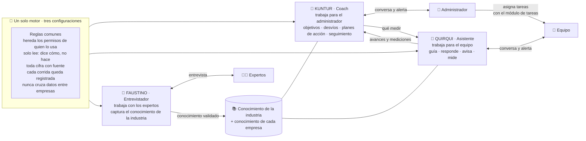
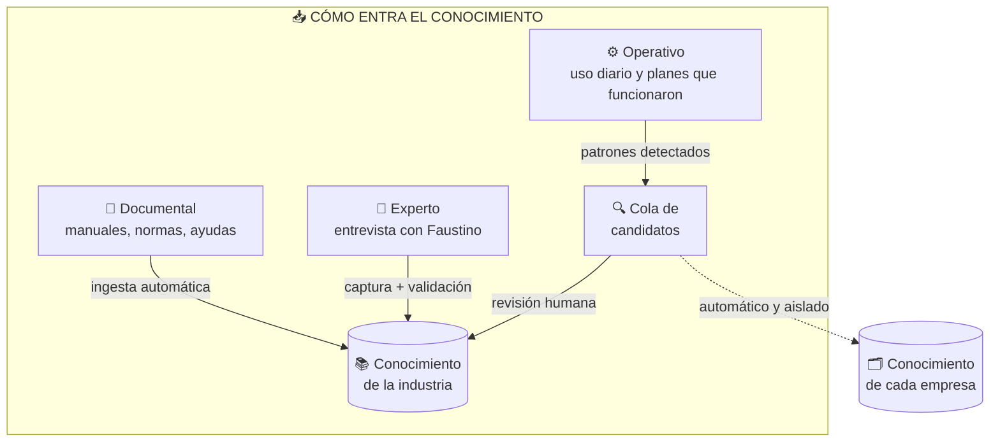
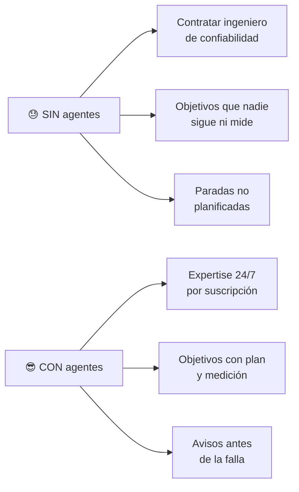
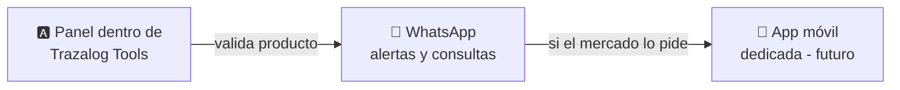

# 🏔️ Agentes de IA de Trazalog — Arquitectura Funcional y Caso de Negocio

## Objetivo

Qué es: la descripción funcional de los tres agentes de IA de Trazalog —**Kuntur** (el Coach), **Quirqui** (el Asistente) y **Faustino** (el Entrevistador de expertos)—, qué hace cada uno, cómo se relacionan y por qué se venden. Para quién: socios, inversores y el PM. Cuándo leerlo: antes de presentar el producto o de decidir alcance. Qué NO cubre: cómo está construido (eso está en [`AGENTES_TRAZALOG_ARQUITECTURA_TECNICA.md`](AGENTES_TRAZALOG_ARQUITECTURA_TECNICA.md)) ni el estado de avance (eso está en [`STATE.md`](STATE.md)).

**Audiencia:** Socios, inversores, PM · **Versión:** 2.0 · **Octubre 2026**
**Changelog v2.0 (2026-10-27):** el "Agente Minero" pasa a ser **tres agentes sobre un motor único** (Coach, Asistente, Entrevistador), con identidad propia (nombre y avatar). El producto deja de ser solo minero: sirve para **cualquier industria extractiva o de proceso** — hoy minería, oil & gas y electricidad. Los agentes son **de solo lectura y proactivos**: dicen cómo hacer, avisan, miden; no ejecutan.
**Antes:** v1.0 (agosto 2026) se llamaba `AGENTE_MINERO_ARQUITECTURA_FUNCIONAL.md`.

---

## 🎯 Qué es, en una frase

**Tres asistentes de inteligencia artificial expertos en la operación de industrias extractivas y de proceso**, que ayudan al equipo en su trabajo diario, acompañan al administrador a fijar objetivos y cumplirlos, y capturan el conocimiento de los expertos, apoyándose en los datos reales que ya viven en Trazalog. Se venden como suscripción.

---

## 🧩 Los tres agentes

| Agente | Para quién | Qué hace | Qué NO hace |
|---|---|---|---|
| 🦅 **Kuntur — el Coach** un cóndor humanizado, vestido de minero / oil & gas | **Solo el administrador** de la empresa | Lo entrevista para entender su operación y propone la configuración; lo ayuda a fijar **objetivos medibles sobre KPIs**; detecta **desvíos**, explica la causa y propone un **plan de acción**; mide si el plan funcionó; le avisa lo importante | No habla con el equipo; no crea ni asigna tareas; no compara la empresa con otras |
| 🦔 **Quirqui — el Asistente** un quirquincho humanizado, vestido de minero | **Todo el equipo**, cada uno con sus permisos | Sabe en qué pantalla está el usuario y le explica qué hacer ahí; responde consultas **citando la fuente**; propone el siguiente paso; **avisa proactivamente** (una orden por vencer, stock bajo mínimo, una tarea atrasada); le informa al Coach avances y mediciones | No fija metas; no arma planes; no ejecuta nada; no le cuenta al Coach qué le preguntó cada uno |
| 🎩 **Faustino — el Entrevistador** un humano con el aire de Sarmiento — el software es de San Juan | **Expertos y curadores** de Trazalog | Entrevista a expertos con una agenda priorizada por datos reales, repregunta, estructura lo que dicen en hechos y los hace validar | No habla con clientes |

Los tres **aparecen con su nombre y su avatar animado** cada vez que se los usa y en **todas las notificaciones** que mandan. Nombre y avatar son configurables por Trazalog e iguales para todos los clientes.

---

## 🔄 Cómo trabajan juntos: el Coach y el Asistente

El Coach y el Asistente no conversan entre sí: intercambian **datos**, con un contrato cerrado.

| Sentido | Qué viaja | Qué no viaja nunca |
|---|---|---|
| Kuntur → Quirqui | **Mediciones pedidas**: qué indicador, sobre qué (una actividad, un equipo o una persona), cada cuánto, hasta cuándo y para qué plan | Pedidos de leer conversaciones; mensajes del Coach para el equipo |
| Quirqui → Kuntur | **Avances** de las tareas que nacieron de un plan y **resultados** de las mediciones pedidas | Lo que conversó cada usuario; opiniones del modelo sobre personas |

**El ciclo completo, con un ejemplo:**

1. Kuntur y el administrador fijan un objetivo: *"cumplimiento del plan preventivo ≥ 85 % al 31/12"*.
2. El motor de KPIs lo mide solo. Cae a 72 %.
3. Kuntur avisa al administrador y explica la causa con datos: *"tres equipos críticos tienen preventivos vencidos hace más de 20 días; dos están asignados a la misma persona"*.
4. Kuntur **propone un plan de acción**: un pedido de trabajo con sus hitos y tareas sugeridas, el impacto esperado y a quién convendría asignar cada tarea. El plan queda **en estado "propuesta"**.
5. El administrador lo revisa, lo ajusta y **asigna las tareas con el módulo de tareas** de Trazalog, como siempre.
6. Quirqui acompaña a cada persona del equipo en sus tareas, le avisa si se atrasan, e informa los avances a Kuntur.
7. Al cierre del plazo, Kuntur **mide si el plan movió el KPI**. Si funcionó, se registra como una práctica que funcionó; si no, lo dice y propone otra cosa. **Un plan que nadie mide es ruido con buena redacción: la medición es obligatoria.**

**Mediciones sobre personas.** Kuntur puede pedir medir el cumplimiento de una persona en particular, siempre **para entender el cumplimiento de un KPI**. La persona no recibe aviso individual, pero Quirqui muestra **siempre** un aviso de que lo que se trabaja con él se usa para medir indicadores. El texto final de ese aviso pasa por revisión legal antes de salir a clientes. El administrador ve y puede cancelar todo lo que Kuntur pidió medir.

---

## 📚 El conocimiento: el activo central

Los tres agentes leen **la misma base de conocimiento**, con dos partes:

- **Conocimiento de la industria** (igual para todos los clientes de la misma vertical): buenas prácticas, normas, procedimientos estándar, lo que capturó Faustino de los expertos, las páginas de ayuda de Trazalog, el catálogo de casos de uso, y las prácticas que funcionaron, redactadas **sin cifras ni referencias a ninguna empresa**. Cada pieza está marcada con su **vertical** (minería, oil & gas, electricidad o general): una empresa de oil & gas recibe lo de su vertical y lo general.
- **Conocimiento de la empresa** (solo visible dentro de ella): su configuración, sus objetivos, sus planes y cómo les fue, sus documentos y el perfil que armó Kuntur en la entrevista.

**1. 📄 Documental — el más barato.** Manuales, normas, procedimientos y las ayudas de Trazalog se cargan y se procesan solos.

**2. 🎩 Experto — el diferenciador.** El conocimiento valioso está en la cabeza de los expertos. Faustino los entrevista con una **agenda priorizada por los datos reales de la plataforma** (si las chancadoras generan el 40 % de las órdenes, ese conocimiento va primero), repregunta y pide ejemplos. Cada aporte se valida cruzándolo con otros expertos: si coinciden, es sólido; si difieren, queda como zona gris.

**3. ⚙️ Operativo — automático pero controlado.** Lo que se aprende de cada cliente va a **su** memoria privada. Solo cuando un patrón se repite en varios clientes se propone como conocimiento de la industria, y **siempre pasa por revisión humana**.

### 👥 Dimensionamiento del equipo de expertos

| Fase | Equipo sugerido | Dedicación | Para qué |
|---|---|---|---|
| 🧪 **Carga inicial** (por vertical) | 2-3 expertos de la vertical + 1 curador | Intensiva, acotada | Base fundacional de esa vertical |
| 🌱 **Operación** | 1 experto part-time por vertical + 1 curador part-time | Baja, periódica | Revisar la cola de candidatos |
| 📈 **Escala** | Curador dedicado + expertos a demanda | Según crecimiento | Curaduría continua |

El gasto fuerte en expertos es **inicial y acotado por vertical**: abrir una vertical nueva cuesta una carga inicial, no un costo permanente. El conocimiento capturado es un activo que queda (con los expertos bajo acuerdo de que lo capturado es de Trazalog).

---

## 💰 Cómo reduce costos al cliente

- 👨‍🔧 **Costo de personal:** un ingeniero de confiabilidad senior cuesta millones de pesos al mes. Los agentes entregan buena parte de ese conocimiento por una fracción, 24/7.
- 🎯 **Gestión por objetivos:** la pyme fija metas sobre sus KPIs, tiene un plan cuando se desvía y sabe si el plan funcionó — sin un área de mejora continua.
- 🏭 **Costo de operación:** anticipar una falla con avisos evita paradas que cuestan miles de dólares por hora.
- 🖥️ **Nuestro costo de infraestructura:** los agentes se montan sobre lo que ya existe (Trazalog, MCP, motor de KPIs, módulo de tareas).

---

## 🖥️ Canales

- 🅰️ **MVP: panel dentro de Trazalog Tools.** Quirqui acompaña al usuario **en la pantalla donde está**, sabe qué se hace ahí y qué le falta. Cero instalación, cero login extra.
- 🔔 **Notificaciones** en la campanita de Tools y por push, firmadas por el agente que avisa, con su avatar.
- 💬 **Fase 2: WhatsApp**, ideal para avisos y consultas rápidas desde terreno.
- 📱 **Futuro: app dedicada**, solo si clientes validados la piden.

---

## 📈 Casos de negocio

1. **"¿Cómo mantengo esta bomba de transferencia?"** → El técnico pregunta y Quirqui responde con el procedimiento de la norma + el historial de **su** equipo, citando de dónde sale cada cosa.
2. **Objetivo con plan y medición** → El administrador fija disponibilidad ≥ 95 % en equipos críticos; cuando cae, Kuntur explica por qué y propone un plan; al mes dice si funcionó.
3. **Aviso proactivo** → Quirqui avisa que un repuesto crítico está bajo mínimo antes de que frene una orden.
4. **Onboarding de personal nuevo** → Un técnico junior le pregunta a Quirqui qué hacer en la pantalla donde está, en vez de interrumpir a un senior.
5. **Cumplimiento y auditorías** → Los agentes ayudan a documentar procedimientos según normas, requisito para calificar como proveedor de las grandes operadoras.

---

## 🌎 Mercado: industrias extractivas y de proceso

Trazalog apunta a las pymes proveedoras de servicios —y a las operaciones medianas— de tres verticales: **minería, oil & gas y electricidad**. El producto y los agentes son los mismos; cambia el conocimiento de la industria que se carga y los KPIs que importan en cada una.

### ⛏️ Minería — la vertical relevada (San Juan)

- 🚀 **Vicuña** (Lundin + BHP) inicia construcción en **2027** e invierte ~US$7.100M en tres años; en el pico (2027-2030) demandará ~**12.000 empleos directos**.
- 📊 San Juan es la **jurisdicción argentina mejor rankeada** para inversión minera (puesto 18 mundial, Fraser Institute).
- 🏗️ Tres proyectos RIGI aprobados por **US$3.727M** (Los Azules, Gualcamayo, Veladero) más Vicuña y El Pachón.
- 🔑 En proyectos como Los Azules, **~61 % del presupuesto de proveedores debe ser local**; en Josemaría, el 78 % de los proveedores fueron sanjuaninos.

Fuente: [`investigacion-sector-minero-trazalog-v3-2.md`](investigacion-sector-minero-trazalog-v3-2.md).

### 🛢️ Oil & gas y ⚡ electricidad — a relevar

Comparten el problema de fondo: proveedores pymes que tienen que profesionalizarse (estándares, trazabilidad, confiabilidad de activos) para calificar ante las grandes operadoras. **Todavía no hay un relevamiento de mercado equivalente al minero**; hasta que exista, este documento no da cifras de estas verticales.

### 💡 Cómo venderlo

- **No vender "IA", vender resultados:** "reducí paradas no planificadas", "cumplí tus objetivos" y "calificá como proveedor de las grandes" venden; "agentes con RAG" no.
- **Upsell sobre la base instalada:** el cliente ya usa Trazalog; los agentes son el escalón premium.
- **Diferenciador local:** conocimiento de normativa argentina y regional + datos operativos reales del cliente + personajes con identidad local (Kuntur, Quirqui, Faustino).
- **Retención:** cada cliente que los usa los hace más valiosos para él (memoria y prácticas acumuladas).

### 🎯 Lectura honesta del posicionamiento

El foso **no es la tecnología** (replicable), sino tres cosas difíciles de copiar: (1) el **conocimiento de la industria curado** con expertos locales, (2) el **acceso a datos operativos reales** vía la base instalada de Trazalog, y (3) el **ciclo objetivo → plan → medición** sobre el trabajo real del equipo. El riesgo principal sigue siendo **la calidad del conocimiento capturado**.

---

## ⏭️ Próximo paso

El orden de construcción está en [`PROMPT_CC_AGENTES_TRAZALOG.md`](PROMPT_CC_AGENTES_TRAZALOG.md): primero los cimientos del motor, después **Quirqui** (que no depende de nada nuevo), en paralelo la identidad visual de los tres, y **Kuntur** cuando el módulo de tareas y el motor de KPIs tengan lo que necesita.
