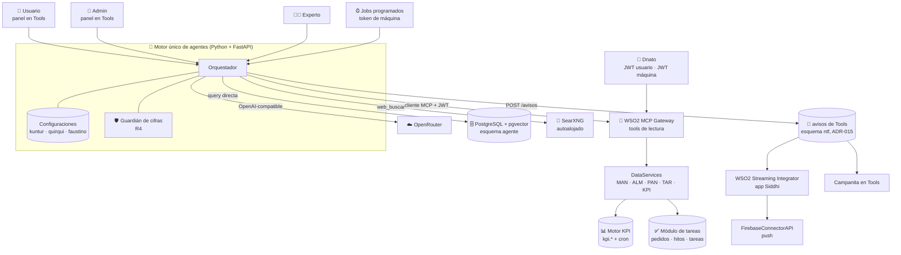
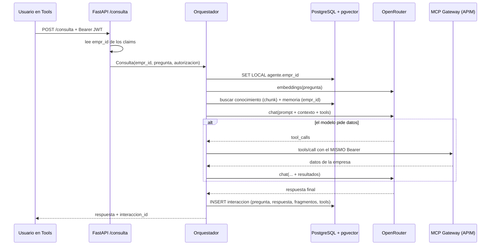
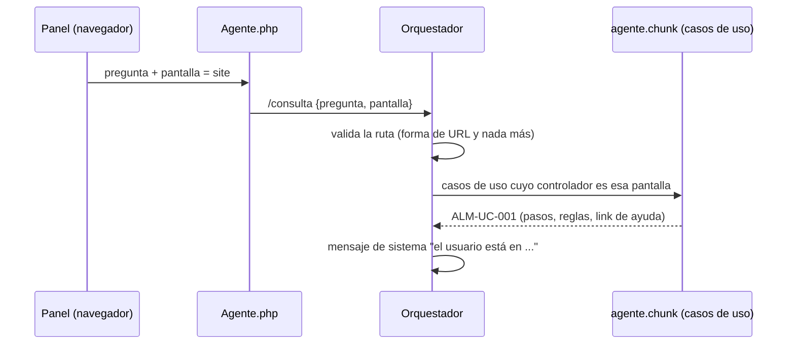
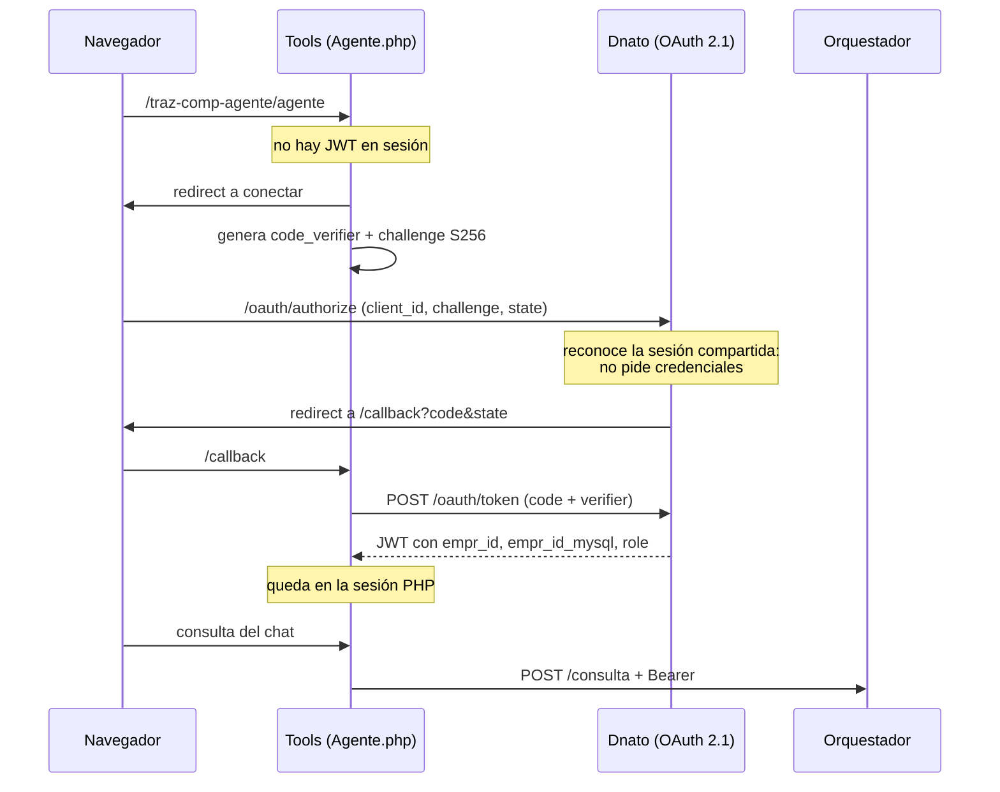
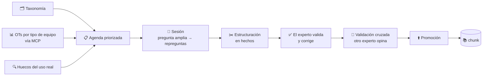
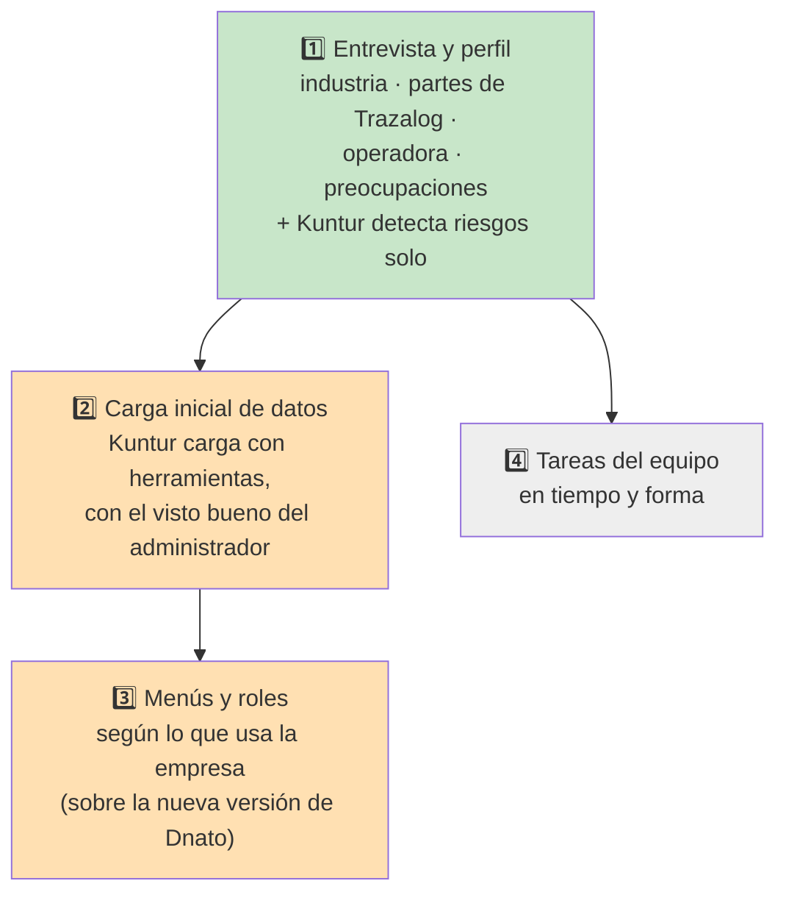
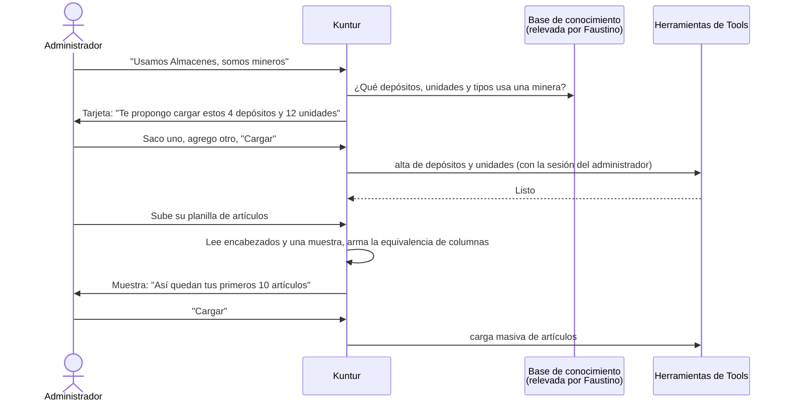
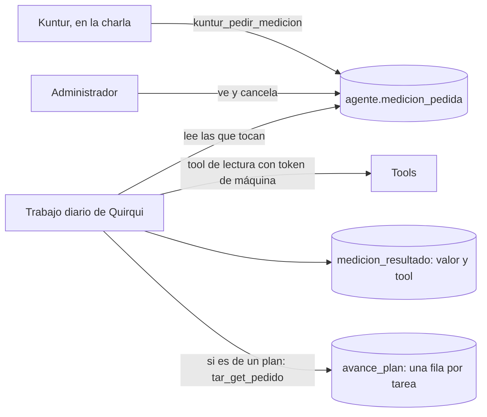
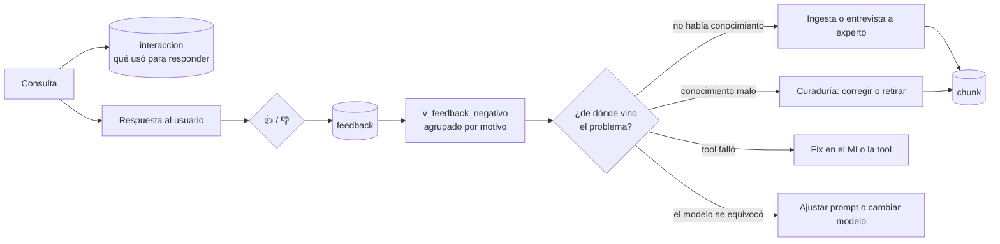

# ⚙️ Agentes de IA de Trazalog — Arquitectura Técnica

## Objetivo

Qué es: la arquitectura de los agentes de IA de Trazalog (Kuntur, Quirqui y Faustino) en un solo documento: el diseño (componentes, reglas duras, contrato entre agentes, modelo de datos, decisiones **ADR-A1 a ADR-A14**) en la parte 1, y cómo quedó construido cada pedazo en las partes 2 a 7. Para quién: PM, arquitecto y quien desarrolle (Claude Code incluido). Cuándo leerlo: la parte 1 completa antes de escribir código de cualquier tarea `AGENTE-*`; las demás, antes de tocar esa parte. Qué NO cubre: el caso de negocio ([`AGENTES_TRAZALOG_ARQUITECTURA_FUNCIONAL.md`](AGENTES_TRAZALOG_ARQUITECTURA_FUNCIONAL.md)), cómo instalarlo y operarlo ([`doc/agente/instalar-y-operar.md`](../agente/instalar-y-operar.md)) ni las decisiones de producto pendientes ([`doc/agente/decisiones.md`](../agente/decisiones.md)).

**Audiencia:** PM / Arquitecto / Desarrollo · **Versión:** 3.0 · **Noviembre 2026**
**Changelog v3.0 (2026-11-26):** absorbe los documentos de implementación de `doc/agente/` (arquitectura, entrevistador, mediciones, feedback, funciones sin usar, puesta en marcha de Kuntur) como partes 2 a 7; suma ADR-A14 (el motor es un servicio aparte). Unificación de documentación, sin cambios de contenido.
**Changelog v2.0 (2026-10-27):** tres agentes sobre un motor único (ADR-A7); solo lectura y cifras con fuente obligatoria (ADR-A8); plan de acción sobre el módulo de tareas y objetivos sobre el motor de KPIs (ADR-A9); token de máquina emitido por Dnato (ADR-A10); conocimiento multi-vertical (ADR-A11); identidad visual de los agentes; reglas R1–R11; contrato Coach ↔ Asistente.
**Changelog v1.1 (septiembre 2026):** entrevistador, canales, alertas vía AssetPlanner, feedback, DocTest, rama `develop-v3.5`. Se llamaba `AGENTE_MINERO_ARQUITECTURA_TECNICA.md`.

**Partes de este documento**

1. Diseño (de «Componentes» a «Riesgos»)
2. Cómo quedó implementado el motor
3. Faustino: captura de conocimiento experto
4. Kuntur: puesta en marcha de la empresa
5. Mediciones entre Kuntur y Quirqui
6. Funciones de Tools que la empresa no usa
7. El ciclo de mejora (feedback)

---

## 🏗️ Componentes



**Regla central:** 🧠 el cerebro razona vía **router**; 📚 el conocimiento por **query directa a pgvector**; 🔌 los datos del cliente **siempre vía MCP**, con el JWT del usuario o el de máquina (aislamiento `empr_id`); 🔎 lo que viene de internet, **con URL citada**; 🔔 las notificaciones por **cola propia → Streaming Integrator → Firebase**; los agentes **leen, nunca escriben** sobre datos del negocio.

---

## 🤖 Un motor, tres configuraciones

Cada agente es una **fila de configuración**, no un servicio aparte. Agregar un cuarto agente es agregar una configuración.

| Campo de la configuración | Kuntur (Coach) | Quirqui (Asistente) | Faustino (Entrevistador) |
|---|---|---|---|
| Quién lo puede usar | Rol `admin` de Dnato (R1) | Todo usuario de la empresa | Expertos y curadores de Trazalog |
| Prompt | `prompts/kuntur.md` + `prompts/kuntur-entrevista.md` | `prompts/quirqui.md` | `prompts/entrevistador.md` (hoy) |
| Tools permitidas | Lectura: `kpi_get_*`, `tar_get_*`, `man_get_*`, `alm_get_*`, `pan_get_*`, `core_get_*`, `web_buscar`, mediciones de Quirqui | Lectura: `man_get_*`, `alm_get_*`, `pan_get_*`, `core_get_*`, `tar_get_*`, `kpi_get_valor`, `web_buscar` | Lectura para priorizar la agenda |
| Disparadores | Primer ingreso del admin, cambio de contexto, desvío de KPI, cierre de ventana de medición | Apertura de pantalla, consulta, evento operativo (job), pedido de medición | Sesión iniciada por el experto |
| Fuentes de conocimiento | Industria (su vertical + general) + empresa completa | Industria (su vertical + general) + empresa **sin** planes ni objetivos del admin | Industria |
| Autonomía | Proponer (fija) | Proponer (fija) | Proponer (fija) |
| Identidad | Nombre, personalidad, avatar y estados | ídem | ídem |

Los textos visibles y las instrucciones viven en **archivos de recursos** (`prompts/`, `recursos/es/`) para poder traducirlos. La identidad (nombre y avatar) la configura Trazalog y es **igual para todos los clientes**.

---

## 📏 Reglas duras

Ninguna se puede desactivar por configuración. Cada una tiene al menos un test automático.

| # | Regla |
|---|---|
| R1 | **Kuntur solo interactúa con `admin` de Dnato.** No existe pantalla, notificación ni mensaje de Kuntur para otro rol. Hoy `admin` no es un rol por empresa (deuda conocida) |
| R2 | **Ningún agente crea ni asigna tareas.** Kuntur propone un pedido de trabajo en estado "propuesta"; una persona lo aprueba y asigna con el módulo de tareas |
| R3 | **Quirqui le informa a Kuntur datos medidos del sistema** (de actividades, equipos o una persona), **nunca contenido de conversaciones ni juicios del modelo sobre personas.** El contrato es cerrado: un campo nuevo requiere cambiar este documento |
| R4 | **Toda cifra que diga un agente tiene origen**: una tool de lectura llamada en esa corrida, o una búsqueda web con su URL citada en la respuesta. Si una cifra no tiene origen, **la respuesta se bloquea**, el usuario ve "no tengo datos para responder eso" y la corrida queda con un incidente |
| R5 | **Los agentes solo proponen.** No hay nivel de autonomía superior en esta versión |
| R6 | **Cada agente hereda los permisos del usuario que lo invoca** (su JWT) y no puede leer más que él. Los jobs usan el JWT de máquina de **una** empresa |
| R7 | **Ningún dato de una empresa llega a otra**, por ninguna vía, ni anonimizado ni promediado. Lo único compartido es el conocimiento de la industria, revisado por una persona y sin cifras |
| R8 | **Cada corrida queda registrada**: agente, disparador, entradas, tools llamadas con su respuesta, salida, costo, regla aplicada e incidentes |
| R9 | *(descartada en v2.0: los agentes no escriben, no hay nada que deshacer)* |
| R10 | **Todo plan de acción lleva su medición programada.** Un plan sin medición no se puede proponer |
| R11 | **El administrador ve todo lo que Kuntur pidió medir**, incluidas las mediciones sobre personas, y puede cancelarlo. Ningún otro usuario ve esa lista. Quirqui muestra siempre un **aviso permanente** de que lo que se trabaja con él se usa para medir indicadores (texto sujeto a revisión legal) |
| R12 | *(descartada en v2.0: retención nula del proveedor de modelos no es requisito)* |

---

## 🔁 Contrato Kuntur ↔ Quirqui

Es un intercambio de **datos por tablas**, no una conversación entre agentes.

| Tabla (esquema `agente`) | Escribe | Lee | Campos |
|---|---|---|---|
| `medicion_pedida` | Kuntur | Quirqui (job), admin | `empr_id`, indicador (KPI o consulta de tool), alcance (`actividad` / `equipo` / `persona`) + id, frecuencia, vigencia desde/hasta, `petr_id` del plan, estado (`activa` / `cancelada` / `vencida`) |
| `medicion_resultado` | Quirqui (job) | Kuntur, admin | `medicion_id`, fecha, valor, detalle JSON, tool de origen |
| `avance_plan` | Quirqui (job) | Kuntur, admin | `petr_id`, tarea, estado, fechas plan y real, responsable, resultado |

**Prohibido por diseño:** ninguna de estas tablas tiene columnas de texto libre que puedan llevar contenido de `agente.interaccion`; el rol del job no tiene `SELECT` sobre `interaccion`. Hay un test que lo verifica.

---

## 🗄️ Modelo de datos nuevo

Todo como scripts versionados en `db/agente/` (numerados, idempotentes, con rollback, con RLS por `empr_id` donde corresponda), salvo lo del motor KPI y TAR, que va en sus propios scripts de versión.

| Objeto | Para qué | Dónde |
|---|---|---|
| `agente.agente` | Configuración de cada agente (campos de la tabla de arriba) | `db/agente/` |
| `agente.interaccion` + columnas `agente`, `disparador`, `costo_tokens`, `regla`, `incidente` | La corrida (R8) | `db/agente/` (ampliación) |
| `agente.tool_llamada` | Cada tool llamada en una corrida, con su respuesta cruda (insumo del guardián R4) | `db/agente/` |
| `vertical` en `chunk`, `fuente`, `tema`, `hecho`, `perfil_empresa` | Conocimiento multi-vertical (ADR-A11) | `db/agente/` |
| `agente.perfil_empresa` | Lo que Kuntur aprendió en la entrevista (vertical, equipos críticos, frecuencias, roles) como datos estructurados | `db/agente/` |
| `agente.medicion_pedida`, `medicion_resultado`, `avance_plan` | Contrato Kuntur ↔ Quirqui | `db/agente/` |
| `kpi.historico` | Serie de valores (hoy `kpi.cache` se pisa) | scripts del motor KPI |
| `kpi.objetivos` + `kpi.desvios()` | Metas por empresa y KPI, y detección de desvío | scripts del motor KPI |
| Estado `propuesta`, origen `agente` y KPI objetivo en el pedido de trabajo | Plan de acción (ADR-A9) | scripts del módulo de tareas |

---

## 🔌 Integraciones

- **Motor de KPIs** (`kpi.definiciones` / `kpi.cache` / `kpi.correr()` por cron cada 5 minutos, en producción desde 2026-10-24). Los KPIs nuevos de cada vertical son **filas en `kpi.definiciones`**. Se le suman historia, objetivos y desvíos, y se expone por tools `kpi_get_valor`, `kpi_get_historico`, `kpi_get_objetivos`, `kpi_get_desvios` en la fachada MCP. La medición por persona usa `valor_json`.
- **Módulo de tareas (TAR)** — Pedidos de Trabajo → Hitos → Tareas, con bandeja en Bonita. Necesita, antes de que Kuntur lo use: aislamiento por empresa completo, fechas plan y real separadas, una API de negocio (`toolsTARAPI`) y tools de lectura `tar_get_*`, y el estado "propuesta". Ver la especificación del módulo TAR.
- **Dnato** — emite el JWT de usuario (OAuth PKCE, como hoy) y **el JWT de máquina por `client_credentials`** (ADR-A10).
- **Catálogo DocTest** — cada caso de uso declara su pantalla, flujo y validaciones; se ingesta como conocimiento para que Quirqui sepa qué se hace en cada pantalla.
- **Alertas** — el agente publica en el mecanismo único de avisos de Tools (`POST /avisos` de `toolsNTFAPI`, esquema `ntf`, ADR-015) → app Siddhi `AvisosPush` → `FirebaseConnectorAPI`, y la campanita de Tools. Sigue la Opción C de E0 (cola en PostgreSQL), pero la cola es la de Tools: la propia del agente (`agente.notificacion`) se borró en `021`. Cada aviso lleva el agente emisor.

---

## 🎨 Identidad visual

| Agente | Personaje | Uso |
|---|---|---|
| Kuntur | Cóndor humanizado, vestido de minero / oil & gas | Panel del Coach, notificaciones al admin |
| Quirqui | Quirquincho humanizado, vestido de minero | Panel lateral del Asistente, notificaciones al equipo |
| Faustino | Humano con el aire de Sarmiento | Pantalla de entrevista |

Cada uno tiene un juego de **estados** (saludo, escuchando, pensando, hablando, alerta, despedida) en imágenes fijas animadas con CSS; el componente cambia de estado según la corrida. Las imágenes se generan con modelos de licencia libre. El detalle está en [`doc/agente/identidad.md`](../agente/identidad.md).

---

## 🔐 Decisiones técnicas (ADRs de los agentes)

- **ADR-A1 — Modelo configurable vía OpenRouter.** LLM como parámetro; failover; pago unificado desde Argentina; routing por costo/calidad. *Vigente.*
- **ADR-A2 — RAG por acceso directo, NO vía MCP.** El conocimiento es maquinaria interna. *Vigente.*
- **ADR-A3 — Datos del cliente SIEMPRE vía MCP.** Con el token del usuario o, en jobs, el token de máquina de esa empresa (ADR-A10). *Vigente, ampliado.*
- **ADR-A4 — Conocimiento compartido solo con revisión humana.** Memoria por empresa automática y aislada; lo compartido pasa por cola de candidatos + curaduría, sin cifras ni referencia a empresas. *Vigente.*
- **ADR-A5 — Canal MVP: panel embebido en Tools; WhatsApp fase 2; app diferida.** *Vigente; el chat pasa a panel con contexto de pantalla.*
- **ADR-A6 — Notificaciones: cola propia + Streaming Integrator + `FirebaseConnectorAPI`** (Opción C de E0). *Vigente; ahora para los dos agentes.*
- **ADR-A7 — Un motor único con configuraciones por agente** (2026-10-27). Cada agente declara quién lo usa, prompt, tools permitidas (lista blanca), disparadores, fuentes, autonomía e identidad. **Por qué:** el comportamiento común (aislamiento, auditoría, guardián, permisos) se escribe y se prueba una sola vez; un agente nuevo es una configuración.
- **ADR-A8 — Agentes de solo lectura, con cifras de origen comprobable** (2026-10-27). Los agentes dicen cómo hacer, no lo hacen: las tools de escritura (`man_create_ot`, `alm_crear_pedido_materiales`) quedan fuera de toda lista blanca. Toda cifra sale de una tool de la corrida o de `web_buscar` con URL citada; si no, se bloquea la respuesta (R4). `web_buscar` usa **SearXNG autoalojado** (costo $0). **Por qué:** el riesgo de un agente es afirmar una cifra plausible y falsa, o ejecutar algo que nadie revisó.
- **ADR-A9 — El plan de acción es un pedido de trabajo del módulo de tareas en estado "propuesta"; los objetivos viven en el motor de KPIs** (2026-10-27). **Por qué:** el módulo de tareas ya tiene asignación, bandeja y seguimiento, y el motor de KPIs ya calcula por empresa con cron; duplicarlos en el esquema del agente sería un segundo sistema de tareas y otro de indicadores.
- **ADR-A10 — Token de máquina emitido por Dnato con `client_credentials`, un cliente por empresa** (2026-10-27). El JWT lleva el `empr_id` y lo valida el APIM igual que el de usuario. **Por qué:** los avisos y mediciones corren sin nadie conectado; es el mecanismo estándar y no requiere usuarios fantasma con contraseña.
- **ADR-A11 — Conocimiento multi-vertical** (2026-10-27). El producto sirve para industrias extractivas y de proceso (hoy minería, oil & gas, electricidad). La **vertical** es metadato del conocimiento, de la taxonomía de Faustino y del perfil de la empresa; la búsqueda trae lo de la vertical de la empresa más lo `general`. **Por qué:** el mismo motor y los mismos agentes sirven a todas; cambia el contenido, no el código.
- **ADR-A12 — Kuntur graba datos de configuración, con confirmación del administrador** (2026-11-11, aprobado por el PM). Excepción acotada a ADR-A8 para la puesta en marcha de la empresa (`doc/v3/AGENTES_TRAZALOG_ARQUITECTURA_TECNICA.md`, etapas 2 y 3). Kuntur puede ejecutar tools de la clase nueva **`configuracion`** si se cumplen las cinco condiciones: (1) **confirmación**: el administrador vio una tarjeta con lo que se va a grabar y tocó "Cargar"; (2) **con el token del administrador**, nunca el de máquina (el gateway ya rechaza escrituras con ese token); (3) **lista cerrada**: solo altas y cambios de datos de configuración (depósitos, unidades, tipos, artículos, ABM de Mantenimiento, menús y roles); órdenes de trabajo, pedidos y movimientos siguen fuera; (4) **registro** en la corrida de qué se grabó y quién lo confirmó; (5) **todo o nada** en las cargas de varias filas. Quirqui y Faustino siguen de solo lectura. Las operaciones de Dnato v3 (menús, roles, administradores de una empresa) se usan contra **servicios de datos simulados** hasta que Dnato v3 los construya (deuda técnica registrada en STATE). **Por qué:** la puesta en marcha es donde una empresa nueva más se traba, y el administrador ya revisa cada paso; ejecutar lo que confirmó es lo que le ahorra trabajo, sin que el agente decida nada por su cuenta.
- **ADR-A13 — Kuntur arma el plan de acción completo; el pedido de trabajo se crea con el token del administrador al aceptar** (2026-11-12, opción B elegida por el PM; **aprobado el 2026-11-22** junto con las escrituras del anexo A, PR #669). Ajusta D6/R2 y es otra excepción acotada a ADR-A8. Kuntur propone un plan con pedido, hitos y tareas **sin responsable**; la propuesta se guarda en la base del agente y se le muestra al administrador como una tarjeta (porqué con cifra de una tool, hitos por semana, tareas con responsable sugerido) con **Aceptar / Pedir cambios / No lo quiero**. Al aceptar, con **el token del administrador**, se crean pedido, hitos y tareas en el módulo de Tareas, siempre con el **Proceso Estándar** (`PROCESO-STANDAR`, que no arranca casos de Bonita; TST001 arranca recién cuando una persona asigna responsable y fecha); la herramienta no recibe el proceso. Si no lo quiere, queda descartada con el motivo. Kuntur nunca asigna responsables ni usa procesos propios de un cliente (por ejemplo, el de Yudica). Todo o nada, registro en la corrida y medición obligatoria vinculada por `kpi.objetivos.petr_id` (R10). **Por qué:** el plan solo sirve si llega a Tareas listo para asignar; crearlo recién al aceptar evita cambiar pantallas y consultas de producción (un pedido "propuesta" se vería como activo y sus tareas serían editables) y evita escrituras con el token de máquina. Análisis: `doc/historial/agente/analisis-impacto-plan-accion-kuntur.md`.
- **ADR-A14 — El motor de agentes es un servicio aparte de Tools y de WSO2** (2026-11-25, aprobado por el PM). Corre como su propio proceso (FastAPI en Python) con su propia base PostgreSQL con pgvector; Tools le habla por el servidor PHP y el motor entra a WSO2 por el MCP con el permiso del usuario. **Por qué:** (1) una consulta dura de 5 a 60 segundos y ocuparía los procesos de PHP que atienden las pantallas; (2) hay trabajos sin nadie conectado (monitoreo, mediciones, avisos); (3) las herramientas para modelos de lenguaje (clientes de modelos, MCP, embeddings) están en Python; (4) WSO2 es mediación sin estado, no orquestación de una conversación con varias llamadas; (5) al entrar a WSO2 con el permiso del usuario, el aislamiento por empresa lo sigue aplicando WSO2 (ADR-A3) y el motor no puede saltearlo; (6) si el motor se cae, Tools sigue funcionando; (7) sirve a más de un canal (ADR-A5). **Costo asumido:** una pieza y una base más para instalar, respaldar y vigilar. ⚠️ La unidad de servicio para producción todavía no existe: ver `doc/v3/deployment-gcp.md`, sección del motor de agentes.

---

## 💵 Costos por etapa de madurez

| Etapa | Infra | Costo IA (variable) | Total aprox. mensual |
|---|---|---|---|
| 🧪 **Versión inicial** (1 cliente piloto) | 1 VM chica + pgvector + SearXNG | ~US$5-15 | **~US$30-50** |
| 🌱 **MVP comercial** (3-5 clientes) | 1 VM mediana | ~US$25-50/cliente | **~US$150-300** |
| 📈 **Escala** (20+ clientes) | VM dedicada + routing optimizado | ~US$5-30/cliente | **cubierto por suscripciones** |

> El costo de IA se traslada vía suscripción (objetivo: ≤30 % del precio del tier). La premisa "costo $0" no aplica a esta capa.

---

## ⚠️ Riesgos

1. **La calidad del conocimiento**, por vertical. Abrir oil & gas o electricidad sin carga inicial de expertos da un agente genérico.
2. **Kuntur depende de dos frentes ajenos** (módulo de tareas y motor de KPIs). Si se demoran, Kuntur se demora; Quirqui no.
3. **El guardián de cifras puede bloquear de más** (fechas, códigos de equipo, "en 3 pasos"). Se ajusta con los incidentes registrados.
4. **Mediciones sobre personas**: el aviso permanente y su texto requieren revisión legal antes de salir a clientes.

---

## Parte 2 — Cómo quedó implementado el motor

> Este documento describe **cómo está construido el motor de los agentes de IA en el código**, pieza por pieza: qué hace cada módulo, cómo se conectan y por qué se resolvió así. Es para quien va a tocar el código o necesita entender qué pasa cuando alguien hace una pregunta.
> 
> > **Estado de transición.** El diseño vigente son **tres agentes sobre este mismo motor** —Kuntur (Coach), Quirqui (Asistente) y Faustino (Entrevistador)— y un conocimiento multi-vertical (ADR-A7 a A11). Este documento se actualiza a medida que se implementan las tareas de [`PROMPT_CC_AGENTES_TRAZALOG.md`](../historial/v3/PROMPT_CC_AGENTES_TRAZALOG.md). **Hecho:** AGENTE-M-01 (configuración por agente, sección "Un motor, tres agentes") AGENTE-M-02 (lista blanca de tools, sección "Los agentes dicen cómo, no hacen") AGENTE-M-03 (corrida auditable, sección "Todo queda registrado") AGENTE-M-04 (guardián de cifras, sección "Ninguna cifra sin origen") AGENTE-M-05 (búsqueda en internet, sección "Internet, como último recurso") AGENTE-M-06 (conocimiento del producto, sección "Lo que el agente sabe del propio Trazalog") AGENTE-M-08 (multi-vertical, sección "Una industria, su conocimiento") AGENTE-AS-01 (panel de Quirqui, sección "Quirqui sabe dónde estás") y AGENTE-AS-02 (siguiente paso, sección "Quirqui propone sin que le pidan"). Los nombres de infraestructura que todavía dicen "minero" —la base `agente_minero`, `~/.agente-minero.env`, la empresa de prueba y el ítem de menú en `seg.menues`— se mantienen: cambiarlos rompe entornos ya armados sin aportar nada al usuario.

### El recorrido de una consulta



El `interaccion_id` que vuelve es el que después usa el control de feedback: sin él, un pulgar abajo no se puede asociar a nada.

---

### Alcance: dos áreas, no una

El agente cubre **Mantenimiento y Almacenes**, porque son las dos que la capa MCP expone hoy:

| Área | Tools MCP | Qué responde |
|---|---|---|
| 🔧 Mantenimiento (`man_*`) | 11 | Equipos, órdenes de trabajo, preventivos, lecturas, KPIs de confiabilidad |
| 📦 Almacenes (`alm_*`) | 9 | Stock, depósitos, movimientos, entregas, vencimientos, pedidos de materiales |

**Pañol y Tareas quedan para una versión posterior.** Cuando sus tools existan, hay que sumarlas en tres lugares: el prompt (sección "Tu alcance"), `_TOOLS_DEV` de `mcp_client.py` para el modo de desarrollo, y los `CHECK` de `modulo` y `tipo` en la base (script `009`).

Lo más valioso está en el **cruce**: una orden de trabajo que no se puede ejecutar porque falta el repuesto es un problema de las dos áreas a la vez. El prompt le pide explícitamente al agente que no se encierre en el área por la que arrancó la pregunta.

Cada pieza de conocimiento lleva su `modulo` (`man`, `alm` o `general`). El `general` —seguridad, normativa transversal— se recupera siempre, sin importar el área de la consulta. La recuperación **no filtra por módulo por defecto**: la similitud vectorial ya separa bien y muchas consultas cruzan las dos. El filtro está disponible para cuando se sabe el área de antemano, como en un job de monitoreo.

`tests/test_alcance.py` verifica que el sesgo a mantenimiento no vuelva.

---

### Módulos

| Archivo | Qué hace |
|---|---|
| `agente/config.py` | Toda la configuración, por variables de entorno. Ningún modelo ni URL hardcodeado. `validar()` devuelve la lista de problemas, que `/salud` expone |
| `agente/agentes.py` | La configuración de cada agente (`agente.agente`): quién lo puede usar, su identidad, su prompt y sus tools permitidas. `para_consulta()` es la única puerta desde `/consulta` |
| `agente/prompt.py` | Carga los prompts de `prompts/<agente>.md`, saca los comentarios HTML y detecta los bloques que el PM todavía no definió. Relee si el archivo cambió: se puede ajustar el prompt sin reiniciar |
| `agente/llm.py` | Cliente de OpenRouter (ADR-A1). Chat con tool-calling y embeddings. Valida que la dimensión del embedding coincida con la del esquema |
| `agente/rag.py` | Acceso a pgvector: conocimiento compartido, memoria por empresa, y el armado del bloque de contexto que ve el modelo |
| `agente/mcp_client.py` | Cliente MCP (ADR-A3). Passthrough del Bearer, dos modos (`apim` / `mi`), y traza de cada llamada |
| `agente/orquestador.py` | El loop: recupera, conversa, ejecuta tools, registra |
| `agente/api.py` | FastAPI: `/salud`, `/consulta`, `/feedback`, `/admin/feedback` |
| `agente/ingesta.py` | CLI de ingesta documental: PDF/MD/TXT → chunks → embeddings → `agente.chunk` |

---

### Un motor, tres agentes (AGENTE-M-01)

Kuntur, Quirqui y Faustino no son tres servicios: son tres filas de `agente.agente` (ADR-A7). El orquestador arma el mensaje de sistema con **la identidad de la configuración** ("Te llamás Quirqui. …") seguida de **las instrucciones del archivo** `prompts/<agente>.md`. Así el nombre se cambia sin tocar las instrucciones.

| Agente | Acceso | Prompt | Estado |
|---|---|---|---|
| Quirqui (asistente) | Todo usuario | `prompts/quirqui.md` | Activo; es el que responde si `/consulta` no dice otro |
| Kuntur (coach) | Solo `role = 1` de Dnato (administrador) | `prompts/kuntur.md` (esqueleto) | **Inactivo** hasta la Fase 5 |
| Faustino (entrevistador) | Expertos y curadores, por menú | `prompts/faustino.md` | Activo, solo por `/entrevista/*` |

Tres decisiones:

- **El acceso se verifica antes que si el agente está activo.** Si fuera al revés, un empleado que pidiera a Kuntur recibiría "todavía no está disponible" y sabría que existe. Hoy recibe el mismo `404` que con un agente inexistente (R1). Hay un test que lo verifica, y se comprobó que falla si se invierte el orden.
- **`/agentes` expone solo lo que la interfaz muestra** (clave, nombre, rol, avatar). Nunca el prompt ni las tools.
- **El runtime no puede editar la configuración**: `agente_app` solo tiene `SELECT`. El Coach exige acceso `admin` y la autonomía solo puede ser `proponer`, las dos como `CHECK` de la base.

### Los agentes dicen cómo, no hacen (AGENTE-M-02)

El gateway publica 25 tools, y dos escriben: `man_create_ot` y `alm_crear_pedido_materiales`. Ningún agente las puede usar (ADR-A8). Una tool es usable solo si **está en el catálogo `agente.tool`, no es de clase `accion` y entra en un patrón de la configuración del agente**. Lo resuelve la base con `agente.tools_permitidas(clave)`, que es la única fuente.

Dos barreras en el orquestador:

1. **El modelo solo ve las tools permitidas.** Las demás ni aparecen en la lista que se le manda.
2. **Si igual pide otra**, porque inventa el nombre o la conoce de otra conversación, **no sale al MCP**: queda en `tools_llamadas` con `status: "bloqueada"` y le vuelve al modelo como error ("solo podés consultar datos, no modificarlos"), así puede explicarle al usuario cómo hacerlo.

**Falla cerrado.** Una tool nueva del gateway no la ve nadie hasta que se catalogue. Si no se puede resolver la lista blanca (por ejemplo, porque falta `012`), el agente no responde, en vez de seguir con todas las tools del gateway.

### Decisiones que vale la pena conocer

#### Quién decide si usar RAG, MCP o ambos: el modelo

No hay una heurística nuestra que clasifique la pregunta. El modelo recibe el contexto ya recuperado **y** las tools declaradas, y elige. El prompt de sistema le explica cuándo corresponde cada fuente: conocimiento para el "cómo debería ser", datos para el "cómo está", memoria para el "qué venía pasando".

Se hizo así porque cualquier clasificador que escribiéramos sería peor que el modelo y habría que mantenerlo. El costo es una llamada extra cuando el modelo decide pedir datos.

#### El `empr_id` no viaja nunca como parámetro

Sale del JWT, y el JWT lo valida el gateway. Tres barreras, en tres capas distintas:

1. `api.py` lo lee de los claims. **No lo acepta por body**: si lo aceptara, cualquiera podría pedir los datos de cualquier empresa.
2. `rag.py` hace `SET LOCAL agente.empr_id` antes de tocar nada, y las policies de RLS filtran. Sin contexto seteado no se ve nada — falla cerrado.
3. `mcp_client.py` **descarta un `empr_id`** si el modelo lo alucina en los argumentos de una tool, antes de que salga.

`tests/test_aislamiento.py` verifica las tres.

#### `SET LOCAL`, no `SET`

El contexto de empresa muere con la transacción. Es lo que evita la fuga más difícil de encontrar el día que haya un pool: si el contexto sobreviviera al commit, la siguiente consulta que tomara esa conexión heredaría la empresa de la anterior. Hay un test dedicado a eso.

#### El JWT se lee sin validar la firma, y está bien

`api.py` decodifica los claims sin verificar la firma. No es un descuido: la validación la hace el APIM antes de que el request llegue (ADR-008/ADR-009), y el acceso a los datos del cliente vuelve a pasar por el gateway con el mismo token. El orquestador solo necesita saber de qué empresa es la consulta para elegir la partición de memoria.

**La consecuencia operativa es que este servicio no puede quedar expuesto sin el gateway adelante.** Está anotado en el código y en `operacion.md`.

#### Un fallo de tool no corta la conversación

Cuando una tool MCP falla, el error vuelve al modelo **como contenido del mensaje**, no como excepción. Así el agente puede decir "no pude consultar tus equipos en este momento" en lugar de que el usuario reciba un error técnico. Queda registrado en `tools_llamadas` con `status: "error"`.

#### Todo queda registrado, incluidos los errores (R8, AGENTE-M-03)

Cada corrida escribe una fila en `agente.interaccion` con la pregunta, la respuesta, **qué fragmentos se recuperaron y qué tools se llamaron**, y además:

| Columna | Qué guarda |
|---|---|
| `agente` | Quién respondió: `quirqui`, `kuntur`… |
| `disparador` | Qué la puso en marcha: una consulta, un evento operativo, un desvío de KPI… |
| `costo_usd` | Lo que informó OpenRouter (`usage.cost`), sumado entre las llamadas de la corrida. Vacío si no lo informó: cero diría "fue gratis", y no se sabe |
| `controles` | Qué controles se aplicaron y con qué resultado (hoy, la lista blanca: cuántas tools publicó el gateway y cuántas se ofrecieron) |
| `incidentes` | Lo que hay que revisar: tools bloqueadas y, desde M-04, cifras sin fuente. Vacío = corrida limpia |

Y una fila en `agente.tool_llamada` por cada tool, con **exactamente lo que vio el modelo** (el contenido ya truncado que se le pasó, no la respuesta cruda completa). Es contra eso que el guardián de cifras de R4 compara los números de la respuesta: un número tiene que estar en algo que el modelo efectivamente leyó.

Eso es lo que hace accionable un pulgar abajo: sin esa traza, un "no me sirvió" no dice si el problema fue el conocimiento, los datos o el modelo.

**Las corridas con error también se guardan**, incluso cuando lo que falló fue la base: si la transacción quedó abortada, el orquestador vuelve a una limpia, re-fija la empresa y registra. Son las más informativas.

Si el registro falla igual, la respuesta se entrega: se pierde la traza, no la respuesta (queda en el log).

#### Ninguna cifra sin origen (R4, AGENTE-M-04)

Decisión del PM: si una respuesta trae un número que no tiene origen, **se bloquea**. El usuario recibe "No tengo ese dato confirmado. ¿Querés que lo busque en los datos de tu empresa o en internet?" y la corrida queda con un incidente `cifra_sin_fuente` que guarda la respuesta original para revisarla. Lo hace `agente/guardian.py`, sobre la respuesta final del modelo (no sobre los mensajes fijos de error).

**Qué cuenta como origen**, comparado siempre contra lo que el modelo **leyó** en esa corrida:

| Origen | Ejemplo |
|---|---|
| Lo que devolvió una tool (el contenido exacto que se le pasó al modelo) | `alm_get_stock` devolvió `12` → "quedan 12" |
| La cantidad de elementos de una lista que devolvió una tool | tres equipos en la lista → "tenés 3 equipos" |
| El contexto de conocimiento y memoria recuperado | el manual dice 250 horas → "cada 250 horas" |
| La pregunta del usuario | "tengo 4 técnicos" → "con 4 técnicos…" |
| La web (`web_buscar`), **solo si la respuesta cita la URL** | "7100 millones (https://…)" |

**Lo que viene del contexto** (conocimiento, memoria, pantalla) respalda un número solo si **comparten alguna palabra de alrededor** (dos antes y tres después, sin las palabras vacías, con plurales y unidades abreviadas normalizados): "cada 250 horas" respalda "250hs", pero un "7" suelto de un calendario no respalda "7 órdenes vencidas" (D-51). Lo de las tools y de la pregunta sigue valiendo por valor.

Admite redondeos a los decimales escritos (72 contra 71,83), porcentajes contra fracciones (72 % contra 0,72) y el separador de miles argentino (1.500 = 1500). **No controla** fechas, horas, códigos de letras y números (COMP-001, OT1234), marcadores de lista ni números chicos de discurso ("3 pasos", "2 opciones"; la lista de palabras es configurable en `PALABRAS_DE_DISCURSO`). Una norma como "ISO 55000" **sí** se controla: inventar una referencia normativa es tan grave como inventar un torque.

En `controles` queda `{"control": "R4_cifras", "cifras": N, "sin_fuente": K}` en cada corrida. Los falsos positivos se ajustan mirando los incidentes.

#### Lo que el agente sabe del propio Trazalog (AGENTE-M-06)

Además del conocimiento de la industria, la base tiene el **material del producto** (`agente/fuentes.py`):

| Fuente | Cómo se parte | Qué guarda en `chunk.metadata` |
|---|---|---|
| Ayudas de Tools (`ayuda/*.html`, el sitio que ve el usuario) | Una pieza por sección; las de más de 1500 caracteres se parten conservando el título del manual y de la sección | `ayuda` (link con ancla), `titulo`, `documento` |
| Casos de uso validados de DocTest (`doctest/catalogo/**/XXX-UC-NNN.yaml`) | Uno por caso, entero: pantalla, perfil, pasos, alternativas y reglas juntos | `caso_uso`, `pantallas`, `controladores` (repo/path), `perfil`, `ayuda` |

El modelo ve el link de la ayuda y la pantalla de cada fragmento, así puede citarlos ("está en ayuda/manual_almacenes.html#s03"). Los `controladores` son lo que va a usar la AGENTE-AS-01 para ubicar el caso de uso de la pantalla donde está el usuario **por ruta exacta**, no solo por parecido (hay un índice GIN sobre `chunk.metadata` para eso).

Los documentos **de una empresa** van a su memoria privada (`origen = 'ingesta'`), con RLS. Nunca al conocimiento compartido.

**Limitación del guardián de cifras (D-24) — resuelta (D-51):** con mucho conocimiento cargado, un número chico podía quedar respaldado por coincidencia ("7 órdenes vencidas" contra un "7" de un calendario de ejemplo). Ahora un número del contexto solo respalda si comparte alguna palabra de alrededor (ver "Ninguna cifra sin origen").

#### Una industria, su conocimiento (ADR-A11, AGENTE-M-08)

El producto sirve para industrias extractivas y de proceso: hoy minería, oil & gas y electricidad. El motor y los agentes son los mismos; cambia el conocimiento.

- `chunk.vertical` y `tema.vertical`: `mineria`, `oil_gas`, `electricidad` o `general` (aplica a todas). Por defecto, `general`.
- `agente.perfil_empresa`: la industria de cada empresa, con RLS. El runtime solo la lee.
- **Con industria declarada**, la empresa recibe lo de su industria y lo general: una de oil & gas no recibe lo que es solo de minería. **Sin declarar**, recibe todo, y el modelo ve de qué industria es cada fragmento ("industria: minería"). Queda en `controles` de cada corrida (`{"control": "vertical", ...}`).
- **Faustino**: la agenda se puede filtrar por industria (`/entrevista/agenda?vertical=oil_gas`), y un hecho promovido a conocimiento **hereda la industria del tema** de la entrevista.

#### Internet, como último recurso (AGENTE-M-05)

`web_buscar` busca en internet con **SearXNG autoalojado** (`agente/web.py`): un metabuscador libre, sin API key ni costo (ADR-005). Devuelve título, URL y extracto de los primeros resultados.

- **No pasa por el MCP Gateway** —no son datos del cliente—, pero **sí por la lista blanca**: está catalogada en `agente.tool` (script `014`, clase `lectura`, costo `externo`, riesgo `medio`). La tiene Quirqui; Faustino no.
- **Solo se ofrece si hay un SearXNG configurado** (`AGENTE_WEB_URL`). Sin él la búsqueda queda apagada, sin error.
- **Toda cifra que salga de la web va con su URL**, o el guardián de cifras la bloquea (R4).
- **La consulta sale a buscadores externos**, así que no puede llevar datos de la empresa. Lo dicen el prompt y la descripción de la tool, que es lo que el modelo lee al decidir usarla. No hay un filtro automático de la consulta (ver D-21 en `decisiones-para-revisar.md`).
- Si el buscador falla, el agente sigue: el error le vuelve al modelo como contenido y la llamada queda con `status: "error"`.

#### `interaccion`, `feedback` y `tool_llamada` tienen RLS

Guardan preguntas y respuestas de cada empresa, con datos que vinieron de sus tools. Desde `013` tienen la misma policy que `memoria`: un `empr_id` solo ve y escribe lo suyo, y sin contexto no se ve nada. Hasta `013` las protegía solo el `WHERE empr_id` del código (hallazgo del 2026-10-27). La vista `v_feedback_negativo` corre con los permisos de quien consulta (`security_invoker`), para que su dueño no se saltee las policies.

#### El orquestador no puede borrar interacciones

`agente_app` tiene `SELECT`/`INSERT`/`UPDATE` sobre `interaccion`, pero no `DELETE`. El historial es la evidencia de qué dijo el agente y el insumo del ciclo de mejora; un bug del runtime no tiene que poder borrarlo. Hay un test que lo verifica.

---

### Quirqui sabe dónde estás (AGENTE-AS-01)

El chat deja de ser solo una página: **Quirqui está en un panel en todas las pantallas de Tools** (`views/panel.php`, incluido desde `layout/Admin.php`). Con cada pregunta, el panel manda **la ruta de la pantalla actual** (la variable global `site` que mantiene `linkTo()` en `lib/props/navegacion.js`).



`agente/pantalla.py` traduce la ruta al controlador (`traz-comp-almacenes/Articulo` → `traz-comp-almacenes/controllers/Articulo.php`) y busca los casos de uso **por controlador exacto**, sin importar mayúsculas, en el conocimiento del producto (AGENTE-M-06). Le da al modelo hasta 3, con sus pasos y el link de la ayuda. Si no hay ninguno, el modelo sabe que no sabe qué se hace ahí. Queda en `controles` (`{"control": "pantalla", "ruta": ..., "casos": [...]}`), y el texto también cuenta como fuente para el guardián de cifras.

**La ruta viene del navegador y termina en un mensaje de sistema:** se valida dos veces (patrón en la API, que da 422, y otra vez en el orquestador). Texto libre ahí sería una forma de darle instrucciones al modelo.

**Quién ve el panel:** solo quien tiene en su menú el ítem del agente. Los agentes son una suscripción; mostrarlo a todos es una decisión comercial.

**El aviso de medición** (D9 del plan) está fijo en el panel. Su texto está **pendiente de revisión legal** (AGENTE-LEGAL-01).

**Cobertura hoy:** pantallas de Almacenes (26 casos) y Pañol (6). Los casos de Mantenimiento están relevados sobre AssetPlanner y los de Dnato sobre su propia app, que no son pantallas de Tools: se cubren cuando Mantenimiento migre a `traz-tools-man`.

### Quirqui propone sin que le pidan (AGENTE-AS-02)

Al abrir el panel en una pantalla, Quirqui propone hasta 3 cosas para hacer ahí (`POST /sugerencias`). Las arma `agente/sugerencias.py` con **reglas sobre lo que devuelven las tools, no con el modelo**: es inmediato, no gasta tokens y cada cifra sale de una tool (R4 por construcción).

| Pantalla | Qué revisa | Propone |
|---|---|---|
| Almacenes (`traz-comp-almacenes/...`) | `alm_get_vencimientos`, `alm_get_stock` | Lotes **vencidos** y **críticos** (el gateway marca crítico a menos de 10 días); artículos activos con **stock menor al punto de pedido** |
| Pañol (`traz-comp-pan/...`) | `pan_get_certificaciones` | Certificaciones de herramientas **vencidas o que vencen en 30 días o menos** |

Lo más urgente va primero (vencido, crítico, stock, certificación). Cada propuesta trae el **cómo** y el link de la ayuda, no ejecuta nada (ADR-A8). El usuario la **ve** (`aceptada`) o la **descarta**: una descartada no se le repite por 7 días, y no se le esconde a otro usuario. Volver a abrir el panel no duplica la pendiente. Todo queda en `agente.propuesta` (RLS), y cada armado es una corrida con disparador `apertura_pantalla` (R8).

Umbrales y máximos son **valores por defecto configurables** (`AGENTE_SUGERENCIAS_MAX`, `AGENTE_SUGERENCIA_SILENCIO_DIAS`, `AGENTE_SUGERENCIA_DIAS_CERTIFICACION`): el PM no los definió.

**Limitación:** ninguna tool dice hoy qué tarea es de cada usuario, así que las propuestas son sobre el estado de la empresa en esa pantalla. "Tus tareas atrasadas" llega con las tools del módulo de tareas (TAR-API).

### Avisos proactivos (AGENTE-AS-03)

- **Token de máquina** (`agente/credenciales.py`): por empresa, con el secreto cifrado en `agente.credencial_empresa` y la clave en el entorno. Pide el JWT a Dnato por `client_credentials` y lo guarda hasta un minuto antes de vencer. **La emisión en Dnato espera la aprobación** de `analisis-impacto-token-maquina.md`.
- **Monitoreo** (`agente/monitoreo.py`, por cron): con ese token, revisa lo mismo que el siguiente paso del panel y **publica** cada hallazgo en el mecanismo de avisos de Tools (`POST /avisos` de `toolsNTFAPI`, esquema `ntf`, ADR-015) con `agente/avisos.py`. A quién le llega lo deciden las suscripciones de `ntf`; la clave de deduplicación lleva el día, así que un hallazgo se avisa una vez por día.
- **Campanita y push**: son los de Tools, para todos los avisos del sistema (ver `doc/notificaciones/diseno-avisos-tools.md`). El aviso va firmado por el agente (`emisor`) y la campanita lo muestra con su nombre.
- El agente **no tiene cola propia**: la que crearon `007`, `008`, `018` y `020` (`notificacion`, `envio`, `dispositivo`, `destinatario_alerta`) se borró en `021`.

### El chat dentro de Trazalog Tools (E3)

Módulo `application/modules/traz-comp-agente/`, con el patrón habitual de Tools:

| Archivo | Qué hace |
|---|---|
| `controllers/Agente.php` | Vista del chat, flujo OAuth, y **proxy** de las llamadas al orquestador |
| `models/Agentes.php` | Las llamadas HTTP, con el Bearer del usuario |
| `views/chat.php` | La conversación, el resumen de fuentes y el control de feedback |
| `views/feedback_admin.php` | Feedback negativo agrupado por motivo |

#### El módulo devuelve solo fragmentos, nunca el layout

`layout/Admin.php` es la **página completa** — trae `<html>`, `<head>`, `<body>` y un `<section id="content">` vacío donde el menú inyecta el contenido de cada módulo con `linkTo(url)` (`lib/props/navegacion.js`, que hace `$("#content").load(url)`).

Dos razones para no servirlo desde el módulo, y la segunda es la que obliga:

1. **La convención.** Todas las vistas de módulo son fragmentos: empiezan en `<div class="box box-primary">`, sin layout propio.
2. **El layout no funciona fuera del Dash.** Referencia sus CSS con rutas relativas (`lib/bower_components/...`), así que servido desde `/traz-tools/traz-comp-agente/agente` el navegador los busca en `/traz-tools/traz-comp-agente/lib/...` y recibe 404. La página queda sin una sola hoja de estilo.

La primera versión de esta vista cargaba el layout y la vista una detrás de otra, lo que dejaba el fragmento **después de `</html>`**. La segunda cargaba el layout desde la URL del módulo, y se rompían los assets. La correcta es la de todos los demás: **solo el fragmento**, y se entra por el menú.

#### El OAuth se hace desde el servidor, no con redirects

Consecuencia directa de lo anterior: si el módulo vive dentro de la SPA, no puede sacar al usuario a Dnato y traerlo de vuelta cada vez que vence el token — eso recargaría la página entera y lo dejaría fuera del contexto donde estaba.

Como **Tools y Dnato comparten la sesión PHP**, el controller resuelve el flujo entero desde el backend: le pide el `code` a `/oauth/authorize` **reenviando la cookie de sesión del usuario**, y lo canjea en `/oauth/token`. Dnato reconoce la sesión y responde sin pedir credenciales. El usuario no se entera.

Un detalle que importa: **la sesión de CI usa archivos y queda bloqueada durante el request.** Si el controller llama a Dnato sin cerrarla, Dnato se queda esperando el mismo archivo y el `curl` expira. Por eso hay un `session_write_close()` antes de la llamada y un `session_start()` después.

Medido en el entorno local: la primera consulta tarda ~4,5 s (incluye obtener el token) y las siguientes ~1,7 s, con el token ya en sesión.

#### El navegador nunca habla directo con el orquestador

Todo pasa por el controller PHP, que agrega el `Authorization: Bearer`. Dos motivos: el JWT no queda expuesto al JavaScript, y el orquestador puede seguir sin estar publicado — que es requisito, porque lee los claims sin validar la firma.

#### De dónde sale el JWT del usuario

Este fue el problema de fondo de E3. El orquestador necesita el JWT con el claim `empr_id` (ADR-009) porque es el token que reenvía al MCP Gateway. **Tools no tenía ese token**: se autentica contra WSO2 con `TOKEN_API_MANAGER`, que es de aplicación (`"sub":"admin"`, `"aut":"APPLICATION"`), y pasa el `empr_id` a mano en cada URL desde la sesión PHP.

La identidad JWT estaba resuelta para el camino MCP (Claude.ai → APIM), pero el frontend web seguía en el modelo viejo. El chat es lo primero que necesita las dos cosas a la vez.

**Solución (decisión del PM, 2026-09-02): flujo OAuth 2.1 contra Dnato**, que ya lo tiene implementado. No hizo falta tocar Dnato.



Detalles que importan:

- **PKCE con S256** es obligatorio del lado de Dnato. El `code_verifier` vive en la sesión del servidor y **nunca viaja al navegador**. `tests/agente/test-pkce.php` verifica que el challenge que genera Tools sea exactamente el que Dnato valida — si difirieran en un detalle del base64url, el canje fallaría con un mensaje poco claro.
- El `state` se valida a la vuelta, para que nadie haga canjear un code ajeno.
- Cuando el token está por vencer, `/consulta` devuelve `401` y el JS **reconecta solo**, sin perder lo que el usuario había escrito.

> **Deuda conocida:** Dnato acepta hoy un único `client_id` (`trazalog-mcp-connector`, "fase 1: cliente único fijo"), así que Tools usa el mismo que el conector MCP. Cuando Dnato soporte varios clientes, Tools debería tener el suyo.

#### El control de feedback

Cada respuesta muestra 👍/👎 y, **solo cuando la calificación es negativa**, pide un comentario — que es donde aporta. Debajo va un resumen de en qué se apoyó la respuesta ("3 fragmentos de conocimiento · consultó: alm_get_stock"), para que el usuario sepa si el agente miró sus datos o solo el conocimiento general.

El `interaccion_id` que devuelve `/consulta` es lo que ata la calificación a la respuesta. Sin él, un pulgar abajo no se puede asociar a nada.

---

### Los dos modos de MCP

| Modo | Cómo habla | Auth | Dónde se usa |
|---|---|---|---|
| `apim` | JSON-RPC MCP contra el Virtual MCP Server | `Authorization: Bearer` del usuario, tal cual | Demo y producción |
| `mi` | REST directo al MI | `X-JWT-Assertion` | **Solo desarrollo** |

El modo `mi` existe para poder trabajar sin un APIM levantado, reusando el patrón de `scripts/dev/mcp_tools_client.py`. **No se usa fuera de desarrollo**: el MI decodifica la assertion sin validar la firma, porque en el flujo real eso lo hace el gateway. Además solo expone tools de lectura, para no crear OTs sin querer mientras se prueba.

---

### Tests

```
./agente/dev.sh test
```

| Archivo | Qué cubre |
|---|---|
| `tests/test_agentes.py` | La configuración de los agentes: quién puede usar a quién (R1), que el Coach no se pueda confirmar desde un usuario común, que no haya tools de escritura permitidas, que el runtime no pueda editar la configuración, y `/agentes` y `/consulta` con la elección de agente |
| `tests/test_corrida.py` | La corrida (R8): agente, disparador, costo sumado, controles, una tool bloqueada como incidente, lo que vio el modelo de cada tool, que una corrida que rompe la base igual quede registrada, y que otra empresa no la vea |
| `tests/test_fuentes.py` | El conocimiento del producto, contra el material real del repo: ayudas por sección con link, casos validados con pantalla y controlador, borradores y obsoletos afuera, ningún documento interno del catálogo, y los documentos de empresa a su memoria (sin duplicar y sin que los vea otra) |
| `tests/test_guardian.py` | R4: qué se bloquea (cifra inventada, pegada a la unidad, norma inventada, cifra de la web sin URL) y qué pasa (tool, conteo, redondeo, miles, conocimiento, pregunta, web citada, fechas, códigos, discurso); y en el orquestador, que el usuario reciba "no tengo datos" y quede el incidente con la respuesta original |
| `tests/test_vertical.py` | Multi-vertical, con SQL real: oil & gas no recibe lo de minería pero sí lo general, sin industria declarada recibe todo, y el modelo ve la etiqueta. Siembra como administrador (opcional, `AGENTE_TEST_DB_ADMIN_DSN`) en una transacción que se deshace |
| `tests/test_web.py` | `web_buscar`: el cliente contra un SearXNG simulado, que solo se ofrezca con buscador configurado, la cifra citada que pasa y la no citada que se bloquea, que un buscador caído no corte la conversación, y una búsqueda real opcional (con `AGENTE_WEB_URL`) |
| `tests/test_pantalla.py` | AS-01: la ruta de Tools al controlador, que lo que no es una ruta no pase (inyección, `..`, URLs), los casos de uso de la pantalla por controlador, que el modelo los reciba y quede el control, y el 422 de la API |
| `tests/test_sugerencias.py` | AS-02: cada regla con sus bordes (inactivos, punto de pedido cero, un elemento suelto, datos raros), lo más urgente primero, que no use el modelo, el máximo, que lo descartado no vuelva pero a otro usuario sí, que no duplique, la corrida registrada, y que nadie responda la propuesta de otro |
| `tests/test_tools.py` | La lista blanca: que el catálogo cubra todo el contrato del gateway y que lo que no es `GET` sea `accion`; que un patrón amplio no alcance las de escritura; que el modelo solo vea las permitidas; que una de escritura pedida igual no salga al MCP; y que sin catálogo no responda |
| `tests/test_prompt.py` | Que los comentarios no le lleguen al modelo, que el contenido sobreviva, y que los bloques sin definir se detecten |
| `tests/test_mcp_client.py` | Passthrough del token, que el `empr_id` no viaje, trazabilidad, y el parseo de SSE |
| `tests/test_orquestador.py` | El loop completo con OpenRouter mockeado: sin tools, con tools, tool que falla, LLM que falla, tope de iteraciones, registro |
| `tests/test_aislamiento.py` | **El que no puede fallar nunca.** Que una empresa no vea ni escriba la memoria de otra, que sin contexto no se vea nada, que el conocimiento compartido sea de solo lectura, y que el contexto no quede pegado entre transacciones |
| `tests/agente/test-pkce.php` | Que el PKCE que genera Tools sea el que Dnato valida, que un verifier distinto se rechace, y que el alfabeto sea seguro en URLs |
| `tests/agente/oauth-dnato.hurl` | El flujo OAuth contra Dnato real: metadata, JWKS, que los parámetros del chat sean aceptados, y que un `client_id` ajeno o un PKCE sin S256 se rechacen |
| `tests/agente/orquestador.hurl` | El contrato HTTP que consume el chat: identidad (401/403), forma de la respuesta, feedback, y que no se pueda calificar la interacción de otra empresa |
| `tests/test_alcance.py` | Que el prompt nombre las dos áreas y pida cruzarlas, que haya tools de ambas, que toda tool declarada tenga ruta y descripción útil, y que la ingesta acepte los tres módulos |
| `tests/test_smoke_real.py` | Apagado por defecto. Con `AGENTE_SMOKE_REAL=1` verifica contra OpenRouter real que la key anda, que el modelo hace tool-calling y que los embeddings tienen la dimensión del esquema |

**Ningún test gasta tokens** salvo el smoke, que hay que pedir explícitamente.

---

## Parte 3 — Faustino: captura de conocimiento experto

> Explica **cómo el agente le saca conocimiento a un experto humano y lo convierte en conocimiento del sistema**: cómo se decide qué preguntar, cómo es la sesión, quién valida y cuándo eso llega a la base de conocimiento. Es para quien va a conducir las entrevistas y para quien tenga que tocar el código.

### Por qué existe

De las tres vías por las que entra conocimiento, esta es **la más cara y la que más vale**:

| Vía | Esfuerzo humano | Qué aporta |
|---|---|---|
| 📄 Documental | Bajo — subir y etiquetar | Lo que ya está escrito: manuales, normas |
| 🎙️ **Experto** | **Alto — hora de una persona con oficio** | **Lo que no está escrito en ningún lado** |
| ⚙️ Operativo | Automático + curaduría | Patrones que se repiten entre clientes |

El conocimiento que diferencia al producto —qué mira un mecánico con veinte años antes de decidir, qué se equivoca siempre la gente nueva— **no está en ningún manual**. Está en la cabeza de alguien, y esa persona no lo va a escribir: un formulario en blanco intimida y da resultados pobres.

Por eso el agente **entrevista** en vez de pedir que llenen algo. Hablar es fácil; escribir estructurado, no.

---

### El circuito



**Nada llega a `agente.chunk` sin que una persona lo apruebe** (ADR-A4). El agente propone redacciones; el experto decide.

---

### 1. La agenda: qué preguntar primero

Una hora de experto rinde muy distinto según qué se pregunte. La agenda ordena los temas por prioridad, y esa prioridad **se calcula, no se estima**:

| Fuente | Cuánto pesa | De dónde sale |
|---|---|---|
| **Peso base** (taxonomía) | Hasta 95 | `db/agente/010-seed-taxonomia.sql` |
| **OTs por familia de equipo** | Hasta 50 | Las tools MCP. **Es la más potente**: si las chancadoras generan el 40% de las OTs, ese conocimiento va primero |
| **Huecos del uso real** | Hasta 30 | Consultas que el agente no pudo responder |

Cada aporte queda registrado en `tema.origen_prioridad`, así que **la agenda es auditable**: se puede saber por qué un tema está donde está.

```
SELECT nombre, prioridad, origen_prioridad
FROM agente.tema WHERE estado = 'pendiente' ORDER BY prioridad DESC LIMIT 10;
```

La taxonomía inicial cubre las dos áreas del agente —18 temas entre mantenimiento, almacenes y transversales— y **está escrita para que la corrijas**: es una propuesta, no un dogma. Editar `010-seed-taxonomia.sql` y volver a aplicarlo actualiza los temas por nombre, sin duplicar ni perder lo ya capturado.

---

### 2. La sesión

Arranca amplia y se va cerrando. El prompt del entrevistador (`prompts/entrevistador.md`) le da tres repreguntas que son las que más rinden:

1. **Números** — *"¿cuánto es 'alta' en ese caso?"*. Un procedimiento sin números no se puede seguir.
2. **Un caso concreto** — la gente recuerda casos mucho mejor de lo que enuncia reglas.
3. **El error típico** — *"¿qué es lo que más se equivoca la gente con esto?"*. Casi siempre trae lo mejor de la entrevista.

Y tres prohibiciones que importan más que las preguntas:

- **No poner palabras en su boca.** Si le sugerís la respuesta, te la confirma y no sabés si es lo que hace de verdad.
- **No opinar ni corregir.** Puede que sepa algo que vos no.
- **No completar lo que no dijo.**

El agente **cierra solo** cuando ya tiene procedimiento, números y un caso, o cuando las últimas respuestas no agregan nada. No estira para llenar un cupo: tres hechos sólidos valen más que diez vagos.

**La transcripción se guarda completa**, no solo los hechos. La estructuración pierde matices, y a veces esos matices son lo que hace falta después.

---

### 3. Los hechos

La conversación se convierte en **afirmaciones sueltas que se entienden solas**:

> *"En chancadoras cónicas, las muelas se cambian cada 500 horas de operación o cuando el desgaste supera los 15 mm, lo que ocurra primero."*

Cada hecho lleva `tipo_equipo`, `situacion`, `modulo` y una **confianza**:

| Confianza | Cuándo |
|---|---|
| 0.9 | Lo dijo con números concretos y un caso que lo respalda |
| 0.7 | Con claridad, pero sin números o sin ejemplo |
| 0.5 | Con dudas, "en general", o hubo que interpretar |
| < 0.5 | **No se registra.** El código lo descarta, no solo el prompt |

Dos filtros más, en `_parsear_hechos()`: se descartan los hechos de menos de 20 caracteres —una línea suelta no se sostiene fuera de contexto— y se tolera que el modelo envuelva el JSON en ``` aunque se le pida que no.

**El experto revisa y corrige** antes de que nada se apruebe. Si edita el texto, **se guarda el suyo**: es su conocimiento, no la redacción del modelo.

---

### 4. Validación cruzada

Con más de un experto, cada hecho se contrasta. `agente.validacion_cruzada` guarda el veredicto: `coincide`, `discrepa`, `matiza` o `no_opina`.

**Un experto nunca ve sus propios hechos para validar** — hay un filtro en la consulta y un trigger en la base. Si alguien validara lo suyo, la validación cruzada no significaría nada.

Y si **discrepan, el hecho no se descarta**: queda como `zona_gris`. Un desacuerdo entre dos personas con oficio es información, y tirarla sería perder justo lo que más conviene revisar. Cuando se promueve, va con la confianza bajada a 0.5 como máximo, para que el agente pueda decir que es terreno discutido.

---

### 5. La promoción

Es el **único punto** por el que una entrevista llega al conocimiento compartido, y es explícito: nada se promueve solo.

Requiere el rol **`agente_curador`**. Con las credenciales del orquestador falla con `permission denied for table chunk`, y está bien: por ADR-A4 el runtime no escribe conocimiento compartido.

Al promover, el chunk queda con `metadata` que apunta al `hecho_id`, al curador y al estado de validación — así cada afirmación del agente se puede rastrear hasta la sesión y la persona que la dijo.

---

### Cómo se usa

**Menú → Agente Minero → Capturar conocimiento.**

1. Elegís quién responde (los expertos se dan de alta en `POST /entrevista/expertos`).
2. Elegís un tema de la agenda, que viene ordenada.
3. Conversás. El agente repregunta hasta que considera cubierto el tema, o cortás vos con "Terminar y ordenar lo que conté".
4. Revisás los hechos, corregís el texto donde haga falta, aprobás o descartás.
5. Cerrás. Si quedó algo aprobado, el tema pasa a `cubierto`; si no, sigue pendiente para volver.

> Necesita una `OPENROUTER_API_KEY` válida: sin ella el agente no puede formular preguntas.

---

### Lo que quedó fuera de esta versión

- **Entrada por voz.** Es la mejora más importante pendiente: un experto de terreno habla mucho mejor de lo que tipea, y la entrevista por voz cambiaría la calidad de lo capturado. Requiere transcripción (Whisper vía OpenRouter o local).
- **La UI de validación cruzada.** Los endpoints (`/entrevista/para-validar`, `/entrevista/opinar`) y el modelo están completos y probados; falta la pantalla. Se decidió así en el alcance de E4.
- **El recálculo automático de la agenda.** `recalcular_prioridades()` está implementado y probado, pero todavía no hay un job que lo corra con datos MCP reales — eso entra con el scheduler de E5.

---

## Parte 4 — Kuntur: puesta en marcha de la empresa

> Qué es: cómo Kuntur acompaña al administrador de una empresa cliente en la puesta en marcha. Cubre la entrevista de configuración, la detección de metas en riesgo, la carga inicial de datos y los menús y roles. Para quién: el PM, que aprueba cada etapa, y quien programe las etapas 2 a 4. Cuándo leerlo: antes de revisar el PR de AGENTE-CO-02 o de empezar la etapa 2. Qué NO cubre: el tono de Kuntur (sale del taller de personajes, [`taller-claude-web-personajes.md`](../historial/agente/taller-claude-web-personajes.md)) ni la charla de metas, que ya funciona (ver la sección Kuntur de [`operacion.md`](operacion.md)).
> 
> | Campo | Valor |
> |---|---|
> | Versión | 2, 2026-11-11 (la 1 era un borrador de 5 preguntas; esta incorpora lo que pidió el PM el mismo día) |
> | Tareas | AGENTE-CO-02 (entrevista), CO-07 (avisos), y las etapas nuevas CO-09 (carga inicial) y CO-10 (menús y roles) |
> | Etapa 1 | **Hecha** (rama `feat/AGENTE-CO-02-entrevista-kuntur`) |
> | Etapas 2 y 3 | **ADR-A12 aprobado** (2026-11-11). El mecanismo "Kuntur propone, el administrador toca Cargar" ya está hecho. Las herramientas de alta esperan el análisis de impacto: [`analisis-impacto-kuntur-configuracion.md`](../historial/agente/analisis-impacto-kuntur-configuracion.md) |
> | Etapa 4 | Espera al módulo de Tareas |

### 1. Las cuatro etapas



---

### 2. Etapa 1 — entrevista y perfil (hecha)

#### 2.1 Las preguntas

La primera vez que el administrador abre la pestaña Kuntur, Kuntur le propone la entrevista ("Dale" / "Ahora no"). Las opciones se tocan como botones. La entrevista se puede cortar y seguir otro día, y nada se guarda en el perfil hasta que el administrador toca **"Confirmar"**.

| # | Pregunta | Opciones | Para qué sirve |
|---|---|---|---|
| 1 | ¿En qué industria trabaja tu empresa? | Minería · Petróleo y gas · Electricidad · Otra o varias | El conocimiento que usan **los tres asistentes**. Si ya estaba cargada: *"Ya me habías dicho que son de minería. ¿Querés cambiarla?"*, con la industria anterior marcada |
| 2 | ¿Qué partes de Trazalog usan hoy, o usarían? | Almacenes · Mantenimiento · Herramientas · Tareas | Kuntur no propone metas sobre lo que no usan. En las etapas 2 y 3 define qué datos se cargan y qué menús se arman |
| 3 | ¿Trabajan para una operadora? | Sí · No | Si es "no", se saltean la 4 y la 5 |
| 4 | ¿Para cuál? | Texto, opcional | Kuntur la nombra en la charla |
| 5 | ¿Qué información o qué metas te exige hoy la operadora? | Los indicadores del Tablero, más un texto para lo demás | **Mandan sobre la pregunta 6.** Lo que la operadora pide y Trazalog no mide queda anotado |
| 6 | ¿Qué es lo que más te preocupa hoy? (hasta dos) | Que falten repuestos · Que los equipos paren · Que las herramientas no vuelvan · Que los pedidos internos tarden | El orden en que Kuntur mira los indicadores, después de lo de la operadora |

#### 2.2 La tarjeta "Así voy a trabajar con tu empresa"

La arma **una regla fija, no el modelo de lenguaje**, así no puede inventar nada:

- **Prioridades:** primero los indicadores que exige la operadora y después los que le preocupan al administrador, sin repetir.
- Un indicador de una parte que la empresa no usa no entra. Se avisa: *"La operadora pide «Disponibilidad de equipos», pero no usan Mantenimiento: para medirlo hay que empezar a usar Mantenimiento en Trazalog"*.
- Lo que la operadora pide y Trazalog no mide queda anotado: *"hoy Trazalog no lo mide. Lo dejamos anotado"*. Es insumo para sumar indicadores nuevos.
- Al confirmar, Kuntur ofrece arrancar la charla de metas por la primera prioridad. Desde ese momento, en cada charla recibe lo que contó el administrador.
- La tarjeta tiene "Corregir": la entrevista vuelve a empezar con lo elegido marcado. Lo mismo hace "Revisar configuración".

#### 2.3 Kuntur detecta riesgos solo

Ya no hay una pregunta de "cada cuánto te aviso" (pedido del PM). Cada meta tiene uno de tres estados:

| Estado | Cuándo |
|---|---|
| ✅ ok | Se cumple, y con la tendencia del último mes llega a la fecha |
| 🟠 en riesgo | Hoy se cumple, pero con la tendencia del último mes **no llega** a la fecha |
| 🔴 no se cumple | Hoy no se cumple |

- La tendencia sale de la historia diaria del indicador (`kpi_get_historico`, últimos 30 días, mínimo 7 valores), proyectada en línea recta hasta la fecha de la meta. Con menos historia no se adivina: queda ok.
- La disponibilidad de equipos no tiene historia (vive en AssetPlanner): solo puede quedar ok o no se cumple.
- **Kuntur avisa cuando el estado cambia** a en riesgo o a no se cumple, no por calendario. Si la meta se recupera y vuelve a caer, avisa de nuevo.
- **"No insistas":** en la pestaña Kuntur se listan las metas de las que ya avisó, con ese botón. Con "No insistas", no avisa más de esa meta hasta que vuelva a cumplirse; ahí se limpia solo.
- En el futuro, también va a dejar de insistir si hay acciones correctivas cargadas en Tareas (etapa 4).

#### 2.4 A quién le llegan los avisos

- **Solo a administradores, nunca a empleados** (decisión del PM).
- **Hoy:** a quien cargó la meta, que es un administrador.
- **Lo que pidió el PM: a todos los administradores de la empresa.** Falta saber quiénes son:
  - hoy el rol de administrador de Dnato es uno solo para todas las empresas (D7);
  - la nueva versión de Dnato lo hace por empresa, pero no trae una forma de listar los administradores (ver §4.1);
  - los avisos de Tools (`ntf`) todavía no admiten "a todos los de un rol" (D-85).
  
  Queda pendiente para cuando se resuelvan esas dos cosas.

---

### 3. Etapa 2 — carga inicial de datos (diseño, para aprobar)

#### 3.1 Lo que pidió el PM

- Kuntur **carga** los datos de la puesta en marcha **con herramientas**, sin planillas: establecimientos, depósitos, unidades de medida, tipos de artículo, puntos de pedido, tipos de herramienta, preventivos y correctivos.
- El administrador también puede **pasarle sus datos como los tiene** (su planilla, con sus columnas). Kuntur:
  1. lee los encabezados y una muestra de filas;
  2. entiende qué es cada columna;
  3. lo pasa al formato que espera la carga masiva;
  4. le muestra al administrador **una muestra de cómo va a quedar**;
  5. si el administrador acepta, carga todo.
- El contenido típico de cada industria (qué depósitos, unidades y tipos usa una minera, una petrolera o una eléctrica) **lo releva Faustino con los expertos** y queda en la base de conocimiento.

#### 3.2 Lo que cambia en las reglas

Hasta acá los agentes **no grababan nada** (ADR-A8, decisión D3 del plan). Esta etapa necesita una excepción, **ADR-A12, aprobado por el PM el 2026-11-11**:

> Kuntur puede ejecutar herramientas que graban **datos de configuración** de la empresa cuando se cumplen estas cinco condiciones:
>
> 1. **Confirmación:** antes de cada carga, el administrador vio una tarjeta con lo que se va a cargar y tocó "Cargar".
> 2. **Con el permiso del administrador:** se usa su sesión, nunca el token de máquina. El gateway ya rechaza las escrituras con ese token.
> 3. **Lista cerrada:** solo herramientas de la clase nueva `configuracion`. Crear órdenes de trabajo o pedidos de materiales sigue fuera de su alcance.
> 4. **Registro:** cada carga queda en la corrida, con qué se cargó y quién lo confirmó.
> 5. **Todo o nada:** si una fila falla, no se carga ninguna. Es como funciona hoy la carga masiva.
>
> Quirqui sigue sin grabar nada.

#### 3.3 Cómo funcionaría



#### 3.4 Qué hace falta construir

El detalle y lo que toca del núcleo está en [`analisis-impacto-kuntur-configuracion.md`](../historial/agente/analisis-impacto-kuntur-configuracion.md). En resumen:

| Pieza | Estado |
|---|---|
| Mecanismo de carga propuesta: tarjeta "Cargar", ejecución con el token del administrador (`agente/cargas.py`, `025`) | **Hecho** |
| Alta de establecimiento, depósito y valores de listas (unidades, tipos de artículo, tipos de herramienta) | Lote 1, para aprobar: sobre servicios de datos que ya existen, sin modificarlos |
| Carga de artículos y herramientas de a muchos, incluida la planilla del cliente | Lote 2, para aprobar la dirección: una función nueva que reutiliza la carga masiva de Dnato |
| Lo que se carga el primer día en Mantenimiento: sectores, áreas, criticidades, grupos, marcas, familias (pedido del PM) | Lote 3: espera a la migración de AssetPlanner a Mantenimiento (otra sesión) |
| Preventivos | **No se cargan el primer día** (PM). Kuntur propone una **tarea** "generar los preventivos de estos equipos" (etapa 4, módulo de Tareas) |
| Contenido típico por industria | Lo releva Faustino con expertos y queda en la base de conocimiento (PM). Hasta entonces, Kuntur solo carga lo que le da el administrador |

---

### 4. Etapa 3 — menús y roles (diseño, para aprobar)

El PM pidió que esto lo configure Kuntur, asumiendo que la nueva versión de Dnato (en diseño) ya está construida. Lo que dicen sus documentos (`traz-tools/doc/v3/dnato/`, versión 0.5.1 del 2026-11-02):

#### 4.1 Lo que trae la nueva versión de Dnato

- **El administrador es por empresa:** es quien tiene el rol Administrador en esa empresa (`02_MODELO_Y_REGLAS.md` §3 R7). Es parte del ADR-016, todavía en propuesta.
  - Pero el token sigue trayendo el nivel global (`role`), que ya no sirve para saber si alguien es administrador.
  - Y no hay una forma de **listar los administradores de una empresa**: solo se puede preguntar por un usuario.
- **Roles:** cada empresa tiene cinco fijos (Administrador, Solicitante, Supervisor, Planificador, Mantenedor). **No se crean roles nuevos** (D-09 de Dnato) y el rol Administrador no se edita.
- **Menús:** lo que ve cada rol es una tabla de "rol × opción del menú, sí o no". Existe también un menú a medida que se asigna a un rol o a una persona. Las funcionalidades se activan por empresa según el plan contratado.
- **No hay plantillas** de menú por módulo ni por industria.
- **No hay operaciones para agentes:** todo se configura desde pantallas del Portal. Los únicos servicios para otros sistemas son de consulta.
- Los tokens de máquina (`client_credentials`) no figuran en el diseño. Están construidos aparte (Dnato #48).

#### 4.2 Qué haría Kuntur

Con lo que el administrador contó en la pregunta 2, Kuntur propone:

- qué funcionalidades activar;
- qué opciones del menú ve cada uno de los roles (por ejemplo, el Planificador ve Tareas y Mantenimiento, y el Solicitante solo pedidos);
- a quién de su equipo darle cada rol.

Lo muestra en una tarjeta y, con "Aplicar", lo graba bajo las mismas cinco condiciones de §3.2.

#### 4.3 Qué le falta a la nueva versión de Dnato para esto

Esto hay que pedírselo al frente de Dnato. No lo programo yo: es identidad y está en diseño.

1. Operaciones de API para:
   - activar funcionalidades;
   - asignar opciones del menú a un rol;
   - asignar un rol a un usuario.
   
   Que las use el panel del Portal y también Kuntur. Es la regla del proyecto: la lógica en las APIs.
2. Una forma de **listar los administradores de una empresa**, para avisarles a todos (§2.4).
3. Que esas operaciones acepten el token del administrador de la empresa, no solo la sesión del Portal.

---

### 5. Etapa 4 — tareas del equipo (espera al módulo de Tareas)

- Los empleados reciben tareas. Kuntur mira si se hacen en tiempo y forma y, si no, le avisa al administrador.
- Si para una meta en riesgo hay acciones correctivas cargadas en Tareas, Kuntur deja de insistir con esa meta.
- Depende de que se corrijan los errores de Tareas que permiten ver datos entre empresas y los de fechas y horas (los está corrigiendo otra sesión: PR en borrador #636), y de las herramientas de lectura de Tareas.

---

### 6. Decisiones del PM (2026-11-11)

| # | Pregunta | Respuesta |
|---|---|---|
| P-5 | ¿Se aprueba el ADR-A12 (Kuntur graba configuración con confirmación)? | **Sí** |
| P-6 | ¿Por dónde empieza la etapa 2? | Depósitos, unidades, tipos de artículo, artículos **y los ABM de Mantenimiento** (sectores, áreas y demás). **Los preventivos no**: Kuntur propone una tarea para generarlos |
| P-7 | Etapa 3: ¿se le pide al frente de Dnato lo de §4.3? | Se asumen **servicios de datos simulados** por ahora y se anota como deuda técnica usar los reales |
| P-8 | ¿Puede ir una muestra de la planilla del cliente al modelo de lenguaje? | **Sí**: encabezados y unas 20 filas, avisándolo en la tarjeta. Entra en la revisión legal |
| P-1 a P-4 | Las del borrador de 5 preguntas | Respondidas en la versión 2 de este documento |

Pendiente: aprobar el análisis de impacto de las herramientas de alta (A-1 a A-4).

---

### 7. Cómo está armada la etapa 1 (para la revisión técnica)

| Pieza | Archivo |
|---|---|
| Guion, validación de respuestas, la regla y el texto que recibe Kuntur | `agente/configuracion.py` |
| Estados de una meta y tendencia | `agente/metas.py` (`seguir`, `estado_meta`, `pendiente`) |
| Seguimiento programado: avisa cuando cambia el estado y respeta "No insistas" | `agente/coach.py` |
| Puntos de entrada `/kuntur/configuracion*` y `/kuntur/avisos*`, solo para administradores (R1) | `agente/api.py` |
| Tablas: perfil ampliado, entrevista en curso, estado de los avisos (con aislamiento por empresa) | `db/agente/024-kuntur-configuracion.sql` |
| Panel: entrevista, tarjeta y seguimiento | `application/modules/traz-comp-agente/views/panel.php`, `controllers/Agente.php`, `models/Agentes.php` |
| Pruebas | `tests/test_configuracion.py`, `tests/test_metas.py`, `db/agente/tests/*.sql` |

Decisiones tomadas sin consultar: D-98 a D-103 en [`decisiones-para-revisar.md`](../agente/decisiones.md).

---

## Parte 5 — Mediciones entre Kuntur y Quirqui

> Qué es: cómo funciona el contrato entre Kuntur y Quirqui para medir (AGENTE-AS-04 y AGENTE-CO-06): qué puede pedir Kuntur, cómo y cuándo lo mide Quirqui, qué ve el administrador y las decisiones que tomé al construirlo. Para quién: el PM, que revisa las decisiones, y quien opere el orquestador. Cuándo leerlo: antes de unir el PR de AGENTE-AS-04 o al programar el trabajo diario. Qué NO cubre: el plan de acción que dispara la medición (AGENTE-CO-04, [`analisis-impacto-plan-accion-kuntur.md`](../historial/agente/analisis-impacto-plan-accion-kuntur.md)) ni cómo se instala el cron (está en [`operacion.md`](operacion.md)).

### Cómo funciona



- **Kuntur pide** con la tool del motor `kuntur_pedir_medicion`: indicador, parámetros, frecuencia (diaria, semanal o mensual), fecha final (hasta 180 días), alcance y, si es de un plan, el número de pedido. El prompt le pide hacerlo **siempre después de un plan aceptado** (R10) y para un desvío que quiera vigilar.
- **Quirqui mide** en el trabajo programado `python -m agente.mediciones`: solo las activas, dentro de su vigencia, cuyo último resultado es más viejo que la frecuencia. Llama a la tool con el token de máquina de la empresa, saca el número y lo guarda junto con la tool (R4). Si es de un plan, actualiza el avance de cada tarea.
- **El administrador ve y cancela** en la pestaña Kuntur, «Lo que estoy midiendo» (R11).
- **Nunca viaja contenido de conversaciones** (R3): solo números y estados cortos; la base lo vigila desde `019`.

### Qué se puede medir

| Indicador | Qué número guarda |
|---|---|
| `kpi_get_valor` (parámetro `kpi`) | El valor de hoy de ese indicador |
| `tar_get_atrasadas` | Cuántas tareas están atrasadas |
| `tar_get_tareas` (parámetros `hito_id`, `estado`) | Cuántas tareas hay con ese filtro |
| `tar_get_pedidos` (parámetros `buscar`, `todos`) | Cuántos pedidos de trabajo |
| `man_get_kpi_disponibilidad`, `_mttr`, `_mttf`, `_fallas` (parámetro `equipo_id`) | El indicador de los últimos 30 días |

### Avance de una tarea del plan

| Situación | Resultado |
|---|---|
| Eliminada | `cancelada` |
| Sin fecha planificada | sin resultado |
| Finalizada después de lo planificado | `atrasada` |
| Finalizada a tiempo | `en_plazo` |
| Abierta y con la fecha pasada | `atrasada` |
| Abierta y en fecha | `en_plazo` |

La fecha planificada es el fin planificado y, si no tiene, la fecha asignada: el mismo criterio que `tar_get_atrasadas`.

---

### Decisiones

🔴 = necesita tu revisión antes de unir; 🟡 = conviene que la mires; 🟢 = técnica menor.

| # | Decisión | Por qué | Revisión |
|---|---|---|---|
| 1 | Kuntur deja la medición **activa enseguida**, sin tarjeta de confirmación. El administrador la ve y la cancela en «Lo que estoy midiendo» | Solo escribe la base del agente (no toca Tools) y R11 pide ver y cancelar, no aprobar antes. Una tarjeta más en cada plan suma un clic sin proteger nada | 🟡 |
| 2 | Tope de **20 mediciones activas** por empresa y sin duplicados (mismo indicador, parámetros, alcance y pedido) | Que Kuntur no llene la lista ni gaste llamadas | 🟢 |
| 3 | Solo se miden las tools de la tabla de arriba, y además tienen que estar en la lista blanca de Quirqui | Quirqui es el que mide (contrato R3); cada una necesita una regla para sacar el número | 🟢 |
| 4 | Los KPI de Mantenimiento se miden con los **últimos 30 días** | Esas tools piden un período; 30 días es lo mismo que usa el seguimiento de metas | 🟢 |
| 5 | Trabajo diario aparte (`python -m agente.mediciones`, a las 6), no dentro del monitoreo | El monitoreo corre cada hora; medir una vez por día alcanza y no repite llamadas | 🟢 |
| 6 | Clave única por tarea en `agente.avance_plan` (`032`) | La tabla de `019` no tenía clave natural y el trabajo tiene que poder refrescar sin duplicar | 🟢 |
| 7 | Tool `kuntur_pedir_medicion` de clase `generacion`, como `kpi_proponer_meta` | No lee datos de la empresa ni cambia nada en Tools | 🟢 |

---

### Medición del plan y prácticas (AGENTE-CO-05)

Cuando la medición de un plan (una medición con `petr_id`) pasa su fecha final y queda `vencida`, el mismo trabajo diario (`python -m agente.mediciones`) hace tres cosas, en `agente/evaluacion.py`:

1. **Decide si funcionó, con una regla:** compara el **primer** valor medido con el **último** (los días sin valor no cuentan). Si mejoró en el sentido del indicador, **funcionó**; igual o peor, **no funcionó**; con menos de dos valores, **sin datos suficientes**. Queda una fila en `agente.evaluacion_plan` (script `033`), **una sola vez** por medición.
2. **Le avisa al administrador** por los avisos de Tools, firmado por Kuntur, con los dos números, sus fechas y la tool de la que salieron (R4). Si el aviso no sale (API caída o sin `AGENTE_AVISOS_URL`), se reintenta en la próxima corrida sin volver a evaluar; la clave de duplicado es una por medición.
3. **Si funcionó, propone una práctica** en la cola de curaduría (`agente.candidato`, origen `plan_accion`): el indicador, las etapas (hitos) y las tareas del pedido leídas con `tar_get_pedido`, **sin cifras y sin la empresa ni el pedido**. La aprueba o la descarta un curador (ADR-A4).

El panel muestra los planes que terminaron en la pestaña Kuntur, debajo de «Lo que estoy midiendo»: ✅ funcionó, ⚠️ no movió el indicador o ❔ sin datos suficientes, con los dos valores.

#### Decisiones de AGENTE-CO-05

| # | Decisión | Por qué | Revisión |
|---|---|---|---|
| 8 | **Hacia dónde mejora** un indicador: lo dice Kuntur en `parametros.mejor` (`subir` o `bajar`); si no lo dice, el sentido habitual (tareas atrasadas, fallas y tiempo de reparación mejoran si **bajan**; disponibilidad y tiempo entre fallas si **suben**); si tampoco se conoce (un KPI del Tablero), **subir** | Sin el sentido no se puede decir si funcionó, y casi todos los KPI del Tablero son "más es mejor". Para uno que no lo sea, Kuntur tiene que decirlo al pedir la medición (regla en `prompts/kuntur.md`) | 🟡 |
| 9 | **Funcionó = mejoró estrictamente** entre el primer y el último valor; igual o peor es "no funcionó". No hay umbral mínimo de mejora ni tendencia | Es la regla más simple de explicar al administrador y no inventa un porcentaje que nadie definió. Si después hace falta un umbral (por ejemplo, la meta del pedido de TAR-METAS), se agrega a la regla | 🟡 |
| 10 | Se evalúan solo las mediciones **vencidas** de un plan; una cancelada por el administrador no se evalúa | Cancelar es decir "esto no me interesa": no corresponde avisar ni proponer práctica | 🟢 |
| 11 | El aviso va a los **suscriptos del tipo** `plan_accion_resultado` (sin destinatario puntual) | La medición no guarda qué administrador aceptó el plan, y avisar a todos los administradores espera Dnato v3 (D-85). Hay que suscribir al administrador a ese tipo de aviso en Tools | 🟡 |
| 12 | La práctica candidata lleva **etapas y tareas del pedido sin números**, la industria de la empresa y nada más; los nombres pueden conservar letras de un código (por ejemplo "pala P-") | Es conocimiento compartido (ADR-A4) y lo revisa un curador antes de que llegue a nadie; sacar números es la limpieza que se puede hacer con una regla | 🟡 el curador tiene que mirar que no queden nombres propios |
| 13 | Origen nuevo `plan_accion` en la cola de curaduría (`033`) en lugar de usar `patron_operativo` | Que el curador sepa que viene de un plan medido, no de un patrón observado en charlas | 🟢 |

---

## Parte 6 — Funciones de Tools que la empresa no usa

> Qué es: cómo decide Kuntur qué partes de Tools recomendarle al administrador porque su empresa no las usa (tarea AGENTE-CO-08), y cómo se cambia. Para quién: el PM y quien mantenga el motor de los agentes. Cuándo leerlo: antes de sumar una función al catálogo o de cambiar los valores por defecto. Qué NO cubre: el siguiente paso que propone Quirqui en cada pantalla ([`agente/sugerencias.py`](../../agente/sugerencias.py)) ni las metas de Kuntur ([`analisis-impacto-kpi-objetivos.md`](../historial/agente/analisis-impacto-kpi-objetivos.md)).

### Cómo funciona

- Cuando el administrador abre la pestaña de Kuntur en el panel, el panel pide `GET /kuntur/funciones` al motor (a través de `Agente/kuntur_funciones`). Solo responde a administradores (R1); para cualquier otro, Kuntur no existe.
- El motor consulta las tools de lectura con **el token del administrador** y aplica **reglas**, no el modelo: no gasta tokens y cada cifra sale de contar lo que devolvió una tool (R4).
- Muestra hasta 3, la más importante primero, cada una con la evidencia ("Tenés 12 equipos cargados y ningún plan preventivo"), por qué conviene, cómo hacerlo y el enlace a la ayuda.
- **Ver cómo** registra que le interesó. **No me interesa** la esconde para **toda la empresa** durante 30 días.
- La corrida queda registrada como de Kuntur (R8), con disparador `apertura_pantalla`.

### El catálogo (`agente/funciones.py`)

| Orden | Función | Se recomienda cuando | Tools |
|---|---|---|---|
| 1 | Metas | La empresa no tiene ninguna meta | `kpi_get_objetivos` |
| 2 | Preventivo | Hay equipos y ningún plan preventivo | `man_get_equipos`, `man_get_preventivos` |
| 3 | Punto de pedido | Hay artículos y ninguno tiene punto de pedido | `alm_get_stock` |
| 4 | Certificaciones | Hay herramientas y ninguna certificación | `pan_get_herramientas`, `pan_get_certificaciones` |
| 5 | Movimientos de stock | Hay artículos y no aparece ningún movimiento | `alm_get_stock`, `alm_get_movimientos` |
| 6 | Depósitos | No hay ningún depósito | `alm_get_depositos` |
| 7 | Pañol | No hay ninguna herramienta | `pan_get_herramientas` |

Reglas de prudencia:
- **Si una tool falla, no se recomienda** lo que dependía de ella: "no pude leer" no es "no lo usás".
- Si la empresa ya declaró en la entrevista de Kuntur qué módulos usa, **solo se recomienda dentro de esos módulos**. Las metas se recomiendan siempre.
- Las tools de movimientos pueden traer solo un período reciente; por eso el texto dice "no aparece ningún movimiento", no "nunca hubo".

### Cómo se cambia

- **Valores por defecto** (variables del motor, en el `.env` del orquestador): `AGENTE_FUNCIONES_MAX` (3) y `AGENTE_FUNCIONES_SILENCIO_DIAS` (30). Los propuso Claude Code; el PM no los fijó.
- **Sumar una función**: una regla y una fila en `CATALOGO` de `agente/funciones.py`, con su test en `tests/test_funciones.py`. Solo con tools de lectura que ya estén en la lista blanca de Kuntur.
- **Base**: `db/agente/030-funciones-sin-usar.sql` habilita el tipo `funcion_sin_usar` en `agente.propuesta` (se reutiliza la tabla del siguiente paso de Quirqui).

---

## Parte 7 — El ciclo de mejora (feedback)

> Explica **cómo el agente mejora con el uso**: qué se registra de cada consulta, cómo el usuario califica una respuesta, y qué se hace después con eso. Es para quien va a revisar el feedback y decidir qué corregir.

### Por qué un pulgar abajo, solo, no sirve

Si lo único que guardáramos fuera "esta respuesta no sirvió", tendríamos una estadística y ninguna acción posible. La misma respuesta mala puede venir de cuatro lugares distintos:

1. **No había conocimiento** que respondiera la pregunta.
2. **Había conocimiento pero era malo** — desactualizado, mal capturado, contradictorio.
3. **La tool MCP falló** o devolvió datos que el agente interpretó mal.
4. **El modelo se equivocó** teniendo todo lo necesario a mano.

Cada una se arregla de una forma completamente distinta: la primera con ingesta o una entrevista a un experto, la segunda con curaduría, la tercera con un fix en el MI, la cuarta con el prompt o con otro modelo.

Por eso cada consulta guarda **qué usó para responder**, no solo qué respondió.

---

### Qué se registra

`agente.interaccion`, una fila por consulta:

| Campo | Para qué sirve al revisar |
|---|---|
| `pregunta` / `respuesta` | El caso concreto |
| `fragmentos_rag` | Qué fragmentos de conocimiento y memoria recuperó, con su distancia. **Vacío = no había nada que responder** → caso 1 |
| `tools_llamadas` | Qué tools llamó, con status y latencia. Un `status: "error"` → caso 3 |
| `modelo` | Cuál respondió. Necesario porque es configurable |
| `tokens_*`, `latencia_ms` | Costo y performance por consulta |
| `error` | Si falló, qué pasó. **Las interacciones con error también se guardan**: son las más informativas |

`agente.feedback`, la calificación:

| Campo | Notas |
|---|---|
| `util` | `true` = pulgar arriba, `false` = abajo |
| `comentario` | Texto libre del usuario |
| `motivo` | Categoría opcional: `respuesta_incorrecta`, `incompleta`, `no_entendio`, `datos_desactualizados`, `lenta`, `otro`. Es lo que hace agrupable el feedback negativo |
| `triaje` | `pendiente` → `revisado` → `accionado` \| `descartado`. Para no revisar dos veces lo mismo |

Una persona califica una interacción **una sola vez**; puede cambiar de opinión, pero no acumular pulgares.

---

### El circuito



---

### Cómo se revisa

El endpoint de administración devuelve el feedback negativo sin triar, agrupado por motivo y con el detalle:

```
curl -s -H "Authorization: Bearer <token>" http://127.0.0.1:8099/admin/feedback | python3 -m json.tool
```

O directo contra la base, que da más libertad para investigar:

```
psql -h 127.0.0.1 -U postgres -d agente_minero -c "SELECT motivo, count(*) FROM agente.v_feedback_negativo GROUP BY 1 ORDER BY 2 DESC;"
```

La vista `agente.v_feedback_negativo` ya trae la pregunta, la respuesta, cuántos fragmentos se usaron y cuántas tools se llamaron. **Una fila con `cant_fragmentos = 0` es un hueco de conocimiento**: el agente no tenía nada que decir. Esos son los casos que alimentan la agenda del entrevistador (E4).

Al resolver un caso, marcarlo:

```
psql -h 127.0.0.1 -U postgres -d agente_minero -c "UPDATE agente.feedback SET triaje = 'accionado' WHERE feedback_id = <id>;"
```

---

### Qué NO hace el ciclo automáticamente

**Nada llega al conocimiento compartido sin revisión humana** (ADR-A4). El feedback no reentrena nada ni corrige fragmentos solo. Lo que puede pasar automáticamente es que un patrón se proponga en `agente.candidato`, y ahí espera a un curador.

Es a propósito: el conocimiento curado es el activo del producto. Dejar que se corrija solo con señales de uso es la forma más rápida de degradarlo.

---

### Lo que todavía no está

- **La UI del control de feedback** (👍/👎 + comentario en cada respuesta) es parte de **E3**, la vista de chat en Tools. La API ya está: `POST /feedback` con el `interaccion_id` que devuelve `/consulta`.
- **La promoción automática de patrones a `agente.candidato`** es parte del circuito de curaduría, todavía no implementada. La tabla y sus reglas ya existen.
- **Retención**: las interacciones se acumulan sin purga. Con volumen real hay que definir cuánto se guarda; el registro es evidencia de qué dijo el agente, así que la decisión no es solo técnica.

## De dónde salió este documento

Fusionado el 2026-11-26 (unificación de documentación, `DOC-UNIF-2`) a partir de:

- `doc/v3/AGENTES_TRAZALOG_ARQUITECTURA_TECNICA.md (versión 2.0, parte 1)`
- `doc/v3/AGENTES_TRAZALOG_ARQUITECTURA_TECNICA.md`
- `doc/v3/AGENTES_TRAZALOG_ARQUITECTURA_TECNICA.md`
- `doc/v3/AGENTES_TRAZALOG_ARQUITECTURA_TECNICA.md`
- `doc/v3/AGENTES_TRAZALOG_ARQUITECTURA_TECNICA.md`
- `doc/v3/AGENTES_TRAZALOG_ARQUITECTURA_TECNICA.md`
- `doc/v3/AGENTES_TRAZALOG_ARQUITECTURA_TECNICA.md`

El texto se juntó sin reescribirlo; solo se bajaron niveles de título y se ajustaron enlaces. La historia de cada parte está en `git log --follow` de los archivos originales.
