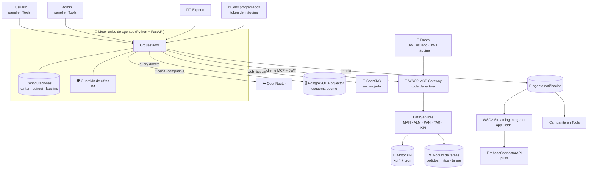

# ⚙️ Agentes de IA de Trazalog — Arquitectura Técnica

## Objetivo

Qué es: la arquitectura de referencia de los agentes de IA de Trazalog (Kuntur, Quirqui y Faustino): componentes, reglas duras, contrato entre agentes, modelo de datos nuevo, integraciones y las decisiones de arquitectura **ADR-A1 a ADR-A11**. Para quién: PM, arquitecto y quien desarrolle (Claude Code incluido). Cuándo leerlo: **completo, antes de escribir código** de cualquier tarea `AGENTE-*`. Qué NO cubre: el caso de negocio ([`AGENTES_TRAZALOG_ARQUITECTURA_FUNCIONAL.md`](AGENTES_TRAZALOG_ARQUITECTURA_FUNCIONAL.md)), el orden de trabajo ([`PROMPT_CC_AGENTES_TRAZALOG.md`](PROMPT_CC_AGENTES_TRAZALOG.md)) ni cómo quedó implementado lo ya construido ([`doc/agente/arquitectura.md`](../agente/arquitectura.md)).

**Audiencia:** PM / Arquitecto / Desarrollo · **Versión:** 2.0 · **Octubre 2026**
**Changelog v2.0 (2026-10-27):** tres agentes sobre un motor único (ADR-A7); solo lectura y cifras con fuente obligatoria (ADR-A8); plan de acción sobre el módulo de tareas y objetivos sobre el motor de KPIs (ADR-A9); token de máquina emitido por Dnato (ADR-A10); conocimiento multi-vertical (ADR-A11); identidad visual de los agentes; reglas R1–R11; contrato Coach ↔ Asistente.
**Changelog v1.1 (septiembre 2026):** entrevistador, canales, alertas vía AssetPlanner, feedback, DocTest, rama `develop-v3.5`. Se llamaba `AGENTE_MINERO_ARQUITECTURA_TECNICA.md`.

---

## 🏗️ Componentes

**Regla central:** 🧠 el cerebro razona vía **router**; 📚 el conocimiento por **query directa a pgvector**; 🔌 los datos del cliente **siempre vía MCP**, con el JWT del usuario o el de máquina (aislamiento `empr_id`); 🔎 lo que viene de internet, **con URL citada**; 🔔 las notificaciones por **cola propia → Streaming Integrator → Firebase**; los agentes **leen, nunca escriben** sobre datos del negocio.

---

## 🤖 Un motor, tres configuraciones

Cada agente es una **fila de configuración**, no un servicio aparte. Agregar un cuarto agente es agregar una configuración.

| Campo de la configuración | Kuntur (Coach) | Quirqui (Asistente) | Faustino (Entrevistador) |
|---|---|---|---|
| Quién lo puede usar | Rol `admin` de Dnato (R1) | Todo usuario de la empresa | Expertos y curadores de Trazalog |
| Prompt | `prompts/kuntur.md` + `prompts/kuntur-entrevista.md` | `prompts/quirqui.md` | `prompts/entrevistador.md` (hoy) |
| Tools permitidas | Lectura: `kpi_get_*`, `tar_get_*`, `man_get_*`, `alm_get_*`, `pan_get_*`, `core_get_*`, `web_buscar`, mediciones de Quirqui | Lectura: `man_get_*`, `alm_get_*`, `pan_get_*`, `core_get_*`, `tar_get_*`, `kpi_get_valor`, `web_buscar` | Lectura para priorizar la agenda |
| Disparadores | Primer ingreso del admin, cambio de contexto, desvío de KPI, cierre de ventana de medición | Apertura de pantalla, consulta, evento operativo (job), pedido de medición | Sesión iniciada por el experto |
| Fuentes de conocimiento | Industria (su vertical + general) + empresa completa | Industria (su vertical + general) + empresa **sin** planes ni objetivos del admin | Industria |
| Autonomía | Proponer (fija) | Proponer (fija) | Proponer (fija) |
| Identidad | Nombre, personalidad, avatar y estados | ídem | ídem |

Los textos visibles y las instrucciones viven en **archivos de recursos** (`prompts/`, `recursos/es/`) para poder traducirlos. La identidad (nombre y avatar) la configura Trazalog y es **igual para todos los clientes**.

---

## 📏 Reglas duras

Ninguna se puede desactivar por configuración. Cada una tiene al menos un test automático.

| # | Regla |
|---|---|
| R1 | **Kuntur solo interactúa con `admin` de Dnato.** No existe pantalla, notificación ni mensaje de Kuntur para otro rol. Hoy `admin` no es un rol por empresa (deuda conocida) |
| R2 | **Ningún agente crea ni asigna tareas.** Kuntur propone un pedido de trabajo en estado "propuesta"; una persona lo aprueba y asigna con el módulo de tareas |
| R3 | **Quirqui le informa a Kuntur datos medidos del sistema** (de actividades, equipos o una persona), **nunca contenido de conversaciones ni juicios del modelo sobre personas.** El contrato es cerrado: un campo nuevo requiere cambiar este documento |
| R4 | **Toda cifra que diga un agente tiene origen**: una tool de lectura llamada en esa corrida, o una búsqueda web con su URL citada en la respuesta. Si una cifra no tiene origen, **la respuesta se bloquea**, el usuario ve "no tengo datos para responder eso" y la corrida queda con un incidente |
| R5 | **Los agentes solo proponen.** No hay nivel de autonomía superior en esta versión |
| R6 | **Cada agente hereda los permisos del usuario que lo invoca** (su JWT) y no puede leer más que él. Los jobs usan el JWT de máquina de **una** empresa |
| R7 | **Ningún dato de una empresa llega a otra**, por ninguna vía, ni anonimizado ni promediado. Lo único compartido es el conocimiento de la industria, revisado por una persona y sin cifras |
| R8 | **Cada corrida queda registrada**: agente, disparador, entradas, tools llamadas con su respuesta, salida, costo, regla aplicada e incidentes |
| R9 | *(descartada en v2.0: los agentes no escriben, no hay nada que deshacer)* |
| R10 | **Todo plan de acción lleva su medición programada.** Un plan sin medición no se puede proponer |
| R11 | **El administrador ve todo lo que Kuntur pidió medir**, incluidas las mediciones sobre personas, y puede cancelarlo. Ningún otro usuario ve esa lista. Quirqui muestra siempre un **aviso permanente** de que lo que se trabaja con él se usa para medir indicadores (texto sujeto a revisión legal) |
| R12 | *(descartada en v2.0: retención nula del proveedor de modelos no es requisito)* |

---

## 🔁 Contrato Kuntur ↔ Quirqui

Es un intercambio de **datos por tablas**, no una conversación entre agentes.

| Tabla (esquema `agente`) | Escribe | Lee | Campos |
|---|---|---|---|
| `medicion_pedida` | Kuntur | Quirqui (job), admin | `empr_id`, indicador (KPI o consulta de tool), alcance (`actividad` / `equipo` / `persona`) + id, frecuencia, vigencia desde/hasta, `petr_id` del plan, estado (`activa` / `cancelada` / `vencida`) |
| `medicion_resultado` | Quirqui (job) | Kuntur, admin | `medicion_id`, fecha, valor, detalle JSON, tool de origen |
| `avance_plan` | Quirqui (job) | Kuntur, admin | `petr_id`, tarea, estado, fechas plan y real, responsable, resultado |

**Prohibido por diseño:** ninguna de estas tablas tiene columnas de texto libre que puedan llevar contenido de `agente.interaccion`; el rol del job no tiene `SELECT` sobre `interaccion`. Hay un test que lo verifica.

---

## 🗄️ Modelo de datos nuevo

Todo como scripts versionados en `db/agente/` (numerados, idempotentes, con rollback, con RLS por `empr_id` donde corresponda), salvo lo del motor KPI y TAR, que va en sus propios scripts de versión.

| Objeto | Para qué | Dónde |
|---|---|---|
| `agente.agente` | Configuración de cada agente (campos de la tabla de arriba) | `db/agente/` |
| `agente.interaccion` + columnas `agente`, `disparador`, `costo_tokens`, `regla`, `incidente` | La corrida (R8) | `db/agente/` (ampliación) |
| `agente.tool_llamada` | Cada tool llamada en una corrida, con su respuesta cruda (insumo del guardián R4) | `db/agente/` |
| `vertical` en `chunk`, `fuente`, `tema`, `hecho`, `perfil_empresa` | Conocimiento multi-vertical (ADR-A11) | `db/agente/` |
| `agente.perfil_empresa` | Lo que Kuntur aprendió en la entrevista (vertical, equipos críticos, frecuencias, roles) como datos estructurados | `db/agente/` |
| `agente.medicion_pedida`, `medicion_resultado`, `avance_plan` | Contrato Kuntur ↔ Quirqui | `db/agente/` |
| `kpi.historico` | Serie de valores (hoy `kpi.cache` se pisa) | scripts del motor KPI |
| `kpi.objetivos` + `kpi.desvios()` | Metas por empresa y KPI, y detección de desvío | scripts del motor KPI |
| Estado `propuesta`, origen `agente` y KPI objetivo en el pedido de trabajo | Plan de acción (ADR-A9) | scripts del módulo de tareas |

---

## 🔌 Integraciones

- **Motor de KPIs** (`kpi.definiciones` / `kpi.cache` / `kpi.correr()` por cron cada 5 minutos, en producción desde 2026-10-24). Los KPIs nuevos de cada vertical son **filas en `kpi.definiciones`**. Se le suman historia, objetivos y desvíos, y se expone por tools `kpi_get_valor`, `kpi_get_historico`, `kpi_get_objetivos`, `kpi_get_desvios` en la fachada MCP. La medición por persona usa `valor_json`.
- **Módulo de tareas (TAR)** — Pedidos de Trabajo → Hitos → Tareas, con bandeja en Bonita. Necesita, antes de que Kuntur lo use: aislamiento por empresa completo, fechas plan y real separadas, una API de negocio (`toolsTARAPI`) y tools de lectura `tar_get_*`, y el estado "propuesta". Ver la especificación del módulo TAR.
- **Dnato** — emite el JWT de usuario (OAuth PKCE, como hoy) y **el JWT de máquina por `client_credentials`** (ADR-A10).
- **Catálogo DocTest** — cada caso de uso declara su pantalla, flujo y validaciones; se ingesta como conocimiento para que Quirqui sepa qué se hace en cada pantalla.
- **Alertas** — cola `agente.notificacion` → app Siddhi → `FirebaseConnectorAPI`, y campanita en Tools (decisión de E0, Opción C). Cada notificación lleva el agente emisor y su avatar.

---

## 🎨 Identidad visual

| Agente | Personaje | Uso |
|---|---|---|
| Kuntur | Cóndor humanizado, vestido de minero / oil & gas | Panel del Coach, notificaciones al admin |
| Quirqui | Quirquincho humanizado, vestido de minero | Panel lateral del Asistente, notificaciones al equipo |
| Faustino | Humano con el aire de Sarmiento | Pantalla de entrevista |

Cada uno tiene un juego de **estados** (saludo, escuchando, pensando, hablando, alerta, despedida) en imágenes fijas animadas con CSS; el componente cambia de estado según la corrida. Las imágenes se generan con modelos de licencia libre. El detalle está en [`doc/agente/identidad.md`](../agente/identidad.md).

---

## 🔐 Decisiones técnicas (ADRs de los agentes)

- **ADR-A1 — Modelo configurable vía OpenRouter.** LLM como parámetro; failover; pago unificado desde Argentina; routing por costo/calidad. *Vigente.*
- **ADR-A2 — RAG por acceso directo, NO vía MCP.** El conocimiento es maquinaria interna. *Vigente.*
- **ADR-A3 — Datos del cliente SIEMPRE vía MCP.** Con el token del usuario o, en jobs, el token de máquina de esa empresa (ADR-A10). *Vigente, ampliado.*
- **ADR-A4 — Conocimiento compartido solo con revisión humana.** Memoria por empresa automática y aislada; lo compartido pasa por cola de candidatos + curaduría, sin cifras ni referencia a empresas. *Vigente.*
- **ADR-A5 — Canal MVP: panel embebido en Tools; WhatsApp fase 2; app diferida.** *Vigente; el chat pasa a panel con contexto de pantalla.*
- **ADR-A6 — Notificaciones: cola propia + Streaming Integrator + `FirebaseConnectorAPI`** (Opción C de E0). *Vigente; ahora para los dos agentes.*
- **ADR-A7 — Un motor único con configuraciones por agente** (2026-10-27). Cada agente declara quién lo usa, prompt, tools permitidas (lista blanca), disparadores, fuentes, autonomía e identidad. **Por qué:** el comportamiento común (aislamiento, auditoría, guardián, permisos) se escribe y se prueba una sola vez; un agente nuevo es una configuración.
- **ADR-A8 — Agentes de solo lectura, con cifras de origen comprobable** (2026-10-27). Los agentes dicen cómo hacer, no lo hacen: las tools de escritura (`man_create_ot`, `alm_crear_pedido_materiales`) quedan fuera de toda lista blanca. Toda cifra sale de una tool de la corrida o de `web_buscar` con URL citada; si no, se bloquea la respuesta (R4). `web_buscar` usa **SearXNG autoalojado** (costo $0). **Por qué:** el riesgo de un agente es afirmar una cifra plausible y falsa, o ejecutar algo que nadie revisó.
- **ADR-A9 — El plan de acción es un pedido de trabajo del módulo de tareas en estado "propuesta"; los objetivos viven en el motor de KPIs** (2026-10-27). **Por qué:** el módulo de tareas ya tiene asignación, bandeja y seguimiento, y el motor de KPIs ya calcula por empresa con cron; duplicarlos en el esquema del agente sería un segundo sistema de tareas y otro de indicadores.
- **ADR-A10 — Token de máquina emitido por Dnato con `client_credentials`, un cliente por empresa** (2026-10-27). El JWT lleva el `empr_id` y lo valida el APIM igual que el de usuario. **Por qué:** los avisos y mediciones corren sin nadie conectado; es el mecanismo estándar y no requiere usuarios fantasma con contraseña.
- **ADR-A11 — Conocimiento multi-vertical** (2026-10-27). El producto sirve para industrias extractivas y de proceso (hoy minería, oil & gas, electricidad). La **vertical** es metadato del conocimiento, de la taxonomía de Faustino y del perfil de la empresa; la búsqueda trae lo de la vertical de la empresa más lo `general`. **Por qué:** el mismo motor y los mismos agentes sirven a todas; cambia el contenido, no el código.

---

## 💵 Costos por etapa de madurez

| Etapa | Infra | Costo IA (variable) | Total aprox. mensual |
|---|---|---|---|
| 🧪 **Versión inicial** (1 cliente piloto) | 1 VM chica + pgvector + SearXNG | ~US$5-15 | **~US$30-50** |
| 🌱 **MVP comercial** (3-5 clientes) | 1 VM mediana | ~US$25-50/cliente | **~US$150-300** |
| 📈 **Escala** (20+ clientes) | VM dedicada + routing optimizado | ~US$5-30/cliente | **cubierto por suscripciones** |

> El costo de IA se traslada vía suscripción (objetivo: ≤30 % del precio del tier). La premisa "costo $0" no aplica a esta capa.

---

## ⚠️ Riesgos

1. **La calidad del conocimiento**, por vertical. Abrir oil & gas o electricidad sin carga inicial de expertos da un agente genérico.
2. **Kuntur depende de dos frentes ajenos** (módulo de tareas y motor de KPIs). Si se demoran, Kuntur se demora; Quirqui no.
3. **El guardián de cifras puede bloquear de más** (fechas, códigos de equipo, "en 3 pasos"). Se ajusta con los incidentes registrados.
4. **Mediciones sobre personas**: el aviso permanente y su texto requieren revisión legal antes de salir a clientes.
