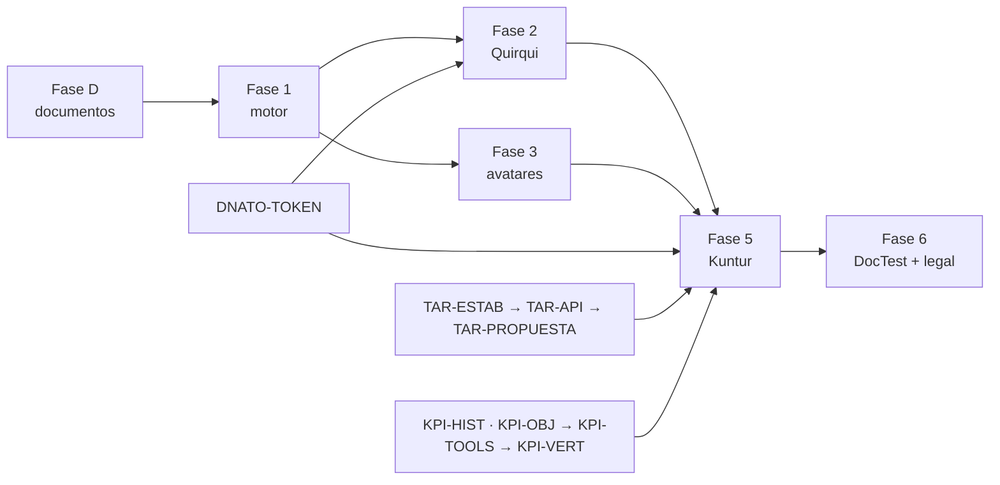

# Prompt para Claude Code — Agentes de IA de Trazalog v3.5 (Kuntur, Quirqui, Faustino)

## Objetivo

Qué es: el plan de trabajo ejecutable del frente de agentes de IA en la rama `develop-v3.5` de `traz-tools`: fases, tareas, dependencias, gates y qué modelo de Claude conviene para cada una. Para quién: Claude Code (que lo ejecuta tarea por tarea) y el PM (que aprueba cada gate). Cuándo leerlo: al abrir cualquier sesión de trabajo sobre una tarea `AGENTE-*`. Qué NO cubre: la arquitectura (está en [`AGENTES_TRAZALOG_ARQUITECTURA_TECNICA.md`](AGENTES_TRAZALOG_ARQUITECTURA_TECNICA.md), leela completa antes de codificar), el caso de negocio ([`AGENTES_TRAZALOG_ARQUITECTURA_FUNCIONAL.md`](AGENTES_TRAZALOG_ARQUITECTURA_FUNCIONAL.md)) ni el estado de avance ([`STATE.md`](STATE.md)).

**Versión:** 2.0 · **2026-10-27** · reemplaza a la v1 (`PROMPT_CC_AGENTE_MINERO.md`, etapas E0–E6, de las que E0–E4 quedaron mergeadas en los PRs #498–#504).

---

## Contexto

Lo construido en E0–E4 sigue vigente y es la base de todo: esquema `agente.*` con RLS, orquestador FastAPI con RAG sobre pgvector, cliente MCP y OpenRouter, chat PHP (`traz-comp-agente`) con OAuth PKCE contra Dnato, feedback, entrevistador de expertos, Streaming Integrator instalado. Lo que cambió el 2026-10-27:

- El agente único pasa a ser **tres agentes sobre un motor** (ADR-A7): **Kuntur** (Coach del administrador), **Quirqui** (Asistente del equipo) y **Faustino** (Entrevistador de expertos, lo que hoy es E4).
- Los agentes **solo leen** y **toda cifra tiene origen** o se bloquea (ADR-A8).
- El plan de acción de Kuntur es un **pedido de trabajo del módulo de tareas** y sus objetivos viven en el **motor de KPIs** (ADR-A9).
- Los jobs usan un **token de máquina de Dnato** (ADR-A10).
- El conocimiento es **multi-vertical**: minería, oil & gas, electricidad (ADR-A11).
- Los tres tienen **nombre y avatar animado**, visibles en cada uso y en cada notificación.

## Reglas de trabajo

1. **Rama base:** `develop-v3.5`. Cada tarea en su rama `<tipo>/<ID>-<desc>` y PR contra `develop-v3.5` con el formato de descripción del `CLAUDE.md`. Merge commit, nunca squash. Máximo 2 PRs abiertos.
2. **Stack:** el de la arquitectura técnica. Python 3.11+ / FastAPI para el motor; PHP/CodeIgniter para las vistas; PostgreSQL + pgvector; WSO2 para todo acceso a datos del negocio; LLM solo vía OpenRouter, modelo por variable de entorno.
3. **Aislamiento innegociable:** datos del negocio solo vía MCP con JWT (de usuario o de máquina). Cada tabla nueva del esquema `agente` con RLS por `empr_id` y su test de aislamiento corriendo con `SET ROLE agente_app`, nunca como superusuario.
4. **Base de datos:** scripts SQL numerados, idempotentes y con rollback en `db/agente/` (o en los scripts de versión del motor KPI y de TAR cuando el objeto es de ellos).
5. **Pruebas para todo:** pytest (OpenRouter mockeado), Hurl para endpoints, aislamiento, y los derivados DocTest. Smoke real solo opt-in.
6. **Documentación:** en `doc/agente/`, indexada desde el `README.md`. Todo `.md` nuevo abre con `## Objetivo`.
7. **Costos:** desarrollo con modelos baratos; ningún servicio pago nuevo sin consultar. SearXNG autoalojado para la web.
8. **Lo que dice el PM se registra:** cada decisión nueva va a `STATE.md` (y a un ADR-A si es de arquitectura) en el mismo PR.
9. **Modelo de Claude por tarea:** la columna "Modelo" de cada fase. Cuando una tarea corresponde a **Sonnet**, Claude Code **corta y le avisa al PM** antes de seguir, para que cambie con `/model`.

## Fases y tareas

Clase: 🟢 sin efecto en runtime · 🟡 código · 🔴 decisión del PM o arquitectura. ⛔ = depende de otro frente.

### Fase D — Documentos (este PR)

| ID | Tarea | Clase | Modelo |
|---|---|---|---|
| AGENTE-DOC-01 | Anclas renombrados y reescritos (funcional 2.0, técnico 2.0 con ADR-A7–A11, este prompt 2.0) | 🔴 | Opus |
| AGENTE-DOC-02 | `doc/agente/identidad.md`: ficha de cada personaje, estilo, estados, proceso de generación | 🔴 | Opus |
| AGENTE-DOC-03 | Lenguaje "multi-vertical" en `doc/agente/` (los prompts y los textos de UI se renombran en M-01; los nombres de infraestructura —base `agente_minero`, `~/.agente-minero.env`, empresa de prueba, ítem de menú en `seg.menues`— **se mantienen**: renombrarlos rompe entornos armados sin aportar nada al usuario) | 🟢 | Opus |
| AGENTE-DOC-04 | `README.md` con índice de los docs de agentes; CONTEXT-PACK con la serie ADR-A; `STATE.md` con el frente redefinido | 🟢 | Opus |

**Gate:** el PM aprueba el PR y la ficha de los personajes.

### Fase 1 — Cimientos del motor

| ID | Tarea | Depende de | Clase | Modelo |
|---|---|---|---|---|
| AGENTE-M-01 | Tabla `agente.agente` con la configuración (quién lo usa, prompt, tools permitidas, disparadores, fuentes, autonomía, identidad); seed de Kuntur, Quirqui y Faustino; el orquestador carga la configuración por clave. Renombrar `prompts/agente-minero.md` → `prompts/quirqui.md` y los textos de UI "Agente Minero" | — | 🟡 | Opus |
| AGENTE-M-02 | Lista blanca de tools por agente; cada tool con clase (lectura / generación), costo y riesgo; las de escritura fuera de toda lista. Test: un agente no puede invocar una tool fuera de su lista | M-01 | 🟡 | Opus |
| AGENTE-M-03 | Corrida auditable (R8): columnas nuevas en `interaccion` y tabla `agente.tool_llamada` | M-01 | 🟡 | Opus |
| AGENTE-M-04 | Guardián de cifras (R4): extrae números de la respuesta, los busca en las respuestas de tools de la corrida o en citas web; si falta origen, bloquea, responde "no tengo datos para responder eso" y registra incidente. Tests de bordes (fechas, códigos de equipo, "3 pasos") | M-03 | 🟡 | Opus |
| AGENTE-M-05 | Tool `web_buscar` sobre SearXNG autoalojado (en `docker-compose.dev.yml`), devuelve título + URL + extracto; el prompt obliga a citar | M-02 | 🟡 | Opus |
| AGENTE-M-06 | Base de conocimiento ampliada: ingestar `ayuda/*.html` y `doctest/catalogo/**/*.yaml` (con metadato de pantalla/ruta) y documentos de la empresa | — | 🟡 | Opus |
| AGENTE-M-07 | **Gate 2 (PM):** los 6 bloques de `prompts/quirqui.md` y la taxonomía de Faustino reorganizada por vertical | PM | 🔴 | — |
| AGENTE-M-08 | Multi-vertical (ADR-A11): `vertical` en `chunk`, `tema` y `perfil_empresa` (el hecho la hereda del tema, ver D-32); la búsqueda filtra por la vertical de la empresa + `general`; ingesta y entrevistador piden la vertical. Test: una empresa de oil & gas no recibe lo marcado solo `mineria` | M-06 | 🟡 | Opus |

### Fase 2 — Quirqui, el Asistente

| ID | Tarea | Depende de | Clase | Modelo |
|---|---|---|---|---|
| AGENTE-AS-01 | Panel lateral en el layout de Tools con contexto de pantalla (módulo, controller, método, registro abierto); ruta → caso de uso DocTest → ayuda; aviso permanente de medición y botón "qué se mide" | M-01, M-06 | 🟡 | Opus |
| AGENTE-AS-02 | Siguiente paso y propuestas al propio usuario a partir de tools de lectura; el usuario acepta o descarta | M-02 | 🟡 | Opus |
| AGENTE-AS-03 | Avisos operativos proactivos (cierra la vieja E5): jobs con token de máquina, cola `agente.notificacion`, app Siddhi `_backend/siddhi/agente-alertas.siddhi`, `FirebaseConnectorAPI` y campanita. Antes: corregir el `faultSequence` vacío del connector, rotar y sacar la clave de Firebase commiteada, y definir dónde vive la base del agente | M-03, ⛔ DNATO-TOKEN | 🟡/🔴 | Opus |
| AGENTE-AS-04 | Contrato con Kuntur, lado Quirqui: `medicion_pedida`, `medicion_resultado`, `avance_plan`; job que ejecuta las mediciones vigentes; test de que nada de `interaccion` sale | M-03, ⛔ TAR-API, ⛔ KPI-TOOLS | 🟡 | Opus |
| AGENTE-AS-05 | Tests: pytest, Hurl y aislamiento ampliado a las tablas nuevas | todas | 🟡 | Opus |

### Fase 3 — Identidad y avatares (en paralelo con la Fase 2)

| ID | Tarea | Clase | Modelo |
|---|---|---|---|
| AGENTE-ID-03 | Generar la imagen base de cada personaje con Qwen-Image (Space de Hugging Face) y los estados con Qwen-Image-Edit partiendo de la base; quitar fondo, normalizar, exportar a `assets/agentes/<clave>/<estado>.webp`; registrar prompts y semillas en `identidad.md` | 🟢 | **Sonnet** |
| AGENTE-ID-04 | Animación CSS por estado (parpadeo, respiración, balanceo); loop de video opcional con Wan 2.2 para el reposo del panel | 🟢 | **Sonnet** |
| AGENTE-ID-05 | Componente PHP/JS `avatar_agente`: nombre + avatar + estado ligado a la corrida; lo usan el panel de Quirqui, la pantalla de Kuntur y la de Faustino | 🟡 | **Sonnet** |
| AGENTE-ID-06 | Avatar y nombre en todas las notificaciones: campanita, push FCM (`image`), mail si existe | 🟡 | **Sonnet** |

### Fase 4 — Prerrequisitos de Kuntur (frentes propios, en paralelo)

| ID | Frente | Qué necesita Kuntur | Clase | Modelo |
|---|---|---|---|---|
| DNATO-TOKEN | Dnato (`traz-comp-dnato`) | `client_credentials`, un cliente por empresa, JWT con `empr_id`, validado por el APIM | 🔴 | Opus |
| TAR-ESTAB | Módulo de tareas | Aislamiento por empresa, fechas plan y real separadas, DDL versionado | 🔴 | Opus |
| TAR-API | Módulo de tareas | `toolsTARAPI` con operaciones completas y tools de lectura `tar_get_pedidos`, `tar_get_hitos`, `tar_get_tareas`, `tar_get_atrasadas` | 🟡 | Opus |
| TAR-PROPUESTA | Módulo de tareas | Estado "propuesta", origen agente, aprobación del planificador, KPI objetivo en el pedido | 🔴 | Opus |
| KPI-HIST | Motor KPI | `kpi.historico` + inserción en `kpi.publicar()` | 🟡 | Opus |
| KPI-OBJ | Motor KPI | `kpi.objetivos` + `kpi.desvios()` | 🟡 | Opus |
| KPI-TOOLS | Motor KPI | `kpi_get_valor`, `kpi_get_historico`, `kpi_get_objetivos`, `kpi_get_desvios` en `ToolsKPIDataService` y la fachada MCP | 🟡 | Opus |
| KPI-VERT | Motor KPI | Definiciones por vertical del documento de KPIs del PM (filas en `kpi.definiciones`) | 🟡 | **Sonnet** |

### Fase 5 — Kuntur, el Coach

| ID | Tarea | Depende de | Clase | Modelo |
|---|---|---|---|---|
| AGENTE-CO-01 | Solo `admin` (R1) en menú, controller y orquestador; test de que un `user` no ve ni invoca a Kuntur por ninguna vía | M-01 | 🟡 | Opus |
| AGENTE-CO-02 | Entrevista de configuración (reusa el entrevistador, prompt propio); respuestas en `agente.perfil_empresa`, incluida la vertical; una regla propone la configuración; se aplica solo con confirmación; interrumpible | M-01, M-08 | 🟡 | Opus |
| AGENTE-CO-03 | Objetivos de KPI conversados que terminan en `kpi.objetivos`, confirmados por el admin | ⛔ KPI-OBJ, KPI-TOOLS | 🟡 | Opus |
| AGENTE-CO-04 | Desvío → diagnóstico con causa → plan de acción como pedido de trabajo "propuesta", con impacto estimado, sugerencia de responsable y medición programada (R10) | ⛔ TAR-PROPUESTA, KPI-HIST | 🟡 | Opus |
| AGENTE-CO-05 | Medición del plan (antes/después en `kpi.historico`); si funcionó, candidato a práctica sin cifras a la cola de curaduría | CO-04 | 🟡 | Opus |
| AGENTE-CO-06 | Pedidos de medición a Quirqui y pantalla del admin para verlos y cancelarlos (R11) | AS-04 | 🟡 | Opus |
| AGENTE-CO-07 | Avisos al admin (desvíos y lo importante) por el mismo puente de AS-03, firmados por Kuntur | AS-03 | 🟡 | Opus |
| AGENTE-CO-08 | Recomendaciones de funciones sin usar, con evidencia | M-02 | 🟡 | Opus |

### Fase 6 — DocTest y cierre

| ID | Tarea | Clase | Modelo |
|---|---|---|---|
| AGENTE-DT-01 | Catálogo `doctest/catalogo/agente/AGENTE-UC-NNN.yaml` — **gate del PM antes de derivar**. Quirqui: explicar pantalla, responder con cita, proponer al propio usuario, aviso operativo, informar avances, ejecutar medición. Kuntur: entrevista, objetivo, desvío y diagnóstico, plan, medir plan, pedir medición, recomendar. Transversales: configurar agente, auditar corrida, Kuntur invisible para `user`, medición sin aviso individual, sin cruce entre empresas, cifra sin fuente bloqueada | 🔴 | Opus |
| AGENTE-DT-02 | Derivados: ayuda HTML (tuteo argentino), Playwright, Hurl, Gherkin | 🟢 | **Sonnet** |
| AGENTE-LEGAL-01 | Revisión legal única: aviso de medición (Ley 25.326, LCT), derechos sobre imágenes generadas por IA, registro de marca de Kuntur, Quirqui y Faustino | 🔴 | — (PM) |

## Orden y dependencias

Quirqui no depende de los frentes de tareas ni de KPIs salvo para AS-04, que va al final de su fase. Kuntur no arranca hasta que TAR-API y KPI-TOOLS estén mergeados.

## Fuera de alcance en esta versión

Interacción de Kuntur con el equipo; asignación automática de tareas; cualquier escritura de un agente sobre datos del negocio; comparaciones entre empresas; escalamiento por encima del admin; voz; WhatsApp; telemetría de atascos en el frontend; identidad configurable por empresa; agentes que hablen con clientes o proveedores externos.

## Definition of Done global

- [ ] Fases 1, 2, 3 y 5 con todas sus tareas en PRs mergeados y revisados por el PM
- [ ] Tests en verde (pytest + Hurl + Playwright de DocTest) con un comando único documentado
- [ ] Tests de las reglas: R1 (Kuntur invisible para `user`), R2/R5 (ninguna tool de escritura invocable), R3 (nada de `interaccion` sale), R4 (cifra sin fuente bloqueada), R7 (aislamiento), R10 (plan sin medición rechazado), R11 (lista de mediciones solo para el admin)
- [ ] Circuito end-to-end en desarrollo: consulta con cita → aviso proactivo recibido con avatar → objetivo fijado → desvío → plan propuesto → asignado por una persona → medido
- [ ] `README.md` indexando toda la documentación; `STATE.md` al día
- [ ] Revisión legal hecha antes de habilitar a un cliente real
