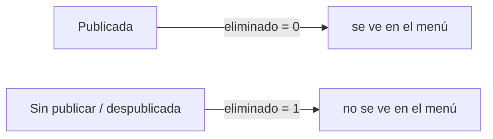

# Análisis de impacto — menú lateral de Tools (REQ-005)

| Campo | Valor |
|---|---|
| Tarea | REQ-005 · análisis de impacto (núcleo 🔴, antes de que la Consola escriba en `seg.menues`) |
| Fecha | 2026-11-27 |
| Aprueba | Rodolfo (puerta 🔴 antes de construir el Catálogo) |
| Pide | La Consola → Catálogo pasa a **escribir** en `seg.menues`, que es la tabla con la que Tools dibuja el menú de todas las pantallas de producción |

Este documento responde: dónde vive el menú, quién lo lee, qué escribe el Catálogo, qué pasa con el menú en
cada caso, qué se puede romper y por qué lo que hay hoy quedó así. No es el plan de REQ-005: es la condición
para poder arrancar a construir.

---

## 1. Dónde vive el menú (inventario)

El menú lateral de Tools se arma en **dos piezas**:

| Pieza | Archivo | Qué hace |
|---|---|---|
| La consulta | `COREDataService.dbs:8` (query `getMenuByUserPermission`) | Trae todas las filas de `seg.menues` con `eliminado = 0`, arma un árbol de 2 niveles y le pone a cada fila un `habilitado` (por permisos de `seg.menues_users_vw`) |
| El dibujo | `application/helpers/menu_helper.php` → función `menu()` | Recibe el JSON y arma el `<ul>` del sidebar (nivel 1 y nivel 2) |

**Cómo se pide** (evidencia en `application/logs/`, cientos de llamadas):

```
GET .../services/COREDataService/menuitems/porEmail/<correo>/porGrupo/<empresa>
```

El que lo dispara es `application/models/Dashs.php:26` (arma la URL con `REST_CORE`) y lo dibuja
`application/controllers/Dash.php::index()` (`menu($aux)`). El helper que se autoload es el compartido
(`application/helpers/menu_helper.php`).

> ⚠️ Como en la barra (REQ-004), hay **copias viejas** del helper: `menu_helper_andando_version0.1.php`
> (en `application/helpers/`) y `traz-comp-pan/helpers/menu_helper.php`. Son restos divergentes de una
> versión anterior. La viva es la compartida. **Nota para Rodolfo:** confirmar que en producción nadie
> dibuja el menú con una copia vieja de módulo; si la usara, mostraría el menú con la lógica anterior,
> pero no se rompe nada (igual que en REQ-004 con la barra).

**Los dos detalles que importan de ese código:**

1. La consulta filtra `eliminado = 0` en **los dos niveles** (la fila "borrada" no entra al árbol).
2. El orden sale de `camino`, que se arma **concatenando texto** (`orden || '.' || modulo || '.' || opcion`).
   Por eso ordena como texto: `"100"` queda antes que `"20"`.

Y un tercero, del helper:

3. Regla "**si ningún hijo está habilitado se muestran todos**" (`menu_helper.php:121-126`): cuando el padre
   está habilitado pero ningún hijo lo está, el helper muestra **todos los hijos** (los que estaban
   deshabilitados incluidos), para que la rama no quede vacía.

---

## 2. Qué escribe el Catálogo en `seg.menues`

La Consola → Catálogo hace **cuatro tipos de escritura** (todas nuevas, ninguna cambia el menú por sí sola):

| Escritura | Qué toca | Efecto en `seg.menues` |
|---|---|---|
| Opción nueva | inserta una fila | queda **sin publicar** ⇒ `eliminado = 1` |
| Editar textos/ícono/tipo/dirección | actualiza la fila | no cambia `eliminado` |
| Publicar / despublicar | cambia `eliminado` | publicada ⇒ `eliminado = 0`; despublicada ⇒ `eliminado = 1` |
| Reordenar | reescribe `orden` de los hermanos | números **del mismo largo** (110, 120, 130…) |

**Regla de oro de REQ-005:** "publicación" y `eliminado` van **siempre juntas**:



La razón es exactamente el detalle nº 3 de arriba: si una opción nueva quedara con `eliminado = 0` pero
"sin permiso", el helper la mostraría igual por la regla "si ningún hijo está habilitado se muestran
todos". Poniéndola `eliminado = 1`, la consulta directamente no la trae y **no aparece**, sin tocar el
código del menú de producción.

---

## 3. Qué pasa con el menú en cada escenario (lo que pide REQ-005)

Con un usuario de prueba que ya tiene el padre habilitado en su rol:

| Escenario | Qué pasa | Por qué |
|---|---|---|
| (a) Crear una opción **sin publicar** bajo un padre ya habilitado | **No aparece nada nuevo** en el menú | la fila queda `eliminado = 1`, el `WHERE eliminado = 0` del árbol la excluye |
| (b) Reordenar un módulo | **Cambia solo el orden** (nada se agrega ni se pierde) | se reescriben los `orden` con números del mismo largo, y el orden es por `camino` (texto); número y texto coinciden |
| (c) Despublicar una opción | La opción **desaparece** del menú de las empresas que la tenían | pasa a `eliminado = 1` |
| (c') Volver a publicarla | La opción **vuelve a aparecer** con los mismos textos y planes | vuelve a `eliminado = 0` |

**Conclusión de impacto:** el Catálogo **no cambia** `getMenuByUserPermission` ni `menu_helper`. Solo
escribe datos en `seg.menues` respetando las reglas que ese código ya lee. El menú se comporta como hoy
ante cualquier fila con `eliminado` 0 ó 1.

---

## 4. Riesgos

### 🔴 4.1 El orden alfabético como texto (por qué se renumera y no se toca la consulta)

Hoy el menú ordena por texto. Si el superusuario pusiera ordenes "1, 2, … 10, 11", el menú mostraría
"1, 10, 11, 2, …". La solución **no es tocar la consulta** (es núcleo, la consume v2): es **renumerar en
los datos** con números del mismo largo (por ejemplo 010, 020, 030…), de modo que el orden de texto y el
de número coincidan siempre.

- Al guardar el orden, el Catálogo renumera a los hermanos del módulo en pasos iguales.
- El único efecto visible: el orden cambia. Nada se agrega, se pierde ni se rompe.

### 🟠 4.2 Filas viejas con `eliminado = 1` pero `publicacion = 'publicada'`

REQ-004 agregó la columna `publicacion` con valor por defecto `'publicada'`, y **no** reconcilió las filas
que ya tenían `eliminado = 1` (las que se "borraron" desde DNATO en su momento). Consecuencia lógica:
**puede haber filas que hoy tienen `eliminado = 1` pero la Consola las mostraría como "publicadas"** (y
viceversa: no aparecen en el menú pero figuran publicadas en el Catálogo).

> *(Supuesto mío: esto se confirma contra la base de DEV antes de construir; si no hay ninguna fila con
> `eliminado = 1`, el punto desaparece.)*

**Propuesta (es la duda 17 ya validada por Pablo):** hacer una reconciliación de una sola vez en el
script de REQ-005: `eliminado = 1` ⇒ `publicacion = 'despublicada'`; `eliminado = 0` ⇒ `publicacion =
'publicada'`. Es un ajuste de datos, aditivo, y deja el catálogo consistente antes de abrir la pantalla.

### 🟠 4.3 DNATO sigue leyendo la misma tabla

DNATO tiene su ABM de menú ("Menues", A-18) y su "Menú por rol" (A-19) que leen y escriben `seg.menues`.
Como publicación y `eliminado` comparten la misma marca, un "despublicar" desde la Consola se ve en DNATO
como "borrado" (y un alta/borrado desde DNATO se ve en la Consola). **Esto es esperado y buscado** (los
dos hablan de lo mismo), pero conviene tenerlo presente: mientras convivan, los cambios de una pantalla
se reflejan en la otra. REQ-005 **no toca** DNATO ni su lógica.

### 🟢 4.4 El módulo MCP ya está en el menú (por REQ-004)

REQ-004 ya cargó las 25 herramientas del agente como filas `tool_mcp`, `publicada`, `eliminado = 0`, sin
permisos, y su módulo padre no está habilitado para nadie, así que **no aparecen** en el menú. El Catálogo
solo las lista y deja editar textos/publicación; no las vuelve a crear. (La aprobación de "agregar MCP a
los módulos válidos" ya quedó hecha en REQ-004; solo falta verificar el CHECK en DEV.)

---

## 5. Qué NO se toca

- `getMenuByUserPermission` (la consulta del menú).
- `menu_helper.php` (el dibujo del menú).
- Ningún recurso de `COREDataService` (los consumen v2 y DNATO).
- DNATO (su ABM y su "Menú por rol" siguen andando en paralelo).

---

## 6. Pruebas de regresión (para cerrar el análisis)

1. **Menú de Tools antes/después** con un usuario de prueba, en copia de DEMO (nunca producción):
   - (a) crear opción sin publicar ⇒ no aparece nada nuevo;
   - (b) reordenar un módulo ⇒ cambia solo el orden;
   - (c) despublicar y volver a publicar ⇒ aparece/desaparece la opción.
2. DocTest `regresion` en verde (el menú de los usuarios DocTest no cambió).
3. DNATO → "Menues" y "Menú por rol" siguen abriendo y mostrando las mismas opciones.
4. `phpcs` (PHP 5.6) y `./mvnw clean install` del proyecto de APIs en verde.

---

## 7. Recomendación

1. El Catálogo **solo escribe datos** en `seg.menues`; no toca la consulta ni el helper.
2. Mantener la regla publicación ↔ `eliminado` juntas (es lo que evita tocar el núcleo).
3. Renumerar el orden con números del mismo largo, **en los datos**, sin tocar la consulta.
4. Hacer la reconciliación de una sola vez de `eliminado` ↔ `publicacion` (4.2) en el script de REQ-005.
5. Verificar en DEV el CHECK de `seg.menues.modulo` (que ya incluya `MCP`) antes de construir.
