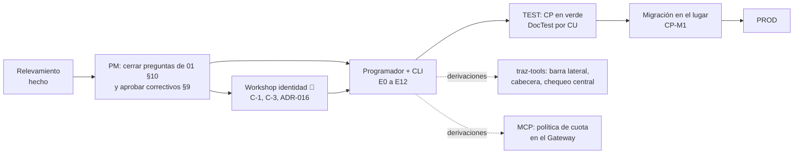

# DNATO v3 — Especificación completa (versión 0.5.1)

Carpeta destino en el repo: `traz-comp-dnato/doc/v3/dnato/` (con copia o enlace desde `traz-tools/doc/v3/`, donde viven los documentos canónicos).

| Archivo | Qué es | Quién lo usa |
|---|---|---|
| `00_README.md` | Este índice y el flujo de trabajo | Todos |
| `PROMPT_CC_DNATO_RELEVAMIENTO.md` | Prompt con el que Claude Code relevó el DNATO actual | Histórico |
| `DNATO_v2_RELEVAMIENTO.md` | **Lo que hay hoy**, con evidencia `ruta:línea` (lo produjo Claude Code el 2026-10-29) | Todos; es la fuente 1 del programador |
| `PROMPT_CC_FORMULARIOS_DINAMICOS_RELEVAMIENTO.md` · `FORMULARIOS_DINAMICOS_RELEVAMIENTO.md` | Prompt e informe del relevamiento de formularios dinámicos (2026-11-02) | Programador (E11b) |
| `01_ESPECIFICACION_FUNCIONAL.md` | Actores, conceptos sobre las entidades actuales, 65 RF y 16 RNF con columnas **Hoy** y **Dónde**, 33 CU, correspondencia con los UC DocTest existentes, correctivos previos, decisiones, preguntas | PM, programador, CLI |
| `02_MODELO_Y_REGLAS.md` | Qué entidad actual absorbe cada concepto nuevo; reglas de cálculo únicas R1–R8; servicios que DNATO expone a traz-tools y al Gateway; reglas G1–G10; UI; migración en el lugar; reparto de trabajo; ADR propuestos | Programador, CLI, frentes traz-tools y MCP |
| `03_CASOS_DE_PRUEBA.md` | Fixture sobre el modelo real, 75 CP indexados, Gherkin por CU, ejemplo DocTest con numeración continuada | Programador, CLI, DocTest |
| `mockups/index.html` + 20 páginas + `dnato.css` | Maquetas HTML, una por pantalla, con CU/RF/Dónde/Layout en cabecera y `data-*`. Portal de la empresa y Consola con layout propio; `tools-barra-superior.html` y `vista-esfumada.html` muestran lo que dibuja traz-tools; `registro-plan.html` es el paso nuevo del registro. Login, elegir empresa y OAuth no tienen maqueta (no se tocan) | Programador (navegador), CLI (como código) |
| `PROMPT_CLI_DNATO_V3_BUILD.md` | Prompt de construcción por entregas E0–E12 para la CLI del programador | PM → programador |

## Qué cambió en la 0.5 (revisión de la Consola por el PM, 2026-11-02)

- **Planes**: marca gratuito / de prueba (columna propia en el listado) con vencimiento opcional (sin vencimiento por default; cantidad + días/semanas/meses). Al vencer, la empresa queda en **plan vencido**: entra, pero todo se muestra fuera de plan e invita a un plan no gratuito; MCP rechazado; un gratuito se usa **una sola vez** por empresa (RF-26, RF-26b, CU-63); modificar un plan con suscriptores avisa cuántas empresas afecta, pide confirmación y notifica por correo cuando restringe (RF-16); la baja de un plan en uso sigue bloqueada.
- **Registro**: los planes gratuitos / de prueba se activan solos; los demás quedan pendientes de aprobación del súper usuario (RF-07). Nueva **notificación a infra** (Telegram y correo) por cada alta y pedido (RF-08) y reporte **Consola → Registros** (RF-29, CU-23).
- **Empresas**: "suspender" reemplaza a "bloquear"; listado y ficha con logo (o inicial), edición, acceso directo a los usuarios de la empresa (RF-22, RF-27).
- **Usuarios de la plataforma**: filtros, exportación, acceso desde Empresas, "Ver actividad" hacia la auditoría (RF-78).
- **Catálogo**: el súper usuario administra la estructura completa del menú global (RF-40, CU-24).
- **Consola** como aplicación aparte, solo para súper usuarios, con entrada desde Tools y desde el Portal (RF-46). El Portal muestra la marca Trazalog y el logo de la empresa.

## Qué cambió en la 0.4 (formularios dinámicos, 2026-11-02)

- Nueva sección **Formularios** en el Portal y **Formularios globales** en la Consola (RF-120 a 131, CU-70 a 76, CP-120 a 132, 3 maquetas): constructor de ítems con los tipos actuales, listas de opciones en línea, vista previa sin crear respuesta, "Usar como base" (copia explícita de un global), "Dónde se usa" (puntos de uso del mecanismo A), configuración al alta que reemplaza el clonado desde la empresa 9000.
- Decisiones D-16 a D-19 y ADR-020; regla R9; correctivos C-9 (endpoints de formularios sin sesión) y C-10 (`info_id` por `select_max`, DDL no versionado).

## Qué cambió en la 0.3 (comentarios del PM, 2026-11-02)

- **Portal de la empresa** separado del menú operativo de Tools, con diseño propio y acceso por botón "🏢 Mi empresa" en la barra superior (RF-45, D-13); el menú del perfil pierde "Usuarios".
- **Inicio** del Portal es de control (plan, lugares, cuota, avisos), no de KPIs; al programar se compara con la pantalla actual y se suma solo lo nuevo.
- **Registro** suma el paso "Elegí tu plan" con Freemium por default: 5 usuarios · Mantenimiento, Almacenes y Herramientas · 30 consultas MCP por semana (RF-07, CU-53).
- **Menú operativo**: jerarquía del catálogo; las opciones de otro plan quedan en su lugar, sombreadas y con el ícono del plan (RF-64, R3). Desaparece el grupo "Más en Trazalog".
- **Roles y accesos**: casilla sí/no, sin modo ver/operar (RF-77).
- **Menús**: se ven las dos direcciones (quién ve cada menú; qué menú tiene cada rol o persona) (RF-62).
- **Perfil**: foto con vista previa, cámara y avatares libres; teléfono; reglas de contraseña en vivo (RF-111).
- Maquetas: se quitaron login y elegir empresa; los modales se muestran al pie sin tapar la pantalla.

## Qué cambió respecto de la 0.1

- Se reescribió todo **sobre el DNATO real**: `core.empresas`, `seg.users`, `seg.memberships_users` + Bonita, `seg.menues` como catálogo, `seg.memberships_menues` como permiso de rol, `core.tablas` como variables, `seg.tokens` para invitaciones. Nada se crea donde ya hay algo que cumple el rol; los datos se migran en el lugar.
- Login, selección de empresa en el login, recuperación, autorregistro y OAuth quedan **como están**.
- El menú lo **dibuja traz-tools**; DNATO guarda definición y resolución. Es una derivación con contratos definidos (`02` §4).
- Se incorporaron los hallazgos del relevamiento como **prerrequisitos correctivos** (`01` §9) y las 40 observaciones de la revisión cruzada de la 0.1.
- El documento de arquitectura pasó a ser de **modelo y reglas**: el diseño físico es del programador.

## Flujo

## Pendiente para la versión 1.0

- Respuestas a `01` §10 (D-10, Me interesa por rol, multi-empresa consolidado, catálogo real de `seg.menues`, DDL de `seg.menues_users_vw`, aprobación de correctivos).
- RF-113+ con lo que surja de los UC DocTest existentes que no esté cubierto.
- Confirmación del frente MCP sobre el enganche de la política de cuota.
