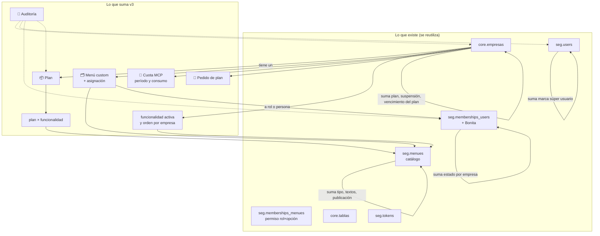
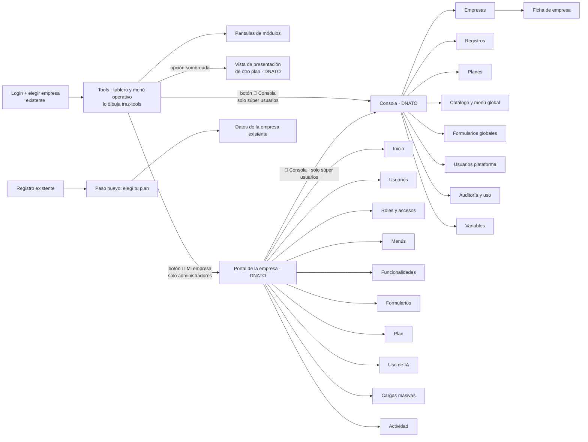

# DNATO v3 — Especificación funcional

| Campo | Valor |
|---|---|
| Versión | 0.5.1 (corrección de vencimiento de planes gratuitos / de prueba) |
| Fecha | 2026-11-02 |
| Base | `DNATO_v2_RELEVAMIENTO.md` (2026-10-29) + `FORMULARIOS_DINAMICOS_RELEVAMIENTO.md` (2026-11-02) + doc "Planes y súper usuario (base Portal T4)" + requerimientos nuevos del PM |
| Principio | **DNATO v3 se construye sobre el DNATO actual**: mismas tablas, mismos datos, mismos flujos de identidad. Lo nuevo se suma; nada se rehace de cero |
| Nivel | Especificación funcional. El diseño físico (columnas, SQL, servicios) es del programador |
| Documentos hermanos | `02_MODELO_Y_REGLAS.md`, `03_CASOS_DE_PRUEBA.md`, `mockups/index.html`, `PROMPT_CLI_DNATO_V3_BUILD.md` |

Convenciones:
- `RF-xx` requerimiento funcional · `RNF-xx` no funcional · `CU-xx` caso de uso · `CP-xx` caso de prueba.
- Columna **Dónde**: `DNATO` (se construye en `traz-comp-dnato`) · `traz-tools ⤴` (derivación: lo construye el repo tools, DNATO solo provee los datos) · `MCP ⤴` (frente MCP/WSO2) · `Existente` (ya está, no se toca) · `Correctivo 🔴` (arreglo de seguridad previo que requiere workshop/ADR según CLAUDE.md).
- Columna **Hoy** cita el CU del relevamiento (`A-nn`, `ID-nn`) o el UC del catálogo DocTest (`DNATO-UC-0nn`) sobre el que se apoya.

---

## 1. Resumen

- 🧱 **Qué hay hoy**: DNATO es la app de identidad de la suite (CodeIgniter 3.1.5 / PHP 5.6): login con selección de empresa, autorregistro freemium, ABM de usuarios y ban global, asignación de roles de Bonita (= membresías usuario↔empresa), catálogo de menú global y menú por (empresa, rol), carga masiva, servidor OAuth 2.1 que emite JWT con `empr_id`. Datos en PostgreSQL (`seg.*`, `core.*`, `sta.*`), parte directo y parte por WSO2 MI.
- 🎯 **Qué suma v3**: (1) **planes** por empresa con funcionalidades, tope de usuarios y cuota MCP, elegibles desde el registro (default Freemium); (2) **Consola del súper usuario** y **Portal de la empresa** como aplicaciones con diseño propio, separadas del menú operativo de Tools; (3) **administración de empresa** real: usuarios con estado por empresa (invitado, activo, baneado, baja) y tope validado en servidor; (4) **menús custom** definidos en DNATO y dibujados por traz-tools respetando la jerarquía del catálogo; (5) **cuota MCP** por período con renovación fija, visible para el administrador; (6) **auditoría** de acciones administrativas; (7) **una sola UI**; (8) **ABM de formularios dinámicos**: globales desde la Consola, propios de cada empresa desde el Portal, hoy se cargan a mano en la base.
- 🔁 **Qué se reutiliza**: `core.empresas` (empresa), `seg.users` (usuario), `seg.memberships_users` + Bonita (membresía y rol por empresa), `seg.menues` (catálogo de funcionalidades), `seg.memberships_menues` (permiso de rol sobre funcionalidad), `core.tablas` (variables de sistema), `seg.tokens` (invitaciones), carga masiva `sta.*`, OAuth/JWT tal cual.
- 🚫 **Qué no se toca**: login web, selección de empresa en el login, recuperación de contraseña, OAuth/JWT/JWKS. Al autorregistro solo se le **agrega un paso** (elegir plan). No tienen maqueta.
- 🔴 **Qué hay que arreglar antes** (prerrequisitos, §9): la fuga de empresa por `cambiarDeEmpresa`, los endpoints que escriben sin sesión, CSRF apagado y la falta de control de acceso central. Sin eso, planes y topes no tienen dónde apoyarse.

---

## 2. Actores

| Actor | Quién es hoy (relevamiento) | Quién es en v3 | Dónde |
|---|---|---|---|
| 🔑 Súper usuario | El correo fijo `TOOLS_ADMIN_USER` (distinto en cada repo) | Marca `superusuario` en el usuario (`seg.users`), administrada desde la Consola. La constante queda solo para arrancar la migración | DNATO |
| 🏢 Administrador de empresa | Tres definiciones que conviven: `seg.users.role = 1` (global, lo recibe todo freemium), rol `Administrador%` en la empresa activa (traz-tools), `TOOLS_ADMIN_USER` | **Una sola**: tener una membresía activa con el rol base *Administrador* en la empresa activa. `seg.users.role` deja de autorizar nada (se conserva por compatibilidad, §9) | DNATO + Correctivo 🔴 |
| 👤 Usuario | Membresía (`seg.memberships_users` + Bonita) con un rol de la empresa | Igual, con **estado por empresa** (invitado, activo, baneado, baja) | DNATO |
| 🤖 Cliente MCP | Claude u otro agente con JWT emitido por DNATO (`empr_id`, `email`, `sub`, `role`, `userIdBpm`, `groupBpm`) | Igual. El JWT no cambia; lo que cambia es que cada llamada verifica estado de membresía, plan y cuota | MCP ⤴ |

Un usuario puede ser miembro de varias empresas con roles distintos. Elige la empresa en el login (existente, `main/seleccionar_empresa`) y puede cambiarla desde traz-tools **solo contra sus membresías activas** (RF-02, correctivo).

---

## 3. Conceptos y a qué entidad actual se apoyan

| Concepto v3 | Definición | Se apoya en |
|---|---|---|
| **Catálogo de funcionalidades** | Todo lo que la suite sabe hacer, con granularidad de **opción de menú** (pantalla o acción) y de **herramienta MCP**. Cada funcionalidad tiene módulo, código, nombre, ícono, tipo, texto de presentación, ayuda y estado de publicación | `seg.menues` (módulo + opción, árbol por `opcion_padre`, `url_icono`, `eliminado`). Suma: tipo (`pantalla`/`accion`/`tool_mcp`), textos y publicación. El módulo `MCP` se agrega a los módulos válidos |
| **Módulo** | Agrupador del catálogo | `seg.menues.modulo` (PRD, CORE, ALM, MAN, TAR, PAN, LOG, SEG, TRZ, PRO, FIS, BPM) + `MCP` |
| **Plan** | Paquete con nombre, ícono, orden, tope de usuarios (número o ilimitado), cuota MCP (número, ilimitado o 0), período (semana/mes), día de renovación, marca "plan base", precio o "Consultar" | **Nuevo**. Una empresa tiene exactamente un plan |
| **Freemium** | El plan base y el default del registro: **5 usuarios · módulos Mantenimiento, Almacenes y Herramientas (Pañol) · 30 consultas MCP por semana**. Es el freemium actual con la cuota agregada | Plan con marca "base" |
| **Funcionalidad del plan** | Qué trae cada plan | **Nuevo**: plan × funcionalidad del catálogo |
| **Funcionalidad activa en la empresa** | Está en el plan y el administrador la encendió, con un orden | **Nuevo**: empresa × funcionalidad (activa, orden). Se conserva al bajar de plan |
| **Acceso de rol a funcionalidad** | Si el rol accede o no a la pantalla (sí/no; no hay modo "ver/operar", como hoy) | `seg.memberships_menues` (group, role, módulo, opción): **es lo que hoy administra "Menú por rol" (A-19)**, se mantiene tal cual |
| **Visible para un usuario** | Funcionalidad publicada ∧ en el plan ∧ activa en la empresa ∧ accesible para su rol | Regla de cálculo única (ver `02_MODELO_Y_REGLAS.md` §3) |
| **Portal de la empresa** | Aplicación del administrador (Mi empresa: Inicio, Usuarios, Roles y accesos, Menús, Funcionalidades, Plan, Uso de IA, Cargas masivas, Actividad) con layout propio, **fuera del menú operativo de Tools**; se entra por el botón "Mi empresa" de la barra superior de Tools | Pantallas de DNATO; hoy se llega por perfil → "Usuarios" |
| **Menú** | Árbol de dos niveles (grupos + opciones) con nombre, armado por el administrador a partir de lo visible. Hay un *menú predeterminado* por empresa, que es todo lo activo agrupado por módulo en el orden de Funcionalidades; no se edita. Al dibujarse respeta la **jerarquía del catálogo** y muestra en su lugar, sombreadas y con el ícono del plan, las opciones de otro plan | **Nuevo** (definición en DNATO). El dibujo lo hace traz-tools (hoy `getMenuByUserPermission` + `menu_helper`) |
| **Asignación de menú** | "Este menú lo ve este rol" o "lo ve esta persona". Persona gana a rol; rol gana a predeterminado. Un rol o una persona tienen a lo sumo una asignación | **Nuevo** |
| **Membresía** | Vínculo usuario↔empresa con un rol | `seg.memberships_users` (group, role, email) + membresía Bonita. Suma: **estado** (`invitado`, `activo`, `baneado`, `baja`), motivo, fechas. Lugares usados del plan = personas con membresía en estado ≠ `baja` en la empresa |
| **Rol de empresa** | Los roles de Bonita que se crean al dar de alta la empresa (`<empr_id>-<rolBase> <empresa>`): Administrador, Solicitante, Supervisor, Planificador, Mantenedor (y los que existan hoy) | Existente. **v3 no crea roles nuevos por pantalla** (fuera de alcance; respuesta a pregunta abierta 5) |
| **Cuota MCP** | Consultas MCP por período (semana o mes) que la empresa puede hacer; se renueva un día fijo del plan, hora `America/Argentina/San_Juan` | **Nuevo**: período de cuota por empresa (inicio, fin, cuota, bonificación, consumidas) + registro de consumo |
| **Consulta MCP** | Una invocación de herramienta (`tools/call`) en nombre de la empresa. Listar herramientas y los rechazos no consumen | — |
| **Pedido de cambio de plan** | Lo crea el administrador con motivo opcional; lo resuelve el súper usuario con motivo opcional; a lo sumo uno pendiente por empresa | **Nuevo** |
| **Baneo** | El miembro no entra a **esa** empresa (web ni MCP) y conserva su lugar. Reversible en un clic | Estado `baneado` en la membresía. El ban **global** actual (`seg.users.banned_users`, A-08) queda reservado al súper usuario |
| **Baja** | Deja la empresa; libera el lugar; no se borra el usuario | Estado `baja` en la membresía. Reemplaza al DELETE físico de A-04 |
| **Bloqueo de empresa** | Nadie entra; sesiones y MCP rechazados; datos intactos | Estado en `core.empresas` (hoy solo existe `eliminado`) |
| **Plan vencido** | Estado de una empresa cuyo plan gratuito / de prueba llegó a su fecha de fin: entra, pero todo está "fuera de plan" hasta que pase a un plan no gratuito | Fecha de vencimiento y estado en la empresa; historial de planes para la regla "una sola vez" |
| **Variables de sistema** | Textos, contactos, validez de invitaciones, precios, umbrales | `core.tablas` con `empr_id` nulo (global), **que ya existe** con ese uso (`configuraciones_ui*`). Se le suma historial |
| **Formulario dinámico** | Cabecera con nombre y descripción + ítems (campos) de tipos conocidos; cada carga guarda una "foto" de la definición. **Global** = sin empresa, disponible para todas; **propio** = de una empresa | `frm.formularios` (`empr_id` nulo = global, decisión D1 del relevamiento), `frm.items`, `frm.instancias_formularios`. Suma: estado (borrador / publicado / inactivo), "copiado de" y "clonar al alta" en la cabecera |
| **Ítem** | Campo del formulario: tipo, etiqueta, nombre interno, orden, obligatorio, ancho, lista de opciones (para select/check/radio) | `frm.items` tal cual (`tipo_dato`, `label`, `name`, `orden`, `requerido`, `columna`, `valo_id`, `multiple`) |
| **Lista de opciones** | Valores que ofrece un select/check/radio | `core.tablas` por empresa (como hoy). Para formularios globales, la misma lista con `empr_id` nulo; al usarla se busca primero la de la empresa y si no la global |
| **Punto de uso** | Pantalla de la suite que muestra un formulario dinámico y de qué formulario toma cada empresa | Mecanismo A actual: fila `configuraciones/formulario_<punto>` en `core.tablas` por empresa. Los puntos se catalogan (`formulario_entrega_materiales`, `formulario_salida_herramientas`, `formulario_recepcion_herramientas`, `formulario_checklist_herramientas`, …). Procesos, tareas estándar y etapas siguen eligiendo en su propio ABM (mecanismos C/D); los ids fijos en vistas de módulos de cliente (E/F) quedan fuera |
| **Invitación** | Alta de usuario con enlace de activación por correo | Mismo mecanismo del autorregistro (`seg.tokens` + `main/complete`), con validez configurable y token no predecible |
| **Auditoría** | Quién hizo qué, sobre qué, cuándo; solo inserción; 5 años | **Nuevo** (hoy no existe nada) |

---

## 4. Requerimientos funcionales

### 4.1 Identidad y contexto de empresa

| ID | Requerimiento | Hoy | Dónde |
|---|---|---|---|
| RF-01 | Login web, selección de empresa en el login, recuperación de contraseña, autorregistro y activación de cuenta se mantienen como están (el registro solo suma el paso de RF-07) | ID-01, 02, 06, 07, 09, 10 · UC-001, 006, 008 | Existente |
| RF-07 | El autorregistro suma un paso **"Elegí tu plan"** antes de los datos de la empresa: tarjetas con los planes publicados, **Freemium preseleccionado** (5 usuarios · Mantenimiento, Almacenes y Herramientas · 30 consultas MCP por semana). Un plan marcado **gratuito / de prueba** se activa solo (con su vencimiento, RF-26) y solo se ofrece si la empresa nunca usó uno (RF-26b). Un plan que no lo es queda **pendiente de aprobación** del súper usuario: la empresa se crea y opera en Freemium mientras tanto, con el aviso "Tu plan {X} está pendiente de aprobación por Trazalog" en el Portal; no se piden datos de pago | ID-09, 11 · UC-001 a 005 | DNATO |
| RF-08 | **Notificación de registro**: cada alta de empresa (por registro o desde la Consola) dispara un aviso al sistema de notificaciones de infra (en v3: Telegram y correo) con empresa, administrador, plan elegido y si requiere aprobación. Lo mismo al crearse un pedido de cambio de plan. Los eventos y su canal se registran en un reporte propio de la Consola (RF-29) | — | DNATO + infra ⤴ (canal de notificación) |
| RF-02 | Cambiar de empresa en sesión solo entre las empresas donde el usuario tiene membresía **activa**; el cambio actualiza `empr_id` y `groupBpm` y nunca acepta un `empr_id` que no esté en esa lista | ID-04 (hoy acepta cualquier `empr_id` por POST) | Correctivo 🔴 (DNATO valida; traz-tools llama) |
| RF-03 | Un usuario baneado o dado de baja en una empresa no puede elegirla ni cambiar a ella. Si es su única empresa, ve: "Tu acceso a {empresa} está suspendido. Comunicate con el administrador de tu empresa: {correo del administrador}" (texto variable). Un usuario con ban global (súper usuario) ve el mensaje de soporte de Trazalog | ID-01 (hoy solo mira `banned_users` global) | DNATO |
| RF-04 | Empresa **suspendida**: ningún miembro puede elegirla; las sesiones abiertas en ella se cortan en el próximo pedido; texto: "Tu empresa está momentáneamente suspendida. Comunicate con soporte: {contacto}" (variable). La suspensión no toca datos y es reversible | A-15 (no existe) | DNATO + traz-tools ⤴ (chequeo en cada pedido) |
| RF-05 | Emisión de JWT, claims, JWKS y discovery no cambian. Lo que se agrega: toda llamada MCP verifica contra DNATO el estado de la membresía, el bloqueo de empresa, el plan y la cuota **antes** de ejecutar la herramienta (RF-81) | ID-14 a 16 | Existente + MCP ⤴ |
| RF-06 | Toda pantalla y todo endpoint de DNATO verifican sesión y permiso en un punto central (no método por método); los endpoints hoy abiertos (§9) quedan cerrados | Hallazgo 2 | Correctivo 🔴 |

### 4.2 Planes (súper usuario)

| ID | Requerimiento | Hoy | Dónde |
|---|---|---|---|
| RF-10 | Alta, modificación, copia y baja de planes desde la Consola: código, nombre, ícono, orden, tope de usuarios (> 0 o ilimitado), cuota MCP (≥ 0 o ilimitado), período (semana/mes), día de renovación, plan base (uno solo: marcar otro transfiere la marca y la pantalla avisa), precio o "Consultar", **gratuito / de prueba** (sí/no) y, si lo es, **vencimiento**: "sin vencimiento" (default) o un número con unidad (días, semanas, meses). Al asignar un plan con vencimiento, la empresa recibe la fecha de fin calculada; al llegar, **el sistema se cierra** para esa empresa (RF-26). El listado de planes muestra la columna "Gratuito / de prueba" con su vencimiento. **Baja solo si ninguna empresa lo usa** (se bloquea con el mensaje de CU-10 E1) | — | DNATO |
| RF-11 | Matriz planes × funcionalidades: un plan por fila, una funcionalidad por columna agrupada por módulo (incluido MCP), casilla por cruce; tope y cuota editables en la fila; cada cambio se guarda solo y se audita | — | DNATO |
| RF-12 | Una funcionalidad puede estar en varios planes; no hay herencia: cada plan lista todo lo que trae | — | DNATO |
| RF-13 | Al quitar una funcionalidad de un plan, deja de usarse en las empresas de ese plan en el próximo pedido (en el menú queda en su lugar, sombreada y con el ícono del plan). La marca "activa" de la empresa **se conserva** para que reaparezca si vuelve al plan (RF-52). Los datos de negocio no se tocan | — | DNATO + traz-tools ⤴ |
| RF-14 | Lo que está fuera del plan de una empresa se muestra con el ícono del plan de **menor orden** que lo incluye | — | DNATO |
| RF-16 | **Modificar un plan con empresas suscriptas**: los cambios rigen en el próximo pedido (RNF-06). Si el cambio **restringe** (quita una funcionalidad, baja el tope o la cuota), la Consola muestra antes cuántas empresas afecta y pide confirmación; al confirmar se envía correo a los administradores de esas empresas y el Inicio del Portal muestra el aviso (CU-30). Si el cambio **amplía**, solo se audita y aparece como "sin activar" en Funcionalidades (RF-53) | — | DNATO |
| RF-15 | Las herramientas MCP son funcionalidades del catálogo (módulo `MCP`, tipo `tool_mcp`, código = nombre de la tool, prefijo por módulo según ADR-013). Un plan puede traer solo las de lectura o también las de escritura. No entran en menús: se ven en Funcionalidades, Plan y Uso de IA | — | DNATO |

### 4.3 Empresas (súper usuario)

| ID | Requerimiento | Hoy | Dónde |
|---|---|---|---|
| RF-20 | Alta de empresa desde la Consola con: nombre, descripción para soporte, plan, moneda, idioma, fecha de fin de plan (opcional) y correo del primer administrador. Usa la **misma orquestación que el autorregistro** (`API_CORE/empresa`, roles y actores Bonita, establecimiento y depósito por defecto, trigger de menú inicial) y, a diferencia de hoy, **lee la respuesta e informa el error** | A-12 (parcial), ID-11 · UC-002 a 005, 022, 023 | DNATO |
| RF-21 | Al dar de alta una empresa, todas las funcionalidades del plan quedan activas en el orden del catálogo; el permiso de rol inicial es el que hoy crea el trigger (opciones de nivel 1 por rol), que pasa a respetar el plan | trigger `configuracion_inicial_empresa_trg` | DNATO |
| RF-22 | Listado de empresas con logo, búsqueda y filtros: nombre, plan, estado (activa, suspendida, plan pendiente de aprobación), lugares usados / tope, consultas MCP usadas / cuota, pedido pendiente, vencimiento del plan, administrador sin aceptar. Acciones en línea: ficha, editar, cambiar plan, suspender/reactivar, reenviar invitación, resolver pedido, **ver usuarios** (abre RF-78 filtrado por la empresa). Exportable | A-11 (solo lectura) | DNATO |
| RF-23 | Cambio directo de plan por el súper usuario, con motivo opcional. Si el plan nuevo admite menos usuarios que los lugares usados, avisa cuántos sobran, aplica igual y la empresa no puede invitar hasta quedar bajo el tope. Si hay un pedido pendiente, queda `cancelado` con motivo automático y se avisa | — | DNATO |
| RF-24 | Suspender / reactivar empresa (RF-04), con motivo opcional, auditado y notificado a infra (RF-08) | A-15 | DNATO |
| RF-25 | Edición de datos de la empresa (nombre, descripción, moneda, idioma, contacto, logo) y reenvío de la invitación al primer administrador; si el correo falla, la pantalla muestra el enlace para copiar | A-13 (no existe), ID-10 | DNATO |
| RF-26 | **Vencimiento de un plan gratuito / de prueba**: la fecha de fin se calcula al asignarlo (el súper usuario puede ajustarla o extenderla en la ficha). Al llegar, la empresa pasa al estado **plan vencido** (proceso diario): sus usuarios siguen pudiendo entrar, pero **todas** las funcionalidades se muestran como "fuera de plan" (sombreadas, RF-64) y cada una abre la invitación a pasar a un plan **no gratuito**; el Portal muestra "Tu período de prueba terminó" con la comparativa solo de planes no gratuitos y el botón "Pedir plan"; las consultas MCP se rechazan con `plan_vencido`. Se sale del estado cuando el súper usuario aprueba un plan no gratuito. Aviso por correo 7 días antes y el día del vencimiento. Un plan "sin vencimiento" (Freemium hoy) no genera fecha | — | DNATO + traz-tools ⤴ (menú) + MCP ⤴ |
| RF-26b | **Un plan gratuito / de prueba se usa una sola vez por empresa**: si la empresa ya tuvo uno (vigente o vencido, según el historial de planes), no puede volver a elegirlo ni pedirlo; en la comparativa esos planes aparecen como "ya usado"; en el cambio directo de la Consola la opción está deshabilitada con el motivo. El súper usuario puede, en cambio, **extender el vencimiento** del que está en curso o vencido (auditado) | — | DNATO |
| RF-27 | Ficha de empresa: **logo** (o la inicial como sustituto), datos editables (RF-25), plan y su historial (derivado de la auditoría), estado, miembros (con acceso a RF-78 filtrado), menús, formularios propios, uso MCP del período y de los últimos 6, actividad de la empresa (RF-100 filtrada), bonificar cuota, cambiar fecha de vencimiento, suspender | — | DNATO |
| RF-29 | **Consola → Registros**: reporte de altas de empresa y pedidos de plan con fecha, empresa, administrador, plan, origen (registro / Consola), estado (activa / pendiente de aprobación / aprobada / rechazada) y canal por el que se notificó a infra (Telegram, correo) con su resultado. Filtros por fecha y estado; exportable; desde cada fila se aprueba o rechaza (CU-20) | — | DNATO |
| RF-28 | Baja de empresa = baja lógica (`eliminado`) solo si no tiene miembros activos; reemplaza al método roto actual | A-14 (roto) | DNATO |

### 4.4 Pedidos de cambio de plan

| ID | Requerimiento | Hoy | Dónde |
|---|---|---|---|
| RF-30 | El administrador pide cambio desde *Mi empresa → Plan* o desde *Uso de IA* cuando está bloqueado, con motivo opcional. Uno pendiente por empresa; no se puede pedir el plan actual; el administrador puede cancelarlo | — | DNATO |
| RF-31 | El súper usuario ve los pendientes (contador en la Consola) y los aprueba o rechaza con motivo opcional. Aprobar = RF-23 con origen "pedido". Correo a los administradores en ambos casos; auditoría | — | DNATO |
| RF-32 | Al crearse un pedido, el súper usuario recibe correo | — | DNATO |
| RF-33 | El cobro va por fuera: aprobar no factura. Las tarjetas muestran precio o "Consultar" (variable) | — | DNATO |

### 4.5 Catálogo de funcionalidades (súper usuario)

| ID | Requerimiento | Hoy | Dónde |
|---|---|---|---|
| RF-40 | El catálogo sigue siendo `seg.menues` y **el súper usuario lo administra completo desde Consola → Catálogo**: estructura del menú global (módulo, opción, texto, url, ícono, opción padre, orden, arrastrando dentro de cada módulo), alta de opciones nuevas, textos de presentación y publicación. Las opciones también pueden llegar por script de versión (como hoy) y aparecen "sin publicar". Reemplaza al ABM actual de menú (A-18), que **deja de ser editable por administradores de empresa** | A-18 | DNATO |
| RF-41 | Publicar = completar nombre, ícono (de `core.iconos`), tipo, texto de presentación y ayuda, y sumarla a planes. Hasta publicar no aparece en ninguna empresa | — | DNATO |
| RF-42 | Despublicar para todos sin borrar (equivale al `eliminado` lógico actual, que se conserva) | A-18 | DNATO |
| RF-43 | Contador de "Me interesa" por funcionalidad y por empresa | — | DNATO |
| RF-44 | Las opciones del Portal de la empresa **no** entran al catálogo ni al menú operativo de Tools: son pantallas del Portal (RF-45). Si en el futuro se quiere vender alguna por plan (por ejemplo, Cargas masivas), se incorpora al catálogo como módulo `SEG` | §5.4 del relevamiento | DNATO |
| RF-45 | **Portal de la empresa**: aplicación con layout propio (barra lateral clara, "← Ir a Tools"), con las secciones Inicio, Usuarios, Roles y accesos, Menús, Funcionalidades, Plan, Uso de IA, Cargas masivas y Actividad. Se entra desde la **barra superior de Tools** con un botón "🏢 Mi empresa" visible solo para administradores de la empresa activa; el menú del perfil queda con Mi perfil, Cambiar de empresa y Salir (hoy tiene "Usuarios"). El Portal muestra siempre la marca Trazalog y el **logo de la empresa** (o su inicial si no tiene) con su nombre y plan. Reemplaza al navbar estático de DNATO | §5.4 · `perfil.php` de traz-tools | DNATO (portal) + traz-tools ⤴ (botón y menú del perfil) |
| RF-47 | **Impacto en traz-tools**: antes de empezar a construir, se hace el análisis de impacto de `02` §9b (tablero del administrador, menú operativo, barra superior, cambio de empresa, chequeo central, formularios, regresión E2E) y cada punto queda en la tabla "Derivaciones" de `STATE.md` con responsable y entrega | — | traz-tools ⤴ (planificación) |
| RF-46 | **Consola**: aplicación aparte del Portal, **solo visible para súper usuarios**, con entrada propia: botón "🔑 Consola" en la barra superior de Tools y en la cabecera del Portal. Secciones: Empresas, Registros, Planes, Catálogo, Formularios globales, Usuarios, Auditoría y uso, Variables de sistema. Un súper usuario que además administra una empresa tiene las dos entradas | `TOOLS_ADMIN_USER` en el navbar | DNATO + traz-tools ⤴ (botón) |

### 4.6 Mi empresa → Funcionalidades (administrador)

| ID | Requerimiento | Hoy | Dónde |
|---|---|---|---|
| RF-50 | Tres grupos agrupados por módulo: ✅ activas (arrastrables para ordenar), 💤 sin activar (interruptor), 💎 de otro plan (ícono del plan, sin interruptor). Las `tool_mcp` aparecen bajo "IA" | — | DNATO |
| RF-51 | Apagar una funcionalidad la oculta en todos los menús de la empresa (las opciones de menús custom que la referencian quedan ocultas, no se borran). Encenderla la vuelve a mostrar. Si está en menús custom, la pantalla lo avisa antes | — | DNATO + traz-tools ⤴ |
| RF-52 | Al bajar de plan, lo que queda afuera pasa a "de otro plan" conservando activación y orden; al volver a subir reaparece igual, también en los menús custom | — | DNATO |
| RF-53 | Lo que el plan nuevo trae y la empresa nunca tuvo aparece como sin activar | — | DNATO |

### 4.7 Mi empresa → Menús (administrador) — nuevo

| ID | Requerimiento | Hoy | Dónde |
|---|---|---|---|
| RF-60 | Alta, modificación, copia y baja de menús custom: nombre único en la empresa, descripción, árbol de dos niveles (grupo con etiqueta e ícono → opciones = funcionalidades visibles, con etiqueta custom opcional). Se arma arrastrando desde un panel que solo ofrece funcionalidades **activas, del plan y de tipo pantalla/acción** | A-19 (menú por rol) | DNATO |
| RF-61 | El menú predeterminado es automático: todo lo activo, agrupado por módulo, en el orden de Funcionalidades. No se edita ni se borra | — | DNATO |
| RF-62 | Asignación: un menú se asigna a roles y/o a personas de la empresa. Un rol tiene a lo sumo un menú asignado; una persona también. Asignar sobre uno existente lo reemplaza con aviso. Resolución para un usuario: persona → rol → predeterminado. Se ve en **las dos direcciones**: por cada menú, qué roles y personas lo ven (chips en el constructor y pestaña "Por menú"); por cada rol o persona, qué menú tiene y cuál le queda resuelto | `seg.memberships_menues` por (empresa, rol) | DNATO (definición) + traz-tools ⤴ (dibujo) |
| RF-63 | "Ver como…" muestra el menú resuelto de un rol o persona tal como lo dibujará traz-tools | — | DNATO |
| RF-64 | El menú que ve el usuario respeta la regla madre (RNF-01) y la **jerarquía del catálogo** (módulo → opción, en el orden del menú). Las opciones **de otro plan quedan en su lugar**, con el ícono del plan a un costado y un estilo distinto (sombreadas, en cursiva); al hacer clic abren la vista de presentación (RF-91). Lo sin activar o sin acceso para el rol no aparece. No hay grupo aparte "Más en Trazalog" ni opciones de administración en este menú | `getMenuByUserPermission` + `menu_helper` | traz-tools ⤴ |
| RF-65 | DNATO entrega a traz-tools el menú resuelto de un usuario: el árbol con cada opción marcada `visible` o `otro_plan` (con el ícono y nombre del plan mínimo). Reemplaza al comportamiento actual de "si ningún hijo está habilitado se muestran todos" | `menu_helper.php:122-125` | DNATO + traz-tools ⤴ |

### 4.8 Mi empresa → Usuarios y Roles (administrador)

| ID | Requerimiento | Hoy | Dónde |
|---|---|---|---|
| RF-70 | Listado de miembros de la empresa activa: nombre, correo, rol, menú asignado, estado, último acceso, consultas MCP del período; búsqueda y filtros. Reemplaza a `main/users` (A-01), `changelevel` y `banuser` | A-01, A-07, A-08 · UC-013 a 019 | DNATO |
| RF-71 | Invitar: correo, nombre, rol, menú opcional. Crea el usuario por la **misma orquestación actual** (`API_CORE/usuario` → `seg.users`, Bonita, AssetPlanner) y la membresía con el rol elegido, en estado `invitado`; manda enlace de activación (`seg.tokens`, validez variable, token no predecible). Si el correo ya es usuario, solo se crea la membresía. Si estaba en `baja` en la empresa, se reutiliza y pasa a `invitado`. Reenviar invitación disponible | A-02 + ID-10 | DNATO |
| RF-72 | Tope de usuarios: el servidor rechaza invitaciones y altas que superen el tope (también desde carga masiva). La pantalla muestra "N de M lugares usados" y, al llegar: "Llegaste al tope de M usuarios del plan X. Para invitar a alguien más, dá de baja a un usuario o pedí un cambio de plan" con botón a Plan | no existe | DNATO |
| RF-73 | Banear / reactivar en un clic, con confirmación y motivo opcional. Baneado en la empresa: no entra (web ni MCP), sesiones en esa empresa cortadas en el próximo pedido, conserva lugar. No se puede banear uno mismo ni al último administrador activo. Auditado | A-08 (global) | DNATO |
| RF-74 | Dar de baja: la membresía pasa a `baja` (libera lugar), se quita la membresía de Bonita; **no se borra el usuario**. No se puede dar de baja al último administrador activo ni a uno mismo | A-04 (DELETE físico) | DNATO |
| RF-75 | Cambiar rol y menú de un miembro en línea. Cambiar rol = quitar y asignar membresía (`/rol/desasignar`, `/rol/asignar`) con compensación, como hoy | A-05, A-06 | DNATO |
| RF-76 | Alta con contraseña inicial (sin correo): el usuario queda `activo` y debe cambiarla al primer ingreso | A-02 | DNATO |
| RF-77 | Roles y accesos: la pantalla reemplaza a "Menú por rol" (A-19). Por cada rol de la empresa, una casilla por funcionalidad activa: **accede o no** (como hoy; no existe modo "ver/operar"). Es `seg.memberships_menues`, que se conserva tal cual. El rol Administrador no se edita. Se corrigen los defectos actuales (opción tomada del campo equivocado, `explode('-')`, UPDATE que pisa todas las opciones del rol) | A-19 | DNATO |
| RF-78 | Consola → Usuarios (súper usuario): listado de todas las personas de la plataforma con búsqueda y **filtros** (empresa, rol, estado de membresía, súper usuario, ban global, último acceso antes de / después de, invitados sin aceptar), columnas nombre, correo, empresas y roles, estado, último acceso, consultas MCP del período; acciones en línea: banear/reactivar en una empresa, ban global, marcar/desmarcar súper usuario (no el último), reenviar invitación, **ver actividad** (abre Auditoría filtrada por la persona); **exportable** (CSV); se llega también desde Empresas y desde la ficha de empresa con el filtro ya aplicado | — | DNATO |

### 4.9 Cuota MCP — nuevo

| ID | Requerimiento | Hoy | Dónde |
|---|---|---|---|
| RF-80 | Cada plan define cuota, período (semana/mes) y día de renovación. 0 = sin IA; ilimitado permitido | — | DNATO |
| RF-81 | Antes de ejecutar cada `tools/call`, el Gateway consulta a DNATO "consumir una consulta para esta empresa/usuario/herramienta". DNATO verifica en este orden y responde con un texto legible: membresía activa y empresa no bloqueada (si no: rechazo de acceso); herramienta publicada y en el plan (si no: "La herramienta {tool} no está activa para tu empresa. Está incluida en el plan {X}"); plan con cuota 0 ("Tu plan no incluye IA"); cuota agotada ("Tu empresa usó las {N} consultas de IA de esta semana del plan {X}. Se renueva el {día} a las 00:00. Tu administrador puede pedir un cambio de plan desde Mi empresa → Uso de IA"). Si pasa, descuenta 1 y responde ok con las restantes | — | DNATO (servicio) + MCP ⤴ (política en el Gateway) |
| RF-82 | Cada intento se registra: empresa, usuario, herramienta, fecha y resultado (`ok`, `sin_cuota`, `fuera_plan`, `sin_acceso`) | — | DNATO |
| RF-83 | *Mi empresa → Uso de IA*: consumidas / cuota con barra; fecha y hora de renovación; por día, por persona y por herramienta; últimos 6 períodos; botón "Pedir cambio de plan". Estados: normal, aviso (≥ umbral), bloqueado, sin IA (cuota 0), ilimitado | — | DNATO |
| RF-84 | Correo a los administradores al cruzar el umbral (variable, 80 %) y al 100 %, una vez por período | — | DNATO |
| RF-85 | El súper usuario puede bonificar consultas para el período en curso, con motivo, auditado y avisado | — | DNATO |
| RF-86 | Al cambiar de plan a mitad de período, el período en curso toma la cuota y la fecha de fin del plan nuevo; lo consumido no se descuenta | — | DNATO |

### 4.10 Visibilidad e invitación a subir de plan

| ID | Requerimiento | Hoy | Dónde |
|---|---|---|---|
| RF-90 | Lo que el rol no tiene asignado no aparece en el menú ni se puede abrir por URL (RF-94). Lo de otro plan sí aparece, sombreado (RF-64) | parcial (solo al dibujar el menú) | DNATO + traz-tools ⤴ |
| RF-91 | Lo que se habilitaría con otro plan se muestra con el ícono del plan y abre la **vista de presentación** (página de DNATO): ícono grande, nombre, "Está incluido en el plan X", texto de presentación, botón *Me interesa*, y un fondo esfumado dibujado en el navegador con datos de relleno. El servidor no envía datos reales | — | DNATO |
| RF-92 | *Me interesa*: correo a los administradores, auditoría, contador; "Listo: le avisamos a tu administrador"; segunda vez: "Ya avisaste el {fecha}" | — | DNATO |
| RF-93 | *Mi empresa → Plan*: tabla comparativa con las **funcionalidades del catálogo** en filas agrupadas por módulo y los planes en columnas (✔ por cruce; verde lo que suma respecto del plan actual), más tope de usuarios, cuota MCP y precio. Plan actual marcado; "Pedir cambio a …"; estado del pedido | — | DNATO |
| RF-94 | Toda pantalla o acción de la suite valida en el servidor que la funcionalidad sea visible para el usuario; si no: "no está activa para tu empresa" (403); inexistente: 404. Hoy ningún controller revalida | §5.3 del relevamiento | DNATO + traz-tools ⤴ |

### 4.11 Consola: auditoría, uso, variables

| ID | Requerimiento | Hoy | Dónde |
|---|---|---|---|
| RF-100 | Auditoría filtrable por empresa, usuario, acción y fecha; exportable. Se audita: plan (alta, cambio, contenido), empresa (alta, edición, bloqueo, cambio de plan, fin de prueba), pedido (crear, aprobar, rechazar, cancelar), membresía (invitar, activar, banear, reactivar, baja, cambio de rol o menú), menú (alta, cambio, asignación), catálogo (publicar, despublicar, textos), Me interesa, bonificación, variable de sistema, súper usuario. El consumo MCP **no** va a la auditoría (RF-82 tiene su propio registro) | no existe | DNATO |
| RF-101 | Uso de la plataforma por empresa: usuarios activos, accesos (`last_login`), consultas MCP del período, funcionalidades más usadas (si se registra el acceso por opción). Exportable | solo `last_login` | DNATO |
| RF-102 | Variables de sistema en `core.tablas` global, con historial y vuelta atrás. Lista inicial: `texto_suspension_empresa`, `texto_suspension_miembro`, `contacto_soporte`, `validez_invitacion_dias`, `validez_recuperacion_horas`, `precio_plan_{codigo}`, `aviso_cuota_porcentaje`, `zona_horaria_cuotas`, `remitente_correo`, `monedas_permitidas`. Reemplaza al "tema" de `seg.settings`, que desaparece con la UI única | A-20, A-22 | DNATO |

### 4.12 Formularios dinámicos — nuevo

| ID | Requerimiento | Hoy | Dónde |
|---|---|---|---|
| RF-120 | **Portal → Formularios**: listado de los formularios de la empresa (propios) y de los globales disponibles, con nombre, estado, cantidad de campos, dónde se usa y cuántas respuestas tiene. Acciones: nuevo, editar, duplicar, "Usar como base" (sobre un global), activar/inactivar, vista previa | Sin ABM (§7 del relevamiento) | DNATO |
| RF-121 | **Consola → Formularios globales**: mismo ABM sobre los formularios sin empresa, más la marca "se asigna al dar de alta una empresa" por punto de uso. Reemplaza a la empresa plantilla 9000 y al clonado del trigger | trigger v2.8.1.3 clona desde la 9000 | DNATO |
| RF-122 | **Constructor**: cabecera (nombre único en su ámbito, descripción) y lista de ítems arrastrables. Por ítem: tipo (título, comentario, texto, número, área de texto, fecha, lista desplegable, casillas, opciones excluyentes, archivo, imagen; los tipos por URL `service` / `urlConsultor` / `urlEvaluador` quedan como "avanzado", solo para el súper usuario), etiqueta, nombre interno (se genera de la etiqueta; editable solo mientras el formulario no tenga respuestas), obligatorio, ancho (columna), valor por defecto y, para listas, la lista de opciones | `frm.items` | DNATO |
| RF-123 | **Listas de opciones** dentro del constructor: elegir una lista existente de la empresa (o global, en la Consola) o crear una nueva escribiendo los valores; se guarda en `core.tablas` con el mismo mecanismo de hoy. Regla de uso: al dibujar, se busca la lista de la empresa y, si no existe, la global del mismo nombre (hoy solo busca la de la empresa: trampa 1 del relevamiento) | `core.tablas`, `Forms::obtenerValores` | DNATO (ABM) + módulo formularios ⤴ (regla de búsqueda) |
| RF-124 | **Vista previa** del formulario tal como se dibuja en Tools, **sin crear una respuesta** (hoy `nuevoForm` inserta una instancia vacía al dibujar) | `form_helper.php:282-290` | DNATO + módulo formularios ⤴ |
| RF-125 | **Usar como base**: desde un global, la empresa crea una copia propia (cabecera, ítems y listas de opciones), con "copiado de" y aviso de que a partir de ahí no sigue los cambios del global | trigger clona uno solo, sin listas | DNATO |
| RF-126 | **Dónde se usa**: pestaña con los puntos de uso catalogados; para cada uno, la empresa elige el formulario propio o global que se muestra, o "ninguno". Guarda la fila `configuraciones/formulario_<punto>` de la empresa (mecanismo A). Muestra también los usos por proceso, tarea estándar y etapa (solo lectura, con enlace a su ABM) | `core.tablas`, ABM "Lista de valores" tipeando el id | DNATO |
| RF-127 | **Alta de empresa**: para cada punto de uso con un global marcado "al alta", se escribe la configuración de la empresa apuntando **al global** (referencia, no copia). Reemplaza el clonado desde la 9000 y cubre los puntos de pañol que hoy nadie siembra | trigger v2.8.1.3 | DNATO (reemplaza parte del trigger) |
| RF-128 | **Ciclo de vida**: estados borrador (editable libremente), publicado (usable; elegible en puntos de uso y combos), inactivo (no se ofrece; las respuestas existentes se siguen viendo). Baja lógica, nunca física. Con respuestas cargadas: se puede agregar ítems, cambiar etiquetas, orden, obligatorio y dar de baja ítems; **no** se puede cambiar el nombre interno ni el tipo de un ítem (hay pantallas que leen respuestas por nombre). No hay versionado: alcanza con la "foto" por respuesta (respuesta a la duda 7) | §5.1 | DNATO |
| RF-129 | **Validación en servidor** al guardar una respuesta: ítems obligatorios, tipo, que el nombre pertenezca al formulario, que el `info_id` sea de la empresa en sesión, sesión obligatoria y CSRF | ninguna (§5.3, §5.4) | módulo formularios ⤴ + Correctivo 🔴 |
| RF-130 | Solo el administrador edita los formularios de su empresa; solo el súper usuario edita los globales y los tipos avanzados. Un formulario propio nunca es visible para otra empresa. Todo cambio se audita (RF-100) | sin permisos | DNATO |
| RF-131 | **Migración**: los formularios de la 9000 pasan a globales (`empr_id` nulo) con estado publicado; sus listas de opciones pasan a listas globales; los que no tienen empresa y pertenecen a un cliente (verificación §8.5 del relevamiento) se asignan a esa empresa; los que tienen respuestas quedan publicados, el resto en borrador | §8.5 | DNATO |

### 4.13 Lo que se mantiene y se integra

| ID | Requerimiento | Hoy | Dónde |
|---|---|---|---|
| RF-110 | Carga masiva: se mantiene el flujo (entidad → plantilla → archivo → resultado) dentro de la nueva UI; el nombre del procedimiento se valida contra el catálogo de entidades (no se acepta del navegador); si la carga crea usuarios aplica el tope (RF-72); el resultado de cada carga (quién, cuándo, entidad, filas ok/error) se conserva y se puede consultar. La carga parcial por fila se mantiene como comportamiento | A-21 · UC-026, 027 | DNATO |
| RF-111 | Perfil propio: nombre, apellido, **teléfono con validación por país** (la del registro), idioma, zona horaria; **foto** con vista previa, que se puede subir, **tomar con la cámara** o elegir de un **set de avatares con licencia libre** (guardados localmente, sin CDN; recomendación DiceBear, MIT/CC0 según estilo); cambio de contraseña pidiendo la actual y mostrando **en vivo** las reglas que debe cumplir (las actuales de `password_strong`, mínimo 10), que pasan a verde a medida que se cumplen; el botón se habilita cuando todo está en verde | A-25, ID-08 · UC-010 a 012 | DNATO |
| RF-112 | Lo que el programador encuentre en los UC DocTest existentes (DNATO-UC-001 a 028) y no esté cubierto acá se agrega como RF-113+ antes de la versión 1.0 | catálogo DocTest | DNATO |

---

## 5. Requerimientos no funcionales

| ID | Requerimiento | Dónde |
|---|---|---|
| RNF-01 | El servidor valida todo: sesión, rol, permiso, plan, funcionalidad activa, tope, cuota. Ocultar en pantalla no alcanza | DNATO + traz-tools ⤴ |
| RNF-02 | `empr_id` siempre sale de la sesión o del JWT, nunca de un parámetro del cliente (TAD-IDENT-01). Toda operación por id verifica que el registro pertenezca a la empresa activa (hoy hay IDOR en usuarios) | DNATO + Correctivo 🔴 |
| RNF-03 | Acceso a datos **solo** a través de WSO2 MI (DataServices / APIs). Las lecturas y escrituras directas que hoy hacen `User_model`, `Mmenu`, `Roles` y `Bulkloads` migran a servicios; la carga masiva mantiene su mecanismo de procedimientos pero invocado desde un servicio | decisión del PM |
| RNF-04 | Auditoría solo de inserción, 5 años | DNATO |
| RNF-05 | Nada fijo en el código: textos, contactos, validez, precios, umbrales son variables de sistema; `TOOLS_ADMIN_USER`, la contraseña por defecto de registro y los tokens de Bonita dejan de estar en `constants.php` | DNATO + Correctivo 🔴 |
| RNF-06 | Los cambios rigen en el próximo pedido; ningún cache de menú, plan o permiso supera los 60 s | DNATO + traz-tools ⤴ |
| RNF-07 | La vista de presentación no expone datos reales | DNATO |
| RNF-08 | Correos del sistema con el mecanismo actual (sendmail / Postfix); si falla, la pantalla lo dice y ofrece el enlace para copiar | DNATO |
| RNF-09 | Textos en castellano rioplatense con tuteo, sin tecnicismos; errores con qué pasó y qué hacer; ningún mensaje técnico ni excepción al usuario | DNATO |
| RNF-10 | El conteo de cuota es atómico (dos consultas simultáneas no superan el tope) y no agrega más de 50 ms | DNATO |
| RNF-11 | PHP 5.6 + CodeIgniter 3.1.5 (el actual); librerías nuevas solo open source, compatibles con 5.6, servidas localmente; el código nuevo también válido en PHP 8.3 | decisión del PM |
| RNF-12 | Listados con paginación en servidor; ninguna pantalla administrativa tarda más de 2 s con 10.000 usuarios | DNATO |
| RNF-13 | Accesibilidad básica: contraste AA, teclado, foco visible | DNATO |
| RNF-14 | *Mi empresa* funciona en tablet; la Consola es de escritorio | DNATO |
| RNF-15 | Cada CU se registra en el catálogo DocTest (`traz-tools/doctest/catalogo/dnato/`) continuando la numeración existente, y tiene su spec Playwright o Hurl | DNATO |
| RNF-16 | CSRF activo en todos los formularios y acciones de DNATO (excepto `oauth/token` y `oauth/register`); ninguna acción que cambie estado va por GET | Correctivo 🔴 |

---

## 6. Casos de uso

Formato: actor · pantalla (`mockups/…`) · Hoy · Dónde · precondición · flujo · alternativas (A) · excepciones (E) · postcondición · RF.

### Identidad (existentes, no se tocan)

**CU-01 Ingresar y elegir empresa** · 👤 · sin maqueta (existente) · ID-01/02/03 · Existente. Se mantiene tal cual. Para v3 solo cambia la lista de empresas elegibles: excluye membresías `baneado`/`baja` y empresas bloqueadas (RF-03/04), y el mensaje cuando no queda ninguna.

**CU-02 Recuperar contraseña** · 👤 · ID-06/07 · Existente.

**CU-03 Cambiar de empresa en sesión** · 👤 · `tools-barra-superior.html` (selector de la barra superior, lo dibuja traz-tools) · ID-04 · Correctivo 🔴 + traz-tools ⤴
- Flujo: el usuario elige otra empresa en la cabecera → traz-tools pide a DNATO el cambio → DNATO valida que exista membresía `activa` y la empresa no esté bloqueada → actualiza sesión (`empr_id`, `groupBpm`) → traz-tools redibuja el menú.
- E1: `empr_id` no elegible → rechazo, la sesión no cambia, se audita el intento. RF-02.

### Súper usuario — Consola

**CU-10 Administrar planes** · 🔑 · `consola-planes.html` · nuevo · DNATO
- Flujo: lista por orden; crear (RF-10), editar, duplicar, dar de baja.
- E1: baja de un plan en uso → "Este plan lo usan N empresas: cambialas de plan antes de darlo de baja".
- A1: marcar otro plan como base → la marca se transfiere y se avisa "{anterior} dejó de ser el plan base".

**CU-11 Definir contenido de los planes** · 🔑 · `consola-planes.html` · nuevo · DNATO
- Flujo: matriz (RF-11); marcar/desmarcar; "Guardado" por casilla; tope y cuota en la fila.
- A1: desmarcar algo que empresas tienen activo → aviso "N empresas la usan; dejará de verse" y confirmación. RF-11 a 15.

**CU-12 Dar de alta una empresa** · 🔑 · `consola-empresas.html` · A-12, ID-11 · DNATO
- Flujo: formulario RF-20 (con logo) → orquestación existente de alta → activa todo el plan (RF-21) → membresía Administrador en estado `invitado` → correo con enlace de activación → notificación a infra (RF-08) y fila en Registros (RF-29).
- E1: el correo ya es usuario → solo membresía. E2: correo falla → enlace para copiar. E3: la orquestación falla a mitad → se informa qué quedó creado y se ofrece reintentar (hoy no se informa nada). RF-20, 21, 25.

**CU-13 Administrar empresas** · 🔑 · `consola-empresas.html` · A-11 · DNATO — listado RF-22 con acciones en línea.

**CU-14 Ver y editar ficha de empresa** · 🔑 · `consola-empresa-ficha.html` · A-13 · DNATO — RF-25, RF-27; desde acá bonificar (CU-21), cambiar fin de prueba, bloquear, cambiar plan.

**CU-15 Cambiar plan de una empresa (directo)** · 🔑 · `consola-empresas.html` · nuevo · DNATO
- Flujo: elige plan, motivo, confirma → se aplica RF-52/53; se recalcula el período de cuota (RF-86).
- A1: sobran usuarios → aviso con la cantidad; se aplica; no puede invitar hasta bajar del tope.
- A2: pedido pendiente → pasa a `cancelado` ("resuelto por cambio directo") y se avisa.
- Post: correo a administradores; auditoría. RF-23.

**CU-16 Suspender / reactivar empresa** · 🔑 · `consola-empresas.html` · nuevo · DNATO — RF-24. Suspender: confirmación con motivo; estado `suspendida`; sesiones y MCP cortados; notificación a infra. Reactivar revierte.

**CU-17 Publicar funcionalidades del catálogo** · 🔑 · `consola-catalogo.html` · A-18 · DNATO
- Flujo: lista por módulo con estado y contador "Me interesa"; editar textos, ícono, tipo; publicar/despublicar; "Sumar a planes" abre la columna de la matriz. RF-40 a 44.

**CU-18 Administrar usuarios de la plataforma** · 🔑 · `consola-usuarios.html` · nuevo · DNATO
- Flujo: listado con filtros (RF-78); acciones en línea; "Ver actividad" abre Auditoría con el filtro de la persona; "Exportar" baja el listado filtrado.
- A1: llega desde Empresas o desde la ficha → el filtro "Empresa" viene aplicado.
- E1: desmarcar el último súper usuario → rechazado. RF-78.

**CU-23 Revisar registros y aprobar planes** · 🔑 · `consola-registros.html` · nuevo · DNATO
- Flujo: reporte RF-29 con filtros; para una fila "pendiente de aprobación", ve plan pedido, empresa, administrador y motivo; aprueba (la empresa pasa al plan, se calcula el vencimiento si corresponde, correo al administrador) o rechaza con motivo (la empresa sigue en Freemium).
- Muestra por cada evento el resultado de la notificación a infra (enviada por Telegram / correo, o fallida con reintento). RF-08, 29, 31.

**CU-24 Administrar la estructura del menú global** · 🔑 · `consola-catalogo.html` (pestaña Estructura) · A-18 · DNATO
- Flujo: árbol por módulo (opción padre → opciones) arrastrable; nueva opción (módulo, opción, texto, url, ícono de `core.iconos`, padre); editar; despublicar. Es `seg.menues`; los cambios se ven en los menús de todas las empresas en el próximo pedido.
- E1: mover una opción a otro módulo → no permitido (la clave es módulo + opción). RF-40.

**CU-19 Consultar auditoría y uso** · 🔑 · `consola-auditoria.html` · nuevo · DNATO — RF-100, 101.

**CU-20 Resolver pedido de cambio de plan** · 🔑 · `consola-empresas.html` · nuevo · DNATO
- Flujo: ve plan actual, pedido, motivo, lugares usados y consumo (si caben en el plan pedido); aprueba (= CU-15 origen "pedido") o rechaza con motivo. Post: correo, auditoría. RF-31.

**CU-21 Bonificar consultas MCP** · 🔑 · `consola-empresa-ficha.html` · nuevo · DNATO — RF-85.

**CU-22 Editar variables de sistema** · 🔑 · `consola-config.html` · A-20/A-22 · DNATO — RF-102.

### Administrador de empresa — Mi empresa

**CU-30 Ver Inicio del Portal de la empresa** · 🏢 · `inicio-admin.html` · tablero de traz-tools (KPIs) · DNATO
- Es una pantalla de **control**, no de indicadores: los KPIs de operación siguen en el tablero de Tools y se enlazan.
- Muestra solo lo nuevo que le permite al cliente controlar su uso: tres tarjetas (plan, lugares usados / tope, cuota de IA con renovación), pedido pendiente si hay, avisos derivados de la actividad de los últimos 30 días (funcionalidad quitada del plan, invitación sin aceptar, cuota agotada) y accesos a las secciones del Portal.
- Regla de construcción: antes de programarla, comparar con la pantalla actual y sumar únicamente lo nuevo; sin saturar (tres tarjetas, avisos, accesos; nada más).
- Contraparte en Tools (derivación T-1 de `02` §9b): el tablero donde el administrador cae al loguearse muestra una tarjeta resumida (plan, lugares, cuota, pedido pendiente, avisos de vencimiento) con enlace al Portal; los KPIs de operación no cambian.

**CU-31 Activar y ordenar funcionalidades** · 🏢 · `empresa-funcionalidades.html` · nuevo · DNATO
- Flujo: tres grupos (RF-50); arrastrar; interruptor; tocar una "de otro plan" abre CU-50.
- A1: apagar algo que está en menús custom → "Está en N menús: dejará de verse en ellos" y confirmación. RF-50 a 53.

**CU-32 Armar un menú** · 🏢 · `empresa-menus.html` · A-19 · DNATO
- Pre: funcionalidades activas.
- Flujo: "Nuevo menú" o "Duplicar" → nombre y descripción → la cabecera muestra "Lo ven: {roles y personas}" → panel con funcionalidades visibles (pantalla/acción) por módulo → arrastrar al árbol: grupos (etiqueta + ícono) y opciones (etiqueta custom opcional) → reordenar → "Ver como…" → Guardar.
- A1: quiere algo de otro plan → no está en el panel; pie "Lo que trae tu plan" lleva a Plan.
- E1: menú sin opciones → "Agregá al menos una opción". E2: nombre repetido → rechazado. RF-60, 63.

**CU-33 Asignar un menú** · 🏢 · `empresa-menus.html` (Asignaciones) · A-19 · DNATO
- Flujo: pestaña "Por rol / persona": filas por rol y por persona; elegir menú; columna "Resuelto". Pestaña "Por menú": por cada menú, roles, personas directas y cuántos lo ven en total.
- A1: asignar a un rol o persona que ya tenía otro → reemplazo con aviso. RF-62.

**CU-35 Invitar usuario** · 🏢 · `empresa-usuarios.html` · A-02, ID-10 · DNATO
- Pre: lugares disponibles.
- Flujo: correo, nombre, rol, menú opcional → orquestación de alta existente → membresía `invitado` → correo con enlace de activación (`main/complete`, existente) → el invitado define contraseña y queda `activo`.
- A1: "Crear con contraseña inicial" (CU-39).
- E1: tope alcanzado → mensaje RF-72; el servidor rechaza igual. E2: ya es miembro → "Ya es miembro (estado: {estado})" con la acción que corresponda (Reactivar si baneado; Reenviar si invitado). E3: estaba en `baja` → se reutiliza la membresía y pasa a `invitado`. E4: correo falla → enlace para copiar. RF-71, 72.

**CU-36 Banear / reactivar usuario** · 🏢 · `empresa-usuarios.html` · A-08 · DNATO
- Flujo: botón en la fila → confirmación con motivo → `baneado`; su próximo pedido en esa empresa es rechazado; MCP rechazado. Reactivar revierte.
- E1: a uno mismo o al último administrador activo → no se ofrece el botón y el servidor rechaza. RF-73.

**CU-37 Dar de baja usuario** · 🏢 · A-04 · DNATO — RF-74. E1: último administrador o uno mismo → rechazado.

**CU-38 Cambiar rol o menú de un usuario** · 🏢 · en línea · A-05/06 · DNATO — RF-75, con compensación si falla Bonita.

**CU-39 Crear usuario con contraseña inicial** · 🏢 · A-02 · DNATO — RF-76, 72.

**CU-40 Administrar accesos por rol** · 🏢 · `empresa-roles.html` · A-19 · DNATO
- Flujo: lista de roles de la empresa (los de Bonita); por rol, una casilla por funcionalidad activa (accede / no accede); Guardar. El rol Administrador no se edita. RF-77, 90.

**CU-41 Ver uso de IA** · 🏢 · `empresa-uso-ia.html` · nuevo · DNATO — RF-83; estados normal / aviso / bloqueado / sin IA / ilimitado.

**CU-42 Pedir cambio de plan** · 🏢 · `empresa-plan.html` · nuevo · DNATO
- Pre: sin pedido pendiente.
- Flujo: comparativa (RF-93) → "Pedir cambio a X" → motivo → confirmación con el texto "Los cambios de plan los aprueba Trazalog. El cobro se maneja aparte. Si bajás de plan, tus datos se conservan" → pedido creado; botones deshabilitados; estado visible.
- A1: cancelar el pedido. E1: plan actual → sin botón. RF-30, 32, 33.

**CU-43 Cargas masivas** · 🏢 · `empresa-cargas.html` · A-21 · DNATO — flujo actual en la nueva UI + RF-110 (validación del procedimiento, tope, historial de cargas).

**CU-70 Administrar formularios de la empresa** · 🏢 · `empresa-formularios.html` · sin ABM hoy · DNATO
- Flujo: listado con dos grupos (propios, globales disponibles), estado, campos, dónde se usa, respuestas. Acciones: nuevo (CU-71), editar, duplicar, usar como base (CU-72), activar / inactivar, vista previa (CU-73).
- E1: inactivar un formulario que está en un punto de uso → aviso "Está en uso en {punto}: la pantalla quedará sin formulario hasta que elijas otro" y confirmación. RF-120, 128, 130.

**CU-71 Construir un formulario** · 🏢 / 🔑 · `empresa-formulario-editor.html` · scripts SQL a mano · DNATO
- Flujo: nombre y descripción → agregar ítems desde la paleta de tipos → por ítem: etiqueta, nombre interno (sugerido), obligatorio, ancho, valor por defecto; para listas, elegir o crear la lista de opciones → arrastrar para ordenar → Vista previa → Guardar como borrador o Publicar.
- A1: ítem de lista con lista nueva → se escriben los valores en línea y se crea en `core.tablas` de la empresa (o global en la Consola).
- A2: el formulario ya tiene respuestas → nombre interno y tipo bloqueados; dar de baja un ítem lo oculta en cargas nuevas y lo conserva en las viejas.
- E1: nombre repetido en el ámbito → rechazado. E2: dos ítems con el mismo nombre interno → rechazado. E3: formulario sin ítems con nombre → no se puede publicar. RF-122, 123, 128.

**CU-72 Usar un formulario global como base** · 🏢 · `empresa-formularios.html` · trigger 9000 · DNATO
- Flujo: sobre un global, "Usar como base" → nombre para la copia → se copian cabecera, ítems y listas de opciones a la empresa, en borrador, con "copiado de" → abre el constructor.
- Post: la copia no sigue los cambios del global; la pantalla lo avisa. RF-125.

**CU-73 Vista previa** · 🏢 / 🔑 · `empresa-formulario-editor.html` · `nuevoForm` crea instancia · DNATO + módulo ⤴
- Flujo: dibuja el formulario con el mismo helper que usa Tools, con las listas de opciones de la empresa (o globales), sin crear ninguna respuesta. RF-124.

**CU-74 Elegir qué formulario usa cada pantalla** · 🏢 · `empresa-formularios.html` (Dónde se usan) · ABM "Lista de valores" tipeando el id · DNATO
- Flujo: tabla de puntos de uso (entrega de materiales, salida de pañol, recepción de pañol, checklist de herramientas, …) con un selector por fila: formularios propios publicados, globales publicados, o "ninguno". Guardar escribe la configuración de la empresa.
- Debajo, solo lectura: procesos, tareas estándar y etapas con su formulario, con enlace al ABM correspondiente.
- E1: elegir "ninguno" → aviso de que la pantalla no mostrará formulario. RF-126.

**CU-75 Administrar formularios globales** · 🔑 · `consola-formularios.html` · scripts a mano + 9000 · DNATO
- Flujo: listado de globales con estado, campos, cuántas empresas lo usan por referencia y cuántas lo copiaron; nuevo / editar (CU-71, con tipos avanzados), duplicar, publicar / inactivar, vista previa. Pestaña "Puntos de uso": catálogo de puntos (clave, módulo, pantalla) y qué global se asigna al alta de una empresa.
- E1: inactivar un global usado por referencia → aviso con la cantidad de empresas afectadas y confirmación. RF-121, 127, 130.

**CU-76 Cargar una respuesta (existente, con validación)** · 👤 · pantallas de Tools · `Form::guardar` · módulo ⤴
- Se mantiene el flujo actual de las pantallas de Tools. Lo que cambia: sesión obligatoria, CSRF, validación en servidor de obligatorios y tipos, y `info_id` verificado contra la empresa. Las listas de opciones se buscan primero en la empresa y después en las globales. RF-123, 129.

### Usuario

**CU-50 Ver funcionalidad de otro plan** · 👤 · `vista-esfumada.html` · nuevo · DNATO — RF-91, 92. Llega al hacer clic en una opción sombreada del menú operativo de Tools (RF-64).

**CU-51 Usar una herramienta MCP** · 🤖 · nuevo · DNATO (servicio) + MCP ⤴
- Pre: JWT vigente.
- Flujo: `tools/call` → Gateway valida el JWT (como hoy) → consulta a DNATO (RF-81) → si ok, ejecuta la herramienta.
- E1 sin acceso (baneado, baja, empresa bloqueada) · E2 fuera del plan · E3 sin IA · E4 sin cuota: en todos, la herramienta no se ejecuta, el cliente recibe el texto de RF-81 y se registra RF-82.

**CU-52 Perfil, foto y contraseña** · 👤 · `perfil.html` · A-25, ID-08 · DNATO
- Flujo: datos (nombre, apellido, teléfono por país, idioma, zona horaria) → Guardar. Foto: subir archivo, tomar con la cámara o elegir avatar; vista previa recortada a cuadrado; Quitar. Contraseña: actual, nueva, repetir; lista de reglas que se ponen en verde al cumplirse; el botón se habilita con todo en verde.
- E1: contraseña actual incorrecta → rechazo. E2: la cámara no está disponible → se ofrece subir o elegir avatar. RF-111.

**CU-53 Elegir plan en el registro** · 🌐 visitante · `registro-plan.html` · ID-09/11 · DNATO
- Pre: el visitante activó su cuenta (`main/complete`, existente) y va a crear su empresa.
- Flujo: paso "Elegí tu plan" con las tarjetas de los planes publicados y Freemium preseleccionado → sigue al paso de datos de la empresa (existente) → la empresa se crea con el plan elegido si es gratuito / de prueba (con vencimiento calculado) → notificación a infra y fila en Registros.
- A1: elige un plan que no es gratuito / de prueba → la empresa se crea en Freemium con estado "plan pendiente de aprobación"; el súper usuario lo resuelve en Registros (CU-23); el administrador ve el aviso en el Portal y en Plan.
- Post: funcionalidades del plan activas (RF-21). RF-07, 08.

### Procesos automáticos

**CU-60 Renovar cuotas** · ⏱️ diario · DNATO — cierra y abre períodos según plan (RF-80); si no existe período abierto al consumir, se abre al vuelo.
**CU-61 Vencer planes gratuitos / de prueba** · ⏱️ diario · DNATO
- Flujo: para cada empresa con fecha de vencimiento = hoy → estado "plan vencido"; correo a los administradores; notificación a infra (RF-08); auditoría.
- Post: menú de Tools con todo sombreado (RF-64), Portal con "Tu período de prueba terminó", MCP rechazado con `plan_vencido`. RF-26.

**CU-63 Operar con el plan vencido** · 👤 / 🏢 · `empresa-plan.html` (estado vencido), `vista-esfumada.html` · nuevo · DNATO + traz-tools ⤴
- Flujo (usuario): entra a Tools → todas las opciones del menú sombreadas → al tocar una, la vista de presentación dice "El período de prueba de tu empresa terminó" e invita a avisar al administrador (*Me interesa*).
- Flujo (administrador): el Portal abre en Plan con el aviso y la comparativa de planes no gratuitos → "Pedir plan X" → pedido pendiente (CU-42) → al aprobarse (CU-20), la empresa vuelve a operar con el plan nuevo, con las funcionalidades y menús que tenía.
- E1: pedir un plan gratuito → no se ofrece ("ya usado"). RF-26, 26b.
**CU-62 Avisar consumo** · ⏱️ al consumir · DNATO — RF-84.

### Correspondencia con el catálogo DocTest existente

| UC DocTest | Qué cubre hoy | En v3 |
|---|---|---|
| DNATO-UC-001 registro · 006 login · 007 logout · 008 recuperar · 009 OAuth | Identidad | Se mantienen (CU-01, 02) |
| DNATO-UC-002 a 005 alta de empresa | Autorregistro de empresa | Se mantiene; CU-12 reutiliza su orquestación |
| DNATO-UC-010 a 012 perfil | Perfil | CU-52 |
| DNATO-UC-013 a 019 usuarios | Lista, alta, roles, ban, baja | CU-35 a 39 los reemplazan (nuevo comportamiento por empresa) |
| DNATO-UC-022/023 empresas súper usuario | Listar y alta | CU-12, 13 |
| DNATO-UC-025 menú por rol | Permisos por rol | CU-40 |
| DNATO-UC-026/027 carga masiva | Carga | CU-43 |
| Nuevos | — | Se numeran desde DNATO-UC-030 al incorporarlos al catálogo |

---

## 7. Mapa de navegación

Reparto: el **menú operativo** de Tools (lo dibuja traz-tools con el menú resuelto que entrega DNATO) contiene solo módulos de negocio, en la jerarquía del catálogo, con las opciones de otro plan sombreadas en su lugar. La **barra superior** de Tools lleva el botón "Mi empresa" (administradores), "Consola" (súper usuarios), el indicador de cuota (administradores), el selector de empresa (CU-03) y el perfil (Mi perfil, Cambiar de empresa, Salir). El **Portal de la empresa** y la **Consola** tienen layout propio, con "← Ir a Tools" para volver.

---

## 8. Decisiones de esta versión

| # | Decisión | Por qué |
|---|---|---|
| D-01 | Un plan por empresa, con la cuota MCP adentro | Simplicidad; el pricing se expresa como planes combinados |
| D-02 | El catálogo de funcionalidades **es** `seg.menues`; las tools MCP son filas del módulo `MCP` | Reutiliza el catálogo, el árbol y el permiso por rol existentes |
| D-03 | La cuota de negocio se cuenta en DNATO; WSO2 aplica solo throttling técnico | Período con día fijo, bonificación y pantalla necesitan un contador propio y atómico |
| D-04 | El permiso de rol sigue siendo `seg.memberships_menues`; lo nuevo es la activación por empresa y los menús custom | Reutiliza "Menú por rol" y el trigger de alta |
| D-05 | El menú lo dibuja traz-tools; DNATO guarda definición y resolución | Es donde vive hoy (`getMenuByUserPermission` + `menu_helper`) |
| D-06 | La membresía absorbe el estado por empresa (invitado/activo/baneado/baja); el ban global queda para el súper usuario | Evita borrar usuarios y arregla el ban global de A-08 |
| D-07 | Súper usuario = marca en el usuario; administrador = rol Administrador en la empresa activa | Cierra las tres definiciones que conviven hoy |
| D-08 | Variables de sistema en `core.tablas` global | Ya se usa así |
| D-09 | Sin roles propios por empresa en v3; acceso por rol sí/no, sin modo ver/operar | Los roles de Bonita existentes alcanzan; las pantallas de hoy no distinguen ver de operar |
| D-13 | Portal de la empresa y Consola separados del menú operativo de Tools, con diseño propio; acceso por botón en la barra superior | El menú de Tools es operativo y no debe saturarse; el Portal va a crecer |
| D-14 | Las opciones de otro plan se muestran en su lugar jerárquico, sombreadas, no en un grupo aparte | Mantiene la estructura del menú y la invitación a subir de plan a la vista |
| D-15 | El registro elige plan con Freemium por default (5 usuarios · MAN, ALM, PAN · 30 MCP/semana); un plan pago genera pedido, no cobro | Decisión del PM |
| D-16 | Formulario global = `frm.formularios` sin `empr_id` (D1 del relevamiento). Las empresas lo usan **por referencia**; "Usar como base" crea una copia propia. La empresa plantilla 9000 y el clonado del trigger se reemplazan por globales + configuración al alta | Evita el clonado silencioso y las listas vacías del trigger actual |
| D-17 | Las listas de opciones de un global viven en `core.tablas` sin empresa; al dibujar se busca la de la empresa y si no la global | Resuelve la trampa 1 reutilizando `core.tablas` |
| D-18 | Sin versionado de formularios: alcanza con la "foto" por respuesta; nombre interno y tipo de ítem se congelan cuando hay respuestas | Hay pantallas que leen respuestas por nombre |
| D-20 | "Suspender" reemplaza a "bloquear" como estado de empresa; reversible, sin tocar datos | Vocabulario del PM |
| D-21 | Plan con marca gratuito / de prueba y vencimiento opcional (sin vencimiento por default). Al vencer, la empresa queda con el sistema cerrado (todo "fuera de plan") hasta pasar a un plan no gratuito; un gratuito se usa una sola vez por empresa. Los planes no gratuitos esperan aprobación del súper usuario al registrarse | Decisión del PM (corregida el 2026-11-02) |
| D-22 | Altas y pedidos se notifican al sistema de notificaciones de infra (Telegram y correo en v3) y quedan en el reporte Registros | Decisión del PM |
| D-23 | El súper usuario administra la estructura del menú global desde Consola → Catálogo (reemplaza al ABM de menús actual) | Pregunta 4 del PM |
| D-19 | El ABM cubre los puntos de uso del mecanismo A (almacenes, pañol) y muestra en solo lectura los C/D; los ids fijos en vistas de módulos de cliente (E/F) quedan fuera | Son módulos de cliente; se migran cuando se toquen |
| D-10 | Las consultas MCP de escritura cuentan igual que las de lectura; la cuota es por empresa | Pendiente de confirmación del PM; se asume lo simple |
| D-11 | Login, selección de empresa en el login, recuperación, autorregistro y OAuth no se tocan | Decisión del PM |
| D-12 | Maquetas HTML en el repo; PHP 5.6 + CI 3.1.5; datos solo vía WSO2 MI | Decisión del PM |

## 9. Prerrequisitos correctivos (del relevamiento)

Sin esto, los topes, planes y baneos de v3 se pueden saltear. Las marcadas 🔴 requieren workshop/ADR según `CLAUDE.md`.

| # | Hallazgo | Qué debe quedar | Dónde |
|---|---|---|---|
| C-1 🔴 | Fuga de empresa: `Dash::cambiarDeEmpresa` (traz-tools) acepta cualquier `empr_id`; `Oauth::authorize` reutiliza esa sesión | RF-02: cambio de empresa validado contra membresías activas; `authorize` no emite code con `empr_id` que el usuario no pueda elegir | traz-tools + DNATO |
| C-2 🔴 | Endpoints que escriben sin sesión ni rol (`cambiarNivelUsr`, `guardarMembership`, `borrarMembership`, `changeLevelRolUser*`, `deleteLevelRolUser`, ABM `Menu`, `Rol::guardar`, `Empresa::guardar`, `Email::send`, `Test`) | Control de acceso central (RF-06); los métodos muertos o de prueba se eliminan | DNATO |
| C-3 🔴 | `redirect_uri` sin validar en `authorize` | Validar contra la whitelist de clientes | DNATO (identidad) |
| C-4 | CSRF apagado; borrados por GET | RNF-16 | DNATO |
| C-5 | Tres definiciones de admin; freemium recibe `role = 1` global | D-07; `seg.users.role` deja de autorizar | DNATO |
| C-6 | IDOR en usuarios (`getUserInfo($id)`, `deleteuser`, `updateUserban` por correo sin empresa) | RNF-02 | DNATO |
| C-7 | Secretos en el repo y archivos de prueba accesibles por web | Fuera del alcance funcional; se deriva al especialista de infra ya asignado | infra |
| C-8 | Vínculo membresía→empresa por nombre, con dos criterios distintos (`nombre`/`descripcion`) | Un único criterio de resolución a `empr_id`, documentado, usado por DNATO y por los data services | DNATO + MI |
| C-9 🔴 | Formularios: endpoints del módulo ruteables sin sesión ni CSRF en Tools (`Form/guardar`, `obtener`, `obtenerTodos` lista respuestas de todas las empresas); en DNATO `Register::guardarFormularioRegistro` sin sesión usa `user_id = 1` y acepta cualquier `info_id` | RF-129: sesión, CSRF, validación en servidor, `info_id` verificado contra la empresa; `obtenerTodos` filtrado o eliminado | módulo formularios + DNATO |
| C-10 | `info_id` asignado por `select_max` (carrera) y DDL de `frm.*` no versionado | Asignación por secuencia; DDL extraído de la base real y versionado antes de tocar el módulo | módulo formularios + DBA |

## 10. Preguntas abiertas para el PM

1. ¿Confirmás D-10 (escritura cuenta 1, cuota por empresa sin límite por usuario)?
2. ¿"Me interesa" lo puede tocar cualquier rol?
3. Resumen consolidado multi-empresa para un administrador de varias (caso proveedor con varias mineras): ¿v3.1?
4. Catálogo real de `seg.menues` por ambiente (duda 15 del relevamiento): hace falta para armar el plan "Completo" de la migración.
5. Definición real de `seg.menues_users_vw` (duda 13): decide si la asignación de menú por persona se apoya en ella o en algo nuevo.
6. ¿Se aprueban los correctivos C-1 a C-6, C-9 y C-10 como historias previas a v3?
7. Formularios: ¿una pantalla puede tener más de un formulario (duda 2 del relevamiento)? Se asume uno por punto de uso, salvo procesos (principal + rechazo), que siguen en su ABM.
8. Formularios: ¿las claves de pañol (`formulario_salida_herramientas`, `formulario_recepcion_herramientas`, `formulario_checklist_herramientas`) entran al catálogo de puntos de uso con un global al alta? Se asume que sí (duda 8).
9. Formularios: resultado de la consulta de §8.5 del relevamiento (formularios sin empresa en producción), para decidir cuáles pasan a globales y cuáles a su cliente (RF-131).
