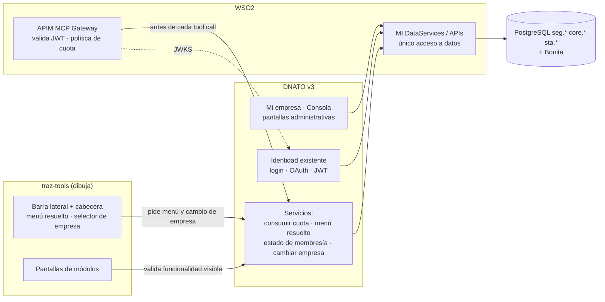
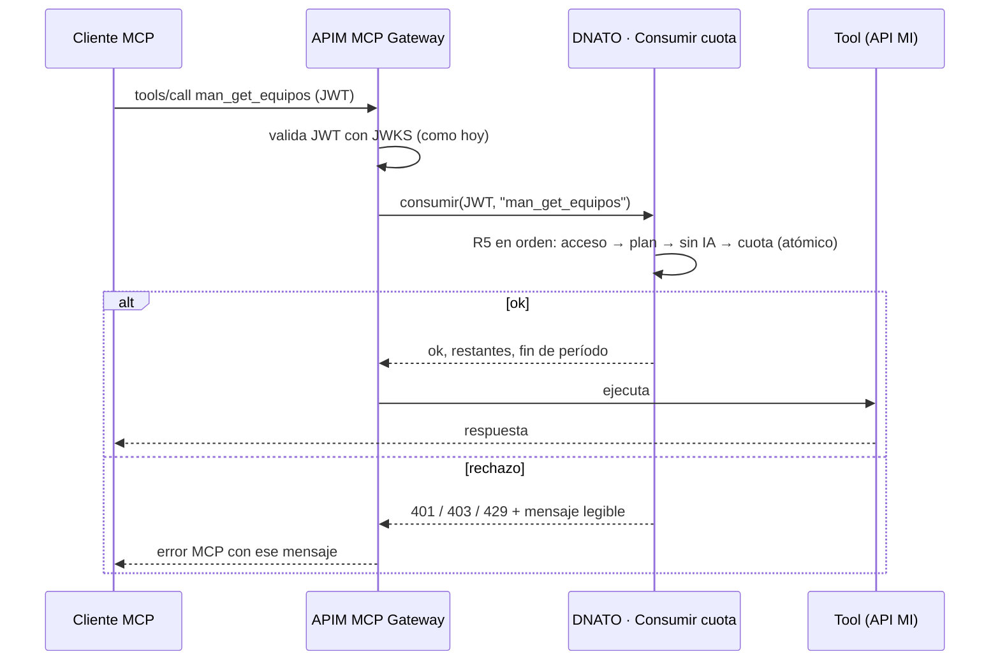

# DNATO v3 — Modelo conceptual, reglas y reparto de trabajo

| Campo | Valor |
|---|---|
| Versión | 0.5.1 |
| Fecha | 2026-11-02 |
| Nivel | Especificación. Dice **qué entidad actual absorbe cada concepto nuevo**, **qué reglas debe garantizar el sistema** y **qué le toca a cada componente**. El diseño físico (columnas, tipos, SQL, data services concretos) lo define el programador respetando estas reglas |
| Restricciones del PM | PHP 5.6 · CodeIgniter 3.1.5 (el actual) · datos solo vía WSO2 MI · misma arquitectura de la suite · librerías nuevas solo open source |
| Documentos que mandan | `TRAZALOG_v3_MCP_ARCHITECTURE.md` (ADR-001, 002, 008, 009, 013; TAD-IDENT-01/03) · `TRAZALOG_v3_CICD_STRATEGY.md` · `DNATO_v2_RELEVAMIENTO.md` |

---

## 1. Resumen

- 🧩 **Siete conceptos nuevos**, de los cuales **cuatro se apoyan en entidades existentes** (catálogo, permiso de rol, membresía, variables) y **tres son nuevos** (plan, menú custom, cuota/pedido/auditoría).
- 🔌 **Tres servicios que DNATO expone** a otros componentes: consumir cuota (al Gateway), menú resuelto y estado de membresía (a traz-tools), cambio de empresa validado (a traz-tools).
- 🔐 **Cinco reglas que el sistema debe garantizar** siempre: validación en servidor, `empr_id` nunca del cliente, cuota atómica, auditoría solo inserción, textos como variables.
- 🚚 **Migración en el lugar**: ninguna empresa, usuario, membresía u opción de menú se recrea; se les agregan los atributos nuevos.



---

## 2. Modelo conceptual sobre las entidades actuales

Leyenda: **Existente** = la entidad ya está y se usa tal cual · **Existente + atributos** = se le agregan datos · **Nueva** = no hay nada hoy.

| Concepto | Entidad actual | Estado | Atributos que suma v3 | Reglas |
|---|---|---|---|---|
| Empresa | `core.empresas` (incluye `image`/`imagepath` para el logo) | Existente + atributos | plan; estado (activa / suspendida) y motivo; estado del plan (vigente / pendiente de aprobación / **vencido**) y plan pedido; fecha de vencimiento del plan; marca "ya usó un plan gratuito / de prueba" (derivable del historial); contacto del administrador para mensajes | Una empresa tiene exactamente un plan. `eliminado` sigue siendo la baja lógica. El logo existente se muestra en Portal y Consola; sin logo, la inicial |
| Usuario | `seg.users` | Existente + atributos | marca `superusuario`; obligación de cambiar contraseña al primer ingreso (alta con contraseña inicial) | `role` (nivel global 1..8) **deja de autorizar**; se conserva para no romper lo existente y se documenta como obsoleto. `banned_users` queda como ban global del súper usuario |
| Membresía (usuario ↔ empresa ↔ rol) | `seg.memberships_users` (group, role, email) + membresía Bonita | Existente + atributos | estado (`invitado`, `activo`, `baneado`, `baja`), motivo, fecha de cambio, quién lo cambió, menú asignado (opcional) | Debe resolverse a `empr_id` por **un único criterio** (hoy: `nombre` o `descripcion` en DNATO, solo `descripcion` en los data services). Lugares usados del plan = personas distintas con membresía en estado ≠ `baja` en la empresa. Un usuario tiene a lo sumo una membresía por empresa a efectos de estado (puede tener varios roles; el estado es uno) |
| Rol de empresa | Roles Bonita `<empr_id>-<rolBase> <empresa>` creados en el alta | Existente | — | "Administrador de empresa" = membresía activa con el rol base Administrador. No se crean roles por pantalla |
| Catálogo de funcionalidades | `seg.menues` (módulo, opción, texto, url, ícono, padre, orden, eliminado) | Existente + atributos | tipo (`pantalla`, `accion`, `tool_mcp`); texto de presentación; ayuda; estado de publicación (`sin_publicar`, `publicada`, `despublicada`); módulo `MCP` y módulo `SEG` para las opciones de administración | El catálogo es global y **solo lo edita el súper usuario**. Las tools MCP llevan como "opción" el nombre de la tool (ADR-013). `eliminado` se mantiene como despublicación |
| Acceso de rol a funcionalidad | `seg.memberships_menues` (group, role, módulo, opción) | Existente | — (presencia = accede; no hay modo ver/operar) | Es lo que hoy administra "Menú por rol". Se corrigen sus defectos (ver `01` RF-77) |
| Plan | — | Nueva | código, nombre, ícono, orden, tope de usuarios (número o ilimitado), cuota MCP (número, 0 o ilimitado), período, día de renovación, plan base (preseleccionado en el registro), precio o "Consultar", gratuito / de prueba (sí/no), vencimiento (sin vencimiento, o cantidad + unidad: días / semanas / meses), activo | Un solo plan base. No se da de baja un plan en uso. Un plan no gratuito elegido en el registro queda pendiente de aprobación. Un gratuito se asigna una sola vez por empresa; al vencer, la empresa queda en "plan vencido" (R1) |
| Evento de registro / notificación | — | Nueva | fecha, tipo (alta de empresa, pedido de plan, suspensión), empresa, administrador, plan, origen, estado de aprobación, canal (Telegram / correo), resultado del envío, reintentos | Alimenta Consola → Registros (RF-29). El envío lo hace el sistema de notificaciones de infra a través de un servicio que DNATO llama (§4) |
| Funcionalidad del plan | — | Nueva | plan × (módulo, opción) | Sin herencia entre planes |
| Funcionalidad activa en la empresa | — | Nueva | empresa × (módulo, opción) × activa × orden | Se conserva al salir del plan (reaparece al volver) |
| Menú custom | — | Nueva | empresa, nombre único, descripción; ítems: grupo (etiqueta, ícono, orden) y opción (módulo, opción, etiqueta custom, orden) | Dos niveles. Solo referencia funcionalidades de tipo pantalla/acción. Los ítems que dejan de ser visibles se ocultan, no se borran |
| Asignación de menú | — | Nueva | menú × rol **o** menú × membresía, fecha | A lo sumo una por rol y una por persona en la empresa |
| Período de cuota | — | Nueva | empresa, inicio, fin, cuota, bonificación, consumidas, avisos enviados | Único por empresa e inicio; "ilimitado" = sin tope |
| Consumo MCP | — | Nueva | empresa, usuario, herramienta, fecha, resultado (`ok`, `sin_cuota`, `fuera_plan`, `sin_acceso`) | Se registran también los rechazos |
| Pedido de cambio de plan | — | Nueva | empresa, plan actual, plan pedido, motivo, estado (`pendiente`, `aprobado`, `rechazado`, `cancelado`), quién/cuándo pidió y resolvió, motivo de resolución | Uno pendiente por empresa |
| Interés ("Me interesa") | — | Nueva | empresa, usuario, funcionalidad, fecha | — |
| Auditoría | — | Nueva | fecha, quién, empresa, acción, entidad, identificador, detalle | Solo inserción; 5 años |
| Variables de sistema | `core.tablas` con `empr_id` nulo | Existente + historial | historial (valor anterior, quién, cuándo) | Reemplaza a `seg.settings` para todo lo configurable; `seg.settings` queda solo si algo lo sigue leyendo |
| Invitación / activación | `seg.tokens` + `main/complete` | Existente + reglas | validez configurable; token no predecible; un solo uso | Mismo flujo del autorregistro |
| Resultado de carga masiva | tabla temporal de sesión (se pierde) | Nueva | empresa, usuario, entidad, fecha, filas ok/error, detalle | Hoy no queda rastro persistente |
| Formulario dinámico | `frm.formularios` (`form_id`, `nombre`, `descripcion`, `empr_id` nulo = global, `eliminado`) | Existente + atributos | estado (`borrador`, `publicado`, `inactivo`), "copiado de" (`form_id` global de origen), nombre único por ámbito | Un global es visible para todas las empresas por referencia; un propio solo para su empresa. `eliminado` se mantiene como baja lógica |
| Ítem de formulario | `frm.items` (`tipo_dato`, `label`, `name`, `orden`, `requerido`, `valor`, `columna`, `valo_id`, `multiple`, `eliminado`) | Existente | — | Nombre interno único dentro del formulario; nombre y tipo congelados cuando hay respuestas. `multiple` debe quedar en el DDL versionado (C-10) |
| Respuesta | `frm.instancias_formularios` (una fila por campo, agrupadas por `info_id`) | Existente | — | No cambia. `info_id` por secuencia (C-10). El módulo verifica que el `info_id` pertenezca a la empresa en sesión al actualizar (RF-129): el programador define cómo se conoce la empresa de una respuesta (recomendación: guardar `empr_id` en la instancia al crearla) |
| Lista de opciones | `core.tablas` (`tabla`, `valor`, `descripcion`, `empr_id`) | Existente | — | Lista de empresa = `empr_id` de la empresa (prefijo que ya arma el trigger `core.set_tabla_id_trg`); lista global = `empr_id` nulo. Regla R9 |
| Punto de uso | `core.tablas` fila `configuraciones` / `formulario_<punto>` por empresa, con el `form_id` en `descripcion` (mecanismo A) | Existente | catálogo de puntos de uso (clave, módulo, pantalla, descripción) y, por punto, el global que se asigna al alta | El catálogo es global y lo mantiene el súper usuario; los puntos C/D (procesos, tareas, etapas) y E/F (ids fijos) no se administran acá |

```mermaid
erDiagram
  EMPRESA ||--|| PLAN : "tiene"
  PLAN ||--o{ PLAN_FUNCIONALIDAD : "trae"
  CATALOGO ||--o{ PLAN_FUNCIONALIDAD : ""
  EMPRESA ||--o{ EMPRESA_FUNCIONALIDAD : "activa y ordena"
  CATALOGO ||--o{ EMPRESA_FUNCIONALIDAD : ""
  EMPRESA ||--o{ MEMBRESIA : ""
  USUARIO ||--o{ MEMBRESIA : ""
  ROL_EMPRESA ||--o{ MEMBRESIA : ""
  ROL_EMPRESA ||--o{ PERMISO_ROL : ""
  CATALOGO ||--o{ PERMISO_ROL : ""
  EMPRESA ||--o{ MENU : ""
  MENU ||--o{ MENU_ITEM : ""
  CATALOGO ||--o{ MENU_ITEM : ""
  MENU ||--o{ ASIGNACION : "a rol o persona"
  EMPRESA ||--o{ PERIODO_CUOTA : ""
  PERIODO_CUOTA ||--o{ CONSUMO_MCP : ""
  EMPRESA ||--o{ PEDIDO_PLAN : ""
  EMPRESA ||--o{ AUDITORIA : ""
  EMPRESA { existente core_empresas }
  USUARIO { existente seg_users }
  MEMBRESIA { existente seg_memberships_users_mas_Bonita }
  ROL_EMPRESA { existente roles_Bonita }
  CATALOGO { existente seg_menues }
  PERMISO_ROL { existente seg_memberships_menues }
  PLAN { nueva }
  MENU { nueva }
  PERIODO_CUOTA { nueva }
  PEDIDO_PLAN { nueva }
  AUDITORIA { nueva }
```

---

## 3. Reglas de cálculo que deben ser únicas en todo el sistema

Estas reglas se implementan **una sola vez** (en un servicio) y las usan pantallas, menú, validaciones y Gateway.

**R1 — Estado de una funcionalidad para una empresa.** Si la empresa está en estado **plan vencido**, toda funcionalidad publicada es 💎 (fuera de plan) y `plan_minimo` es el plan no gratuito de menor orden que la incluye. Si no, para cada funcionalidad publicada: `en_plan` = está en el plan de la empresa; `activa` = marcada activa por la empresa; `plan_minimo` = plan de menor orden que la incluye. Grupos: ✅ `en_plan ∧ activa` · 💤 `en_plan ∧ ¬activa` · 💎 `¬en_plan`.

**R2 — Visible para un usuario.** `visible(usuario, funcionalidad)` = ✅ para su empresa activa ∧ el rol de su membresía activa tiene acceso (`seg.memberships_menues`) ∧ la membresía está `activa` ∧ la empresa no está suspendida. Toda pantalla y toda tool MCP se validan con R2 (RNF-01, RF-94). Además, `otro_plan(usuario, funcionalidad)` = 💎 para su empresa ∧ tipo pantalla/acción: se muestra sombreada en el menú y abre la vista de presentación.

**R3 — Menú resuelto de un usuario.** `menu = asignación por persona ?: asignación por su rol ?: predeterminado`. Se dibuja respetando la **jerarquía del catálogo** (módulo → opción) en el orden del menú. Cada ítem sale con un estado: `visible` (cumple R2) o `otro_plan` (💎, con ícono y nombre de `plan_minimo`); los de otro plan quedan **en su lugar**, sombreados y en cursiva, y al hacer clic abren la vista de presentación. Lo sin activar o sin acceso para el rol **no** se incluye. Grupos vacíos no se dibujan. El menú operativo no contiene opciones del Portal ni de la Consola. **Reemplaza** la regla actual "si ningún hijo está habilitado se muestran todos".

**R4 — Lugares usados.** Personas distintas con membresía en estado ≠ `baja` en la empresa. Tope alcanzado ⇒ el servidor rechaza invitar, alta directa y alta por carga masiva.

**R5 — Consumir cuota** (en este orden, y con un solo resultado):
1. membresía activa y empresa no suspendida; si no → `sin_acceso`; empresa con plan vencido → `plan_vencido` ("El período de prueba de tu empresa terminó. Tu administrador puede pedir un plan desde Mi empresa → Plan");
2. herramienta publicada y en el plan; si no → `fuera_plan`;
3. plan con cuota 0 → `sin_ia`;
4. período en curso: si no existe, se abre según el plan; `consumidas < cuota + bonificación` (o ilimitado) → `consumidas + 1`, `ok`; si no → `sin_cuota`.
El paso 4 es **atómico** (una sola operación de "incrementar si cabe"); dos llamadas simultáneas no superan el tope (RNF-10). Todo intento queda en Consumo MCP.

**R6 — Período de cuota.** Inicio/fin según período y día de renovación del plan en `America/Argentina/San_Juan` (semana: lunes 00:00; mes: día N 00:00). Al cambiar de plan a mitad de período, el período en curso toma cuota y fin del plan nuevo sin descontar lo consumido. El proceso diario cierra y abre; si no corrió, R5 abre el período al vuelo.

**R7 — Administrador / súper usuario.** `es_admin(usuario, empresa)` = membresía activa con rol base Administrador en esa empresa. `es_super(usuario)` = marca en el usuario. Ninguna otra condición (`role = 1`, correo fijo) autoriza.

**R9 — Formulario y opciones para una pantalla.** `formulario(empresa, punto)` = el `form_id` de la fila `configuraciones/formulario_<punto>` de la empresa, si existe y el formulario está `publicado` (propio de la empresa o global); si no, ninguno (la pantalla lo dice y guarda sin `info_id`, como hoy). `opciones(empresa, lista)` = lista de la empresa si existe; si no, lista global del mismo nombre; si no, vacía con aviso en la vista previa. Las dos reglas se implementan una vez en el módulo de formularios y las usan Tools, la vista previa del Portal y el registro de DNATO.

**R8 — Resolución membresía → empresa.** Un único criterio documentado (el programador lo fija con el PM a partir de la duda 5 del relevamiento) y usado por DNATO y por los data services (`getUsersXGroup`, `getEsAdminXEmailEmpresa`). Recomendación: guardar `empr_id` en la membresía al crearla y migrar las existentes resolviéndolas una vez.

---

## 4. Servicios que DNATO expone a otros componentes

Contratos de nivel funcional. La forma (REST, DataService, API MI) la decide el programador junto al frente MCP y traz-tools.

| Servicio | Quién lo llama | Entrada | Salida | Reglas |
|---|---|---|---|---|
| **Consumir cuota** | APIM MCP Gateway, antes de cada `tools/call` | JWT del usuario (de ahí `empr_id`, `email`), nombre de la tool | `ok` + restantes + fin del período, o rechazo (`sin_acceso` 401, `fuera_plan` 403, `sin_ia` 403, `sin_cuota` 429) con `{error, mensaje, accion}` legible | R5, R6. Latencia objetivo < 50 ms |
| **Menú resuelto** | traz-tools al dibujar la barra lateral | usuario + empresa activa (de la sesión) | árbol de dos niveles con etiqueta, ícono, url y estado por ítem (`visible` / `otro_plan` + ícono y nombre del plan + url de la vista de presentación) | R3. Reemplaza a `getMenuByUserPermission` como fuente del menú (ese data service puede quedar para compatibilidad) |
| **Funcionalidad visible** | traz-tools y DNATO en cada controller | usuario, empresa, (módulo, opción) | sí/no + motivo (`fuera_plan`, `sin_activar`, `sin_permiso`, `sin_acceso`) | R2. Es el chequeo central de RF-94 |
| **Estado de membresía** | traz-tools en cada pedido (o por cache ≤ 60 s) | usuario, empresa | `activo` / `baneado` / `baja` / `empresa_suspendida` / `plan_vencido` (entra, pero todo fuera de plan) | Corta sesiones de baneados y de empresas suspendidas (RF-03/04) |
| **Cambiar empresa activa** | traz-tools (selector de cabecera) | usuario, `empr_id` pedido | ok + nuevo `groupBpm`, o rechazo | Solo membresías `activas` y empresas no suspendidas (RF-02, correctivo C-1) |
| **Formulario para un punto de uso** | Tools (almacenes, pañol) y registro de DNATO | empresa, clave del punto | `form_id` publicado o ninguno | R9. Reemplaza las lecturas directas de `getTablaValor('configuraciones', 'formulario_…')` de cada controller |
| **Opciones de una lista** | módulo de formularios al dibujar | empresa, nombre de lista | valores de la empresa o globales | R9 |
| **Notificar a infra** | DNATO → sistema de notificaciones de infra (Telegram y correo en v3) | tipo de evento, empresa, administrador, plan, requiere aprobación, enlace a la Consola | aceptado / fallido (se reintenta y se registra) | RF-08. Contrato a definir con infra: DNATO no implementa el envío, lo llama |
| **Contexto del usuario** | traz-tools (barra superior) | usuario, empresa | empresa, ícono del plan, es_admin (→ botón "Mi empresa"), es_super (→ botón "Consola" en Tools y en el Portal), cuota resumida (solo admin), url del Portal y de la Consola | R1, R7 |

Lo que **no** cambia: emisión de JWT, JWKS, discovery, claims (ADR-008/009). La revocación se resuelve por estado: un JWT de un usuario baneado o de una empresa suspendida sigue siendo válido criptográficamente, pero **Consumir cuota** lo rechaza con `sin_acceso`. No hace falta lista de revocación en v3.

---

## 5. Integración con el MCP Gateway (frente MCP)



- Dónde se engancha en WSO2 (política de mediación del MCP Server virtual o secuencia común en MI) lo decide el frente MCP; la interfaz es la de la tabla §4.
- El throttling nativo de WSO2 se configura por minuto como protección del backend, no como cuota de negocio (D-03).
- Los rechazos **no** ejecutan la herramienta y quedan en Consumo MCP.

---

## 6. Reglas que el programador debe garantizar (y cómo se verifican)

| # | Regla | Verificación |
|---|---|---|
| G1 | Control de acceso central: ningún controller de DNATO responde sin pasar por el chequeo de sesión + R7/R2 (hoy no hay `MY_Controller` ni hook) | CP-91, CP-110; revisión de que no quede ningún método público sin chequeo |
| G2 | `empr_id` sale de la sesión o del JWT; toda operación por id verifica pertenencia a la empresa (RNF-02) | CP-76, CP-111 |
| G3 | Datos solo vía WSO2 MI; sin consultas directas nuevas en PHP | revisión de código en cada PR |
| G4 | Consumo de cuota atómico | CP-81 (20 llamadas simultáneas) |
| G5 | Auditoría solo inserción (el rol de base de datos que usa MI no puede modificar ni borrar) | CP-101 |
| G6 | Textos y parámetros como variables de sistema; sin secretos ni correos fijos en `constants.php` para lo administrativo | revisión |
| G7 | CSRF activo; nada que cambie estado por GET | CP-112 |
| G8 | Tokens de invitación no predecibles, de un solo uso, con vencimiento configurable | CP-70, CP-113 |
| G9 | Toda alta/baja de membresía mantiene la compensación actual con Bonita (si falla el segundo paso, se revierte el primero) | CP-38 |
| G10 | Compatibilidad PHP 5.6 y 8.3; sin `??`, tipos escalares ni `...`; librerías locales, sin CDN | revisión |
| G11 | Formularios: toda respuesta se guarda con sesión, CSRF, validación de obligatorios y tipos en el servidor y verificación de que el `info_id` sea de la empresa; la vista previa no crea respuestas; `obtenerTodos` nunca devuelve respuestas de otra empresa | CP-129, CP-124 |
| G12 | Formularios: un ítem con respuestas no cambia de nombre interno ni de tipo; las bajas son lógicas; un propio nunca aparece en otra empresa | CP-128, CP-130 |

---

## 7. UI: una sola línea de diseño

| Elemento | Definición |
|---|---|
| Qué se reemplaza | Las 43 vistas actuales de DNATO (cuatro estilos, tres jQuery, Bootswatch por usuario) por un layout único. Login, forgot, reset, registro (salvo el paso nuevo de plan) y OAuth se conservan como están (D-11); se les puede aplicar la hoja de estilo nueva **sin cambiar comportamiento** si el programador lo considera trivial |
| Tres layouts | **Tools** (lo dibuja traz-tools): barra lateral oscura con el menú operativo y barra superior con los botones "Mi empresa" / "Consola", cuota, selector de empresa y perfil. **Portal de la empresa** (DNATO): marca Trazalog + logo de la empresa (o inicial) con nombre y plan, barra lateral clara con secciones propias, "← Ir a Tools" y, para súper usuarios, "🔑 Consola". **Consola** (DNATO, solo súper usuarios): misma estructura con marca "Consola Trazalog" y secciones propias. Mismos tokens; se distinguen a simple vista |
| Kit | Un framework CSS open source moderno compatible con páginas servidas por CI (recomendación: Tabler CSS) + Alpine.js (estado local) + htmx (listados y acciones sin recargar) + SortableJS (arrastrar) + Chart.js (cuota). Todo local, sin build |
| Tokens | Rojo `#E63327`, casi negro `#141412`, gris `#676766`, blanco; DM Sans; íconos de plan configurables por plan. Definidos en `mockups/dnato.css` |
| Layout del Portal | Lo dibuja DNATO (es su aplicación). Secciones: Inicio · Usuarios · Roles y accesos · Menús · Funcionalidades · Plan · Uso de IA · Cargas masivas · Actividad. Inicio es de control (tres tarjetas, avisos, accesos), no de KPIs: los KPIs siguen en el tablero de Tools |
| Patrones | Tablas con búsqueda, filtros y paginación en servidor; interruptores; casillas de matriz; barras con tres estados (normal / ámbar ≥ umbral / rojo 100 %); modales de confirmación con motivo opcional; toast de autoguardado; avisos con acción; estados vacíos con una acción; foto con vista previa, cámara y avatares; reglas de contraseña en vivo; nunca `alert()` nativo ni mensajes técnicos |
| Maquetas | `mockups/index.html`: una página por pantalla, con CU/RF en cabecera y `data-cu`/`data-rf`. Son la referencia visual para el programador y la CLI |

---

## 8. Migración en el lugar

| Paso | Qué | Regla |
|---|---|---|
| M-1 | Agregar los atributos nuevos a empresa, usuario, membresía y catálogo; crear las entidades nuevas | Sin tocar filas existentes |
| M-2 | Catálogo: todas las opciones actuales de `seg.menues` quedan **publicadas** con su texto actual como nombre, tipo `pantalla`; se cargan las opciones del módulo `SEG` (administración) y del módulo `MCP` (tools del facade) | Requiere el catálogo real por ambiente (duda 15) |
| M-3 | Plan "Completo": todas las funcionalidades, usuarios ilimitados, cuota MCP según decisión del PM. Todas las empresas actuales pasan a él. El plan base (Freemium: 5 usuarios · MAN, ALM, PAN · 30 MCP/semana) se crea para las empresas nuevas del registro | Nadie pierde nada el día del cambio |
| M-4 | Funcionalidad activa por empresa: para cada empresa, activar toda opción que hoy tenga asignada a algún rol en `seg.memberships_menues`, en el orden del catálogo | El permiso por rol no cambia |
| M-5 | Membresías: todas pasan a estado `activo`; se resuelve y guarda `empr_id` por el criterio único (R8); las que no resuelven se listan para el PM | Hoy el log ya marca `gruposSinEmpresa` |
| M-6 | Súper usuario: marcar a los usuarios cuyo correo coincide con `TOOLS_ADMIN_USER` en cada ambiente | Después, la constante deja de usarse |
| M-7 | Variables de sistema: cargar la lista de RF-102 en `core.tablas` con los valores actuales de `constants.php`/`seg.settings` | — |
| M-7b | Formularios: los de la empresa 9000 pasan a globales publicados y sus listas a globales; se carga el catálogo de puntos de uso (al menos entrega de materiales, salida, recepción y checklist de pañol) y, por punto, el global al alta; para cada empresa existente se conserva su configuración actual (apunta a su clon) y se completan los puntos que no tenga apuntando al global; los formularios sin empresa que sean de un cliente (consulta §8.5 del relevamiento) se asignan a esa empresa | RF-127, RF-131 |
| M-8 | Verificación: para cada usuario, el menú resuelto por R3 contiene exactamente las opciones que hoy devuelve `getMenuByUserPermission` como habilitadas (salvo las diferencias justificadas por la regla "todos los hijos") | CP-M1 |
| M-9 | Cutover según `TRAZALOG_v3_CICD_STRATEGY.md`: TEST (staging-v3) con la suite completa, luego PROD | — |

---

## 9. Reparto de trabajo

| Componente | Entrega | Referencia |
|---|---|---|
| **DNATO** (`traz-comp-dnato`) | Todas las pantallas de Mi empresa y Consola; entidades nuevas y atributos; servicios de §4; procesos diarios; correos; auditoría; migración M-1 a M-8; correctivos C-2, C-4, C-5, C-6, C-8 | `01` §4-6, `PROMPT_CLI_DNATO_V3_BUILD.md` |
| **Módulo `traz-comp-formularios`** (derivación, compartido por DNATO y Tools) | R9 (búsqueda de opciones empresa → global), vista previa sin instancia, validación en servidor, sesión y CSRF en `Form/*`, `info_id` por secuencia, DDL versionado; el trigger de alta deja de clonar desde la 9000 y DNATO escribe la configuración al alta (RF-127). El constructor del ABM vive en DNATO y escribe `frm.*` y `core.tablas` por servicios MI | `01` RF-123, 124, 129; `02` C-9, C-10 |
| **traz-tools** (derivación, ver §9b) | Tablero del administrador con tarjeta resumida de plan y uso; menú operativo con "Menú resuelto" (jerarquía + opciones de otro plan sombreadas en su lugar, RF-64); barra superior con "Contexto" (botones "Mi empresa" / "Consola", cuota, selector con "Cambiar empresa", perfil sin "Usuarios"); chequeo de "Estado de membresía" y "Funcionalidad visible" en cada pedido (control central que hoy no existe); correctivo C-1 (`Dash::cambiarDeEmpresa` y copias en módulos). Maquetas: `tools-barra-superior.html` y la barra lateral de `vista-esfumada.html` | tabla "Derivaciones" de `STATE.md`; prompt aparte cuando se encare |
| **Frente MCP** (derivación) | Política de cuota en el Gateway llamando a "Consumir cuota"; throttling técnico por minuto; tools del facade como funcionalidades del catálogo (módulo `MCP`) | `TRAZALOG_v3_MCP_ARCHITECTURE.md`, ADR-013 |
| **Identidad** (workshop 🔴) | C-1 y C-3 (`authorize` con sesión web y `redirect_uri`), definición única de admin (D-07) | ADR nuevo |
| **Infra** | C-7 (secretos, archivos de prueba, document root) | especialista ya asignado |

## 9b. Análisis de impacto en traz-tools (obligatorio en la planificación)

Antes de la entrega E0, el PM y el programador recorren esta lista contra el código de traz-tools y registran cada punto en la tabla "Derivaciones" de `STATE.md`, con responsable y entrega. Nada de esto se construye en DNATO; DNATO entrega los servicios de §4.

| # | Punto de Tools | Qué cambia | Servicio de DNATO | Hoy |
|---|---|---|---|---|
| T-1 | **Tablero del administrador** (`Dash::index`, landing tras el login) | Para administradores, una **tarjeta resumida** de plan y uso: plan e ícono, lugares usados / tope, consultas MCP del período con barra y renovación, pedido pendiente, y los avisos críticos (vencimiento próximo, plan vencido, tope alcanzado) con enlace al Portal. Los KPIs de operación no cambian. Para no administradores, nada nuevo | Contexto | `Dash.php`, `Dashs.php:124+` (KPIs) |
| T-2 | **Menú operativo** (`menu_helper`, `getMenuByUserPermission`) | Dibuja el menú resuelto con R3: jerarquía del catálogo, opciones de otro plan sombreadas en su lugar con ícono del plan, estado "plan vencido" con todo sombreado; elimina la regla "todos los hijos"; sin opciones del Portal ni de la Consola | Menú resuelto | `menu_helper.php:122-125` |
| T-3 | **Barra superior** (`layout/perfil.php` y copias en módulos) | Botón "🏢 Mi empresa" (administradores) y "🔑 Consola" (súper usuarios); indicador de cuota (administradores); selector de empresa con logo o inicial; menú del perfil sin "Usuarios" | Contexto, Cambiar empresa | `perfil.php:63,115` |
| T-4 | **Cambio de empresa** (`Dash::cambiarDeEmpresa` y sus 3 copias) | Llama al servicio validado; nunca escribe `empr_id` del POST en sesión (correctivo C-1 🔴) | Cambiar empresa | `Dash.php:140-147` |
| T-5 | **Chequeo central en cada pedido** (hoy 4 de 124 controllers) | Hook o `MY_Controller`: sesión viva, estado de membresía (activo / baneado / baja / suspendida / plan vencido) y funcionalidad visible para la pantalla pedida; 403 con mensaje legible si no | Estado de membresía, Funcionalidad visible | `sesion_helper.php:260-330`, `hooks.php` vacío |
| T-6 | **Vista de presentación** | Enlace desde cada opción sombreada a la página de DNATO con módulo y opción; texto distinto en estado "plan vencido" | — | — |
| T-7 | **Pantallas que leen `configuraciones/formulario_*`** (almacenes, pañol) | Pasan a pedir el formulario por el servicio "Formulario para un punto de uso" (R9) en vez de `getTablaValor` directo; `Form/*` con sesión, CSRF y validación en servidor (C-9) | Formulario para un punto de uso | `Entrega_Material.php:50`, `Order.php:31`, `Herramienta.php:56` |
| T-8 | **Combos de formularios** (tareas estándar, subtareas, etapas) | Ya muestran globales con D2-D3; verificar que respeten estado publicado / inactivo | — | `FRMDataService.dbs:6` |
| T-9 | **Tope de usuarios y cuota en cualquier otra alta de usuario** que exista en Tools (módulos de cliente) | Toda alta pasa por la orquestación de DNATO y respeta R4 | — | a relevar en el análisis |
| T-10 | **Regresión**: suite E2E de `traz-tools/doctest` | Specs que dependían del menú viejo o del navbar de DNATO se actualizan en la misma entrega que los toca | — | `doctest/tests/e2e/specs/` |

El análisis se cierra con un documento corto en `traz-tools/doc/v3/dnato/IMPACTO_TOOLS.md`: para cada punto, archivos afectados, entrega en la que se hace y prueba que lo cubre (CP-05, 19, 67, 106, 108, 110, 126, 129 o nuevas).

## 10. ADR propuestos

| ADR | Decisión | Estado |
|---|---|---|
| ADR-014 | La cuota MCP de negocio se cuenta en DNATO (R5/R6); WSO2 aplica solo throttling técnico | Propuesta |
| ADR-015 | El catálogo de funcionalidades es `seg.menues` ampliado; las tools MCP y las opciones de administración son filas del catálogo; solo lo publica el súper usuario | Propuesta |
| ADR-016 | Definición única de administrador (rol Administrador en la empresa activa) y de súper usuario (marca en el usuario); `seg.users.role` y `TOOLS_ADMIN_USER` dejan de autorizar | Propuesta (toca identidad: workshop) |
| ADR-017 | El menú se define en DNATO y se dibuja en traz-tools con la regla R3 (jerarquía del catálogo, opciones de otro plan sombreadas en su lugar); reemplaza la regla "todos los hijos" de `menu_helper`. El Portal de la empresa y la Consola quedan fuera del menú operativo, con acceso por la barra superior | Propuesta |
| ADR-018 | El estado de membresía por empresa reemplaza al borrado físico de usuarios y al ban global como mecanismo del administrador de empresa | Propuesta |
| ADR-019 | DNATO v3 mantiene PHP 5.6 / CI 3.1.5 y accede a datos exclusivamente por WSO2 MI | Decidida por el PM (2026-10-29) |
| ADR-020 | Formularios dinámicos: global = sin `empr_id`, uso por referencia, copia explícita ("Usar como base"); listas de opciones empresa → global; sin versionado (foto por respuesta); la empresa plantilla 9000 se migra a globales | Propuesta |

## 11. Riesgos

| Riesgo | Impacto | Mitigación |
|---|---|---|
| Los correctivos 🔴 no se aprueban a tiempo | Alto: planes y topes se pueden saltear | Tratarlos en el primer workshop; v3 no sale a PROD sin C-1, C-2, C-4 |
| traz-tools no incorpora el chequeo central (hoy 4 de 124 controllers validan sesión) | Alto | Derivación con prioridad; mientras tanto, DNATO rechaza en sus servicios y el Gateway en MCP |
| Criterio de resolución membresía→empresa (R8) deja usuarios sin empresa | Medio | M-5 lista los casos antes del cutover |
| La política de cuota no se puede enganchar como mediación en MCP Servers virtuales | Medio | Secuencia común en MI; misma interfaz |
| Catálogo real de menú desconocido por ambiente | Medio | Extraerlo con la consulta del relevamiento §5.2 antes de M-2 |
| PHP 5.6 sin soporte | Alto (fuera de alcance) | Código nuevo compatible con 8.3; migración de infra ya encargada |
