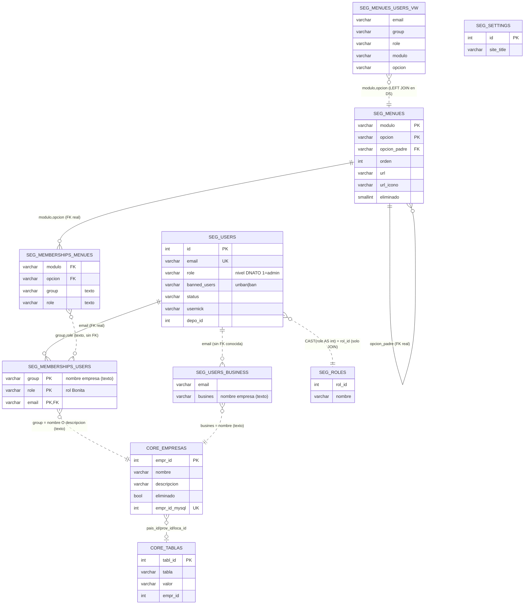
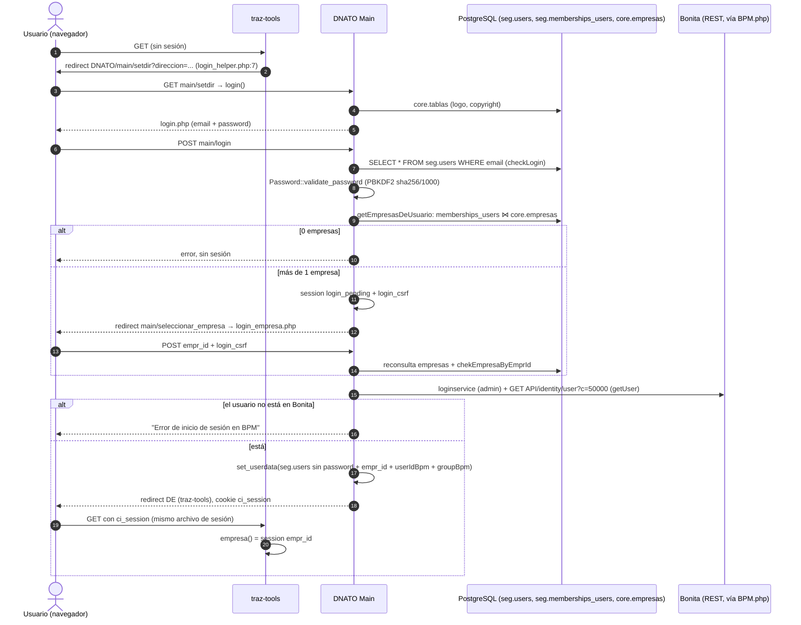
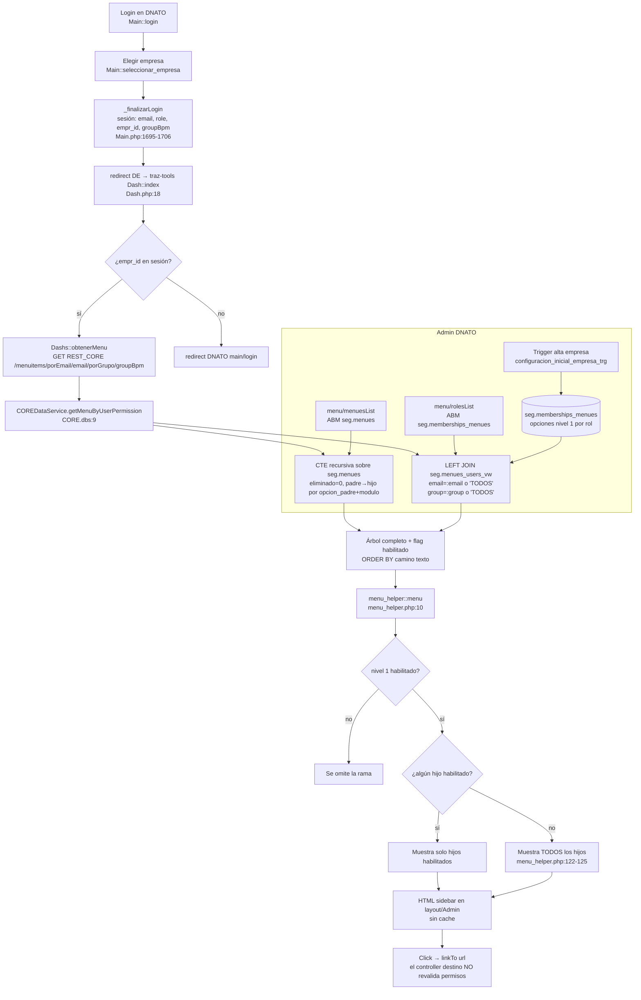

# DNATO v2 — Relevamiento del estado actual

## Objetivo

Relevamiento de **solo lectura** de lo que DNATO (`traz-comp-dnato`) hace hoy, tal como está construido, y de los puntos donde `traz-tools` depende de él (login, sesión, menú, permisos, `empr_id`). Está escrito para el PM y Claude Web como insumo para especificar **DNATO v3** (planes, cuotas MCP, menús custom, gestión de usuarios, nueva UI). Leerlo antes del workshop de especificación de v3. **No propone soluciones** ni decide arquitectura: eso va en los ADR de `traz-tools/doc/adr/` y en la especificación de v3.

- **Fecha:** 2026-10-29.
- **Repos relevados:** `traz-comp-dnato` en la rama `feat/oauth-login-empresas-igual-que-el-web` (HEAD `91535a2`, con `application/config/constants.php` modificado localmente) y `traz-tools` en la rama `docs/MIG-ASSET-hoja-de-ruta`. `traz-comp-dnato` **no** es submódulo de `traz-tools`: son repos hermanos (`/mnt/win/dev/git/`).
- **Método:** lectura de código, configuración, SQL y `.dbs`. **No se ejecutó nada** contra ningún ambiente ni en el navegador. Las conclusiones de comportamiento en runtime son inferencias del código y lo dicen.
- **Convención de evidencia (`ruta:línea`).** Cada sección viene de un relevamiento parcial y conserva su prefijo:
  - Sin prefijo, o con `traz-comp-dnato/`, `dnato/` o `D:` → repo `traz-comp-dnato`.
  - Con `traz-tools/`, `tools/` o `T:` → repo `traz-tools`.
  - `CORE.dbs` → `traz-tools/_backend/api/ToolsAPIProject/ToolsAPIProject/src/main/wso2mi/artifacts/data-services/COREDataService.dbs`. Es la copia que coincide con el código actual de DNATO (ver §2.0).
- **Secretos:** solo se indica dónde están (`ruta:línea`) y de qué tipo son; nunca su valor.

---

## Resumen ejecutivo

1. **Qué hace DNATO hoy.** Es la app CodeIgniter 3.1.5 (PHP 5.6) de identidad de la suite. Resuelve:
   - login web con selección de empresa;
   - autorregistro freemium (usuario + empresa + establecimiento + roles Bonita);
   - ABM de usuarios y bans;
   - asignación de roles de Bonita (que son las membresías usuario↔empresa);
   - ABM del catálogo de menú y de menú por rol;
   - carga masiva xlsx;
   - desde v3, servidor OAuth 2.1 + PKCE que emite JWT RS256 con `empr_id`, JWKS y discovery.

   Los datos viven en PostgreSQL (`seg.*`, `core.*`, `sta.*`); DNATO accede en parte directo y en parte por data services de WSO2 MI.
2. **Estado.** Funciona, pero es una base heredada de un template ("CodeIgniter login") con capas agregadas encima:
   - no hay `MY_Controller` ni control de acceso central;
   - conviven 4 estilos visuales y varias versiones de jQuery;
   - hay código muerto o roto;
   - ningún test corre en el repo ni en CI.
3. **Hallazgo 1 — fuga de empresa (crítico).** `traz-tools` `Dash::cambiarDeEmpresa` escribe en sesión el `empr_id` que llega por POST, sin validar la membresía (`T:application/controllers/Dash.php:140-147`). La sesión es compartida con DNATO, y `Oauth::authorize` reutiliza esa sesión para emitir el code (`D:application/controllers/Oauth.php:76-92`). Resultado: un usuario puede obtener un JWT de **cualquier** empresa. Además `redirect_uri` no se valida contra la whitelist de clientes.
4. **Hallazgo 2 — endpoints que escriben sin sesión ni rol.** Están abiertos: `Main::cambiarNivelUsr` (permite volverse admin), la asignación y quita de roles, todo el ABM de `Menu`, `Rol::guardar`, `Empresa::guardar` y `Email::send`. El CSRF está apagado.
5. **Hallazgo 3 — "admin" no está atado a la empresa, y hay tres definiciones distintas:**
   - `seg.users.role=1` es global, y además todo autorregistro freemium lo recibe;
   - el email fijo `TOOLS_ADMIN_USER` define al súper usuario;
   - en `traz-tools`, admin es tener un rol `Administrador%` en la empresa activa.

   Un admin de una empresa puede banear, cambiar el nivel o borrar usuarios de otras empresas.
6. **Hallazgo 4 — modelo de datos débil para planes y cuotas.** El vínculo usuario↔empresa se guarda como texto en tres lugares sin FK: `seg.memberships_users`, Bonita y `seg.users_business`. Para mapear grupo→empresa, DNATO compara contra `nombre` o `descripcion` y el data service solo contra `descripcion`. No existen planes, cuotas, tope de usuarios, bloqueo de empresa, auditoría administrativa ni estadísticas (solo `last_login`).
7. **Hallazgo 5 — secretos y exposición.** Están commiteados en claro:
   - credenciales de BD, Bonita (incluido un token de sesión fijo), reCAPTCHA y Gmail;
   - `development/credentials.txt`.

   En DEV la raíz del repo es el document root, sin `application/.htaccess`: config, logs (con `log_threshold=4` y contraseñas en claro), uploads de carga masiva y scripts de prueba de mail podrían ser accesibles por web. Falta confirmar si producción tiene el mismo layout.
8. **El menú lo arma `traz-tools`, no DNATO.** DNATO administra el catálogo y la asignación (empresa, rol); `traz-tools` lo dibuja con el data service `getMenuByUserPermission`. El permiso se valida **solo al dibujar el menú**: ningún controller vuelve a chequearlo. El navbar de DNATO es estático.
9. **Discrepancias entre docs y código.** La selección de empresa en OAuth contradice TAD-IDENT-02 y no tiene ADR. El CONTEXT-PACK todavía dice que OAuth rechaza usuarios multi-empresa. El discovery está en `oauth/.well-known/...`, no en la raíz. La base real se llama `tools_prod_t`, no `trazalog_tools`.
10. **Implicancia para v3.** Planes, cuotas y menús custom necesitan primero tres cosas: una entidad empresa con FK, una definición única de admin por empresa y control de acceso central. Hoy no hay dónde colgarlos.

---

## 1. Mapa del módulo

### 1.1 Framework y arranque

| Ítem | Valor | Evidencia |
|---|---|---|
| Framework | CodeIgniter **3.1.5** | `traz-comp-dnato/system/core/CodeIgniter.php:58` |
| ENVIRONMENT | `CI_ENV` o `production` por defecto | `traz-comp-dnato/index.php:56` |
| Rewrite | `.htaccess` manda todo a `index.php/$1` y propaga `Authorization` | `traz-comp-dnato/.htaccess` (RewriteRule + `SetEnvIf Authorization`) |
| Server embebido | `router.php` fuerza `CI_ENV=development` | `traz-comp-dnato/router.php:7` |
| Composer | `firebase/php-jwt ^5.5`, `platform.php=5.6.40`, autoload por `FCPATH.'vendor/autoload.php'` | `traz-comp-dnato/composer.json`, `traz-comp-dnato/application/config/config.php:179` |
| Hooks | Habilitados | `traz-comp-dnato/application/config/config.php:143` |
| `subclass_prefix` | `MY_` (lo usa solo `MY_Form_validation`) | `traz-comp-dnato/application/config/config.php:157`, `traz-comp-dnato/application/libraries/MY_Form_validation.php` |
| Sesión | driver `files`, `sess_save_path = NULL` | `traz-comp-dnato/application/config/config.php:422,425` |
| CSRF global de CI | **Desactivado** | `traz-comp-dnato/application/config/config.php:493` |
| XSS global | Desactivado (se usa `security->xss_clean` a mano en algunos métodos) | `traz-comp-dnato/application/config/config.php:477` |
| `log_threshold` | 4 ("temporalmente para debugging") | `traz-comp-dnato/application/config/config.php:268` |
| Idioma CI | `english` (la UI está en español, existe `language/spanish/form_validation_lang.php`) | `traz-comp-dnato/application/config/config.php:119`, `traz-comp-dnato/application/libraries/MY_Form_validation.php:10-11` |

### 1.2 Estructura de carpetas

| Carpeta / archivo | Contenido | Observación |
|---|---|---|
| `application/controllers/` | 13 controllers + `Bulkload copy.php` | `Bulkload copy.php` declara la **misma clase** `Bulkload` (`traz-comp-dnato/application/controllers/Bulkload copy.php:12`) con SPs distintos (`sta.sp_carga_masiva_*` en vez de `sta.bulkload_*`, ver diff en líneas 66-103). Por el espacio en el nombre no es ruteable: es código muerto versionado. |
| `application/models/` | `Bulkload_model`, `Bulkloads`, `Empresas`, `Establecimientos`, `Mmenu`, `OauthCode_model`, `Roles`, `Tablas`, `User_model` | Mixto: `$this->db` directo (Mmenu 78 usos, User_model 135) y REST/WSO2 (`Establecimientos`, `Empresas`, `Roles`). Lo conté con grep de `$this->db->` y `callAPI`. |
| `application/libraries/` | `BPM`, `Curl`, `JwtIssuer`, `MY_Form_validation`, `Password`, `Phpmailer_Lib`, `Recaptcha`, `REST`, `Sendmail`, `Userlevel` | `Userlevel` viene del template "CodeIgniter login" de Abed Putra (`traz-comp-dnato/application/libraries/Userlevel.php:3-7`) y mapea role 1..4 a `is_admin/is_author/is_editor/is_subscriber` (`:16-31`). Con role vacío hace `echo "Empty Role"` (`:33`). |
| `application/helpers/` | `flag_helper`, `gitv_helper` (clase `ApplicationVersion`, v1.5.4 de fallback), `image_helper` (`imageAdmin()`), `sesion_helper` | `sesion_helper` define `userId()`, `userNick()`, `empresa()`, `validarSesion()`, etc. (`traz-comp-dnato/application/helpers/sesion_helper.php:8-167`). **`validarSesion()` no se invoca desde ningún controller** (grep `validarSesion` en `application/controllers` = 0 resultados). Además redirige a `login/main/logout/` (`:165`), una ruta que no existe (el controller es `main`). |
| `application/hooks/` | `compress.php` | Minifica TODO el output (HTML y JSON) en `display_override` (`traz-comp-dnato/application/config/hooks.php:16-21`, `traz-comp-dnato/application/hooks/compress.php:9-31`). |
| `application/core/` | Solo `index.html` | **NO ENCONTRADO** `MY_Controller` ni ningún core extendido (hice `ls application/core`). Todos los controllers extienden `CI_Controller` directo. |
| `application/config/` | Estándar CI + `jwt.php`, `oauth_clients.php`, `modules.php`, `keys/` (ignorada en git) | `modules.php` define `modules_locations`/`modules_autoload` (`traz-comp-dnato/application/config/modules.php:17-23`) pero no hay HMVC instalado (ver 1.3). |
| Migraciones | — | **NO ENCONTRADO**: no hay `application/migrations/`. Existe `config/migration.php`, que es el stock de CI. Los scripts SQL sueltos están en `scripts/` y `development/sql`. |
| `application/language/` | `english/`, `spanish/` | Solo se personaliza `form_validation_lang.php`. |
| `application/third_party/` | PHPMailer **6.1.4**, SimpleXLSX | `traz-comp-dnato/application/third_party/PHPMailer/PHPMailer.php:748` |
| `application/modules/` | Ver 1.3 | — |
| `application/views/` | 43 vistas + `errors/` + `changeuser_old` (archivo **sin extensión**) | Inventario completo en sección 6. |
| `assets/` | `fullcalendar` (v5.10.0), `jquery` (v3.3.1, sin uso), `jquery-ui` (v1.11.4, sin uso), `koolreport_assets/` (~80 carpetas con hash, sin uso), `plugin/datatables` (v1.10.7), `select2` (v4.0.5, sin uso) | Versiones: `assets/fullcalendar/lib/main.js:2`, `assets/jquery/dist/jquery.js:2`, `assets/jquery-ui/jquery-ui.js:1`, `assets/select2/package.json`, `assets/plugin/datatables/jquery.dataTables.min.js` ("1.10.7"). Sin uso = grep de `koolreport\|jquery-ui\|assets/select2\|assets/jquery/` en `application/**/*.php` sin resultados. |
| `public/` | `css/main.css`, `css/password-strength.css`, `js/main.js` (6 líneas, marca nav activo), `js/forms.js` (492 líneas), `js/password-strength.js`, `img/`, `plantillas/carga_masiva/*.xlsx` | `public/lib/props/forms.js`, que referencia `application/modules/views/scripts.php:11`, **NO EXISTE** (`ls public/lib` falla). |
| `_backend/api/` | Docs y scripts curl de despliegue de la API de usuario (WSO2) | Solo documentación y sh, nada de runtime. |
| `mcp` (raíz) | **No es una carpeta**: es un `.tar.gz` sin trackear (20 KB) que contiene `vendor/` con `firebase/php-jwt` | `file mcp` → "gzip compressed data", `tar tzvf mcp`; git status `?? mcp`. |
| `scripts/` | SQL (`seg-users.sql`, `users.sql`, formularios de registro, `sql/{despliegue,mariadb,sta}`, `menu/insert_bulkload_menu.sql`), `tratar-imagen.php`, `README_BULKLOAD.md` | Sin runner de migraciones. |
| `tests/identity/` | `BpmMembershipsTest.php`, `JwtIssuerTest.php`, `PkceTest.php`, más `jwt_private.pem`/`jwt_public.pem` locales | Los `.pem` están en `.gitignore` (no los trackea `git ls-files`). No hay phpunit en `composer.json` (require-dev vacío), así que no hay forma declarada de correr estos tests. |
| `testing/` | `ALM-Carga masiva artículos-1.xlsx` | Ignorada en `.gitignore`. |
| `development/` | Más de 40 docs de fases, scripts de deploy CAR, `HashMD5Mediator.*`, `ToolsAPIProject_1.0.0`, `wso2current`, `sql/`, `tests/` (sh+md de Bonita) y **`credentials.txt` versionado** | `git ls-files development/credentials.txt` lo devuelve como trackeado. No abrí el contenido. |
| `bulkload_stage_files/` | 8 archivos xlsx/csv de prueba | Ignorada en git. |
| `docs/`, `doc/`, `prompts/` | Documentación (`docs/registracion.md`, `doc/v3/...`), prompts txt | — |
| Raíz suelta | `smtp_probe.php`, `test_email_ci.php`, `test_email_simple.php`, `test_smtp_direct.php`, `test_nuevoform.php`, `test_*.html`, `test.xml` (vacío), `Sql-File.sql` (schema MySQL original del template: tabla `settings` con tema Bootswatch), `status-*.txt`, `bulkload_prompt.txt`, **`udo systemctl status sendmail`** (archivo con nombre de comando, error de tipeo) | `smtp_probe.php` y `test_email_ci.php` están versionados (`git ls-files`). Al estar en la raíz web, cualquiera puede ejecutarlos por HTTP (no lo probé). |

### 1.3 `application/modules/` y traz-comp-formularios: ¿HMVC?

- **No es HMVC/MX funcional.** No hay `MX_Controller`, `MX_Loader` ni `Modules::` (grep `MX_\|Modules::` en `application` + `index.php` = 0 resultados fuera de `config/modules.php`). `application/third_party/` solo tiene PHPMailer y simplexlsx, y `application/core/` está vacío. `config/modules.php` (`:17-23`) es configuración huérfana.
- Consecuencia: los controllers `application/modules/controllers/{Dash,Form,Loggin}.php` y `application/modules/traz-comp-formularios/controllers/*` **no son ruteables** por CI3 estándar, que solo busca en `APPPATH.'controllers/'`.
- `application/modules/traz-comp-formularios` es un **submódulo git** (`traz-comp-dnato/.gitmodules`), pin `d1cc7f9` (tag `v1.8.5.1`) según `git submodule status`.
- `application/modules/{controllers,models,helpers,views}` es una **copia vieja del mismo módulo versionada en el repo dnato** (`git ls-files application/modules`; último commit que la toca: `143a839` del 2025-12-30). Difiere del submódulo: `models/Forms.php` tiene 347 líneas contra 432 en el submódulo, y también difieren `helpers/form_helper.php` y `views/scripts.php` (`diff -rq`). Además `application/modules/.git` es un archivo con `gitdir: ../../../.git/modules/...`, una ruta que desde esa carpeta apunta fuera del repo, o sea un gitlink roto.
- Cómo se usa realmente el módulo: con `require_once` directo al submódulo:
  - `traz-comp-dnato/application/controllers/Register.php:26-27,213-214` (helper + `models/Forms.php`, `new Forms()`).
  - `traz-comp-dnato/application/helpers/image_helper.php:15` (`form_helper.php` para `obtenerExtension`).
  - `traz-comp-dnato/application/controllers/Test_formularios.php:12,16`.
  - `traz-comp-dnato/application/controllers/Main.php:2077-2078`: hace `require_once` del helper pero después `$this->load->model('traz-comp-formularios/Forms')`, que en CI3 busca `application/models/traz-comp-formularios/Forms.php`, y eso **no existe**. Ver dudas.
  - Constante `FRM = 'traz-comp-formularios/'` (`traz-comp-dnato/application/config/constants.php:101`), usada en `application/modules/controllers/Form.php:55` (no ruteable).
- Vistas referenciadas por los controllers de módulos que no existen: `layout/Admin` (`application/modules/controllers/Dash.php:16`) y `loggin` (`application/modules/controllers/Loggin.php:10`). Tampoco están en `application/views` ni en `application/modules/views`, así que figuran como **NO ENCONTRADO**.

### 1.4 `routes.php` (todas las rutas custom)

| Ruta | Destino | Evidencia |
|---|---|---|
| `default_controller` | `main` | `traz-comp-dnato/application/config/routes.php:52` |
| `404_override` | `''` | `:53` |
| `translate_uri_dashes` | `FALSE` | `:54` |
| `bulkload_separated` | `bulkload` | `:57` |
| `bulkload_separated/(:any)` | `bulkload/$1` | `:58` |
| `oauth/authorize` | `oauth/authorize` | `:61` |
| `oauth/token` | `oauth/token` | `:62` |
| `oauth/.well-known/jwks.json` | `oauth/jwks` | `:63` |
| `oauth/.well-known/oauth-authorization-server` | `oauth/authorization_server_metadata` | `:64` |
| `oauth/.well-known/openid-configuration` | `oauth/authorization_server_metadata` | `:65` |
| `oauth/register` | `oauth/register_client` | `:66` |
| `oauth/login` | `oauthlogin/index` | `:71` |
| `oauth/login/credentials` | `oauthlogin/credentials` | `:72` |
| `oauth/login/empresa` | `oauthlogin/empresa` | `:73` |
| `oauth/resume` | `oauth/resume_after_login` | `:74` |

Todo lo demás se resuelve por convención `controller/método/args`. Todo método `public` que no empieza con `_` es invocable por URL, incluidos helpers como `Main::procesarRegistro($clean)` (`Main.php:1913`), `Main::base64url_encode/decode` (`:1901,1905`) y `Main::getBPMroles` (`:1080`).

### 1.5 `autoload.php` y `hooks.php`

| Tipo | Valor | Evidencia |
|---|---|---|
| libraries | `database`, `session`, `REST`, `BPM` | `traz-comp-dnato/application/config/autoload.php:61` |
| helper | `url`, `form`, `security`, `sesion`, `image`, `gitv` | `:92` |
| packages / drivers / config / language / model | vacíos | `:42,82,106,120,135` |
| hook | `display_override` → `compress()` en `hooks/compress.php` | `traz-comp-dnato/application/config/hooks.php:16-21` |

Implicancia: la BD se conecta en **cada request**, incluidos los endpoints OAuth de metadata y JWKS. `BPM` solo toma la referencia a `REST` en su constructor (`traz-comp-dnato/application/libraries/BPM.php:7-11`), sin llamadas remotas al construirse.

### 1.6 Chequeo de sesión / autenticación / empresa en constructores

| Controller | ¿Chequea sesión en el constructor? | Evidencia |
|---|---|---|
| `Main` | **No**. Carga modelos y libs; cada método chequea por su cuenta (o no) | `traz-comp-dnato/application/controllers/Main.php:9-22` |
| `Bulkload` | **Sí**: `if (!$this->session->userdata('email')) redirect('main/login')`. No chequea nivel admin en el constructor | `traz-comp-dnato/application/controllers/Bulkload.php:29-31` |
| `Empresa` | No | `traz-comp-dnato/application/controllers/Empresa.php:6-19` |
| `Menu` | No | `traz-comp-dnato/application/controllers/Menu.php:6-19` |
| `Rol` | No (solo carga `Roles`) | `traz-comp-dnato/application/controllers/Rol.php:4-9` |
| `Register` | No | `traz-comp-dnato/application/controllers/Register.php:12-22` |
| `Oauth` | No (es correcto para un AS: valida parámetros por método) | `traz-comp-dnato/application/controllers/Oauth.php:20-26` |
| `Oauthlogin` | No (CSRF propio por método `_checkCsrf`) | `traz-comp-dnato/application/controllers/Oauthlogin.php:46-53,449` |
| `Cli` | Bloquea todo acceso que no sea CLI (`show_error 403`) | `traz-comp-dnato/application/controllers/Cli.php:13-20` |
| `Email` | No. **Endpoint público** que envía mail por Gmail SMTP con credenciales hardcodeadas | `traz-comp-dnato/application/controllers/Email.php:7-11,23-26` |
| `Test` | No. Público, envía mail de prueba con `smtp_pass` en el código | `traz-comp-dnato/application/controllers/Test.php:5-11,33` |
| `Test_formularios` | Sin constructor. Público | `traz-comp-dnato/application/controllers/Test_formularios.php:5-7` |

Patrón de chequeo por método (no hay filtro central): `$data = $this->session->userdata; if(empty($data['role'])) redirect('main/login/')` y después `userlevel->checkLevel()=='is_admin'`. La "empresa activa" vive en sesión (`empr_id`, `groupBpm`, helper `empresa()` en `sesion_helper.php:151-157`). Para Empresas, el super-admin se define por email hardcodeado `TOOLS_ADMIN_USER` (email fijo)`` (`traz-comp-dnato/application/config/constants.php:113`; usado en `Empresa.php:34,56` y `navbar.php:57`).

**Métodos públicos SIN ningún chequeo de sesión** (detección: no hay `empty($data['email'|'role'])` ni redirect a login en el cuerpo; verifiqué a mano los casos marcados):
- Main: `deleteLevelRolUser` (`:839`), `changeLevelRolUser` (`:880`), `changeLevelRolUserObject` (`:947`), `cambiarNivelUsr` (`:1041`), `associaterol` (`:1061`), `getBPMroles` (`:1080`), `guardarMembership` (`:1090`), `borrarMembership` (`:1156`), `procesarRegistro` (`:1913`). Todos modifican roles/membresías en BD o Bonita.
- Menu: `addMenuRoles` (`:98`), `addMenu` (`:158`), `activeMenu` (`:206`), `activeMenuRole` (`:224`), `deleteMenu` (`:246`), `deleteMenuRole` (`:272`), `getModulo` (`:294`).
- Empresa: `getEstados` (`:106`), `getLocalidades` (`:118`), `obtener` (`:177`), `guardar` (`:183`, escribe rol vía `Roles->guardar`).
- Rol: `obtener` (`:11`), `guardar` (`:17`).
- Además existe un fallback con token Bonita y JSESSIONID **hardcodeados** si no está definida `BPM_ROLES_SESSION_URL`: `traz-comp-dnato/application/controllers/Main.php:857` y `:1096`.

### 1.7 Tabla Controller → método público → respuesta → models/libs

Leyenda de respuesta: **HTML** (vista con layout `header+navbar+container+X+footer` salvo que se indique otra cosa), **JSON**, **REDIR**, **FILE**, **TXT** (echo plano), **VACÍO** (no emite nada). Los métodos `private`/`protected` y los que empiezan con `_` no figuran porque CI no los expone por URL. Excepción: `_email_sin_signo_mas` es `public` (`Main.php:1196`), pero CI igual lo bloquea por el prefijo `_`.

#### Main (`traz-comp-dnato/application/controllers/Main.php`)

| Método | Línea | Respuesta | Vista / destino | Models / libs |
|---|---|---|---|---|
| `setdir` | 24 | delega en `login()` | — | — |
| `index` | 34 | REDIR | a `session['direccion']` o `main/login` | `userlevel` |
| `checkLoginUser` | 64 | REDIR + mail | `main/` | `user_model->getAllSettings`, `email`, `sendmail->secureMail`, `user_agent` |
| `settings` | 117 | HTML / REDIR | `settings` | `user_model->getAllSettings/settings/getListUserData`, `Roles->getBpmGroups` |
| `users` | 178 | HTML | `container`(con data) + `usersList` (`user` y `list_usuarios_externos` comentadas en `:214,216`) | `user_model->getListUserDataForGroups/gestMembershipsUserInfo`, `Roles->getBpmGroups` |
| `adduser` | 224 | HTML / REDIR | `adduser`; si OK redirige a `main/users/{id}` | `user_model->crearUsuarioAPI/isDuplicate/obtenerBusines`, `Roles->obtener/getBpmGroups` |
| `changeleveluser($id)` | 334 | HTML / REDIR | `changeleveluser` | `user_model->getUserInfo/getInfoEmpCore/updateUserLevel/...`, `Roles->getBpmGroups/getBpmRoles/obtener` |
| `changelevel` | 400 | HTML / REDIR | `changelevel` | `user_model->getUserData/updateUserLevel`, `Roles` |
| `banuser_old` | 449 | HTML / REDIR | `banuser` (no carga `banuser_old`) | `user_model->getUserDataAll/updateUserban` |
| `banuser` | 500 | HTML / REDIR | `banuser` | `user_model->getListUserData/updateUserban` |
| `changeuser` | 555 | HTML / REDIR | `changeuser` | `user_model->getUserInfo/updatePass`, `password` |
| `updateuser` | 611 | HTML / REDIR | `changeuser` | `user_model->updateProfile` |
| `profile` | 673 | HTML | `profile` | `user_model->getListUserData`, `Roles` |
| `deleteuser($id,$busines)` | 693 | REDIR | `main/users/` | `user_model->deleteUser/deleteUserBusines/getMembershipsUserInfoEmpresa` |
| `edituser($id)` | 742 | **VACÍO** (define reglas y no hace nada) | — | `userlevel` |
| `adduserexterno` | 772 | HTML / REDIR | `usuario_externo` (navbar sin `$data`, `:796`) | `user_model->addUserExterno/isDuplicate`, `password` |
| `deleteLevelRolUser` | 839 | **VACÍO** (hace `return bool`, no emite nada) | — | `rest->callAPI(API_CORE/rol/desasignar)` |
| `changeLevelRolUser` | 880 | VACÍO o JSON (delega en `guardarMembership`) | — | `user_model->updateUserLevel` |
| `changeLevelRolUserObject` | 947 | JSON solo si `is_ajax_request`, si no VACÍO | — | `user_model->updateUserLevel`, `rest->callAPI` |
| `cambiarNivelUsr` | 1041 | VACÍO (solo flashdata) | — | `user_model->updateUserLevel` |
| `associaterol($usr_id)` | 1061 | HTML **roto** | vista `membership` **NO ENCONTRADA**; usa `$this->Rol`, que no está cargado (el constructor carga `Roles`, `:19`) | — |
| `getBPMroles` | 1080 | VACÍO (`return`) | — | `user_model->getBPMroles` |
| `guardarMembership` | 1090 | JSON (si AJAX) / VACÍO | — | `rest->callAPI` |
| `borrarMembership` | 1156 | TXT `'true'/'false'` | — | `rest->callAPI` |
| `register` | 1206 | HTML (sin navbar ni footer) / REDIR | `header` + `register` | `user_model->isDuplicate/existeRazonSocial/obtenerPaisesRegistracion/validarTelefonoPorPais`, `curl`, `recaptcha` |
| `successregister` | 1307 | HTML | `header+container+register-info+footer` | — |
| `successresetpassword` | 1326 | HTML | `header` + `reset-pass-info` | `Tablas->obtenerTabla` |
| `complete` | 1344 | HTML / REDIR | `header+complete_password+footer`; OK → `register/register_success` | `user_model->isTokenValid/updateUserInfo`, `password`, `rest` |
| `login` | 1452 | HTML / REDIR | `header` + `login`; con sesión → `DE`; con varias empresas → `main/seleccionar_empresa` | `user_model->checkLogin/getEmpresasDeUsuario`, `Tablas`, `curl`, `recaptcha` |
| `seleccionar_empresa` | 1560 | HTML / REDIR | `header` + `login_empresa` | `user_model->getEmpresasDeUsuario/chekEmpresaByEmprId/getUserInfoByEmail`, `bpm->getUser` |
| `logout` | 1734 | REDIR | `$dir` | — |
| `forgot` | 1742 | HTML / REDIR | `header` + `forgot` | `user_model->getUserInfoByEmail/insertToken`, `sendmail->sendForgot`, `email` |
| `reset_password` | 1851 | HTML / REDIR | `header` + `reset_password` | `user_model->isTokenValid/updatePassword`, `password` |
| `base64url_encode` / `base64url_decode` | 1901 / 1905 | VACÍO (`return`) | — | — |
| `procesarRegistro($clean)` | 1913 | REDIR + mail | `main/register` | `rest->callAPI`, `email` |
| `guardarFormularioRegistro` | 2065 | JSON (`echo json_encode`) | — | `Forms->actualizar` (carga de modelo dudosa, ver 1.3) |

#### Bulkload (`traz-comp-dnato/application/controllers/Bulkload.php`)

| Método | Línea | Respuesta | Vista / destino | Models / libs |
|---|---|---|---|---|
| `index` | 49 | HTML (sin `container`) | `header+navbar+bulkload/index+footer`. Si WSO2 falla usa "datos de prueba" hardcodeados (`:55-110`) | `bulkloads->obtenerEntidadesNegocio`, `user_model`, `Roles` |
| `procesarCarga` | 162 | REDIR o HTML vía `mostrarResultado` (`bulkload/resultado`, `:715-718`) | `bulkload` | `bulkloads->obtenerEmpresaId/enviarADataservice`, `upload`, SimpleXLSX |
| `descargarTemplate($id)` | 732 | FILE (`header Content-Disposition` + `echo`) o `show_error` | — | `bulkloads->obtenerEntidadesNegocio`, cURL |

#### Empresa (`traz-comp-dnato/application/controllers/Empresa.php`)

| Método | Línea | Respuesta | Vista | Models |
|---|---|---|---|---|
| `listarEmpresas` | 20 | HTML / REDIR | `empresas/list` | `Empresas->listarEmpresas`, `user_model`, `Roles` |
| `agregarEmpresa` | 46 | HTML / REDIR | `empresas/view` | `Empresas->agregarEmpresa/listarPaises` |
| `getEstados` | 106 | JSON | — | `Empresas->getEstados` |
| `getLocalidades` | 118 | JSON | — | `Empresas->getLocalidades` |
| `borrarEmpresa($empr_id)` | 132 | REDIR (`main/users/`) | — | `Empresas->deleteUser/deleteUserBusines/getUserInfo/...` (nombres de métodos de usuario en un modelo de empresas) |
| `obtener` | 177 | JSON | — | `Roles->obtener` (duplica `Rol::obtener`) |
| `guardar` | 183 | JSON | — | `Roles->guardar` (duplica `Rol::guardar`) |

#### Menu (`traz-comp-dnato/application/controllers/Menu.php`)

| Método | Línea | Respuesta | Vista | Models |
|---|---|---|---|---|
| `index` | 20 | REDIR / TXT `'Error de Redireccionamiento'` (`:46`) | — | `userlevel` |
| `menuesList` | 56 | HTML | `menu/menuesList` | `mmenu->getMenues/getModulos/getIconos/getOpcionPadre` |
| `addMenuRoles` | 98 | REDIR `menu/rolesList` | — | `mmenu->addMenuRoles/updateMembershipsMenues` |
| `addMenu` | 158 | REDIR `menu/menuesList` | — | `mmenu->addMenues/updateMenues` |
| `activeMenu` | 206 | VACÍO (solo flashdata) | — | `mmenu->activeMenu` |
| `activeMenuRole` | 224 | VACÍO | — | `mmenu->activeMenuRole` |
| `deleteMenu` | 246 | VACÍO | — | `mmenu->deleteMenu` |
| `deleteMenuRole` | 272 | VACÍO | — | `mmenu->deleteMenuRole` |
| `getModulo` | 294 | VACÍO (arma `$data` y no devuelve nada) | — | `mmenu`, `Roles`, `user_model` |
| `rolesList` | 313 | HTML | `menu/menurolesList` | `mmenu->getMenuesRoles/getModulos/getOpcionPadre`, `Roles` |

#### Register (`traz-comp-dnato/application/controllers/Register.php`)

| Método | Línea | Respuesta | Vista | Models / libs |
|---|---|---|---|---|
| `register_success` | 23 | HTML (`header+formulario_page+footer`) / REDIR | `formulario_page` | `Forms` (require directo), `bpm` |
| `guardarFormularioRegistro` | 185 | JSON | — | `Forms->actualizar` |
| `crearEmpresa` | 247 | HTML / REDIR | `crear_empresa_page` | `$this->db` directo sobre `seg.users` (`:262-266`) |
| `guardarEmpresa` | 507 | HTML (re-render con error, 8 caminos) / REDIR `register/registro_completo` | `crear_empresa_page` | `Empresas->agregarEmpresa/eliminarEmpresa`, `user_model->existeRazonSocial`, `Establecimientos`, BPM |
| `getEstados` | 837 | JSON | — | `Empresas->getEstados` |
| `getLocalidades` | 853 | JSON | — | `Empresas->getLocalidades` |
| `registro_completo` | 870 | HTML + `sess_destroy` | `bienvenida_page` | — |

#### Oauth (`traz-comp-dnato/application/controllers/Oauth.php`)

| Método | Línea | Respuesta | Models / libs |
|---|---|---|---|
| `authorize` | 43 | JSON de error (`_jsonError`) / REDIR a `oauth/login` / REDIR a `redirect_uri?code=` (`_issueCode`, `:339-371`) | `OauthCode_model`, sesión |
| `resume_after_login` | 100 | REDIR (a `redirect_uri?code=` o `base_url()`) | `OauthCode_model` |
| `token` | 132 | JSON (solo POST) | `OauthCode_model->consume/purgeExpired`, `jwtissuer->issue`, `user_model->getUserInfoByEmail` |
| `jwks` | 210 | JSON | config `jwt` |
| `authorization_server_metadata` | 263 | JSON | — |
| `register_client` | 305 | JSON 201 (solo POST) | — |

#### Oauthlogin (`traz-comp-dnato/application/controllers/Oauthlogin.php`)

| Método | Línea | Respuesta | Vista | Models |
|---|---|---|---|---|
| `index` | 67 | HTML standalone | `oauth/login_step1` (`:87`) | config `oauth_clients` |
| `credentials` | 98 | REDIR (`oauth/login`, `oauth/login/empresa`, `redirect_uri?code=`) o HTML `oauth/login_error` (`_showError`, `:460-462`) | — | `user_model->checkLogin/getEmpresasDeUsuario`, `bpm->getUser`, `OauthCode_model` |
| `empresa` | 201 | HTML `oauth/login_empresa` (GET) / REDIR (POST) / HTML `login_error` | `oauth/login_empresa` | `user_model->getEmpresasDeUsuario` |

#### Otros controllers en `application/controllers/`

| Controller::método | Línea | Respuesta | Notas |
|---|---|---|---|
| `Rol::obtener` | `Rol.php:11` | JSON | `Roles->obtener` |
| `Rol::guardar` | `Rol.php:17` | JSON | `Roles->guardar`. La usa `views/nuevo_rol.php:28`, que no está referenciada |
| `Cli::issue_test_token($email,$empr_id)` | `Cli.php:29` | TXT (JWT por stdout) | Solo CLI; `jwtissuer`, `bpm`, `user_model` |
| `Email::send` | `Email.php:12` | TXT (`'Message has been sent'` / `'Mailer Error: ...'`) | PHPMailer, **creds Gmail hardcodeadas** (`:23-26`), destinatario fijo `fleiva@trazalog.com` |
| `Test::index` | `Test.php:12` | TXT (`'Mail Enviado'` / `print_debugger` / `'Me Fayol'`) | `email`, `sendmail` |
| `Test_formularios::index` | `Test_formularios.php:7` | HTML eco directo con emojis y `$e->getMessage()` | `Forms` |
| `Bulkload copy.php` (todos) | — | No ruteable | Duplicado muerto |

#### `application/modules/controllers/` (NO ruteables, ver 1.3)

| Controller::método | Línea | Respuesta declarada | Notas |
|---|---|---|---|
| `Dash::index` | `application/modules/controllers/Dash.php:10` | HTML `layout/Admin` (**vista NO ENCONTRADA**) | Carga `menu_helper`, que no existe en `application/helpers` |
| `Form::obtener($info,$modal)` | `application/modules/controllers/Form.php:12` | JSON | `Forms->obtener` |
| `Form::obtenerNuevo($form,$modal)` | `:36` | JSON o HTML eco | `Forms->obtenerPlantilla` |
| `Form::obtenerTodos` | `:52` | HTML `FRM.'list'` | `Forms->listado` |
| `Form::guardar($info_id,$new)` | `:58` | JSON | `Forms->guardar/actualizar` |
| `Form::guardarJson($info_id)` | `:94` | JSON `true` | — |
| `Form::uploadFile($nom)` | `:126` | sin salida explícita | `upload` |
| `Loggin::index` | `application/modules/controllers/Loggin.php:8` | HTML `loggin` (**NO ENCONTRADA**) | — |
| `Loggin::loggin` | `:13` | JSON `{status:true}` | — |

Los controllers de `application/modules/traz-comp-formularios/controllers/` tienen el mismo set (`diff -rq` no marca diferencias en controllers) y tampoco son ruteables.


---

## 2. Modelo de datos que toca DNATO

### 2.0 Cómo accede DNATO a los datos

| Canal | Configuración | Qué lo usa |
|---|---|---|
| **BD directa PostgreSQL** (`$this->db`, grupo `default`, driver `postgre`, base `tools_prod_t`) | `dnato/application/config/database.php:76-97` | `User_model`, `Mmenu`, `Roles` (seg.roles), `Tablas::obtener`, `Bulkloads` (dispatcher PG), `OauthCode_model`, `Bulkload_model` (muerto) |
| **BD directa MariaDB AssetPlanner** (grupo `assetplanner`, `mysqli`, base `assetv2`) | `dnato/application/config/database.php:116-133` | Solo `Bulkloads::ejecutarCargaMariaDB` (`dnato/application/models/Bulkloads.php:730`) |
| **WSO2 Data Service** `REST_CORE` = `HOST/services/COREDataService` | `dnato/application/config/constants.php:176-177` | `Empresas` (listar, get, delete), `Establecimientos`, `Tablas::obtenerTabla`, `Bulkloads::obtenerEntidadesNegocio`, `User_model::addUserAsset` (deprecado) |
| **WSO2 API** `API_CORE` = `…/tools/core` (toolsCOREAPI, orquesta DS + Bonita + AssetPlanner) | `dnato/application/config/constants.php:98` | Alta de usuario (`/usuario`), alta empresa (`/empresa`), asignar/desasignar rol (`/rol/asignar`, `/rol/desasignar`) |
| **WSO2 API BPM** `REST_BPM` = `…/tools/bpm` (Bonita) | `dnato/application/config/constants.php:97` | `Roles::getBpmGroups/getBpmRoles/getInfoBPM`, `Empresas::crearRolBpm/mapearActorBpm` |

**Copias de COREDataService.dbs.** Hay tres en total, más una cuarta muy vieja:

| Copia | Resources | Observación |
|---|---|---|
| `CORE.dbs` (traz-tools) | 95 | Única que tiene `GET /empresa/{empr_id}` (`CORE.dbs:1290`), que DNATO **sí usa** (`dnato/application/models/Empresas.php:69`, llamado desde `Oauth.php:354` y `Oauthlogin.php:364`). También única con `PUT /empresa/asset-id`, `GET /usuario/esadmin/...`, `POST /assetuser/empresa`. **Es la que corresponde al código actual de DNATO.** |
| `dnato/development/ToolsAPIProject_1.0.0/COREDataService_1.0.0/COREDataService-1.0.0.dbs` | 90 | Le faltan esos 5 resources. Último commit en dnato: `a02413e` (2026-08-31). |
| `dnato/development/wso2current/COREDataService.dbs` | 78 | Le faltan además `/membership` POST/DELETE, `/usuario/registro`, `/token`, etc. La más desactualizada de las tres. |
| `tools/esb/dataservices/COREDataService.xml` | 17 | Legado, no relevante. |

Para lo relevante de este informe (query de menú `getMenuByUserPermission`) **las tres copias tienen el SQL idéntico** (mismo hash de `línea 9` en las tres). Difieren en `getEmpresas` y en resources nuevos. Para redesplegar, usar `CORE.dbs` (coincide con la memoria del proyecto "dos copias de COREDataService.dbs").

### 2.1 Tablas, vistas y funciones

Leyenda de marca: **[USR]** usuarios · **[EMP]** empresas · **[ROL]** roles · **[PERM]** permisos · **[MENU]** menús/opciones · **[U-E]** relación usuario-empresa · **[R-M]** relación rol-menú · **[PAR]** parámetros de sistema · **[LOG]** auditoría/log.

| Objeto | Marca | Columnas principales / claves | L/E por DNATO | Fuente (DDL o uso) |
|---|---|---|---|---|
| `seg.users` | [USR] [PERM] | `id` PK serial, `email` UNIQUE, `first_name`, `last_name`, `role` varchar(10) (nivel DNATO: '1'=admin…), `password` (PBKDF2), `last_login`, `status` (pending/approved), `banned_users` (unban/ban), `passmd5`, `telefono`, `dni`, `usernick`. Agregadas después: `depo_id`, `image`, `image_name`, `reg_info_id`, `reg_pais_id`, `reg_razon_social` | L/E directa (insert, update role/ban/perfil, delete) + alta vía API | DDL `DUMP2020 [schema]:60-74, 86-89`; ALTERs `dnato/scripts/users.sql:1-4`, `dnato/scripts/seg-users.sql:1`, `dnato/scripts/modificar_tabla_usuarios.sql:5`; `image/image_name/depo_id` en `dnato/development/sp_insert_usuario_con_hash_con_imagen.sql:82-85`; `reg_*` en `CORE.dbs:578-588`; uso `dnato/application/models/User_model.php:44,240,762,775,925` |
| `seg.users_business` | [U-E] [PERM] | `email`, `busines` (nombre de empresa/grupo). PK/FK: **NO ENCONTRADO** (busqué `CREATE TABLE.*users_business` en ambos repos) | L/E directa (insert en addUser deprecado, delete en baja) + insert vía API | `dnato/application/models/User_model.php:576-579, 936-940`; `CORE.dbs:604` (`setUserBusiness`); triggers `tools/_backend/database/scripts/versiones/v2.8.1.3/configuracion_inicial_empresa_trg_func.sql:58-59` |
| `seg.memberships_users` | [U-E] [ROL] | `"group"` (nombre de empresa **sin** prefijo empr_id), `role` (nombre de rol Bonita, ej. "Administrador ACME"), `email` FK→`seg.users(email)`, `fec_alta`, `usuario`, `usuario_app`. PK (`group`,`role`,`email`) | L directa; E directa (deprecado) y vía API `/rol/asignar` | DDL `DUMP2020 [schema]:12-19, 80-81, 92-93`; rename `user_id→email` `dnato/scripts/users.sql:6-10`; lectura `dnato/application/models/User_model.php:142-166, 341-385`; escritura `CORE.dbs:614` (`insertMembership`), `CORE.dbs:622` (`deleteMembership`), deprecada `User_model.php:633-664` |
| `seg.roles` | [ROL] | `rol_id`, `nombre`, `descripcion`, `fec_alta`, `eliminado`. Sin PK en el dump. Datos 2020: 1 Admin, 2 Author, 3 Editor, 4 Subscriber, 5-7 basura de test, 8 Usuario Externo | L (combo "nivel") / E (`Rol::guardar`) | DDL `DUMP2020 [schema]:36-42`; datos `DUMP2020 [data]:15-23`; uso `dnato/application/models/Roles.php:10-27` |
| `seg.menues` | [MENU] | PK (`modulo`,`opcion`); `texto`, `url`, `javascript`, `orden`, `url_icono`, `texto_onmouseover`, `eliminado` smallint, `opcion_padre` FK (`modulo`,`opcion_padre`)→`seg.menues`; `modulo` varchar(4) con CHECK en (PRD, CORE, ALM, MAN, TAR, PAN, LOG, SEG, TRZ, PRO, FIS) + BPM agregado después | L/E directa (ABM desde DNATO) | DDL `DUMP2020 [schema]:20-35, 82-83, 94-95`; CHECK con BPM `tools/_backend/database/scripts/versiones/v1.5/arreglo de menu.sql:12-13`; uso `dnato/application/models/Mmenu.php:22,44,54,116,174,190,236` |
| `seg.memberships_menues` | [R-M] [PERM] | `modulo`,`opcion` FK→`seg.menues`; `"group"`, `role`, `fec_alta`, `usuario`, `usuario_app`. **Sin PK** en el dump. El código usa además `eliminado` (soft delete) que **no está en el dump 2020** | L/E directa | DDL `DUMP2020 [schema]:3-11, 90-91`; uso `dnato/application/models/Mmenu.php:83,141,207,253,311`; `eliminado` usado en `Mmenu.php:207,253` |
| `seg.menues_users_vw` (vista) | [R-M] [PERM] | Expone al menos `email`, `"group"`, `role`, `modulo`, `opcion` (inferido de su uso). Acepta comodín `'TODOS'` en email y group | L (vía DS, desde traz-tools) | Uso `CORE.dbs:9` (query `getMenuByUserPermission`). **DDL NO ENCONTRADA** (busqué `menues_users_vw` en ambos repos, `*.sql`, `*.dbs`, `*.php`: solo aparece en las 3 copias del .dbs). Query sugerida: `SELECT pg_get_viewdef('seg.menues_users_vw'::regclass, true);` |
| `seg.settings` | [PAR] | `id` PK, `site_title`, `timezone`, `recaptcha`, `theme`. Una sola fila (2020: "Loguin", America/Argentina/San_Juan) | L/E directa | DDL `DUMP2020 [schema]:43-49`; datos `DUMP2020 [data]:25-26`; uso `dnato/application/models/User_model.php:951-975` |
| `seg.tokens` | [USR] | `id` PK, `token`, `user_id`, `created` | L/E (reset de contraseña — fuera de alcance) | `DUMP2020 [schema]:52-57`; `User_model.php:104,116` |
| `seg.oauth_codes` | [USR] | `id_code` PK, `email`, `empr_id`, `code_challenge`, `redirect_uri`, `useridbpm`, `groupbpm`, `created_at`, `used_at` | L/E (OAuth — fuera de alcance) | `dnato/doc/identity/migrations/001_create_seg_oauth_codes.sql:8-18`; `dnato/application/models/OauthCode_model.php:7` |
| `core.empresas` | [EMP] | `empr_id` PK, `nombre`, `descripcion`, `cuit`, `telefono`, `email`, `pais_id`/`prov_id`/`loca_id` (→`core.tablas.tabl_id`), `imagepath`, `image`, `eliminado` bool, `empr_id_mysql` (UNIQUE parcial, vínculo a AssetPlanner). **CREATE TABLE NO ENCONTRADO** en ningún repo | L directa (match grupo→empresa, combos); E vía API `/empresa` y DS `DELETE /empresa` | Columnas: `CORE.dbs:309` (`setEmpresa`), `CORE.dbs:1280` (`getEmpresaById`); `empr_id_mysql` `dnato/scripts/sql/despliegue/2026-09-carga-masiva-multimotor.sql:198-212`; lectura directa `User_model.php:73,300,349-362,897,981` |
| `core.tablas` | [PAR] | `tabl_id`, `tabla`, `valor`, `valor2`, `valor3`, `descripcion`, `empr_id` (NULL = global), `eliminado`. Catálogo genérico (países, provincias, localidades, `configuraciones_ui*`, `coresuper_admin`, listas por empresa) | Solo L (vía DS `GET /tablas/{tabla}`) | `CORE.dbs:25` (`getTabla`), `CORE.dbs:48/124/132` (set/update/delete, **DNATO no los usa**); uso `dnato/application/models/Tablas.php:10-16` (líneas del archivo); seed `dnato/scripts/crear_formulario_registro.sql:9-25` |
| `alm.utl_tablas` | [PAR] | `tabla`, `valor`, `descripcion`, `eliminado` | L directa — método `Tablas::obtener` **sin llamadores** (grep `Tablas->obtener(` en controllers: 0) | `dnato/application/models/Tablas.php:20-26` (líneas del archivo); `CORE.dbs` query `getParametros` |
| `core.iconos` | [MENU] | `icono` | L directa (combo de íconos del ABM de menú) | `dnato/application/models/Mmenu.php:31-36`. DDL NO ENCONTRADA |
| `prd.establecimientos` | [EMP] | `esta_id`, `nombre`, `calle`, `altura`, `pais`, `estado`, `localidad`, `empr_id`, `eliminado` | E vía DS (solo autoregistro) | `CORE.dbs:156` (`setEstablecimiento`), `CORE.dbs:177` (soft delete), `CORE.dbs:199` |
| `alm.alm_depositos` | [EMP] | `depo_id`, `descripcion`, `nombre`, `empr_id`, `esta_id`, `eliminado` | E vía DS (solo autoregistro) | `CORE.dbs:191` (insert), `CORE.dbs:187` (**DELETE físico**), `CORE.dbs:181` |
| `core.encargados_depositos` | [USR] [EMP] | `depo_id`, `user_id` | E vía DS (solo autoregistro) | `CORE.dbs:334`, `CORE.dbs:352` |
| `sta.entidades_negocio` | [PAR] (catálogo de carga masiva) | `nombre` PK, `stored_procedure`, `template` (URL), `fec_alta`, `usuario`, `motor_bd` ('postgresql'\|'mariadb') | L directa + L vía DS | `dnato/scripts/sql/sta/sta_entidades_negocio.sql:3-10`; `motor_bd` `dnato/scripts/sql/sta/2026-08-agregar-motor-bd.sql:38-47`; uso `Bulkloads.php:158-159`, `CORE.dbs:545` |
| `sta.articulos`, `sta.herramientas`, `sta.alm_lotes`, `sta.articulos_etapas`, `sta.solicitantes_transporte` | staging | Columnas del CSV + `procesado` bool + `fec_proceso` | E por `COPY` dentro de los SP | `dnato/scripts/sql/sta/sta_tables.sql:7-79`; `dnato/scripts/sql/sta/sta_solicitantes_transporte_table.sql` |
| `sta.ejecutar_carga_masiva(sp, archivo, empr_id)` (función) | — | Dispatcher dinámico | Invocada por BD directa | `dnato/scripts/sql/sta/sta_ejecutar_carga_masiva.sql:3-84`; llamada `Bulkloads.php:209` |
| `sta.bulkload_articulos / _herramientas / _alm_lotes / _articulos_etapas / _solicitantes_transporte` (funciones) | — | `(p_archivo, p_empr_id)` | Invocadas por el dispatcher | `dnato/scripts/sql/sta/bulkload_*.sql:7` |
| `sta.calcula_*` (8 lookups), `sta.insert_log_message`, `temp_log_messages` (tabla temporal) | [LOG] (log efímero de la carga) | `level`, `message`, `procedure_name`, `timestamp` | E por los SP | `dnato/scripts/sql/sta/bulkload_lookup_functions.sql`; `dnato/scripts/sql/sta/sta_insert_log_message.sql:10-20` |
| Tablas destino de carga masiva: `alm.alm_articulos`, `alm.alm_lotes`, `pan.herramientas`, `prd.etapas_materiales/_productos/_salidas`, `log.solicitantes_transporte` | — | — | E por SP; `log.solicitantes_transporte.empr_id` además por BD directa | `bulkload_articulos.sql:66`, `bulkload_alm_lotes.sql:84`, `bulkload_heramientas.sql:69`, `bulkload_articulos_etapas.sql:79,98,118`, `bulkload_solicitantes_transporte.sql:114`; `Bulkloads.php:315-317` |
| `seg.insert_usuario_con_hash(...)` (función) | [USR] | Hashea PBKDF2 e inserta en `seg.users` | Vía DS `POST /usuario` | `dnato/development/sp_insert_usuario_con_hash_con_imagen.sql:6-93`; `CORE.dbs:563` |
| `bulkload_logs`, `bulkload_permisos`, `users`, `empresas` (sin esquema) | [LOG] [PERM] | — | Solo en `Bulkload_model`, **modelo muerto** (grep `Bulkload_model->`: 0 llamadas) | `dnato/application/models/Bulkload_model.php:34-35,79,107,159`. DDL NO ENCONTRADA |
| MariaDB `assetv2`: `sta_<entidad>` (staging), SP sin prefijo, `sisgroups`, `sisgroupsactions` | [MENU] [PERM] de AssetPlanner | `sisgroups(grpName, grpDash, id_empresa)`, `sisgroupsactions(grpId, menuAccId)` | Staging/SP: E directa desde DNATO. `sisgroups*`: E por trigger MariaDB, no por DNATO | `Bulkloads.php:830-833,965`; `dnato/development/sql/asset-empresa-trigger.sql:42-166` |

Columnas usadas por el código y **no encontradas en ninguna DDL**: `seg.users.nombre_razon` y `seg.users.cuit_empresa` (`dnato/application/models/User_model.php:672-675`; grep `nombre_razon\|cuit_empresa` en `*.sql`/`*.dbs` de ambos repos: 0); `seg.memberships_menues.eliminado` (no está en `DUMP2020`).

### 2.2 Cómo se vincula un usuario con una o varias empresas

Hay **tres vínculos paralelos, sin FK entre ellos ni hacia `core.empresas`**, y todos por **nombre** (texto), no por `empr_id`:

1. **`seg.memberships_users` (group, role, email)** — es la fuente que manda. Una fila por rol en cada empresa. El "group" es el nombre de la empresa **sin** prefijo. Se resuelve a `empr_id` por coincidencia de texto contra `core.empresas.nombre` **o** `core.empresas.descripcion` (`dnato/application/models/User_model.php:349-362` y `291-315`). El docblock del propio código dice que con un solo criterio quedaban 9 o 40 usuarios sin empresa (`User_model.php:323-331`); el script de control lo mide (`dnato/scripts/sql/verificar-membresias-vs-empresas.sql:5-19`). Ojo: dos queries del DS siguen matcheando **solo por `descripcion`**: `getUsersXGroup` (`CORE.dbs:97`) y `getEsAdminXEmailEmpresa` (`CORE.dbs:102`, que traz-tools usa para decidir si es admin, `tools/application/models/Dashs.php:104-122`). Inconsistencia.
2. **Memberships de Bonita (grupo + rol)** — espejo de lo anterior. En Bonita el grupo se llama `<empr_id>-<nombre>` y el rol `<empr_id>-<rolBase> <empresa>` (`dnato/application/models/Empresas.php:145,173`). `/rol/asignar` escribe primero `seg.memberships_users` y después Bonita, con rollback del primero si falla el segundo (`CORE-API:985, 1008, 1028`). traz-tools toma el `empr_id` partiendo por `-` el nombre del grupo Bonita (`tools/application/models/Dashs.php:58-59`).
3. **`seg.users_business` (email, busines)** — marca "usuario dado de alta para esta empresa" aunque todavía no tenga roles. Se usa para que el recién creado aparezca en la lista del admin (`User_model.php:876-883`, H-032) y para la baja (`Main.php:720`). El trigger de alta de empresa lo usa para darle al superadmin permiso de crear usuarios en la empresa (`v2.8.1.3/configuracion_inicial_empresa_trg_func.sql:56-59`).

Además, la sesión fija **una** empresa a la vez: `empr_id` y `groupBpm` se guardan al confirmar empresa en el login (`dnato/application/controllers/Main.php:1695-1706`). AssetPlanner tiene su propio id de empresa, vinculado por `core.empresas.empr_id_mysql`, que **hoy se carga a mano** (comentario en `2026-09-carga-masiva-multimotor.sql:198-201`).

### 2.3 Diagrama ER (solo lo encontrado)



Líneas punteadas = vínculo por texto o solo en JOIN, sin FK. La definición de `SEG_MENUES_USERS_VW` es inferida (DDL no encontrada); la relación vista↔memberships es una hipótesis razonable, **no verificada**.

---


## 3. Identidad, sesión y aislamiento por empresa

### 3.1 Login web, paso a paso

| # | Paso | Evidencia |
|---|---|---|
| 1 | `GET /main/login`. Si la sesión ya tiene `email`, redirige a `DE` (la URL de traz-tools) sin mostrar nada | `D:application/controllers/Main.php:1452-1459` |
| 2 | Lee el logo y el copyright de `core.tablas` (`configuraciones_ui`, `configuraciones_uifotterCopyright`) | `D:application/controllers/Main.php:1470-1476` |
| 3 | **reCAPTCHA apagado a la fuerza en el login:** `$data['recaptcha'] = ''` y en `login()` no hay validación de captcha. El login no tiene límite de intentos ni bloqueo (busqué `attempt`, `intentos`, `lock` en `Main.php`: NO ENCONTRADO) | `D:application/controllers/Main.php:1478-1482` |
| 4 | Pide sólo `email` y `password`; con eso valida el formulario | `D:application/controllers/Main.php:1465-1466` |
| 5 | Valida las credenciales **sólo contra PostgreSQL**: `User_model::checkLogin()` hace `SELECT * FROM seg.users WHERE email=?`, exige exactamente 1 fila, compara con `Password::validate_password()` y actualiza `last_login`. **No consulta a Bonita** | `D:application/controllers/Main.php:1506` · `D:application/models/User_model.php:253-279` |
| 6 | Formato del hash: PBKDF2 `sha256:1000:salt:hash` (24 bytes de salt, 24 bytes de hash, **1000 iteraciones**) | `D:application/libraries/Password.php:17-20,28-40,98-115` |
| 7 | Rechaza si `banned_users == 'ban'`. **No verifica `status` (`pending`/`approved`)** | `D:application/controllers/Main.php:1514-1519` |
| 8 | Resuelve las empresas **server-side** con `getEmpresasDeUsuario(email)`: `seg.memberships_users` JOIN `core.empresas` por `UPPER(TRIM(nombre))` o `UPPER(TRIM(descripcion))` = `UPPER(TRIM(group))`, `eliminado=false`, `DISTINCT ON empr_id`. Es la **tabla local de membresías, no la API de Bonita** | `D:application/controllers/Main.php:1522` · `D:application/models/User_model.php:341-376` |
| 9 | Deja en el log las membresías cuyo `group` no tiene empresa en `core.empresas` (`gruposSinEmpresa`) | `D:application/controllers/Main.php:1523,1724-1731` · `D:application/models/User_model.php:403-433` |
| 10 | Con 0 empresas muestra un error. Con 1 entra directo a `_finalizarLogin`. Con más de una guarda `login_pending` (`user_id`, `email`) y `login_csrf` y redirige a `main/seleccionar_empresa` | `D:application/controllers/Main.php:1527-1550` |
| 11 | Paso 2 (`seleccionar_empresa`): vuelve a consultar las empresas, muestra `views/login_empresa.php` y en el POST valida el CSRF con `hash_equals`. Busca el `empr_id` elegido en la lista y lo revalida con `chekEmpresaByEmprId`. Relee el usuario y le saca el `password` | `D:application/controllers/Main.php:1560-1654` · `D:application/views/login_empresa.php:216-219` |
| 12 | `_finalizarLogin`: busca el `userIdBpm` con `BPM::getUser(usernick)`. **Si no está en Bonita, el login web falla** (en OAuth no falla, ver 3.4). Después arma la sesión y redirige a `DE` | `D:application/controllers/Main.php:1679-1714` |

**Sesión: todas las claves que escribe DNATO**

| Clave | Dónde se escribe | Contenido |
|---|---|---|
| *todas las columnas de `seg.users` (menos `password`)* | `D:application/controllers/Main.php:1705-1707` (login) · `D:application/controllers/Main.php:1423-1425` (activación de cuenta) | `checkLogin()` hace `SELECT *` (`D:application/models/User_model.php:256`) y sólo quita `password` (`:276`). Viajan a la sesión: `id`, `email`, `first_name`, `last_name`, `role`, `status`, `banned_users`, `usernick`, `depo_id`, `telefono`, `dni`, `last_login`, `image`, `image_name`, **`passmd5`** y las `reg_*` (columnas inferidas de `D:application/models/User_model.php:807-822`; no hay DDL de `seg.users` en el repo, busqué `CREATE TABLE seg.users` en `doc/`: NO ENCONTRADO) |
| `empr_id` | `D:application/controllers/Main.php:1697` (vía el loop de 1705) | `core.empresas.empr_id` de la empresa elegida |
| `userIdBpm` | `D:application/controllers/Main.php:1698` | id del usuario en Bonita |
| `groupBpm` | `D:application/controllers/Main.php:1700` | `seg.memberships_users."group"` de esa empresa |
| `login_pending` | `D:application/controllers/Main.php:1541` | `{user_id, email}` del paso intermedio |
| `login_csrf` | `D:application/controllers/Main.php:1545` | CSRF del paso 2 |
| `empr_id_previo_registro`, `empr_id` (= `REGISTER_TEMP_EMPR_ID` '9000'), `empr_id_temporal_registro` | `D:application/controllers/Register.php:82-84` | empr_id temporal mientras dura el formulario de registro |
| `temp_info_id` | `D:application/controllers/Register.php:46` | instancia del formulario dinámico de registro |
| `temp_user_id` | sólo se lee y se borra (`D:application/controllers/Main.php:2067,2092`); quién la escribe: NO ENCONTRADO (grep `temp_user_id`) | — |
| `oauth_pending` | `D:application/controllers/Oauth.php:81` · `D:application/controllers/Oauthlogin.php:72` | parámetros OAuth pendientes |
| `oauth_csrf` | `D:application/controllers/Oauthlogin.php:75` | CSRF del login OAuth |
| `oauth_login_state` | `D:application/controllers/Oauthlogin.php:167` | `{email, usernick, role, userIdBpm}` |
| `selected_entidad` | `D:application/controllers/Bulkload.php:181,200,213,263,340` | carga masiva |
| flashdata: `flash_message`, `success_message`, `danger_message`, `flash_message_hint`, `oauth_error` | varios (por ejemplo `D:application/controllers/Main.php:1509,1832`, `D:application/controllers/Oauthlogin.php:106`) | mensajes |

No hay accesos directos a `$_SESSION` en DNATO fuera de la librería de sesión (busqué `$_SESSION[` en controllers, models, libraries y helpers: NO ENCONTRADO).

**Cambio de empresa.** DNATO no tiene un endpoint para cambiar de empresa: `login()` con sesión activa redirige a `DE` (`D:application/controllers/Main.php:1456-1459`), así que para cambiar hay que hacer logout y volver a entrar. **traz-tools sí lo tiene y sin validar nada:** `Dash::cambiarDeEmpresa()` escribe `empr_id` y `groupBpm` en la sesión **tal como vienen del POST**, sin chequear la membresía (`T:application/controllers/Dash.php:140-147`). Lo mismo está copiado en `T:application/modules/ddpe-tools-pro/controllers/Dash.php:30-37`, `T:application/modules/traz-comp-codigos/controllers/Dash.php:29` y `T:application/modules/traz-comp-pan/controllers/Dash.php:29`. Lo dispara la vista `T:application/modules/traz-comp-pan/views/layout/perfil.php:63`. → **Fuga crítica entre empresas** (ver 3.4: contamina también el JWT).

**Logout.** `Main::logout()` hace `sess_destroy()` y redirige a `DS` (`D:application/controllers/Main.php:1734-1739`). traz-tools delega en `DNATO.'main/logout'` (`T:application/helpers/login_helper.php:13-16`).

**Cómo consume traz-tools esa sesión: sesión compartida por cookie y archivos.**

| Parámetro | DNATO | traz-tools |
|---|---|---|
| `sess_driver` | `files` (`D:application/config/config.php:422`) | `files` (`T:application/config/config.php:383`) |
| `sess_cookie_name` | `ci_session` (`:423`) | `ci_session` (`:384`) |
| `sess_save_path` | `NULL` → el `session.save_path` de PHP (`:425`) | `NULL` (`:386`) |
| `sess_expiration` | `7200` (`:424`) | `0` (`:385`) — **distinto** |
| `cookie_path` / `cookie_domain` | `/` / `''` (`:446-447`) | `/` / `''` (`:407-408`) |
| `cookie_secure` / `cookie_httponly` | `FALSE` / `FALSE` (`:448-449`) | `FALSE` / `FALSE` (`:409-410`) |
| `sess_match_ip` | `FALSE` (`:426`) | `FALSE` (`:387`) |
| `csrf_protection` | `FALSE` (`:493`) | `FALSE` (`:454`) |
| `encryption_key` | `''` (`:369`) | `''` (`:330`) |

La conclusión sale de la configuración (no la verifiqué en un ambiente corriendo): las dos apps comparten la sesión porque usan el mismo nombre de cookie, el mismo path `/`, el host del mismo vhost (`DE` y `DS` en `traz-comp.local`, `D:application/config/constants.php:134-135`) y archivos en el mismo `save_path`. traz-tools lee la sesión de tres formas:
- `empresa()`, que devuelve `session->userdata('empr_id')` (`T:application/helpers/sesion_helper.php:222-228`);
- `validarSesion()`, que mira `$_SESSION['email']` y, si falta, manda a `DNATO.'main/logout'` (`T:application/helpers/sesion_helper.php:260-289`);
- `validarInactividad()`, con 4000 s de inactividad (`T:application/helpers/sesion_helper.php:293-330`).

**Cobertura:** sólo 4 de 124 controllers de traz-tools tienen alguno de los chequeos `validarInactividad|validarSesion|userdata('email')|$_SESSION['email']` (conteo con grep sobre `application/controllers` y `application/modules/*/controllers`). Ejemplos: `T:application/controllers/Dash.php:15`, `T:application/modules/traz-comp-bpm/controllers/Proceso.php:11`, `T:application/modules/ddpe-tools-pro/controllers/Reportes.php:25`. No hay `MY_Controller` (`T:application/core/` sólo tiene `MY_Loader.php` y `MY_Router.php`, sin lógica de sesión) ni hooks de autenticación (`T:application/config/hooks.php` está vacío). DNATO tampoco tiene `MY_Controller` (`D:application/core/` sólo tiene `index.html`); su único hook es `compress` (`D:application/config/hooks.php:16-21`).

El camino de entrada desde traz-tools es `login()`, que hace `redirect(DNATO.'main/setdir?direccion=…&direccionsalida=…')` (`T:application/helpers/login_helper.php:5-8`). `Main::setdir()` ignora esos parámetros (las líneas que los guardaban están comentadas) y llama a `login()` (`D:application/controllers/Main.php:24-31`). El destino final siempre es la constante `DE`.



### 3.2 Súper usuario: cómo se identifica y dónde decide

Conviven **tres mecanismos distintos**, y ninguno está atado a la empresa:

1. **`seg.users.role == 1` → `is_admin`** (librería `Userlevel`, `D:application/libraries/Userlevel.php:13-37`). Es un rol **global del usuario**, no de la empresa. Además, **todo usuario que se autorregistra por freemium recibe `role = '1'`** (`D:application/controllers/Main.php:1934-1935,1946`; `config['roles'] = array('4','1')` en `D:application/config/config.php:577`). En la práctica, cada cliente freemium es `is_admin` de todo DNATO.
2. **`email == TOOLS_ADMIN_USER`**, un email fijo por ambiente. En DNATO vale una cosa (`D:application/config/constants.php:113`) y en traz-tools otra (`T:application/config/constants.php:104`): los valores **difieren** entre los dos repos.
3. **`empr_id ∈ EMPRESAS_RESI_ADMIN`** (`json_encode([1])`), sólo en el módulo de residuos de traz-tools (`T:application/config/constants.php:279`).
4. Aparte, el "admin de empresa" de la landing de traz-tools se pregunta a WSO2: `REST_CORE/usuario/esadmin/porEmail/{email}/empresa/{empr_id}` (`T:application/models/Dashs.php:104-122`).

**Cada condición encontrada** (grep `is_admin|checkLevel|TOOLS_ADMIN_USER|role.*==|isAdmin|super|root|userlevel`):

| Ubicación | Condición | Qué habilita |
|---|---|---|
| `D:application/controllers/Main.php:150` | `is_admin` | editar **`seg.settings` global** (título, timezone, **recaptcha on/off**, tema). Si no es admin, la página queda en blanco (no hay `else`) |
| `D:application/controllers/Main.php:210` | `is_admin` | lista de usuarios, filtrada por los grupos del conectado (`getListUserDataForGroups`, `:181-190`) |
| `D:application/controllers/Main.php:242` | `is_admin` | alta de usuario (combo con **todas** las empresas: `obtenerBusines()`, `:255`, y todos los grupos de Bonita, `:261`) |
| `D:application/controllers/Main.php:369` | `is_admin` | cambiar el nivel de **cualquier usuario por id/email**, sin chequear la empresa (`updateUserLevel` por email) |
| `D:application/controllers/Main.php:344` | `checkLevel($data['groupBpm'])` | bug: pasa el nombre del grupo a `checkLevel`; el resultado no se usa |
| `D:application/controllers/Main.php:420` | `is_admin` | `changelevel`: ídem, lista `getUserData()` (todos) |
| `D:application/controllers/Main.php:471,521` | `is_admin` | ban/unban de **cualquier email** (`updateUserban`) |
| `D:application/controllers/Main.php:707` | `is_admin` | `deleteuser($id,$busines)`: sólo bloquea si el usuario tiene membresía en el `groupBpm` del admin; **si no la tiene (es de otra empresa), lo borra** (`:712-727`) |
| `D:application/controllers/Main.php:756` | `is_admin` | `edituser`: define las reglas y no hace nada más (método incompleto) |
| `D:application/controllers/Main.php:787` | `is_admin` | alta de usuario externo (`role = USUARIO_EXTERNO` 8) |
| `D:application/controllers/Menu.php:86,346` | `is_admin` | listas de menús y roles |
| `D:application/controllers/Empresa.php:34,56` | `email == TOOLS_ADMIN_USER` | listar y dar de alta empresas |
| `D:application/controllers/Empresa.php:142` | `is_admin` (no `TOOLS_ADMIN_USER`) | `borrarEmpresa($empr_id)`: llama a `getUserInfo($empr_id)`, mezcla id de empresa con id de usuario |
| `D:application/views/navbar.php:44,70` | `is_admin` | menús de gestión de usuarios y de menús |
| `D:application/views/navbar.php:57` | `email == TOOLS_ADMIN_USER` | menú de gestión de empresas |
| `T:application/models/core/Valores.php:24` | `email == TOOLS_ADMIN_USER` | lista las tablas de valores de **todas** las empresas (`/tablas/lista/empresa/` sin id) |
| `T:application/models/core/Valores.php:49,71,103` | `email != TOOLS_ADMIN_USER` | si no es súper, filtra por `empresa()`; si es súper, el `empr_id` sale del input (`:85`); `999999` → vacío (`:92-93`) |
| `T:application/views/core/valores/view.php:55` | `email == TOOLS_ADMIN_USER` | UI de súper |
| `T:application/views/layout/perfil.php:115` · `T:application/modules/traz-comp-pan/views/layout/perfil.php:37` · `T:application/modules/traz-tools-resi/views/layout/perfil.php:21` | `session role == 1` | botón "Usuarios" que lleva a DNATO |
| `T:application/modules/traz-tools-resi/controllers/estructura/Ordentransporte.php:72-74` | `empresa() ∈ EMPRESAS_RESI_ADMIN` | trae las órdenes de **todas** las empresas (`sotr_id='todos'`) |
| `T:application/modules/traz-tools-resi/views/ordenes/lista_orden_transporte.php:141,144,226` | ídem | UI |
| `T:application/controllers/Dash.php:31` | `Dashs::esAdminEmpresa()` (WSO2) | landing del dashboard |

**Endpoints de DNATO que alteran identidad sin ningún chequeo de sesión ni de rol** (no hay `MY_Controller` ni hook que los proteja):

| Método | Efecto | Evidencia |
|---|---|---|
| `Main::cambiarNivelUsr()` | `UPDATE seg.users SET role = POST.level WHERE email = POST.email` → **cualquiera, sin sesión, puede volverse `is_admin`** | `D:application/controllers/Main.php:1041-1053` · `D:application/models/User_model.php:758-768` |
| `Main::changeLevelRolUser()` | cambia el nivel y llama a `guardarMembership()` | `D:application/controllers/Main.php:880-901` |
| `Main::changeLevelRolUserObject()` | cambia el nivel y asigna roles de Bonita vía `/rol/asignar` | `D:application/controllers/Main.php:947-1025` |
| `Main::guardarMembership()` / `borrarMembership()` / `deleteLevelRolUser()` | asignan o quitan membresías (cualquier grupo, cualquier email) vía `API_CORE/rol/asignar` y `/rol/desasignar` | `D:application/controllers/Main.php:1090-1129,1156-1188,839-872` |
| `Menu::addMenuRoles/addMenu/activeMenu/activeMenuRole/deleteMenu/deleteMenuRole` | ABM de `seg.menues` y `seg.memberships_menues` | `D:application/controllers/Menu.php:98-292` |
| `Email::send()` | manda un mail de prueba por SMTP de Gmail con `SMTPDebug = 4` y lo imprime en la respuesta | `D:application/controllers/Email.php:12-57` |

Que estos métodos sean ruteables es una inferencia: CodeIgniter 3 rutea por convención cualquier método `public` que no empiece con `_` (`D:application/config/routes.php:52`, `default_controller`).

### 3.3 OAuth 2.1 / JWT (ADR-008)

| Aspecto | Qué hace el código | Evidencia |
|---|---|---|
| Rutas | `oauth/authorize`, `oauth/token`, `oauth/.well-known/jwks.json`, `oauth/.well-known/oauth-authorization-server`, `oauth/.well-known/openid-configuration` (mismo handler), `oauth/register`, `oauth/login`, `oauth/login/credentials`, `oauth/login/empresa`, `oauth/resume` | `D:application/config/routes.php:61-74` |
| Algoritmo de firma | `RS256` | `D:application/config/jwt.php:33` |
| Dónde se firma | `JwtIssuer::issue()` → `Firebase\JWT\JWT::encode($payload, privateKey, 'RS256', null, ['kid'=>…])` (firebase/php-jwt `^5.5`) | `D:application/libraries/JwtIssuer.php:44-66` · `D:composer.json:3` |
| Clave privada y pública | env `JWT_PRIVATE_KEY_PATH` / `JWT_PUBLIC_KEY_PATH`, si no `application/config/keys/jwt_{private,public}.pem`. Los dos archivos existen localmente, **no están trackeados** (`.gitignore:14`) y nunca se commitearon (`git log --all -- application/config/keys`: vacío) | `D:application/config/jwt.php:19-31` |
| `kid` | `dnato-rs256-v1` (fijo; sin rotación implementada) | `D:application/config/jwt.php:74` · `D:application/libraries/JwtIssuer.php:63` |
| Claims exactos | `iss`, `aud`, `iat`, `exp`, `sub` (=usernick), `azp`, `email`, **`empr_id` (string)**, `empr_id_mysql` (string o ''), `role` (seg.users.role), `userIdBpm`, `groupBpm` | `D:application/libraries/JwtIssuer.php:48-61` |
| `iss` | 1) env `DNATO_ISSUER`; 2) `DNATO_OAUTH_ISSUER` (vacía en el repo, `D:application/config/constants.php:346`); 3) `base_url` + `/oauth` | `D:application/config/jwt.php:49-66` |
| `aud` | `trazalog-mcp` | `D:application/config/jwt.php:67` |
| `azp` | env `JWT_AZP`; si no está, un **consumer key por defecto en claro** | `D:application/config/jwt.php:80` |
| Duración | `jwt_ttl = 86400` (24 h); `expires_in` sale de ahí | `D:application/config/jwt.php:68` · `D:application/controllers/Oauth.php:198` |
| Refresh token | **No existe.** `grant_types_supported = ['authorization_code']`; `token()` rechaza cualquier otro grant | `D:application/controllers/Oauth.php:145-148,280` |
| PKCE | sólo `S256` y es obligatorio (`code_challenge` requerido); se verifica `base64url(sha256(verifier))` con `hash_equals` | `D:application/controllers/Oauth.php:66-73,169-173` |
| Authorization code | 32 bytes de `openssl_random_pseudo_bytes` (en Oauthlogin con chequeo de `$strong`), guardado en `seg.oauth_codes`, TTL 60 s, un solo uso (`used_at`), **consumo no atómico** (SELECT y después UPDATE) | `D:application/controllers/Oauthlogin.php:382-390` · `D:application/controllers/Oauth.php:349` · `D:application/models/OauthCode_model.php:6,50-74` |
| Validación de `redirect_uri` | **Sí** en `Oauthlogin::_resolvePendingParams()`, cuando los parámetros llegan por query (`in_array` estricto contra la whitelist). **No** en `Oauth::authorize()`, que guarda el `redirect_uri` en `oauth_pending` sin validarlo (`:81-87`); después `_resolvePendingParams()` lo acepta desde la sesión chequeando sólo el `client_id` (`:291-295`). En `token()` sólo se exige que coincida con el del code | `D:application/controllers/Oauthlogin.php:291-328` · `D:application/controllers/Oauth.php:50-92` · `D:application/models/OauthCode_model.php:53` |
| Registro de clientes | Estático en `config/oauth_clients.php` (un solo cliente, `trazalog-mcp-connector`, redirect `https://claude.ai/api/mcp/auth_callback`). `POST /oauth/register` (RFC 7591) **siempre devuelve el mismo `client_id`** y repite los `redirect_uris` que mandó el cliente, sin guardar ni validar nada | `D:application/config/oauth_clients.php:19-26` · `D:application/controllers/Oauth.php:18,305-333` |
| Autenticación del cliente | `token_endpoint_auth_methods_supported = ['none']` (cliente público) | `D:application/controllers/Oauth.php:282` |
| Revocación | **No existe** (busqué `revoke`, `revocation`, `introspect` en `application/`: NO ENCONTRADO). Un JWT emitido vale 24 h, aunque el usuario quede baneado o pierda la membresía | — |
| JWKS | `GET oauth/.well-known/jwks.json` → `{keys:[{kty:RSA,use:sig,alg:RS256,kid,n,e}]}` armado desde la PEM pública | `D:application/controllers/Oauth.php:210-243` |
| Discovery | `GET oauth/.well-known/oauth-authorization-server` (RFC 8414). `issuer` = `(DNATO_PUBLIC_URL ?: base_url)/oauth`, **calculado distinto que el `iss` del token** (que también mira `DNATO_ISSUER` y `DNATO_OAUTH_ISSUER`) | `D:application/controllers/Oauth.php:263-289` vs `D:application/config/jwt.php:49-66` |
| Token de prueba por CLI | `Cli::issue_test_token`, sólo por CLI (`is_cli_request`). Emite **sin `empr_id_mysql`** | `D:application/controllers/Cli.php:18,119` |
| Tabla `seg.oauth_codes` | La migración **no tiene la columna `empr_id_mysql`**, que el model sí inserta | `D:doc/identity/migrations/001_create_seg_oauth_codes.sql:8-18` vs `D:application/models/OauthCode_model.php:32` |

**Atajo de sesión web en `authorize()` (riesgo alto).** Si la sesión `ci_session` ya tiene `email` y `empr_id` (o sea, si el usuario está logueado en el login web o en traz-tools, porque la sesión es compartida), `authorize()` **emite el code directamente**, sin login OAuth, sin pantalla de consentimiento y con el `empr_id` que haya en la sesión (`D:application/controllers/Oauth.php:76-92,341-371`). Combinado con dos cosas:
- (a) el `redirect_uri` que no se valida en ese camino, y
- (b) `Dash::cambiarDeEmpresa()` de traz-tools, que acepta cualquier `empr_id` por POST (`T:application/controllers/Dash.php:140-147`),

queda una cadena completa: un usuario logueado puede fijarse cualquier `empr_id` en traz-tools y después obtener de DNATO un JWT firmado para esa empresa. Y un tercero puede hacer que un usuario logueado le entregue un code en una URI propia (con PKCE elegido por el atacante). Eso rompe el principio de TAD-IDENT-01 ("empr_id no elegible por el cliente"). Ojo: la conclusión sale de leer el código, no la ejecuté. Lo mismo vale para el flujo de registro: durante `register_success` la sesión tiene `empr_id = '9000'` (`D:application/controllers/Register.php:83`), y `authorize()` lo aceptaría.

**`resume_after_login`** (ruta pública `oauth/resume`, `D:application/config/routes.php:74`): el docblock dice que lo llama `Main::login()` (`D:application/controllers/Oauth.php:95-99`), pero no hay ninguna llamada (busqué `resume_after_login` y `oauth/resume`: sólo aparece la ruta). Es código muerto pero alcanzable, y emite un code con la sesión actual y el `redirect_uri` pendiente.

**Diferencia entre el login web y el login OAuth en la lista de empresas** (después de `91535a2`):

| Aspecto | Web (`Main`) | OAuth (`Oauthlogin`) |
|---|---|---|
| Fuente de empresas | `getEmpresasDeUsuario()` (`D:application/controllers/Main.php:1522`) | la misma (`D:application/controllers/Oauthlogin.php:156,211`). Antes del commit eran las membresías de Bonita cruzadas con PG (mensaje de `91535a2`; cabecera de `D:application/controllers/Oauthlogin.php:25-40`) |
| Más de una empresa | paso 2, `main/seleccionar_empresa` | paso 2, `oauth/login/empresa` (`D:application/controllers/Oauthlogin.php:178-184,201-232`) |
| Revalidación del elegido | lista + `chekEmpresaByEmprId` (doble) | sólo contra la lista reconsultada (`D:application/controllers/Oauthlogin.php:252-269`) |
| Usuario que no está en Bonita | **bloquea** el login (`D:application/controllers/Main.php:1687-1694`) | **no bloquea**: `userIdBpm` queda vacío y se registra un WARN (`D:application/controllers/Oauthlogin.php:144-151`) |
| `groupBpm` | `empresa->grupo` (`D:application/controllers/Main.php:1700`) | `_groupBpmDe()`: `grupo`, si no `descripcion`, si no `nombre` (`D:application/controllers/Oauthlogin.php:418-428`) |
| Escribe la sesión web | sí | no (sólo `oauth_*`, que borra en `:372-376`) |

```mermaid
sequenceDiagram
    autonumber
    participant C as Claude.ai (cliente MCP)
    participant U as Navegador del usuario
    participant O as DNATO Oauth.php
    participant L as DNATO Oauthlogin.php
    participant PG as PostgreSQL
    participant B as Bonita
    participant AP as WSO2 APIM
    C->>O: GET oauth/.well-known/oauth-authorization-server
    O-->>C: metadata (issuer, authorize, token, jwks, register)
    C->>O: POST oauth/register
    O-->>C: client_id fijo trazalog-mcp-connector
    C->>U: abre oauth/authorize?client_id&redirect_uri&code_challenge(S256)&state
    U->>O: GET oauth/authorize
    alt ci_session ya tiene email + empr_id (login web o traz-tools)
        O->>PG: seg.oauth_codes INSERT (empr_id de la sesión, redirect_uri sin whitelist)
        O-->>U: 302 redirect_uri?code&state
    else sin sesión
        O->>O: session oauth_pending (sin validar redirect_uri)
        O-->>U: 302 oauth/login
        U->>L: GET oauth/login → login_step1 (oauth_csrf)
        U->>L: POST oauth/login/credentials
        L->>PG: checkLogin (seg.users, PBKDF2)
        L->>B: getUser(usernick) (no bloqueante)
        L->>PG: getEmpresasDeUsuario
        opt más de 1 empresa
            L-->>U: oauth/login/empresa (tarjetas)
            U->>L: POST empr_id + oauth_csrf
            L->>PG: reconsulta empresas
        end
        L->>O: (WSO2) Empresas::getEmpresaById → empr_id_mysql
        L->>PG: seg.oauth_codes INSERT (TTL 60 s)
        L-->>U: 302 redirect_uri?code&state
    end
    U->>C: code
    C->>O: POST oauth/token (code, code_verifier, client_id, redirect_uri)
    O->>PG: consume(code, redirect_uri) — SELECT y después UPDATE used_at
    O->>O: PKCE S256 hash_equals
    O->>PG: getUserInfoByEmail
    O->>O: JwtIssuer::issue RS256 kid=dnato-rs256-v1 (empr_id, empr_id_mysql, ...)
    O-->>C: {access_token, Bearer, expires_in 86400} (sin refresh_token)
    C->>AP: Authorization: Bearer JWT
    AP->>O: GET oauth/.well-known/jwks.json
    AP->>AP: valida firma, iss, aud; X-JWT-Assertion (ADR-009)
```

### 3.4 Cambio, recuperación y registro de contraseña / usuario / empresa

- **Cambio de contraseña (logueado):** `Main::changeuser()` exige sesión (`role`), valida `min_length[10]|password_strong`, hashea y `updatePass` actualiza `seg.users` por el `id` de la sesión. **No pide la contraseña actual.** Registra el `cleanPost`, con el hash, a nivel DEBUG (`D:application/controllers/Main.php:555-608,597`; `D:application/models/User_model.php:735-755`). No sincroniza con Bonita (no hace falta: Bonita usa `BPM_USER_PASS`, ver 7.1).
- **Recuperación (forgot/reset):**
  - `Main::forgot()` busca por email y **dice si el email existe o no** (enumeración, `:1768-1771`). Exige `status == approved` (`:1773-1776`). reCAPTCHA sólo si `seg.settings.recaptcha == 'yes'` (`:1779-1815`). Genera el token con `insertToken`.
  - Token: **`substr(sha1(rand()),0,30)`**, que no es criptográfico, concatenado con `user_id` y guardado en `seg.tokens` (`D:application/models/User_model.php:94-107`).
  - Vencimiento: **válido sólo el mismo día calendario de creación**, entre 0 y 24 h según la hora (`D:application/models/User_model.php:111-138`). **El token nunca se invalida después de usarlo** (no hay `DELETE` ni `UPDATE` sobre `seg.tokens`; grep `seg.tokens`: sólo INSERT y SELECT).
  - Link `main/reset_password/token/<base64url>` por mail. Remitente `config['forgot']` (`D:application/config/config.php:590`); cuerpo en `Sendmail::sendForgot` (`D:application/libraries/Sendmail.php:79`).
  - `reset_password()` actualiza con `updatePassword()`, que hace `update('users', …)` **sin el schema `seg.`** (`D:application/models/User_model.php:522-535`), y después redirige a `main/checkLoginUser` (`D:application/controllers/Main.php:1851-1898`). Si el `search_path` de la conexión no incluye `seg`, el reset falla (no verifiqué el `search_path`: `D:application/config/database.php` no define `schema`).
- **Registro freemium:**
  - `Main::register()` valida los campos (rechaza emails con `+`, `:1196-1203`), los duplicados de email y de razón social por país y el teléfono por país. reCAPTCHA según `seg.settings` (`:1206-1304`).
  - `procesarRegistro()` genera `token_30 = sha1(rand())` y hace `POST API_CORE/usuario/registro` con `role = '1'` (administrador). Arma el link `main/complete/token/<base64url(token+usr_id)>` y lo manda por `CI_Email`, protocolo sendmail (`:1913-2058`). **Escribe en el log, a nivel INFO, los datos del formulario y la URL de activación** (`:1922,1974,2028`).
  - `complete()` valida el token (mismo criterio del mismo día), exige una contraseña fuerte y llama a `updateUserInfo` (password, `status = approved`, `usernick = email` si estaba vacío). Después hace `POST API_CORE/usuario/bpm-asset` con la **contraseña en texto plano** en el payload, que `REST.php:18` registra a nivel DEBUG con `log_threshold = 4` (`D:application/config/config.php:268`). Por último **abre la sesión** con todas las columnas de `seg.users` y sin `empr_id` (`D:application/controllers/Main.php:1344-1435`).
  - `Register::register_success()` → formulario dinámico (`FORMULARIO_REGISTRO_ID`) con `empr_id` temporal 9000 (`D:application/controllers/Register.php:23-104`).
  - `crearEmpresa()` y `guardarEmpresa()` exigen `session id` (`:247-283,507-698`). `guardarEmpresa` llama a `API_CORE/empresa`, crea los roles y mapeos de Bonita (`Empresas::crearRolBpm`, `mapearActorBpm`) y los usuarios por defecto con `REGISTRACION_PASSWORD_DEFAULT`, que está **en claro** en `D:application/config/constants.php:236` y también se muestra en la página de bienvenida (`D:application/controllers/Register.php:877`). Crea también el establecimiento y el depósito por defecto, y manda un mail de bienvenida **que incluye la contraseña** (`D:application/controllers/Register.php:1611-1660`).
  - No verifiqué si `guardarEmpresa` impide que un usuario que ya tiene empresa cree otra.

### 3.5 Auditoría de aislamiento por `empr_id`

Leyenda: ✓ filtra por empresa · ✗ no filtra · n/a = catálogo global o clave natural de identidad. "Origen" indica de dónde sale el filtro.

**DNATO, `User_model`** (`D:application/models/User_model.php`)

| Método | Línea | ¿Filtra por empresa? | Origen del filtro / comentario |
|---|---|---|---|
| `checkLogin` | 253 | n/a | email de la credencial |
| `getEmpresasDeUsuario` | 341 | ✓ (resuelve las empresas del email) | email autenticado (server-side) |
| `gruposSinEmpresa` | 403 | n/a | email |
| `chekEmpresaByEmprId` | 445 | ✓ | `empr_id` del POST, validado contra el email de la sesión `login_pending` |
| `chekEmpresa` | 477 | ✓ (por group) | parámetros (legado) |
| `getEmprIdByGroup` | 291 | — | el `group` viene del **POST** (`D:application/controllers/Main.php:1110`), así que el admin puede asignar a cualquier empresa |
| `gestMembershipsUserInfo` | 142 | ✓ por email | email de la sesión (`D:application/controllers/Main.php:181`) o del usuario elegido por id de URL (`:351`) |
| `getMembershipsUserInfoEmpresa` | 170 | ✓ | `groupBpm` de la sesión (`D:application/controllers/Main.php:700`) |
| `getUserInfo($id)` | 187 | ✗ | `id` de la URL (`changeleveluser/{id}`, `deleteuser/{id}`) → **IDOR** |
| `getUserAllData` | 201 | ✗ | email param |
| `getUserInfoByEmail` | 508 | ✗ | email param. Además **registra la fila completa (con el hash) a nivel DEBUG** (`:512`) |
| `getListUserData` | 804 | ✗ | sin filtro, **selecciona `password` y `passmd5`**. Lo usan `settings`, `changeleveluser`, `banuser`, `changeuser`, `updateuser`, `profile` y `Empresa::listarEmpresas` |
| `getListUserDataForGroups` | 848 | ✓ | grupos del conectado (sesión → `gestMembershipsUserInfo`) |
| `getUserData` / `getUserDataAll` | 789 / 913 | ✗ | todos los usuarios |
| `getInfoEmpCore` / `obtenerBusines` | 894 / 978 | ✗ | todas las `core.empresas` (se usan en los combos de alta de usuario) |
| `updateUserLevel` | 758 | ✗ | email del **POST** |
| `updateUserban` | 772 | ✗ | email del **POST** |
| `deleteUser` | 922 | ✗ | id de la URL |
| `deleteUserBusines` | 936 | ✗ | `busines` de la URL |
| `updateUserInfo` / `updatePassword` | 224 / 522 | n/a | `user_id` del token |
| `updatePass` / `updateProfile` | 735 / 707 | n/a | `id` de la sesión |
| `getAllSettings` / `settings` | 951 / 960 | ✗ (global) | `seg.settings` único para todas las empresas |
| `guardarMembership` / `borrarMembership` (BD) | 633 / 651 | ✗ | parámetros |

**DNATO, `Mmenu`** (`D:application/models/Mmenu.php`)

| Método | Línea | ¿Filtra? | Comentario |
|---|---|---|---|
| `getModulos`, `getOpcionPadre`, `getMenues` | 17, 39, 51 | n/a | catálogo global `seg.menues` |
| `getIconos` | 29 | n/a | `core.iconos` |
| `updateMembershipsMenues`, `addMenuRoles`, `activeMenuRole`, `deleteMenuRole` | 70, 128, 201, 247 | ✗ | `group` del **POST** (`D:application/controllers/Menu.php:98-112`), controller sin chequeo de sesión |
| `updateMenues`, `addMenues`, `activeMenu`, `deleteMenu` | 94, 154, 186, 218 | n/a (global) | modifica el catálogo de **todas** las empresas, sin chequeo de rol en el controller |
| `menuesPaginados`, `getMenuesRoles` | 264, 296 | ✗ | devuelve `seg.memberships_menues` de todas las empresas |

**DNATO, `Roles`** (`D:application/models/Roles.php`)

| Método | Línea | ¿Filtra? | Comentario |
|---|---|---|---|
| `obtener` | 10 | n/a | `seg.roles` (niveles globales) |
| `getBpmGroups` | 37 | ✗ | **todos** los grupos (empresas) de Bonita vía `REST_BPM/groups/123`; llega a las vistas de settings, users, adduser y changeleveluser |
| `getBpmRoles` | 55 | ✗ | todos los roles de Bonita |
| `getBpmRoleByName` | 100 | ✗ | por nombre |
| `deleteMembershipBPM` / `guardarMembershipBPM` | 129 / 162 | ✗ | parámetros; token de sesión de Bonita fijo |
| `getInfoBPM` | 197 | n/a | por nick |

**traz-tools, `Articulos`** (`T:application/modules/traz-comp-almacenes/models/Articulos.php`)

| Método | Línea | ¿Filtra? | Origen |
|---|---|---|---|
| `obtenerTodos`, `obtenerXTipo` | 11, 21 | ✓ | `empresa()` (sesión) en el path del DS |
| `getList` | 44 | ✓ | `empresa()` (`:52`) |
| `guardar`, `setArticle` | 65, 236 | ✓ (escribe) | `empresa()` |
| `editar` | 76 | ✗ | sólo `arti_id` (`:78`) |
| `get` | 82 | ✗ | sólo `arti_id` (`:84`) |
| `getLotes` | 88 | ✗ por empresa | filtra por encargado = `session id` (`:96`) |
| `getpencil`, `verificarStock` | 101, 123 | ✓ | `empresa()` |
| `eliminar` | 150 | ✗ | sólo `arti_id` (`:152`) |
| `getUnidadesMedidas`, `getUM` | 157, 169 | n/a | `core.tablas` por nombre (sin empresa) |
| `getdatosfams`, `getestados` | 289, 397 | ✓ | `empresa()` (columna `id_empresa`) |
| `update_articulo` | 300 | ✗ en el WHERE | escribe `id_empresa`, pero el `WHERE` es sólo `artId` (`:304`) |
| `update_editar` | 311 | ✗ | `arti_id` (`:313`) |
| `searchByCode`, `searchByAll` | 318, 357 | ✗ | tabla legacy `articles`, sin empresa (`:329,368`) |
| `getArtiService` | 414 | ✓ | `empresa()` |
| `obtener($id)` | 424 | ✗ si hay `$id` | usa el **parámetro** como segmento de empresa (`:426`) |
| `validarArticulo` | 435 | ✓ | `empresa()` |

**traz-tools, `Notapedidos`** (`T:application/modules/traz-comp-almacenes/models/Notapedidos.php`)

| Método | Línea | ¿Filtra? | Origen |
|---|---|---|---|
| `setMotivoRechazo` | 12 | ✗ | `pema_id` |
| `notaPedidos_List` | 21 | ✓ | `empresa()` (`:34`) |
| `get`, `getXCaseId`, `setCaseId` | 49, 55, 69 | ✗ | `pema_id` / `case_id` |
| `getNotasxOT` | 79 | ✓ | `empresa()` (`:92`) |
| `getNotaPedidoIds` | 108 | ✗ | `pema_id` (`:142`) |
| `getArticulos` | 153 | ✗ | sin filtro y con SQL roto (`alm.alm_articulos;.artId`, `:155`) |
| `setNotaPedidos`, `setCabeceraNP` | 179, 385 | ✓ (escribe) | `empresa()` |
| `setCabeceraNotaV2` | 256 | ✓ | `$cabecera['empr_id']`, que el controller arma con `empresa()` (`T:application/modules/traz-comp-almacenes/controllers/Notapedido.php:191`) |
| `setDetaNota`, `editarDetalle`, `eliminarDetalle`, `editaJustificacion`, `updateaDeposito`, `obtenerXOrigen` | 281, 314, 337, 345, 416, 410 | ✗ | por id |

**Lectura:**
- Los listados de traz-tools filtran con `empresa()`, que sale de la sesión. Las operaciones por id (get, editar, eliminar) **no verifican que el id pertenezca a la empresa**: es IDOR si el controller no lo valida. Además, el `empr_id` de la sesión es **manipulable** con `cambiarDeEmpresa` y la mayoría de los controllers no chequean la sesión.
- En DNATO la "empresa" de un administrador casi nunca limita lo que puede hacer: `is_admin` es global.


---

## 4. Capacidades funcionales actuales (inventario de casos de uso)

### 4.1 Administración (usuarios, roles, menús, empresas, carga masiva)

**Cómo se determina el actor en DNATO.** "Admin" = `seg.users.role == 1` → `is_admin` (`dnato/application/libraries/Userlevel.php:16-18`). Es un flag **global del usuario**, no por empresa. El alcance por empresa se aplica solo en algunas pantallas, filtrando por las empresas del conectado (`gestMembershipsUserInfo($email,1)`, `User_model.php:142-166`). "Súper usuario" = email igual a la constante `TOOLS_ADMIN_USER` (`dnato/application/config/constants.php:113`, email fijo), usado solo en Empresas (`dnato/application/controllers/Empresa.php:34,56`). En la BD existe otro concepto de superadmin, `core.tablas` con `tabl_id='coresuper_admin'`, que solo usan los triggers de traz-tools (`v2.8.1.3/configuracion_inicial_empresa_trg_func.sql:18-21`).

| CU | Nombre | Actor | Pantalla o ruta | Controller::método | Tablas | Estado | Evidencia |
|---|---|---|---|---|---|---|---|
| A-01 | Listar usuarios de mis empresas | admin empresa | `main/users` (navbar "Lista de Usuarios") | `Main::users` | seg.users, seg.memberships_users, seg.users_business, seg.roles; Bonita groups | **completo** | `Main.php:178-222`; filtro por empresas `User_model.php:848-892`; menú `views/navbar.php:44-51` |
| A-02 | Alta de usuario | admin empresa | `main/adduser` | `Main::adduser` → `User_model::crearUsuarioAPI` → `POST API_CORE/usuario` | seg.users (vía `seg.insert_usuario_con_hash`), seg.users_business, Bonita user, AssetPlanner user | **completo** (no asigna roles: el usuario queda sin acceso hasta el CU A-05, lo avisa el flash `Main.php:310-312`). El combo "Empresa" lista **todas** las empresas (`obtenerBusines` sin filtro, `User_model.php:978-982`; `Main.php:259`) | `Main.php:224-332`, `User_model.php:1097-1166`; orquestación `CORE-API:433-647` (DS `/usuario` 510, `/users_business` 543, `/bpm/users` 572, `/assetuser/add` 614) |
| A-03 | Edición de usuario por el admin | admin empresa | `main/edituser/{id}` | `Main::edituser` | — | **roto/vacío**: define reglas de validación y no hace nada más (no carga vista ni guarda). Sin link en las vistas | `Main.php:742-768` |
| A-04 | Baja de usuario | admin empresa | `main/deleteuser/{id}/{busines}` (ícono en lista) | `Main::deleteuser` | seg.memberships_users (chequeo), seg.users_business (delete), seg.users (**DELETE físico**) | **parcial**: solo bloquea si tiene roles en la empresa **de la sesión** (`groupBpm`); si tiene roles en otra empresa, el DELETE de `seg.users` choca con la FK `memberships_users_fk` (`DUMP2020 [schema]:92-93`) o, si no, borra el usuario **global** para todas sus empresas. No toca Bonita ni AssetPlanner. No verifica que el `{id}` pertenezca a una empresa del admin | `Main.php:693-740`; `User_model.php:922-947`; link `views/usersList.php:35` |
| A-05 | Asignar roles (empresa + rol Bonita) a un usuario | admin empresa | `main/changeleveluser/{id}` → AJAX `main/changeLevelRolUserObject` / `main/changeLevelRolUser` | `Main::changeLevelRolUserObject`, `Main::changeLevelRolUser` → `Main::guardarMembership` → `POST API_CORE/rol/asignar` | seg.users.role, seg.memberships_users, Bonita membership, AssetPlanner (usuario↔grupo) | **completo**, con compensación (desasigna lo ya asignado si falla uno, `Main.php:1000-1013`). **Sin chequeo de sesión ni de `is_admin` en los endpoints AJAX**: cualquiera que alcance la URL puede asignar roles | Pantalla `Main.php:334-398`; AJAX `Main.php:880-1025, 1090-1129`; vista `views/changeleveluser.php:553,621,701`; API `CORE-API:882-1078` |
| A-06 | Quitar rol a un usuario | admin empresa | AJAX `main/deleteLevelRolUser`, `main/borrarMembership` | `Main::deleteLevelRolUser`, `Main::borrarMembership` → `POST API_CORE/rol/desasignar` | seg.memberships_users, Bonita membership | **completo**, mismo problema: **sin control de sesión/admin** | `Main.php:839-872, 1156-1190`; vista `changeleveluser.php:428`; API `CORE-API:1079-1195` |
| A-07 | Cambiar "nivel" DNATO (seg.users.role) | admin empresa | `main/changelevel` (lista global) y `main/changeleveluser/{id}` | `Main::changelevel`, `Main::changeleveluser`, `Main::cambiarNivelUsr` | seg.users.role, seg.roles | **parcial**: `changelevel` lista **todos** los usuarios no baneados del sistema (sin filtro de empresa, `User_model.php:789-797`; `Main.php:412`). `cambiarNivelUsr` no tiene control de admin (`Main.php:1041-1054`). El nivel es **global**: hacer admin a alguien lo hace admin en todas sus empresas | `Main.php:400-446, 334-398`; `User_model.php:758-768` |
| A-08 | Ban / desban de usuario | admin empresa | `main/banuser` (navbar "Habilitar/Deshabilitar Usuario") | `Main::banuser` | seg.users.banned_users | **completo pero global**: la vista filtra a usuarios de mis empresas (`views/banuser.php:10-14`) pero el UPDATE es por email, para todas las empresas (`User_model.php:772-784`). Efecto: bloquea el **próximo** login web y OAuth (`Main.php:1514, 1648`; `Oauthlogin.php:134`). No corta sesiones abiertas ni JWT ya emitidos, ni deshabilita en Bonita (grep de `banned_users` fuera de login: solo escrituras). El POST no valida que el email pertenezca a una empresa del admin | `Main.php:500-552`; `banuser_old` duplicado `Main.php:449-497` |
| A-09 | Alta de "usuario externo" | admin empresa | `main/adduserexterno` | `Main::adduserexterno` | seg.users (role=8 `USUARIO_EXTERNO`, `constants.php:133`) | **probablemente roto**: inserta en columnas `nombre_razon` y `cuit_empresa` que no aparecen en ninguna DDL; no crea en Bonita ni asigna empresa. No hay link en el navbar; el listado de externos está comentado (`Main.php:216`) | `Main.php:772-833`; `User_model.php:669-686`; vista `views/usuario_externo.php` |
| A-10 | Asociar rol BPM (pantalla vieja) | — | `main/associaterol/{id}` | `Main::associaterol`, `Main::getBPMroles` | — | **roto**: usa `$this->Rol` (el modelo cargado es `Roles`, `Main.php:21`), carga la vista `membership` que no existe en `views/`; `getBPMroles` llama a `user_model->getBPMroles()` que no existe en `User_model` | `Main.php:1061-1083` |
| A-11 | Listar empresas | súper usuario | `empresa/listarEmpresas` | `Empresa::listarEmpresas` → `GET REST_CORE/empresas` | core.empresas, core.tablas | **completo** (solo lectura; la vista no tiene acciones, `views/empresas/list.php` 31 líneas) | `Empresa.php:20-43`; `Empresas.php:15-20`; `CORE.dbs:237` |
| A-12 | Alta de empresa (manual) | súper usuario | `empresa/agregarEmpresa` | `Empresa::agregarEmpresa` → `POST API_CORE/empresa` | core.empresas (+ trigger traz-tools: memberships_menues, users_business, memberships_users, core.tablas, frm.*), Bonita group/roles/actores, AssetPlanner empresa | **parcial**: crea pero **no lee la respuesta ni informa error** (descarta `$usr_id`, redirige siempre, `Empresa.php:95-98`); `file_get_contents` de imagen sin validar que exista (`Empresa.php:92`); chequeo de duplicado comentado (`Empresa.php:71-74`). Distinto del alta por autoregistro (`Register::guardarEmpresa`, `Register.php:507-718`, fuera de alcance), que sí valida y compensa | `Empresa.php:46-104`; `Empresas.php:79-97`; `CORE-API:48-430`; trigger `v2.8.1.3/configuracion_inicial_empresa_trg_func.sql:5-147` |
| A-13 | Edición de empresa | — | — | — | — | **NO EXISTE**: no hay método, vista ni resource `PUT /empresa` en el DS (grep `PUT.*empresa` en `CORE.dbs`: solo `/empresa/asset-id`, `CORE.dbs:1295`) | `Empresa.php` (métodos: listar, agregar, getEstados, getLocalidades, borrar, obtener, guardar) |
| A-14 | Baja de empresa | admin (`is_admin`, no súper usuario) | `empresa/borrarEmpresa/{empr_id}` | `Empresa::borrarEmpresa` | — | **roto**: es copia de `deleteuser`; llama a `Empresas->getUserInfo`, `getMembershipsUserInfoEmpresa`, `deleteUserBusines`, `deleteUser`, que **no existen** en el modelo `Empresas` (`Empresas.php` define solo listar/paises/estados/localidades/getById/agregar/eliminar/crearRolBpm/mapearActorBpm/isDuplicate); `$busines` indefinida. Existe `Empresas::eliminarEmpresa` (soft delete, `Empresas.php:109-124`, `CORE.dbs:325`) pero solo lo usa el rollback del autoregistro (`Register.php:671`) | `Empresa.php:132-175` |
| A-15 | Bloqueo de empresa | — | — | — | — | **NO EXISTE**: solo `eliminado` (soft delete); ningún flag de bloqueo/suspensión (grep `bloque\|suspend\|activo` sobre `core.empresas` en `CORE.dbs` y models: sin resultados) | — |
| A-16 | Roles DNATO (seg.roles): listar / crear | sin control | `rol/obtener`, `rol/guardar`, `empresa/obtener`, `empresa/guardar` | `Rol::obtener/guardar`, `Empresa::obtener/guardar` | seg.roles | **parcial e inseguro**: endpoints JSON **sin sesión ni admin**; `guardar` inserta el POST crudo en `seg.roles`. Sin UI que los llame (grep `rol/guardar` en views: no relevado como llamador) | `Rol.php:11-22`; `Empresa.php:177-188`; `Roles.php:24-27` |
| A-17 | Gestión de roles Bonita (crear/editar rol de empresa) | — | — | — | — | **NO EXISTE como pantalla**. Los roles por empresa se crean solo al dar de alta la empresa (`CORE-API:341-363` `toolsCreateRole`; `Empresas::crearRolBpm` usado por autoregistro `Register.php:1019`). DNATO solo **lista** roles/grupos de Bonita (`Roles.php:37-122`) | — |
| A-18 | ABM de opciones de menú (catálogo global) | admin (`is_admin`) | `menu/menuesList` + POST `menu/addMenu`, AJAX `menu/activeMenu`, `menu/deleteMenu` | `Menu::menuesList/addMenu/activeMenu/deleteMenu` | seg.menues, core.iconos | **parcial**: listado protegido por `is_admin` (`Menu.php:86`) pero `addMenu`, `activeMenu`, `deleteMenu` **no validan sesión ni admin** (`Menu.php:158-270`). El catálogo es **global para todas las empresas** y lo puede editar cualquier admin de empresa. Baja = soft delete (`eliminado=1`); el chequeo "opción asignada a un rol" está comentado (`Mmenu.php:220-232`). El combo de módulo sale de los módulos existentes (`Mmenu.php:17-27`) | `Menu.php:56-96,158-270`; `Mmenu.php:94-245`; vista `views/menu/menuesList.php:100,310,349` |
| A-19 | Asignar opción de menú a (empresa, rol) | admin (`is_admin`) | `menu/rolesList` + POST `menu/addMenuRoles`, AJAX `menu/activeMenuRole`, `menu/deleteMenuRole` | `Menu::rolesList/addMenuRoles/activeMenuRole/deleteMenuRole` | seg.memberships_menues | **parcial/con bugs**: (a) toma `opcion` del campo `opcion_padre` del form (`Menu.php:101`); (b) extrae empresa y rol del id Bonita con `explode('-')[2]` (`Menu.php:106-117`), lo que rompe si el nombre tiene guiones; (c) la "edición" (`updateMembershipsMenues`) hace UPDATE `WHERE group AND role` → pisa **todas** las opciones de ese rol con una sola (`Mmenu.php:81-83`); (d) endpoints AJAX/POST sin control de admin. La vista sí limita empresas a las del conectado (`views/menu/menurolesList.php:82,160`) | `Menu.php:98-156,224-292,313-356`; `Mmenu.php:70-152,201-262` |
| A-20 | Configuración del sitio | admin (`is_admin`) | `main/settings` | `Main::settings` | seg.settings | **completo pero global**: una sola fila para todo el sistema, editable por cualquier admin de empresa | `Main.php:117-176`; `User_model.php:951-975`; navbar `views/navbar.php:80` |
| A-21 | Carga masiva (Bulkload) | cualquier usuario logueado (link visible solo a `is_admin`) | `bulkload` → POST `bulkload/procesarCarga`; `bulkload/descargarTemplate/{id}` | `Bulkload::index/procesarCarga/descargarTemplate` → `Bulkloads::enviarADataservice` | sta.entidades_negocio, staging `sta.*` / MariaDB `sta_*`, destino según entidad | **completo con riesgos** (detalle abajo) | `Bulkload.php:18-345`; `Bulkloads.php:128-1083`; navbar `views/navbar.php:79` |
| A-22 | Parámetros / tablas (core.tablas) | — | — | — | core.tablas | **NO EXISTE en DNATO**: solo lee configuraciones (`Tablas::obtenerTabla`, `Main.php:1330-1332,1471`; `Oauthlogin.php:471`). El DS tiene CRUD (`CORE.dbs:48,124,132` y resources `POST /tablas`, `PUT /tabla`, `DELETE /tabla`, `CORE.dbs:683,762,771`) pero el consumidor estaría en traz-tools (no relevado) | `dnato/application/models/Tablas.php` |
| A-23 | Establecimientos y depósitos | — (sistema, durante autoregistro) | — | `Register::crearEstablecimientoDefectoEmpresa` → `Establecimientos::*` | prd.establecimientos, alm.alm_depositos, core.encargados_depositos | **solo automático**: crea un establecimiento + depósito + encargado por defecto al registrar empresa, con compensación (`Register.php:1069-1160`). **No hay ABM administrativo** en DNATO (grep `Establecimientos->` en controllers: solo `Register.php`) | `Establecimientos.php:29-190` |
| A-24 | Formularios | — | — | — | frm.formularios, frm.items | **NO hay ABM administrativo**. Solo el formulario de registro (`FORMULARIO_REGISTRO_ID=72`, `constants.php:102`; `Register::guardarFormularioRegistro`, `Register.php:185`; `Main::guardarFormularioRegistro`, `Main.php:2065`) — fuera de alcance. `Test_formularios` es un controller de prueba (`Test_formularios.php:7`) | — |
| A-25 | Perfil propio / editar mis datos | usuario | `main/profile`, `main/changeuser`, `main/updateuser` | `Main::profile/changeuser/updateuser` | seg.users | no relevado en detalle (frontera con "cambio de contraseña") | `Main.php:555-691` |

#### Detalle de la carga masiva (A-21)

- **Entidades**: no están en el código, viven en `sta.entidades_negocio` y se leen por DS (`Bulkloads.php:35`, `CORE.dbs:545`). Lo que hay en el repo: Artículos (`sta.bulkload_articulos`), Herramientas (`sta.bulkload_herramientas`), Stock/lotes (`sta.bulkload_alm_lotes`), Etapas de artículos (`sta.bulkload_articulos_etapas`), Solicitantes de Transporte (`dnato/scripts/sql/sta/insert_solicitantes_entidad.sql:6-13`), y dos de MariaDB "Mantenimiento Equipos" / "Mantenimiento Articulos" (`2026-08-agregar-motor-bd.sql:55-57`). Si WSO2 no responde, la pantalla usa una lista hardcodeada "de prueba" (`Bulkload.php:58-106`) — con nombres de SP **distintos** en el `try` y en el `catch` (`sta.bulkload_*` vs `sta.carga_masiva_*`, `Bulkload.php:66-77` vs `91-101`).
- **Formato**: solo `.xlsx`/`.xls` (`Bulkload.php:208-214`), que se convierte a CSV en el servidor (`Bulkload.php:249, 352-620`). Plantilla: URL en `sta.entidades_negocio.template` (`Bulkload.php:732-810`). Los archivos se guardan en `FCPATH/bulkload_stage_files` (`Bulkload.php:221-237`), **dentro del webroot**. En el repo quedaron CSV de corridas reales (`dnato/bulkload_stage_files/bulkload_2025-09-29_*.csv`).
- **Empresa**: siempre la de la sesión (`Bulkloads.php:455-477`). En MariaDB se traduce con `core.empresas.empr_id_mysql` y aborta si falta (`Bulkloads.php:1040-1065`).
- **PostgreSQL**: `SELECT sta.ejecutar_carga_masiva(sp, csv, empr_id)` (`Bulkloads.php:209`). El dispatcher valida que la función exista en el esquema `sta` (`sta_ejecutar_carga_masiva.sql:31-36`) y la ejecuta dinámicamente (`:51-55`). Cada SP hace `COPY … FROM <archivo>` (`bulkload_articulos.sql:45`), por lo que **el archivo tiene que ser legible por el servidor de PostgreSQL**. Borra filas sin código/descripción (`:52-54`), valida por lookups `sta.calcula_*` y hace INSERT fila por fila.
- **Errores y rollback (PG)**: por fila hay `BEGIN … EXCEPTION` → la fila que falla se cuenta y se loguea, y **las demás se insertan** (carga parcial, `bulkload_articulos.sql:65-79`). Un error general hace `RAISE` (`:91-94`) y el bloque `EXCEPTION` del dispatcher (`sta_ejecutar_carga_masiva.sql:53-69`) revierte todo lo que hizo el SP (semántica de subtransacción de plpgsql) y devuelve `ERROR: …`. El log va a una tabla temporal de sesión (`sta_insert_log_message.sql:10-20`): **no queda registro persistente** de quién cargó qué.
- **MariaDB**: valida el nombre del SP con regex (`Bulkloads.php:712`), mapea columnas del CSV por nombre de encabezado (`:745-757`), **aborta si el staging tiene filas pendientes** de otra corrida (`:775-784`), `insert_batch` al staging y `CALL sp(empr_id)` (`:965`). Rollback: NO ENCONTRADO del lado PHP (sin `trans_start`/`trans_rollback` en `Bulkloads.php`); depende del SP de AssetPlanner.
- **Solicitantes de transporte**: después de la carga, **crea una empresa por cada solicitante** vía `POST API_CORE/empresa` y actualiza `log.solicitantes_transporte.empr_id` (`Bulkloads.php:263-320`).
- **Riesgos**: (1) el `stored_procedure` llega del POST del navegador (`Bulkload.php:189`), así que un usuario puede invocar **cualquier** función `sta.*` con firma (text, int), no solo las del catálogo; (2) no hay chequeo de `is_admin` en el controller (solo que haya `email` en sesión, `Bulkload.php:29-31`); (3) `Bulkload_model::verificarPermisosCarga` (permisos por entidad) existe pero **nunca se llama**.

### 4.2 Identidad (login, OAuth/JWT, contraseñas, registro)

| CU | Nombre | Actor | Pantalla o ruta | Controller::método | Tablas | Estado (completo/parcial/roto) | Evidencia |
|---|---|---|---|---|---|---|---|
| ID-01 | Login web con credenciales | Usuario | `main/login` (`views/login.php`) | `Main::login` | `seg.users`, `seg.memberships_users`, `core.empresas`, `core.tablas` | completo (sin captcha ni límite de intentos) | `D:application/controllers/Main.php:1452-1551` |
| ID-02 | Selección de empresa (web, más de una) | Usuario | `main/seleccionar_empresa` (`views/login_empresa.php`) | `Main::seleccionar_empresa` / `_confirmarEmpresa` | ídem | completo | `D:application/controllers/Main.php:1560-1654` |
| ID-03 | Apertura de sesión y enlace a Bonita | Sistema | — | `Main::_finalizarLogin` | `seg.users`; Bonita `identity/user` | completo (bloquea si el usuario no está en Bonita) | `D:application/controllers/Main.php:1679-1714` |
| ID-04 | Cambio de empresa en sesión | Usuario | traz-tools `Dash/cambiarDeEmpresa` (POST) | `T: Dash::cambiarDeEmpresa` | (sesión) | **roto (sin validar membresía)** | `T:application/controllers/Dash.php:140-147` |
| ID-05 | Logout | Usuario | `main/logout` | `Main::logout` | — | completo | `D:application/controllers/Main.php:1734-1739` |
| ID-06 | Recuperar contraseña (pedido) | Usuario | `main/forgot` | `Main::forgot` | `seg.users`, `seg.tokens`, `seg.settings` | parcial (token débil, enumeración de emails) | `D:application/controllers/Main.php:1742-1848` · `D:application/models/User_model.php:94-107` |
| ID-07 | Restablecer contraseña | Usuario | `main/reset_password/token/{t}` | `Main::reset_password` | `seg.tokens`, `users` (sin schema) | parcial (token reutilizable; depende del `search_path`) | `D:application/controllers/Main.php:1851-1898` · `D:application/models/User_model.php:522-535` |
| ID-08 | Cambiar mi contraseña | Usuario logueado | `main/changeuser` | `Main::changeuser` | `seg.users` | parcial (no pide la contraseña actual) | `D:application/controllers/Main.php:555-608` |
| ID-09 | Autorregistro freemium | Visitante | `main/register` | `Main::register` / `procesarRegistro` | vía `API_CORE/usuario/registro` (`seg.users`, `seg.tokens`) | completo (asigna `role = 1`) | `D:application/controllers/Main.php:1206-1304,1913-2058` |
| ID-10 | Activar cuenta y fijar contraseña | Usuario nuevo | `main/complete/token/{t}` | `Main::complete` | `seg.users`, `seg.tokens`; `API_CORE/usuario/bpm-asset` | completo | `D:application/controllers/Main.php:1344-1435` |
| ID-11 | Alta de empresa freemium | Usuario recién activado | `register/crearEmpresa` → `register/guardarEmpresa` → `register/registro_completo` | `Register::crearEmpresa` / `guardarEmpresa` / `registro_completo` | vía `API_CORE/empresa`, `REST_CORE/establecimiento`, `REST_BPM/role` y `/actor/*` | completo (con rollback de extras) | `D:application/controllers/Register.php:247-698,870-1160` |
| ID-12 | Login OAuth (credenciales) | Usuario vía Claude | `oauth/login` → `oauth/login/credentials` | `Oauthlogin::index` / `credentials` | `seg.users`, `seg.memberships_users`, `core.empresas`, `seg.oauth_codes` | completo | `D:application/controllers/Oauthlogin.php:67-185` |
| ID-13 | Selección de empresa OAuth | Usuario vía Claude | `oauth/login/empresa` | `Oauthlogin::empresa` | ídem | completo (contradice TAD-IDENT-02 sin ADR) | `D:application/controllers/Oauthlogin.php:201-272` |
| ID-14 | Autorización OAuth (code + PKCE) | Cliente MCP | `oauth/authorize` | `Oauth::authorize` / `_issueCode` | `seg.oauth_codes` | parcial (no valida `redirect_uri`; atajo por la sesión web) | `D:application/controllers/Oauth.php:43-93,339-372` |
| ID-15 | Emisión de JWT | Cliente MCP | `POST oauth/token` | `Oauth::token` + `JwtIssuer::issue` | `seg.oauth_codes`, `seg.users` | parcial (sin refresh ni revocación; consumo no atómico) | `D:application/controllers/Oauth.php:132-200` · `D:application/libraries/JwtIssuer.php:44-66` |
| ID-16 | Publicación de JWKS y discovery | APIM / cliente MCP | `oauth/.well-known/jwks.json`, `oauth/.well-known/oauth-authorization-server` | `Oauth::jwks` / `authorization_server_metadata` | — | completo (el `issuer` del discovery puede no coincidir con el `iss`) | `D:application/controllers/Oauth.php:210-289` |
| ID-17 | Registro dinámico de cliente | Cliente MCP | `POST oauth/register` | `Oauth::register_client` | — | parcial (stub, `client_id` fijo) | `D:application/controllers/Oauth.php:305-333` |
| ID-18 | Token de prueba por CLI | Dev/Ops | `php index.php cli issue_test_token` | `Cli::issue_test_token` | `seg.users`, `seg.memberships_users` | parcial (sin `empr_id_mysql`) | `D:application/controllers/Cli.php:18,29-123` |
| ID-19 | Cambiar el nivel (role) de un usuario | Admin (o cualquiera) | `main/changeleveluser/{id}`, `main/changelevel`, `main/cambiarNivelUsr` | `Main::changeleveluser` / `changelevel` / `cambiarNivelUsr` | `seg.users` | **roto (sin aislamiento; `cambiarNivelUsr` sin autenticación)** | `D:application/controllers/Main.php:334-447,1041-1053` |
| ID-20 | Asignar o quitar roles de Bonita | Admin (sin chequeo) | AJAX `main/guardarMembership`, `main/borrarMembership`, `main/changeLevelRolUserObject` | `Main::guardarMembership` / … | vía `API_CORE/rol/asignar` y `/rol/desasignar` | parcial (sin autenticación ni chequeo de empresa) | `D:application/controllers/Main.php:839-1188` |
| ID-21 | Ban/unban de usuario | Admin | `main/banuser` | `Main::banuser` | `seg.users` | parcial (por email, cualquier empresa) | `D:application/controllers/Main.php:500-552` |
| ID-22 | Borrar usuario | Admin | `main/deleteuser/{id}/{busines}` | `Main::deleteuser` | `seg.users`, `seg.users_business`, `seg.memberships_users` | **roto (borra usuarios de otras empresas)** | `D:application/controllers/Main.php:693-740` |
| ID-23 | Configuración global del sitio | Admin | `main/settings` | `Main::settings` | `seg.settings` | parcial (cualquier `is_admin`, incluidos los freemium) | `D:application/controllers/Main.php:117-172` |

---

## 5. Menú y permisos

### 5.1 Dónde se arma el menú

DNATO **no dibuja el menú funcional** del sistema: después del login redirige a traz-tools (`redirect(DE)`, `dnato/application/controllers/Main.php:1713`; `DE` en `constants.php:134`). DNATO tiene su propio navbar administrativo fijo (5.4). El menú funcional lo arma traz-tools:

1. `Dash::index` (`tools/application/controllers/Dash.php:18-49`) toma la sesión compartida (`email`, `groupBpm`, `empr_id`).
2. `Dashs::obtenerMenu` llama a `GET REST_CORE/menuitems/porEmail/{email}/porGrupo/{groupBpm}` (`tools/application/models/Dashs.php:22-29`).
3. El DS ejecuta `getMenuByUserPermission` (`CORE.dbs:8-58`, resource `CORE.dbs:641`).
4. `menu_helper::menu()` genera el HTML del sidebar (`tools/application/helpers/menu_helper.php:10-140`).

**Query exacta** (`CORE.dbs:9`, desescapada):

```sql
SELECT DISTINCT(m.*)
FROM (WITH RECURSIVE menu_tree AS(
  SELECT m.modulo, m.opcion, m.opcion_padre, m.texto, m.url, m.javascript, m.url_icono,
         m.texto_onmouseover, 1 AS nivel, m.orden || '.' || m.modulo || '.' || m.opcion AS camino
  FROM seg.menues M
  WHERE M.opcion_padre IS NULL AND eliminado = 0
  UNION
  SELECT m.modulo, m.opcion, m.opcion_padre, m.texto, m.url, m.javascript, m.url_icono,
         m.texto_onmouseover, (t.nivel + 1) AS nivel,
         t.camino || '>' || m.orden || '.' || m.modulo || '.' || m.opcion AS PATH
  FROM seg.menues M
  INNER JOIN menu_tree t ON m.opcion_padre = t.opcion AND m.modulo = t.modulo
  WHERE m.eliminado = 0 )
SELECT t.*,
       case WHEN meme."role" IS NOT null OR meme."group" IS NOT NULL THEN true ELSE false END habilitado
FROM (SELECT mt.* FROM menu_tree mt) t
LEFT JOIN (select * from seg.menues_users_vw where email=:email or email='TODOS') meme
  on meme.opcion = t.opcion AND meme.modulo = t.modulo
 and (meme.group = :group or meme.group='TODOS')
) m ORDER BY m.camino
```

Características:
- **Devuelve el árbol completo** de opciones activas, con un flag `habilitado` por opción. El filtrado lo hace el helper PHP.
- **Jerarquía**: recursiva por `opcion_padre` dentro del mismo `modulo` (FK `menues_opcion_padre_fk`, `DUMP2020 [schema]:94-95`). El helper **solo dibuja 2 niveles** (`menu_helper.php:30` nivel 1, `:67` nivel 2); un nivel 3 no se renderiza.
- **Orden**: por `camino` = `orden.modulo.opcion` concatenado como **texto** (`CORE.dbs:9`), así que ordena lexicográficamente ("100" queda antes que "20"). Convención de orden por módulo en `tools/_backend/database/scripts/versiones/v1.5/arreglo de menu.sql:3-9` (PRD 100, LOG 200, ALM 300, PAN 400, TAR 500, BPM 600).
- **Íconos**: `seg.menues.url_icono` (clase CSS Font Awesome, ej. `fa fa-upload`); en el ABM se eligen de `core.iconos` (`Mmenu.php:31-36`).
- **Regla de visibilidad del helper**: nivel 1 se muestra solo si `habilitado` (`menu_helper.php:34`). Para los hijos, si al menos uno está habilitado se muestran solo los habilitados; **si ninguno está habilitado se muestran todos los hijos** (`menu_helper.php:122-125`). En la práctica, habilitar la opción padre de un módulo expone todo el módulo, que es lo que hace el trigger de alta de empresa, que solo asigna opciones de nivel 1 (`core/almacenes/produccion/...`, `v2.8.1.3/configuracion_inicial_empresa_trg_func.sql:36-48`).
- **Cache**: NO ENCONTRADO. Se recalcula en cada `Dash::index` (`Dash.php:26-27`) y no se guarda en sesión (el HTML va a `$data['menu']` para la vista).
- **Granularidad**: por **(empresa activa, rol)**, con la intermediación de la vista `seg.menues_users_vw` (DDL no encontrada), que también filtra por `email`. Como `:group` es el grupo de la sesión, **el menú cambia según la empresa elegida en el login**. Roles de Bonita: la relación es **solo por nombre de texto**: `memberships_menues.role` tiene que coincidir literalmente con el nombre del rol (ej. `'Administrador ' || nombre`, trigger `:38`), y `memberships_users.role` también. No se consulta Bonita en el armado.

### 5.2 Catálogo de opciones de menú existente

**El catálogo vive en la BD; el repo no tiene un seed completo.** Lo encontrado:

| Fuente | Opciones (modulo / opcion / texto / url / padre) |
|---|---|
| `DUMP2020 [data]:5-14` (base `tools_sema_t`, 2020, desactualizado) | PRD/produccion/Producción/—/raíz · ALM/almacenes/Almacenes/—/raíz · MAN/mantenimiento/Mantenimiento/—/raíz · MAN/reporte/Reporte ot/`general/Estructura/Chofer/templateChoferes`/ot · PRD/aminowana/Pantalla Operario/`general/Estructura/Circuito/templateCircuitos`/produccion · ALM/stock/Stock Articulos/`general/Estructura/Generador/templateGeneradores`/almacenes · MAN/ot/Crear Orde de Trabajo/`general/Estructura/Vehiculo/templateVehiculos`/mantenimiento · PRD/etapas/Planificar Etapas/`general/Estructura/Contenedor/templateContenedores`/produccion (datos de prueba) |
| `tools/_backend/database/scripts/versiones/v1.5/arreglo de menu.sql:16` | BPM/tareas/Tareas/NULL/raíz (`fa fa-star`) |
| Opciones referenciadas por el trigger de alta de empresa (`v2.8.1.3/configuracion_inicial_empresa_trg_func.sql:38-48`) y por `habilita_superadmin.sql:11-12` | CORE/core · ALM/almacenes · ALM/almacenes_solicitante · LOG/logistica · PRD/produccion · PRD/reportes · PRD/lotes_operarios · PAN/panol · TAR/tareas · PRO/procesos (solo claves; texto/url no están en el repo) |
| `tools/application/modules/traz-comp-pan/_backend/database/scripts/versiones/v0.1/items menu.sql` | Ítems del módulo Pañol (no abierto en detalle) |
| `dnato/scripts/menu/insert_bulkload_menu.sql:5-48` | 'Operaciones'/'Carga Masiva'/`bulkload`. **Este script no puede correr**: `modulo='Operaciones'` viola `varchar(4)` y el CHECK de módulos (`DUMP2020 [schema]:21,34`), y `group` sin comillas es palabra reservada en PostgreSQL (`:37`). Además asigna `role=1` (nivel DNATO), que no es un nombre de rol Bonita |

Módulos válidos (CHECK): PRD, CORE, ALM, MAN, TAR, PAN, LOG, SEG, TRZ, PRO, FIS, BPM (`arreglo de menu.sql:13`).

**Query sugerida** para obtener el catálogo real (correr en la base PostgreSQL de Tools del ambiente, con cliente SQL):

```sql
SELECT m.modulo, m.opcion, m.texto, m.url, m.opcion_padre, m.orden, m.url_icono, m.eliminado,
       (SELECT count(*) FROM seg.memberships_menues mm
         WHERE mm.modulo = m.modulo AND mm.opcion = m.opcion) AS asignaciones
  FROM seg.menues m
 ORDER BY m.modulo, coalesce(m.opcion_padre, m.opcion), m.orden;
SELECT pg_get_viewdef('seg.menues_users_vw'::regclass, true);
```

**AssetPlanner tiene un menú aparte**: `sisgroups` (grupo por empresa) + `sisgroupsactions(grpId, menuAccId)` en MariaDB, cargado por trigger al crear la empresa allá (`dnato/development/sql/asset-empresa-trigger.sql:42-166`). DNATO lo alimenta indirectamente al asignar rol (`role_base` + `empr_id` → secuencia `toolsAssetUserEmpresa`, `Main.php:991-996`, `CORE-API:1044-1049`).

### 5.3 Dónde se valida el permiso

**Solo se valida al dibujar el menú.** No hay control por opción en los controllers.

| Lugar | Qué valida | Evidencia |
|---|---|---|
| traz-tools, armado de menú | Opción visible si `habilitado` (empresa + rol) | `menu_helper.php:34,81` |
| traz-tools, `Dash` | Solo que exista `empr_id` en sesión | `tools/application/controllers/Dash.php:21,59` |
| traz-tools, `validarInactividad` / `validarSesion` | Sesión viva (email presente) y timeout de 4000 s. Lo llaman solo 4 archivos | `tools/application/helpers/sesion_helper.php:263-320`; grep `validarInactividad()\|validarSesion()`: `Dash.php`, `modules/ddpe-tools-pro/controllers/Reportes.php`, `modules/traz-comp-bpm/controllers/Proceso.php`, el propio helper |
| traz-tools, `Dashs::esAdminEmpresa` | ¿Rol `Administrador%` en la empresa activa? Solo decide la pantalla de aterrizaje | `tools/application/models/Dashs.php:104-122`; `Dash.php:31`; `CORE.dbs:102` |
| traz-tools, hooks / MY_Controller | **NO EXISTEN**: `enable_hooks = FALSE`; `application/core` solo tiene `MY_Loader.php` y `MY_Router.php` | `tools/application/config/config.php:106`; `ls tools/application/core` |
| traz-tools, controllers | Sin chequeo de rol/permiso: grep `is_admin\|checkLevel\|esAdminEmpresa\|userdata('role')` fuera de `Dash`/`Dashs`: 0 resultados | — |
| DNATO, pantallas admin | `userlevel->checkLevel(role) == 'is_admin'` (rol global 1) | `Main.php:150,210,242,369,420,521,707,756,787`; `Menu.php:86,346`; `Empresa.php:142` |
| DNATO, súper usuario | `email == TOOLS_ADMIN_USER` | `Empresa.php:34,56`; `views/navbar.php:57` |
| DNATO, endpoints **sin** control | `Main::changeLevelRolUser(Object)`, `guardarMembership`, `borrarMembership`, `deleteLevelRolUser`, `cambiarNivelUsr`; `Menu::addMenu/addMenuRoles/activeMenu/activeMenuRole/deleteMenu/deleteMenuRole`; `Rol::*`; `Empresa::obtener/guardar`; `Bulkload::*` (solo sesión) | `Main.php:839-1190`; `Menu.php:98-292`; `Rol.php:11-22`; `Empresa.php:177-188`; `Bulkload.php:29` |
| DNATO, helper de sesión | `validarSesion()` existe (`dnato/application/helpers/sesion_helper.php:162-167`, líneas del archivo) pero no se encontró ningún controller de DNATO que lo llame | grep `validarSesion(` en `dnato/application/controllers`: sin resultados |

En DNATO no hay `MY_Controller` (`dnato/application/core/` solo tiene `index.html`).

### 5.4 Navbar de DNATO (menú administrativo fijo)

Hardcodeado en `dnato/application/views/navbar.php`, no sale de `seg.menues`:
- `is_admin` → "Gestión de usuarios": Lista, Agregar, Habilitar/Deshabilitar (`:44-51`); "Menues", "Menu por Rol", "Carga Masiva", "Configuración" (`:70-80`).
- `email == TOOLS_ADMIN_USER` → "Lista de Empresas", "Agregar Empresa" (`:57-64`).
- Selector de empresa visible: lista los grupos Bonita del usuario y marca el activo (`:126-140`).

### 5.5 Diagrama del armado del menú




## 6. Interfaz de usuario actual

### 6.1 Stack

| Capa | Qué se usa | Cómo se incluye | Evidencia |
|---|---|---|---|
| Motor de vistas | PHP plano (`$this->load->view`), mucho HTML armado con `echo '...'` dentro de la vista. Se usan short tags `<?=` (29 ocurrencias) | — | p. ej. `traz-comp-dnato/application/views/oauth/login_step1.php:60`, `traz-comp-dnato/application/views/usersList.php:24-35` |
| Layout maestro | `header.php` (head + CSS + jQuery 3.6) → `navbar.php` → `container.php` (flash messages + abre `.container .row`) → vista → `footer.php` (JS). **No hay layout único**: cada método arma la secuencia a mano y varía | — | `traz-comp-dnato/application/controllers/Main.php:152-156` (5 vistas), `Main.php:1496-1497` (solo header+login), `Bulkload.php:136-139` (sin container) |
| CSS base | **Bootstrap 3.3.7 vía tema Bootswatch** elegido por el usuario y guardado en la tabla `settings.theme` (Cosmo, Darkly, Flatly, Journal, Lumen, Slate, Superhero, Yeti) | CDN maxcdn | `traz-comp-dnato/application/views/header.php:5-6,24`, `traz-comp-dnato/application/views/settings.php:49-57`, default Cosmo en `traz-comp-dnato/Sql-File.sql:44` |
| Bootstrap JS | 3.3.7 | CDN | `traz-comp-dnato/application/views/footer.php:56` |
| AdminLTE | **No se usa** como framework (no hay CSS/JS de AdminLTE). Quedan clases sueltas `box-title` | — | `views/menu/menuesList.php:15`, `views/menu/menurolesList.php:15`, `views/registro_completo.php:5`, `views/formulario_registro.php:5`. Contraste: traz-tools sí usa AdminLTE (`traz-tools/application/views/layout/general_scripts.php:77-78`) |
| Iconos | Font Awesome **4.7.0** + algún glyphicon | CDN | `header.php:23`, `navbar.php:80` |
| jQuery | **Cargado dos o tres veces con versiones distintas**: 3.6.0 en el head, **1.11.1 en el footer** (pisa a la anterior) y 3.4.1 adicional en tres vistas | CDN code.jquery / googleapis / cdnjs | `header.php:27`, `footer.php:55`, `views/changelevel.php:113`, `views/changeleveluser.php:222`, `views/changeleveluser_old.php:228` |
| Select2 | 4.0.6-rc.0 (CSS+JS en el head, atado al jQuery 3.6 que después se pisa) | CDN cdnjs | `header.php:28-29` |
| DataTables | 1.10.7 + Buttons (jszip, html5, print) local; **además 1.13.7 + Buttons 2.4.2 + Responsive 2.5.0 + pdfmake 0.2.7 + jszip 3.10.1 por CDN** en `bulkload/resultado` | local `assets/plugin/datatables` + CDN | `header.php:31-34`, `footer.php:129-135`, `views/bulkload/resultado.php:67-69,380-394` |
| FullCalendar | 5.10.0 local (CSS en navbar, JS en footer). Lo usa `cargarCalendar()` del footer para mostrar tags de git | local | `navbar.php:1`, `footer.php:67-122,125-126`, `assets/fullcalendar/lib/main.js:2` |
| jQuery UI | 1.11.4 en `assets/` | **sin referencias** | grep negativo (ver 1.2) |
| KoolReport | Solo `assets/koolreport_assets/` (assets cacheados) | **sin referencias** | grep `koolreport` en `application` = 0 |
| SweetAlert / Toastr | **NO ENCONTRADO** (grep `swal\|toastr` en views sin resultados). Se usan `alert()` nativos (27 ocurrencias) y modales Bootstrap | — | `grep -rn "alert(" application/views` |
| CSS propio | `public/css/main.css` (180 líneas), `password-strength.css`, más **bloques `<style>` por vista** (16 vistas con `<style>`) | local | tabla 6.3 |
| Tipografía | `'Ubuntu', sans-serif` declarada en el registro, pero **no se carga ninguna webfont** (sin `@font-face`, `@import` ni Google Fonts) | — | `views/register.php:80`, `views/crear_empresa_page.php:6,52`; grep `@font-face\|fonts.g` = 0 |
| Referencias a otro host | Link "TOOLS" del navbar a la constante `DE` (= `http://traz-comp.local/traz-v3/traz-tools/` en la copia local modificada). Tras el login exitoso se redirige a `DE` | — | `navbar.php:41`, `traz-comp-dnato/application/config/constants.php:134`, `Main.php:1459,1713` |
| Versión de la app | Footer "Versión" con `ApplicationVersion::getVerision()` y modal de copyright | — | `footer.php:10,17-51`, `traz-comp-dnato/application/helpers/gitv_helper.php:24-28` |

### 6.2 Conviven cuatro estilos visuales

1. **Template "CodeIgniter login" de Abed Putra (Bootstrap 3 + Bootswatch, navbar-inverse)**: gestión interna (usuarios, roles, menús, empresas, settings, perfil). Evidencia: `views/navbar.php:23`, `views/settings.php`, `views/usersList.php`, `libraries/Userlevel.php:3-7`, `Sql-File.sql:36-44`.
2. **Sistema "tz-*" nuevo** (BEM `tz-login`, `tz-field`, `tz-btn`, `tz-sel`, `tz-promo`; split-screen con panel promo): login, olvido, reset, aviso de mail enviado y selección de empresa. Paleta `#1b2733`/`#3498db`. Evidencia: `views/login.php:48,83,104,117,185,339,403`, `views/forgot.php:42`, `views/reset_password.php:43`, `views/reset-pass-info.php:20`, `views/login_empresa.php:39,77`. Cada vista **repite su propio bloque CSS** (no hay hoja compartida): `.tz-login__logo` está definida en `forgot.php:72`, `reset_password.php:70` y `reset-pass-info.php:30`.
3. **Estilo "registro" (Ubuntu + `.logo-container` + paleta flat `#2c3e50/#e74c3c/#3498db`)**: alta freemium (`register`, `complete_password`, `formulario_page`, `crear_empresa_page`, `bienvenida_page`). Repiten literalmente el mismo CSS base: `font-family` en la línea 6, `.logo-container` en las 40/45 y otra `font-family` en la 52, en las cuatro últimas vistas. Evidencia: `views/complete_password.php:6,40,45,52`, `views/formulario_page.php:6,40,45,52`, `views/crear_empresa_page.php:6,40,45,52`, `views/bienvenida_page.php:6,40,45,52`. `register.php` agrega `font-family: Arial ... !important` (`:13`) **y** `'Ubuntu'` (`:80`).
4. **Pantallas OAuth standalone** (HTML completo propio, Bootstrap 3.3.7 CSS sin tema Bootswatch, `<html lang="es">`, color `#337ab7`): `views/oauth/login_step1.php:2,7`, `views/oauth/login_error.php:7`. `oauth/login_empresa.php` en cambio replica el estilo tz-* (`tz-sel`) de `login_empresa.php`, con unas 88 líneas de diferencia (`diff`).

Más heterogeneidad: `bulkload/resultado.php` trae su propio stack DataTables 1.13 (`:67-69,380-394`) y colores alert de Bootstrap a mano (`#a94442`, `#3c763d`); `menu/*` usan clases AdminLTE (`box-title`, `icon fa fa-ban`, "ALERTA!") sin AdminLTE cargado.

### 6.3 Inventario de pantallas (`application/views`)

Abreviaturas: **Ctrl** = controller/método que la renderiza. **Estilo**: BS = Bootstrap/Bootswatch template, TZ = sistema tz-*, REG = estilo registro, OA = OAuth standalone. Conteos: `<style>` = bloques de estilo; `style=` = atributos inline (grep).

| Vista | Ctrl | Qué muestra | Acciones → endpoint | Estilo | Observaciones / inconsistencias |
|---|---|---|---|---|---|
| `header.php` | todos | `<head>`, CSS, jQuery 3.6, Select2 | — | BS | Consulta la BD (`user_model->getAllSettings()`) desde la vista para elegir el tema (`:5-6`). Comentarios condicionales para IE6-8 (`:10-13`) |
| `navbar.php` | vistas internas | Navbar con menús admin fijos (Usuarios, Empresas si sos `TOOLS_ADMIN_USER`, Menúes, Carga Masiva, Configuración), usuario, empresa activa, Salir | links a `main/users`, `main/adduser`, `main/banuser`, `empresa/*`, `menu/*`, `bulkload`, `main/settings`, `main/changeuser`, `main/logout` | BS | **El menú es estático**: no usa `Mmenu` ni la tabla de menús que se administra en `menu/menuesList` (`navbar.php:43-81`). Llama a `userlevel->checkLevel` y a la BD desde la vista (`:18-19`). Usa el id genérico `bs-example-navbar-collapse-1` (`:28`). "Menues" (`:75`) |
| `container.php` | vistas internas | Flash messages `flash_message`/`success_message`/`danger_message` | — | BS | 5 `style=` inline (`:11,16,24,29,37`). **No muestra `error_message` ni `warning_message`**, que son las claves que usa Bulkload (`Bulkload.php:106,272,293`). `warning_message` no se renderiza en ninguna vista (grep = 0) |
| `footer.php` | vistas internas | Copyright 2020, versión, modal de copyright 2026, JS | botón versión → modal | BS | Carga **jQuery 1.11.1** después del 3.6 del head (`:55`). Dice "Copyright - 2020" (`:7`) y "© 2026" en el modal (`:28`). Contiene código FullCalendar para tags git (`:67-122`) |
| `login.php` | `Main::login` | Login email/clave + panel promo "Empezá gratis" | POST `main/login/` (`:348`); links `main/forgot`, `main/register` | TZ | `<style>` propio grande. Se renderiza solo con `header` (sin footer), así que no tiene Bootstrap JS. Sin `required` en inputs (grep = 0) |
| `login_empresa.php` | `Main::seleccionar_empresa` | Tarjetas de empresas para elegir | POST `main/seleccionar_empresa` con CSRF propio (`:216`); link `main/logout` | TZ | Bien comentada. Casi duplicada de `oauth/login_empresa.php` |
| `forgot.php` | `Main::forgot` | Recuperar contraseña | POST `main/forgot/` (`:238`) | TZ | Link `http://trazalog.com/` sin https (`:270`) |
| `reset_password.php` | `Main::reset_password` | Nueva contraseña + confirmación + medidor de fuerza | POST `main/reset_password/token/{t}` (`:234`) | TZ | Incluye `password-strength.css/js` al final del body (`:295-296`) |
| `reset-pass-info.php` | `Main::successresetpassword` | "Correo enviado" | — | TZ | — |
| `register.php` | `Main::register` | Alta freemium (Regístrese Gratis) | POST `main/register` (`:339`); link `main/login` | REG | Tutea/vosea de forma mixta: "Regístrese" (`:322`) junto a "¿Ya es usuario?" (`:388`) y "Empezá gratis" en el login. Fuente Ubuntu sin cargar |
| `register-info.php` | `Main::successregister` | "Correo enviado correctamente." | link `main/login` | BS | Mezcla `header+container+footer` sin navbar |
| `complete_password.php` | `Main::complete` | Establecer contraseña (link del mail) | POST `main/complete/token/{t}` (`:147`) | REG | — |
| `formulario_page.php` | `Register::register_success` | Formulario dinámico de traz-comp-formularios (`getForm($info_id)`, `:100`) | AJAX POST `register/guardarFormularioRegistro` → redirect `register/crearEmpresa` (`:144-151`) | REG | Usa `alert()` para errores técnicos ("No se pudo obtener el identificador del formulario.") |
| `crear_empresa_page.php` | `Register::crearEmpresa` / `guardarEmpresa` | Datos de empresa (nombre, dominio, CUIT/ID tributario, provincia, localidad, logo) | POST `register/guardarEmpresa` (`:180`); AJAX `getEstados/getLocalidades` (`:359-404`) | REG | Re-renderiza con mensaje de error desde 8 puntos distintos del controller (`Register.php:548-707`) |
| `bienvenida_page.php` | `Register::registro_completo` | Registro completado, usuarios por defecto generados, advertencias de aprovisionamiento | link a login | REG | 16 `style=` inline (p. ej. `:173,184`). Muestra al usuario "Atención: aprovisionamiento parcial" con detalles técnicos de provisión (flash `provisioning_warnings`, `Register.php:873`) |
| `settings.php` | `Main::settings` | Configuración: título del sitio, zona horaria, reCAPTCHA, tema | POST `main/settings/` (`:9`) | BS | "Configuracion" sin tilde (`:4`). El selector de tema es la herencia del template; cambiarlo altera el look de toda la gestión |
| `profile.php` | `Main::profile` | Nombre, email, último login | — | BS | Gravatar comentado (`:13`). Con `last_login` vacío muestra **la fecha actual** como último login (`:28-29`) |
| `usersList.php` | `Main::users` | DataTable de usuarios (id, nombre, email, último login, nivel, estado) | ícono roles → `main/changeleveluser/{id}`; ícono borrar → **GET** `main/deleteuser/{id}/{biz}` (`:34-35`) | BS | La función `deleteUser()` con modal de confirmación y POST (`:76-113`) **no está conectada**: el ícono es un `<a href>` que borra por GET sin confirmar. Además el POST mandaría `id`/`busines` en el body, pero `deleteuser($id,$busines)` los lee de la URL (`Main.php:693`). `id` duplicado `btnDeleteUser` en cada fila. Datos sin escapar (0 `htmlspecialchars`). 2 `style=` inline. Muchos `console.log` |
| `adduser.php` | `Main::adduser` | Alta de usuario (nombre, apellido, email, foto, tel, DNI, empresa, rol, contraseña con medidor) | POST `/main/adduser` (`:9`) | BS | El único formulario interno con validación HTML5 completa (13 `required`). Path absoluto `/main/adduser` en vez de `base_url` (se rompe en subcarpeta, salvo que `form_open` lo resuelva, ver dudas) |
| `usuario_externo.php` | `Main::adduserexterno` | Alta de usuario externo | POST `/main/adduserexterno` (`:6`) | BS | **Textos en inglés**: "Hello ..., Please enter the required information below." (`:2-3`). Navbar sin `$data` (`Main.php:796`) |
| `changeuser.php` | `Main::changeuser` / `updateuser` | Editar perfil + cambiar contraseña (dos forms) | POST `main/updateuser/` (`:42`), `main/changeuser/` (`:68`) | BS | Saludo con `$groups->first_name` (`:24`), naming confuso |
| `changeuser_old` (sin extensión) | ninguno | Versión vieja de editar perfil | POST (form) | BS | Archivo muerto sin `.php` |
| `banuser.php` | `Main::banuser` (y `banuser_old`) | Habilitar/Deshabilitar usuario | POST `main/banuser/` (`:5`) | BS | Sin validación (0 `required`) |
| `banuser_old.php` | ninguno | Ídem, lista los usuarios desde `$groups` | — | BS | Muerta (no referenciada) |
| `changelevel.php` | `Main::changelevel` | "Gestión de Indentidades" [sic]: usuario + perfil + grupo/rol Bonita | AJAX `main/cambiarNivelUsr` (`:141`), `main/guardarMembership` (`:197`), `main/borrarMembership` (`:242`) | BS | Typo "Indentidades" (`:10`). Recarga jQuery 3.4.1 (`:113`). Las URLs AJAX quedan con doble barra (`base_url() ?>/main/...`, `base_url` ya termina en `/`) |
| `changeleveluser.php` | `Main::changeleveluser` | Edición de roles del usuario: perfil, tabla Empresa/Rol, modal "Agregar Rol" | AJAX `main/deleteLevelRolUser` (`:428`), `main/changeLevelRolUser` (`:553`), `main/changeLevelRolUserObject` (`:621,701`); redirect a `main/users` | BS | 719 líneas, 8 `style=`. Recarga jQuery 3.4.1 (`:222`). `deleteLevelRolUser` no devuelve cuerpo (ver 1.7), así que el JS no puede distinguir éxito de error. Doble barra en las URLs |
| `changeleveluser_old.php` | ninguno | Versión previa | ídem | BS | Muerta. Cerca de 1270 líneas de diff contra la actual |
| `empresas/list.php` | `Empresa::listarEmpresas` | Tabla de empresas con logo | ninguna (no hay editar/borrar, aunque existe `Empresa::borrarEmpresa`) | BS | Falta el `</tr>` dentro del foreach (`:17-28`). Encabezado "CUIT" fijo (multi-país usa "Identificador Tributario" en el registro) |
| `empresas/view.php` | `Empresa::agregarEmpresa` | Nueva empresa | POST `/empresa/agregarEmpresa` (`:12`); AJAX `Empresa/getEstados` (`:72`), `Empresa/getLocalidades` (`:110`) | BS | URL con mayúscula `Empresa/` contra la minúscula del resto |
| `menu/menuesList.php` | `Menu::menuesList` | ABM de menús (módulo, opción, URL, padre, orden, mouseover, estado) | POST `/menu/addMenu` (`:100`); AJAX `menu/activeMenu` (`:310`), `menu/deleteMenu` (`:349`) + `location.reload()` | BS (+ clases AdminLTE) | Caja "ALERTA!" (`:5`). 8 `style=`. Doble barra en las URLs. Los endpoints AJAX no responden nada (solo flashdata) |
| `menu/menurolesList.php` | `Menu::rolesList` | Asignación de menús a grupo/rol | POST `/menu/addMenuRoles` (`:148`); AJAX `menu/activeMenuRole` (`:503`), `menu/deleteMenuRole` (`:544`) | BS (+ AdminLTE) | **`<?php use function PHPSTORM_META\type; echo $first_name; ?>`** en el medio del HTML (`:144`): un autoimport de IDE que quedó. 7 `style=` |
| `bulkload/index.php` | `Bulkload::index` | Carga masiva: entidad, link a template, archivo Excel, info | POST multipart `bulkload/procesarCarga` (`:37`); `bulkload/descargarTemplate/{id}` | BS | Manejo propio de alertas `success_message`/`error_message` (`:13-24`), distinto de `container.php`. Cuando WSO2 falla ofrece entidades de "datos de prueba" y avisa con "Usando datos de prueba. Error en WSO2: ..." (`Bulkload.php:106`), pero ese aviso (`warning_message`) **no se ve** en ninguna vista |
| `bulkload/resultado.php` | `Bulkload::procesarCarga` → `mostrarResultado` | Log de resultado de la carga parseado (tipo/mensaje/copiar), DataTable con export | botones copiar mensaje | BS + DT 1.13 | Segundo stack DataTables por CDN (`:380-394`) que se carga **antes** del footer con jQuery 1.11.1 + DT 1.10.7: conflicto de versiones |
| `oauth/login_step1.php` | `Oauthlogin::index` | Login OAuth (logo + email/clave) | POST `oauth/login/credentials` con `oauth_csrf` (`:60`) | OA | HTML completo propio, BS 3.3.7 sin tema |
| `oauth/login_empresa.php` | `Oauthlogin::empresa` | Selección de empresa OAuth | POST `oauth/login/empresa` (`:232`); link `oauth/login` | TZ | Duplicado de `login_empresa.php` con ajustes |
| `oauth/login_error.php` | `Oauthlogin::_showError` | Error de autorización | — | OA | — |
| `user.php` | ninguno (comentada en `Main.php:214`) | Lista de usuarios vieja | links `main/changeleveluser/{id}`, `main/deleteuser/{id}` (GET) | BS | Muerta |
| `list_usuarios_externos.php` | ninguno (comentada en `Main.php:216`) | Usuarios externos | botones **"Role" / "Delete" en inglés** (`:53-54`), `main/deleteuser/{id}` por GET | BS | Muerta |
| `nuevo_rol.php` | ninguno | "Nuevo Rol de Sistema" | AJAX `Rol/guardar` (`:28`) | BS | Muerta (no referenciada) |
| `index.php` | ninguno | "Welcome, {name}!" (`:3`) | — | — | Inglés. Muerta |
| `complete.php` | ninguno | "¡Ya casi estás!" | POST `main/complete/token/` | BS | Reemplazada por `complete_password.php`. Muerta |
| `register_success.php` | ninguno | "Bienvenido a Trazalog Tools." | — | — | Muerta (el método homónimo vive en `Register` y carga `formulario_page`) |
| `registro_completo.php` | ninguno | "¡Bienvenido a Trazalog!" (clases AdminLTE) | link `main/login` | AdminLTE-like | Muerta (reemplazada por `bienvenida_page`) |
| `formulario_registro.php` | ninguno | Formulario dinámico (versión vieja) | AJAX `register/guardarFormularioRegistro` (`:41`) | AdminLTE-like | Muerta |
| `errors/html/*`, `errors/cli/*` | CI | Errores stock de CodeIgniter | — | stock CI | Sin personalizar (no los revisé línea por línea) |
| — `membership` | `Main::associaterol` (`:1070`) | — | — | — | **NO ENCONTRADA** |

Vistas no referenciadas por ningún `load->view` de los controllers (cruce `grep load->view` contra `find views`): `banuser_old`, `changeleveluser_old`, `complete`, `formulario_registro`, `index`, `nuevo_rol`, `register_success`, `registro_completo`, más `user` y `list_usuarios_externos` (solo en líneas comentadas) y `changeuser_old`.

### 6.4 Inconsistencias transversales (con evidencia)

| Tema | Evidencia |
|---|---|
| jQuery triple con versiones distintas, y el footer pisa al head (los plugins Select2 inicializados sobre 3.6 quedan colgados del `$` anterior) | `header.php:27-28`, `footer.php:55`, `changelevel.php:113`, `changeleveluser.php:222` |
| Dos versiones de DataTables en la misma página de resultado | `footer.php:129-135` contra `bulkload/resultado.php:380-387` |
| Assets locales que no se usan (jQuery 3.3.1, jQuery UI 1.11.4, Select2 4.0.5, KoolReport) mientras se cargan versiones distintas por CDN | sección 6.1 |
| CSS embebido por vista en lugar de hojas compartidas (16 vistas con `<style>`; las vistas REG repiten el mismo CSS literal) | sección 6.2 |
| Mensajes técnicos al usuario: excepciones y respuestas crudas en flash/JSON | `Main.php:320` ("Detalle: " + JSON de la API), `Main.php:1013` (`'Error: ' . $e->getMessage()`), `Main.php:1123`, `Main.php:2101`, `Register.php:207` ("Datos faltantes: user_id=..., info_id=..."), `Register.php:243`, `Bulkload.php:106,272,293,314,339,722,823`, `Email.php:54` ("Mailer Error"), `Userlevel.php:33` ("Empty Role"), `Menu.php:46` ("Error de Redireccionamiento") |
| Textos en inglés en la UI | `usuario_externo.php:2-3`, `list_usuarios_externos.php:53-54`, `index.php:3`, `aria-label="Close"` (`usersList.php:49`, `bulkload/index.php:15,24`), `navbar.php:29` ("Toggle navigation", sr-only) |
| Tono mezclado: usted / tú / vos | `register.php:322` ("Regístrese"), `register.php:388` ("¿Ya es usuario?"), `login.php:403` ("Empezá gratis"), `formulario_page.php:97+` ("Por favor completa") |
| Typos / tildes | `changelevel.php:10` ("Indentidades"), `settings.php:4` ("Configuracion"), `navbar.php:75` ("Menues"), `crear_empresa_page`/`changeleveluser` (`formRolEmprresa`, `changeleveluser.php:167`) |
| Validación de formularios dispar: HTML5 `required` solo en algunos (adduser 13, register 6, usuario_externo 5), ninguno en `banuser`, `settings`, `changelevel`, `nuevo_rol`, `login`, `forgot`. Validación server-side con `form_validation` concentrada en Main (51 `set_rules`), ninguna en `Menu` (0) y 1 en `Bulkload` | conteo grep sobre `views/*.php` y `controllers/*.php` |
| Sin CSRF en los formularios internos (CSRF de CI desactivado). Solo los forms de selección de empresa y OAuth tienen token propio | `config.php:493`, `login_empresa.php` (2 menciones csrf), `oauth/login_step1.php` (1), `Main.php:1545`, `Oauthlogin.php:74-82` |
| Acción destructiva por GET sin confirmación (borrar usuario) | `usersList.php:35`, `Main.php:693` |
| Output sin escapar en tablas (riesgo XSS almacenado) | `usersList.php:24-31`, `empresas/list.php:17-27` (0 `htmlspecialchars` en ambas) |
| Lógica y consultas a BD dentro de las vistas | `header.php:5`, `navbar.php:18-19,91-144` |
| URLs AJAX con doble barra y mezcla de mayúsculas (`Empresa/`, `Rol/`) | `changelevel.php:141`, `menuesList.php:310`, `empresas/view.php:72`, `nuevo_rol.php:28` |
| Menú de navegación estático aunque existe un ABM de menús por rol | `navbar.php:43-81` contra `Menu::menuesList`/`rolesList` |
| Archivos `_old`, `copy` y vistas huérfanas versionadas | secciones 1.2 y 6.3 |
| `console.log` de depuración en producción (187 ocurrencias en views) | `grep -rn console.log application/views` |


---

## 7. Integraciones y dependencias

### 7.1 Bonita BPM

**Directo por REST** (`BPM.php`, autocargado en `D:application/config/autoload.php:61`; base `BONITA_URL` en `D:application/config/constants.php:87`)

| Endpoint de Bonita | Método de BPM.php | Credencial | Para qué |
|---|---|---|---|
| `loginservice` (GET con usuario y contraseña **en la query string**) | `loggin` `:418-439` | `BPM_ADMIN_USER`/`BPM_ADMIN_PASS` o `userNick()`/`userPass()` (= `BPM_USER_PASS`) | obtener la cookie de sesión |
| `API/identity/user?p=0&c=50000` | `getUsuariosBPM` `:383-400` | admin | `getUser(nick)` **trae todos los usuarios y filtra en PHP** (`:362-380`); se usa en cada login web y OAuth |
| `API/identity/user/{id}` PUT | `setPasswordUsuario` `:315-337` | admin | alinear la contraseña del usuario de Bonita a `BPM_USER_PASS` (registro freemium, `D:application/controllers/Register.php:389`) |
| `API/bpm/humanTask`, `userTask/{id}/execution`, `process/{id}/instantiation`, `activity`, `archivedActivity`, `comment`, `caseVariable`, `activityVariable` | `:14-298`, `:339-360` | admin o usuario | operaciones de bandeja y procesos (DNATO casi no las usa; la librería es compartida con traz-tools) |

- **Modelo de credenciales:** todos los usuarios de Bonita comparten la misma contraseña, `BPM_USER_PASS`. El sistema "actúa como el usuario" sin conocer su clave real (lo dice el comentario de `D:application/libraries/BPM.php:300-313`).
- **Secretos:** `BPM_ADMIN_PASS` (`D:application/config/constants.php:100`) y `BPM_USER_PASS` (`:114`) están **en claro y commiteados**, y lo mismo en traz-tools (`T:application/config/constants.php:179-180`).
- **Logs:** `REST.php` registra a nivel DEBUG la URL, el payload y el header de salida (`D:application/libraries/REST.php:7,18,95`). Con `log_threshold = 4` (`D:application/config/config.php:268`), las credenciales de `loginservice` (que van en la query, `REST.php:48-50`) y las contraseñas en texto plano (por ejemplo, el payload de `complete()`) **terminan en `application/logs/`**.

**A través de WSO2** (`REST_BPM = $wso2_base/tools/bpm`, `D:application/config/constants.php:97`)

| Recurso | Dónde | Para qué |
|---|---|---|
| `GET /groups/123`, `/roles/123?p&c`, `/role/porNombre/123?name=` | `D:application/models/Roles.php:41,63,104` | catálogo de grupos (empresas) y roles de Bonita |
| `POST /memberships`, `DELETE …`, `GET /users/{nick}/session/{session}` | `D:application/models/Roles.php:151,179,200` | membresías y sesión |
| `POST /users` | `D:application/models/User_model.php:623` (deprecado) | alta de usuario de Bonita |
| `POST /role`, `/actor/grupo`, `/actor/membership` | `D:application/models/Empresas.php:150,183,186` | alta de empresa: roles y mapeo de actores |

**Token de sesión de Bonita fijo** (`X-Bonita-API-Token` + `JSESSIONID`), en claro, en `D:application/config/constants.php:125,130` y repetido como literal de fallback en `D:application/controllers/Main.php:857,981,1099,1170,1391`, `D:application/controllers/Register.php:1276`, `D:application/models/Roles.php:140,172,199` y `D:application/models/User_model.php:610`. El comentario de `constants.php:116-124` dice "Actualizar cuando expire la sesión", o sea que hay que mantenerlo a mano.

**Membresías:** para resolver el `empr_id`, la fuente es la **tabla local `seg.memberships_users`** (`D:application/models/User_model.php:341-376`), no la API de Bonita. Las altas y bajas de membresías van por `API_CORE/rol/asignar` y `/rol/desasignar` (toolsCOREAPI), que según el payload escribe en Bonita y en la tabla (`D:application/controllers/Main.php:1100-1113`). La sincronización entre Bonita y la tabla no está garantizada (lo reconoce la cabecera de `D:application/controllers/Oauthlogin.php:36-40`).

### 7.2 WSO2 (Micro Integrator, data services y APIs)

| Constante | Valor base | Definida en | Uso principal |
|---|---|---|---|
| `$wso2_base` | IP interna `:8280` | `D:application/config/constants.php:96` | base de todo |
| `REST_BPM` | `/tools/bpm` | `:97` | proxy de Bonita (7.1) |
| `API_CORE` | `/tools/core` (toolsCOREAPI) | `:98` | `usuario/registro` (`D:application/controllers/Main.php:1952`), `usuario/bpm-asset` (`:1405`), `usuario` (`D:application/models/User_model.php:1120`; `D:application/controllers/Register.php:1244`), `rol/asignar` y `rol/desasignar` (`D:application/controllers/Main.php:867,999,1113,1180`; `D:application/controllers/Register.php:1323`), `empresa` (`D:application/models/Empresas.php:94`) |
| `HOST`, `REST_CORE` | `/services/COREDataService` | `:176-177` | `empresas`, `empresa/{id}` (`getEmpresaById`, que usa OAuth para `empr_id_mysql`, `D:application/models/Empresas.php:67-76`), `establecimiento*`, `deposito*` (`D:application/models/Establecimientos.php:43-303`), `assetuser/add` (`D:application/models/User_model.php:1007`), `entidades_negocio` (`D:application/models/Bulkloads.php:35`), `bandeja/linea/validar` (`D:application/helpers/sesion_helper.php:121`) |
| `REST_CORE_PAISES` | `REST_CORE/tablas/paises_registracion` | `:230` | combo de países del registro |
| `COREDataService_URL` | ídem | `:207` | carga masiva |
| `API_URL`, `REST_RESI` | `/tools/log`, `/services/semaresiduosDS` | `:178-179` | no encontré usos en DNATO fuera de la definición (no barrí todas las vistas) |
| `REST_PRD` | — | **NO ENCONTRADO** (`grep "REST_PRD'"`): se usa en `D:application/helpers/sesion_helper.php:60,77` sin estar definida | |

Del lado MCP, DNATO sólo **emite** el JWT. La validación la hace el APIM con el JWKS de DNATO (ADR-008) y la propagación del `empr_id` va por `X-JWT-Assertion` (ADR-009). No hay código del lado WSO2 en DNATO que valide JWT. `JwtValidator.xml` y `EmprIdFromHeader.xml` no se relevaron.

### 7.3 Correo

| Mecanismo | Config | Dónde se usa |
|---|---|---|
| `CI_Email`, protocolo **sendmail** (`/usr/sbin/sendmail`), HTML | `D:application/config/email.php:3-10` | activación (`D:application/controllers/Main.php:1987-2031`), forgot (`:1797-1835`), aviso de "nuevo inicio de sesión" (`:96-108`), bienvenida de empresa (`D:application/controllers/Register.php:1611-1660`) |
| Remitentes `register@…` / `forgot@…` | `D:application/config/config.php:589-590` | — |
| Plantillas | `D:application/libraries/Sendmail.php:13,58,79,119` (`secureMail`, `sendRegister`, `sendForgot`, `sendBienvenidaEmpresa`) | — |
| PHPMailer por SMTP de Gmail (`ssl://smtp.gmail.com:465`), **usuario y contraseña en claro** | `D:application/controllers/Email.php:21-28` · `D:application/libraries/Phpmailer_Lib.php:22-29` | sólo en el controller de prueba `Email::send` (público) |

Por la memoria del proyecto, la entrega real va por Postfix → stunnel → SMTP del proveedor (TLS). Eso es configuración del servidor, no está en el repo.

### 7.4 Otros externos y otros módulos

- **reCAPTCHA v2:** `D:application/libraries/Recaptcha.php:13,15` (site key y **secret en claro**). Se valida con `https://www.google.com/recaptcha/api/siteverify` vía la librería `curl` (`D:application/controllers/Main.php:1783-1786,1278-1283`). Se activa por `seg.settings.recaptcha`, pero en `login()` está forzado a apagado (`:1481`).
- **traz-tools:**
  - comparte la sesión (3.1);
  - depende de las URLs `DNATO`, `DE` y `DS` (`T:application/config/constants.php:93`; `D:application/config/constants.php:134-136`);
  - la pantalla de usuarios de traz-tools redirige a `DNATO/main/users` (`T:application/helpers/login_helper.php:28-33`).
- **`traz-comp-formularios`:** DNATO lo carga con `require_once APPPATH.'modules/traz-comp-formularios/...'` (`D:application/controllers/Register.php:26-27`) para el formulario de registro (`FORMULARIO_REGISTRO_ID = 72`, `D:application/config/constants.php:102`).
- **AssetPlanner (MySQL `assetv2`):** conexión directa configurada en `D:application/config/database.php:118-121`. El id `empr_id_mysql` se resuelve vía `REST_CORE/empresa/{id}`.
- **ngrok/proxy:** `DNATO_PUBLIC_URL` y la autodetección de esquema con `X-Forwarded-Proto` (`D:application/config/config.php:37-62`).

### 7.5 Configuración y variables necesarias para arrancar

| Archivo / variable | Para qué | Dónde se define | ¿En claro? ¿Commiteado? |
|---|---|---|---|
| `ENVIRONMENT` (`CI_ENV`) | modo de CodeIgniter (por defecto `production`) | `D:index.php:56` | variable del servidor; `index.php` está trackeado |
| `application/config/database.php` | PostgreSQL `default` (host interno, base **`tools_prod_t`**, no `trazalog_tools`) y MySQL `assetv2` | `D:application/config/database.php:73-121` | **contraseñas en claro** (`:82,120`); **trackeado** (`git ls-files`) |
| `application/config/constants.php` | URLs de WSO2 y Bonita, credenciales de Bonita, token de sesión de Bonita, `DE`/`DS`/`DNATO`, `TOOLS_ADMIN_USER`, contraseña por defecto del registro, `DNATO_OAUTH_ISSUER`, `LOGIN_MOSTRAR_REGISTRO` | `D:application/config/constants.php:87-391` | **secretos en claro** (`:100,114,125,130,236`); **trackeado** aunque figura en `.gitignore:2` (el ignore no tiene efecto sobre un archivo ya trackeado). Hoy tiene cambios locales que no hay que commitear (`:134-136`) |
| `application/config/config.php` | `base_url` (autodetección), sesión, cookies, `log_threshold = 4` ("temporal") | `D:application/config/config.php:37-65,268,422-449` | `encryption_key` vacía (`:369`); trackeado |
| `application/config/jwt.php` | algoritmo, `iss`, `aud`, TTL, `kid`, `azp` | `D:application/config/jwt.php:19-80` | `azp` por defecto en claro (`:80`); trackeado |
| `JWT_PRIVATE_KEY_PATH` / `JWT_PUBLIC_KEY_PATH` (env) | rutas de las PEM | `D:application/config/jwt.php:19-28` | env; si falta, usa `config/keys/` |
| `application/config/keys/jwt_private.pem`, `jwt_public.pem` | firma RS256 y JWKS | archivos locales | **no** trackeados (`.gitignore:14`) |
| `DNATO_ISSUER` (env) | claim `iss` (prioridad 1) | `D:application/config/jwt.php:49` | env |
| `DNATO_PUBLIC_URL` (env) | `base_url` y discovery detrás de ngrok o proxy | `D:application/config/config.php:37` · `D:application/controllers/Oauth.php:271` | env |
| `JWT_AZP` (env) | claim `azp` para la suscripción del APIM | `D:application/config/jwt.php:80` | env |
| `application/config/oauth_clients.php` | whitelist de clientes y `redirect_uris` | `D:application/config/oauth_clients.php:19-26` | trackeado, sin secretos |
| `application/config/email.php` | sendmail | `D:application/config/email.php:3-10` | trackeado |
| `application/libraries/Recaptcha.php` | claves de reCAPTCHA | `:13,15` | **secret en claro, trackeado** |
| `application/controllers/Email.php` | SMTP de Gmail (prueba) | `:25-26` | **contraseña en claro, trackeado** |
| `.htaccess` | rewrite a `index.php` y paso de `Authorization` (`SetEnvIf`) | `D:.htaccess:25-32` | trackeado |
| `.env` | — | **NO ENCONTRADO** en el repo (está en `.gitignore:9`, pero no existe) | — |
| Migración `seg.oauth_codes` | tabla de codes | `D:doc/identity/migrations/001_create_seg_oauth_codes.sql` | falta la columna `empr_id_mysql` |
| Columna `core.empresas.empr_id_mysql` | claim `empr_id_mysql` | sin migración en DNATO (grep `empr_id_mysql` en `doc/*.sql`: NO ENCONTRADO), como ya registra `D:doc/v3/hallazgos-identidad-para-mcp.md:131` | — |
| traz-tools `database.php`, `constants.php`, `config.php` | mismas funciones, del lado tools | `T:application/config/database.php:79,103` (contraseñas) · `T:application/config/constants.php:179-180` | en claro y **trackeados** |

### 7.6 Discrepancias entre la documentación y el código

| # | Documento dice | Código hace | Evidencia |
|---|---|---|---|
| 1 | Arquitectura §6.1/6.3: "el sistema consulta los Memberships de Bonita" para resolver el `empr_id` | se resuelve desde la tabla local `seg.memberships_users` ⋈ `core.empresas`; Bonita sólo da el `userIdBpm` | `D:application/models/User_model.php:341-376` · `D:application/controllers/Oauthlogin.php:153-156` |
| 2 | TAD-IDENT-02: MVP con una sola empresa por usuario, sin pantalla de selección | OAuth tiene paso 2 de selección ("decisión del PM 2026-09-02"). **No hay un ADR que lo formalice** (`traz-tools/doc/adr/` tiene ADR-003, 009, 011, 012, 013) | `D:application/controllers/Oauthlogin.php:15-23,178-184` |
| 3 | CONTEXT-PACK §6: el login OAuth "sigue rechazando usuarios multi-empresa (TAD-IDENT-02)"; `hallazgos-identidad` §6 fila 1, lo mismo | ya no los rechaza | `D:doc/v3/CONTEXT-PACK.md` §6 · `D:doc/v3/hallazgos-identidad-para-mcp.md:141,147` vs `D:application/controllers/Oauthlogin.php:178-184` |
| 4 | Hallazgo B: `??` y `random_bytes` en `Oauthlogin.php:262,295,360` y en `Cli.php` | en esta rama no queda ningún `??` ni `random_bytes` fuera de `Password::random_bytes_compat` | grep sobre controllers, models, libraries, helpers y config: sólo `D:application/libraries/Password.php:58` |
| 5 | Hallazgo E en `Cli.php:104` | ahora en `Cli.php:119` (sigue sin `empr_id_mysql`) | `D:application/controllers/Cli.php:119` |
| 6 | CONTEXT-PACK §3: discovery en `/.well-known/oauth-authorization-server` | la ruta es `oauth/.well-known/oauth-authorization-server` | `D:application/config/routes.php:65` |
| 7 | Docblock de `resume_after_login`: "lo llama Main::login()" | no hay ninguna llamada; sólo la ruta pública | `D:application/controllers/Oauth.php:95-99` · `D:application/config/routes.php:74` |
| 8 | Docblock de `consume()`: "en un solo paso para prevenir race conditions" | SELECT y después UPDATE (hallazgo C sigue vigente) | `D:application/models/OauthCode_model.php:42-74` |
| 9 | ADR-008: "Dnato expone JWKS + discovery", `iss` = URL de Dnato | el `issuer` del discovery y el `iss` del JWT se calculan distinto (pueden divergir si se define `DNATO_ISSUER` o `DNATO_OAUTH_ISSUER`) | `D:application/controllers/Oauth.php:271-274` vs `D:application/config/jwt.php:49-66` |
| 10 | CONTEXT-PACK regla de oro: "nunca aceptar `empr_id` como parámetro de entrada" | traz-tools `Dash::cambiarDeEmpresa` lo toma del POST, y `Oauth::authorize` lo hornea en el token desde esa sesión | `T:application/controllers/Dash.php:140-147` · `D:application/controllers/Oauth.php:341` |
| 11 | Brief del relevamiento: BD `trazalog_tools` | `database.php` apunta a `tools_prod_t` | `D:application/config/database.php:83` |

---

---

## 8. Calidad y deuda técnica

> Relevamiento de solo lectura hecho el 2026-10-29 sobre la rama `feat/oauth-login-empresas-igual-que-el-web` (HEAD `91535a2`) de `traz-comp-dnato` y sobre `traz-tools` (working copy local). No se ejecutó código de la app ni se probó ningún hallazgo contra un servidor. Los valores de secretos **no** se transcriben: solo ruta:línea y tipo.
>
> **Supuesto de exposición web**: el vhost DEV es `http://traz-comp.local/traz-comp-dnato/`, así que la raíz del repo está bajo el document root. `traz-comp-dnato/.htaccess:27-29` reescribe a `index.php` **solo** si el archivo no existe (`!-f`, `!-d`): cualquier archivo físico del repo se sirve directo. Solo hay `.htaccess` con `Require all denied` en `system/` y `application/cache/`; **no existe `application/.htaccess`** (el que trae CodeIgniter de fábrica). Si PROD usa el mismo layout, todo lo marcado "accesible por web" aplica también a PROD (ver Dudas).

### 8.1 Tests

| # | Ruta | Qué cubre | ¿Corre hoy? |
|---|---|---|---|
| T1 | `traz-comp-dnato/tests/identity/JwtIssuerTest.php` | Unit de `JwtIssuer` (firma RS256, claims) | **No.** PHPUnit no está en `vendor/` (solo `autoload.php`, `composer`, `firebase`) y `composer.json:9` tiene `require-dev` vacío. Además usa sintaxis prohibida en el repo: `declare(strict_types=1)` (`:2`), typed properties `private string` (`:16-17`), `: void` (`:19`). Solo correría con PHP ≥7.4 + PHPUnit instalado aparte. |
| T2 | `traz-comp-dnato/tests/identity/PkceTest.php` | Cálculo S256 de PKCE (reimplementa el algoritmo en el test, no prueba el controller) | **No**, mismas razones (`:2`, scalar hints `string` en `:14`). |
| T3 | `traz-comp-dnato/tests/identity/BpmMembershipsTest.php` | Regresión `c=10→c=100` en `BPM.php` **de traz-tools** (lee `../../../../traz-tools/application/libraries/BPM.php`, `:19`) | **No** (PHPUnit). Además depende de layout de carpetas hermanas y testea otro repo. |
| T4 | `traz-comp-dnato/phpunit.xml:1-11` | Suite `identity` → `tests/identity` | Huérfano: apunta a `vendor/phpunit/phpunit/phpunit.xsd`, que no existe. |
| T5 | `traz-comp-dnato/testing/ALM-Carga masiva artículos-1.xlsx` | Planilla de ejemplo para carga masiva (no es un test) | N/A. No trackeada (`.gitignore` lista `testing/`). |
| T6 | `traz-comp-dnato/development/tests/*.sh` (`bonita-actor-membership-test.sh`, `bonita-actor-role-test.sh`) + `.log` + ~35 `.md` de "fase-0.x" | Scripts manuales contra Bonita/WSO2 y bitácoras de pruebas | Manuales, dependen de ambiente; trackeados. Los `.md` son notas, no tests. |
| T7 | `traz-comp-dnato/development/test_fase_0_1*.{sh,py}`, `test_script.js`, `test_script_simple.xml` | Pruebas ad-hoc de la fase 0.1 (hash MD5 AssetPlanner) | Manuales/obsoletas; trackeadas. |
| T8 | `traz-comp-dnato/_backend/api/scripts_test/*.sh` (`run_tests.sh`, `test_create_usuario*.sh`, `curl_commands.sh`, …) | curls contra la API de alta de usuario (WSO2) | Manuales; trackeados junto con ~9 `.md`/`.txt` de resultados. |
| T9 | `traz-tools/doctest/tests/e2e/specs/dnato/*.spec.ts` (21 specs) | **E2E Playwright de DNATO**: registro (UC-001), alta de empresa (UC-002-005, tag `@alta-empresa`), login con empresa (UC-006), logout (UC-007), recuperar contraseña (UC-008), OAuth agente (UC-009), perfil (UC-010-012), usuarios (UC-013-019), empresas superusuario (UC-022/023), menú por rol (UC-025), carga masiva (UC-026/027). Page objects en `traz-tools/doctest/tests/e2e/pages/dnato/*.ts`. Tags `@smoke` en UC-001, 006, 007, 013, 022. `test.skip` condicional en `DNATO-UC-006.iniciar-sesion.spec.ts:64` y `DNATO-UC-014-018.circuito-alta-con-rol-asset.spec.ts:68`. | **Sí, localmente** (`node_modules` presente; scripts `test:smoke`/`test:all` en `traz-tools/doctest/package.json`), contra un DNATO levantado. **No corren en CI**: el único workflow es `traz-tools/.github/workflows/doctest-validate.yml` (valida catálogo, `:47-48`); el `doctest-e2e.yml` que menciona `traz-tools/doctest/ci/module-map.json:2` NO ENCONTRADO en `.github/workflows/`. |
| T10 | `traz-tools/doctest/catalogo/dnato/DNATO-UC-0NN.yaml` (28 UC + `RESUMEN-RELEVAMIENTO-DNATO.md`) y `traz-tools/doctest/features/dnato/*.feature` | Catálogo funcional + Gherkin generado | Sí: validación de esquema en CI (`doctest-validate.yml`). Son especificación, no ejecutan contra DNATO. |
| T11 | `traz-tools/tests/security/jwt-validation.hurl` | Validación en APIM del JWT emitido por DNATO (firma, `exp`, `iss`, `empr_id`) — ADR-008 | Sí con `hurl` (instalado en `~/.local/bin/hurl`) y APIM + `test-env.vars` generado por `generate-test-jwts.sh`. Manual, no CI. JWT válido se obtiene con `php index.php cli issue_test_token` (`traz-comp-dnato/application/controllers/Cli.php:29`, protegido por `is_cli_request()` en `:18`). |
| T12 | `traz-tools/tests/security/{dataservice-isolation,mi-fallback,ot-mcp,mcp-facade-*}.hurl` | Aislamiento multi-tenant en MI/MCP (consumen el JWT de DNATO, no prueban DNATO en sí) | Igual que T11. Los `.pem` de test y `test-env.vars` están presentes localmente pero NO trackeados (verificado con `git ls-files tests/security`). |
| T13 | `traz-tools/tests/oauth/probe-discovery-chain.sh` | Sonda de la cadena de discovery OAuth (`.well-known`) de DNATO | Manual (bash/curl). |
| T14 | `traz-tools/doctest/tests/api-mcp/hurl/` | Placeholder de tests de contrato MCP | Vacío (solo `.gitkeep`). |

**Conclusión 8.1**: DNATO **no tiene ningún test automatizado que corra en su propio repo ni en CI**. La única red real es el E2E Playwright de `traz-tools/doctest` (manual) y los Hurl de seguridad (manuales). Los tres PHPUnit están muertos en la práctica y además violan la restricción PHP 5.6 del repo.

### 8.2 Código muerto/duplicado

Todos los archivos de esta tabla están **trackeados** salvo que se diga lo contrario (verificado con `git ls-files`).

| Ruta | Qué es | Accesible por web | Observación |
|---|---|---|---|
| `traz-comp-dnato/application/controllers/Bulkload copy.php` | Copia vieja de `Bulkload.php` (805 vs 826 líneas), **misma clase `Bulkload`** (`:12`) | Probable vía CI (`permitted_uri_chars` incluye espacio y `%`, `application/config/config.php:203`) — no verificado | Duplicado. Si CI lo carga junto al real → "Cannot redeclare class". Borrar. |
| `traz-comp-dnato/application/controllers/Test.php` | Envío de mail de prueba vía Gmail con credenciales hardcodeadas (`:19` comentado, `:33` activo); `print_debugger()` a pantalla (`:57`) | Sí: `/test` sin chequeo de sesión (`:5-12`) | Muerto + riesgo (ver S4). |
| `traz-comp-dnato/application/controllers/Test_formularios.php` | Página de diagnóstico del módulo formularios con `echo` de HTML (`:7-40`) | Sí: `/test_formularios`, sin sesión | Muerto. |
| `traz-comp-dnato/application/controllers/Email.php` | `send()` con PHPMailer, Gmail hardcodeado (`:23-26`), `SMTPDebug = 4` (`:22`), destinatarios fijos y `example.com` (`:30-38`) | Sí: `/email/send`, sin sesión (`:7-12`) | Sin referencias (grep `email/send` en views/JS/routes: 0). Muerto + riesgo (S4). |
| `traz-comp-dnato/application/views/banuser_old.php`, `changeleveluser_old.php`, `changeuser_old` (sin extensión) | Vistas viejas | No ejecutables por URL (CI no las rutea; `changeuser_old` se serviría como texto plano por Apache al no tener `application/.htaccess`) | Sin referencias en controllers (grep por nombre: 0). |
| `traz-comp-dnato/application/controllers/Main.php:449` `banuser_old()` | Método viejo | Sí (`/main/banuser_old`) | Sin referencias. |
| `traz-comp-dnato/application/models/User_model.php:688` `updateProfile_old()` | Método viejo | — | Sin referencias. |
| Métodos públicos sin referencias en views/JS/routes/controllers (grep por `controlador/metodo` y por nombre entre comillas) | `Main::edituser` (`Main.php:742`), `Main::associaterol` (`:1061`), `Main::getBPMroles`, `Main::successregister` (`:1307`), `Empresa::borrarEmpresa` (`Empresa.php:132`), `Empresa::obtener` (`:177`), `Rol::obtener` (`Rol.php:11`), `Menu::getModulo` (`Menu.php:294`) | Todos ruteables por CI | Candidatos a muerto; confirmar antes de borrar (pueden llamarse desde JS de otros módulos/repos). |
| Helpers internos expuestos como `public` | `Main::procesarRegistro($clean)` (`Main.php:1913`, llamado internamente en `:1292`/`:1300`), `Main::base64url_encode`/`base64url_decode` | Sí, ruteables como `/main/procesarRegistro` | Deberían ser `private`/prefijo `_` (CI no rutea `_metodo`). |
| `traz-comp-dnato/smtp_probe.php`, `test_smtp_direct.php`, `test_email_simple.php`, `test_email_ci.php` | Scripts de prueba SMTP con credenciales y destinatario fijo | **Sí** (raíz, archivos físicos) | Ver S3. |
| `traz-comp-dnato/test_nuevoform.php` | Bootstrap manual de CI para probar `nuevoForm()`, `display_errors=1` (`:4`) | Sí | Muerto. |
| `traz-comp-dnato/test_color.html`, `test_register.html`, `test_register_color.html`, `test_simple.html`, `test.xml` (vacío) | Maquetas de prueba | Sí | Muertos. |
| `traz-comp-dnato/Sql-File.sql` | Dump phpMyAdmin 2017 (MySQL) del template de login original: tablas `settings`, `tokens`, `users` con `INSERT INTO users` (`:81`) | **Sí** (se descarga como texto) | Muerto y sensible (contiene filas de usuarios; no se revisaron los valores). |
| `traz-comp-dnato/status-before-reinit.txt`, `status-final-completed.txt` | Bitácoras de una sesión de trabajo | Sí | Basura de sesión. |
| `traz-comp-dnato/udo systemctl status sendmail` | Salida de `systemctl` guardada por error de tipeo (`sudo` → archivo) | Sí | Basura; nombre con espacios. |
| `traz-comp-dnato/bulkload_prompt.txt` | Prompt de IA para la feature de carga masiva | Sí | Basura de sesión. |
| `traz-comp-dnato/IMPLEMENTACION_FORMULARIO_REGISTRO.md`, `docs/registracion.md`, `prompts/*.txt`, `.cursor/commands/usuario.md` | Notas/prompts sueltos fuera de `doc/` | Sí | Ordenar en `doc/`. |
| `traz-comp-dnato/development/` (≈80 archivos: `RESUMEN_*.md`, `SOLUCION_FINAL.md`, `HashMD5Mediator.{java,class,jar}`, `credentials.txt`, `wso2current`, …) | Bitácora de investigación + binarios compilados | **Sí** | Binarios `.class`/`.jar` trackeados; `credentials.txt` crítico (S1). |
| `traz-comp-dnato/_backend/api/scripts_test/` | Scripts + resultados (`diagnostico_20251117_201736.txt`, `test_results_summary.txt`) | Sí | Bitácora. |
| `traz-comp-dnato/mcp` (raíz) | gzip de 20 KB (descomprime a ~110 KB, probablemente un tar) | Sí | **No trackeado** (`?? mcp` en git status). Origen desconocido (ver Dudas). |
| `traz-comp-dnato/application/modules/traz-comp-formularios/helpers/form_helper.php` | Helper del submódulo con el **mismo nombre de archivo** que el `form_helper` de CI; define funciones globales genéricas sin `function_exists` (`input` `:88`, `select` `:99`, `check` `:127`, `radio` `:148`, `textarea` `:194`, `image` `:234`, `number` `:263`, `form` `:4`) | — | Se carga con `require_once` manual en `Register.php:26`, `:213`, `Main.php:2077`, `Test_formularios.php:16`. No hay colisión de nombres con `form_*` de CI, pero sí riesgo alto de colisión con cualquier otra lib/función global; y si el loader HMVC resuelve `helper('form')` (lo pide `system/libraries/Form_validation.php:147`) al del módulo, se rompe CI. |
| Bloque grande comentado | `Oauthlogin.php:4-43` (docblock de 40 líneas, es documentación, OK). En `Main.php` hay 181 líneas que empiezan con `//` (código comentado disperso, p.ej. `:29-30`). | — | Limpieza menor. |
| Librerías | `Phpmailer_Lib` solo usada por `Email.php` (2 refs); `Curl` 6 refs, `REST` 69, `Sendmail` 10, `BPM` 7, `Userlevel` 23, `Recaptcha` 7. | — | `Phpmailer_Lib` + `third_party/PHPMailer` (v6.1.4, `third_party/PHPMailer/PHPMailer.php:748`) quedan solo por el controller muerto `Email.php`. Dato: 6.1.4 tiene CVEs públicos corregidos en 6.1.6/6.5.0 (CVE-2020-13625, CVE-2021-3603, CVE-2021-34551). |

### 8.3 Riesgos de seguridad

| # | Severidad | Tipo | ruta:línea | Descripción | Recomendación breve |
|---|---|---|---|---|---|
| S1 | **alta** | Secreto commiteado + expuesto por web | `traz-comp-dnato/development/credentials.txt` (todo el archivo; trackeado desde commit `ef32f5c`) | Credenciales de PostgreSQL (host/puerto/usuario/clave), WSO2 MI y MariaDB/AssetPlanner. El propio encabezado del archivo dice que no debe commitearse. Al estar bajo el document root, se descarga por HTTP. | Rotar las tres credenciales, sacar del repo (y del historial), bloquear `development/` por web. |
| S2 | **alta** | Secretos commiteados | `traz-comp-dnato/application/config/database.php:82`, `:120` (claves de BD PostgreSQL y MariaDB); `traz-comp-dnato/application/config/constants.php:100` (clave admin Bonita), `:114` (clave usuario Bonita), `:125` (token de sesión Bonita + JSESSIONID literal), `:130` (`BPM_SESSION_FALLBACK`, usado en `Register.php:1556`, `:1562`, `:1594`), `:236` (contraseña default de registración), `:309`; `traz-comp-dnato/application/libraries/Recaptcha.php:15` (secret de reCAPTCHA) | `constants.php` figura en `.gitignore:2` **pero está trackeado** (el ignore no tiene efecto); `database.php` trackeado sin ignore. | Rotar; mover a variables de entorno / archivo no versionado con `.example`; `git rm --cached`. |
| S3 | **alta** | Archivos de prueba que envían mail, accesibles por web, con credenciales | `traz-comp-dnato/smtp_probe.php:11` (clave SMTP), `:5-6` `display_errors=1`; `traz-comp-dnato/test_smtp_direct.php:10` (clave SMTP), `:16-17` `verify_peer=false`; `traz-comp-dnato/test_email_simple.php:8` (clave SMTP), `:32` `print_debugger()` a pantalla; `traz-comp-dnato/test_email_ci.php:22` | Cualquiera que pida la URL dispara autenticación SMTP y envío de correo desde la cuenta de registro (relay/abuso de reputación), y ve el diálogo SMTP. Las claves quedan en el repo. | Borrar los 4 archivos, rotar la clave de la casilla. |
| S4 | **alta** | Endpoints de mail sin sesión + credenciales Gmail hardcodeadas | `traz-comp-dnato/application/controllers/Email.php:12`, `:22`, `:25-26`; `traz-comp-dnato/application/controllers/Test.php:12`, `:32-33`, `:57` | `/email/send` y `/test` envían correo sin autenticación, con `SMTPDebug=4`/`print_debugger()` (expone diálogo SMTP y credenciales en base64). | Borrar ambos controllers, rotar la cuenta Gmail. |
| S5 | **alta** | OAuth: `redirect_uri` sin validar en `authorize` (robo de authorization code / open redirect) | `traz-comp-dnato/application/controllers/Oauth.php:51`, `:70-92`, `:339-371`; `traz-comp-dnato/application/controllers/Oauthlogin.php:291-295` | `Oauth::authorize` solo valida `client_id`, `response_type` y método PKCE; **no** compara `redirect_uri` con la whitelist `application/config/oauth_clients.php:22`. Con sesión web activa emite el code directo a cualquier `redirect_uri` (`:92` → `:367-371`). Sin sesión, lo guarda en `oauth_pending`, y `Oauthlogin::_resolvePendingParams` acepta lo de sesión verificando solo el `client_id` (`:292-294`); la whitelist (`:324-327`) solo se aplica a parámetros por query string. PKCE no mitiga: el atacante arma la URL con su propio `code_challenge`. Resultado posible: un JWT de la víctima en manos del atacante. | Validar `redirect_uri` contra la whitelist en `Oauth::authorize` (y revalidar en `_resolvePendingParams` también cuando viene de sesión). Tocar el mecanismo de identidad es 🔴 según CLAUDE.md, así que requiere workshop/ADR. |
| S6 | **alta** | Clave privada JWT accesible por web (condicional) | `traz-comp-dnato/application/config/keys/jwt_private.pem` (presente en disco, **no** trackeada: `.gitignore:14`) + ausencia de `traz-comp-dnato/application/.htaccess` | Sin `application/.htaccess` y con la regla `!-f` de `.htaccess:27-28`, Apache sirve `/traz-comp-dnato/application/config/keys/jwt_private.pem` como archivo estático, salvo que el VirtualHost lo bloquee. Con esa clave se emiten JWT válidos para cualquier `empr_id`. | Restaurar `application/.htaccess` (`Require all denied`) o mover el document root a una carpeta `public/`. Verificar en PROD urgente. |
| S7 | **alta** | Endpoints que modifican datos sin chequeo de sesión | `traz-comp-dnato/application/controllers/Rol.php:17-22` → `models/Roles.php:24-26` (`insert('seg.roles', $this->input->post())`: mass-assignment directo del POST); `traz-comp-dnato/application/controllers/Empresa.php:183-188` (`guardar()`, idem); `traz-comp-dnato/application/controllers/Menu.php:6-18` (constructor sin control de sesión) → `addMenuRoles` `:98`, `addMenu` `:158`, `activeMenu` `:206`, `activeMenuRole` `:224`, `deleteMenu` `:246`, `deleteMenuRole` `:272` | Un anónimo puede insertar roles y alterar el menú/permisos de cualquier empresa. | Chequeo de sesión + nivel en constructor (o hook); lista blanca de campos. |
| S8 | **media** | CSRF deshabilitado | `traz-comp-dnato/application/config/config.php:493` (`csrf_protection = FALSE`) | Todos los POST del panel (alta/baja de usuarios, roles, empresas, carga masiva) son explotables por CSRF. Además hay cambios de estado por **GET**: `Empresa::borrarEmpresa($empr_id)` (`Empresa.php:132`). Solo el flujo OAuth tiene token CSRF propio (`Oauthlogin.php:228`, `:244`, `:452`). | Activar `csrf_protection` con excepciones para `oauth/token`, `oauth/register`; borrar por POST. |
| S9 | **media** | Cookies/sesión débiles | `traz-comp-dnato/application/config/config.php:448` (`cookie_secure=FALSE`), `:449` (`cookie_httponly=FALSE`), `:369` (`encryption_key` vacío), `:426` (`sess_match_ip=FALSE`); sin `sess_regenerate()` ni `session_regenerate_id` en login (grep en `application/controllers`: 0 resultados) | Cookie de sesión legible por JS y enviable por HTTP plano; posible fijación de sesión. | `cookie_secure`/`httponly` TRUE en PROD, regenerar sesión al loguear, definir `encryption_key`. |
| S10 | **media** | Hash de contraseña débil / aleatoriedad débil | `traz-comp-dnato/application/libraries/Password.php:18` (PBKDF2-SHA256 con **1000** iteraciones), `:93` (fallback a `mt_rand` para el salt); `traz-comp-dnato/application/models/User_model.php:96` y `traz-comp-dnato/application/controllers/Main.php:1933` (token de activación/reset = `substr(sha1(rand()),0,30)`, predecible); `Main.php:85-88` (cookie "secure login" con nombre `md5(email)` y valor `sha1(rand(1,9000))`) | Tokens de reset/activación adivinables; 1000 iteraciones está muy por debajo de lo recomendado. Ojo: el formato de hash está acoplado al SP de BD (memoria del proyecto "PBKDF2: acoplamiento SP↔Password.php"). | Tokens con `openssl_random_pseudo_bytes` (ya usado en `Oauthlogin.php:379-380`). Subir iteraciones coordinando con el SP. |
| S11 | **media** | Nombre de procedimiento desde POST concatenado en SQL | `traz-comp-dnato/application/controllers/Bulkload.php:189` (`stored_procedure` sale del POST, sin lista blanca); `traz-comp-dnato/application/models/Bulkloads.php:178` (si no está en el catálogo, el motor se deduce por el nombre); `:965` (`'CALL ' . $sp . '(…)'` concatenado); `:209-214` (PG: el nombre va como parámetro a `sta.ejecutar_carga_masiva`) | En MariaDB, la mitigación es indirecta: antes de llegar a `CALL` se exige que exista la tabla `sta_<nombre>` (`:727`, `:737-743`, consulta parametrizada), lo que hace difícil inyectar. En PG no se pudo verificar si el dispatcher arma SQL dinámico con el nombre (vive en BD). | Validar `stored_procedure` contra `sta.entidades_negocio` en el controller y rechazar si no está. |
| S12 | **media** | Uploads servidos por web | `traz-comp-dnato/application/controllers/Bulkload.php:208-211` (solo valida extensión del nombre, sin MIME ni tamaño: el tamaño solo se loguea en `:218`), `:223-226` (destino `FCPATH . 'bulkload_stage_files'`, dentro del document root) | Los xlsx subidos y los CSV generados (datos de negocio de cada empresa) quedan descargables por URL; el nombre es `bulkload_<fecha>_<uniqid>` (adivinable por rango de tiempo). Hoy hay archivos de prueba en esa carpeta (no trackeados). | Mover el staging fuera del document root o protegerlo con `.htaccess`; validar MIME/tamaño; borrar después de procesar. |
| S13 | **media** | Logs con datos sensibles | `traz-comp-dnato/application/config/config.php:268` (`log_threshold = 4`, "temporal para debugging"); `traz-comp-dnato/application/models/User_model.php:41` (loguea el array de alta de usuario), `traz-comp-dnato/application/controllers/Main.php:1921` (loguea `$clean` del registro), `traz-comp-dnato/application/controllers/Bulkload.php:169-170` (POST y `$_FILES` completos) | `application/logs/` **no está trackeado** (`.gitignore:4`; solo `application/logs/index.html`), pero en disco hay 53 archivos / 206 MB: la clave JSON `"password"` aparece en 27 archivos (~10.500 apariciones), `X-Bonita-API-Token` ~1.150 veces y fragmentos con prefijo de JWT. Los `.php` de log arrancan con guarda `BASEPATH`, así que no se leen por web. | Bajar `log_threshold` a 1 en PROD, no loguear payloads con contraseñas/tokens, rotar/purgar logs. |
| S14 | **media** | XSS | En `traz-comp-dnato/application/views/`: 429 `echo`/`<?=` contra 41 llamadas a `html_escape`/`htmlspecialchars`. Ejemplos: `views/bulkload/index.php:18`, `:27` (flashdata que incluye `$e->getMessage()`, ver `Bulkload.php:272`, `:293`, `:314`, `:339`); `views/crear_empresa_page.php:174` | No se revisó vista por vista cuáles imprimen datos controlados por el usuario (nombre de empresa, razón social, etc.). | Escapar por defecto (`html_escape`) en todas las vistas. |
| S15 | **baja** | Mensajes técnicos expuestos | `traz-comp-dnato/application/controllers/Bulkload.php:106`, `:272`, `:293`, `:314`, `:339`, `:722` (excepciones al usuario vía flashdata); `traz-comp-dnato/application/config/database.php` `db_debug => (ENVIRONMENT !== 'production')` | En no-PROD, errores SQL completos en pantalla. | Mensajes genéricos al usuario, detalle al log. |
| S16 | **baja** | ENVIRONMENT | `traz-comp-dnato/index.php:56` (default `production` si no hay `CI_ENV`; `:66-82` ajusta `display_errors`); `traz-comp-dnato/router.php:7` fuerza `development` | Correcto por defecto. `router.php` (servidor embebido) está trackeado y accesible por web; incluido vía Apache solo re-entra a `index.php` en modo development (con `display_errors=1`). | Excluir `router.php` del document root o bloquearlo. |
| S17 | **baja** | Dump SQL y bitácoras expuestas | `traz-comp-dnato/Sql-File.sql:65-81` (tabla `users` + INSERT), `status-*.txt`, `udo systemctl status sendmail`, `development/*.md` | Fuga de información de estructura/infra. | Borrar o mover fuera del document root. |
| S18 | **baja** | Token BPM hardcodeado | `traz-comp-dnato/application/models/Roles.php:39-41` (`$token = 123`, con `//TODO: deshardcodear`) | Llamada a `REST_BPM/groups/123`. | Resolver el TODO. |
| S19 | **baja** | Dependencia vulnerable (dato) | `traz-comp-dnato/application/third_party/PHPMailer/PHPMailer.php:748` (v6.1.4) | Solo la usa `Email.php` (muerto). | Borrar junto con `Email.php`/`Phpmailer_Lib`. |

**Inyección SQL clásica**: no se encontraron `$this->db->query("… $var")` con input crudo en `application/controllers` ni en `application/models`. Las consultas crudas usan bindings (`User_model.php:365`, `:426`, `:468`; `Bulkloads.php:158`, `:225`, `:737`, `:749`) o `$this->db->escape()` antes de interpolar (`User_model.php:297-306`). Las excepciones son S11 y `Bulkloads.php:775` (concatena `$tabla_staging`, ya validado contra `information_schema`). No se revisó el submódulo `traz-comp-formularios`.

### 8.4 Deuda técnica general

- **Controllers gigantes**: `Main.php` 2104 líneas, `Register.php` 1663, `User_model.php` 1177, `Bulkloads.php` 1083, `Bulkload.php` 826. Funciones más largas: `Register::guardarEmpresa` 213 líneas (`Register.php:507`), `Bulkload::procesarCarga` 190 (`Bulkload.php:162`), `Bulkloads::ejecutarCargaPostgreSQL` 183 (`Bulkloads.php:182`), `Main::procesarRegistro` 152 (`Main.php:1913`), `Bulkloads::ejecutarCargaMariaDB` 127 (`Bulkloads.php:703`), `Bulkload::convertirXlsxManual` 113 (`Bulkload.php:475`), `Main::adduser` 110 (`Main.php:224`).
- **Control de sesión copiado a mano** en cada método (`$data = $this->session->userdata; if(empty(...)) redirect(...)`, p.ej. `Main.php:66-68`, `:118-120`, `Empresa.php:22-31`, `:48-52`), en vez de un `MY_Controller` o un hook. Por eso hay controllers que se olvidaron (S7). `application/core/` solo tiene `index.html`.
- **Mezcla de idiomas**: nombres en inglés del template original (`adduser`, `banuser`, `changelevel`, `insertToken`) conviven con castellano (`procesarRegistro`, `guardarEmpresa`, `borrarEmpresa`); typos que quedaron en la API (`getMemeberships`, `gestMembershipsUserInfo` en `Menu.php:299`, `manual_mantenimeinto_preventivo`).
- **Inconsistencia de casing/estilo**: indentación mezcla tabs y espacios (`Main.php` tabs, `Bulkload.php` espacios); `Rol.php` termina con `?>` (`:25`).
- **Logging excesivo y ruidoso**: `log_message('DEBUG', …json_encode($dataPost))` repetido 2-3 veces por método (`Menu.php:123`, `:128`, `:133`); `Mmenu.php:143` concatena un array a string (`'…'.$string` → "Array" + notice).
- **Configuración por ambiente versionada**: `constants.php` y `database.php` mezclan config de código con secretos y valores por máquina (IPs internas, `database.php` host `:78`/`:118`); el `.gitignore` declara `constants.php` pero no tiene efecto porque ya estaba trackeado.
- **Lógica en vistas**: `views/profile.php:3` calcula el hash de Gravatar en la vista; `Test_formularios.php` arma HTML con `echo` desde el controller.
- **`require_once` manual de helpers del submódulo** (`Register.php:26`, `:213`, `Main.php:2077`) en vez de `$this->load->helper()`; el helper define funciones globales genéricas.
- **Tests que no respetan la restricción del repo**: los PHPUnit usan PHP 7.4+ (8.1), contra la regla de CLAUDE.md.

---

## Lo que NO existe

| Capacidad | Resultado | Qué busqué |
|---|---|---|
| Tope de usuarios por empresa | **NO EXISTE.** El alta (`Main::adduser`, `crearUsuarioAPI`) no cuenta usuarios; tampoco el API (`CORE-API:433-647`) | `grep -rniE "max_usuarios\|limite_usuarios\|tope_usuarios\|cant_max\|cantidad_maxima\|max_users\|user_limit\|cupo"` en `dnato/application`, `dnato/scripts`, `dnato/development` (php/sql/dbs): 0 resultados |
| Bloqueo/baneo rápido | **Existe un ban básico**, no un bloqueo rápido: campo `seg.users.banned_users` 'ban'/'unban' (`dnato/application/config/config.php:579`), pantalla `main/banuser` (A-08). Es global (todas las empresas), solo actúa en el próximo login, no revoca sesiones/JWT, no deshabilita en Bonita/AssetPlanner. Bloqueo de empresa: no existe | `grep banned_users\|'ban'` en controllers/models/libraries/config; lectura de `Main.php:1514,1648`, `Oauthlogin.php:134` |
| Menús custom por rol o por usuario | **Granularidad real: (empresa, rol)** vía `seg.memberships_menues(group, role, modulo, opcion)`. La query de menú filtra además por `email` contra `seg.menues_users_vw` y admite comodín `'TODOS'` en email y group (`CORE.dbs:9`), lo que **sugiere** que la vista permitiría permisos por usuario, pero su DDL no está en el repo (no verificable). No hay pantalla para asignar opciones a un usuario puntual. El catálogo de opciones (`seg.menues`) es global, no hay opciones propias de una empresa | Lectura de `Mmenu.php`, `Menu.php`, `CORE.dbs:8-58`; `grep menues_users_vw` en ambos repos |
| Planes / suscripción | **NO EXISTE** como modelo de datos. Solo un banner "freemium" de autoregistro (`dnato/application/config/constants.php:350-356`) y menciones en comentarios (`Register.php:69`) | `grep -niE "\bplan(es)?\b\|plan_id\|suscripcion\|subscription\|freemium"`: solo esos hits y `jwt.php:77` (subscription de APIM, otra cosa) |
| Cuotas de uso | **NO EXISTE** | `grep -niE "cuota\|quota\|rate.?limit"`: 0 resultados |
| Auditoría de cambios administrativos | **NO EXISTE.** Solo hay rastro mínimo: `fec_alta`/`usuario`/`usuario_app` en `memberships_users`/`memberships_menues`/`menues` (en `Mmenu.php` hardcodeado a `'postgres'`, `:77-78,108-109,137-138`), `log_message` a archivo y `seg.oauth_codes.used_at`. No se registra quién baneó, borró o cambió un rol | `grep -niE "auditoria\|audit\|historial_cambios\|log_cambios\|seg\.log\|bitacora"`: 0 resultados |
| Estadísticas de uso | **NO EXISTE.** Solo `seg.users.last_login` (lo escribe `User_model.php:268,496-500`, se muestra en `views/usersList.php:30`). `Bulkload_model::obtenerEstadisticasCarga` está muerto y apunta a una tabla `bulkload_logs` sin DDL. (traz-tools tiene un tablero de KPIs, `tools/application/models/Dashs.php:124+`, no relevado) | `grep -niE "estadistic\|stats\|usage\|contador_accesos\|last_login"` |
| Edición de usuario por admin, edición de empresa, bloqueo de empresa, ABM de roles Bonita, ABM de establecimientos, ABM de parámetros | **NO EXISTEN** (ver A-03, A-13, A-15, A-17, A-22, A-23) | Lectura de los controllers `Main`, `Empresa`, `Rol`, `Menu`, `Register` |

---

---

## Dudas para el PM

Son las preguntas que no se pudieron resolver leyendo el código. Las marcadas 🔴 tocan identidad o seguridad: según CLAUDE.md requieren workshop o ADR antes de implementar cualquier corrección.

1. 🔴 **Fuga de empresa** (`T:Dash::cambiarDeEmpresa` combinado con el atajo de sesión de `Oauth::authorize`). ¿Se confirma como fuga crítica y entra como historia correctiva prioritaria? Opciones relevadas:
   - validar la empresa contra `getEmpresasDeUsuario` en traz-tools;
   - que `authorize()` no reutilice la sesión web (forzar el login OAuth o pedir consentimiento).
2. 🔴 **`redirect_uri` sin validar contra `oauth_clients.php`.** ¿Es un riesgo aceptado para la Fase 1 (cliente único) o un descuido?
3. 🔴 **Selección de empresa en OAuth.** Contradice TAD-IDENT-02 y no tiene ADR. ¿Se formaliza con un ADR nuevo y se actualizan el CONTEXT-PACK y `hallazgos-identidad-para-mcp.md`?
4. 🔴 **Definición canónica de "admin" para v3.** Hoy hay tres:
   - `seg.users.role=1`, global;
   - un rol `Administrador%` en la empresa activa (traz-tools);
   - el email fijo `TOOLS_ADMIN_USER`, con valores distintos en cada repo.

   ¿Cuál vale? ¿Es intencional que todo autorregistro freemium quede como `is_admin` global?
5. **Criterio para mapear grupo Bonita → empresa.** DNATO compara contra `nombre` o `descripcion`; el data service (`getUsersXGroup`, `getEsAdminXEmailEmpresa`) solo contra `descripcion`. ¿Cuál es el canónico?
6. **Endpoints sin autenticación** (`cambiarNivelUsr`, `guardarMembership`, `borrarMembership`, `changeLevelRolUser*`, `deleteLevelRolUser`, ABM `Menu`, `Rol::guardar`, `Empresa::guardar`, `Email::send`). ¿Alguno se llama a propósito desde otro sistema sin sesión? ¿Hay alguna protección en otra capa (Apache, APIM)? En el código no hay ninguna.
7. **Document root en DEMO y PROD.** ¿Es la raíz del repo, como en DEV? ¿El VirtualHost bloquea `application/`, `development/`, `bulkload_stage_files/` y `*.pem`? De esto depende la severidad real de varios riesgos de §8.3.
8. **Vigencia de los secretos commiteados** (`development/credentials.txt`, `database.php`, `constants.php`, `Recaptcha.php`, `Email.php`/`Test.php`, scripts SMTP de la raíz). ¿Siguen activos? Si es así, hay que rotarlos antes de limpiar el historial.
9. **¿Están desplegados en PROD los endpoints y scripts de prueba?** (`Email`, `Test`, `Test_formularios`, `smtp_probe.php`, `test_email_*.php`).
10. **`log_threshold = 4` "temporal".** ¿También está así en DEMO o PROD? Con ese nivel, los logs guardan payloads con contraseñas en claro y credenciales de Bonita.
11. **Sesión compartida DNATO↔traz-tools.** ¿En producción las dos apps corren en el mismo host y con el mismo `session.save_path`? El `sess_expiration` difiere: 7200 en una, 0 en la otra.
12. **Token de sesión fijo de Bonita** (`BPM_ROLES_SESSION`, repetido como literal en unos 10 lugares). ¿Quién lo renueva y cuándo? Si vence, se caen la asignación de roles y el alta de empresa.
13. **DDL vigente.** Falta confirmar en la base real (solo hay un dump de 2020):
    - el esquema `seg`: PK/FK de `seg.users_business`, si existen `seg.users.passmd5`, `nombre_razon`, `cuit_empresa` y `seg.memberships_menues.eliminado`;
    - la definición de la vista `seg.menues_users_vw`, que es la que fija la granularidad real del permiso de menú;
    - la DDL de `core.empresas`;
    - el `search_path`, porque `updatePassword()` usa `users` sin el prefijo de schema.
14. **Trigger `configuracion_inicial_empresa_trg`.** ¿Está aplicado en todos los ambientes? Sin él, una empresa nueva queda sin menú.
15. **Catálogo real de opciones de menú** por ambiente (DEV/DEMO/PROD). No está en el repo: hay que extraerlo con la query de §5.2. Es la base del futuro "catálogo de funcionalidades por plan".
16. **¿Qué copia de `COREDataService.dbs` está desplegada en el WSO2 MI de cada ambiente?** Hay tres copias que difieren (90, 78 y 95 resources).
17. **Dispatcher `sta.ejecutar_carga_masiva`.** ¿Arma SQL dinámico con el nombre del procedimiento que llega del POST? Vive en la BD, no en el repo.
18. **Carga masiva.** Hoy un error por fila deja carga parcial y el log queda en una tabla temporal, sin rastro persistente. ¿Ese es el comportamiento funcional esperado para v3?
19. **Código heredado sin uso aparente** (la copia de `traz-comp-formularios` en `application/modules/*` con un `.git` roto, `Bulkload copy.php`, las vistas `*_old`, el archivo `mcp` de la raíz). ¿Se puede dar de baja o alguien lo usa?
20. **Comportamientos que no se verificaron en ejecución:**
    - el choque entre jQuery 3.6 y 1.11.1;
    - si el hook `compress` rompe JS inline o JSON;
    - si `form_open('/main/...')` funciona en una subcarpeta;
    - si `Main::associaterol` y `Main::guardarFormularioRegistro` fallan al ejecutarse.

    Requieren prueba manual.

---

## Anexo — Inventario de archivos recorridos

Lo que recorrió cada relevamiento parcial.

### A.1 Mapa del módulo y UI (secciones 1 y 6)

- Config: `application/config/{routes,hooks,autoload,config,modules,constants}.php` (constants, parcial por grep).
- Core/hook/helpers/libs: `application/core/` (ls), `application/hooks/compress.php`, `application/helpers/{sesion_helper,gitv_helper,flag_helper,image_helper}.php` (parcial), `application/libraries/{Userlevel,BPM}.php` (parcial), conteos sobre todos los models y libraries.
- Controllers (todos sus métodos, con un script que extrae por rango de método `load->view`/`echo`/`json_encode`/`redirect`/`header`/`show_error` y `$this->X->Y()`, más lectura manual de constructores y métodos AJAX): `Main`, `Bulkload`, `Bulkload copy`, `Cli`, `Email`, `Empresa`, `Menu`, `Oauth`, `Oauthlogin`, `Register`, `Rol`, `Test`, `Test_formularios`, `application/modules/controllers/{Dash,Form,Loggin}`.
- Views: todas las de `application/views/` (headings/botones/forms/AJAX por grep; lectura completa de `header`, `container`, `footer`, `navbar`, partes de `usersList`, `empresas/list`, `formulario_page`, `settings`, `profile`, `bulkload/index`). `application/modules/views/scripts.php`.
- Assets: cabeceras de versión de `assets/fullcalendar/lib/main.js`, `assets/jquery/dist/jquery.js`, `assets/jquery-ui/jquery-ui.js`, `assets/select2/package.json`, `assets/plugin/datatables/jquery.dataTables.min.js`; `public/js/main.js`; listados de `public/`.
- Raíz: `index.php` (ENVIRONMENT), `.htaccess`, `router.php`, `composer.json`, `.gitmodules`, `.gitignore`, `Sql-File.sql` (por grep), `mcp` (listado tar).
- Otros: listados de `_backend/`, `scripts/`, `tests/`, `testing/`, `development/`, `bulkload_stage_files/`; `git ls-files`/`git submodule status` (solo lectura).
- traz-tools: `traz-tools/application/views/layout/general_scripts.php:77-78` (solo para contrastar AdminLTE).

### A.2 Datos, casos de uso administrativos y menú (secciones 2, 4.1 y 5)

**traz-comp-dnato**
- `application/config/database.php`, `application/config/constants.php`, `application/config/config.php`
- `application/controllers/Main.php`, `Menu.php`, `Empresa.php`, `Rol.php`, `Bulkload.php`; listados de métodos de `Register.php`, `Cli.php`, `Test.php`, `Test_formularios.php`, `Email.php`
- `application/models/User_model.php`, `Mmenu.php`, `Roles.php`, `Empresas.php`, `Tablas.php`, `Establecimientos.php`, `Bulkloads.php`, `Bulkload_model.php`, `OauthCode_model.php` (encabezado)
- `application/libraries/Userlevel.php`, `application/helpers/sesion_helper.php`
- `application/views/navbar.php`, `usersList.php`, `banuser.php`, `changeleveluser.php`, `menu/menuesList.php`, `menu/menurolesList.php`, `empresas/list.php` (grep)
- `scripts/BD completa postgres (schema seg)/dump-tools_sema_t-202008061605.sql` (vía `pg_restore` a stdout, sin restaurar)
- `scripts/menu/insert_bulkload_menu.sql`, `scripts/users.sql`, `scripts/seg-users.sql`, `scripts/modificar_tabla_usuarios.sql`, `scripts/user transportistas generadores.sql`, `scripts/crear_formulario_registro.sql`, `scripts/formulario_registro_usuario.sql`, `scripts/sql/verificar-membresias-vs-empresas.sql`
- `scripts/sql/sta/*.sql` (dispatcher, entidades, staging, SP de carga, log), `scripts/sql/despliegue/2026-09-carga-masiva-multimotor.sql`
- `development/sp_insert_usuario_con_hash_con_imagen.sql`, `development/sql/asset-empresa-trigger.sql`, `development/sql/asset-createEmpresaGroupsAndActions.sql` (grep)
- `development/wso2current/COREDataService.dbs`, `development/ToolsAPIProject_1.0.0/COREDataService_1.0.0/COREDataService-1.0.0.dbs` (comparación de resources y query de menú)
- `doc/identity/migrations/001_create_seg_oauth_codes.sql`, `Sql-File.sql` (grep; es el esquema MySQL original de la plantilla, no se usa)

**traz-tools**
- `_backend/api/ToolsAPIProject/ToolsAPIProject/src/main/wso2mi/artifacts/data-services/COREDataService.dbs`
- `_backend/api/ToolsAPIProject/ToolsAPIProject/src/main/wso2mi/artifacts/apis/toolsCOREAPI.xml` (`/empresa`, `/usuario`, `/rol/asignar`, `/rol/desasignar`)
- `_backend/database/scripts/versiones/v1.5/arreglo de menu.sql`, `v2.1.5/habilita_superadmin.sql`, `v2.8.1.3/configuracion_inicial_empresa_trg_func.sql`
- `application/controllers/Dash.php`, `application/models/Dashs.php`, `application/helpers/menu_helper.php`, `application/helpers/sesion_helper.php`, `application/config/config.php`, `application/config/hooks.php`
- `esb/dataservices/COREDataService.xml` (solo conteo de resources)

### A.3 Identidad e integraciones (secciones 3, 4.2 y 7)

- **DNATO, controllers:** `application/controllers/Main.php`, `Oauth.php`, `Oauthlogin.php`, `Register.php` (parcial: 1-110, 247-285, 507-540 e índice de métodos), `Cli.php`, `Email.php`, `Empresa.php` (parcial), `Menu.php` (parcial).
- **DNATO, models y libraries:** `application/models/User_model.php`, `OauthCode_model.php`, `Roles.php`, `Mmenu.php`, `Establecimientos.php` (parcial), `Empresas.php` (parcial); `application/libraries/JwtIssuer.php`, `Password.php`, `BPM.php`, `REST.php`, `Userlevel.php`, `Recaptcha.php`, `Sendmail.php` (firmas), `Phpmailer_Lib.php`.
- **DNATO, helpers, config y vistas:** `application/helpers/sesion_helper.php`; `application/config/config.php`, `constants.php`, `database.php`, `jwt.php`, `oauth_clients.php`, `routes.php`, `email.php`, `autoload.php`, `hooks.php`; `application/views/login.php`, `login_empresa.php`, `navbar.php` y `oauth/login_step1.php` (parcial).
- **DNATO, raíz y docs:** `.gitignore`, `.htaccess`, `index.php`, `composer.json`; `doc/v3/CONTEXT-PACK.md`, `doc/v3/hallazgos-identidad-para-mcp.md`, `doc/identity/migrations/001_create_seg_oauth_codes.sql`.
- **traz-tools:** `doc/v3/TRAZALOG_v3_MCP_ARCHITECTURE.md` (§6 y ADR-008), `doc/adr/ADR-009-backend-jwt-assertion.md`; `application/config/config.php`, `constants.php` (grep), `database.php` (grep), `autoload.php`, `hooks.php`; `application/helpers/sesion_helper.php`, `login_helper.php`; `application/controllers/Dash.php`; `application/models/Dashs.php` (parcial), `models/core/Valores.php` (parcial); `modules/traz-comp-almacenes/models/Articulos.php`, `Notapedidos.php`, `controllers/Notapedido.php` (parcial); `modules/traz-tools-resi/controllers/estructura/Ordentransporte.php` (parcial); `views/layout/perfil.php` (parcial).

### A.4 Calidad (sección 8)

- `traz-comp-dnato`: `.gitignore`, `.htaccess`, `router.php`, `index.php`, `composer.json`, `phpunit.xml`, `.gitmodules`, `tests/identity/*.php`, `application/config/{config,database,constants,oauth_clients,routes}.php` (por grep, sin transcribir valores), `application/controllers/*.php` (todos, por grep + lectura parcial de `Email`, `Test`, `Test_formularios`, `Rol`, `Empresa`, `Menu`, `Oauth`, `Oauthlogin`, `Bulkload`, `Main`), `application/models/{User_model,Bulkloads,Roles,Mmenu}.php`, `application/libraries/{Password,Recaptcha,Phpmailer_Lib}.php`, `application/views/**` (grep), `application/modules/traz-comp-formularios/helpers/form_helper.php`, `application/third_party/PHPMailer/PHPMailer.php` (versión), `application/logs/` (solo conteos), `smtp_probe.php`, `test_*.php`, `Sql-File.sql` (estructura), `status-*.txt`, `udo systemctl status sendmail`, `bulkload_prompt.txt`, `development/credentials.txt` (estructura, con valores enmascarados), listados de `development/`, `_backend/api/scripts_test/`, `bulkload_stage_files/`, `system/.htaccess`.
- `traz-tools`: `doctest/package.json`, `doctest/ci/module-map.json`, `doctest/tests/e2e/specs/dnato/*.spec.ts` (tags y conteo de tests), `doctest/tests/e2e/pages/dnato/`, `doctest/catalogo/dnato/`, `doctest/features/dnato/`, `tests/security/{README.md,jwt-validation.hurl}` y listado, `tests/oauth/`, `.github/workflows/`.

