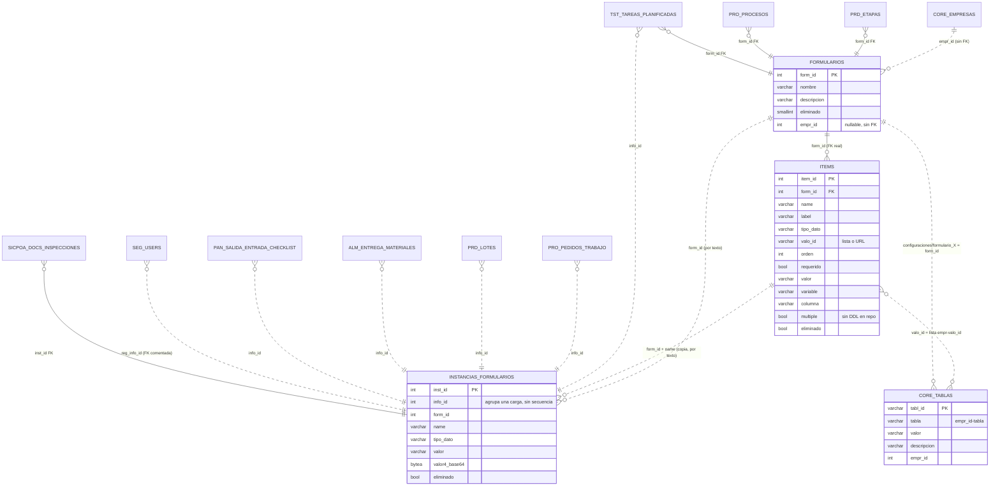
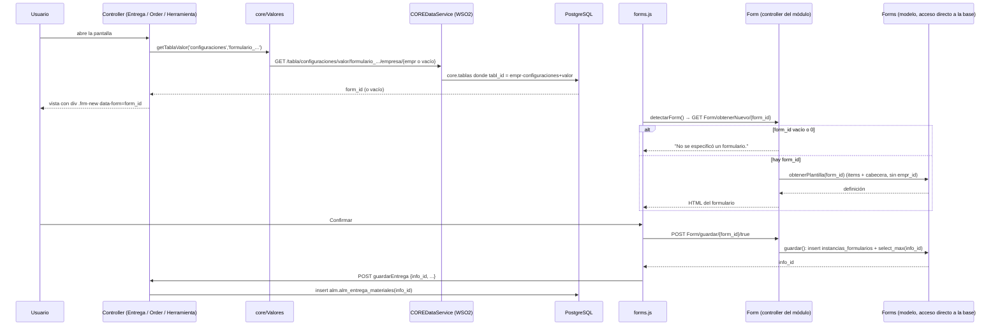

# Formularios dinámicos — relevamiento del estado actual (insumo para el ABM de DNATO v3)

## Objetivo

Qué es: el relevamiento, **solo descriptivo y con evidencia `ruta:línea`**, de cómo funcionan hoy los
formularios dinámicos de la suite (módulo `traz-comp-formularios`): modelo de datos, tipos de campo,
quién los usa, cómo se elige cuál mostrar, cómo se personalizan a mano, riesgos y lo que no existe.
Para quién: PM y quien especifique el ABM de formularios dinámicos de DNATO v3 (Portal de la empresa +
Consola del súper usuario). Cuándo leerlo: antes de escribir esa especificación. Qué NO cubre: ninguna
propuesta de diseño (es deliberadamente "cómo está"), ni el relevamiento general de DNATO v2
([`DNATO_v2_RELEVAMIENTO.md`](DNATO_v2_RELEVAMIENTO.md)), ni el modelo de formularios propio de
AssetPlanner en MariaDB (`traz-prod-assetplanner/scripts/v2.3/frm/frm-tablas.sql:31-102`, no relevado).

---

| Ítem | Valor |
|---|---|
| Fecha | 2026-11-02 |
| Modo | Solo lectura sobre el código. No se consultó ninguna base de datos (sin VPN): lo dicho sobre datos sale de scripts y de un dump |
| Submódulo | `application/modules/traz-comp-formularios`, pin **`d1cc7f9` (tag `v1.8.5.1`)**, idéntico en los dos repos, sin cambios locales |
| Notación | **TT:** = repo `traz-tools` · **DN:** = repo `traz-comp-dnato` · **FRM:** = `TT:application/modules/traz-comp-formularios` (mismo contenido que en DN) · **DS/** = `TT:_backend/api/ToolsAPIProject/ToolsAPIProject/src/main/wso2mi/artifacts/data-services/` · **DMP:** = líneas del dump `TT:_backend/database/traz_tools_v1.5.8.5.dmp` convertido a texto con `pg_restore -f` (ver §1, aviso) |
| Supuestos | Todo lo marcado **"(inferencia)"** sale de leer código, no de probarlo en un ambiente |

---

## Resumen ejecutivo

1. Un formulario dinámico es una **cabecera** (`frm.formularios`) + **campos** (`frm.items`); cada carga
   genera **una fila por campo** en `frm.instancias_formularios`, agrupadas por `info_id`, y la entidad de
   negocio (entrega, salida de pañol, pedido de trabajo, lote, usuario…) guarda ese `info_id`.
2. Se usa en almacenes, pañol, BPM/procesos, tareas estándar, trazasoft (etapas), residuos, módulos de
   cliente (SEIN, YUDI, DDPE) y el registro de usuario de DNATO. Bonita no lo usa.
3. **No hay una regla única para elegir qué formulario mostrar**: hay 6 mecanismos distintos (config por
   empresa en `core.tablas`, config global, tabla de procesos, columna de la entidad, id fijo en la vista,
   constante). El módulo en sí no sabe de empresas: dibuja el `form_id` que le pasen.
4. **Formulario global = formulario sin `empr_id`** (decisión D1). La columna lo admite (es nullable) y
   dibujar/guardar no mira la empresa, así que ya funciona en todas; lo que faltaba es que los combos lo
   muestren (cambio D2-D3). Además existe la **empresa plantilla 9000**, desde la que el alta de empresa
   **clona un único formulario** ("Entrega Materiales").
5. Hallazgos principales:
   - 🔴 **Seguridad**: los endpoints del módulo en tools no piden sesión ni CSRF, y uno lista las
     respuestas de **todas** las empresas; en DNATO, sin sesión se usa `user_id=1` y se acepta cualquier
     `info_id` del POST → cualquiera puede sobrescribir cualquier respuesta.
   - 🔴 **Sin validación en servidor**: "obligatorio" se controla solo en el navegador (y en check/radio y
     en el registro de DNATO, ni eso).
   - 🟠 **Aislamiento por empresa**: de 30 puntos auditados, 7 filtran por `empr_id`.
   - 🟠 **`info_id` por `select_max`**: dos guardados simultáneos pueden cruzarse; el mecanismo real que
     asigna `info_id` no está en el repo.
   - 🟠 **El DDL de `frm.*` no está versionado**: solo existe en un dump binario viejo; columnas que el
     código usa (`multiple`) no figuran ahí.
6. Hoy no hay ninguna pantalla para crear/editar formularios: todo se hace con SQL a mano, con scripts
   que se contradicen entre sí (el formulario de registro aparece como 24, 1 y 72).
7. Un formulario **sin `empr_id`** ya funciona en todas las empresas si la pantalla llega a él por número;
   lo que lo ata a cada empresa son las **listas de opciones** y la **configuración por pantalla** (§8).
   Decisión posterior del PM: sin empresa = global, y los combos de tareas/etapas los van a mostrar (D1-D3).

---

## 1. Modelo de datos completo del esquema `frm`

> **Aviso de fuente.** En ningún `.sql` de los dos repos hay `CREATE TABLE frm.*` (buscado:
> `create table "?frm"?\.`, `create schema frm`, `alter table frm\.`, `create (view|function|trigger).*frm\.`
> en `*.sql, *.php, *.dbs, *.xml, *.md`). La **única** fuente de estructura es el dump binario
> `TT:_backend/database/traz_tools_v1.5.8.5.dmp` (pg_dump tar), versión 1.5.8.5: lo agregado después no
> aparece. `TT:doc/analisis/impacto-config-formulario-entrega-alta.md:98-102` ya lo marcaba como bloqueante.

En el dump, el esquema `frm` tiene exactamente: **4 tablas, 4 secuencias, 4 PK, 1 FK, 2 comentarios**.
Funciones, vistas y triggers propios de `frm`: **NO ENCONTRADO**.

### 1.a Cabecera — `frm.formularios` (DMP:3983-3991)

| Columna | Tipo | Nota |
|---|---|---|
| `form_id` | integer serial, PK `formularios_pk` (DMP:12795-12796) | |
| `nombre` | varchar(45) | Se busca por nombre: `obtenerXEmpresa` (`FRM:models/Forms.php:414-418`) y el clon del trigger (`nombre = 'Entrega Materiales'`) |
| `descripcion` | varchar(300) | |
| `eliminado` | **smallint** DEFAULT 0 | Baja lógica (en las otras tablas es boolean) |
| `fec_alta`, `usuario` | timestamp now() / CURRENT_USER | |
| `empr_id` | integer, **nullable, sin FK** a `core.empresas` | Agregada por `TT:application/modules/traz-prod-trazasoft/database/v0.4.4/scripts.php:25` |

**No tiene**: código, versión, estado, ni referencia a pantalla o entidad. La asociación va al revés (la
entidad guarda el `form_id`; ver §3):
- FK real a `frm.formularios(form_id)`: `prd.etapas` (DMP:13732, 13740), `pro.procesos` (DMP:14116;
  `TT:_backend/database/scripts/versiones/v1.4/tablas pedidos trabajo.sql:33`), `tst.tareas_planificadas` (DMP:14348).
- Por texto, sin FK: `tst.subtareas.form_id` (DMP:5896), `tst.tareas_std.form_id` (DMP:5985).

### 1.b Campos — `frm.items` (DMP:4076-4090)

| Columna | Tipo | Nota |
|---|---|---|
| `item_id` | integer serial, PK `items_pk` (DMP:12811-12812) | |
| `form_id` | integer, **FK real** `items_fk` → `frm.formularios`, sin ON DELETE (DMP:13539-13540) | |
| `label` | varchar | Etiqueta |
| `name` | varchar | Nombre del campo HTML. **Es la clave** con la que se guarda/actualiza la respuesta (`Forms.php:126-133`) |
| `tipo_dato` | varchar | Ver catálogo §2 |
| `valo_id` | varchar | **Por texto**. Según el tipo: nombre de la lista en `core.tablas` (`Forms.php:228-230`) o una **URL** (`service`, `urlEvaluador`, `urlConsultor`; `Forms.php:175-217`) |
| `orden` | integer | Orden de dibujo (`Forms.php:191`) |
| `variable` | varchar(100) | Se copia a la respuesta (`instanciarVariables`, `Forms.php:388-400`); la lee `getVariablesXOrigen` (`DS/FRMDataService.dbs:11`) |
| `requerido` | boolean DEFAULT false | |
| `valor` | varchar(500) | Valor por defecto/fijo |
| `columna` | varchar(50) | Clase Bootstrap de ancho (comentario DMP:4099) |
| `multiple` | **sin DDL en el repo** | Lo usan `Forms.php:186`, `FRM:helpers/form_helper.php:186,253` y el trigger v2.8.1.3:116-117; no figura en el dump ni en ningún `.sql` |
| `fec_alta`, `eliminado` | timestamp / boolean DEFAULT false | Baja lógica (`Forms.php:190`) |

- **Secciones/agrupación**: no hay columna; se simulan con campos `titulo1/2/3` y `comentario` (`form_helper.php:16-26`).
- **Validaciones**: solo `requerido`. **Condicionales** (mostrar/habilitar según otro campo): **NO
  ENCONTRADO** en `frm`. Solo existen en `alm.items` (`mostrar, cond_mostrar, deshabilitado,
  cond_habilitado`; DMP:3385-3400), tabla aparte, vacía en el dump y sin uso en ningún `.dbs`.

### 1.c Respuestas — `frm.instancias_formularios` (DMP:4022-4038)

| Columna | Tipo | Nota |
|---|---|---|
| `inst_id` | integer serial, PK (DMP:12803-12804) | **Una fila por campo respondido** |
| `info_id` | integer, **sin secuencia, sin default, sin restricción** | Agrupa las filas de **una carga**; es el "id de respuesta" que circula por el sistema |
| `form_id` | integer, **por texto** (sin FK) | |
| `label, name, tipo_dato, requerido, valo_id, orden, variable, columna` | copia de `items` | **Se copian del campo al guardar** (`Forms.php:23-96`): cada respuesta guarda su "foto" de la definición |
| `valor` | varchar | Valor cargado. Multiselección: ver §2 |
| `valor4_base64` | bytea | Archivo/imagen (DMP:4047; `Forms.php:39-45`) |
| `multiple` | sin DDL | Leída en `Forms.php:154` |
| `fec_alta`, `eliminado` | timestamp NOT NULL / boolean | `eliminado` filtrado en `Forms.php:158`, `DS/FRMDataService.dbs:17,22` |

- **No hay `item_id`**: la respuesta se vincula al campo solo por `form_id + name`, por texto.
- **No hay `empr_id`** (inferencia: ninguna consulta ni inserción lo usa).
- **Cómo se asigna `info_id`**: el código inserta sin `info_id` (`Forms.php:95-96`) y después lee
  `select_max('info_id')` (`Forms.php:98`); la vista previa calcula `max+1` (`Forms.php:195`). El
  mecanismo que realmente lo completa al insertar: **NO ENCONTRADO** (ni default ni trigger en el dump;
  buscado `instancias_formularios` en todos los `.sql` e `info_id.*(trigger|nextval)` en docs).
  Inferencia: hay un trigger en las bases reales que no está en el repo.

### 1.d Opciones de lista

- **Vigente: `core.tablas`** (DMP:3947-3958). El trigger `core.set_tabla_id_trg` (presente **solo en el
  dump**, DMP:440-445) reescribe `tabla = empr_id||'-'||tabla` y `tabl_id = tabla||valor`. El modelo lee
  `tabla = empresa().'-'.valo_id` (`Forms.php:230`): **las opciones son siempre de una empresa**, no se heredan.
- **Vieja: `frm.utl_tablas`** (DMP:4128-4135; PK DMP:12819-12820): sin `empr_id`, datos 2020-2021
  (DMP:9804-9850). Solo la usa la query `getvalvalidos` (`DS/FRMDataService.dbs:26-27`), que ningún
  recurso expone (`:31-46`), y `Tareas::obtenerValores` (`TT:application/modules/traz-comp-tareasestandar/models/Tareas.php:483-486`).

### 1.e Cómo se vincula una respuesta a la entidad de negocio

Siempre la entidad guarda el `info_id`, nunca al revés.

| Entidad | Columna | Restricción | Evidencia |
|---|---|---|---|
| Pedido de trabajo | `pro.pedidos_trabajo.info_id` NOT NULL | por texto | `TT:_backend/database/scripts/versiones/v1.4/tablas pedidos trabajo.sql:55`; DMP:5105 |
| Formularios por tarea del pedido | `pro.pedidos_trabajo_forms(petr_id, info_id, task_id)` | PK compuesta (DMP:13028) | DMP:5128; `DS/PRODataService.dbs:69,77` |
| Tarea planificada | `tst.tareas_planificadas.info_id` | por texto | DMP:5941; `DS/FRMDataService.dbs:11` |
| Lote de producción | `prd.lotes.info_id` | por texto | `TT:application/modules/traz-prod-trazasoft/database/v0.4.3/agrego_columna_info_id.sql:1` |
| Entrega de materiales | `alm.alm_entrega_materiales.info_id` | DDL NO ENCONTRADO | `DS/ALMDataService.dbs:555` |
| Salida / entrada de pañol | `pan.salida_panol.info_id`, `pan.entrada_panol.info_id` | DDL NO ENCONTRADO | `DS/PANDataservice.dbs:66-67, 98-99, 215, 220, 248` |
| Checklist de herramienta | `pan.checklists.info_id` | DDL NO ENCONTRADO | `DS/PANDataservice.dbs:312-313` |
| Solicitante de transporte (residuos) | `log.solicitantes_transporte.info_id` (+ transportistas, contenedores, `core.equipos`) | DDL NO ENCONTRADO | `DS/semaresiduosDS.dbs:942,982`; `DS/semaresiduosDS2.dbs:48,63,92` |
| Usuario (registro DNATO) | `seg.users.reg_info_id` | FK **comentada** | `DN:scripts/formulario_registro_usuario.sql:52-62`; escrito en `DN:application/controllers/Register.php:229` |
| Inspecciones/documentos SICPOA | `sicpoa.documentos.imag_id`, `sicpoa.inspecciones.inca_id` | **FK real a `inst_id`** (una fila, no una carga) | DMP:14188, 14252 |

Equipo, OT y artículo: **ninguna** columna `info_id|form_id` en el dump para esas tablas.

### 1.f Diagrama



### 1.g ¿"Global para todas las empresas" = `empr_id` NULL?

**Sí, por decisión del PM (D1, §Decisiones).** El modelo de datos ya lo permite (`empr_id` nullable, sin FK)
y el código de dibujo y guardado no mira la empresa, así que un formulario sin `empr_id` funciona en
cualquier empresa. Lo que había al momento del relevamiento, y que se ajusta:
- El listado que llena los combos usaba igualdad estricta, `where empr_id = cast(:empr_id as integer) and
  eliminado != 1` (`DS/FRMDataService.dbs:6`, vía `listarFormularios()`, `Forms.php:424-430`), así que un
  formulario sin empresa **no aparecía para elegirlo**. Con D2-D3 pasa a traer los propios + los sin
  empresa (rama `feat/frm-formularios-globales-en-combos`). `obtenerXEmpresa` (`Forms.php:414-418`) sigue
  con igualdad estricta, pero no tiene llamadores.
- `obtenerPlantilla(form_id)` y `obtener(info_id)` **no filtran por empresa** (`Forms.php:183-191`, `152-159`):
  cualquier `form_id` se puede abrir por id. Así funciona el "uso compartido" de hecho (registro DNATO con el 72).
- Convive con eso una **empresa plantilla 9000**: el formulario de registro se crea con `empr_id=9000`
  (`DN:scripts/crear_formulario_registro.sql:5-6`), sus opciones también (`:9-29`); el registro pone en
  sesión `REGISTER_TEMP_EMPR_ID='9000'` (`DN:application/config/constants.php:111`;
  `DN:application/controllers/Register.php:69-85`) para que se encuentren las opciones; y el trigger de
  alta clona desde la 9000.
- Otros mecanismos de "global" (empresa 0, tabla puente, flag): **NO ENCONTRADO** (buscado
  `empr_id is null|empr_id = 0` en el módulo, `_backend/api` y DataServices de DNATO; lo único es sobre
  `core.tablas`, `DS/COREDataService.dbs:49,114,120,630`). El global se modela solo con `empr_id` NULL.
- Ojo: las **listas de opciones** de un formulario global siguen siendo de cada empresa (§8.4, trampa 1).

---

## 2. Catálogo de tipos de ítem

El dibujo lo decide el `switch` sobre `tipo_dato` en `form()` (`FRM:helpers/form_helper.php:14-82`). Las
opciones se cargan en `Forms::obtenerPlantilla()` (`Forms.php:204-218`, formulario nuevo) y
`Forms::obtener()` (`Forms.php:170-178`, respuesta existente).

| `tipo_dato` | Función | HTML que genera | Opciones | Cómo se guarda | Validación |
|---|---|---|---|---|---|
| `titulo1` | inline `:17` | `div.col > h1`. **HTML mal armado** (falta comilla del `class`, no cierra un `div`) | — | sin `name` → rama "sin name" (`Forms.php:81-90`) | — |
| `titulo2` / `titulo3` | `:19-24` | `h2` / `h3` | — | igual | — |
| `comentario` | `:26-28` | `p.text-info` | — | igual | — |
| `input` | `input()` `:88-97` | `div.form-group > label + input.form-control[type=text]` | — | texto en `valor` | `requerido` → `data-bv-notempty` (`req()` `:206-211`), solo navegador |
| `number` | `number()` `:263-271` | igual con `type=number` | — | texto | solo `requerido`. **Sin min/max ni unidad** |
| `textarea` | `textarea()` `:194-204` | `textarea rows=3` (con un `type='file'` sobrante) | — | texto | `requerido` |
| `date` | `datepicker()` `:115-125` | `input.datepicker[type=date]` + `data-bv-date-format='DD/MM/YYYY'` | — | lo que mande el navegador | `requerido`. **Formatos en choque**: `type=date` manda aaaa-mm-dd, `TT:lib/props/forms.js:56-58` configura `yy-mm-dd`, el atributo pide DD/MM/YYYY |
| `select` | `select()` `:99-113` | `select.frm-select` con `-Seleccionar-` | `core.tablas` (`empr-valo_id`) | el **`tabl_id`** elegido | `data-bv-notempty` + regla `forms.js:33-47` (rechaza `""` y `"0"`) |
| `service` | `select()` `:38-40` | igual | `valo_id` **es una URL** REST; se llama con `Bearer TOKEN_API_MANAGER` y se recorta el primer `[...]` (`Forms.php:240-317`) | `value` | igual que select |
| `urlConsultor` | `select()` `:41-43` | igual | `file_get_contents(valo_id)`; `value=registro`, `label=nombre` (`Forms.php:352-377`) | `value` | igual |
| `urlEvaluador` | `select()` `:44-46` | igual | `file_get_contents(valo_id)`; `value=dni`, `label=nombre` (`Forms.php:325-350`) | `value` | igual |
| `check` | `check()` `:127-146` | un checkbox `name='{name}[]'` por opción; marcado si el valor aparece como **subcadena** de `valor` (`:133`) | `core.tablas` | **multiselección**: al crear, **una fila por valor** (`Forms::guardar` `:49-73`); al actualizar, **todo junto con `-` en una fila** (`Forms::actualizar` `:122-124`) | **ninguna**: `($key == 0 && $e->requerido ? null : null)` da siempre null (`:133`) |
| `radio` | `radio()` `:148-165` | `input[type=radio][name='{empr}-{valo_id}']` — **no** el `name` del ítem (`:154`) | `core.tablas` | se lee de `$data[empresa().'-'.name]` (`Forms.php:35`): **solo funciona si `valo_id == name`**; al actualizar toma lo que sigue al último `-` (`Forms.php:127-132`) | ninguna (mismo `null : null`, `:154`) |
| `file` | `archivo()` `:167-192` | `input[type=file][name='-file-{name}']` (`[]` si `multiple`) + link "Ver Adjunto" en base64. Error de tipeo `<iclass=` (`:188`) | — | nombre en `valor` (`FRM:controllers/Form.php:65-73`), contenido en `valor4_base64` (`Forms.php:39-46,58-64,134-137`) | `requerido` |
| `image` | `image()` `:234-261` | `input[type=file][accept=image/*][capture]` + vista previa | — | igual que `file` | `requerido` |
| `btnAgregar` | `btnAgregar()` `:273-280` | `button onclick='agregar{name}()'` (la función la define la pantalla) | — | — | — |
| **desconocido** | `default` `:79-81` | **dibuja `<hr>`**, sin error ni log | — | igual se graba la fila | — |

- **No existen**: `<select multiple>` (la multiselección es solo `check`), regex, min/max, número con
  unidad, opciones inline en el ítem.
- **Validación en servidor: NO ENCONTRADO** (`Forms::guardar`/`actualizar` no miran `requerido`).
- Formulario sin campos → devuelve el texto `'Formulario No encontrado.'` (`form_helper.php:8-10`).
- Se guarda el **id** de la opción; combinado con la búsqueda por subcadena de `check`, el id `1` también
  "coincide" dentro de `12` (`:133`).
- Hueco: `obtener()` **no carga opciones** para `urlEvaluador`/`urlConsultor` (`Forms.php:170-178`).
  Inferencia: al reabrir una respuesta, esos desplegables salen vacíos con aviso de PHP.
- Error de sintaxis PHP latente: `Forms.php:259` concatena con `+ url`.
- **Listas por empresa**: sí, siempre (las de `core.tablas`). Las de tipo URL dependen de la URL guardada
  en el ítem, que pertenece a un formulario de una empresa.

---

## 3. Quién usa formularios dinámicos y cómo se elige cuál

### 3.1 Tabla de usos

Mecanismos: **A** `core.tablas` `configuraciones` por empresa · **B** `core.tablas` global (residuos) ·
**C** tabla de procesos por empresa · **D** columna `form_id` de la entidad (elegida en un ABM) · **E** id
fijo en la vista · **F** constante.

| Pantalla / ABM | Módulo | Cómo pide el form | Con form propio / sin config | Dónde guarda la respuesta |
|---|---|---|---|---|
| Entrega directa de materiales | traz-comp-almacenes | **A** `getTablaValor('configuraciones','formulario_entrega_materiales')` (`controllers/new/Entrega_Material.php:50`) → `views/new/entregas_materiales/view_entrega_pedido.php:18` | El de la empresa. Sin config: "No se especificó un formulario" y guarda con `info_id=null` (`view_entrega_pedido.php:331-345`) | `info_id` en `info_entrega` (`:385`) → `alm.alm_entrega_materiales` (`models/Ordeninsumos.php:119,136`) |
| Tarea BPM "Entrega pedido pendiente" | traz-comp-almacenes | **A** misma clave (`models/Almtareas.php:133`) → `views/proceso/tareas/pedido_materiales/view_entrega_pedido_pendiente.php:28` (antes fijo `14`, comentado en `:27`) | Igual (`:183,239,443`) | `Ordeninsumos.php:136` vía `Almtareas.php:247` |
| Pañol: salida | traz-comp-pan | **A** `formulario_salida_herramientas` (`controllers/Order.php:31`) → `views/orders/view_.php:86` | Igual que A | `models/Orders.php:103` → `pan.salida_panol.info_id` (`DS/PANDataservice.dbs:66-67`) |
| Pañol: modales nueva salida / nueva recepción | traz-comp-pan | **A** **la misma clave de salida para las dos** (`controllers/Movimientoherramientas.php:32,121,132`) | Igual que A | Recepción: `models/Unloads.php:95` → `pan.entrada_panol.info_id` (`PANDataservice.dbs:98-99`) |
| Pañol: recepción directa | traz-comp-pan | **No define `form_id`** (`controllers/Unload.php:17-20`; vista `unloads/view_.php:83`) | Siempre sin formulario | `info_id` null |
| Pañol: checklist de herramienta | traz-comp-pan | **A** `formulario_checklist_herramientas` (`controllers/Herramienta.php:56`) → `views/herramienta/modals/modal_checklist.php:70` | Igual que A | `models/Herramientas.php:504-506` → `pan.checklists.info_id` (`PANDataservice.dbs:312-313`) |
| Pedido de trabajo (alta) | traz-comp-bpm | **C** `pro.procesos.form_id` del proceso de la empresa, **resuelto desde la vista** (`views/pedido_trabajo.php:153-158`; `DS/PRODataService.dbs:31`); si no hay proceso usa `PRO_STD` | Sin form: `data-form="0"` (`:161`) | `pro.pedidos_trabajo.info_id` (`controllers/Pedidotrabajo.php:223`; `PRODataService.dbs:6`) |
| Pedido de trabajo (detalle) | traz-comp-bpm | Solo lee `getForm($info_id)` (`Pedidotrabajo.php:182-185`); busca "Rechazo de Tarea" **por nombre** (`:164-170`) | — | `pro.pedidos_trabajo_forms` |
| Tareas del proceso productivo | sein-tools-almpantar | **C** `pro.procesos_forms` por `nombre_tarea + empr_id`, `orden=1` principal / `orden=2` rechazo (`models/Proceso_tareas.php:173-191`; `PRODataService.dbs:82`) | Sin fila: no se dibuja | `pro.pedidos_trabajo_forms` (`Proceso_tareas.php:357-388`) |
| Tareas SEIN con id fijo | sein-tools-almpantar | **E** `data-form` 53, 55, 57-66 (p. ej. `views/tareas/proceso_productivo/view_ejecuta_trabajo.php:18`) | Igual para toda empresa | igual |
| Reparación de neumáticos | yudi-tools-almproc | **E** `data-form` 3, 6, 7, 9, 10, 51 (p. ej. `views/tareas/pedido_reparacion_neumaticos/view_aprueba_reparacion.php:39-40`) | Fijo | `models/Yudiproctareas.php:225,260-266` |
| Control de camiones SICPOA | ddpe-tools-pro | **E** `data-form` 11, 12, 69 (`views/inspeccion/modales.php:186,222`, `views/barrera/barrera.php:8`) | Fijo | `models/Sicpoatareas.php:543-555` |
| Residuos: generador, contenedor, vehículo, transportista, evaluador | traz-tools-resi | **B** `core.tablas` `configuraciones_log`, primer `valor === 'form_X'` → `valor2` (`models/estructura/Generadores.php:199-211`, y análogos en Contenedores, Vehiculos, Transportistas, Evaluadores); query **sin empresa** (`DS/semaresiduosDS.dbs:208`) | Uno solo para todas. Sin config: `data-form="0"` | UPDATE de la entidad (`semaresiduosDS.dbs:942`, `semaresiduosDS2.dbs:48,63,92`) |
| Tareas estándar / subtareas | traz-comp-tareasestandar | **D** `tst.tareas_std.form_id` / `tst.subtareas.form_id`, elegido en un combo que llama a `GET /formularios/{empr_id}` (`views/tareas/form.php:25`, `subtareas.php:37`). Con D2-D3 el combo muestra los de la empresa + los globales (sin `empr_id`), marcados "(global)" | Sin form: no instancia (`models/Tareas.php:215`) | `tst.tareas_planificadas.info_id` |
| Etapa productiva (alta de lote) | traz-prod-trazasoft | **D** `prd.etapas.form_id`, ABM con `listarFormularios()` (`controllers/general/Etapa.php:79,746,764-765`), que usa el mismo recurso: con D2-D3 también muestra los globales | Sin form: no dibuja | **La instancia se crea al dibujar** (`nuevoForm`, `views/etapa/abm.php:128`) → `prd.lotes.info_id` (`Etapa.php:138`) |
| Registro de usuario | traz-comp-dnato | **F** `FORMULARIO_REGISTRO_ID = 72` (`DN:application/config/constants.php:102`, igual en `master`) → `Register.php:32` | Fijo para todos | `Forms->actualizar` + `seg.users.reg_info_id` (`Register.php:224-230`) |
| Vale de pañol (impresión) | traz-comp-pan | Solo lee `Forms->obtener($info_id)` (`controllers/Vales.php:37-39`) | — | — |

(Rutas de módulo relativas a `TT:application/modules/<módulo>/`, salvo las de DN.) Además hay 47
`data-form` con id fijo, mayoritariamente en módulos de cliente y pantallas de prueba (`data-form="1"`).
**Bonita no usa el módulo** (sin coincidencias de `form_id`, `info_id`, `frm.`, `traz-comp-formularios`
dentro de los `.bos`/`.bar` de `TT:_backend/bpm/`).

### 3.2 La regla de resolución

**No hay una regla única: la decide cada pantalla.** El módulo dibuja lo que le pidan
(`obtenerPlantilla` filtra solo por `form_id`, `Forms.php:189`). El caso más extendido y el más parecido
a "por empresa" es el **mecanismo A** (almacenes y pañol):

`TT:application/models/core/Valores.php:65-84`:
```php
$empre_id = '';
if ($usuario['email'] != TOOLS_ADMIN_USER) { $empre_id = empresa(); }
$resource = "/tabla/".$tabla."/valor/".$valor."/empresa/".$empre_id;
```
→ `DS/COREDataService.dbs:1237`, query `getTablaValorXEmp` (`:629-635`):
```sql
where t.tabl_id = case when param.empr_id is null or param.empr_id = ''
                       then param.tabla||param.valor
                       else param.empr_id||'-'||param.tabla||param.valor end
and t.eliminado = false
```

- **Usuario común**: busca **solo** la fila de su empresa (`'{empr}-configuracionesformulario_xxx'`). **No
  hay respaldo al global** si la empresa no la tiene.
- **Administrador de tools**: busca la fila sin prefijo de empresa.
- **Si falta la fila**: `form_id` vacío → `Form/obtenerNuevo/` responde `"No se especificó un formulario."`
  (`FRM:controllers/Form.php:48`) y la pantalla **guarda igual con `info_id = null`**. No se rompe; se
  pierde el dato del formulario. (Inferencia: que la DataService sin filas termina en `null` en PHP, `Valores.php:83`.)
- **Quién carga la fila**: para empresas nuevas, solo `formulario_entrega_materiales` (trigger de alta,
  §4.2). **`formulario_salida_herramientas` y `formulario_checklist_herramientas` no tienen ningún script
  que las siembre** (buscado en `TT:_backend/database`): las empresas nuevas quedan sin formulario de
  pañol hasta que alguien cargue la fila a mano.

Los demás mecanismos: **B** residuos = un formulario global para todas, sin variante por empresa; **C** =
por empresa y proceso/tarea; **D** = lo elige un administrador en el ABM de la entidad (solo ve los de su
empresa); **E/F** = fijo en código, igual para toda empresa.



Variante: en el registro DNATO y en etapas de trazasoft la respuesta **se crea vacía al dibujar**
(`generarInstancia` / `nuevoForm`, `FRM:helpers/form_helper.php:282-291`) y después se completa con
`actualizar($info_id)` o se vincula.

### 3.3 Cómo se carga el módulo en cada repo

| Repo | Mecanismo | Evidencia |
|---|---|---|
| traz-tools | **Módulo ruteable (HMVC/MX)**: `TT:application/core/MY_Loader.php:6`, `MY_Router.php:6`; helper autocargado `FRM.'form'` (`TT:application/config/autoload.php:92`); JS inyectado por `TT:application/views/layout/general_scripts.php:93` → `FRM:views/scripts.php` → `lib/props/forms.js` | Los controllers `Form`, `Dash`, `Loggin` **son ruteables** (`index.php/traz-comp-formularios/Form/...`) y extienden `CI_Controller` sin validar sesión (`Form.php:3-10`) |
| traz-comp-dnato | **Sin HMVC: `require_once` directo** del helper y del modelo del submódulo (`DN:application/controllers/Register.php:26-28,213-215`). `DN:application/config/modules.php:17-23` no tiene efecto | Los `Form.php` **no son ruteables**. `Main::guardarFormularioRegistro` (`DN:application/controllers/Main.php:2065-2103`) no tiene llamadores y fallaría (carga el modelo sin `require_once`): código muerto |

---

## 4. Cómo se customizan hoy "a mano"

### 4.1 Scripts encontrados

| Script | Qué hace | Evidencia |
|---|---|---|
| `DN:scripts/crear_formulario_registro.sql` | Cabecera con `empr_id=9000`, listas en `core.tablas` (`empr_id=9000`), 4 campos con **`form_id=24` fijo** (el comentario dice "asumiendo 1") | `:5-6`, `:9-29`, `:31-36` |
| `DN:scripts/formulario_registro_usuario.sql` | Variante: cabecera `empr_id=1`, listas `'1-como_enteraste'` con `tabl_id` a mano, campos `form_id=1`, `ALTER TABLE seg.users ADD reg_info_id` | `:5-6`, `:12-32`, `:38-49`, `:52-58` |
| `DN:scripts/corregir_formulario_registro.sql` | **DELETE físico** de los campos del `form_id=1` y reinserción con `form_id=72` | `:5`, `:8-19` |
| `DN:scripts/corregir_valo_id.sql` | Cambia `valo_id` a `'1-como_enteraste'` etc. en `form_id=72` | `:5-17` |
| `TT:_backend/database/scripts/versiones/v2.8.1.3/configuracion_inicial_empresa_trg_func.sql` | Trigger de alta: clona "Entrega Materiales" de la 9000 (§4.2) | `:94-129` |
| `TT:application/modules/traz-prod-trazasoft/database/v0.4.4/scripts.php` | `ALTER TABLE frm.formularios ADD empr_id` | `:25` |

Docs relacionados: `DN:development/PASAJE_PRODUCCION.md:42-62` (orden de ejecución; "NO ejecutar
formulario_registro_usuario.sql"; "capturar el form_id real y reflejarlo en `FORMULARIO_REGISTRO_ID`"),
`DN:IMPLEMENTACION_FORMULARIO_REGISTRO.md:55-63`, `DN:doc/FORMULARIOS_DINAMICOS.md` (uso, no alta).
`TT:doc/hallazgos/REGISTRO.md:135` (H-088): sin campos en `frm.items` no anda.

**Procedimiento reconstruido** para crear un formulario para una empresa:
1. `INSERT frm.formularios (nombre, empr_id, …)` y **anotar a mano el `form_id`** generado (ningún script lo captura).
2. Por cada campo de lista: `INSERT core.tablas (tabla=<valo_id>, empr_id=<empresa>, valor, descripcion)`
   (el prefijo `empr-` lo agrega el trigger `core.set_tabla_id_trg`, que solo está en el dump).
3. `INSERT frm.items (form_id, name, label, tipo_dato, requerido, orden, columna, valo_id[, variable, multiple])`.
4. Asociarlo a la pantalla según su mecanismo (§3.1): fila `configuraciones/formulario_xxx` con el
   `form_id` en `descripcion`, o `configuraciones_log.valor2`, o columna de la entidad, o constante, o
   tocar la vista.

**Modificar** = `UPDATE frm.items` o **DELETE físico + reinsertar**. Los propios scripts se contradicen:
el formulario de registro aparece como 24, 1 y 72, y `valo_id` como `'como_enteraste'` y `'1-como_enteraste'`.
Inferencia: con `valo_id='1-…'` se rompe el guardado del radio (que solo funciona si `valo_id == name`, §2).
`DN:docs/registracion.md:52,218,290` describe una tabla `frm.respuestas_formularios` que **no existe**.

### 4.2 Qué hace el trigger de alta de empresa sobre `frm.*`

El trigger `configuracion_inicial_empresa_ai AFTER INSERT ON core.empresas`
(`TT:_backend/database/scripts/versiones/v2.8.1.2/configuracion_inicial_empresa_trg.sql:1-6`). La función
v2.8.1.2 no toca `frm`; la **v2.8.1.3** agrega el bloque de formularios (`…/v2.8.1.3/configuracion_inicial_empresa_trg_func.sql`):

1. Busca la plantilla (`:98-105`): `empr_id = 9000 and nombre = 'Entrega Materiales'`, no eliminada, la más nueva.
2. Si no la encuentra (`:107`), no hace nada.
3. **Clona la cabecera** con el `empr_id` nuevo (`:109-113`) y **los campos no eliminados**, incluidos
   `variable` y `multiple` (`:116-120`).
4. Escribe `core.tablas ('configuraciones','formulario_entrega_materiales', descripcion = form_id clonado, empr_id)` (`:123-124`).
5. Si falla (`:126-128`), solo `raise warning`: el alta sigue.

**Clona, no referencia, y un único formulario.** No hace:
- clonar otros formularios (ni los de pañol);
- **copiar las listas de opciones** de la 9000 (inferencia: los select/radio/check del clon salen vacíos
  en la empresa nueva, porque se buscan como `<empr_nueva>-<valo_id>`, `Forms.php:230`);
- nada para las empresas que ya existían (`TT:doc/analisis/impacto-config-formulario-entrega-alta.md:148-152`).

Depende de `frm.items.multiple`, sin DDL en el repo: si en una base no existe, el bloque falla entero y
solo queda el warning.

---

## 5. Ciclo de vida y riesgos

### 5.1 Modificar un formulario con respuestas cargadas

Cada respuesta guarda su **propia copia** de la definición y se dibuja solo desde esa copia (`Forms.php:154-159`). Por eso:
- Cambiar texto, orden o dar de baja un campo **no afecta** respuestas viejas.
- Un **campo nuevo** no aparece en respuestas viejas, y si se intenta guardar, `actualizar()` hace un
  UPDATE por `info_id + name` que afecta 0 filas y **no inserta** (`Forms.php:126-145`), sin aviso.
- **Renombrar `name`** rompe a quienes buscan respuestas por nombre: `DS/PANDataservice.dbs:220`
  (`lower(i.name)='dni'`), `DS/ALMDataService.dbs:555` (`name='obra'`), y la entrega de materiales, que lee
  `comprobante`, `solicitante`, `dni` del formulario (`…/view_entrega_pedido.php:377-381`; si faltan, `'S/C'` o vacío).
- **Opciones**: la respuesta guarda el `tabl_id`; las opciones se releen en vivo (`Forms.php:230`). Si se da
  de baja una opción, la respuesta vieja se ve sin selección; y la lista se arma con la empresa **de quien
  mira**, no la dueña (`TT:application/helpers/sesion_helper.php:224-227`).
- **Borrar la cabecera** deja las respuestas sin dibujarse (INNER JOIN, `Forms.php:156` → "Formulario No encontrado.").
- **Versionado: NO ENCONTRADO** (buscado `form_version|version_form|frm.versiones|nro_version`). La copia
  por respuesta es una "foto" sin número de versión.
- Editar una respuesta sobrescribe `valor` en el lugar, sin historial (`Forms.php:126-143`).

### 5.2 Baja y estados

- Baja **lógica** por `eliminado` (entero en cabecera, booleano en campos y respuestas; `DS/FRMDataService.dbs:6`, `Forms.php:158,190`).
- **Ningún código pone `eliminado` en 1/true** sobre `frm.*`; la única baja que existe es el **DELETE
  físico** de `DN:scripts/corregir_formulario_registro.sql:5`.
- La baja de cabecera **no se respeta al dibujar**: `obtenerPlantilla()` y `obtenerXEmpresa()` no filtran
  `eliminado` (`Forms.php:186-191`, `414-418`); solo lo oculta el listado del DataService.
- **Estados** (borrador/activo/inactivo): NO ENCONTRADO.

### 5.3 Validaciones: servidor vs navegador

- **Servidor: ninguna.** `Form::guardar` toma el POST crudo (`FRM:controllers/Form.php:62`); el modelo no
  chequea `requerido`, `tipo_dato`, que el `name` pertenezca al formulario, ni de quién es el `info_id`
  (`Forms.php:21-150`). Sin transacción (`:95-100`). `Form::guardarJson` usa `$form_id` sin definir (`Form.php:119`).
- **Navegador**: BootstrapValidator sobre `data-bv-notempty` y `.frm-select` (`TT:lib/props/forms.js:23-53`).
  En check/radio el requerido no se aplica nunca (§2). `frmGuardar` **guarda aunque sea inválido**
  (`forms.js:98-158`); `frmGuardarConPromesa` y `editarFormulario` no validan (`:443-493`, `:497-609`).
- **DNATO**: el registro no carga ni `forms.js` ni BootstrapValidator (`DN:application/views/header.php`,
  `footer.php`): **cero validación**; el asterisco es decorativo.

### 5.4 Seguridad (hallazgos nuevos, no figuraban en el relevamiento previo)

- 🔴 En tools, `index.php/traz-comp-formularios/Form/{guardar,obtener,obtenerTodos}` son **ruteables, sin
  sesión** (`Form.php:5-10`), con hooks apagados (`TT:application/config/config.php:106`) y **sin CSRF**
  (`:454`). `obtenerTodos` lista las respuestas de **todas las empresas** (`Forms.php:379-386`).
- 🔴 En DNATO, `Register::guardarFormularioRegistro`: **sin sesión usa `user_id = 1` y toma el `info_id`
  del POST** (`DN:application/controllers/Register.php:192-201`), y graba `seg.users.reg_info_id`
  (`:224-229`) → **cualquiera puede sobrescribir cualquier respuesta**.
- 🟠 `info_id` por `select_max` global (`Forms.php:98`): con dos guardados simultáneos puede devolverse la
  respuesta de otro usuario u otra empresa (inferencia).
- 🟠 Tipos `service`/`urlConsultor`/`urlEvaluador` llaman a la URL guardada en el ítem, con un token global
  (`Forms.php:244-256,328,355`).
- 🟠 El módulo accede a la base directo con `$this->db` (`Forms.php:95,155,187,230`), contra la convención
  del proyecto de pasar todo por WSO2.

### 5.5 Aislamiento multi-empresa

**Modelo `Forms`** (`FRM:models/Forms.php`, único modelo del módulo):

| Método | Línea | ¿Filtra `empr_id`? | Detalle |
|---|---|---|---|
| `guardar` | 21 | ✗ | Instancia cualquier `form_id`; `select_max` global (`:98`) |
| `actualizar` | 112 | ✗ | `WHERE info_id, name` (`:126-133`) |
| `obtener` | 152 | ✗ | `WHERE info_id` (`:157`) |
| `obtenerPlantilla` | 183 | ✗ | `WHERE form_id` (`:189`) |
| `obtenerValores` | 228 | ✓ | `tabla = empresa().'-'.$id` (`:230`), por sesión |
| `obtenerValoresServicio` | 240 | ✗ | URL del ítem + token global |
| `obtenerValoresDesdeUrlEvaluador` | 325 | ✗ | `file_get_contents` |
| `obtenerValoresDesdeUrlConsultor` | 352 | ✗ | `file_get_contents` |
| `listado` | 379 | ✗ | Todas las respuestas |
| `instanciarVariables` | 388 | ✗ | Interno |
| `generarInstancia` | 403 | ✗ | Hereda de `guardar` |
| `validarVariable` | 409 | — | Vacío |
| `obtenerXEmpresa` | 414 | ✓ | Parámetro del que llama; no filtra `eliminado` |
| `listarFormularios` | 424 | ✓ | `/formularios/'.empresa()` |

**Otro código y DataServices sobre `frm.*`:**

| Punto | ¿Filtra? | Evidencia |
|---|---|---|
| `Tareas::obtenerform($info_id)` | ✗ | `TT:application/modules/traz-comp-tareasestandar/models/Tareas.php:455-462` |
| `Tareas::obtenerValores` (`frm.utl_tablas`) | ✗ (catálogo global) | `Tareas.php:483-486` |
| `Pedidotrabajo::cargar_formulario_asociado` (`getForm` con `info_id` de `$_GET`) | ✗ | `TT:application/modules/traz-comp-bpm/controllers/Pedidotrabajo.php:182-184` |
| FRM `getFormularios` | ✓ | `DS/FRMDataService.dbs:6` |
| FRM `getVariablesXOrigen` / `getFormulario` / `getItemsFormulario` / `getvalvalidos` | ✗ | `DS/FRMDataService.dbs:11,17,22,27` |
| PAN `getSalidaxSapaId` / `getEntradaxEnpaId` | ✗ | `DS/PANDataservice.dbs:215,248` |
| PAN `salidasPorDniYFecha` | ✓ | `DS/PANDataservice.dbs:220` |
| ALM `getHistoricoEntMateriales` | ✓ | `DS/ALMDataService.dbs:555` |
| PRO `getPetrForms` | ✗ | `DS/PRODataService.dbs:77` |
| PRDEtapa `getEtapasProductivas` | ✓ | `DS/PRDEtapaDataService.dbs:195` |
| semaresiduos `getDataFormTransportista` / `validaDeleteEvaluador` / `getDataFormDinamico` | ✗ | `DS/semaresiduosDS.dbs:947,982,993` |
| semaresiduosDS2 `getDataFormDinamico` | ✗ | `DS/semaresiduosDS2.dbs:82` |

**Resultado: 7 de 30 puntos filtran por empresa.** Los que no filtran buscan por un id, y nada verifica
que ese id pertenezca a la empresa en sesión. Hay copias heredadas con las mismas consultas en
`TT:esb/dataservices/FRMDataService.xml` y `DN:development/ToolsAPIProject_1.0.0/FRMDataService_1.0.0/*.dbs`.

### 5.6 Copia vieja de DNATO vs submódulo

`diff -q` entre `DN:application/modules/{controllers,models,helpers,views}` y el submódulo: **idénticos**
`controllers/{Dash,Form,Loggin}.php`, `helpers/{admin,fecha}_helper.php`, `views/{list,no_encontrado}.php`,
`views/errors/**`. Difieren 3:

| Archivo | Qué agrega el submódulo (`d1cc7f9`) | Qué tiene la copia vieja que el submódulo **no** |
|---|---|---|
| `models/Forms.php` | `actualizar()` junta multiselección con `-` (`:116-124`, commit `6acb956`) y loguea ERROR si falla (`:138-145`, `0254571`); tipos `urlEvaluador`/`urlConsultor` y sus métodos (`:212-217`, `:319-377`, `38703d0`) | nada |
| `helpers/form_helper.php` | `case 'urlConsultor'`/`'urlEvaluador'` (`:41-46`) | respaldo si `FRM` no está definida (`DN:application/modules/helpers/form_helper.php:280-281,296-297,306-307`) y `obtenerExtension` protegida con `function_exists` (`:312-316`) |
| `views/scripts.php` | ruta `lib/props/forms.js`, **etiqueta `<script>` sin cerrar** (`:11`) | ruta `public/lib/props/forms.js` con etiqueta cerrada (archivo que no existe en DNATO) |

- La copia vieja es el commit **`af1afa2`** del submódulo (2025-08-20) + 2 parches locales. **Nadie la
  referencia hoy** (todo DNATO hace `require_once` del submódulo). Borrarla no rompe nada, pero sus 2
  parches nunca llegaron al submódulo.
- `TT:application/modules/traz-comp-pan/helpers/form_helper.php` es **otra generación, mucho más vieja**
  (2020, commit `1d14aa17`) del mismo helper: switch sobre `$e->tipo` (no `tipo_dato`), menos tipos, y
  funciones con los mismos nombres (`input`, `select`, …). **Ningún código lo carga.** Inferencia: si se
  cargara antes que el del submódulo, PHP cortaría con "Cannot redeclare input()".

---

## 6. UI actual

**Mecánica en tools:**
- `general_scripts.php:93` carga `FRM:views/scripts.php`, que define `frmUrl` e incluye `lib/props/forms.js`
  (existe, 608 líneas). `public/lib/props/forms.js` **no existe** en ninguno de los dos repos. Hay copias
  sueltas: `TT:lib/props.old/forms.js`, `TT:application/modules/traz-prod-trazasoft/lib/props/forms.js` (distinta),
  `DN:public/js/forms.js` (sin referencias).
- La etiqueta sin cerrar de `scripts.php:11` (inferencia, sin probar): el bloque siguiente de
  `general_scripts.php:96-97` (BootstrapValidator local) quedaría absorbido; igual se usa el de CDN (`:85-86`).
- **Tres formas de mostrarlo** (`forms.js:180-306`, `Form.php:12-50`): **parcial** (`div.frm-new[data-form]`
  llenado por `$.load` de `Form/obtenerNuevo/{form_id}`), **modal** (`nuevoForm()`/`obtenerForm()` → JSON
  `{html}` envuelto en `modal()`, agregado a `#frm-list`), y **reabrir** (`.frm-open` → `Form/obtener/{info_id}`).
- **Envío**: `FormData` por POST a `Form/guardar/{info_id|form_id}[/true]` (`forms.js:149-158,470-478,584-591`),
  responde `{info_id}`; sin conexión, `Form/guardarJson/{info}` (`:138-142`).
- Bugs de armado: cierre mal anidado `</form></fieldset>` (`form_helper.php:85`).

**Uso 1 — Registro de DNATO** (`FORMULARIO_REGISTRO_ID = 72`): `Register::register_success`
(`Register.php:23-65`) hace `require_once` del submódulo, pone `empr_id=9000` en sesión, crea la respuesta
vacía con `generarInstancia(72)` y dibuja `header + formulario_page + footer`. Página entera:
```
div.form-container
 ├ div.form-left
 │   ├ logo · h1 "Información Adicional de Registro" · subtítulo
 │   └ form.frm#frm-{info} [data-info={info}] [data-form='frm-default']
 │       ├ radio  "¿Cómo te enteraste de Trazalog? *"   (3 opciones)
 │       ├ check  "¿A qué se dedica tu empresa? *"      (7 opciones, name='actividad_empresa[]')
 │       ├ radio  "¿Cuántos empleados…? *"              (4 opciones)
 │       ├ textarea name=problemas_principales
 │       └ button.frm-save "Guardar"
 └ div.form-right > imagen lateral
```
(Campos según `DN:scripts/corregir_formulario_registro.sql:8-19`; **no verificado contra la base**.) El JS
de la página reemplaza el guardado y manda a `register/guardarFormularioRegistro`
(`DN:application/views/formulario_page.php:116-178`); si sale bien, redirige a `register/crearEmpresa`.
Sin iCheck ni validación (§5.3); jQuery cargado dos veces (`header.php:27` 3.6.0, `footer.php:55` 1.11.1).

**Uso 2 — Entrega Materiales Directa (almacenes, tools)**: `Entrega_Material::entregaMaterialesDirecto`
(`…/traz-comp-almacenes/controllers/new/Entrega_Material.php:48-56`) resuelve el `form_id` por
`core.tablas`. Parcial dentro de un ABM:
```
<style>.frm-save{display:none}</style>          (el botón del formulario se oculta)
div.box.box-primary
 ├ h3 "Entrega Materiales Directa"
 └ .box-body
    ├ div#form-dinamico.frm-new[data-form={form_id}]   ← llenado por AJAX
    ├ textarea#just "Justificación *"
    └ componente de artículos/lotes
```
(`…/views/new/entregas_materiales/view_entrega_pedido.php:1-18`.) Al confirmar (`:330-345`): valida,
`frmGuardarConPromesa` → `info_id`, y recién después crea la nota de pedido y guarda la entrega con ese
`info_id`. Inferencia: `initForm()` (`:127-128`) corre antes de que llegue el AJAX, así que iCheck y el
datepicker no se aplican al formulario; lo compensa `frm_validar` al guardar (`forms.js:84-87`).

---

## 7. Lo que NO existe

| Funcionalidad | Resultado | Cómo se buscó |
|---|---|---|
| ABM / pantalla de administración de formularios por pantalla | **NO EXISTE** | Funciones `crearFormulario/nuevoFormulario/guardarItem/agregarItem` en `application` y `lib`; `insert/update/delete` sobre `frm.items`/`frm.formularios` en `.dbs`/`.xml` (0); opciones de menú en el trigger de alta (`v2.8.1.3:36-48`). `Form::obtenerTodos` lista **respuestas**, no definiciones (`Form.php:52-56`) |
| Clonar formulario plantilla para una empresa (fuera del trigger) | **NO EXISTE** | `clonar|copiar|duplicar…Formulario`, `into frm.` en PHP, `.dbs`, `.sql`: solo el trigger y scripts de DNATO |
| Ordenar ítems arrastrando | **NO EXISTE** | `sortable|draggable|dragula|Sortable.js` en el módulo, `lib/props`, `application/views` (solo `lib/props/dashboard_kpis.js`, no relacionado) |
| Vista previa | **NO EXISTE** como función de diseño. `Form/obtenerNuevo` dibuja la plantilla pero `nuevoForm()` **inserta una respuesta vacía en la base** con solo dibujarla (`form_helper.php:282-290`) | — |
| Versionado | **NO EXISTE** | Ver §5.1 |
| Export / import de formularios | **NO EXISTE** | `(export|import)[a-z_]*form` en el módulo, `forms.js`, `FRMDataService.dbs` (0); la carga masiva de DNATO no incluye `frm` (`DNATO_v2_RELEVAMIENTO.md` A-21) |
| Asociación pantalla↔formulario administrable | **PARCIAL**: mecanismo A y B se editan por el ABM "Lista de valores" (`TT:application/controllers/core/Valor.php`) tipeando el número de `form_id`; C/D tienen combo; E/F requieren tocar código | §3.1 |
| Permisos sobre quién edita formularios | **NO EXISTE** | No hay edición que proteger; el ABM de `core.tablas` no chequea sesión ni rol (`Valor.php:5-8`), solo distingue `TOOLS_ADMIN_USER` (`Valores.php:49-51,71-73`) |
| Validación en servidor | **NO EXISTE** | §5.3 |
| Condicionales entre campos en `frm` | **NO EXISTE** | §1.b |
| DDL versionado de `frm.*` | **NO EXISTE** en el repo | §1, aviso |

---

## 8. Formularios sin empresa (`empr_id` NULL): qué pasa en cada uso

> Análisis agregado después del relevamiento, a pedido del PM, para evaluar la teoría "un formulario sin
> `empr_id` se puede usar en todas las empresas". Hecho leyendo código, **no probado en un ambiente**.

### 8.1 ¿Es obligatorio `empr_id` hoy?

**No.** La columna es nullable y sin FK (DMP:3983-3991; se agregó con
`ALTER TABLE frm.formularios ADD empr_id int4 NULL`,
`TT:application/modules/traz-prod-trazasoft/database/v0.4.4/scripts.php:25`). No se sabe si hoy hay filas
con NULL en producción (no se consultó la base). Los scripts del repo siempre cargan una empresa (9000 en el
registro, 1 en una variante vieja).

### 8.2 Dónde se mira la empresa del formulario

Solo en **dos** lugares de toda la suite (buscado `frm.formularios` + `empr` en `.dbs`, `.xml`, `.php`, `.sql`):

| Lugar | Qué hace con un formulario sin empresa | Evidencia |
|---|---|---|
| Listado que llena los combos (`getFormularios`) | Antes: **no lo mostraba** (`where empr_id = :empr_id`). Con D2-D3: **lo muestra**, después de los propios y con "(global)" | `DS/FRMDataService.dbs:6` (en `master`: `TT:_backend/api/dataservice/FRMDataService.dbs:6`, misma consulta vieja) |
| Clonado del trigger de alta de empresa | **No lo clona** (busca solo `empr_id = 9000`) | `TT:_backend/database/scripts/versiones/v2.8.1.3/configuracion_inicial_empresa_trg_func.sql:100` |

Todo lo demás —dibujar (`obtenerPlantilla`, `Forms.php:188`), reabrir (`obtener`, `Forms.php:155-156`) y
guardar respuestas— **no mira la empresa del formulario**. Las respuestas no tienen `empr_id`.

### 8.3 Caso por caso

| Uso | ¿Funciona con un formulario sin empresa? | Condición |
|---|---|---|
| Almacenes: entrega directa / tarea de entrega pendiente | ✅ Sí | Cada empresa necesita **su propia** fila `configuraciones/formulario_entrega_materiales` apuntando a ese `form_id` (no hay respaldo al global, §3.2) |
| Pañol: salida, recepción, checklist | ✅ Sí | Misma condición |
| Residuos | ✅ Sí | Su configuración ya es una sola para todas |
| Pedido de trabajo / tareas SEIN por proceso | ✅ Sí | El proceso de cada empresa tiene que apuntar a ese `form_id` |
| Ids fijos (DDPE, YUDI, parte de SEIN) y registro DNATO | ✅ Sí | Ya funcionan así; no cambia nada |
| **Tareas estándar, subtareas, etapas de producción** | ✅ Sí (con D2-D3) | Antes no se podía elegir: el combo usa `getFormularios`, que lo excluía. Con el cambio aparece en el combo como "(global)", después de los propios. Las listas de opciones siguen siendo de cada empresa (trampa 1) |

### 8.4 Las tres trampas

1. 🔴 **Las listas de opciones son siempre de la empresa de quien mira.** `obtenerValores` busca
   `tabla = empresa().'-'.valo_id` sin alternativa (`Forms.php:228-231`), y el trigger de `core.tablas`
   arma ese prefijo solo cuando hay `empr_id` (DMP:430-447, `core.set_tabla_id_trg`). Un formulario global
   con campos `select`/`radio`/`check` sale **con las listas vacías** en las empresas que no tengan su propia
   lista con el mismo nombre. Texto, número, fecha, archivo, imagen, títulos y los tipos por URL
   (`service`/`urlConsultor`/`urlEvaluador`) funcionan igual. El truco de `REGISTER_TEMP_EMPR_ID='9000'`
   del registro DNATO existe **por las listas**, no por el formulario.
2. 🟠 **No reemplaza la configuración por empresa** en almacenes y pañol: sin la fila de cada empresa no se
   muestra nada.
3. 🟠 **Visibilidad**: antes quedaba invisible en todos los combos. Con D2-D3 aparece en los de tareas,
   subtareas y etapas (los únicos que listan formularios). En almacenes, pañol, procesos y residuos no hay
   combo: se asocia por configuración o por número.

### 8.5 Riesgo de datos viejos

Como `empr_id` se agregó **después** con `ADD … NULL`, todo formulario creado antes de ese cambio quedó
**sin empresa** (inferencia del script; no verificado en la base). Si entre ellos hay formularios de
clientes puntuales (YUDI, DDPE, SEIN), al mostrar "propios + sin empresa" aparecerían como globales en el
combo de **todas** las empresas. Verificación previa, a correr en la base de tools de producción:

```sql
SELECT form_id, nombre, fec_alta
FROM frm.formularios
WHERE empr_id IS NULL AND eliminado != 1
ORDER BY form_id;
```

---

## Decisiones del PM posteriores al relevamiento (2026-11-02)

| # | Decisión | Alcance |
|---|---|---|
| D1 | **Formulario sin `empr_id` = formulario global**, disponible para todas las empresas | Concepto (responde en parte la duda 5) |
| D2 | **Se modifica la consulta existente `getFormularios`** (`GET /formularios/{empr_id}`) para que traiga los propios **y** los sin `empr_id`, en vez de crear una consulta nueva. Impacta **tareas estándar, subtareas y etapas de producción** (sus tres combos usan esa consulta) | `DS/FRMDataService.dbs` |
| D3 | En el combo se muestran **primero los de la empresa y después los globales**, con **"(global)"** al lado del nombre | Resuelto en la consulta, no en la pantalla |

Pendiente antes de desplegar: correr la verificación de §8.5 en producción y revisar qué formularios sin
empresa existen.

---

## Dudas para el PM

1. ¿El formulario de una empresa debe **reemplazar** al de la plantilla en esa pantalla o **sumarse**?
   Hoy, en el mecanismo A, **reemplaza** sin respaldo: si la empresa no tiene el suyo, no ve ninguno.
2. ¿Una pantalla puede tener **más de un formulario** (por tipo de equipo, por etapa)? Hoy solo
   `pro.procesos_forms` admite varios por tarea (`orden` 1 = principal, 2 = rechazo).
3. ¿Las respuestas deben seguir en la **tabla genérica** (`frm.instancias_formularios`, una fila por
   campo) o vivir junto a la entidad de negocio? Hoy es genérica y la entidad solo guarda el `info_id`.
4. ¿Qué formularios existen hoy en producción y cuáles tiene cada empresa? Consulta para obtenerlo
   (**no ejecutada**; se corre en la base de tools de producción — confirmar cuál, porque en ese host hay
   varias instancias de PostgreSQL, ver [`doc/infra/kpi-cron-refresh.md`](../../infra/kpi-cron-refresh.md)).
   Supuesto: que la columna de nombre de `core.empresas` se llama `nombre`.
   ```sql
   SELECT f.empr_id, e.nombre AS empresa, f.form_id, f.nombre AS formulario, f.eliminado,
          count(i.item_id) FILTER (WHERE coalesce(i.eliminado,false) = false) AS campos_activos
   FROM frm.formularios f
   LEFT JOIN core.empresas e ON e.empr_id = f.empr_id
   LEFT JOIN frm.items i     ON i.form_id = f.form_id
   GROUP BY f.empr_id, e.nombre, f.form_id, f.nombre, f.eliminado
   ORDER BY f.empr_id NULLS FIRST, f.form_id;
   ```
   Y qué pantalla usa qué formulario por empresa (mecanismo A):
   ```sql
   SELECT empr_id, valor AS pantalla, descripcion AS form_id
   FROM core.tablas
   WHERE tabla LIKE '%configuraciones' AND valor LIKE 'formulario_%' AND eliminado = false
   ORDER BY empr_id, valor;
   ```
5. ~~¿El concepto "formulario global para todas las empresas" debe existir como tal (p. ej. `empr_id` NULL)
   o se mantiene la empresa plantilla 9000 + clonado?~~ **Resuelta en parte (D1):** sin `empr_id` = global.
   Sigue abierto si la plantilla 9000 + clonado del alta se mantiene o se reemplaza por globales, y cómo se
   resuelven las listas de opciones de un formulario global (§8.4, trampa 1).
6. ¿Las pantallas con **id fijo en la vista** (DDPE, YUDI, parte de SEIN: 47 apariciones) entran en el
   alcance del ABM, o se consideran módulos de cliente fuera de alcance?
7. ¿Qué debe pasar con las respuestas viejas al editar un formulario: alcanza con la "foto" actual por
   respuesta, o se necesita versionado explícito?
8. Las claves `formulario_salida_herramientas` y `formulario_checklist_herramientas` no las siembra nadie
   para empresas nuevas: ¿es intencional o falta agregarlas al alta?
9. ¿Los hallazgos de seguridad (§5.4) se tratan aparte, antes del ABM? Al menos el de DNATO
   (`user_id=1` sin sesión) afecta a producción hoy.
10. ¿Dónde está el DDL real de `frm.*` y el mecanismo que asigna `info_id`? No están en el repo; hace
    falta sacarlos de una base real para especificar sin adivinar.

---

## Anexo — inventario de archivos recorridos

**Módulo (`FRM:`, idéntico en DN):** `models/Forms.php` · `helpers/form_helper.php` · `helpers/admin_helper.php` ·
`helpers/fecha_helper.php` · `controllers/{Form,Dash,Loggin}.php` · `views/{scripts,list,no_encontrado}.php`.

**Copias y variantes:** `DN:application/modules/{controllers,models,helpers,views}` (copia vieja) ·
`TT:application/modules/traz-comp-pan/helpers/form_helper.php` · `TT:lib/props/forms.js` · `TT:lib/props.old/forms.js` ·
`TT:application/modules/traz-prod-trazasoft/lib/props/forms.js` · `DN:public/js/forms.js` ·
`TT:esb/dataservices/FRMDataService.xml` · `DN:development/ToolsAPIProject_1.0.0/FRMDataService_1.0.0/*.dbs`.

**Base de datos:** `TT:_backend/database/traz_tools_v1.5.8.5.dmp` (convertido a texto para leerlo) ·
`TT:_backend/database/scripts/versiones/v2.8.1.2/configuracion_inicial_empresa_trg.sql` ·
`TT:_backend/database/scripts/versiones/v2.8.1.2/configuracion_inicial_empresa_trg_func.sql` ·
`TT:_backend/database/scripts/versiones/v2.8.1.3/configuracion_inicial_empresa_trg_func.sql` ·
`TT:_backend/database/scripts/versiones/v1.4/tablas pedidos trabajo.sql` ·
`TT:application/modules/traz-prod-trazasoft/database/v0.4.3/agrego_columna_info_id.sql` ·
`TT:application/modules/traz-prod-trazasoft/database/v0.4.4/scripts.php` ·
`DN:scripts/{crear_formulario_registro,formulario_registro_usuario,corregir_formulario_registro,corregir_valo_id}.sql`.

**DataServices (`DS/`):** `FRMDataService.dbs` · `COREDataService.dbs` · `ALMDataService.dbs` · `PANDataservice.dbs` ·
`PRODataService.dbs` · `PRDEtapaDataService.dbs` · `PRDLoteDataService.dbs` · `TareasSTD.dbs` · `semaresiduosDS.dbs` · `semaresiduosDS2.dbs`.

**Consumidores en tools (`TT:application/modules/…`):** `traz-comp-almacenes` (`controllers/new/Entrega_Material.php`,
`models/Almtareas.php`, `models/Ordeninsumos.php`, vistas de entrega) · `traz-comp-pan` (`controllers/{Order,Unload,Herramienta,Movimientoherramientas,Vales}.php`,
`models/{Orders,Unloads,Herramientas}.php`, vistas de órdenes, recepciones, checklist, vale) · `traz-comp-bpm`
(`controllers/Pedidotrabajo.php`, `models/Pedidotrabajos.php`, `views/pedido_trabajo.php`) · `traz-comp-tareasestandar`
(`models/Tareas.php`, vistas de tareas) · `traz-prod-trazasoft` (`controllers/general/Etapa.php`, `models/general/Etapas.php`, vistas de etapa) ·
`traz-tools-resi` (`models/estructura/{Generadores,Transportistas}.php`, `models/general/{Contenedores,Vehiculos,Evaluadores}.php`) ·
`sein-tools-almpantar` (`models/Proceso_tareas.php`, vistas de proceso productivo) · `yudi-tools-almproc` · `ddpe-tools-pro`.
Fuera de módulos: `TT:application/models/core/Valores.php` · `TT:application/controllers/core/Valor.php` ·
`TT:application/helpers/{sesion_helper,infoproceso_helper}.php` · `TT:application/config/{autoload,config,constants}.php` ·
`TT:application/core/{MY_Loader,MY_Router}.php` · `TT:application/views/layout/general_scripts.php` · `TT:_backend/bpm/*.bos|*.bar`.

**DNATO:** `DN:application/controllers/{Register,Main,Test_formularios}.php` · `DN:application/views/{formulario_page,formulario_registro,header,footer}.php` ·
`DN:application/config/{constants,autoload,modules}.php` · `DN:application/helpers/{sesion_helper,image_helper}.php` ·
`DN:development/PASAJE_PRODUCCION.md` · `DN:IMPLEMENTACION_FORMULARIO_REGISTRO.md` · `DN:doc/FORMULARIOS_DINAMICOS.md` · `DN:docs/registracion.md`.

**Docs previos de tools:** `TT:doc/v3/dnato/DNATO_v2_RELEVAMIENTO.md` · `TT:doc/analisis/impacto-config-formulario-entrega-alta.md` ·
`TT:doc/hallazgos/REGISTRO.md`.
