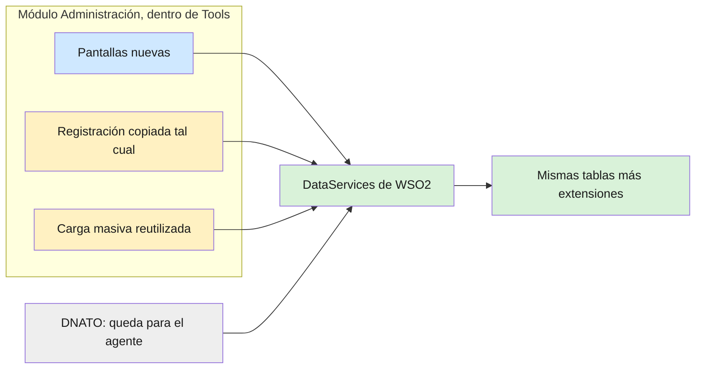

# REQ-001 · Módulo Administración — Análisis inicial (sin código)

## Objetivo

Primer trabajo de Pablo para el módulo nuevo **Administración** de Tools, que reemplaza a DNATO por
partes. Es un análisis, no se programa nada: deja escrito qué se reutiliza de DNATO, qué impacto
tiene en el agente (MCP) y en Tools, y cómo queda armado el módulo. Lo lee Pablo para hacer el
análisis y Rodolfo para aprobarlo. **No** cubre la construcción del módulo: eso va en REQ-002 y
siguientes (ver [`README.md`](README.md)). La forma de trabajar está en
[`doc/metodologia/GUIA_REQUERIMIENTOS_CLAUDE_DEEPSEEK.md`](../doc/metodologia/GUIA_REQUERIMIENTOS_CLAUDE_DEEPSEEK.md).

| Campo | Valor |
|---|---|
| Estado | Borrador: esperando que Rodolfo conteste las dudas del final |
| Qué entrega | `doc/v3/administracion/ANALISIS_INICIAL.md` (un solo documento, secciones A a F de abajo) |
| Fuente de lo funcional | Especificación DNATO v3 0.5.2 en `doc/v3/dnato/` (requisitos, casos de prueba, maquetas). Se usa el **qué**; el **cómo** (parchar DNATO) queda reemplazado por este replanteo |
| Repos que se leen | `traz-comp-dnato` (rama `feat/oauth-login-empresas-igual-que-el-web`), `traz-tools` |
| Riesgo | 🟢 Solo documentación. Pero lo que decide condiciona todo lo que sigue: Rodolfo lo aprueba antes de REQ-002 |
| Casos de uso | No tiene: es un análisis. Los casos de uso del módulo se escriben en REQ-002 con lo que salga de acá |

---

## El replanteo, en cuatro reglas

Decisión de Rodolfo (2026-11-03). Reemplaza el principio de la especificación "DNATO v3 se
construye sobre el DNATO actual" (`01_ESPECIFICACION_FUNCIONAL.md`, línea 8).

1. **Mismas tablas**, más lo que haga falta extender. `core.empresas`, `seg.users`,
   `seg.memberships_users`, `seg.menues`, `seg.memberships_menues`, `core.tablas`, `seg.tokens` y
   `sta.*` se siguen usando; lo nuevo se **agrega** (columnas o tablas), nunca se cambia lo que v2 usa.
2. **La registración se copia tal cual** está hoy en DNATO al módulo nuevo: mismo comportamiento,
   mismos pasos, mismas llamadas.
3. **Se estudia el impacto en el servidor del agente (MCP)** y qué habría que modificar. Una opción
   válida es dejar DNATO funcionando **solo** para lo que necesita el agente.
4. **Pantallas 100 % nuevas**, hechas de cero, con los datos leídos y escritos por DataServices.
   Se reutiliza lógica de DNATO solo cuando conviene.

## Qué tiene que tener el análisis

El documento `doc/v3/administracion/ANALISIS_INICIAL.md` tiene estas seis secciones. Cada afirmación
dice de dónde sale (archivo y línea). Lo que sea un supuesto se marca como supuesto.

### A. Inventario de DNATO: qué se reutiliza

Una tabla con **cada controller, modelo y vista** de `traz-comp-dnato/application/` y, para cada uno:
**copiar tal cual / reutilizar la lógica / descartar**, y por qué. Punto de partida (propuesta de
Rodolfo y Claude, Pablo la verifica y la corrige):

| Pieza de DNATO | Propuesta | Motivo |
|---|---|---|
| `Register.php` y sus vistas (`register*.php`, `crear_empresa_page.php`, `formulario_registro.php`, `bienvenida_page.php`, `registro_completo.php`) | Copiar tal cual | Regla 2 |
| `Main::register`, `procesarRegistro`, `guardarFormularioRegistro`, `complete`, `forgot`, `reset_password` | Copiar tal cual si son parte de la registración; si no, ver sección C | Regla 2 |
| `Bulkload.php`, `Bulkload_model.php`, `Bulkloads.php`, vistas `bulkload/` | Reutilizar la lógica, pantalla nueva | Regla 4 |
| `User_model`, `Empresas`, `Roles`, `Mmenu`, `Tablas`, `Establecimientos` | Reutilizar la lógica que llama a WSO2, si sirve | Ya acceden por WSO2, no van directo a la base |
| `Main` (usuarios, roles, niveles, baneo), `Menu`, `Empresa`, `Rol` y sus vistas | Descartar: pantallas nuevas | Regla 4. Hoy tienen los agujeros de seguridad del relevamiento §1.6 |
| `Oauth.php`, `Oauthlogin.php`, `OauthCode_model.php`, vistas `oauth/` | Quedan en DNATO (ver sección D) | Los usa el agente |
| `Main::login`, `seleccionar_empresa`, `logout` | A decidir (duda 2) | Es el ingreso de todos los usuarios de v2 |
| `Email`, `Test`, `Test_formularios`, `Bulkload copy.php`, `*_old*`, archivos `smtp_*`/`test_*` de la raíz | Descartar | Son de prueba o están sin uso |

### B. Tablas y DataServices

- Qué tablas lee y escribe hoy DNATO y por **qué DataService** de WSO2 (nombre del `.dbs` y del
  recurso).
- Qué recursos ya existen y sirven tal cual para las pantallas nuevas, y cuáles faltan.
- Qué **extensiones** pide la especificación (`02_MODELO_Y_REGLAS.md` §2: plan, consumo MCP,
  auditoría, atributos nuevos), cada una como **agregado** sin tocar lo que v2 usa.
- El criterio para unir **membresía → empresa** (hoy distinto en DNATO y en los DataServices: regla
  R8 de la especificación). Medir con `traz-comp-dnato/scripts/sql/verificar-membresias-vs-empresas.sql`
  en DEMO cuántos usuarios quedan sin empresa con cada criterio, y poner los números.

### C. Registración copiada

- La lista completa de lo que hay que copiar para que la registración funcione igual: controllers,
  vistas, archivos de estilo, constantes, llamadas a WSO2, a Bonita y a AssetPlanner, correos,
  usuarios por defecto, establecimiento por defecto.
- Qué cambia al vivir dentro de Tools: Tools exige sesión iniciada, y la registración tiene que ser
  pública. Cómo se arma la excepción sin abrir otras rutas.
- Qué pasa con las direcciones de hoy (`traz-comp-dnato/main/register`, enlaces en correos, en la web
  comercial): ¿redirección o conviven?
- Cómo se prueba que quedó igual: las pruebas DNATO-UC-001 a 005 del catálogo tienen que pasar contra
  la copia.

### D. Impacto en el agente (MCP)

Hoy el agente depende de DNATO para la identidad (decisión ADR-008 de
`doc/v3/TRAZALOG_v3_MCP_ARCHITECTURE.md`): DNATO emite el token que valida el APIM.
- Recorrer y listar todo lo que lo ata a DNATO: `Oauth.php` (`authorize`, `token`, `jwks`,
  `authorization_server_metadata`, `register_client`), `Oauthlogin.php`, la dirección de DNATO como
  emisor del token, la configuración del APIM como administrador de claves, y en `traz-tools`
  `_backend/api/ApimDiscoveryProject/src/OAuthDiscovery_1.0.0/oauth-discovery.xml`,
  `JwtValidator.xml`, `EmprIdFromHeader.xml`, `toolsCOREAPI.xml`, `toolsMANAPI.xml`.
- Comparar dos opciones, con lo que se rompe y lo que cuesta cada una:
  - **D1. DNATO queda solo para el agente**: no se toca nada de lo anterior; DNATO sigue vivo con
    OAuth (y lo que decida la duda 2).
  - **D2. Mover la identidad del agente al módulo nuevo**: cambia el emisor del token, hay que
    reconfigurar el APIM y los clientes del agente se vuelven a registrar.
- Qué servicios nuevos de la especificación necesita el agente (por ejemplo "Consumir cuota",
  `02_MODELO_Y_REGLAS.md` §4 y §5) y desde dónde se sirven en cada opción.

### E. Impacto en Tools

- Recorrer los puntos T-1 a T-10 de `doc/v3/dnato/02_MODELO_Y_REGLAS.md` §9b contra el código de
  Tools, ajustados al replanteo (por ejemplo, "Mi empresa" deja de ser un salto a otro sistema).
- Dónde entra el módulo en el menú de Tools y quién lo ve.
- Todo lo de Tools que hoy apunta a DNATO (por ejemplo la constante `DNATO` de
  `application/config/constants.php:93`, enlaces del menú, `Dash::cambiarDeEmpresa`) y qué pasa con
  cada uno.

### F. Cómo se arma el módulo

- Nombre y forma: submódulo con repositorio propio (como `traz-comp-pan`) o carpeta dentro de Tools
  (duda 1).
- Estructura de carpetas (`controllers/`, `models/`, `views/`, constante de prefijo para cargarlo
  desde otros módulos, como `PRD` o `ALM`).
- Cómo hereda de Tools la sesión, la empresa activa, el menú y el control de permisos, de modo que
  **desde el primer día** tenga: sesión obligatoria, permiso por pantalla, protección contra envíos
  falsificados y la empresa siempre tomada de la sesión (nunca del navegador). Son los correctivos
  C-2, C-4 y C-6 de la especificación, que en el módulo nuevo nacen resueltos.
- Una propuesta de orden de construcción (qué REQ va después de cuál), usando las entregas E0 a E12
  de `doc/v3/dnato/PROMPT_CLI_DNATO_V3_BUILD.md` como lista de lo que hay que hacer.

## Qué NO hace

- **No** programa nada ni crea el repositorio del módulo.
- **No** cambia DNATO: sigue en producción como está.
- **No** decide: propone. Las decisiones (sobre todo D1 o D2, y el criterio membresía → empresa) las
  toma Rodolfo al aprobar el análisis.

## Reglas para el análisis

- **Producción primero:** todo lo que hay hoy se asume funcionando en producción. Para cada pieza,
  mirar cómo está en `master` (Tools) y en la rama de producción de DNATO.
- **Compatibilidad v2:** ningún DataService ni API cambia lo que devuelve; si hace falta otra cosa,
  se agrega un recurso nuevo.
- **PHP 5.6:** lo que se copie o se proponga no puede usar sintaxis de PHP 7.

## Cómo lo aprueba Rodolfo

Igual que un plan (sección 2.4 de la guía): Pablo abre un pull request en borrador con
`ANALISIS_INICIAL.md`; Rodolfo comenta "✅ Plan aprobado" o pide cambios. Con eso aprobado, Rodolfo y
Claude escriben REQ-002 y sus casos de uso.

## Dudas abiertas

1. ¿El módulo es un **submódulo con repositorio propio** (como `traz-comp-pan`) o una **carpeta**
   dentro de Tools? ¿Se llama `administracion` o `traz-comp-administracion`, como los demás?
2. ¿El **login** (ingreso, elegir empresa, salir, recuperar contraseña) se copia también al módulo, o
   queda en DNATO por ahora? Hoy es la puerta de entrada de todos los usuarios de v2.
3. ¿El análisis D ya arranca con preferencia por **D1** (DNATO queda solo para el agente), o Pablo
   compara las dos sin preferencia?
4. ¿Contra qué rama de Tools se trabaja el módulo: `develop` (de donde despliega DEMO hoy) o
   `develop-v3`?
5. ¿Pablo puede correr el script de verificación de membresías en DEMO? ¿Y contra una copia de
   producción?
