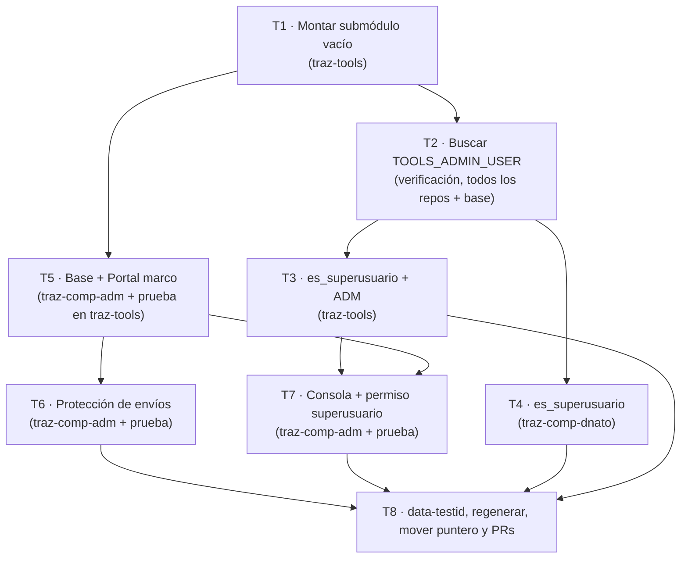

# REQ-002 · Módulo Administración — Plan de trabajo

Plan de Pablo (DeepSeek Pro) para el esqueleto del módulo `traz-comp-adm` con seguridad incluida.
Revisa Rodolfo. Forma de trabajo: `doc/metodologia/GUIA_REQUERIMIENTOS_CLAUDE_DEEPSEEK.md` §2.4–§2.12
y `doc/metodologia/REGLAS-PARA-AGENTES.md`.

## Los tres repositorios (y dónde va cada cosa)

| Repo | Qué lleva este requerimiento |
|---|---|
| **`traz-comp-adm`** (`https://github.com/Trazalog/traz-comp-adm.git`, submódulo en `application/modules/traz-comp-adm`) | **TODO el código del módulo**: carpetas `controllers/ models/ views/ helpers/ config/`, el controlador base, el Portal y la Consola. Nada de esto va en `traz-tools`. |
| **`traz-tools`** | montar el submódulo (`.gitmodules` + puntero), la constante `ADM`, `es_superusuario()` en `application/helpers/sesion_helper.php` y sus **5** comparaciones de `TOOLS_ADMIN_USER`. También las **pruebas** de DocTest (`doctest/tests/e2e/specs/adm/`) y los `derivados`/`referencias_codigo` de los YAML. |
| **`traz-comp-dnato`** | `es_superusuario()` en su helper de sesión y sus **3** comparaciones de `TOOLS_ADMIN_USER`. |

> El código de un submódulo se commitea en **su** repositorio (parado en `application/modules/traz-comp-adm/`);
> en `traz-tools` solo el puntero. Un cambio de submódulo son **dos PR**: primero el del módulo, después el
> del puntero en `traz-tools` (guía §2.9). DNATO es un repo aparte con su propio PR.

## Ramas y pull requests

- Una rama con el mismo nombre en los tres repos: **`feature/req-002-esqueleto-codigo`**, siempre desde `develop`.
- **traz-tools**: el plan va en esa rama y abre un **PR en borrador** a `develop`. No se programa hasta el
  comentario **`✅ Plan aprobado`** de Rodolfo. Al terminar, se completa la descripción y pasa a "Ready for review".
- **traz-comp-adm**: PR a `develop` del módulo, con el enlace al PR de `traz-tools`. Se une **primero**.
- **traz-comp-dnato**: PR a `develop` de DNATO.
- Recién cuando el PR del módulo esté unido se **mueve el puntero** en `traz-tools` a ese commit (Tarea 8).

## Orden y dependencias

---

## Tareas

### Tarea 1 — Montar el submódulo vacío

- **Repositorio:** `traz-tools`.
- **Qué hace:**
  - `git submodule add -b develop https://github.com/Trazalog/traz-comp-adm.git application/modules/traz-comp-adm`
  - Commit de `.gitmodules` y del puntero del submódulo: `chore(adm): monta el submodulo traz-comp-adm [REQ-002]`.
  - Todavía no hay código: el submódulo queda vacío (el repo ya tiene `develop`).
- **Caso de uso:** ninguno (el REQ dice que el montaje se verifica en la revisión, no con un caso).
- **Cómo se verifica (comprobable):** Tools sigue andando **igual que antes**: la primera vez en esta
  máquina se corre `npm run doctest -- casi-full --entorno local` (crea las dos empresas de prueba y las
  anota en `doctest/entornos/local.json`) y después `npm run doctest -- --entorno local`. **DocTest en verde**
  (sin `falla`, `otro-punto` ni `dejo-de-fallar`).

### Tarea 2 — Búsqueda exhaustiva de `TOOLS_ADMIN_USER`

- **Repositorio:** ninguno — es una verificación. El resultado va **en la descripción del PR** de
  `traz-tools` (lo pide el REQ, "Cómo se arma → Varios superusuarios").
- **Qué hace:**
  - Buscar `TOOLS_ADMIN_USER` en **todos** los repos: `traz-tools` (incluidos sus submódulos) y
    `traz-comp-dnato`.
  - Revisar también **la base** (funciones y disparadores de PostgreSQL/MySQL que puedan comparar el correo
    del superusuario), para no dejar ningún lugar afuera.
  - Dejar la lista completa de lugares encontrados.
- **Cómo se verifica (comprobable):** la lista coincide con los **8 lugares** que enumera el REQ
  (5 en `traz-tools`, 3 en `traz-comp-dnato`) **o** aparece alguno más, que se reporta antes de tocar nada.
  La lista viaja en el PR.

### Tarea 3 — `es_superusuario()` y la constante `ADM` en `traz-tools`

- **Repositorio:** `traz-tools`.
- **Qué hace:**
  - Agregar la constante `ADM = 'traz-comp-adm/'` en `application/config/constants.php`, junto a `PRD`,
    `PAN`, `ALM`, etc. Es la única constante nueva.
  - Escribir `es_superusuario($email)` en `application/helpers/sesion_helper.php`: separa la lista por coma,
    quita espacios y compara sin distinguir mayúsculas.
  - Reemplazar las **5 comparaciones** de `TOOLS_ADMIN_USER` por `es_superusuario(...)`:
    - `application/models/core/Valores.php` (líneas 24, 49, 71 y 103)
    - `application/views/core/valores/view.php` (línea 55)
  - `phpcs` con PHPCompatibility para **PHP 5.6** (sin sintaxis de PHP 7).
- **Caso de uso:** ninguno directo — es la base para ADM-UC-002 (la Consola decide por `es_superusuario`).
- **Cómo se verifica (comprobable):** con **un solo correo** en la constante todo se comporta igual que hoy.
  `npm run doctest -- --entorno local` **en verde**.
- **Núcleo (🟡):** toca `constants.php` y `Valores.php` de Tools. Ya está decidido en el REQ; el análisis de
  impacto dice que con un solo correo el cambio es neutro. Si la búsqueda de la Tarea 2 encontró más lugares,
  se suman acá (o se reporta) antes de programar.

### Tarea 4 — `es_superusuario()` en `traz-comp-dnato`

- **Repositorio:** `traz-comp-dnato`.
- **Qué hace:**
  - Escribir `es_superusuario($email)` en el helper de sesión de DNATO (igual que la de Tools).
  - Reemplazar las **3 comparaciones**:
    - `application/controllers/Empresa.php` (líneas 34 y 56)
    - `application/views/navbar.php` (línea 57)
  - `phpcs` PHP 5.6.
- **Caso de uso:** ninguno directo — es el mismo cambio que la Tarea 3, del lado DNATO.
- **Cómo se verifica (comprobable):** con un solo correo, comportamiento idéntico. Correr el módulo `@dnato`
  de DocTest (`npm run test:module -- dnato` contra `--entorno local`) **en verde**.

### Tarea 5 — Controlador base + Portal (marco) + pantallas de error

- **Repositorios:** `traz-comp-adm` (el código) **y** `traz-tools` (la prueba y el `derivados` del YAML).
- **Qué hace (código, en `traz-comp-adm`):**
  - Crear la estructura `controllers/`, `models/`, `views/`, `helpers/`, `config/`.
  - Controlador base del módulo (`ADM_Controller`) con, en este orden:
    1. **Sesión:** sin `empr_id` → redirige al ingreso de DNATO (`DNATO."main/login"`); los pedidos AJAX
       reciben **401** en vez de la redirección.
    2. **Lista pública:** cada controlador declara sus métodos públicos; en este requerimiento está **vacía**.
    3. **Permiso por pantalla:** cada controlador declara `administrador` o `superusuario`; si no cumple,
       responde **403** con la pantalla "sin permiso".
    4. *(la protección de envíos se agrega en la Tarea 6)*
  - Pantalla del Portal `traz-comp-adm/portal` (marco, sin contenido), con sus `data-testid`:
    `adm-portal`, `adm-portal-empresa`, `adm-portal-menu`, `adm-portal-saludo`, `adm-ir-a-tools`.
  - Pantallas de error: `adm-sin-permiso` (403, "No tenés permiso para entrar a esta pantalla.") y
    `adm-no-existe` (404, "Esa página no existe.").
  - La empresa sale **siempre de la sesión** (`empresa()` de `sesion_helper.php`); la que venga por
    dirección/`empr_id` se ignora.
- **Caso de uso:** **ADM-UC-001** (Portal: principal + alternativos "sin sesión", "no administrador",
  "otra empresa en la dirección" y "página inexistente").
- **Prueba (pedido B de la guía §2.8):** `doctest/tests/e2e/specs/adm/ADM-UC-001.portal.spec.ts`, copiando
  una prueba existente como modelo, con page objects y sin esperas fijas. Se completa `derivados.test_e2e` y
  `referencias_codigo` en `doctest/catalogo/adm/ADM-UC-001.yaml` (todo en `traz-tools`).
- **Cómo se verifica (comprobable):** `npm run doctest -- --entorno local` **en verde** (la prueba nueva
  pasa + regresión intacta). La prueba es contra la empresa de test local (perfil `local.json`).

### Tarea 6 — Protección de envíos (código de seguridad)

- **Repositorios:** `traz-comp-adm` (el código) **y** `traz-tools` (la prueba y el `derivados` del YAML).
- **Qué hace (código, en `traz-comp-adm`):**
  - En `ADM_Controller`: generar el código de seguridad **una vez por sesión** (dura toda la sesión, sirve
    con varias pestañas abiertas).
  - Todo pedido que no sea de lectura (POST, PUT, DELETE) tiene que traer el código de la sesión; si falta
    o no coincide → **403** "La página venció. Volvé a cargarla e intentá de nuevo." (`adm-envio-rechazado`)
    y **no ejecuta el método**.
  - El control de sesión corre **antes** que el de código de seguridad.
- **Caso de uso:** **ADM-UC-003** (principal + alternativos "dos pestañas", "sin código", "código de otra
  sesión" y "sin sesión").
- **Prueba (pedido B):** `doctest/tests/e2e/specs/adm/ADM-UC-003.envios-falsificados.spec.ts` +
  `derivados.test_e2e`/`referencias_codigo` en `ADM-UC-003.yaml` (en `traz-tools`).
- **Cómo se verifica (comprobable):** `npm run doctest -- --entorno local` **en verde**. Como el esqueleto no
  tiene acciones que guarden, la prueba se hace contra la pantalla de inicio del Portal (como dice el caso).

### Tarea 7 — Consola (marco) + permiso de superusuario

- **Repositorios:** `traz-comp-adm` (el código) **y** `traz-tools` (la prueba y el `derivados` del YAML).
- **Qué hace (código, en `traz-comp-adm`):**
  - Pantalla de la Consola `traz-comp-adm/consola` (marco), con `data-testid`: `adm-consola`,
    `adm-ir-a-portal`, `adm-ir-a-tools`.
  - Permiso `superusuario` en el controlador base, resuelto con `es_superusuario()` **de Tools**
    (el módulo usa la de Tools, no duplica la función).
  - Botón "🔑 Consola" (`adm-ir-a-consola`) en el Portal, visible **solo** para el superusuario.
- **Caso de uso:** **ADM-UC-002** (principal + alternativos "segundo superusuario", "administrador que no es
  superusuario (botón y dirección directa)" y "sin sesión").
- **Prueba (pedido B):** `doctest/tests/e2e/specs/adm/ADM-UC-002.consola.spec.ts` +
  `derivados.test_e2e`/`referencias_codigo` en `ADM-UC-002.yaml` (en `traz-tools`).
- **Cómo se verifica (comprobable):** `npm run doctest -- --entorno local` **en verde**.

### Tarea 8 — Cierre: data-testid, regenerar, mover el puntero y abrir los PR

- **Repositorios:** `traz-tools` (puntero + artefactos regenerados) y `traz-comp-dnato` (su PR).
- **Qué hace:**
  - Revisar que **todos** los `data-testid` del REQ están en las vistas (Portal, Consola y las tres de error).
  - Regenerar los derivados: `npm run features` (los `.feature` no se editan a mano) y `npm run ayudas` si
    el esqueleto suma una ayuda; `phpcs` PHP 5.6 final sobre el módulo.
  - Correr una última vez `npm run doctest -- --entorno local` **en verde**.
  - **Mover el puntero** cuando el PR de `traz-comp-adm` esté unido:
    `cd application/modules/traz-comp-adm && git checkout develop && git pull origin develop && cd ../../..`
    → `git add application/modules/traz-comp-adm` → `chore(adm): actualiza el submodulo traz-comp-adm [REQ-002]`.
  - Abrir los PR: primero el del módulo (`traz-comp-adm` → `develop`), después el de `traz-tools` (con el
    puntero, la constante, `es_superusuario`, las pruebas y el plan) y el de `traz-comp-dnato`.
- **Cómo se verifica (comprobable):** los tres PR abiertos con sus descripciones completas (formato §2.10),
  el enlace cruzado entre el del módulo y el de `traz-tools`, y el resultado real de DocTest pegado.

---

## Notas transversales (se respetan en todas las tareas)

- 🐘 **PHP 5.6** en el módulo y en los cambios de Tools/DNATO: `phpcs` con PHPCompatibility. Nada de `??`,
  tipos de retorno, tipos escalares, `<=>`, clases anónimas.
- 🧪 **DocTest:** la primera corrida en esta máquina es `npm run doctest -- casi-full --entorno local`
  (una sola vez, crea las dos empresas). Después, **antes de cada commit**:
  `npm run doctest -- --entorno local`. Verde = sin `falla`, `otro-punto` ni `dejo-de-fallar`.
- 🚫 **No se toca** en este requerimiento: `application/config/config.php` (CSRF y hooks siguen apagados),
  la barra de Tools, la registración/ingreso (REQ-003), tablas/columnas, y la marca de superusuario en la
  base (REQ-004). El control de sesión/permisos vive **solo dentro del módulo** (hallazgo H-091).
- 📦 **Commits por repo:** parado en `application/modules/traz-comp-adm/` para el módulo (revisar `git status`
  dentro: no `HEAD detached`, no secretos), y en `traz-tools/` o `traz-comp-dnato/` para lo suyo. Formato
  `tipo(scope): descripción [REQ-002]`. No se commitea si Pablo no lo pide.
- 🔒 **Núcleo:** la constante `ADM` se **agrega** (no rompe nada) y `es_superusuario` con un solo correo da
  el mismo resultado que hoy. La búsqueda de la Tarea 2 garantiza que no queda ninguna comparación afuera.
