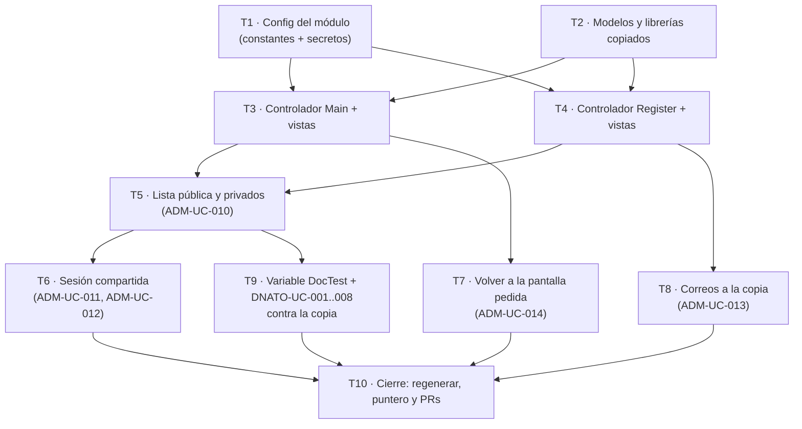

# REQ-003 · Módulo Administración — Plan de trabajo

Plan de Pablo (DeepSeek Pro) para copiar la registración y el ingreso de DNATO dentro del módulo
`traz-comp-adm`, en paralelo con DNATO. Revisa Rodolfo. Forma de trabajo:
`doc/metodologia/GUIA_REQUERIMIENTOS_CLAUDE_DEEPSEEK.md` §2.4–§2.12 y
`doc/metodologia/REGLAS-PARA-AGENTES.md`.

## Los repositorios (y dónde va cada cosa)

| Repo | Qué lleva este requerimiento |
|---|---|
| **`traz-comp-adm`** (submódulo en `application/modules/traz-comp-adm`) | **TODO el código copiado**: controladores `Main` y `Register`, modelos, librerías, vistas, estilos y la configuración del módulo (constantes + lectura de secretos). Nada de esto va en `traz-tools`. |
| **`traz-tools`** | **Solo `doctest/`**: la variable que elige la dirección de identidad (`DOCTEST_<AMBIENTE>_URL_IDENTIDAD`) y las pruebas de los casos ADM-UC-010 a 014. También el puntero del submódulo al cerrar. |
| **`traz-comp-dnato`** | **Nada.** No se toca ni el código ni sus direcciones. |

> El código de un submódulo se commitea en **su** repositorio (parado en `application/modules/traz-comp-adm/`);
> en `traz-tools` solo el puntero. Un cambio de submódulo son **dos PR**: primero el del módulo, después el
> del puntero en `traz-tools` (guía §2.9).

## Ramas y pull requests

- Una rama con el mismo nombre en los dos repos: **`feature/req-003-registro-ingreso`**, siempre desde `develop`.
- **traz-tools**: el plan va en esa rama y abre un **PR en borrador** a `develop`. No se programa hasta el
  comentario **`✅ Plan aprobado`** de Rodolfo. Al terminar, se completa la descripción y pasa a "Ready for review".
- **traz-comp-adm**: PR a `develop` del módulo, con el enlace al PR de `traz-tools`. Se une **primero**.
- Recién cuando el PR del módulo esté unido se **mueve el puntero** en `traz-tools` a ese commit (Tarea 11).

## Orden y dependencias

---

## Tareas

### Tarea 1 — Configuración del módulo: constantes y secretos por entorno

- **Repositorio:** `traz-comp-adm`.
- **Qué hace:**
  - Crear `config/` del módulo con las constantes que DNATO tiene y Tools no: `DE`, `DS`, `DNATO` (URLs),
    `API_CORE`, `REST_CORE`, `REST_BPM`, `REST_CORE_PAISES`, `FORMULARIO_REGISTRO_ID` (= 72), remitentes
    `register@` y `forgot@`, `BONITA_URL`, `REGISTRACION_PASSWORD_DEFAULT`. Todo **dentro del módulo**, no en
    `application/config/constants.php` de Tools.
  - **Secretos por entorno (sin valor en claro en el repo):** `REGISTRACION_PASSWORD_DEFAULT` y la clave de
    reCAPTCHA se leen con `getenv(...)` desde variables de entorno del vhost (decisión de esta sesión). Sin
    valor por defecto: si faltan, la registración corta con un mensaje claro en el log.
  - `phpcs` con PHPCompatibility para **PHP 5.6**.
- **Caso de uso:** ninguno directo — es la base para el resto.
- **Cómo se verifica (comprobable):** el módulo carga sin errores con `php -l` sobre cada archivo nuevo;
  `npm run doctest -- --entorno local` sigue en verde (todavía no cambia nada visible).

### Tarea 2 — Modelos y librerías copiados

- **Repositorio:** `traz-comp-adm`.
- **Qué hace:**
  - Copiar dentro del módulo, con nombres que **no choquen** con los de Tools: `User_model`, `Roles`,
    `Password`, `Sendmail`, `Recaptcha`, `Curl` y la regla `password_strong` de `MY_Form_validation`
    (la lista de accesos directos a base es la de análisis C.1; siguen siendo **directo a base**, excepción
    aprobada).
  - Para Bonita se usa la librería `BPM` que Tools ya carga (`application/libraries/BPM.php`, `getUser`); no
    se copia.
  - `phpcs` PHP 5.6.
- **Caso de uso:** ninguno directo.
- **Cómo se verifica:** `php -l` en verde sobre los archivos nuevos; el módulo sigue cargando.

### Tarea 3 — Controlador `Main` (ingreso, salida, activación, recuperación) + vistas

- **Repositorio:** `traz-comp-adm`.
- **Qué hace:**
  - Copiar de `develop` de `traz-comp-dnato` los métodos de `Main`: `register`, `procesarRegistro`,
    `complete`, `successregister`, `successresetpassword`, `login`, `checkLoginUser`, `seleccionar_empresa`,
    `_finalizarLogin`, `logout`, `forgot`, `reset_password`.
  - **No** se copian `Main::setdir`, `Main::index` ni `Main::guardarFormularioRegistro`.
  - Los auxiliares `procesarRegistro`, `base64url_encode`, `base64url_decode`, `_email_sin_signo_mas`,
    `_islocal` quedan **`private`/`protected`** (en DNATO son públicos por error).
  - Hereda del controlador base del módulo (`ADM_Controller`, REQ-002).
  - Copiar las vistas: `login.php`, `login_empresa.php`, `forgot.php`, `reset_password.php`,
    `reset-pass-info.php`, `register.php`, `register-info.php`, `complete_password.php` (con sus estilos
    `tz-*` embebidos, tal cual).
  - El log no copia datos sensibles: se registra el correo y el paso, sin contraseñas ni enlaces con código.
- **Caso de uso:** ninguno directo — el comportamiento se valida con `DNATO-UC-001..008` contra la copia (Tarea 9).
- **Cómo se verifica:** `php -l` en verde; las direcciones `traz-comp-adm/main/...` responden sin error fatal.

### Tarea 4 — Controlador `Register` (alta de empresa, formulario adicional) + vistas

- **Repositorio:** `traz-comp-adm`.
- **Qué hace:**
  - Copiar de `develop` de `traz-comp-dnato` los métodos de `Register`: `register_success`,
    `guardarFormularioRegistro`, `crearEmpresa`, `guardarEmpresa`, `getEstados`, `getLocalidades`,
    `registro_completo`.
  - Incluir **el arreglo de países del PR `traz-comp-dnato#49`** (hallazgo **H-124**): detecta empresa
    repetida aunque el país venga del catálogo real y guarda `paises` (no `paises_registracion`). Si al
    construir #49 sigue sin estar unido, se aplica el cambio directamente en la copia y se anota en el PR.
  - Copiar las vistas: `formulario_page.php`, `crear_empresa_page.php`, `bienvenida_page.php`.
  - Hereda del controlador base. `phpcs` PHP 5.6.
- **Caso de uso:** ninguno directo — se valida con `DNATO-UC-002..005` contra la copia (Tarea 9).
- **Cómo se verifica:** `php -l` en verde; las direcciones `traz-comp-adm/register/...` responden sin error fatal.

### Tarea 5 — Lista pública, métodos privados y protección de envíos (ADM-UC-010)

- **Repositorios:** `traz-comp-adm` (el código) **y** `traz-tools` (la prueba y el `derivados` del YAML).
- **Qué hace (código, en `traz-comp-adm`):**
  - Llenar la **lista pública** del controlador base con los métodos del REQ:
    `main`: `login`, `seleccionar_empresa`, `logout`, `forgot`, `reset_password`, `register`, `complete`,
    `successregister`, `successresetpassword`, `checkLoginUser`; `register`: `register_success`,
    `guardarFormularioRegistro`, `crearEmpresa`, `guardarEmpresa`, `getEstados`, `getLocalidades`,
    `registro_completo`. Los de `register` no exigen empresa pero conservan su control propio (usuario recién
    activado en la sesión).
  - **Todo lo demás privado**: los auxiliares de T3/T4 quedan inalcanzables desde el navegador.
  - **Sin sesión**, las pantallas del módulo mandan al **ingreso copiado** (`traz-comp-adm/main/login`), ya
    no al de DNATO.
  - **Protección de envíos** también en las páginas públicas: los formularios copiados llevan el código de
    seguridad del módulo como campo oculto (regla de REQ-002). Si algún envío del formulario de registro (que
    arma `traz-comp-formularios`) no puede llevarlo sin tocar ese módulo, se lista en el PR para decidir.
- **Caso de uso:** **ADM-UC-010** (principal + alternativos "pantalla no pública", "método auxiliar",
  "pantalla de DNATO no copiada", "envío sin código" y "ya tiene sesión").
- **Prueba (pedido B, guía §2.8):** `doctest/tests/e2e/specs/adm/ADM-UC-010.lista-publica.spec.ts` +
  `derivados.test_e2e` en `doctest/catalogo/adm/ADM-UC-010.yaml` (en `traz-tools`).
- **Cómo se verifica:** `npm run doctest -- --entorno local` en verde (la prueba nueva pasa + regresión intacta).

### Tarea 6 — Sesión compartida en los dos sentidos (ADM-UC-011 y ADM-UC-012)

- **Repositorios:** `traz-comp-adm` (el código) **y** `traz-tools` (las pruebas y los `derivados`).
- **Qué hace (código, en `traz-comp-adm`):**
  - La copia escribe en la sesión **exactamente las mismas claves** que DNATO: todas las columnas de
    `seg.users` menos `password`, más `empr_id`, `userIdBpm`, `groupBpm` (y `login_pending`/`login_csrf` en
    el paso intermedio). Así Tools (`empresa()`, `Dashs::obtenerMenu`) las lee igual.
  - La empresa sale **siempre de la sesión**; la que venga por dirección se ignora (REQ-002).
- **Casos de uso:**
  - **ADM-UC-011** — ingresar por la copia y seguir en Tools y DNATO (principal + "una sola empresa",
    "salir desde la copia" y "misma sesión en Bonita").
  - **ADM-UC-012** — ingresar por DNATO y entrar al módulo sin volver a ingresar (principal + "otra empresa",
    "sale por DNATO" y "sin rol de administrador").
- **Pruebas (pedido B):** `ADM-UC-011.sesion-compartida-1.spec.ts` y `ADM-UC-012.sesion-compartida-2.spec.ts` +
  `derivados.test_e2e` en sus YAML (en `traz-tools`).
- **Cómo se verifica:** `npm run doctest -- --entorno local` en verde. Si el paso de DNATO falla (supuesto de
  sesión compartida), **parar y avisar** antes de tocar configuración.

### Tarea 7 — Volver a la pantalla del módulo pedida (ADM-UC-014)

- **Repositorios:** `traz-comp-adm` (el código) **y** `traz-tools` (la prueba y el `derivados`).
- **Qué hace (código, en `traz-comp-adm`):**
  - Es lo **único** que la copia agrega al ingreso de DNATO: cuando el controlador base manda al ingreso por
    falta de sesión, guarda en la sesión la dirección **del módulo** pedida (clave `adm_volver_a`). Al
    terminar de ingresar (con una empresa o eligiendo entre varias) vuelve ahí; si no hay dirección guardada,
    va al tablero de Tools como hoy.
  - La dirección **nunca** se toma de un parámetro del navegador; solo puede ser una del módulo. La marca se
    borra apenas se usa.
- **Caso de uso:** **ADM-UC-014** (principal + alternativos "varias empresas", "elige empresa que no
  administra", "ingreso directo" y "dirección de vuelta de afuera").
- **Prueba (pedido B):** `ADM-UC-014.volver-a-pantalla.spec.ts` + `derivados.test_e2e` (en `traz-tools`).
- **Cómo se verifica:** `npm run doctest -- --entorno local` en verde.

### Tarea 8 — Correos: todo enlace apunta a la copia (ADM-UC-013)

- **Repositorios:** `traz-comp-adm` (el código) **y** `traz-tools` (la prueba y el `derivados`).
- **Qué hace (código, en `traz-comp-adm`):**
  - Los enlaces de activación (`complete/token/…`) y restablecimiento (`reset_password/token/…`) que arma la
    copia apuntan a `traz-comp-adm/...`, nunca a DNATO. Lo mismo el correo de bienvenida de la empresa y el
    aviso de "nuevo inicio de sesión".
  - Los correos salen por el mismo `CI_Email`/`sendmail` del servidor, con los mismos remitentes
    (`register@`, `forgot@`). El correo de bienvenida **sigue trayendo la contraseña por defecto** (se copia
    igual, para que `DNATO-UC-005` pase; sacarla es mejora aparte).
- **Caso de uso:** **ADM-UC-013** (principal + alternativos "registro por DNATO", "correo de bienvenida" y
  "enlace del módulo abierto en DNATO").
- **Prueba (pedido B):** `ADM-UC-013.enlaces-correo.spec.ts` + `derivados.test_e2e` (en `traz-tools`).
- **Cómo se verifica:** `npm run doctest -- --entorno local` en verde.

### Tarea 9 — Variable DocTest de identidad + DNATO-UC-001 a 008 contra la copia

- **Repositorio:** `traz-tools` (solo `doctest/`).
- **Qué hace:**
  - Agregar `DOCTEST_<AMBIENTE>_URL_IDENTIDAD` en `doctest/tests/e2e/config/apps.ts`: si está vacía, se usa la
    de DNATO (nada cambia para quien no la configure). La usan **solo** los recorridos de identidad
    `DNATO-UC-001` a `008`; el ingreso del agente (`DNATO-UC-009`) y las pantallas de administración de DNATO
    siguen en la dirección de DNATO.
  - Verificar `DNATO-UC-001` a `008` en verde **dos veces**: con la variable apuntando a la copia y sin ella
    (contra DNATO). Es el criterio de aceptación del requerimiento.
- **Caso de uso:** ninguno nuevo — se verifica corriendo los ocho casos existentes contra la copia.
- **Cómo se verifica:** `npm run doctest -- --entorno local` con `DOCTEST_LOCAL_URL_IDENTIDAD` apuntando a la
  copia, en verde; y una corrida sin la variable (contra DNATO) en verde.

### Tarea 10 — Cierre: revisar listado, regenerar, mover el puntero y abrir los PR

- **Repositorios:** `traz-tools` (puntero + artefactos) y `traz-comp-adm` (su PR).
- **Qué hace:**
  - Revisar que **todos** los métodos públicos de `main` y `register` en el módulo coinciden con la lista
    pública del REQ (se lista en la descripción del PR, como pide el requerimiento).
  - Búsqueda de **secretos en el diff** (contraseñas, clave de reCAPTCHA, credenciales de correo): nada.
  - `phpcs` PHP 5.6 final sobre el módulo; `npm run features` y `npm run ayudas` si corresponde.
  - Correr una última vez `npm run doctest -- --entorno local` en verde.
  - **Mover el puntero** cuando el PR de `traz-comp-adm` esté unido:
    `cd application/modules/traz-comp-adm && git checkout develop && git pull origin develop && cd ../../..`
    → `git add application/modules/traz-comp-adm` → `chore(adm): actualiza el submodulo traz-comp-adm [REQ-003]`.
  - Abrir los PR: primero el del módulo (`traz-comp-adm` → `develop`), después el de `traz-tools` (con el
    puntero y `doctest/`), con el enlace cruzado entre ambos.
- **Cómo se verifica:** los dos PR abiertos con descripciones completas (formato §2.10), el listado de métodos
  públicos pegado, y el resultado real de DocTest.

---

## Notas transversales (se respetan en todas las tareas)

- 🐘 **PHP 5.6** en todo el módulo: `phpcs` con PHPCompatibility. Nada de `??`, tipos de retorno, tipos
  escalares, `<=>`, clases anónimas.
- 🧪 **DocTest:** la primera corrida en esta máquina es `npm run doctest -- casi-full --entorno local`
  (una sola vez). Después, **antes de cada commit**: `npm run doctest -- --entorno local`. Verde = sin
  `falla`, `otro-punto` ni `dejo-de-fallar`.
- 🚫 **No se toca** en este requerimiento: `application/config/config.php` y `constants.php` de Tools (salvo la
  línea `ADM` de REQ-002), la barra de Tools, `traz-comp-formularios` (el formulario de registro 72 se usa como
  DNATO hoy), ni `traz-comp-dnato` (código y direcciones intactos).
- 🔒 **Identidad (núcleo):** análisis de impacto aprobado. La empresa sale siempre de la sesión; la empresa
  temporal 9000 del registro no da acceso fuera de la registración (regla 7 del REQ). El log no copia
  contraseñas ni enlaces con código.
- 📦 **Commits por repo:** parado en `application/modules/traz-comp-adm/` para el módulo (revisar `git status`
  dentro: no `HEAD detached`, no secretos), y en `traz-tools/` para `doctest/` y el puntero. Formato
  `tipo(scope): descripción [REQ-003]`. No se commitea si Pablo no lo pide.
- 📌 **Hallazgos:** el arreglo de países del PR `traz-comp-dnato#49` queda anotado como **H-124** (el `H-090`
  del brief estaba mal; el número correcto se asigna en este requerimiento).
