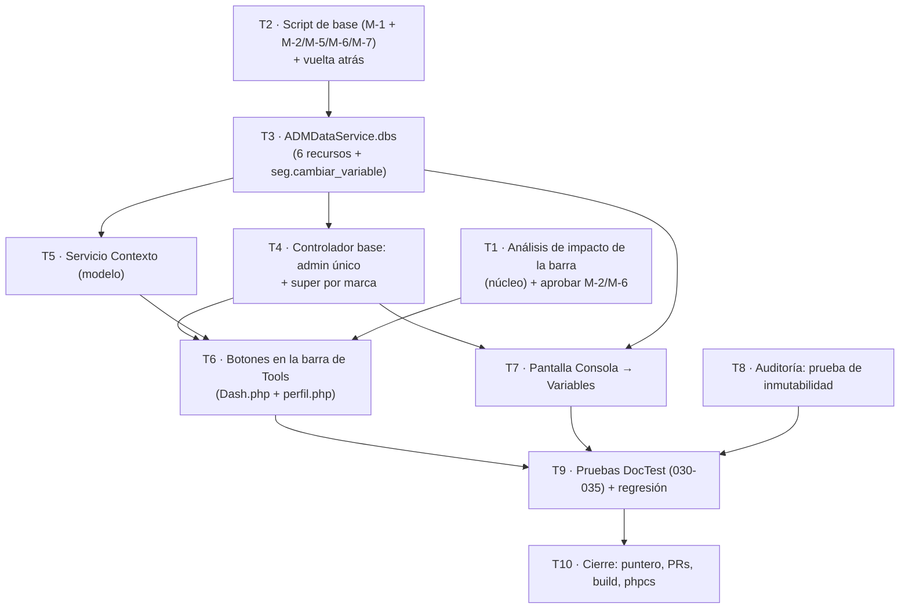

# REQ-004 · Módulo Administración — Plan de trabajo

Plan de Pablo (DeepSeek Pro) para dejar lista la base de datos (atributos y entidades nuevas, auditoría,
variables con historial) y cerrar lo que el esqueleto dejó afuera: la marca de superusuario, una sola
definición de administrador, el servicio "Contexto del usuario" y los botones "🏢 Mi empresa" y "🔑
Consola" en la barra superior de Tools. Revisa Rodolfo. Forma de trabajo:
`doc/metodologia/GUIA_REQUERIMIENTOS_CLAUDE_DEEPSEEK.md` §2.4–§2.12 y
`doc/metodologia/REGLAS-PARA-AGENTES.md`.

> Los casos ADM-UC-030 a 035 ya están **validados** (2026-11-24) y sus dudas resueltas (ver la sección
> "Resoluciones de las dudas" del requerimiento). Este plan las respeta.

## Los repositorios (y dónde va cada cosa)

| Repo | Qué lleva este requerimiento |
|---|---|
| **`traz-comp-adm`** (submódulo en `application/modules/traz-comp-adm`) | **Controlador base** (definición única de administrador + superusuario por marca), el **modelo "Contexto"** y la **pantalla Consola → Variables** (controller + vistas). Nada de esto va en `traz-tools`. |
| **`traz-tools`** | El **script de base** nuevo (+ vuelta atrás), el **DataService nuevo `ADMDataService.dbs`**, y del **núcleo** `application/controllers/Dash.php` + `application/views/layout/perfil.php` (los botones). También `doctest/` (pruebas + derivados) y el **puntero** del submódulo al cerrar. |

> El código de un submódulo se commitea en **su** repositorio (parado en `application/modules/traz-comp-adm/`);
> en `traz-tools` solo el puntero. Un cambio de submódulo son **dos PR**: primero el del módulo, después el
> del puntero en `traz-tools` (guía §2.9).

## Ramas y pull requests

- Una rama con el mismo nombre en los dos repos: **`feature/req-004-base-y-atributos`**, siempre desde `develop`.
- **traz-tools**: el plan va en esa rama y abre un **PR en borrador** a `develop`. No se programa hasta el
  comentario **`✅ Plan aprobado`** de Rodolfo. Al terminar, se completa la descripción y pasa a "Ready for review".
- **traz-comp-adm**: PR a `develop` del módulo, con el enlace al PR de `traz-tools`. Se une **primero**.
- Recién cuando el PR del módulo esté unido se **mueve el puntero** en `traz-tools` (Tarea 10).

## Puertas de aprobación (🔴, antes de construir — no en la planificación)

| Puerta | Qué es | Cuándo |
|---|---|---|
| **Análisis de impacto de la barra de Tools** | Núcleo: qué pantallas dibujan `perfil.php` (la compartida y las copias en `traz-comp-pan`, `traz-comp-tareasestandar`, `traz-prod-trazasoft`, `traz-tools-resi`), qué pasa si el módulo no está o el Contexto no responde, cuánto agrega al tiempo de carga y pruebas de regresión de la barra | Rodolfo lo aprueba **antes** de tocar `Dash.php`/`perfil.php` (Tarea 6) |
| **Carga de datos M-2 y M-6** | Tocan tablas existentes (`seg.menues` y `seg.users`): M-2 carga las tools del agente como `tool_mcp`; M-6 marca `superusuario` al correo `TOOLS_ADMIN_USER` del ambiente | Rodolfo lo aprueba **antes** de correr el script en DEMO. M-1 (estructura), M-5 y M-7 los decide el equipo (regla de Rodolfo del 2026-11-10) |

## Orden y dependencias

---

## Tareas

### Tarea 1 — Análisis de impacto de la barra de Tools (núcleo) + aprobar M-2/M-6

- **Repositorio:** ninguno (análisis; el texto va en la descripción del PR o en un doc corto).
- **Qué hace:**
  - Recorrer `application/views/layout/perfil.php` y las copias de los módulos (`traz-comp-pan`,
    `traz-comp-tareasestandar`, `traz-prod-trazasoft`, `traz-tools-resi`) y determinar cuáles se dibujan
    de verdad (cuál layout carga cada módulo en runtime). Si alguna copia está en uso, se agregan los dos
    botones también ahí, en el mismo trabajo; si no, se dejan quietas (resolución de la duda D1).
  - Responder: qué pasa si el módulo no está montado o el Contexto no responde (los botones no aparecen,
    Tools sigue igual); cuánto agrega al tiempo de carga del tablero; y qué pruebas de regresión cubren la
    barra.
  - Redactar la carga de **M-2** (lista de tools del agente como opciones `tool_mcp` del módulo `MCP`; **sin**
    cargar opciones `SEG`, resolución D19) y de **M-6** (correo a marcar), para que Rodolfo las apruebe
    antes de correr el script en DEMO.
- **Caso de uso:** ADM-UC-030 (la nota que exige el análisis) y ADM-UC-035 (la verificación "el menú no cambia").
- **Cómo se verifica:** Rodolfo aprueba el análisis (comentario). Sin aprobación no se toca `Dash.php` ni `perfil.php`.

### Tarea 2 — Script de base: estructura (M-1) + datos (M-2/M-5/M-6/M-7) + vuelta atrás

- **Repositorio:** `traz-tools`. Ubicación propuesta: `doc/v3/administracion/sql/REQ-004-base-y-atributos.sql`
  y `REQ-004-base-y-atributos-vuelta-atras.sql` **[SUPUESTO de ubicación, se confirma en la revisión del plan]**.
- **Qué hace (estructura M-1, aditivo):**
  - `ALTER TABLE … ADD COLUMN` con valor por defecto sobre: `core.empresas` (`plan_id`, `estado`,
    `estado_motivo`, `estado_plan`, `plan_pedido_id`, `plan_vence`, `uso_plan_gratuito`, `contacto_admin`);
    `seg.users` (`superusuario`, `cambiar_password`); `seg.menues` (`tipo`, `texto_presentacion`, `ayuda`,
    `publicacion`). Todo optativo o con valor por defecto. Nada de `DROP`, `RENAME`, cambio de tipo ni
    `NOT NULL` sobre columnas existentes.
  - `CREATE TABLE` de las entidades nuevas en `seg`: `membresias_estado`, `planes`,
    `planes_funcionalidades`, `empresas_funcionalidades`, `menus_custom`, `menus_custom_items`,
    `menus_asignaciones`, `cuota_periodos`, `consumos_mcp`, `pedidos_plan`, `intereses`,
    `eventos_registro`, `cargas_resultados`, `auditoria`, `variables_historial`.
  - La función `seg.cambiar_variable(clave, valor, quien)` (escribe valor + historial + auditoría en una
    operación) y el disparador que impide modificar o borrar `seg.auditoria`, más el rol de base de WSO2
    **sin** permiso de modificar ni borrar sobre `seg.auditoria` (G5).
- **Qué hace (datos):**
  - **M-2:** toda opción actual de `seg.menues` queda `publicada`, tipo `pantalla` (lo dan los valores por
    defecto). Las tools del agente se cargan como `tool_mcp` del módulo `MCP`. **No** se cargan opciones
    `SEG`. Se verifica que el menú de Tools no cambia (regla "si ningún hijo está habilitado se muestran
    todos" de `menu_helper.php`); si cambia, se difieren a REQ-005/011.
  - **M-5:** una fila `activo` en `seg.membresias_estado` por cada (correo, `"group"`). Se **listan** para
    Rodolfo las membresías cuyo `"group"` no coincide con ningún `nombre` de empresa (la medición de B.4).
  - **M-6:** marca `superusuario` al usuario con el correo `TOOLS_ADMIN_USER` **del ambiente** (el correo va
    como parámetro, no queda en el repo). Si no existe, no marca a nadie y lo avisa. En este requerimiento
    la marca **no se audita** (la acción "súper usuario" se audita en REQ-008).
  - **M-7:** filas de las variables de RF-102 en `core.tablas` sin empresa, con los valores de la
    especificación (Rodolfo los corrige antes de correr el script).
- **Vuelta atrás:** borra solo lo que agregó (columnas nuevas, tablas nuevas, función, disparador, filas
  de M-2/M-5/M-6/M-7). Se prueba en la copia de DEMO.
- **Búsqueda de usos:** antes de correr, revisar `core.empresas`, `seg.users`, `seg.menues`, `core.tablas`
  en DataServices, funciones, disparadores, DNATO, Tools y AssetPlanner: ningún `INSERT` sin lista de
  columnas ni `SELECT *` que se rompa con columnas nuevas. El resultado va en la descripción del PR.
- **Caso de uso:** ADM-UC-035 (principal + "membresías", "catálogo", "DNATO", "vuelta atrás"); M-6 la
  prueba ADM-UC-031 y M-7 la prueba ADM-UC-033.
- **Cómo se verifica:** script corrido en una copia de DEMO y vuelta atrás probada; M-2 y M-6 aprobadas por
  Rodolfo antes de correrlas en DEMO; el menú de un usuario de prueba es el mismo antes y después.

### Tarea 3 — DataService nuevo `ADMDataService.dbs`

- **Repositorio:** `traz-tools`, en
  `_backend/api/ToolsAPIProject/ToolsAPIProject/src/main/wso2mi/artifacts/data-services/`, con la misma
  fuente de datos que `COREDataService`.
- **Qué hace (recursos, URLs en kebab-case, claves en snake_case):**

  | Recurso | Qué hace |
  |---|---|
  | `GET /usuario/es-admin/{email}/empresa/{empr_id}` | Definición única de administrador: membresía con `"group"` = `nombre` de la empresa, rol base Administrador y estado `activo` |
  | `GET /usuario/es-super/{email}` | Lee la marca `superusuario` |
  | `GET /variables` | Lista de variables con grupo, valor, quién y cuándo las cambió por última vez |
  | `PUT /variable` | Cambia un valor: llama a `seg.cambiar_variable` (historial + auditoría en la misma operación) |
  | `GET /variable/{clave}/historial` | Historial de una variable |
  | `POST /auditoria` | Agrega una fila de auditoría (no hay recurso para cambiar ni borrar) |

- **Regla:** "quién" sale siempre de la sesión (el correo), nunca del cuerpo del pedido; el recurso lo
  recibe como parámetro desde el controlador del módulo.
- **Caso de uso:** soporta ADM-UC-031 (es-super), ADM-UC-032 (es-admin), ADM-UC-033 (variables),
  ADM-UC-034 (auditoría) y el Contexto (ADM-UC-030).
- **Cómo se verifica:** `./mvnw clean install` del proyecto de APIs en verde; el CAR empaqueta los recursos;
  los recursos se prueban con los casos al programar el módulo.

### Tarea 4 — Controlador base: definición única de administrador + superusuario por marca

- **Repositorio:** `traz-comp-adm`.
- **Qué hace:**
  - Reemplaza el `/usuario/esadmin` que usaba REQ-002 por la definición única: consulta
    `ADMDataService GET /usuario/es-admin/{email}/empresa/{empr_id}`.
  - Superusuario por marca: consulta `GET /usuario/es-super/{email}`; `seg.users.role` y `TOOLS_ADMIN_USER`
    **no** autorizan nada en el módulo.
  - El correo y la empresa salen siempre de la sesión (nunca del navegador).
- **Caso de uso:** ADM-UC-031 (marca, correo sin marca, otro correo con marca, sin marca) y ADM-UC-032
  (rol de empresa, `role = 1` no autoriza, membresía suspendida, coincidencia solo por descripción,
  super-sin-rol).
- **Cómo se verifica:** `phpcs` PHP 5.6 en verde; los casos en verde.

### Tarea 5 — Servicio "Contexto del usuario" (modelo)

- **Repositorio:** `traz-comp-adm` (por ejemplo `models/Contexto.php`).
- **Qué hace:** toma correo y empresa de la sesión y devuelve: `empr_id` + nombre de la empresa (por
  `REST_CORE/empresa/{empr_id}`, ya existe), `es_admin` (`ADMDataService /usuario/es-admin/…`), `es_super`
  (`/usuario/es-super/…`) y las direcciones del Portal y de la Consola (`traz-comp-adm/portal`,
  `traz-comp-adm/consola`). El ícono del plan y la cuota quedan para REQ-005/011 (**no** acá).
- **Fallback:** si el servicio no responde, devuelve "no administrador, no superusuario": los botones no
  aparecen y Tools sigue igual; nunca un error en la barra.
- **Caso de uso:** ADM-UC-030 (datos del Contexto).
- **Cómo se verifica:** `phpcs` PHP 5.6; el caso ADM-UC-030 en verde.

### Tarea 6 — Botones en la barra de Tools (núcleo)

- **Repositorio:** `traz-tools` (núcleo). **Solo después del análisis de impacto aprobado (Tarea 1).**
- **Qué hace:**
  - `application/controllers/Dash.php` `index()`: si el módulo está montado, pide el Contexto y lo pasa a la
    vista. Ninguna otra línea de `Dash.php` cambia.
  - `application/views/layout/perfil.php`: a la izquierda del perfil, "🏢 Mi empresa" (si `es_admin`) y
    "🔑 Consola" (si `es_super`), abriendo en la **misma pestaña**. El resto de la barra queda igual. En el
    Portal, "🔑 Consola" pasa a depender de la marca (antes, del correo).
  - Si el análisis de impacto determina que alguna copia de `perfil.php` está en uso, se agregan los botones
    también ahí, en el mismo trabajo.
- **`data-testid`:** `adm-tools-mi-empresa`, `adm-tools-consola`.
- **Caso de uso:** ADM-UC-030 (principal + no-administrador, super, super-sin-empresa, cambio de empresa,
  servicio caído).
- **Cómo se verifica:** DocTest `regresion` en verde (la barra no cambió para nadie más); ADM-UC-030 en verde.

### Tarea 7 — Pantalla Consola → Variables de sistema

- **Repositorio:** `traz-comp-adm` (controller `consola/variables` + vista). Maqueta `consola-config.html`.
- **Qué hace:**
  - Lista las variables (`GET /variables`) con Grupo, Clave, Valor (editable), Última modificación
    (quién · cuándo) y "Historial" por fila; guarda (`PUT /variable`); muestra el historial
    (`GET /variable/{clave}/historial`) y "Volver a <valor>" (otro `PUT /variable`).
  - Guardado de varias a la vez = un `PUT /variable` por variable editada; cada cambio es atómico
    (valor + historial + auditoría); si una falla, las ya guardadas quedan y se avisa (resolución D10/D13 +
    nota del caso).
  - Validación en el servidor: enteros > 0 para `_dias`/`_horas`, 1–100 para `_porcentaje`, texto no vacío
    el resto. Solo el superusuario entra (regla del controlador base).
  - Título y explicación "Valen para toda la plataforma. Cada cambio guarda historial y se puede volver
    atrás." (RNF-09, resolución D13).
- **`data-testid`:** `adm-consola-menu-variables`, `adm-variables`, `adm-variables-tabla`,
  `adm-variable-<clave>`, `adm-variables-guardar`, `adm-variable-historial`, `adm-variable-volver`,
  `adm-variables-ok`, `adm-variables-sin-cambios`, `adm-variables-error`.
- **Caso de uso:** ADM-UC-033 (principal + sin cambios, varias a la vez, no super, servicio caído, quién cambió).
- **Cómo se verifica:** `phpcs` PHP 5.6; ADM-UC-033 en verde.

### Tarea 8 — Auditoría: prueba de inmutabilidad

- **Repositorios:** `traz-tools` (la prueba técnica) y lo ya dejado en T2 (disparador + permisos de base) y
  T3 (`POST /auditoria`, y la escritura desde `seg.cambiar_variable`).
- **Qué hace:** en este requerimiento se audita el cambio de una variable y la vuelta atrás. Se agrega la
  prueba técnica de inmutabilidad: con el usuario de base que usa WSO2, intentar modificar y borrar una fila
  de `seg.auditoria` y comprobar que la base rechaza (G5, CP-101). Se corre contra DEMO, **nunca** contra
  producción.
- **Caso de uso:** ADM-UC-034 (principal + modificar, borrar, sin operación en el servicio, cambio que falla).
- **Cómo se verifica:** la prueba técnica en verde; no existe ningún recurso de cambiar/borrar auditoría.

### Tarea 9 — Pruebas DocTest (derivados) + regresión

- **Repositorio:** `traz-tools` (solo `doctest/`).
- **Qué hace:** escribir el `derivados.test_e2e` de ADM-UC-030 a 035 y sus specs
  (`doctest/tests/e2e/specs/adm/ADM-UC-0NN.*.spec.ts`), regenerar y correr la regresión.
- **Cómo se verifica:** `npm run doctest -- --entorno local` en verde (pruebas nuevas + regresión intacta);
  DocTest `regresion` en verde; DNATO-UC-001 a 008 en verde (el ingreso no cambió).

### Tarea 10 — Cierre: revisar, regenerar, mover el puntero y abrir los PR

- **Repositorios:** `traz-tools` (puntero + artefactos) y `traz-comp-adm` (su PR).
- **Qué hace:**
  - Búsqueda de **secretos** en el diff (el correo de M-6 no queda en el repo; nada en claro).
  - `phpcs` PHP 5.6 final sobre el módulo; `npm run features`/`npm run ayudas` si corresponde.
  - `./mvnw clean install` del proyecto de APIs en verde; `npm run validate:catalog` en verde.
  - Última corrida `npm run doctest -- --entorno local` en verde.
  - **Mover el puntero** cuando el PR de `traz-comp-adm` esté unido:
    `cd application/modules/traz-comp-adm && git checkout develop && git pull origin develop && cd ../../..`
    → `git add application/modules/traz-comp-adm` → `chore(adm): actualiza el submodulo traz-comp-adm [REQ-004]`.
  - Abrir los PR: primero el del módulo (`traz-comp-adm` → `develop`), después el de `traz-tools` (puntero +
    script + DataService + núcleo + `doctest/`), con el enlace cruzado entre ambos.
- **Cómo se verifica:** los dos PR abiertos con descripción completa (formato §2.10), el resultado real de
  DocTest pegado y el resultado de la búsqueda de usos de las tablas tocadas.

---

## Notas transversales (se respetan en todas las tareas)

- 🐘 **PHP 5.6** en todo el módulo: `phpcs` con PHPCompatibility. Nada de `??`, tipos de retorno, tipos
  escalares, `<=>`, clases anónimas.
- 🧪 **DocTest:** la primera corrida en esta máquina es `npm run doctest -- casi-full --entorno local`
  (una sola vez). Después, **antes de cada commit**: `npm run doctest -- --entorno local`. Verde = sin
  `falla`, `otro-punto` ni `dejo-de-fallar`.
- 🚫 **No se toca** en este requerimiento: `COREDataService` (recursos existentes de v2), DNATO,
  `getEsAdminXEmailEmpresa`/`getUsersXGroup` (B.4c va después), `TOOLS_ADMIN_USER` de `constants.php`,
  el selector de empresa, la tarjeta del tablero (T-1), ni el indicador de cuota (REQ-011).
- 🔴 **Núcleo:** la barra de Tools (`perfil.php`/`Dash.php`) y las cargas M-2/M-6 tienen puerta de
  aprobación (ver arriba). La empresa y el correo salen siempre de la sesión; nunca del navegador.
- 🗄️ **Base aditiva:** el script solo agrega (columnas optativas, tablas nuevas, filas nuevas). Ninguna
  fila existente cambia en una columna existente. v2 (Tools, DNATO, AssetPlanner, el agente) funciona igual.
- 📦 **Commits por repo:** parado en `application/modules/traz-comp-adm/` para el módulo (revisar `git
  status` dentro: no `HEAD detached`, no secretos), y en `traz-tools/` para el resto. Formato
  `tipo(scope): descripción [REQ-004]`. No se commitea si Pablo no lo pide.
- 🧾 **Log:** `log_message('DEBUG', '#TRAZA | ADM | <Clase> | <metodo>() ...')`. Se registran los rechazos y
  cada cambio de variable (clave y quién, sin el valor si la clave es de texto largo).
