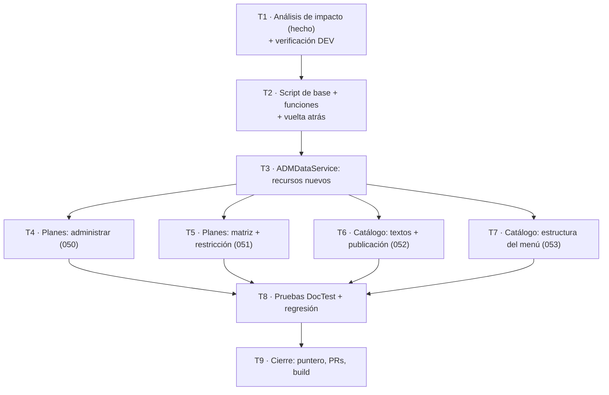

# REQ-005 · Módulo Administración — Plan de trabajo

Plan de Pablo (DeepSeek Pro) para las dos pantallas de la Consola con las que el superusuario arma la
oferta de Trazalog: **Catálogo y menú global** (la lista de todo lo que la suite sabe hacer, su estructura,
textos y publicación) y **Planes** (qué trae cada plan, cuántos usuarios y cuántas consultas de IA). Revisa
Rodolfo. Forma de trabajo: `doc/metodologia/GUIA_REQUERIMIENTOS_CLAUDE_DEEPSEEK.md` §2.4–§2.12 y
`doc/metodologia/REGLAS-PARA-AGENTES.md`.

> Los casos ADM-UC-050 a 053 están en **borrador**; sus dudas ya quedaron resueltas (validado por Pablo).
> Queda que Rodolfo los valide. Este plan respeta esas resoluciones y el análisis de impacto
> `doc/v3/administracion/IMPACTO_MENU_TOOLS.md`.

## Los repositorios (y dónde va cada cosa)

| Repo | Qué lleva este requerimiento |
|---|---|
| **`traz-comp-adm`** (submódulo en `application/modules/traz-comp-adm`) | Las **dos pantallas** de la Consola: modelos, controlador(es) y vistas de Planes y de Catálogo, más el correo de restricción. Nada de esto va en `traz-tools`. |
| **`traz-tools`** | El **script de base chico** (ajustes sobre lo que dejó REQ-004) + vuelta atrás, los **recursos nuevos** en `ADMDataService.dbs`, `doctest/` (pruebas + derivados) y el **puntero** del submódulo al cerrar. |

> El código de un submódulo se commitea en **su** repositorio (parado en `application/modules/traz-comp-adm/`);
> en `traz-tools` solo el puntero. Un cambio de submódulo son **dos PR**: primero el del módulo, después el
> del puntero en `traz-tools` (guía §2.9).

## Ramas y pull requests

- Una rama con el mismo nombre en los dos repos: **`feature/req-005-catalogo-y-planes`**, siempre desde `develop`.
- **traz-tools**: el plan va en esa rama y abre un **PR en borrador** a `develop`. No se programa hasta el
  comentario **`✅ Plan aprobado`** de Rodolfo. Al terminar, se completa la descripción y pasa a "Ready for review".
- **traz-comp-adm**: PR a `develop` del módulo, con el enlace al PR de `traz-tools`. Se une **primero**.
- Recién cuando el PR del módulo esté unido se **mueve el puntero** en `traz-tools` (Tarea 9).

## Puertas de aprobación (🔴, antes de construir — no en la planificación)

| Puerta | Qué es | Cuándo |
|---|---|---|
| **Análisis de impacto del menú de Tools** | Núcleo: el Catálogo escribe en `seg.menues`, la tabla con la que Tools dibuja el menú. Ya redactado en `doc/v3/administracion/IMPACTO_MENU_TOOLS.md`: dónde vive el menú, qué escribe el Catálogo, qué pasa en cada caso (crear sin publicar / reordenar / despublicar-publicar), los riesgos (orden como texto, filas viejas `eliminado = 1`, DNATO en paralelo) y las pruebas de regresión | Rodolfo lo aprueba **antes** de tocar `seg.menues` desde la Consola (Tareas 4–7) |
| **Ampliación del control de módulos de `seg.menues` (agregar `MCP`)** | Cambio a un objeto existente | **Ya hecho en REQ-004** (su script recreó el CHECK con `MCP` y `RESI`). Solo falta **verificar en DEV**; si está, no requiere aprobación nueva |

> Casos ADM-UC-050 a 053: los valida Rodolfo (como en REQ-004). Sus dudas ya están resueltas por Pablo.

## Decisiones que toma este plan (lo que el requerimiento dejaba "a elección de Pablo")

1. **Escrituras atómicas con funciones de base `seg.*`** (cambio + auditoría en una transacción), igual que
   `seg.cambiar_variable` de REQ-004. Es la opción que garantiza "todo o nada" y saca la lógica del
   controlador. Son funciones nuevas ⇒ aditivas, las decide el equipo.
2. **Nombres reales de `seg.planes`** (los que creó REQ-004): se usa `cuota_mcp` (no `cuota_ia`), `base`
   (no `es_base`), `vencimiento_dias` (no `vence_cantidad`). El precio va **solo** a la variable
   `precio_plan_{codigo}`; la columna `precio` de REQ-004 queda **sin uso** (no se borra).
3. **Vencimiento con unidad:** se agrega la columna `vencimiento_unidad` (`dias` / `semanas` / `meses`,
   por defecto `dias`) a `seg.planes`, porque `vencimiento_dias` solo guarda un número y la maqueta pide
   elegir la unidad (duda 6, validada por Pablo).
4. **Las dos pantallas nuevas son métodos del controlador `Consola` existente** (`planes()` y `catalogo()`
   + sus acciones), igual que `variables()` hoy, para no tocar rutas. El requerimiento dice "dos
   controladores nuevos"; se resuelve como dos métodos por coherencia con la estructura actual (decisión
   técnica menor, se documenta en el PR).
5. **Precio:** al crear un plan se crea la variable `precio_plan_{codigo}` (valor inicial "Consultar" o el
   que ponga el formulario); al editarlo, el precio se guarda con el mecanismo de variables existente
   (`PUT /variable`). Nunca se escribe en la columna `precio`.

## Orden y dependencias

---

## Tareas

### Tarea 1 — Análisis de impacto del menú + verificación DEV (núcleo)

- **Repositorio:** ninguno (análisis ya redactado en `doc/v3/administracion/IMPACTO_MENU_TOOLS.md`).
- **Qué hace:**
  - Cerrar con Rodolfo el análisis de impacto (puerta 🔴). Ya cubre: dónde vive el menú
    (`getMenuByUserPermission` en `COREDataService.dbs:8` + `menu_helper.php`), qué escribe el Catálogo,
    qué pasa en los tres escenarios (crear sin publicar / reordenar / despublicar-publicar) y las pruebas
    de regresión.
  - **Verificar en DEV** (solo lectura): que el CHECK de `seg.menues.modulo` ya incluya `MCP` (lo hizo
    REQ-004) y cuántas filas hay con `eliminado = 1` (para dimensionar la reconciliación de T2).
- **Caso de uso:** ADM-UC-053 (la nota que exige el análisis) y ADM-UC-052 (la nota de despublicar =
  `eliminado = 1`).
- **Cómo se verifica:** Rodolfo aprueba el análisis (comentario); el resultado de la verificación DEV queda
  en la descripción del PR.

### Tarea 2 — Script de base (ajustes) + funciones de escritura atómica + vuelta atrás

- **Repositorio:** `traz-tools`. Ubicación propuesta: `doc/v3/administracion/sql/REQ-005-catalogo-y-planes.sql`
  y `REQ-005-catalogo-y-planes-vuelta-atras.sql` **[SUPUESTO de ubicación, se confirma en la revisión]**.
- **Qué hace (todo aditivo, salvo la reconciliación de datos):**
  - `ALTER TABLE seg.planes ADD COLUMN vencimiento_unidad varchar(10) NOT NULL DEFAULT 'dias'` (unidad
    `dias` / `semanas` / `meses`).
  - Índice único parcial para "un solo plan base": `CREATE UNIQUE INDEX ... ON seg.planes ((base)) WHERE base`.
  - **Reconciliación de datos de una sola vez:** `eliminado = 1` ⇒ `publicacion = 'despublicada'`;
    `eliminado = 0` ⇒ `publicacion = 'publicada'` (deja el catálogo consistente antes de abrir la pantalla).
  - **Funciones `seg.*`** para las escrituras atómicas (cada una hace su cambio + `seg.auditoria` en una
    transacción), a elección de Pablo (decisión 1):
    - `seg.plan_guardar(...)` — crear/editar plan (+ crear la variable `precio_plan_{codigo}` al crear);
    - `seg.plan_copiar(...)` — duplicar (datos + matriz, sin `base`, código nuevo);
    - `seg.plan_baja(...)` — baja lógica `activo = false` (rechaza si hay empresas);
    - `seg.plan_base(...)` — marcar base (le quita la marca al anterior);
    - `seg.plan_funcionalidad(...)` — marcar/desmarcar casilla (rechaza si la funcionalidad no está publicada);
    - `seg.catalogo_opcion_crear(...)` — opción nueva, queda `sin_publicar` (`eliminado = 1`); rechaza clave repetida y padre de otro módulo;
    - `seg.catalogo_opcion_editar(...)` — textos/ícono/tipo/dirección;
    - `seg.catalogo_publicacion(...)` — publicar/despublicar (publicación + `eliminado` juntos);
    - `seg.catalogo_orden(...)` — renumera los hermanos del módulo con números del mismo largo.
  - **Vuelta atrás:** borra la columna nueva, el índice, deshace la reconciliación y borra las funciones.
- **Regla de base:** nada de `DROP`/`RENAME`/cambio de tipo sobre columnas existentes; las funciones solo
  agregan. v2 (Tools, DNATO, AssetPlanner) funciona igual.
- **Caso de uso:** ADM-UC-035 (verificación "el menú no cambia") y ADM-UC-053.
- **Cómo se verifica:** script corrido en DEV y vuelta atrás probada; el menú de un usuario de prueba es el
  mismo antes y después de la reconciliación.

### Tarea 3 — DataService: recursos nuevos en `ADMDataService.dbs`

- **Repositorio:** `traz-tools`, en
  `_backend/api/ToolsAPIProject/ToolsAPIProject/src/main/wso2mi/artifacts/data-services/ADMDataService.dbs`
  (se **agregan** recursos; no se toca ninguno existente).
- **Qué hace (URLs en kebab-case, claves en snake_case):**

  | Recurso | Qué hace |
  |---|---|
  | `GET /planes` | Lista de planes (con empresas que lo usan, base, gratuito/vencimiento, tope, cuota, período, día) |
  | `GET /planes/matriz` | Matriz planes × funcionalidades (qué casilla marca cada plan) |
  | `POST /plan` | Crear plan → `seg.plan_guardar` |
  | `PUT /plan` | Editar plan → `seg.plan_guardar` |
  | `POST /plan/copia` | Duplicar → `seg.plan_copiar` |
  | `PUT /plan/baja` | Baja lógica → `seg.plan_baja` |
  | `PUT /plan/base` | Marcar plan base → `seg.plan_base` |
  | `POST /plan/funcionalidad` | Marcar casilla → `seg.plan_funcionalidad` |
  | `PUT /plan/funcionalidad/quitar` | Desmarcar casilla → `seg.plan_funcionalidad` |
  | `GET /plan/{plan_id}/empresas-afectadas` | Empresas del plan (y lugares usados, para el tope) |
  | `GET /empresa/{empr_id}/administradores` | Administradores de una empresa (correo; misma definición que `/usuario/es-admin`) |
  | `GET /catalogo` | Lista de opciones con estado, en-planes y contador "Me interesa" |
  | `PUT /catalogo/opcion` | Editar textos/ícono/tipo/dirección → `seg.catalogo_opcion_editar` |
  | `PUT /catalogo/opcion/publicacion` | Publicar / despublicar → `seg.catalogo_publicacion` |
  | `POST /catalogo/opcion` | Opción nueva (queda sin publicar) → `seg.catalogo_opcion_crear` |
  | `PUT /catalogo/orden` | Reordenar un módulo → `seg.catalogo_orden` |
  | `GET /iconos` | Íconos de `core.iconos` (hoy DNATO lo lee directo) |
  | `GET /catalogo/intereses/{modulo}/{opcion}` | "Me interesa" desglosado por empresa (`seg.intereses`; vacío hasta REQ-012) |

- **Regla:** "quién" sale siempre de la sesión (el correo), nunca del cuerpo del pedido; el controlador lo
  pasa como parámetro. Los recursos que escriben llaman a su función `seg.*` (transacción única).
- **Caso de uso:** soporta ADM-UC-050 a 053.
- **Cómo se verifica:** `./mvnw clean install` del proyecto de APIs en verde; los recursos se prueban con
  los casos al programar el módulo.

### Tarea 4 — Pantalla Consola → Planes: administrar (ADM-UC-050)

- **Repositorio:** `traz-comp-adm`. Modelo `models/Planes.php`, método `Consola::planes()` + acciones, vista
  `consola_planes.php`. Maqueta `consola-planes.html`.
- **Qué hace:**
  - Matriz de planes (una fila por plan, por orden): columnas Plan (ícono, nombre, orden), "Gratuito / de
    prueba", "Tope usuarios", "Cuota IA · período · renovación", una columna por funcionalidad publicada
    (agrupada por módulo, incluido MCP), y acciones ✎ ⧉ 🗑.
  - Formulario "Nuevo plan / editar plan": Código (único, no cambia después), Nombre, Ícono, Orden, Tope de
    usuarios (+ ilimitado), Cuota de IA con período y día (+ ilimitado), Precio (variable), Plan base
    ("hoy es X"), Gratuito / de prueba, Vencimiento (solo si es gratuito/de prueba: sin vencimiento o
    cantidad + unidad).
  - Acciones: crear (`POST /plan`), editar (`PUT /plan`), duplicar (`POST /plan/copia`), dar de baja
    (`PUT /plan/baja`, rechaza si tiene empresas), marcar base (`PUT /plan/base`, avisa "X dejó de ser el
    plan base").
  - Validaciones: tope > 0 o ilimitado; cuota 0 o más o ilimitada; código único. Mensajes y `data-testid`
    según la tabla del requerimiento.
- **Caso de uso:** ADM-UC-050 (principal + plan en uso, otro base, gratuito con vencimiento, vencimiento en
  plan pago, código repetido, tope inválido, ilimitado, administrador rechazado).
- **Cómo se verifica:** `phpcs` PHP 5.6; ADM-UC-050 en verde.

### Tarea 5 — Pantalla Consola → Planes: matriz y restricción (ADM-UC-051)

- **Repositorio:** `traz-comp-adm`. Sobre la misma vista de Planes (Tarea 4).
- **Qué hace:**
  - Casillas de la matriz: cada una se guarda sola (`POST /plan/funcionalidad` / `PUT /plan/funcionalidad/quitar`)
    y queda auditada. Tope y cuota en la fila también se guardan solos.
  - **Restricción (RF-16):** quitar funcionalidad, bajar tope o bajar cuota de un plan **con empresas** ⇒
    el módulo pide `GET /plan/{plan_id}/empresas-afectadas`, muestra el aviso y espera "Confirmar y avisar";
    "Cancelar" deja todo como estaba. Al confirmar: guarda, audita y manda el correo (Tarea 5, correo).
  - Ampliar, o cambiar un plan sin empresas: se guarda y audita, sin aviso ni correo.
  - Columna de funcionalidad sin publicar: atenuada, "⏳", sin casillas; el servidor rechaza marcar una
    funcionalidad sin publicar.
- **Correo (RF-16):** reutiliza el mecanismo de REQ-003 (`CI_Email` + `sendmail`), remitente
  `remitente_correo`, a los administradores de cada empresa afectada (`GET /empresa/{empr_id}/administradores`).
  Asunto "Trazalog cambió tu plan <plan>"; cuerpo según el requerimiento. Si el correo falla, el cambio
  **queda hecho** y la pantalla lo avisa (RNF-08).
- **Caso de uso:** ADM-UC-051 (principal + quitar funcionalidad, cancelar, bajar tope, ampliar, sin
  empresas, correo caído, funcionalidad sin publicar).
- **Cómo se verifica:** `phpcs` PHP 5.6; ADM-UC-051 en verde.

### Tarea 6 — Pantalla Consola → Catálogo: textos y publicación (ADM-UC-052)

- **Repositorio:** `traz-comp-adm`. Modelo `models/Catalogo.php`, método `Consola::catalogo()` + acciones,
  vista `consola_catalogo.php` (pestañas "Catálogo" y "Estructura del menú"). Maqueta `consola-catalogo.html`.
- **Qué hace (pestaña Catálogo):**
  - Tabla (Módulo / opción, Nombre, Tipo, En planes, Me interesa, Estado) con búsqueda y filtros
    ("Todas / Sin publicar / Publicadas / Despublicadas" con su cantidad).
  - Ficha: datos fijos (módulo, opción, dirección, padre); Nombre (= `texto`), Ícono (`core.iconos`), Tipo,
    Texto de presentación, Ayuda; "En planes"; "Me interesa (N)" desglosado por empresa; Guardar /
    Publicar / Despublicar.
  - Publicar exige nombre, ícono, tipo, texto y ayuda. Despublicar avisa cuántas empresas afecta y pide
    confirmar (sin correo). Volver a publicar conserva textos y planes. Tipo solo cambia salvo a/desde
    `tool_mcp` (cambia de módulo).
- **Caso de uso:** ADM-UC-052 (principal + faltan datos, despublicar, volver a publicar, contador, buscar,
  administrador rechazado).
- **Cómo se verifica:** `phpcs` PHP 5.6; ADM-UC-052 en verde.

### Tarea 7 — Pantalla Consola → Catálogo: estructura del menú (ADM-UC-053)

- **Repositorio:** `traz-comp-adm`. Sobre la misma vista (Tarea 6).
- **Qué hace (pestaña "Estructura del menú"):**
  - Árbol por módulo (opción raíz → opciones) con "⋮⋮" para arrastrar dentro del módulo, estado y ✎. El
    módulo MCP dice "Herramientas de IA · no entran al menú".
  - "＋ Nueva opción" (módulo, opción clave, texto, URL, padre del mismo módulo, ícono, tipo); crea
    **sin publicar** (`eliminado = 1`, no aparece en el menú). Rechaza clave repetida y padre de otro módulo.
  - "Guardar orden": renumera los hermanos con números del mismo largo (`PUT /catalogo/orden`), de modo que
    el orden de Tools (por texto) y el número coincidan, sin tocar la consulta. No hay tercer nivel.
- **Caso de uso:** ADM-UC-053 (principal + mover de módulo, clave repetida, padre de otro módulo, editar
  publicada, orden de más de nueve opciones).
- **Cómo se verifica:** `phpcs` PHP 5.6; ADM-UC-053 en verde; con un usuario de prueba, el menú de Tools no
  cambia al crear sin publicar y cambia solo el orden al reordenar.

### Tarea 8 — Pruebas DocTest (derivados) + regresión

- **Repositorio:** `traz-tools` (solo `doctest/`).
- **Qué hace:** escribir el `derivados.test_e2e` de ADM-UC-050 a 053 y sus specs
  (`doctest/tests/e2e/specs/adm/ADM-UC-0NN.*.spec.ts`), regenerar y correr la regresión.
- **Cómo se verifica:** `npm run doctest -- --entorno local` en verde (pruebas nuevas + regresión intacta);
  DocTest `regresion` en verde; el menú de Tools de los usuarios DocTest no cambió.

### Tarea 9 — Cierre: revisar, regenerar, mover el puntero y abrir los PR

- **Repositorios:** `traz-tools` (puntero + artefactos) y `traz-comp-adm` (su PR).
- **Qué hace:**
  - Búsqueda de **secretos** en el diff (nada de `.env`, correos reales ni claves en claro).
  - `phpcs` PHP 5.6 final sobre el módulo; `npm run features`/`npm run ayudas` si corresponde.
  - `./mvnw clean install` del proyecto de APIs en verde; `npm run validate:catalog` en verde.
  - Última corrida `npm run doctest -- --entorno local` en verde.
  - **Mover el puntero** cuando el PR de `traz-comp-adm` esté unido:
    `cd application/modules/traz-comp-adm && git checkout develop && git pull origin develop && cd ../../..`
    → `git add application/modules/traz-comp-adm` → `chore(adm): actualiza el submodulo traz-comp-adm [REQ-005]`.
  - Abrir los PR: primero el del módulo (`traz-comp-adm` → `develop`), después el de `traz-tools` (puntero +
    script + DataService + `doctest/`), con el enlace cruzado entre ambos.
- **Cómo se verifica:** los dos PR abiertos con descripción completa (formato §2.10), el resultado real de
  DocTest pegado y el resultado de la verificación DEV (Tarea 1).

---

## Notas transversales (se respetan en todas las tareas)

- 🐘 **PHP 5.6** en todo el módulo: `phpcs` con PHPCompatibility. Nada de `??`, tipos de retorno, tipos
  escalares, `<=>`, clases anónimas.
- 🧪 **DocTest:** la primera corrida en esta máquina es `npm run doctest -- casi-full --entorno local`
  (una sola vez). Después, **antes de cada commit**: `npm run doctest -- --entorno local`. Verde = sin
  `falla`, `otro-punto` ni `dejo-de-fallar`.
- 🚫 **No se toca** en este requerimiento: `COREDataService` (recursos existentes de v2), DNATO (su ABM y
  "Menú por rol" siguen en paralelo), `getMenuByUserPermission`, `menu_helper.php` ni ningún recurso
  existente de `ADMDataService`. Las herramientas del agente (MCP) ya están cargadas por REQ-004.
- 🔴 **Núcleo:** escribir en `seg.menues` desde la Consola tiene puerta de aprobación (análisis de impacto,
  Tarea 1). La empresa y el correo salen siempre de la sesión; nunca del navegador.
- 🗄️ **Base aditiva:** el script solo agrega (columna nueva, índice, funciones) + una reconciliación de
  datos de una sola vez. Ninguna fila existente cambia salvo la reconciliación `eliminado` ↔ `publicacion`.
- 📦 **Commits por repo:** parado en `application/modules/traz-comp-adm/` para el módulo (revisar `git
  status` dentro: no `HEAD detached`, no secretos), y en `traz-tools/` para el resto. Formato
  `tipo(scope): descripción [REQ-005]`. No se commitea si Pablo no lo pide.
- 🧾 **Log:** `log_message('DEBUG', '#TRAZA | ADM | <Clase> | <metodo>() ...')`. Se registran los rechazos,
  cada cambio de plan y de catálogo (qué y quién) y cada correo de restricción (empresa y resultado del
  envío, sin el contenido).
