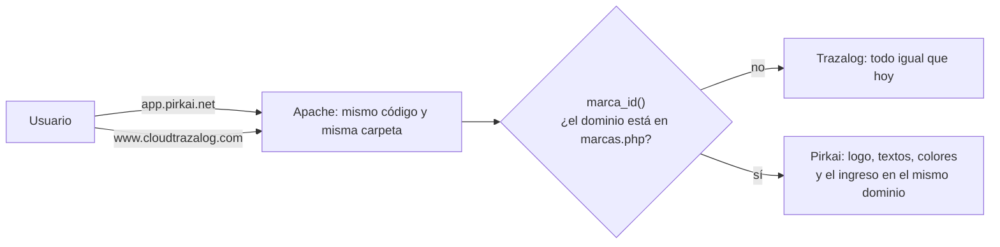

# REQ-019 · Marca por dominio — entrar por `app.pirkai.net` y ver Pirkai

## Objetivo

Requerimiento para que el **mismo sistema** (mismos datos, usuarios y funciones) se pueda usar desde un
segundo dominio, `app.pirkai.net`, mostrando **la marca Pirkai** (logo, nombre "pirkai.net" en vez de
"Trazalog", otros colores) en Tools y en el ingreso/registración. Lo leen Rodolfo, para aprobar, y quien
despliegue o continúe el trabajo. **No** cubre AssetPlanner, los mails, el sitio de ayuda ni la conexión
de agentes (MCP), que siguen con Trazalog. Las tareas de servidor y dominio están en las guías
`doc/infra/pirkai-0*.md` (lista abajo).

| Campo | Valor |
|---|---|
| Estado | **Etapa A construida**, en pedido de cambio (PR) en `traz-tools` y `traz-comp-dnato`, rama `feat/marca-por-dominio-pirkai` desde `develop`. Falta: aprobación del análisis de impacto, prueba en DEMO y logo/colores definitivos |
| Origen | Backlog v3: "Acceso al sistema via Pirkai y logo" (CORE, v3.2). Pedido de Rodolfo del 2026-11-26 |
| Decisión de arquitectura | [ADR-015](../doc/adr/ADR-015-marca-por-dominio.md) |
| Análisis de impacto | [`doc/analisis/impacto-marca-por-dominio.md`](../doc/analisis/impacto-marca-por-dominio.md) |
| Repos | `traz-tools` (núcleo, sin submódulos) y `traz-comp-dnato` |
| Riesgo | 🔴 toca el ingreso y archivos de configuración del núcleo. Con el dominio de Trazalog el resultado es idéntico al de hoy (verificado comparando la página generada contra `develop`) |

---

## Qué pidió Rodolfo

1. Entrar al sistema por otro dominio (`pirkai.net`) y que funcione igual.
2. Con ese dominio se ve el **logo de Pirkai**.
3. En todas las pantallas **no dice Trazalog**: dice "pirkai.net".
4. Todo el sistema responde a **otros colores / otra hoja de estilos**.
5. Guías para cada actividad de infraestructura **antes y después** de desplegar.

Decisiones que tomó al pedirlo (2026-11-26):

| Tema | Decisión |
|---|---|
| Base de código | `develop` (v3.0.0.4), que es lo que corre en DEMO |
| Dirección | Subdominio: `app.pirkai.net` en producción. Para DEMO se propone `demo.pirkai.net` (supuesto, a confirmar) |
| Dominio | `pirkai.net` ya está comprado y lo administra Rodolfo |
| Alcance | Tools + ingreso/registración (DNATO). Afuera: AssetPlanner, mails, ayuda, agentes |

## Cómo funciona

- **Una lista cerrada de dominios** por marca, en `application/config/marcas.php` (igual en las dos
  aplicaciones). Un dominio que no está en la lista muestra Trazalog.
- **Una función**, `marca('clave', 'valor de hoy')`, en `application/helpers/marca_helper.php` (el mismo
  archivo en las dos aplicaciones). Con Trazalog devuelve siempre "el valor de hoy".
- **El ingreso sigue al dominio**: las tres direcciones fijas (`DNATO` en Tools, `DE` y `DS` en DNATO)
  pasan por `marca_url_host()`, que solo las cambia si el dominio es de otra marca.
- **Colores**: hoja `marca.css` que se carga solo con Pirkai y le gana al rojo de Trazalog.
- **Impresiones y remitos**: `lib/marcas/marca.js` (solo con Pirkai) cambia el título "TRAZALOG TOOLS" de
  las impresiones y el logo **por defecto** de Trazalog en remitos y vales, sin tocar los módulos.

## Qué se entregó (Etapa A)

**`traz-tools`**

| Archivo | Cambio |
|---|---|
| `application/helpers/marca_helper.php` | Nuevo. Funciones `marca_id()`, `marca()`, `marca_es_defecto()`, `marca_url_host()`, `marca_head()`, `marca_atributo_body()`, `marca_constante()` |
| `application/config/marcas.php` | Nuevo. Marca `pirkai` con dominios `app.pirkai.net`, `demo.pirkai.net`, `pirkai.local` |
| `application/config/autoload.php` | Carga el helper `marca` |
| `application/views/layout/Admin.php` | Título de la pestaña, manifest, skin, `data-marca`, hoja de estilos e ícono de la marca, pie y texto legal, `window.MARCA` y `marca.js` |
| `application/controllers/Dash.php` | Logo y texto de la barra superior, y logo del tablero del administrador, según la marca |
| `application/config/constants.php` | `DNATO` envuelto con `marca_url_host()` (en los servidores se hace a mano: guía 04) |
| `application/config/config.php` | `base_url` detecta `https` (en los servidores, solo si hace falta: guías 00 y 04) |
| `lib/marcas/marca.js`, `lib/marcas/pirkai/*` | Nuevos. Hoja de estilos, logos (barra y fondo claro), ícono y manifest **provisorios** |

**`traz-comp-dnato`**

| Archivo | Cambio |
|---|---|
| `application/helpers/marca_helper.php`, `application/config/marcas.php` | Nuevos (el helper es idéntico al de Tools) |
| `application/config/autoload.php` | Carga el helper `marca` |
| `application/controllers/Main.php` | Vuelta a Tools (`DE`) y salida (`DS`) por el mismo dominio; logo y título del ingreso según la marca |
| `application/config/jwt.php` | El emisor de tokens no cambia si se entra por otro dominio |
| `application/views/header.php` | Hoja de estilos, ícono y `data-marca` |
| `login.php`, `login_empresa.php`, `forgot.php`, `reset_password.php`, `reset-pass-info.php`, `register.php`, `formulario_page.php`, `crear_empresa_page.php`, `complete_password.php`, `bienvenida_page.php`, `register_success.php`, `registro_completo.php`, `footer.php`, `navbar.php` | Textos "Trazalog", logos y link del pie según la marca |
| `public/marcas/pirkai/*` | Nuevos. Hoja de estilos, logos e ícono **provisorios** |

## Qué queda con Trazalog (Etapa B y fuera de alcance)

| Qué | Por qué | Cómo se resuelve |
|---|---|---|
| Páginas sueltas fuera de la plantilla: `traz-comp-bpm/views/cliente/vista_cliente.php`, `traz-comp-pan/views/herramienta/vista_qr_herramienta.php`, `traz-comp-pan/views/vales/vale.php`, `traz-tools-resi/views/vehiculos/vista_cliente.php` | Viven en módulos con repositorio propio y no cargan la plantilla | Etapa B: un cambio chico por módulo con `function_exists('marca') ? marca(...) : '<valor de hoy>'` |
| PDF de stock (`traz-comp-almacenes/controllers/Lote.php:262`) | Se arma en el servidor, `marca.js` no llega | Etapa B, mismo patrón |
| Pantallas con colores propios fuera de lo censado (174 vistas tienen su `<style>`) | Se cubrieron la plantilla y los acentos `#dd4b39` más repetidos | Etapa B: variable `--marca-primario` y limpieza por módulo; listar lo que se vea en la prueba de DEMO |
| Tablero del administrador (paleta azul propia `--tz-brand`) | Paleta local de esa pantalla | Etapa B |
| Ícono de las notificaciones (`lib/props/firebase_config.js:145`) | Imagen alojada en trazalog.com | Etapa B |
| Ingreso del módulo Administración (`traz-comp-adm`, REQ-003) | Hoy corre en paralelo; el ingreso real sigue siendo DNATO | Cuando se haga el corte (REQ-018), aplicarle la misma función |
| AssetPlanner, sitio de ayuda, agentes (MCP), mails | Fuera de alcance por decisión de Rodolfo | — |

## Efectos que se aceptan

- **Las sesiones quedan separadas por dominio**: haber entrado por `cloudtrazalog.com` no deja entrado en
  `pirkai.net` y viceversa (la cookie de sesión es de un solo dominio).
- **Los mails siguen siendo de Trazalog**: remitente `@trazalog.com` y el link del mail de bienvenida
  apunta al dominio de Trazalog (usa `DS` sin transformar, a propósito).
- **Entradas del menú con dirección absoluta** (por ejemplo, a AssetPlanner) llevan al dominio que tengan
  cargado en la base.
- **Con logo y colores provisorios** hasta que Rodolfo pase los definitivos (ver Pendientes).

## Pendientes de Rodolfo

1. Logo definitivo de Pirkai: versión para fondo oscuro (barra superior) y para fondo blanco
   (impresiones, ingreso), más el ícono de la pestaña. Se reemplazan los archivos con el mismo nombre.
2. Paleta de colores (primario, oscuro, fondo del menú). Se cambian las variables al principio de los dos
   `marca.css`.
3. Razón social y link del pie bajo Pirkai (hoy: "pirkai.net" y `https://pirkai.net/`).
4. Confirmar `demo.pirkai.net` para DEMO.
5. Aprobar el análisis de impacto.

## Guías de infraestructura

Todas en `doc/infra/`. Se siguen en este orden, primero en DEMO y después en producción.

| # | Guía | Cuándo |
|---|---|---|
| 00 | [`pirkai-00-relevamiento-servidor.md`](../doc/infra/pirkai-00-relevamiento-servidor.md) | Antes de todo. Solo lectura |
| 01 | [`pirkai-01-dominio-dns.md`](../doc/infra/pirkai-01-dominio-dns.md) | Antes de desplegar |
| 02 | [`pirkai-02-apache-sitio-http.md`](../doc/infra/pirkai-02-apache-sitio-http.md) | Antes de desplegar |
| 03 | [`pirkai-03-certificado-https.md`](../doc/infra/pirkai-03-certificado-https.md) | Antes de desplegar |
| 04 | [`pirkai-04-configuracion-post-despliegue.md`](../doc/infra/pirkai-04-configuracion-post-despliegue.md) | Después de desplegar |
| 05 | [`pirkai-05-verificacion.md`](../doc/infra/pirkai-05-verificacion.md) | Después de desplegar |
| 06 | [`pirkai-06-operacion.md`](../doc/infra/pirkai-06-operacion.md) | Siempre (renovación, cada despliegue, otra marca, baja) |

## Cómo se verificó

- `php -l` y `phpcs --standard=PHPCompatibility --runtime-set testVersion 5.6` sobre todos los archivos PHP
  tocados de las dos aplicaciones: sin errores.
- Prueba de la función con dominios simulados: `www.cloudtrazalog.com` → Trazalog y direcciones intactas;
  `APP.Pirkai.NET:443` → Pirkai y `https://app.pirkai.net/...`; `pirkai.local` → Pirkai; un dominio que
  solo *contiene* "pirkai.net" → Trazalog.
- La plantilla de Tools generada con datos de prueba: con dominio de Trazalog es **idéntica** a la de
  `develop`; con `app.pirkai.net` cambian solo título, manifest, skin, `data-marca`, hoja de estilos,
  ícono, pie, texto legal y los scripts de marca.
- `node --check` de `marca.js`; manifest y logos validados como JSON/XML.
- **Falta**: prueba en navegador con los dos dominios (local o DEMO), con el recorrido de la guía 05.
